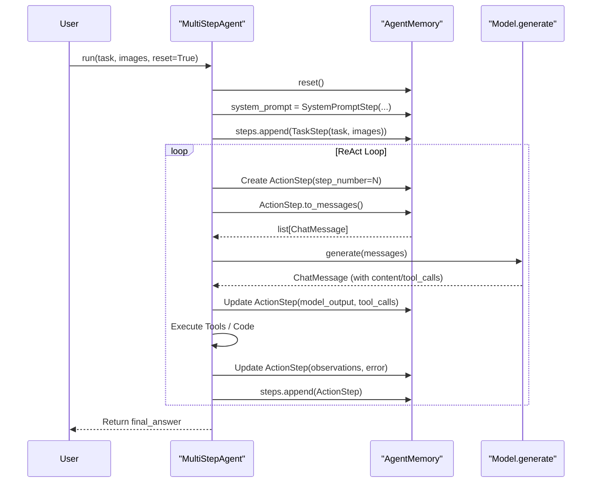

<!-- source: DeepWiki mcp.deepwiki.com · repo huggingface/smolagents · page 3.4 Agent Memory & State Management · fetched 2026-10-27 -->

# Agent Memory & State Management

<details>
<summary>Relevant source files</summary>

The following files were used as context for generating this wiki page:

- [docs/source/en/tutorials/memory.md](docs/source/en/tutorials/memory.md)
- [src/smolagents/memory.py](src/smolagents/memory.py)
- [src/smolagents/monitoring.py](src/smolagents/monitoring.py)
- [tests/test_memory.py](tests/test_memory.py)

</details>


This page documents the memory and state management system in `smolagents`. The agent's memory stores the complete execution history as a sequence of typed steps, enabling context-aware reasoning, error recovery, and execution replay.

## Memory Architecture

The memory system consists of a central `AgentMemory` container that holds a sequence of `MemoryStep` objects. Each step type captures a specific phase of agent execution.

Title: Agent Memory Structure and Hierarchy
```mermaid
graph TB
    subgraph "AgentMemory_Container"
        ["AgentMemory"] -- "system_prompt" --> SystemPrompt["SystemPromptStep"]
        ["AgentMemory"] -- "steps" --> Steps["list[MemoryStep]"]
    end
    
    subgraph "Memory_Step_Hierarchy"
        ["MemoryStep"] -- "Inheritance" --> ["SystemPromptStep"]
        ["MemoryStep"] -- "Inheritance" --> ["TaskStep"]
        ["MemoryStep"] -- "Inheritance" --> ["ActionStep"]
        ["MemoryStep"] -- "Inheritance" --> ["PlanningStep"]
    end
    
    subgraph "Agent_State"
        ["MultiStepAgent.state"] -- "Namespace" --> StateDict["dict[str, Any]"]
    end
    
    Agent["MultiStepAgent"] -- "owns" --> ["AgentMemory"]
    Agent -- "manages" --> ["MultiStepAgent.state"]
```

**Sources:** [src/smolagents/memory.py:214-220](), [src/smolagents/memory.py:42-212](), [src/smolagents/agents.py:488-490]()

## AgentMemory Class

The `AgentMemory` class serves as the central repository for all execution history. It maintains a system prompt and an ordered list of steps. [src/smolagents/memory.py:214-220]()

| Attribute | Type | Description |
|-----------|------|-------------|
| `system_prompt` | `SystemPromptStep` | The system prompt setting agent behavior context |
| `steps` | `list[MemoryStep]` | Ordered sequence of execution steps |

**Key Methods:**

| Method | Return Type | Description |
|--------|-------------|-------------|
| `reset()` | `None` | Clears all steps, preserves system prompt [src/smolagents/memory.py:228-230]() |
| `get_succinct_steps()` | `list[dict]` | Returns step dicts without `model_input_messages` [src/smolagents/memory.py:236-240]() |
| `get_full_steps()` | `list[dict]` | Returns complete step dicts with all fields [src/smolagents/memory.py:242-246]() |
| `replay(logger, detailed=False)` | `None` | Pretty-prints execution history to console using `AgentLogger` [src/smolagents/memory.py:248-271]() |
| `return_full_code()` | `str` | Concatenates all `code_action` strings into single script [src/smolagents/memory.py:273-278]() |

**Sources:** [src/smolagents/memory.py:214-278]()

## Memory Step Types

Each memory step type captures specific information at different phases of agent execution. All steps inherit from the base `MemoryStep` and must implement `to_messages()`. [src/smolagents/memory.py:42-49]()

### SystemPromptStep

Stores the agent's system prompt, which defines its behavior and capabilities. [src/smolagents/memory.py:200-201]()

```python
@dataclass
class SystemPromptStep(MemoryStep):
    system_prompt: str
```

**Sources:** [src/smolagents/memory.py:200-207]()

### TaskStep

Captures the user's task request, including any input images for multimodal agents. [src/smolagents/memory.py:187-190]()

```python
@dataclass
class TaskStep(MemoryStep):
    task: str
    task_images: list["PIL.Image.Image"] | None = None
```

**Sources:** [src/smolagents/memory.py:186-198]()

### ActionStep

The primary step type for the ReAct loop, storing model outputs, tool calls, and execution results. [src/smolagents/memory.py:51-64]()

Title: ActionStep Execution Data Flow
```mermaid
graph TB
    ActionStep["ActionStep"]
    
    subgraph "Input_Phase"
        ["step_number"] -- "int" --> ActionStep
        ["model_input_messages"] -- "list[ChatMessage]" --> ActionStep
    end
    
    subgraph "Model_Output_Phase"
        ["model_output"] -- "str" --> ActionStep
        ["model_output_message"] -- "ChatMessage" --> ActionStep
        ["tool_calls"] -- "list[ToolCall]" --> ActionStep
        ["code_action"] -- "str" --> ActionStep
    end
    
    subgraph "Execution_Phase"
        ["observations"] -- "str" --> ActionStep
        ["observations_images"] -- "list[Image]" --> ActionStep
        ["action_output"] -- "Any" --> ActionStep
        ["error"] -- "AgentError" --> ActionStep
    end
    
    subgraph "Metadata"
        ["timing"] -- "Timing" --> ActionStep
        ["token_usage"] -- "TokenUsage" --> ActionStep
        ["is_final_answer"] -- "bool" --> ActionStep
    end
```

**Sources:** [src/smolagents/memory.py:50-151]()

### PlanningStep

Records planning phases when a planning strategy is active. [src/smolagents/memory.py:154-159]()

**Planning Step Behavior:**
- Generated at specific intervals to guide the agent's long-term strategy.
- Appends "Now proceed and carry out this plan" as a user message to prompt the assistant to act on the plan. [src/smolagents/memory.py:179-181]()
- Omitted from history when `summary_mode=True` to prevent the model from getting stuck in a planning loop. [src/smolagents/memory.py:175-176]()

**Sources:** [src/smolagents/memory.py:153-185]()

## Memory Lifecycle

The following sequence shows how memory is populated during an agent run:

Title: Agent Memory Population Lifecycle


**Sources:** [src/smolagents/memory.py:214-278](), [docs/source/en/tutorials/memory.md:114-133](), [src/smolagents/agents.py:781-815]()

## State Management

While `AgentMemory` handles the structured history for the LLM, the `agent.state` dictionary provides a separate namespace for storing arbitrary data shared across steps or with the Python executor. [src/smolagents/agents.py:488-490]()

| Feature | Description |
|----------|-------------|
| **Shared State** | A dictionary (`agent.state`) that holds variables accessible by the agent and tools. [src/smolagents/agents.py:488]() |
| **Executor Sync** | The agent's state is synchronized with the `PythonExecutor` to allow code to interact with variables. [src/smolagents/agents.py:734-735]() |
| **Persistence** | State is preserved across steps within a single `run()` and across runs if `reset=False`. [src/smolagents/agents.py:785-787]() |

**Sources:** [docs/source/en/tutorials/memory.md:32-53](), [src/smolagents/agents.py:488-495]()

## Message Conversion System

The `to_messages()` method in each step type converts raw data into a list of `ChatMessage` objects. [src/smolagents/memory.py:46-47]()

### Summary Mode
The system supports a `summary_mode` which modifies the message conversion to keep context lean:
- **ActionStep**: Omits raw `model_output` to save tokens, focusing on tool calls and observations. [src/smolagents/memory.py:94-95]()
- **PlanningStep**: Returns an empty list to avoid re-including old plans in the context when generating new ones. [src/smolagents/memory.py:175-176]()
- **SystemPromptStep**: Omitted entirely in summary mode. [src/smolagents/memory.py:204-205]()

**Sources:** [src/smolagents/memory.py:92-150](), [src/smolagents/memory.py:174-184]()

## Inspection & Replay

Memory can be inspected programmatically or via built-in logging utilities.

- **Replay**: `agent.replay()` uses `AgentLogger` to reconstruct the execution trace in the console. [src/smolagents/memory.py:248-271]()
- **Succinct Steps**: `agent.memory.get_succinct_steps()` provides a JSON-serializable version of the history without bulky message lists. [src/smolagents/memory.py:236-240]()
- **Code Extraction**: `agent.memory.return_full_code()` extracts every snippet of Python code executed during the run. [src/smolagents/memory.py:273-278]()

**Sources:** [src/smolagents/memory.py:236-278](), [docs/source/en/tutorials/memory.md:8-28]()

## Memory Serialization

The `ActionStep` and `PlanningStep` include complex objects like `Timing`, `TokenUsage`, and `PIL.Image.Image`. The `.dict()` methods handle the serialization of these into standard types. [src/smolagents/memory.py:66-90]()

| Field | Serialization Strategy |
|-------|------------------------|
| `timing` | Converted via `timing.dict()` into start/end/duration floats. [src/smolagents/memory.py:70]() |
| `token_usage` | Converted via `asdict()` into token counts. [src/smolagents/memory.py:88]() |
| `observations_images` | Converted to `bytes` using `image.tobytes()`. [src/smolagents/memory.py:83-85]() |
| `tool_calls` | Serialized into a standard tool call format via `ToolCall.dict()` (id, type, function). [src/smolagents/memory.py:25-38]() |

**Sources:** [src/smolagents/memory.py:25-38](), [src/smolagents/memory.py:66-90](), [src/smolagents/monitoring.py:36-79]()

---

