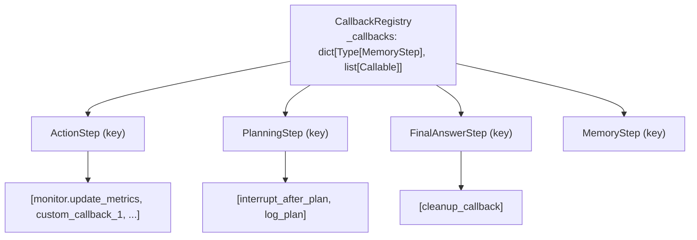
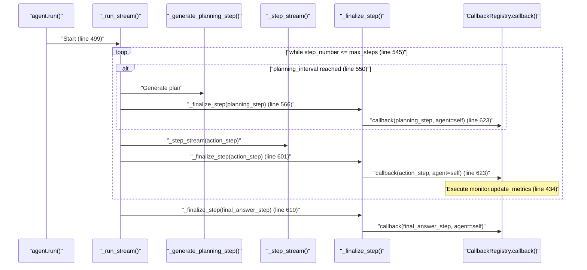
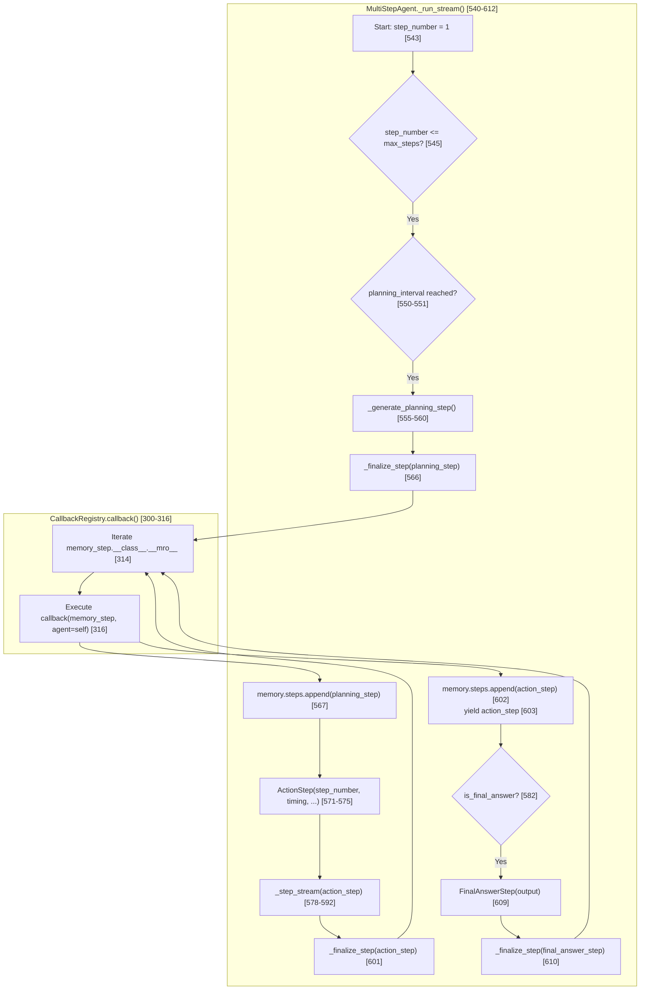

<!-- source: DeepWiki mcp.deepwiki.com · repo huggingface/smolagents · page 3.5 Callbacks & Agent Lifecycle · fetched 2026-10-27 -->

# Callbacks & Agent Lifecycle

<details>
<summary>Relevant source files</summary>

The following files were used as context for generating this wiki page:

- [src/smolagents/agents.py](src/smolagents/agents.py)
- [tests/test_agents.py](tests/test_agents.py)

</details>


This page documents the callback system and agent execution lifecycle in `smolagents`. Callbacks provide extensibility points that allow custom code to execute at specific stages of agent execution, enabling use cases like monitoring, human-in-the-loop workflows, memory management, and custom observability.

For information about the memory structures that callbacks operate on, see [Agent Memory & State Management](3.4). For monitoring-specific features like token tracking, see [Monitor & Metrics](7.2).

---

## Purpose and Scope

The callback system enables developers to:
- **Hook into agent execution** at precise lifecycle points (planning steps, action steps, final answers).
- **Access and modify agent state** during execution (memory, observations, images).
- **Implement human-in-the-loop** patterns (review plans, approve actions, modify behavior).
- **Collect custom metrics** beyond built-in monitoring.
- **Manage resources** (clean up old images, limit memory usage).

This document covers:
1. The `CallbackRegistry` class that manages callbacks.
2. How to register callbacks with agents.
3. When callbacks execute in the agent lifecycle.
4. Common callback patterns with code examples.
5. Advanced techniques for callback implementation.

---

## CallbackRegistry Architecture

The `CallbackRegistry` class in [src/smolagents/memory.py:280-317]() stores and manages callbacks associated with specific memory step types. It maintains a dict mapping from step classes to lists of callback functions.

**CallbackRegistry Class Diagram**



**Key methods:**
- `register(step_cls: Type[MemoryStep], callback: Callable)` [src/smolagents/memory.py:289-298](): Adds a callback to the registry for a specific step class.
- `callback(memory_step, **kwargs)` [src/smolagents/memory.py:300-316](): Executes all registered callbacks using Method Resolution Order (MRO) matching.

The `callback()` method uses MRO traversal to support inheritance: callbacks registered for `MemoryStep` will execute for all step types, while callbacks for `ActionStep` only execute for action steps [src/smolagents/memory.py:314-316]().

Sources: [src/smolagents/memory.py:280-317](), [src/smolagents/agents.py:416-434]()

---

## Registering Callbacks with Agents

Callbacks are registered during agent initialization via the `step_callbacks` parameter in `MultiStepAgent` [src/smolagents/agents.py:304](). Two formats are supported:

### List Format (Backward Compatible)

Registers callbacks that execute only on `ActionStep`:

```python
def my_callback(memory_step: ActionStep, agent: MultiStepAgent) -> None:
    print(f"Action step {memory_step.step_number} completed")

agent = CodeAgent(
    model=model,
    tools=[...],
    step_callbacks=[my_callback, another_callback]
)
```

Implementation in `_setup_step_callbacks()` [src/smolagents/agents.py:420-423]():
```python
if isinstance(step_callbacks, list):
    for callback in step_callbacks:
        self.step_callbacks.register(ActionStep, callback)
```

### Dict Format (Step-Specific)

Registers callbacks for specific step types:

```python
from smolagents import ActionStep, PlanningStep

agent = CodeAgent(
    model=model,
    tools=[...],
    step_callbacks={
        ActionStep: [action_callback],
        PlanningStep: planning_callback
    }
)
```

Implementation in `_setup_step_callbacks()` [src/smolagents/agents.py:425-430]():
```python
elif isinstance(step_callbacks, dict):
    for step_cls, callbacks in step_callbacks.items():
        if not isinstance(callbacks, list):
            callbacks = [callbacks]
        for callback in callbacks:
            self.step_callbacks.register(step_cls, callback)
```

**Callback Signatures:**

The `CallbackRegistry.callback()` method detects the signature using `inspect.signature()` [src/smolagents/memory.py:314-316]():
- **Legacy signature**: `def callback(memory_step: MemoryStep) -> None`
- **Modern signature**: `def callback(memory_step: MemoryStep, agent: MultiStepAgent) -> None`

Sources: [src/smolagents/agents.py:304, 416-434](), [src/smolagents/memory.py:300-316]()

---

## Agent Lifecycle with Callback Execution

Callbacks execute during the agent's ReAct loop inside `_run_stream` [src/smolagents/agents.py:540-612]().

**Agent Execution Flow with Callback Triggers**



**Execution points:**

1. **Planning Step Callbacks** [src/smolagents/agents.py:550-567](): Triggered after `_generate_planning_step()` completes. Timing is recorded at [src/smolagents/agents.py:562-564]().
2. **Action Step Callbacks** [src/smolagents/agents.py:569-604](): Triggered after `_step_stream()` completes tool execution.
3. **Final Answer Step Callbacks** [src/smolagents/agents.py:609-611](): Triggered after the final answer is generated.

The `_finalize_step()` method [src/smolagents/agents.py:620-623]() handles the timing closure and callback invocation.

Sources: [src/smolagents/agents.py:540-623](), [src/smolagents/memory.py:300-316]()

---

## Common Callback Patterns

### Monitoring and Metrics Collection

The `Monitor` class uses `update_metrics` [src/smolagents/monitoring.py:100-117]() to track `TokenUsage` and `Timing` per step. This is registered automatically for `ActionStep` during agent init [src/smolagents/agents.py:434]().

### Memory Management: Observation Cleanup

Manage observation images to prevent memory overflow by clearing `observations_images` in previous steps.

```python
def cleanup_old_images(memory_step: ActionStep, agent: MultiStepAgent) -> None:
    current_step = memory_step.step_number
    for step in agent.memory.steps:
        if isinstance(step, ActionStep) and step.step_number < current_step:
            step.observations_images = None
```

### Human-in-the-Loop

Interrupt execution using `agent.interrupt()` or by raising an error within a callback to stop the loop [src/smolagents/agents.py:546-547]().

Sources: [src/smolagents/monitoring.py:100-117](), [src/smolagents/agents.py:434](), [src/smolagents/memory.py:51-90]()

---

## Advanced Callback Techniques

### Accessing Agent State
Callbacks receive the full agent instance, providing access to:
- `agent.memory.steps`: Full conversation and action history [src/smolagents/memory.py:228]().
- `agent.monitor`: Real-time token usage and timing [src/smolagents/monitoring.py:81]().
- `agent.tools`: Access to tool metadata and instances [src/smolagents/agents.py:284]().

### Conditional Execution
Callbacks can inspect `memory_step.error` [src/smolagents/memory.py:56]() to perform specific logic only when a tool execution fails.

Sources: [src/smolagents/memory.py:51-90](), [src/smolagents/monitoring.py:81-98]()

---

## Complete Lifecycle Map

This diagram maps callback execution to code locations in the agent execution flow.

**MultiStepAgent Execution Flow with Code Locations**



**Key code entities and their roles:**

| Code Entity | Location | Role |
|-------------|----------|------|
| `_run_stream()` | [src/smolagents/agents.py:540-612]() | Main ReAct loop orchestrator. |
| `_finalize_step()` | [src/smolagents/agents.py:620-623]() | Sets `timing.end_time` and triggers callbacks. |
| `CallbackRegistry.callback()` | [src/smolagents/memory.py:300-316]() | Executes all registered callbacks using MRO. |
| `Monitor.update_metrics` | [src/smolagents/monitoring.py:100-117]() | Built-in callback for token/timing tracking. |

Sources: [src/smolagents/agents.py:540-623](), [src/smolagents/memory.py:300-316](), [src/smolagents/monitoring.py:100-117]()

---

