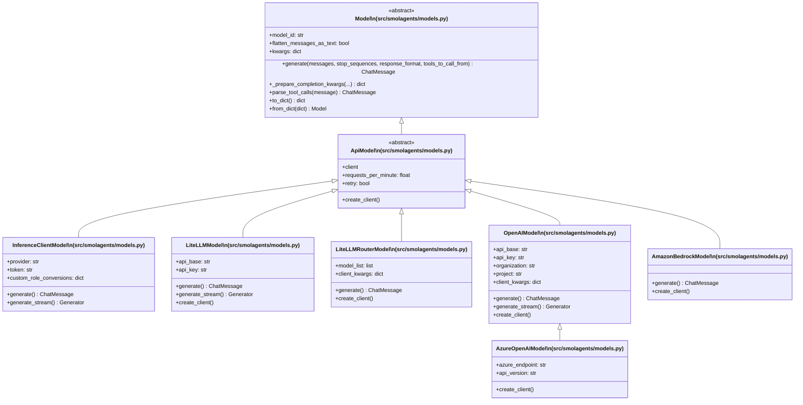
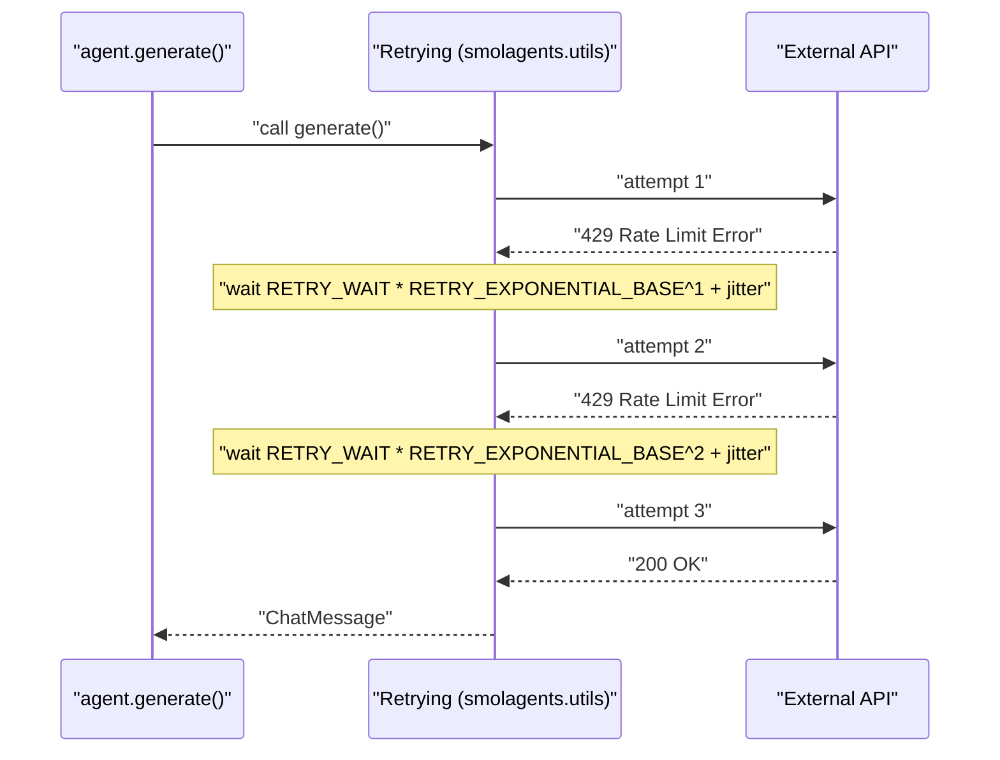
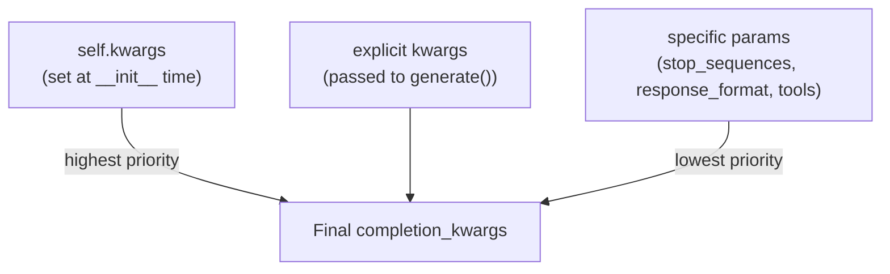

<!-- source: DeepWiki mcp.deepwiki.com · repo huggingface/smolagents · page 4.2 API-Based Models · fetched 2026-10-27 -->

# API-Based Models

<details>
<summary>Relevant source files</summary>

The following files were used as context for generating this wiki page:

- [docs/source/en/examples/using_different_models.md](docs/source/en/examples/using_different_models.md)
- [docs/source/en/guided_tour.md](docs/source/en/guided_tour.md)
- [docs/source/en/reference/models.md](docs/source/en/reference/models.md)
- [src/smolagents/models.py](src/smolagents/models.py)
- [tests/test_models.py](tests/test_models.py)

</details>


This page covers all API-backed model classes in `smolagents`: `ApiModel`, `InferenceClientModel`, `LiteLLMModel`, `LiteLLMRouterModel`, `OpenAIModel`, `AzureOpenAIModel`, and `AmazonBedrockModel`. These classes are implemented in [src/smolagents/models.py](). They share a common abstract base (`ApiModel`) that adds rate limiting, retry behavior, and client lifecycle management on top of the core `Model` interface.

For the abstract `Model` base class, `ChatMessage`, `MessageRole`, and the `generate()` contract, see page 4.1. For locally-loaded models (`TransformersModel`, `VLLMModel`, `MLXModel`), see page 4.3. For cross-cutting configuration options like `flatten_messages_as_text`, `REMOVE_PARAMETER`, and streaming, see page 4.4.

---

## Class Hierarchy

**Class hierarchy for API-based models**



Sources: [src/smolagents/models.py:330-1110](), [tests/test_models.py:49-43]()

---

## Quick Comparison

| Class | Backend Library | Provider Discovery | Streaming | Structured Output | Install Extra |
|---|---|---|---|---|---|
| `InferenceClientModel` | `huggingface_hub.InferenceClient` | HF Inference Providers | ✅ | Cerebras, Fireworks only | *(bundled)* |
| `LiteLLMModel` | `litellm` | 100+ via LiteLLM | ✅ | Depends on provider | `smolagents[litellm]` |
| `LiteLLMRouterModel` | `litellm.router.Router` | Configured via `model_list` | ❌ | Depends on provider | `smolagents[litellm]` |
| `OpenAIModel` | `openai.OpenAI` | Any OpenAI-compatible API | ✅ | ✅ | `smolagents[openai]` |
| `AzureOpenAIModel` | `openai.AzureOpenAI` | Azure-deployed models | ✅ | ✅ | `smolagents[openai]` |
| `AmazonBedrockModel` | `boto3` | AWS Bedrock | ❌ | ❌ | `smolagents[bedrock]` |

Sources: [src/smolagents/models.py:330-1110](), [docs/source/en/reference/models.md:60-209](), [docs/source/en/examples/using_different_models.md:9-19]()

---

## ApiModel

`ApiModel` is the abstract base for all API-backed models. It adds three capabilities on top of `Model`:

- **Client management**: each subclass implements `create_client()`, which is called at initialization to build the underlying SDK client (e.g., `openai.OpenAI`, `InferenceClient`). [src/smolagents/models.py:330-349]()
- **Rate limiting**: the `requests_per_minute` parameter feeds a `RateLimiter` from `smolagents.utils` that throttles calls to `generate()`. [src/smolagents/models.py:341-343]()
- **Retry on errors**: the `retry` flag enables a `Retrying` utility (also from `smolagents.utils`) that retries on `429 Too Many Requests` errors with exponential backoff. [src/smolagents/models.py:344-345]()

**Retry constants** are defined at the top of the module:

[src/smolagents/models.py:38-41]()

| Constant | Value | Purpose |
|---|---|---|
| `RETRY_WAIT` | `60` | Base wait time in seconds |
| `RETRY_MAX_ATTEMPTS` | `3` | Maximum number of retry attempts |
| `RETRY_EXPONENTIAL_BASE` | `2` | Multiplier for exponential backoff |
| `RETRY_JITTER` | `True` | Adds randomness to wait intervals |

Sources: [src/smolagents/models.py:38-41](), [src/smolagents/models.py:330-349]()

---

## InferenceClientModel

`InferenceClientModel` wraps `huggingface_hub.InferenceClient` and routes requests through [Hugging Face Inference Providers](https://huggingface.co/docs/inference-providers/index).

**Initialization parameters:** [src/smolagents/models.py:352-378]()

| Parameter | Type | Default | Description |
|---|---|---|---|
| `model_id` | `str` | `None` | HF model ID (e.g., `"Qwen/Qwen2.5-Coder-32B-Instruct"`) |
| `token` | `str` | `None` | HF API token; aliases to `api_key` |
| `api_key` | `str` | `None` | Alias for `token`; cannot pass both |
| `provider` | `str` | `None` | Inference provider (e.g., `"together"`, `"novita"`, `"sambanova"`) |
| `requests_per_minute` | `float` | `None` | Rate limit in requests per minute |
| `custom_role_conversions` | `dict` | `None` | Override `MessageRole` mapping before sending to API |
| `**kwargs` | — | — | Forwarded to each `chat_completion` call (e.g., `max_tokens`, `temperature`) |

**Authentication:** `token` and `api_key` are interchangeable. Passing both raises `ValueError`. [src/smolagents/models.py:373-376](). If neither is provided, the library falls back to the `HF_TOKEN` environment variable via the `InferenceClient` default behavior.

**Structured output restriction:** `InferenceClientModel` only supports `response_format` (structured outputs) with providers listed in `STRUCTURED_GENERATION_PROVIDERS` — currently `["cerebras", "fireworks-ai"]`. Passing `response_format` with any other provider raises `ValueError`. [src/smolagents/models.py:42](), [src/smolagents/models.py:433-437]()

**Supported providers (partial list):** Cerebras, Cohere, Fal, Fireworks, HF-Inference, Hyperbolic, Nebius, Novita, Replicate, SambaNova, Together. [docs/source/en/reference/models.md:62-62]()

Sources: [src/smolagents/models.py:352-444](), [docs/source/en/reference/models.md:60-91]()

---

## LiteLLMModel

`LiteLLMModel` wraps the `litellm` library, giving access to 100+ providers using a unified interface. The `model_id` uses LiteLLM's `provider/model-name` convention.

**Initialization parameters:** [src/smolagents/models.py:658-675]()

| Parameter | Type | Default | Description |
|---|---|---|---|
| `model_id` | `str` | required | LiteLLM model string (e.g., `"anthropic/claude-3-5-sonnet-latest"`) |
| `api_base` | `str` | `None` | Override API base URL (e.g., for Ollama) |
| `api_key` | `str` | `None` | API key for the provider |
| `requests_per_minute` | `float` | `None` | Rate limit |
| `flatten_messages_as_text` | `bool` | `False` | Flatten message content to plain text |
| `**kwargs` | — | — | Forwarded to each `litellm.completion()` call |

**Retry behavior:** `LiteLLMModel` participates in the `ApiModel` retry mechanism. The test in `tests/test_models.py` confirms that 429 errors trigger up to `RETRY_MAX_ATTEMPTS` retries with exponential backoff + jitter. [tests/test_models.py:429-475]()

**Example — Ollama:** [docs/source/en/reference/models.md:93-109]()
```python
from smolagents import LiteLLMModel

model = LiteLLMModel(
    model_id="ollama_chat/llama3.2",
    api_base="http://localhost:11434",
    num_ctx=8192,
)
```

Sources: [src/smolagents/models.py:658-755](), [docs/source/en/reference/models.md:93-109]()

---

## LiteLLMRouterModel

`LiteLLMRouterModel` wraps `litellm.router.Router` to distribute requests across multiple model deployments. It supports load balancing, fallback, and priority queuing.

**Initialization parameters:** [src/smolagents/models.py:758-775]()

| Parameter | Type | Description |
|---|---|---|
| `model_id` | `str` | The model group name to route to (must match `model_name` entries in `model_list`) |
| `model_list` | `list[dict]` | List of deployment configs, each with `model_name` and `litellm_params` |
| `client_kwargs` | `dict` | Passed directly to `litellm.router.Router` (e.g., `routing_strategy`) |
| `requests_per_minute` | `float` | Rate limit |
| `**kwargs` | — | Forwarded to each completion call |

**Routing strategies** (passed via `client_kwargs`): `"simple-shuffle"`, `"least-busy"`, `"usage-based-routing"`, `"latency-based-routing"`. [docs/source/en/reference/models.md:113-115]()

Sources: [src/smolagents/models.py:758-825](), [docs/source/en/reference/models.md:111-143]()

---

## OpenAIModel

`OpenAIModel` creates an `openai.OpenAI` client and can target any OpenAI-compatible API by customizing `api_base`. It supports streaming and structured outputs.

**Initialization parameters:** [src/smolagents/models.py:828-850]()

| Parameter | Type | Default | Description |
|---|---|---|---|
| `model_id` | `str` | required | Model name (e.g., `"gpt-4o"`) |
| `api_base` | `str` | `None` | Override base URL (default: OpenAI's API) |
| `api_key` | `str" | `None` | API key; falls back to `OPENAI_API_KEY` env var |
| `organization` | `str" | `None` | OpenAI organization ID |
| `project` | `str" | `None` | OpenAI project ID |
| `client_kwargs` | `dict" | `{}` | Passed to `openai.OpenAI(...)` constructor |
| `requests_per_minute` | `float` | `None` | Rate limit |
| `**kwargs` | — | — | Forwarded to each `chat.completions.create()` call |

**Client creation:** [src/smolagents/models.py:852-861]()

**Compatible providers via `api_base`:**
- **Google Gemini**: `"https://generativelanguage.googleapis.com/v1beta/openai/"` [docs/source/en/examples/using_different_models.md:48-48]()
- **OpenRouter**: `"https://openrouter.ai/api/v1"` [docs/source/en/examples/using_different_models.md:76-76]()

Sources: [src/smolagents/models.py:828-956](), [docs/source/en/examples/using_different_models.md:25-79]()

---

## AzureOpenAIModel

`AzureOpenAIModel` extends `OpenAIModel` and creates an `openai.AzureOpenAI` client instead. The `model_id` should be your Azure deployment name. [src/smolagents/models.py:959-960]()

**Additional parameters (on top of `OpenAIModel`):** [src/smolagents/models.py:961-979]()

| Parameter | Type | Env Var Fallback | Description |
|---|---|---|---|
| `azure_endpoint` | `str` | `AZURE_OPENAI_ENDPOINT` | Azure resource endpoint URL |
| `api_key` | `str` | `AZURE_OPENAI_API_KEY` | Azure API key |
| `api_version` | `str` | `OPENAI_API_VERSION` | API version string |

**Client creation:** [src/smolagents/models.py:981-992]()

Sources: [src/smolagents/models.py:959-1002](), [docs/source/en/reference/models.md:175-194]()

---

## AmazonBedrockModel

`AmazonBedrockModel` calls AWS Bedrock via `boto3`. It does not support streaming or structured outputs directly. [src/smolagents/models.py:1005-1006]()

**Initialization parameters:** [src/smolagents/models.py:1007-1015]()

| Parameter | Type | Description |
|---|---|---|
| `model_id` | `str` | Bedrock model ARN or ID |
| `client` | `boto3.client` | Optional pre-initialized Bedrock runtime client |
| `**kwargs` | — | Additional Bedrock API config (e.g., `inferenceConfig`) |

**Default client creation:** [src/smolagents/models.py:1017-1019]()

Sources: [src/smolagents/models.py:1005-1110](), [docs/source/en/reference/models.md:198-209]()

---

## Shared Behaviors

### Retry on Rate Limit Errors

API-based models use a `Retrying` wrapper. On `429 Too Many Requests` errors, it retries up to `RETRY_MAX_ATTEMPTS` times with exponential backoff.

**Retry behavior diagram**



| Constant | Value |
|---|---|
| `RETRY_WAIT` | `60` seconds |
| `RETRY_MAX_ATTEMPTS` | `3` |
| `RETRY_EXPONENTIAL_BASE` | `2` |

Sources: [src/smolagents/models.py:38-41](), [src/smolagents/models.py:344-345]()

---

### Stop Parameter Compatibility

Some model families do not support the `stop` parameter in their API. The function `supports_stop_parameter(model_id)` is used to detect this: [src/smolagents/models.py:418-431]()

Models that **do not** support `stop`:
- `o3` and variants (except `o3-mini`) [src/smolagents/models.py:421-424]()
- `o4` and variants [src/smolagents/models.py:425-427]()
- `gpt-5*` family [src/smolagents/models.py:428-429]()
- `grok-*` models [src/smolagents/models.py:430-431]()

When `supports_stop_parameter` returns `False`, the `stop` parameter is omitted from the API call, and `remove_content_after_stop_sequences()` is applied to the output text after generation instead. [src/smolagents/models.py:79-91]()

The `REMOVE_PARAMETER` sentinel can be used to explicitly exclude any kwarg from API calls. [docs/source/en/examples/using_different_models.md:100-117]()

Sources: [src/smolagents/models.py:79-91](), [src/smolagents/models.py:418-431](), [tests/test_models.py:141-169]()

---

### Completion Kwargs Priority

`_prepare_completion_kwargs()` assembles the final dict sent to the API. Priority from highest to lowest: [src/smolagents/models.py:502-551]()



This means kwargs set at instantiation always override those passed at call time, enabling stable per-model defaults.

Sources: [src/smolagents/models.py:502-551](), [tests/test_models.py:50-79]()

---

### Structured Output / response_format

`CODEAGENT_RESPONSE_FORMAT` is a pre-built JSON schema that `CodeAgent` passes as `response_format` to force the model to return `{"thought": "...", "code": "..."}` responses when structured generation is available. [src/smolagents/models.py:43-67]()

`InferenceClientModel` restricts this to `STRUCTURED_GENERATION_PROVIDERS = ["cerebras", "fireworks-ai"]`. [src/smolagents/models.py:42]().

Sources: [src/smolagents/models.py:42-67](), [src/smolagents/models.py:433-437]()

---

