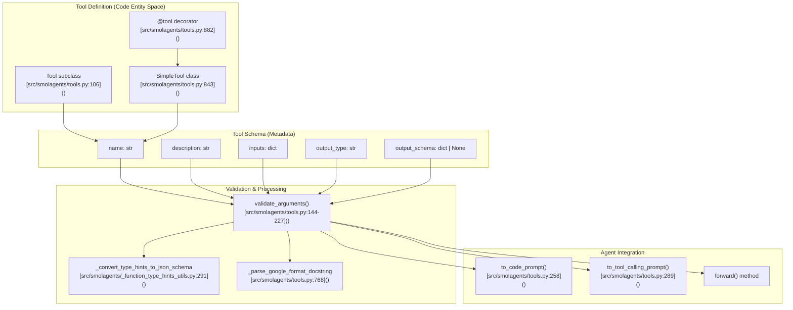
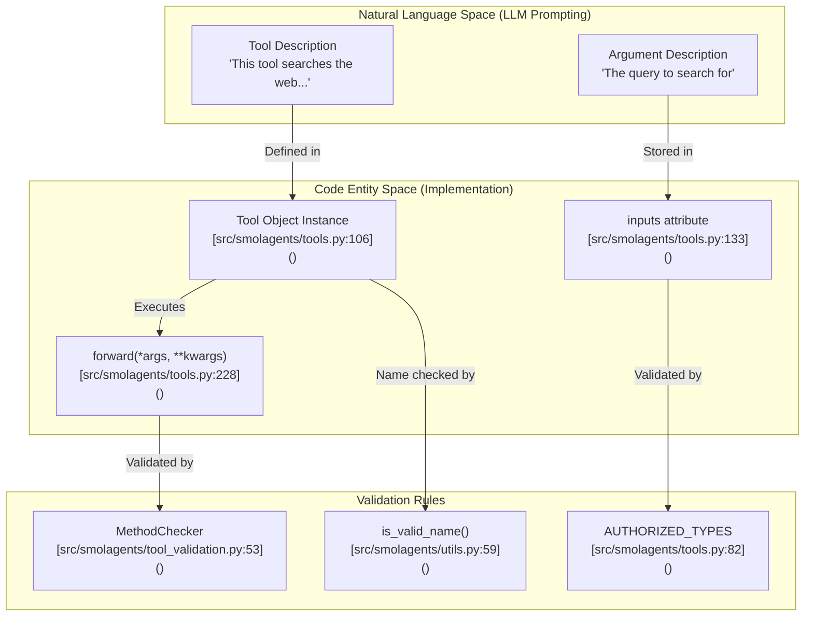
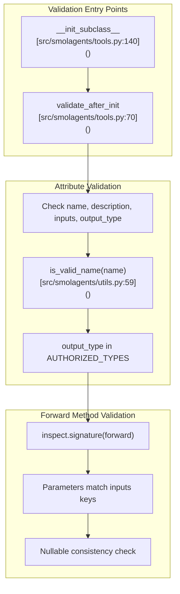

<!-- source: DeepWiki mcp.deepwiki.com · repo huggingface/smolagents · page 5.1 Tool Definition & Interface · fetched 2026-10-27 -->

# Tool Definition & Interface

<details>
<summary>Relevant source files</summary>

The following files were used as context for generating this wiki page:

- [src/smolagents/_function_type_hints_utils.py](src/smolagents/_function_type_hints_utils.py)
- [src/smolagents/agent_types.py](src/smolagents/agent_types.py)
- [src/smolagents/tools.py](src/smolagents/tools.py)
- [tests/test_function_type_hints_utils.py](tests/test_function_type_hints_utils.py)
- [tests/test_tools.py](tests/test_tools.py)
- [tests/utils/markers.py](tests/utils/markers.py)

</details>


This page documents the core interface for defining tools in smolagents. Tools are atomic functions that agents can invoke to perform specific actions. This page covers the `Tool` base class, the `@tool` decorator, schema structure, type validation, and JSON schema generation.

## Tool Architecture Overview

The tool system provides two primary methods for tool definition: the `@tool` decorator for quick function-based tools and the `Tool` subclass for more complex tools requiring initialization or state management.



**Tool Definition Flow**: Tools are defined either via decorator or subclass, undergo validation, and are then exposed to agents through type-specific prompt methods.

Sources: [src/smolagents/tools.py:106-256](), [src/smolagents/tools.py:843-892](), [src/smolagents/_function_type_hints_utils.py:291-432]()

## Tool Base Class

The `Tool` class provides the foundation for all tool implementations. Every tool must define specific class attributes and implement a `forward` method.

### Required Attributes

| Attribute | Type | Description |
|-----------|------|-------------|
| `name` | `str` | Unique identifier for the tool (must be valid Python identifier) |
| `description` | `str` | Clear explanation of tool purpose and behavior |
| `inputs` | `dict[str, dict]` | Input parameter specifications with type and description |
| `output_type` | `str` | Type of value returned (must be in `AUTHORIZED_TYPES`) |

[src/smolagents/tools.py:131-134]()

### Optional Attributes

| Attribute | Type | Description |
|-----------|------|-------------|
| `output_schema` | `dict[str, Any] \| None` | JSON schema for structured output validation |

[src/smolagents/tools.py:135]()

### Core Methods

The `Tool` class provides several key methods:

- **`forward(*args, **kwargs)`**: Abstract method that subclasses must implement. Contains the tool's execution logic. [src/smolagents/tools.py:228-229]()
- **`__call__(*args, **kwargs)`**: Handles tool invocation, manages initialization via `setup()`, processes input types with `handle_agent_input_types`, and handles output type conversion via `handle_agent_output_types`. [src/smolagents/tools.py:231-249]()
- **`setup()`**: Optional method for expensive initialization operations (e.g., loading models). Called once before first use. [src/smolagents/tools.py:251-256]()
- **`validate_arguments()`**: Validates tool attributes at initialization time, ensuring schema compliance and Python identifier validity for the name. [src/smolagents/tools.py:144-227]()

Sources: [src/smolagents/tools.py:106-256](), [src/smolagents/agent_types.py:52-215]()

## Tool Schema Structure

The tool schema defines how agents understand and invoke tools. Each component serves a specific purpose in the agent's decision-making process.



**Schema Validation Pipeline**: Tool schemas undergo multiple validation checks to ensure consistency between declared schema and implementation.

### Input Schema Format

Each input parameter in the `inputs` dictionary must follow this structure:

```python
inputs = {
    "parameter_name": {
        "type": "string",  # or list of types: ["string", "integer"]
        "description": "Clear description of parameter",
        "nullable": True  # Optional: indicates parameter has default value
    }
}
```

The `type` field can be a single string from `AUTHORIZED_TYPES` or a list of strings for union types. [src/smolagents/tools.py:172-194]()

### Output Schema Format

The optional `output_schema` attribute provides structured output specification. When present, `CodeAgent` automatically includes it in the system prompt to help the LLM understand the expected return structure. [src/smolagents/tools.py:122-124](), [src/smolagents/tools.py:268-284]()

Sources: [src/smolagents/tools.py:106-196](), [src/smolagents/tools.py:258-291](), [src/smolagents/utils.py:59]()

## Type System

The tool system enforces a strict type system through `AUTHORIZED_TYPES`, which maps to both Python types and agent-specific types.

### Authorized Types

```python
AUTHORIZED_TYPES = [
    "string",    # str
    "boolean",   # bool
    "integer",   # int
    "number",    # float
    "image",     # AgentImage
    "audio",     # AgentAudio
    "array",     # list, tuple
    "object",    # dict
    "any",       # Any
    "null",      # None
]
```

[src/smolagents/tools.py:82-93]()

### Type Conversion

The `CONVERSION_DICT` maps common Python type names (`str`, `int`, `float`) to their JSON schema equivalents used within the tool system. [src/smolagents/tools.py:95]()

### Agent-Specific Types

Special types for multimodal inputs/outputs like `AgentImage` and `AgentAudio` are handled by `handle_agent_input_types()` and `handle_agent_output_types()` when `sanitize_inputs_outputs=True`. [src/smolagents/tools.py:244-248](), [src/smolagents/agent_types.py:74-215]()

Sources: [src/smolagents/tools.py:82-96](), [src/smolagents/agent_types.py:32-215]()

## Tool Creation: @tool Decorator

The `@tool` decorator automatically extracts tool schema from function signatures and docstrings, creating a `SimpleTool` subclass instance. [src/smolagents/tools.py:882-893]()

### Type Hint to Schema Mapping

The `_convert_type_hints_to_json_schema()` function in `_function_type_hints_utils.py` handles complex type hints, including `Union`, `Literal`, and nested structures like `list[dict[str, Any]]`. [src/smolagents/_function_type_hints_utils.py:291-432]()

Sources: [src/smolagents/tools.py:882-893](), [src/smolagents/_function_type_hints_utils.py:97-432]()

## Tool Creation: Subclassing Tool

For tools requiring initialization, state management, or complex setup, subclassing `Tool` provides full control.

### Validation Requirements

When subclassing, `validate_arguments()` (triggered by `validate_after_init`) enforces:
1. **Name validity**: Must be a valid Python identifier and not a reserved keyword. [src/smolagents/tools.py:166-170]()
2. **Forward signature match**: Parameters in `forward()` must match `inputs` keys. [src/smolagents/tools.py:203-210]()
3. **Nullable consistency**: Parameters with defaults must have `"nullable": True` in inputs. [src/smolagents/tools.py:219-227]()

Sources: [src/smolagents/tools.py:106-256](), [tests/test_tools.py:85-125]()

## Tool Validation

The validation system ensures schema correctness and implementation consistency at tool initialization using the `validate_after_init` wrapper. [src/smolagents/tools.py:70-79]()



Sources: [src/smolagents/tools.py:144-227](), [src/smolagents/tool_validation.py:53]()

## JSON Schema Generation

The `get_json_schema()` function generates standardized JSON schemas from tool functions, used for LLM tool calling interfaces. It parses Google-style docstrings to extract parameter descriptions and enum choices (via `choices: [...]` blocks). [src/smolagents/_function_type_hints_utils.py:97-231]()

Sources: [src/smolagents/_function_type_hints_utils.py:97-432]()

## Agent Integration Methods

Tools expose themselves differently to `CodeAgent` and `ToolCallingAgent` through specialized prompt generation methods.

### to_code_prompt() for CodeAgent

Generates a Python function signature with a comprehensive docstring. If `output_schema` is defined, it includes a note to the model about the strict return format. [src/smolagents/tools.py:258-287]()

### to_tool_calling_prompt() for ToolCallingAgent

Generates a simple text description showing the name, inputs, and output type for agents that do not use the full code interpreter. [src/smolagents/tools.py:289-290]()

Sources: [src/smolagents/tools.py:258-291]()

## Tool Serialization

Tools can be serialized to dictionaries for persistence and sharing.

### to_dict() Method

Converts a tool to a dictionary containing its source code, metadata, and third-party requirements extracted via `get_imports()`. [src/smolagents/tools.py:292-365]()

### from_dict() and from_code() Methods

Reconstruct a tool from its serialized format by dynamically executing the code within a new module and locating the `Tool` subclass. [src/smolagents/tools.py:368-388](), [src/smolagents/tools.py:572-597]()

Sources: [src/smolagents/tools.py:292-598](), [src/smolagents/utils.py:57-86]()

---

