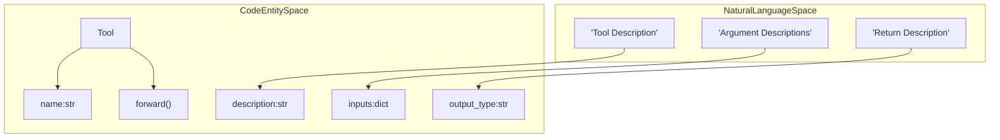
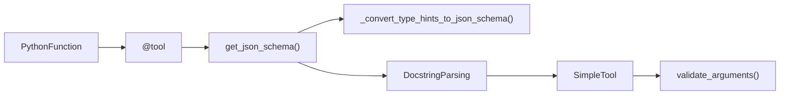
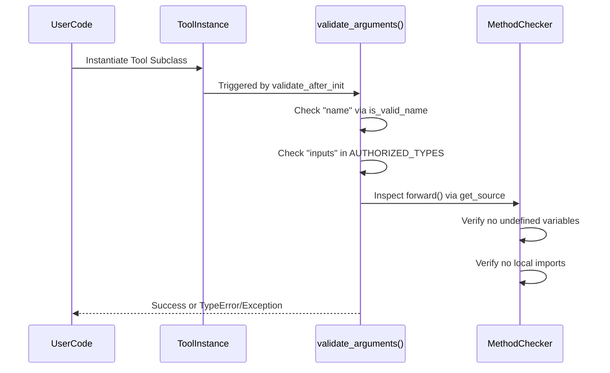
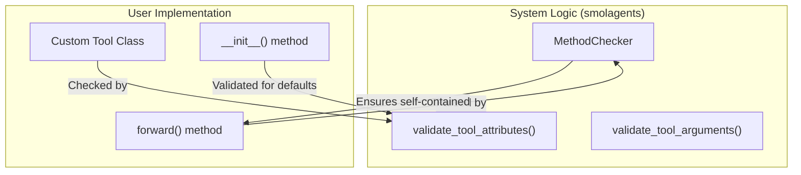

<!-- source: DeepWiki mcp.deepwiki.com · repo huggingface/smolagents · page 5.3 Creating Custom Tools · fetched 2026-10-27 -->

# Creating Custom Tools

<details>
<summary>Relevant source files</summary>

The following files were used as context for generating this wiki page:

- [docs/source/en/conceptual_guides/intro_agents.md](docs/source/en/conceptual_guides/intro_agents.md)
- [docs/source/en/examples/rag.md](docs/source/en/examples/rag.md)
- [docs/source/en/examples/text_to_sql.md](docs/source/en/examples/text_to_sql.md)
- [docs/source/en/tutorials/building_good_agents.md](docs/source/en/tutorials/building_good_agents.md)
- [docs/source/en/tutorials/tools.md](docs/source/en/tutorials/tools.md)
- [src/smolagents/tools.py](src/smolagents/tools.py)
- [tests/test_tools.py](tests/test_tools.py)

</details>


This page guides technical users through implementing custom tools for `smolagents`. Tools can be created using the `@tool` decorator for functional definitions or by subclassing the `Tool` base class for more complex, stateful operations.

## Overview

The `smolagents` framework treats tools as the primary interface between the LLM and the external world. Whether defined as a function or a class, every tool undergoes a validation lifecycle to ensure it can be correctly represented in the agent's system prompt and safely executed.

| Feature | `@tool` Decorator | `Tool` Subclass |
|:---|:---|:---|
| **Primary Use Case** | Simple utility functions, quick prototyping. | Complex tools, stateful logic, lazy loading. |
| **Metadata Extraction** | Automatic (from docstrings and type hints). | Manual (via class attributes). |
| **Lifecycle Hooks** | None (stateless). | Supports `setup()` for heavy initialization. |
| **Validation** | Post-decoration via `SimpleTool`. | Post-instantiation via `validate_after_init`. |

### Natural Language to Code Entity Mapping

The following diagram illustrates how natural language requirements (descriptions and arguments) are transformed into structured code entities that the `smolagents` framework can process.

**Bridge: Requirements to Code Entities**

Sources: [src/smolagents/tools.py:106-135](), [src/smolagents/_function_type_hints_utils.py:97-203]()

---

## Using the @tool Decorator

The `@tool` decorator is the recommended way to create tools quickly [src/smolagents/tools.py:794-795](). It uses `get_json_schema` to parse the function's docstring and type hints into a `SimpleTool` instance [src/smolagents/tools.py:804-817]().

### Implementation Requirements
1. **Docstring Format**: Must follow the Google docstring format with an `Args:` section [src/smolagents/_function_type_hints_utils.py:101-103]().
2. **Type Hints**: Every parameter and the return value must have explicit Python type hints [src/smolagents/_function_type_hints_utils.py:103-104]().
3. **Authorized Types**: Types must map to `AUTHORIZED_TYPES` which include `string`, `boolean`, `integer`, `number`, `image`, `audio`, `array`, `object`, `any`, and `null` [src/smolagents/tools.py:82-93]().

### Example: Functional Tool
```python
from smolagents import tool

@tool
def get_weather(city: str, unit: str = "celsius") -> str:
    """
    Retrieves the current weather for a specified city.

    Args:
        city: The name of the city to check.
        unit: The temperature unit (choices: ["celsius", "fahrenheit"]).
    """
    return f"The weather in {city} is 22 {unit}."
```

**Data Flow: Decorator Validation**

Sources: [src/smolagents/tools.py:794-817](), [src/smolagents/_function_type_hints_utils.py:97-113]()

---

## Subclassing the Tool Class

For tools that require state (e.g., maintaining a database connection) or heavy initialization (e.g., loading a local ML model), subclassing `Tool` is required [docs/source/en/tutorials/tools.md:57-59]().

### Key Components
- **`name`**: A unique string identifier [src/smolagents/tools.py:131]().
- **`description`**: A string explaining the tool's purpose to the LLM [src/smolagents/tools.py:132]().
- **`inputs`**: A dictionary defining the expected parameters, their types, and descriptions [src/smolagents/tools.py:133]().
- **`output_type`**: The expected return type [src/smolagents/tools.py:134]().
- **`forward()`**: The method containing the tool's execution logic [src/smolagents/tools.py:108]().
- **`setup()`**: (Optional) A method for expensive operations called only upon first use [src/smolagents/tools.py:126-128]().

### Validation Lifecycle
The `Tool` class uses `__init_subclass__` to wrap the constructor with `validate_after_init`. This ensures that as soon as a tool is instantiated, its attributes are checked for compliance [src/smolagents/tools.py:140-144]().

**Tool Validation Lifecycle**

Sources: [src/smolagents/tools.py:140-144](), [src/smolagents/tool_validation.py:157-170](), [src/smolagents/tools.py:167-170]()

---

## Advanced Features

### Structured Output with `output_schema`
If a tool returns complex data (e.g., a JSON object), you can provide an `output_schema`. This is used by agents to understand the internal structure of the returned object [src/smolagents/tools.py:122-125]().

### Integration with MCP
Tools can be imported from Model Context Protocol (MCP) servers using the `MCPClient`. The client manages the connection lifecycle and exposes server-side tools as `Tool` objects [docs/source/en/tutorials/tools.md:93-110]().

### Handling Multi-modal Data
Tools can accept or return `AgentImage` and `AgentAudio` types [src/smolagents/tools.py:52-52](). The framework uses `handle_agent_input_types` and `handle_agent_output_types` during execution to ensure these modalities are correctly formatted for the agent [src/smolagents/tools.py:238-245]().

---

## Implementation Best Practices

### 1. Self-Contained Methods
The `MethodChecker` validates that all methods are self-contained [src/smolagents/tool_validation.py:11-16](). Any variable used in `forward()` must be:
- A built-in [src/smolagents/tool_validation.py:127]().
- An argument of the method [src/smolagents/tool_validation.py:129]().
- A class attribute accessed via `self` [src/smolagents/tool_validation.py:131]().
- An imported module [src/smolagents/tool_validation.py:132]().

To ensure tools can be serialized and shared (e.g., via `push_to_hub`), all imports should be defined directly within the tool's functions [docs/source/en/tutorials/tools.md:71-71]().

### 2. Initialization vs. Setup
Avoid performing heavy compute (like loading a large model) in `__init__`. Instead, use the `setup()` method. The framework ensures `setup()` is called exactly once before the first execution of `forward()` [src/smolagents/tools.py:126-128](), [src/smolagents/tools.py:251-256]().

### 3. Argument Defaults
In the `Tool` subclass, any argument in `__init__` should have a default value [src/smolagents/tool_validation.py:159-161](). This is because arguments chosen at init are not easily traceable when rebuilding source code or pushing to the Hub [src/smolagents/tool_validation.py:160-161]().

### 4. Informative Logging and Error Handling
Tools should log helpful information and explicit failure cases. Using `try...except` blocks to provide clear error messages for invalid inputs (like date formats) helps the LLM self-correct [docs/source/en/tutorials/building_good_agents.md:81-101]().

**Bridge: System Logic to User Implementation**

Sources: [src/smolagents/tool_validation.py:11-155](), [src/smolagents/tool_validation.py:157-181]()

Sources: [src/smolagents/tools.py:106-256](), [src/smolagents/tool_validation.py:11-170](), [docs/source/en/tutorials/building_good_agents.md:81-101](), [docs/source/en/tutorials/tools.md:26-110]()

---

