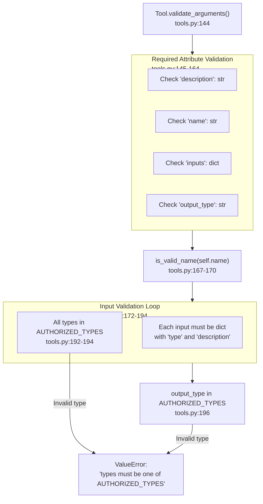
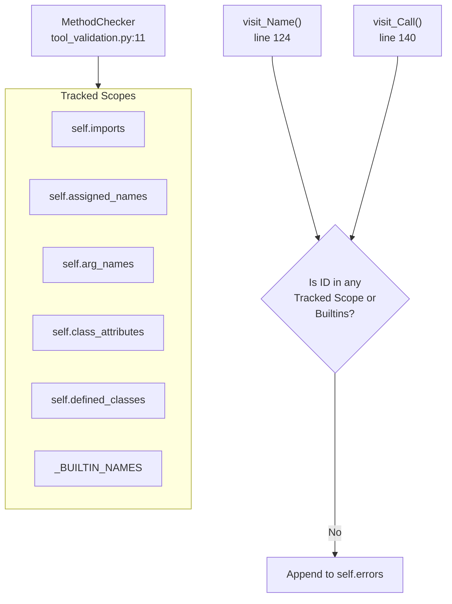
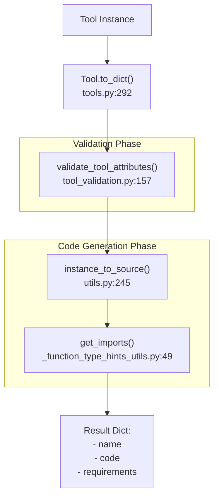
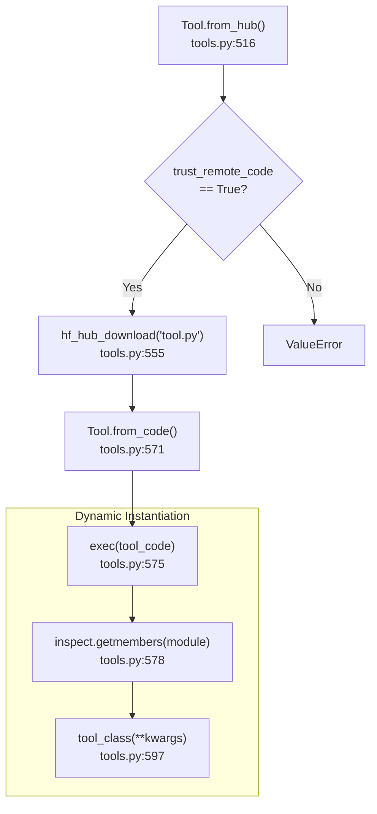

<!-- source: DeepWiki mcp.deepwiki.com · repo huggingface/smolagents · page 5.5 Tool Validation & Serialization · fetched 2026-10-27 -->

# Tool Validation & Serialization

<details>
<summary>Relevant source files</summary>

The following files were used as context for generating this wiki page:

- [src/smolagents/tool_validation.py](src/smolagents/tool_validation.py)
- [src/smolagents/utils.py](src/smolagents/utils.py)
- [tests/test_tool_validation.py](tests/test_tool_validation.py)
- [tests/test_utils.py](tests/test_utils.py)

</details>


This page documents the tool validation and serialization system, which ensures tools are self-contained, secure, and shareable. Tools undergo AST-based validation via `validate_tool_attributes()` and `MethodChecker` before being serialized with `to_dict()`, saved locally with `save()`, or pushed to the Hub with `push_to_hub()`. It also covers the `SafeSerializer` used for remote execution communication.

For information about creating custom tools, see page 5.3. For loading tools from external sources (Spaces, LangChain, Gradio, MCP), see page 5.4.

---

## Overview

The smolagents framework provides a validation and serialization system for tools that ensures type safety, self-containment, and shareability:

| Feature | Description | Key Component |
|---------|-------------|---------------|
| **Type System** | Validated input/output types with multimodal support | `AUTHORIZED_TYPES`, `AgentImage`, `AgentAudio` |
| **Validation** | AST-based code checking for self-contained tools | `validate_tool_attributes()` |
| **Serialization** | Convert tools to portable dictionary format | `Tool.to_dict()` |
| **Safe Serialization** | JSON-based serialization for remote execution | `SafeSerializer` |
| **Hub Sharing** | Upload tools as Gradio Spaces | `Tool.push_to_hub()` |

Sources: [src/smolagents/tools.py:82-93](), [src/smolagents/tools.py:292-365](), [src/smolagents/tool_validation.py:157-263](), [src/smolagents/serialization.py:45-56]()

---

## AUTHORIZED_TYPES

### Valid Tool Types

Tools must declare input and output types from the `AUTHORIZED_TYPES` list defined in [src/smolagents/tools.py:82-93]():

```python
AUTHORIZED_TYPES = [
    "string",
    "boolean", 
    "integer",
    "number",
    "image",
    "audio",
    "array",
    "object",
    "any",
    "null",
]
```

**Type Conversion Mapping** ([src/smolagents/tools.py:95]()):
The `CONVERSION_DICT` maps standard Python type names to authorized strings: `{"str": "string", "int": "integer", "float": "number"}`.

### Type Validation Flow

The `Tool.validate_arguments()` method enforces these constraints during tool initialization. It is automatically called after `__init__` via the `validate_after_init` decorator applied in `__init_subclass__` ([src/smolagents/tools.py:70-80](), [src/smolagents/tools.py:140-142]()).

Title: Type Validation Flow in Tool.__init_subclass__()


Sources: [src/smolagents/tools.py:82-96](), [src/smolagents/tools.py:144-196](), [src/smolagents/tools.py:70-80]()

---

## Tool Validation

### validate_tool_attributes() Function

The `validate_tool_attributes()` function ([src/smolagents/tool_validation.py:157-263]()) performs AST analysis to ensure tools are self-contained and serializable. It checks that:
1. All `__init__` parameters have default values ([src/smolagents/tool_validation.py:203]()).
2. Class attributes are simple literals (strings or dicts) and not complex expressions ([src/smolagents/tool_validation.py:218-223]()).
3. Methods do not use undefined variables or local file imports ([src/smolagents/tool_validation.py:236-240]()).

### MethodChecker AST Visitor

The `MethodChecker` class ([src/smolagents/tool_validation.py:11-155]()) implements an `ast.NodeVisitor` that tracks variable scopes and validates name usage within tool methods. It specifically handles:
- **Assignments**: Tracks variables defined in `visit_Assign` ([src/smolagents/tool_validation.py:49-57]()), `visit_AnnAssign` ([src/smolagents/tool_validation.py:73-79]()), and `visit_For` loops ([src/smolagents/tool_validation.py:80-88]()).
- **Comprehensions**: Correctly tracks variables in `ListComp`, `DictComp`, and `SetComp` via `_handle_comprehension_generators` ([src/smolagents/tool_validation.py:90-113]()).
- **Context Managers & Exceptions**: Tracks aliases in `with` statements ([src/smolagents/tool_validation.py:59-65]()) and `except` handlers ([src/smolagents/tool_validation.py:67-71]()).
- **Class Scopes**: Tracks local class definitions within methods via `visit_ClassDef` ([src/smolagents/tool_validation.py:119-122]()).

Title: MethodChecker AST Visitor Logic


Sources: [src/smolagents/tool_validation.py:11-155](), [src/smolagents/tool_validation.py:157-263]()

---

## Serialization & Sharing

### instance_to_source()

The `instance_to_source()` utility ([src/smolagents/utils.py:245]()) is a critical part of the serialization pipeline. It reconstructs the source code of a Tool instance, ensuring that its current state (class attributes and methods) can be persisted. It uses `get_source` ([src/smolagents/utils.py:228]()) to fetch the original definition, handling both standard Python environments and IPython/Jupyter sessions by inspecting shell history if necessary ([tests/test_utils.py:162-166]()).

### Tool.to_dict()

The `to_dict()` method ([src/smolagents/tools.py:292-365]()) generates a dictionary containing the tool's name, reconstructed source code, and package requirements. For `SimpleTool` (decorated functions), it automatically adds a `self` argument to the `forward` method to maintain compatibility with the class-based tool interface ([src/smolagents/tools.py:326-336]()).

### SafeSerializer

The `SafeSerializer` ([src/smolagents/serialization.py:45]()) provides a secure mechanism for serializing data between the agent and remote executors. It uses a prefix-based system:
- `safe:`: JSON-serialized data with type markers for complex Python objects like `datetime`, `Path`, `set`, and `numpy.ndarray` ([src/smolagents/serialization.py:58-171]()).
- `pickle:`: Base64-encoded pickle data, only used if `allow_pickle=True` is explicitly passed ([src/smolagents/serialization.py:55]()).

Title: Tool Serialization Pipeline


Sources: [src/smolagents/tools.py:292-365](), [src/smolagents/utils.py:228-245](), [src/smolagents/serialization.py:45-171](), [src/smolagents/_function_type_hints_utils.py:49]()

---

## Hub Integration

### push_to_hub()

The `push_to_hub()` method ([src/smolagents/tools.py:367-471]()) allows users to share tools on the Hugging Face Hub as Gradio Spaces. It performs the following steps:
1. Validates the tool attributes using `validate_tool_attributes` ([src/smolagents/tools.py:414]()).
2. Serializes the tool to a source string using `instance_to_source()` ([src/smolagents/tools.py:415]()).
3. Creates a repository on the Hub (type `space` with `gradio` SDK) ([src/smolagents/tools.py:426-432]()).
4. Uploads `tool.py`, `app.py` (a Gradio UI template generated by `create_agent_gradio_app_template`), and `requirements.txt` ([src/smolagents/tools.py:434-471]()).

### from_hub() and from_code()

Tools are loaded from the Hub by downloading the `tool.py` source and using `Tool.from_code()` to instantiate it. This requires `trust_remote_code=True` because it executes arbitrary code from the downloaded file using `exec()` ([src/smolagents/tools.py:549-552](), [src/smolagents/tools.py:575]()).

Title: Loading Tools from External Source


Sources: [src/smolagents/tools.py:367-471](), [src/smolagents/tools.py:516-597](), [src/smolagents/tools.py:549-552](), [src/smolagents/tools.py:575-578]()

---

