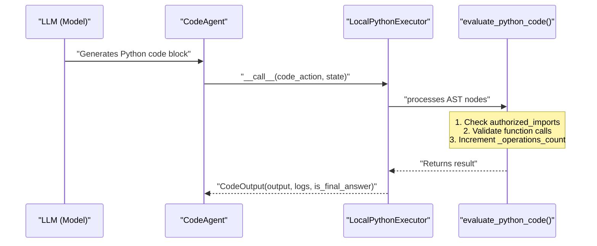

<!-- source: DeepWiki mcp.deepwiki.com · repo huggingface/smolagents · page 6.1 Execution Environment Overview · fetched 2026-10-27 -->

# Execution Environment Overview

<details>
<summary>Relevant source files</summary>

The following files were used as context for generating this wiki page:

- [README.md](README.md)
- [docs/source/en/conceptual_guides/intro_agents.md](docs/source/en/conceptual_guides/intro_agents.md)
- [docs/source/en/examples/rag.md](docs/source/en/examples/rag.md)
- [docs/source/en/examples/text_to_sql.md](docs/source/en/examples/text_to_sql.md)
- [docs/source/en/index.md](docs/source/en/index.md)
- [docs/source/en/tutorials/building_good_agents.md](docs/source/en/tutorials/building_good_agents.md)
- [docs/source/en/tutorials/secure_code_execution.md](docs/source/en/tutorials/secure_code_execution.md)
- [docs/source/en/tutorials/tools.md](docs/source/en/tutorials/tools.md)

</details>


## Purpose and Scope

This page provides an overview of code execution environments in `smolagents`, explaining the fundamental distinction between local and remote execution, the available executor types, and how to select the appropriate executor for your use case. 

`smolagents` prioritizes **Code Agents**, which write actions in Python rather than JSON [docs/source/en/tutorials/secure_code_execution.md:8-12](). This design choice necessitates a robust and secure execution layer to handle LLM-generated code safely. The framework provides a unified interface for both local AST-based interpretation and various remote sandboxed environments [docs/source/en/tutorials/secure_code_execution.md:43-48]().

Sources: [src/smolagents/local_python_executor.py:17-48](), [src/smolagents/remote_executors.py:53-66](), [docs/source/en/tutorials/secure_code_execution.md:8-12]()

## The PythonExecutor Abstraction

All code executors in `smolagents` implement the `PythonExecutor` abstract base class [src/smolagents/local_python_executor.py:1438-1440](). This defines a minimal interface for executing Python code and returning structured output via the `CodeOutput` data structure.

### Executor Class Hierarchy

The following diagram maps the relationship between the base classes and concrete implementations used for code execution.

**Execution Class Architecture**
```mermaid
classDiagram
    class "PythonExecutor" {
        <<abstract>>
        +__call__(code_action: str, ... ) CodeOutput
    }
    
    class "CodeOutput" {
        +output: Any
        +logs: str
        +is_final_answer: bool
    }
    
    class "LocalPythonExecutor" {
        +additional_authorized_imports: list
        +static_tools: dict
        +custom_tools: dict
        +__call__(code_action: str, ... ) CodeOutput
    }
    
    class "RemotePythonExecutor" {
        <<abstract>>
        +additional_imports: list
        +allow_pickle: bool
        +run_code_raise_errors(code: str) CodeOutput
        +send_tools(tools: dict) void
        +send_variables(variables: dict) void
    }
    
    class "E2BExecutor" {
        +sandbox: Sandbox
        +run_code_raise_errors(code: str) CodeOutput
    }
    
    class "DockerExecutor" {
        +container: Container
        +run_code_raise_errors(code: str) CodeOutput
    }

    class "BlaxelExecutor" {
        +run_code_raise_errors(code: str) CodeOutput
    }

    class "ModalExecutor" {
        +run_code_raise_errors(code: str) CodeOutput
    }
    
    "PythonExecutor" <|-- "LocalPythonExecutor"
    "PythonExecutor" <|-- "RemotePythonExecutor"
    "RemotePythonExecutor" <|-- "E2BExecutor"
    "RemotePythonExecutor" <|-- "DockerExecutor"
    "RemotePythonExecutor" <|-- "BlaxelExecutor"
    "RemotePythonExecutor" <|-- "ModalExecutor"
    "PythonExecutor" ..> "CodeOutput" : "creates"
```
Sources: [src/smolagents/local_python_executor.py:1429-1460](), [src/smolagents/remote_executors.py:42](), [src/smolagents/remote_executors.py:53-78]()

### CodeOutput Data Structure
The `CodeOutput` dataclass is the standard return type for all execution attempts [src/smolagents/local_python_executor.py:1429-1435]():
- `output`: The actual return value of the executed code block [src/smolagents/local_python_executor.py:1432]().
- `logs`: A string containing all captured standard output (e.g., from `print()`) captured by a `PrintContainer` instance [src/smolagents/local_python_executor.py:1433](), [src/smolagents/local_python_executor.py:240-250]().
- `is_final_answer`: A boolean flag indicating if the code execution invoked the `FinalAnswerTool`, signaling the end of the agent's task [src/smolagents/local_python_executor.py:1434]().

Sources: [src/smolagents/local_python_executor.py:1429-1435](), [src/smolagents/local_python_executor.py:240-250]()

## Local vs Remote Execution

The framework distinguishes between **local execution** (using a custom AST interpreter) and **remote execution** (using isolated sandboxes).

### Execution Environment Decision Tree
The following diagram bridges the Natural Language task space to the specific Code Entities used for execution.

**Agent-to-Executor Mapping**
```mermaid
graph TD
    subgraph "NL_Space" ["Natural Language Space"]
        "Task"["'Calculate the sum'"]
        "AgentConfig"["'Use a secure sandbox'"]
    end

    subgraph "Code_Entity_Space" ["Code Entity Space"]
        "CA"["CodeAgent Class"]
        "LPE"["LocalPythonExecutor"]
        "RPE"["RemotePythonExecutor Subclasses"]
        "EPC"["evaluate_python_code()"]
        "SS"["SafeSerializer"]
        
        "CA" -- "executor=None" --> "LPE"
        "CA" -- "executor=RemotePythonExecutor(...)" --> "RPE"
        "LPE" -- "calls" --> "EPC"
        "RPE" -- "uses" --> "SS"
    end

    "Task" --> "CA"
    "AgentConfig" --> "RPE"
```
Sources: [src/smolagents/local_python_executor.py:688-690](), [src/smolagents/remote_executors.py:115-131](), [src/smolagents/remote_executors.py:53-66](), [docs/source/en/tutorials/secure_code_execution.md:15-17]()

### Comparison Matrix

| Feature | `LocalPythonExecutor` | `RemotePythonExecutor` |
| :--- | :--- | :--- |
| **Security** | Restricted AST interpretation [src/smolagents/local_python_executor.py:17-18]() | OS/Container-level isolation [src/smolagents/remote_executors.py:53-56]() |
| **Performance** | High (in-process) | Variable (network/provisioning latency) |
| **Imports** | Whitelist only (`BASE_BUILTIN_MODULES`) [src/smolagents/local_python_executor.py:202]() | Configurable via `additional_imports` [src/smolagents/remote_executors.py:76-80]() |
| **State** | Shared memory `state` dict [src/smolagents/local_python_executor.py:690]() | Serialized via `SafeSerializer` [src/smolagents/remote_executors.py:115-128]() |
| **Recommended Use** | Development & Trusted tasks [docs/source/en/tutorials/secure_code_execution.md:104-106]() | Production & Untrusted inputs [docs/source/en/tutorials/secure_code_execution.md:32-37]() |

Sources: [src/smolagents/local_python_executor.py:51-153](), [src/smolagents/remote_executors.py:53-82](), [docs/source/en/tutorials/secure_code_execution.md:47-48]()

## Security Tradeoffs

### Local Execution Safeguards
The `LocalPythonExecutor` does not use `eval()` or `exec()`. Instead, it manually traverses the Abstract Syntax Tree (AST) [docs/source/en/tutorials/secure_code_execution.md:51-54]().
1. **Import Restrictions**: Only modules in `authorized_imports` are allowed [src/smolagents/local_python_executor.py:156-160](). Dangerous modules like `os`, `sys`, and `subprocess` are explicitly restricted in `DANGEROUS_MODULES` [src/smolagents/local_python_executor.py:130-141]().
2. **Operation Limits**: Caps total operations (`MAX_OPERATIONS` = 10,000,000) and loop iterations (`MAX_WHILE_ITERATIONS` = 1,000,000) to prevent resource exhaustion [src/smolagents/local_python_executor.py:58-60]().
3. **Forbidden Functions**: Blocks dangerous built-ins like `builtins.eval`, `builtins.exec`, and `os.system` via the `DANGEROUS_FUNCTIONS` list [src/smolagents/local_python_executor.py:143-153]().
4. **Attribute Access**: Prevents dunder attribute access (except `__init__`, `__str__`, `__repr__`) via `nodunder_getattr` [src/smolagents/local_python_executor.py:61-71]().

### Remote Execution Isolation
For production environments, `smolagents` supports several sandboxed executors [src/smolagents/remote_executors.py:42]():
- **E2B**: Cloud-based sandboxes via `E2BExecutor` [src/smolagents/remote_executors.py:99]().
- **Docker**: Local container isolation via `DockerExecutor` [src/smolagents/remote_executors.py:42]().
- **Modal**: Serverless execution via `ModalExecutor` [src/smolagents/remote_executors.py:42]().
- **Blaxel**: Managed remote execution via `BlaxelExecutor` [src/smolagents/remote_executors.py:42]().

Remote executors use `SafeSerializer` to move variables between the local agent process and the remote kernel [src/smolagents/remote_executors.py:115-131](). By default, `allow_pickle` is set to `False` to prevent arbitrary code execution during deserialization [src/smolagents/remote_executors.py:74]().

Sources: [src/smolagents/local_python_executor.py:51-153](), [src/smolagents/remote_executors.py:42-78](), [src/smolagents/serialization.py:37-38](), [docs/source/en/tutorials/secure_code_execution.md:43-48]()

## Execution Data Flow

The following diagram illustrates how code moves from the LLM through the agent and into the executor.

**Code Execution Pipeline**

Sources: [src/smolagents/local_python_executor.py:688-750](), [src/smolagents/local_python_executor.py:1453-1465](), [tests/test_local_python_executor.py:58-70](), [docs/source/en/conceptual_guides/intro_agents.md:28-33]()

---

