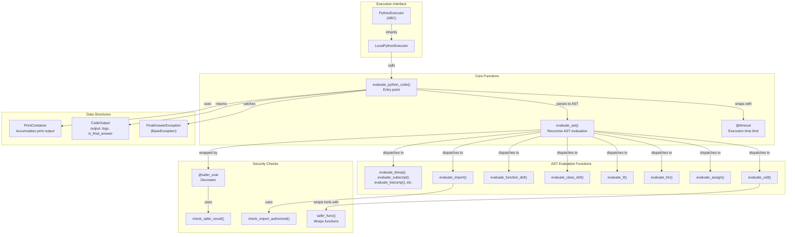
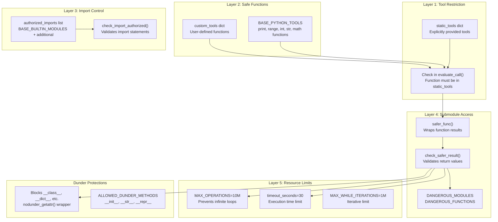
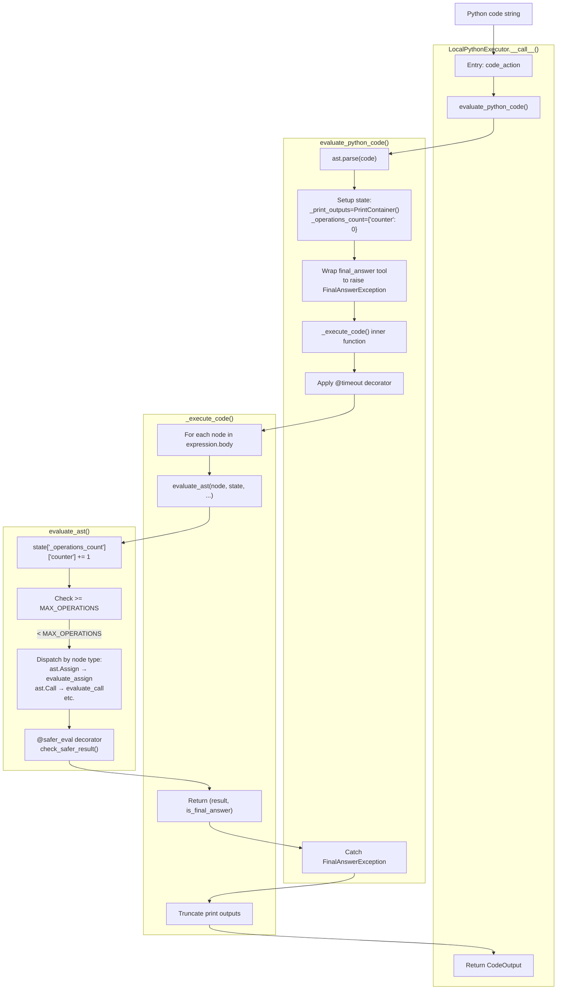
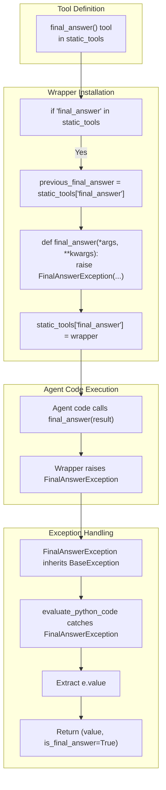

<!-- source: DeepWiki mcp.deepwiki.com · repo huggingface/smolagents · page 6.2 LocalPythonExecutor · fetched 2026-10-27 -->

# LocalPythonExecutor

<details>
<summary>Relevant source files</summary>

The following files were used as context for generating this wiki page:

- [src/smolagents/local_python_executor.py](src/smolagents/local_python_executor.py)
- [tests/test_local_python_executor.py](tests/test_local_python_executor.py)

</details>


`LocalPythonExecutor` provides secure, in-process Python code execution for agents using AST-based evaluation. It enables `CodeAgent` to run LLM-generated Python code with restricted access to imports, built-in functions, and dangerous operations. The executor maintains execution state across multiple code blocks, captures print outputs separately from return values, and enforces resource limits to prevent infinite loops or long-running operations.

For remote, fully-isolated execution environments, see [6.3 Remote Executors](). For general execution environment comparisons, see [6.1 Execution Environment Overview]().

**Sources:** [src/smolagents/local_python_executor.py:1682-1762]()

## Core Architecture

### Class Structure



**Sources:** [src/smolagents/local_python_executor.py:1671-1681](), [src/smolagents/local_python_executor.py:1682-1760](), [src/smolagents/local_python_executor.py:1577-1661](), [src/smolagents/local_python_executor.py:1410-1563]()

### Key Classes and Functions

| Entity | Type | Purpose | Location |
|--------|------|---------|----------|
| `LocalPythonExecutor` | Class | Main executor with state management | [src/smolagents/local_python_executor.py:1682-1760]() |
| `evaluate_python_code` | Function | Parses and evaluates Python code string | [src/smolagents/local_python_executor.py:1577-1661]() |
| `evaluate_ast` | Function | Recursive AST node evaluator with security checks | [src/smolagents/local_python_executor.py:1410-1563]() |
| `CodeOutput` | Dataclass | Execution result: `output`, `logs`, `is_final_answer` | [src/smolagents/local_python_executor.py:1664-1668]() |
| `FinalAnswerException` | Exception | Signals agent termination (inherits `BaseException`) | [src/smolagents/local_python_executor.py:1566-1574]() |
| `PrintContainer` | Class | Accumulates print outputs with `+=` support | [src/smolagents/local_python_executor.py:240-264]() |
| `InterpreterError` | Exception | Raised for unsupported operations or security violations | [src/smolagents/local_python_executor.py:42-48]() |

**Sources:** [src/smolagents/local_python_executor.py:1-1762]()

## Five-Layer Security Model

The executor implements five distinct layers of security to prevent unauthorized access and resource exhaustion.

### Security Architecture



**Sources:** [src/smolagents/local_python_executor.py:74-127](), [src/smolagents/local_python_executor.py:129-154](), [src/smolagents/local_python_executor.py:360-380](), [src/smolagents/local_python_executor.py:156-183]()

### Layer 1: Tool Restriction

Code can only call functions explicitly provided in `static_tools`. The executor checks function calls in `evaluate_call()`:

- If `func_name` is in `state`: User-defined function from earlier code [src/smolagents/local_python_executor.py:825-827]().
- If `func_name` is in `static_tools`: Explicitly allowed tool [src/smolagents/local_python_executor.py:832-833]().
- If `func_name` is in `custom_tools`: Custom function defined in current session [src/smolagents/local_python_executor.py:834-835]().
- Otherwise: `InterpreterError` raised [src/smolagents/local_python_executor.py:837-841]().

Attempting to assign to a tool name raises an error to prevent overwriting [src/smolagents/local_python_executor.py:802-805]().

### Layer 2: Safe Functions (BASE_PYTHON_TOOLS)

A whitelist of safe built-in functions and math operations is used by default [src/smolagents/local_python_executor.py:74-127](). This includes:

- **Built-ins**: `print` (mapped to `custom_print`), `range`, `int`, `str`, `list`, `dict`, `len`, `sum`, etc.
- **Math**: `math.ceil`, `math.floor`, `math.sqrt`, `math.sin`, etc.
- **Access Control**: `getattr` is replaced by `nodunder_getattr` to block access to dunder attributes like `__class__` or `__dict__` [src/smolagents/local_python_executor.py:68-71]().

### Layer 3: Import Control

Imports are restricted to modules in `authorized_imports`. By default, only `BASE_BUILTIN_MODULES` are allowed:

```python
BASE_BUILTIN_MODULES = [
    "collections", "datetime", "itertools", "math", "queue",
    "random", "re", "stat", "statistics", "time", "unicodedata"
]
```

The `check_import_authorized()` function validates module names against the whitelist, supporting exact matches and wildcard patterns [src/smolagents/local_python_executor.py:360-369]().

**Sources:** [src/smolagents/utils.py:26-36](), [src/smolagents/local_python_executor.py:360-380]()

### Layer 4: Submodule and Return Value Validation

Even if a module is imported, accessing its dangerous submodules or functions is blocked via `check_safer_result()` [src/smolagents/local_python_executor.py:156-183]():

- Blocks access to `DANGEROUS_MODULES`: `["builtins", "io", "multiprocessing", "os", "pathlib", "pty", "shutil", "socket", "subprocess", "sys"]` [src/smolagents/local_python_executor.py:130-141]().
- Blocks `DANGEROUS_FUNCTIONS`: `["builtins.compile", "builtins.eval", "builtins.exec", "os.popen", "os.system", ...]` [src/smolagents/local_python_executor.py:143-153]().

The `safer_func` and `safer_eval` decorators apply these checks to function results and AST evaluations [src/smolagents/local_python_executor.py:185-237]().

### Layer 5: Resource Limits

| Protection | Mechanism | Default Limit |
|------------|-----------|---------------|
| Operation Counting | `_operations_count` incremented per AST node | `MAX_OPERATIONS = 10,000,000` |
| While Loop Iterations | Counter in `evaluate_while()` | `MAX_WHILE_ITERATIONS = 1,000,000` |
| Execution Timeout | ThreadPoolExecutor with timeout | `MAX_EXECUTION_TIME_SECONDS = 30` |
| Dunder Calls | Only allows `__init__`, `__str__`, `__repr__` | `ALLOWED_DUNDER_METHODS` |

**Sources:** [src/smolagents/local_python_executor.py:58-61](), [src/smolagents/local_python_executor.py:1438-1442](), [src/smolagents/local_python_executor.py:285-320]()

## Execution Pipeline

### Code Execution Flow



**Sources:** [src/smolagents/local_python_executor.py:1741-1752](), [src/smolagents/local_python_executor.py:1577-1661](), [src/smolagents/local_python_executor.py:1410-1563]()

### State Management

`LocalPythonExecutor` maintains persistent state across executions:
- `self.state`: Persistent dictionary of variables [src/smolagents/local_python_executor.py:1703]().
- `send_variables()`: Manually injects variables into the persistent state [src/smolagents/local_python_executor.py:1754-1755]().
- `send_tools()`: Merges agent tools with base tools [src/smolagents/local_python_executor.py:1757-1759]().

Each execution resets the transient `_print_outputs` and `_operations_count` [src/smolagents/local_python_executor.py:1621-1622]().

## FinalAnswer Mechanism

### Special Handling for Agent Termination

The executor uses a unique mechanism to signal that the agent has finished its task.



**FinalAnswerException** inherits from `BaseException` instead of `Exception` to ensure it is not caught by generic `try...except Exception` blocks in the agent's code [src/smolagents/local_python_executor.py:1566-1574]().

**Sources:** [src/smolagents/local_python_executor.py:1624-1630](), [src/smolagents/local_python_executor.py:1643-1648]()

## Usage Warnings

The `LocalPythonExecutor` is intended for **development-only** usage or trusted environments.

- **Security Warning:** While it implements multiple layers of security, it runs in the same process as your application. Malicious code could potentially find ways to bypass the AST-based sandbox.
- **Production Recommendation:** For production environments running untrusted code from LLMs, it is strongly recommended to use a [6.3 Remote Executors]() which provides VM-level or container-level isolation.

**Sources:** [src/smolagents/local_python_executor.py:1682-1695]()

---

