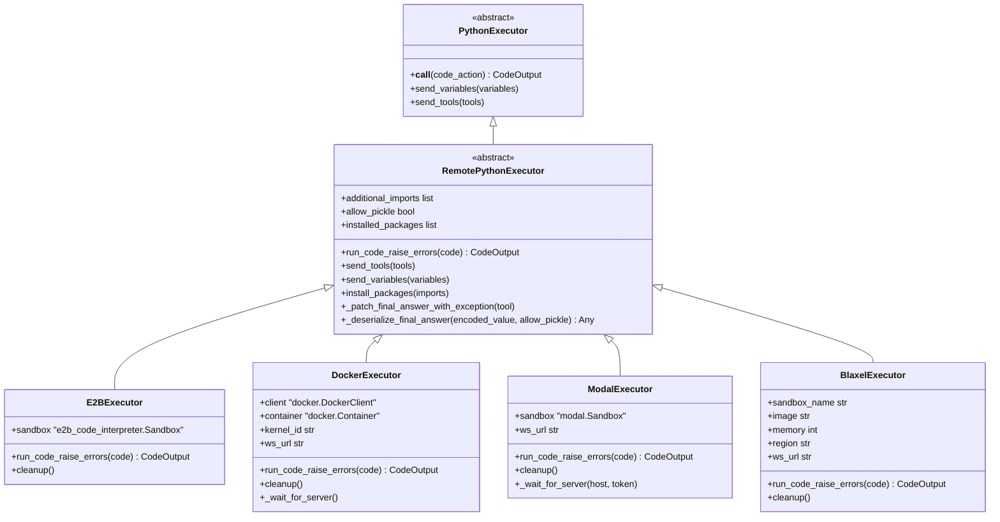
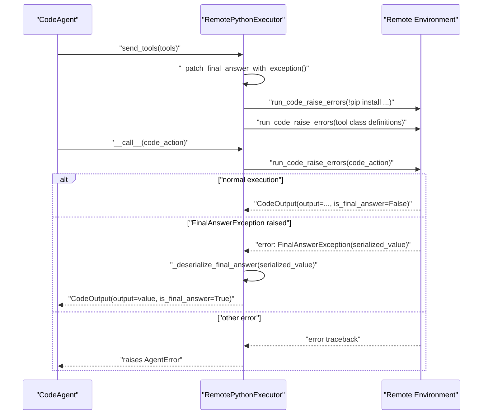
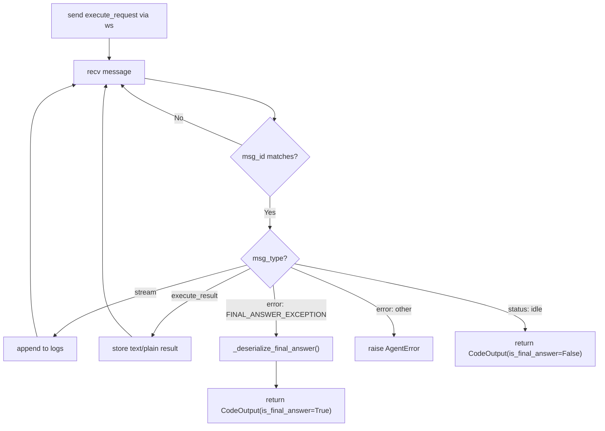
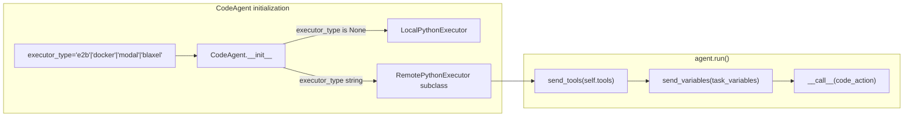

<!-- source: DeepWiki mcp.deepwiki.com · repo huggingface/smolagents · page 6.3 Remote Executors · fetched 2026-10-27 -->

# Remote Executors

Relevant source files

The following files were used as context for generating this wiki page:

- [SECURITY.md](SECURITY.md)
- [docs/source/en/reference/python_executors.md](docs/source/en/reference/python_executors.md)
- [docs/source/ko/reference/agents.md](docs/source/ko/reference/agents.md)
- [examples/sandboxed_execution.py](examples/sandboxed_execution.py)
- [src/smolagents/remote_executors.py](src/smolagents/remote_executors.py)
- [tests/test_remote_executors.py](tests/test_remote_executors.py)

This page documents the `RemotePythonExecutor` base class and all concrete executor implementations found in [src/smolagents/remote_executors.py](). Remote executors allow a `CodeAgent` to run LLM-generated Python code in an isolated external environment rather than in the local process. For background on the `PythonExecutor` protocol and the choice between local and remote execution, see [6.1](). For the local alternative, see [6.2](). For the security rationale that motivates remote execution, see [6.4]().

---

## Overview

When `CodeAgent` is configured with a remote executor, each code snippet generated by the LLM is shipped to a sandboxed environment, executed there, and only the result is returned to the local process. The agent's LLM calls, tool definitions, and orchestration logic all remain local.

The concrete executor backends are:

| Class | `executor_type` string | Backend technology | Required extra |
|---|---|---|---|
| `E2BExecutor` | `"e2b"` | E2B sandbox API | `smolagents[e2b]` |
| `DockerExecutor` | `"docker"` | Docker + Jupyter Kernel Gateway | `smolagents[docker]` |
| `ModalExecutor` | `"modal"` | Modal sandbox + Jupyter Kernel Gateway | `smolagents[modal]` |
| `BlaxelExecutor` | `"blaxel"` | Blaxel sandbox API | `smolagents[blaxel]` |

All inherit from the abstract `RemotePythonExecutor`, which itself implements the `PythonExecutor` protocol defined in [src/smolagents/local_python_executor.py]().

Sources: [src/smolagents/remote_executors.py:42-42](), [src/smolagents/remote_executors.py:53-53](), [src/smolagents/remote_executors.py:338-338](), [src/smolagents/remote_executors.py:453-453](), [src/smolagents/remote_executors.py:546-546](), [src/smolagents/remote_executors.py:713-713]()

---

## Class Hierarchy

**Diagram: RemotePythonExecutor class hierarchy**

Sources: [src/smolagents/remote_executors.py:53-53](), [src/smolagents/remote_executors.py:338-338](), [src/smolagents/remote_executors.py:453-453](), [src/smolagents/remote_executors.py:546-546](), [src/smolagents/remote_executors.py:713-713]()

---

## RemotePythonExecutor (Abstract Base)

`RemotePythonExecutor` [src/smolagents/remote_executors.py:53-335]() defines the shared lifecycle and serialization contract. Concrete subclasses only need to implement `run_code_raise_errors` and optionally `cleanup`.

### Constructor Parameters

| Parameter | Type | Default | Description |
|---|---|---|---|
| `additional_imports` | `list[str]` | required | Python packages to install in the remote environment at startup [src/smolagents/remote_executors.py:72-72]() |
| `logger` | `Logger` | required | Agent logger instance [src/smolagents/remote_executors.py:73-73]() |
| `allow_pickle` | `bool` | `False` | Whether to fall back to pickle serialization for non-JSON-safe objects [src/smolagents/remote_executors.py:74-74]() |

### Core Methods

**`run_code_raise_errors(code: str) -> CodeOutput`**  
Abstract. Executes a Python code string in the remote environment and returns a `CodeOutput`. Raises `AgentError` on execution failures. Detects `FinalAnswerException` and converts it to `CodeOutput(is_final_answer=True)`. [src/smolagents/remote_executors.py:82-92]()

**`__call__(code_action: str) -> CodeOutput`**  
Delegates directly to `run_code_raise_errors`. This satisfies the `PythonExecutor` protocol. [src/smolagents/remote_executors.py:133-135]()

**`send_tools(tools: dict[str, Tool])`**  
Transfers tool definitions to the remote environment [src/smolagents/remote_executors.py:94-114](). Steps performed:
1. Calls `_patch_final_answer_with_exception` on the `"final_answer"` tool if present.
2. Collects required packages from each tool's `to_dict()["requirements"]`.
3. Calls `install_packages` for any not yet installed.
4. Runs `get_tools_definition_code(tools)` to generate class definition code and executes it remotely.

**`send_variables(variables: dict[str, Any])`**  
Serializes a variable dict using `SafeSerializer.dumps` and runs deserialization code in the remote environment [src/smolagents/remote_executors.py:115-131](). Empty dicts are a no-op. Uses prefix-based serialization format (`"safe:..."` or `"pickle:..."`).

**`install_packages(additional_imports: list[str])`**  
Runs `!pip install <packages>` in the remote environment [src/smolagents/remote_executors.py:137-141]().

Sources: [src/smolagents/remote_executors.py:53-141](), [src/smolagents/serialization.py:125-128]()

---

## Final Answer Detection

Remote environments cannot raise Python exceptions that propagate directly to the local process. The framework handles this with a two-part mechanism.

### `_patch_final_answer_with_exception`

[src/smolagents/remote_executors.py:143-307]()

When `send_tools` encounters a `"final_answer"` key, it calls `_patch_final_answer_with_exception`. This modifies the `FinalAnswerTool` instance as follows:

1. A new subclass `_FinalAnswerTool` is created, inheriting from the original. [src/smolagents/remote_executors.py:159-160]()
2. A new `forward` method is injected that:
   - Serializes the result with `_to_json_safe` or `pickle` based on `allow_pickle`. [src/smolagents/remote_executors.py:179-263]()
   - Raises `FinalAnswerException(serialized_value)` instead of returning. [src/smolagents/remote_executors.py:281-281]()
3. The source code of the new `forward` has all logic inlined so it can be sent to the remote environment where external references do not exist. [src/smolagents/remote_executors.py:284-305]()

The constant `FINAL_ANSWER_EXCEPTION = "FinalAnswerException"` [src/smolagents/remote_executors.py:68-68]() is used by each executor's `run_code_raise_errors` to detect this exception by name in the remote error output.

### `_deserialize_final_answer`

[src/smolagents/remote_executors.py:309-335]()

Static method that accepts the serialized string from `FinalAnswerException.value` and reconstructs the Python object. The format is detected by a string prefix:

| Prefix | Handling |
|---|---|
| `"safe:"` | JSON-decoded via `SafeSerializer.from_json_safe` |
| `"pickle:"` | base64-decoded then `pickle.loads` (only when `allow_pickle=True`) |
| anything else | Raises `SerializationError` |

Sources: [src/smolagents/remote_executors.py:143-335](), [src/smolagents/serialization.py:258-277]()

---

## Serialization and the `allow_pickle` Option

Remote execution requires serializing Python objects to pass them between the local process and the remote environment. `RemotePythonExecutor` uses `SafeSerializer` from [src/smolagents/serialization.py]() for this.

**`allow_pickle=False` (default, recommended)**  
Only safe JSON serialization is used. `send_variables` and `FinalAnswerTool.forward` will raise a `SerializationError` if an object cannot be represented in the safe JSON schema. [src/smolagents/remote_executors.py:60-61]()

**`allow_pickle=True` (legacy mode)**  
Safe JSON serialization is tried first. If it fails, pickle is used as a fallback. Pickle deserialization can execute arbitrary code, so this should only be set when the execution environment is fully trusted. [src/smolagents/remote_executors.py:64-66]()

The safe JSON schema supports: primitives, `dict`, `list`, `tuple`, `set`, `bytes`, `complex`, `frozenset`, `PIL.Image`, `datetime`, `date`, `time`, `timedelta`, `Decimal`, `Path`, `numpy.ndarray`, and dataclasses.

Sources: [src/smolagents/remote_executors.py:60-66](), [src/smolagents/remote_executors.py:115-131](), [src/smolagents/serialization.py:37-125]()

---

## Execution Flow

**Diagram: Code execution flow through a remote executor**

Sources: [src/smolagents/remote_executors.py:82-141](), [src/smolagents/remote_executors.py:143-307]()

---

## E2BExecutor

[src/smolagents/remote_executors.py:338-450]()

Runs code in an E2B sandbox using the `e2b_code_interpreter` library.

**Constructor parameters** (beyond base):

| Parameter | Default | Description |
|---|---|---|
| `**kwargs` | — | Passed directly to `e2b_code_interpreter.Sandbox` or `Sandbox.create()` (e.g. `api_key`, `template`, `timeout`) |

**Initialization:**
- Imports `e2b_code_interpreter.Sandbox`.
- Supports both e2b v1 (`Sandbox(...)`) and v2 (`Sandbox.create(...)`) constructors, detected via `hasattr(Sandbox, "create")`. [src/smolagents/remote_executors.py:364-370]()
- Calls `install_packages(additional_imports)` immediately. [src/smolagents/remote_executors.py:381-381]()

**`run_code_raise_errors`:**
- Calls `self.sandbox.run_code(code)`. [src/smolagents/remote_executors.py:384-384]()
- Checks `execution.error.name` against `FINAL_ANSWER_EXCEPTION`. [src/smolagents/remote_executors.py:389-389]()
- Handles image outputs (JPEG/PNG) by decoding base64 into a `PIL.Image`. [src/smolagents/remote_executors.py:410-422]()

**`cleanup`:**
- Calls `self.sandbox.kill()` and deletes `self.sandbox`. [src/smolagents/remote_executors.py:448-450]()

Sources: [src/smolagents/remote_executors.py:338-450](), [tests/test_remote_executors.py:91-118]()

---

## DockerExecutor

[src/smolagents/remote_executors.py:546-711]()

Runs a Docker container hosting a Jupyter Kernel Gateway, then communicates with it over WebSocket.

**Constructor parameters** (beyond base):

| Parameter | Default | Description |
|---|---|---|
| `host` | `"127.0.0.1"` | Host for port binding |
| `port` | `8888` | Port for Jupyter Kernel Gateway |
| `image_name` | `"jupyter-kernel"` | Docker image tag |
| `build_new_image` | `True` | Whether to (re)build the image |
| `container_run_kwargs` | `None` | Extra kwargs for `docker.containers.run()` |
| `dockerfile_content` | `None` | Custom Dockerfile; default installs `jupyter_kernel_gateway` |

**Initialization sequence:**
1. Imports `docker` (requires `smolagents[docker]`).
2. Builds or retrieves the Docker image. [src/smolagents/remote_executors.py:586-608]()
3. Starts the container with port `8888/tcp` mapped. [src/smolagents/remote_executors.py:612-622]()
4. Waits for the Jupyter server to respond on `/api/kernelspecs`. [src/smolagents/remote_executors.py:633-633]()
5. Creates a kernel via `_create_kernel_http`. [src/smolagents/remote_executors.py:634-634]()
6. Stores the WebSocket URL as `self.ws_url`. [src/smolagents/remote_executors.py:635-635]()

**`run_code_raise_errors`:**
- Opens a WebSocket connection to `self.ws_url`.
- Delegates to `_websocket_run_code_raise_errors`. [src/smolagents/remote_executors.py:651-653]()

**`cleanup`:**
- Calls `container.stop()` then `container.remove()`. [src/smolagents/remote_executors.py:707-711]()

Sources: [src/smolagents/remote_executors.py:546-711]()

---

## ModalExecutor

[src/smolagents/remote_executors.py:713-823]()

Runs a Modal sandbox hosting a Jupyter Kernel Gateway over an encrypted tunnel.

**Constructor parameters** (beyond base):

| Parameter | Default | Description |
|---|---|---|
| `app_name` | `"smolagent-executor"` | Modal app name |
| `port` | `8888` | Port Jupyter binds to inside the sandbox |
| `create_kwargs` | `None` | Extra kwargs for `modal.Sandbox.create` |

**Initialization sequence:**
1. Imports `modal`.
2. Merges defaults with `create_kwargs`: base image is `modal.Image.debian_slim().uv_pip_install("jupyter_kernel_gateway", "ipykernel")`. [src/smolagents/remote_executors.py:737-750]()
3. Starts the sandbox with the Jupyter Kernel Gateway entrypoint. [src/smolagents/remote_executors.py:764-774]()
4. Resolves the tunnel URL via `self.sandbox.tunnels()[port]`. [src/smolagents/remote_executors.py:778-778]()
5. Stores the secure WebSocket URL with token in `self.ws_url`. [src/smolagents/remote_executors.py:782-782]()

**`run_code_raise_errors`:**
- Opens a WebSocket to `self.ws_url`.
- Delegates to `_websocket_run_code_raise_errors`. [src/smolagents/remote_executors.py:797-799]()

**`cleanup`:**
- Calls `self.sandbox.terminate()`. [src/smolagents/remote_executors.py:821-823]()

Sources: [src/smolagents/remote_executors.py:713-823]()

---

## BlaxelExecutor

[src/smolagents/remote_executors.py:453-543]()

Uses the Blaxel platform's sandbox API to create and manage a remote Jupyter environment.

**Constructor parameters** (beyond base):

| Parameter | Default | Description |
|---|---|---|
| `sandbox_name` | auto-generated | Name for the Blaxel sandbox |
| `image` | `"blaxel/jupyter-notebook"` | Container image |
| `memory` | `4096` | Memory in MB |

Connects to the sandbox kernel via `_create_kernel_http` and communicates over WebSocket, following the same pattern as `DockerExecutor`.

Sources: [src/smolagents/remote_executors.py:453-543]()

---

## WebSocket Execution Helpers

`DockerExecutor`, `ModalExecutor`, and `BlaxelExecutor` all communicate with a Jupyter Kernel Gateway over WebSocket.

**`_websocket_run_code_raise_errors(code, ws, logger, allow_pickle, safe_serialization) -> CodeOutput`** [src/smolagents/remote_executors.py:484-524]()  
Implements the Jupyter messaging protocol over WebSocket:
1. Sends an `execute_request` message.
2. Collects `stream` messages into `logs`.
3. On `execute_result`, stores the result.
4. On `error`, checks `ename` for `FINAL_ANSWER_EXCEPTION`. Otherwise raises `AgentError`.
5. Breaks on `status: idle`.

**Diagram: WebSocket message handling in `_websocket_run_code_raise_errors`**

Sources: [src/smolagents/remote_executors.py:484-524]()

---

## Connecting to CodeAgent

`CodeAgent` accepts an `executor_type` string or a pre-constructed `PythonExecutor` instance. The string values map to the concrete classes above.

**Diagram: How `executor_type` wires into `CodeAgent`**

Sources: [src/smolagents/remote_executors.py:53-141](), [src/smolagents/agents.py:796-820]()

---

