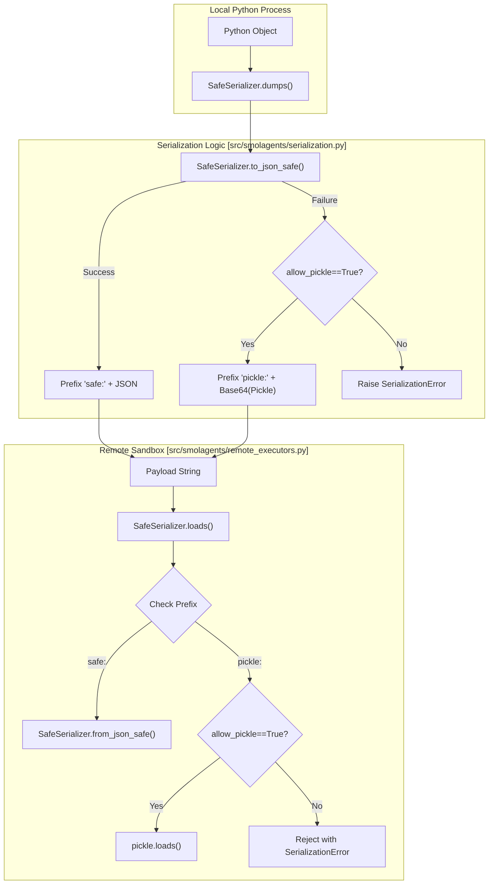
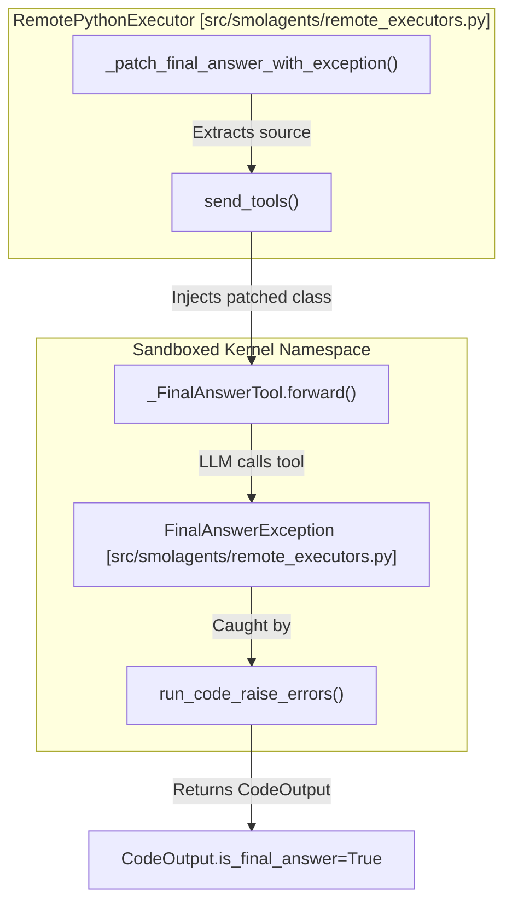

<!-- source: DeepWiki mcp.deepwiki.com · repo huggingface/smolagents · page 6.4 Security Model & Best Practices · fetched 2026-10-27 -->

# Security Model & Best Practices

Relevant source files

The following files were used as context for generating this wiki page:

- [src/smolagents/remote_executors.py](src/smolagents/remote_executors.py)
- [src/smolagents/serialization.py](src/smolagents/serialization.py)
- [tests/test_remote_executors.py](tests/test_remote_executors.py)
- [tests/test_serialization.py](tests/test_serialization.py)

This document describes the security architecture of `smolagents` execution environments, the threat model for LLM-generated code, and technical implementation details for safe serialization and tool patching. For implementation details of local execution, see [LocalPythonExecutor](6.2). For remote execution options, see [Remote Executors](6.3).

## Scope

This page covers:
- **Threat model** for LLM-generated code execution.
- **SafeSerializer implementation**: JSON-safe data flow with optional pickle fallback.
- **FinalAnswerTool patching**: How remote executors detect completion via exceptions.
- **Security flags**: Usage of `allow_pickle` and environment isolation.
- **Production security guidelines**: Risk assessment and sandbox selection.

## Threat Model

LLM-generated code execution introduces several attack vectors that differ from traditional software security concerns:

| Attack Vector | Description | Risk Level | Example |
|---------------|-------------|------------|---------|
| **LLM Error** | Model unintentionally generates harmful code while trying to be helpful | Low-Medium | LLM attempts to read system files to "help" debug. |
| **Supply Chain** | Compromised or malicious LLM generates harmful code deliberately | Very Low | Backdoored model on untrusted infrastructure. |
| **Prompt Injection** | Malicious instructions embedded in agent inputs (e.g., web content) | Medium-High | Website contains hidden instructions to exfiltrate data. |
| **Public Exploitation** | Malicious actors craft adversarial inputs to publicly accessible agents | High | Attacker finds input that triggers arbitrary code execution. |

Sources: [src/smolagents/remote_executors.py:53-68](), [src/smolagents/local_python_executor.py:46-75]()

## Safe Serialization & Data Flow

The `SafeSerializer` class handles the transfer of variables between the local agent process and the remote execution sandbox [src/smolagents/serialization.py:18-27](). It uses a prefix-based system to distinguish between safe JSON-serialized data and potentially dangerous pickle data [src/smolagents/serialization.py:53-56]().

### Serialization Logic

The serializer implements a "Safe-First" strategy:
1. **JSON Path**: Attempt to convert the object into a JSON-serializable dictionary with type markers (e.g., `{"__type__": "tuple", "data": [...]}`) via `to_json_safe` [src/smolagents/serialization.py:76-171]().
2. **Type Markers**: Supports extended types including `tuple`, `set`, `bytes`, `datetime`, `Decimal`, `Path`, `numpy.ndarray`, and `PIL.Image` [src/smolagents/serialization.py:98-158]().
3. **Pickle Fallback**: If `allow_pickle=True` and JSON serialization fails, it falls back to `pickle` with a `FutureWarning` [src/smolagents/serialization.py:228-245]().

### Data Flow Diagram
This diagram bridges the high-level data flow (Natural Language Space) to the internal serialization logic (Code Entity Space).

Sources: [src/smolagents/serialization.py:45-250](), [src/smolagents/remote_executors.py:115-132](), [tests/test_serialization.py:44-94]()

## FinalAnswerTool Patching Mechanism

Remote executors (E2B, Docker, etc.) cannot inspect the internal stack of the sandboxed Python process directly. To detect when an agent has reached a conclusion, `smolagents` patches the `FinalAnswerTool` [src/smolagents/remote_executors.py:143-156]().

### Implementation Detail

The `RemotePythonExecutor._patch_final_answer_with_exception` method performs the following:
1. **Class Injection**: It creates a subclass of the `FinalAnswerTool` [src/smolagents/remote_executors.py:159-160]().
2. **Method Override**: It replaces the `forward` method with a version that imports its own serialization logic (to ensure it runs standalone in the remote environment) [src/smolagents/remote_executors.py:168-205]().
3. **Exception Signaling**: Instead of returning a value, the patched `forward` raises a `FinalAnswerException`. The exception message contains the serialized result prefixed with `safe:` or `pickle:` [src/smolagents/remote_executors.py:286-308]().

### Execution Lifecycle Diagram
This diagram maps the interaction between the local executor and the remote kernel during the final answer phase.

Sources: [src/smolagents/remote_executors.py:143-308](), [src/smolagents/remote_executors.py:68-78](), [tests/test_remote_executors.py:158-180]()

## Security Flags & Best Practices

### The `allow_pickle` Flag
The `allow_pickle` parameter is a critical security toggle available in `RemotePythonExecutor` and its subclasses (E2B, Docker, etc.) [src/smolagents/remote_executors.py:60-66]().

- **`allow_pickle=False` (Default/Recommended)**: Enforces strict JSON-only serialization. If the agent attempts to return a complex custom object that isn't handled by `SafeSerializer.to_json_safe`, a `SerializationError` is raised [src/smolagents/remote_executors.py:61-61]().
- **`allow_pickle=True` (Legacy/High-Risk)**: Enables a fallback to Python's `pickle` module. 
    - **Security Warning**: Pickle deserialization can execute arbitrary code. This should only be used if you fully trust the execution environment and the models [src/smolagents/remote_executors.py:64-66]().

### Production Security Guidelines

1. **Use Remote Executors**: For any production or public-facing application, use `E2BExecutor`, `DockerExecutor`, `ModalExecutor`, or `BlaxelExecutor` to ensure process isolation [src/smolagents/remote_executors.py:42]().
2. **Sanitize Imports**: Even in remote environments, restrict `additional_imports` to the bare minimum required for the task [src/smolagents/remote_executors.py:72-76]().
3. **Disable Pickle**: Always set `allow_pickle=False` unless your specific use case requires passing non-standard Python objects that cannot be converted to JSON [src/smolagents/remote_executors.py:74-74]().
4. **Cleanup Resources**: Always call `cleanup()` on remote executors (like `E2BExecutor`) to ensure resources are released and sandboxes are terminated [tests/test_remote_executors.py:119-140]().

Sources: [src/smolagents/remote_executors.py:53-80](), [src/smolagents/serialization.py:24-27](), [tests/test_remote_executors.py:90-140]()

---

