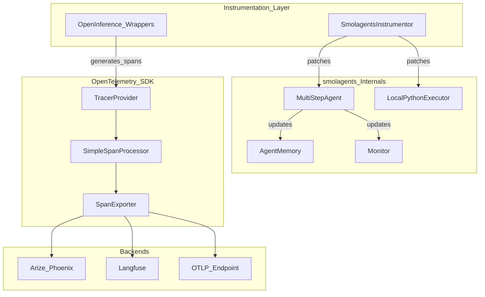
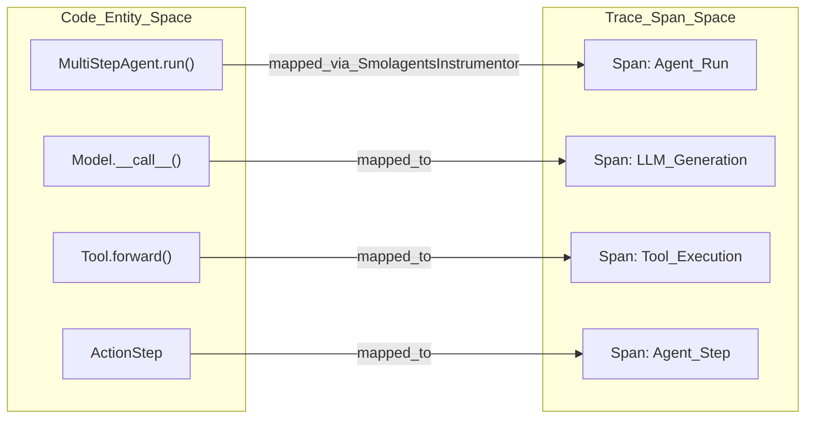

<!-- source: DeepWiki mcp.deepwiki.com · repo huggingface/smolagents · page 7.3 OpenTelemetry Integration · fetched 2026-10-27 -->

# OpenTelemetry Integration

<details>
<summary>Relevant source files</summary>

The following files were used as context for generating this wiki page:

- [pyproject.toml](pyproject.toml)
- [src/smolagents/__init__.py](src/smolagents/__init__.py)
- [tests/test_telemetry.py](tests/test_telemetry.py)

</details>


This document covers the OpenTelemetry instrumentation for `smolagents`, which enables automatic tracing and observability of agent execution across compatible platforms. This integration allows developers to inspect the "thought process" of agents, including tool calls, code execution, and model interactions in a structured, hierarchical format.

## Purpose and Scope

The OpenTelemetry integration provides production-grade observability by automatically capturing execution traces. Unlike standard logging, these traces preserve the nested relationship between different components of an agent's lifecycle.

Key capabilities include:
- **Automatic Instrumentation**: Capture spans for agent steps (planning, actions, final answers) without modifying core agent logic.
- **Detailed Metadata**: Track token usage, model IDs, and execution timing per step.
- **Code Execution Tracing**: Record the Python code generated by `CodeAgent` and its resulting output or errors.
- **Distributed Tracing**: Follow tasks as they are delegated from a manager agent to managed agents.

This integration relies on the `openinference-instrumentation-smolagents` package, which maps internal `smolagents` structures to the OpenInference standard.

Sources: [pyproject.toml:69-74](), [tests/test_telemetry.py:31-36]()

---

## OpenTelemetry Architecture

The integration bridges the gap between the agent's internal state (`AgentMemory` and `Monitor`) and external observability backends.

### System Architecture Diagram
Title: Telemetry Data Flow


**Data Flow and Entity Mapping**

The `SmolagentsInstrumentor` wraps key methods in the `smolagents` library. When `agent.run()` is called, it initiates a root span. Each iteration of the ReAct loop creates child spans corresponding to `ActionStep` or `PlanningStep` objects found in `AgentMemory`. The `openinference-instrumentation-smolagents` package specifically handles the extraction of attributes like `TokenUsage`.

Sources: [tests/test_telemetry.py:47-64](), [pyproject.toml:69-74](), [tests/test_telemetry.py:31-31]()

---

## Installation and Setup

The telemetry features are available as an optional dependency group in `pyproject.toml`.

### Installation

```bash
pip install "smolagents[telemetry]"
```

This command installs the following core components:
- `opentelemetry-sdk`: The standard Python OTEL implementation.
- `openinference-instrumentation-smolagents`: The specific bridge for `smolagents` (version `>=0.1.15` for updated `TokenUsage` structure).
- `arize-phoenix`: A local visualization and evaluation backend.
- `opentelemetry-exporter-otlp`: For exporting to external collectors.

Sources: [pyproject.toml:69-74]()

### Basic Initialization

To begin tracing, you must initialize the `SmolagentsInstrumentor` before your agent starts its work. This is typically done by providing a `TracerProvider`.

```python
from openinference.instrumentation.smolagents import SmolagentsInstrumentor
from opentelemetry.sdk.trace import TracerProvider
from opentelemetry.sdk.trace.export import SimpleSpanProcessor, ConsoleSpanExporter

# 1. Setup OTEL Provider
endpoint = TracerProvider()
endpoint.add_span_processor(SimpleSpanProcessor(ConsoleSpanExporter()))

# 2. Instrument smolagents
SmolagentsInstrumentor().instrument(tracer_provider=endpoint)
```

Sources: [tests/test_telemetry.py:31-31](), [tests/test_telemetry.py:47-64]()

---

## Traced Entities and Attributes

The instrumentation captures specific data from the `smolagents` classes and maps them to OpenInference attributes.

### Mapping Code Entities to Spans
Title: Entity Mapping to OpenInference Spans


### Captured Attributes

The instrumentor extracts the following information:

| Entity | Source Code Reference | Captured Attributes |
| :--- | :--- | :--- |
| **Model** | `smolagents.models.Model` | `model_id`, `input_messages`, `output_messages`, `token_usage` |
| **Tool** | `smolagents.tools.Tool` | `tool_name`, `tool_inputs`, `tool_output` |
| **Step** | `smolagents.memory.ActionStep` | `step_number`, `duration`, `llm_output`, `observations` |
| **Executor** | `smolagents.local_python_executor.LocalPythonExecutor` | `code_block`, `execution_outputs`, `errors` |

Sources: [tests/test_telemetry.py:68-89](), [pyproject.toml:73-74](), [src/smolagents/__init__.py:19-32]()

---

## Arize Phoenix Integration

Arize Phoenix is the recommended local backend for debugging `smolagents`. It provides a web UI to visualize the complex branching of agentic workflows.

### Setup with Phoenix

```python
import phoenix as px
from openinference.instrumentation.smolagents import SmolagentsInstrumentor

# Start Phoenix server
session = px.launch_app()

# Instrument with default Phoenix collector endpoint
SmolagentsInstrumentor().instrument()

# Now run your agent
from smolagents import CodeAgent, DuckDuckGoSearchTool, HfApiModel
agent = CodeAgent(tools=[DuckDuckGoSearchTool()], model=HfApiModel())
agent.run("How many people live in France?")
```

### Visualizing Token Usage

The integration specifically tracks `TokenUsage` objects. When a model returns a response, the `Monitor` updates the cumulative counts, which are then attached to the current span attributes. Version `0.1.15` of the instrumentation is required to support the library's `TokenUsage` structure.

Sources: [pyproject.toml:73-74](), [tests/test_telemetry.py:83-89]()

---

## Distributed Tracing and Multi-Agent Systems

When using `ManagedAgent`, the telemetry integration automatically links the parent agent's span to the child agent's execution.

1. **Context Propagation**: The OpenTelemetry context is passed from the manager agent to the `ManagedAgent`.
2. **Span Hierarchy**: The `ManagedAgent.run()` call appears as a child span within the `ActionStep` where the manager decided to delegate the task.
3. **Tool Equivalence**: Since `ManagedAgent` is treated as a tool by the manager, it generates tool-call spans that contain the nested agent's entire ReAct loop.

Sources: [src/smolagents/__init__.py:19-32](), [tests/test_telemetry.py:55-64]()

---

## Testing and Verification

The codebase includes verification utilities to ensure spans are being generated correctly. In a testing environment, you can use `InMemorySpanExporter` to inspect generated spans programmatically.

```python
# From tests/test_telemetry.py
from opentelemetry.sdk.trace.export.in_memory_span_exporter import InMemorySpanExporter

def test_telemetry_capture():
    exporter = InMemorySpanExporter()
    # ... setup provider with exporter ...
    
    model = InferenceClientModel()
    model(messages=[{"role": "user", "content": "Hello"}])
    
    spans = exporter.get_finished_spans()
    assert len(spans) > 0
    assert spans[0].name == "InferenceClientModel.generate"
```

Sources: [tests/test_telemetry.py:42-52](), [tests/test_telemetry.py:68-89]()

---

