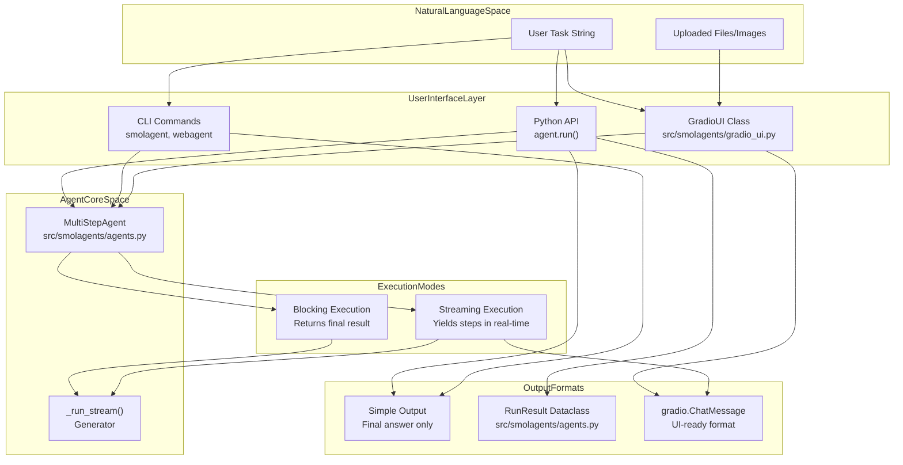
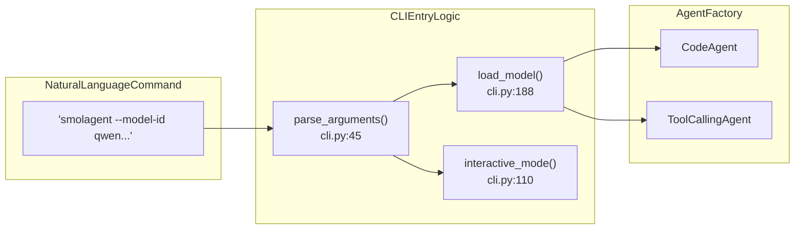
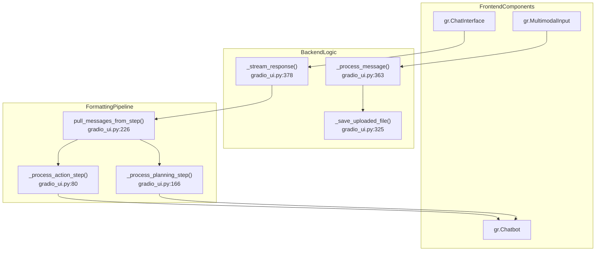

<!-- source: DeepWiki mcp.deepwiki.com · repo huggingface/smolagents · page 8 User Interfaces · fetched 2026-10-27 -->

# User Interfaces

<details>
<summary>Relevant source files</summary>

The following files were used as context for generating this wiki page:

- [examples/agent_from_any_llm.py](examples/agent_from_any_llm.py)
- [examples/gradio_ui.py](examples/gradio_ui.py)
- [src/smolagents/cli.py](src/smolagents/cli.py)
- [src/smolagents/gradio_ui.py](src/smolagents/gradio_ui.py)
- [src/smolagents/vision_web_browser.py](src/smolagents/vision_web_browser.py)
- [tests/test_cli.py](tests/test_cli.py)
- [tests/test_monitoring.py](tests/test_monitoring.py)
- [tests/test_vision_web_browser.py](tests/test_vision_web_browser.py)

</details>


This document describes the primary user-facing interfaces for interacting with `smolagents`: the **Python API**, the **Command Line Interface (CLI)**, and the **Gradio Web UI**. Each interface provides different levels of control and convenience for running agents, from programmatic integration to interactive web-based interaction.

For details on the underlying agent logic, see [Python API](#8.1). For web-specific interaction, see [Gradio Web UI](#8.3).

---

## Overview of User Interface Options

`smolagents` provides three distinct interfaces to accommodate different use cases and user preferences:

Title: UI to Agent Core Mapping


**Sources:** [src/smolagents/agents.py:436-612](), [src/smolagents/gradio_ui.py:279-323](), [src/smolagents/cli.py:45-107]()

---

## Python API

The Python API provides direct programmatic access to agent functionality through the `agent.run()` method, which is the primary entry point for all agent types such as `CodeAgent` and `ToolCallingAgent`. [src/smolagents/agents.py:436-467]()

### Core Method: `agent.run()`

The `run()` method executes an agent with a given task and returns either the final answer or a comprehensive `RunResult` object. [src/smolagents/agents.py:436-467]()

**Method Signature:**
```python
def run(
    task: str,
    stream: bool = False,
    reset: bool = True,
    images: list[PIL.Image.Image] | None = None,
    additional_args: dict | None = None,
    max_steps: int | None = None,
    return_full_result: bool | None = None,
) -> Any | RunResult
```

### Return Values

#### Simple Output Mode (`return_full_result=False`)
Returns the final answer directly, which can be any type depending on the task (e.g., `AgentImage`, `AgentAudio`, or standard Python types). [src/smolagents/agents.py:538]()

#### Full Result Mode (`return_full_result=True`)
Returns a `RunResult` dataclass containing the final output, execution state, memory steps, and metrics. [src/smolagents/agents.py:535]()

For details, see [Python API](#8.1).

**Sources:** [src/smolagents/agents.py:436-538](), [examples/agent_from_any_llm.py:55-61]()

---

## Command Line Interface

`smolagents` provides two CLI entry points defined in the package structure:

| Command | Module Entry Point | Description |
|---------|--------|-------------|
| `smolagent` | `smolagents.cli:run_smolagent` | General-purpose agent CLI for interactive task execution. |
| `webagent` | `smolagents.vision_web_browser:run_webagent` | Specialized CLI for web browser automation with vision capabilities. |

### CLI Architecture

Title: CLI Entry Point Logic


**Sources:** [src/smolagents/cli.py:45-220](), [src/smolagents/vision_web_browser.py:27-63](), [tests/test_cli.py:62-85]()

### Interactive Mode
The CLI features an `interactive_mode()` that guides users through agent setup using `rich.prompt`. This includes selecting action types (`code` or `tool_calling`), selecting tools from `TOOL_MAPPING`, and configuring model providers like `InferenceClientModel`, `OpenAIModel`, or `TransformersModel`. [src/smolagents/cli.py:110-185]()

### Vision Web Browser CLI
The `webagent` command uses `vision_web_browser.py` to provide a vision-enabled browsing experience. It includes specialized tools like `search_item_ctrl_f` and `close_popups`, and utilizes a `save_screenshot` callback to provide visual context to the model by attaching images to `memory_step.observations_images`. [src/smolagents/vision_web_browser.py:66-157]()

For details, see [Command Line Interface](#8.2).

---

## Gradio Web UI

The `GradioUI` class provides a web-based chat interface built on Gradio's `ChatInterface`. It supports multimodal inputs, file uploads, and live streaming of agent thoughts and tool executions. [src/smolagents/gradio_ui.py:279-323]()

### GradioUI Architecture

Title: Gradio UI Component Flow


**Sources:** [src/smolagents/gradio_ui.py:279-462](), [examples/gradio_ui.py:1-16]()

### Key Features
- **File Uploads:** Handled via `_save_uploaded_file`, which sanitizes filenames and saves them to a designated folder. [src/smolagents/gradio_ui.py:325-333]()
- **Step Visualization:** `_process_action_step` generates specific messages for tool calls (e.g., `python_interpreter`), execution logs, and observation images. [src/smolagents/gradio_ui.py:80-150]()
- **Metadata:** Displays token usage and step duration using `get_step_footnote_content`. [src/smolagents/gradio_ui.py:29-36]()

For details, see [Gradio Web UI](#8.3).

---

## Streaming & Real-time Updates

All interfaces can leverage the `_run_stream()` generator to provide real-time updates rather than waiting for the final answer. [src/smolagents/agents.py:540-612]()

### Streaming Pipeline
1. **Deltas:** The model yields `ChatMessageStreamDelta` objects during generation. [src/smolagents/models.py:25]()
2. **Aggregation:** `agglomerate_stream_deltas` combines these chunks into a full message for UI rendering. [src/smolagents/gradio_ui.py:408]()
3. **UI Updates:** The `stream_to_gradio` utility converts these stream events into a format Gradio can display incrementally. [src/smolagents/gradio_ui.py:248-277]()

For details, see [Streaming & Real-time Updates](#8.4).

**Sources:** [src/smolagents/agents.py:540-612](), [src/smolagents/gradio_ui.py:248-277](), [tests/test_monitoring.py:100-118]()

---

