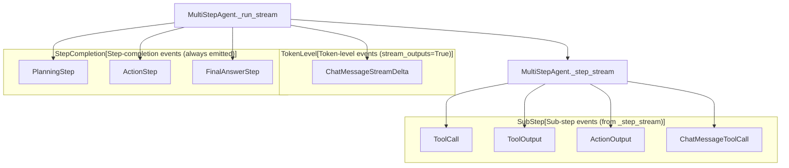
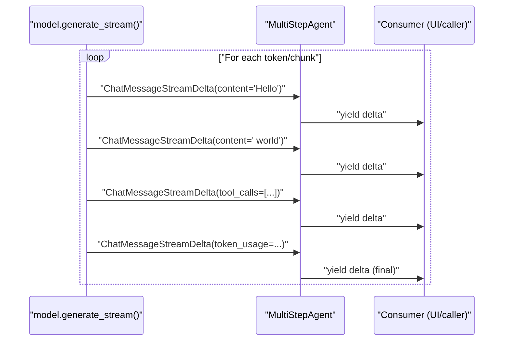
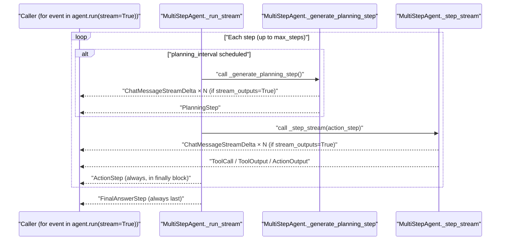
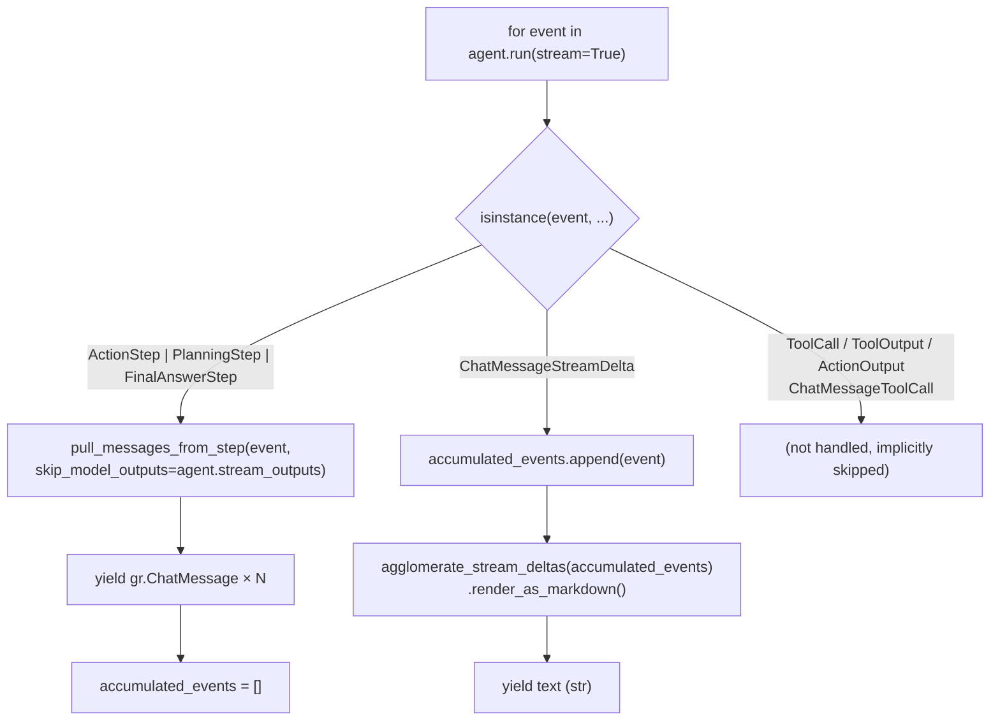
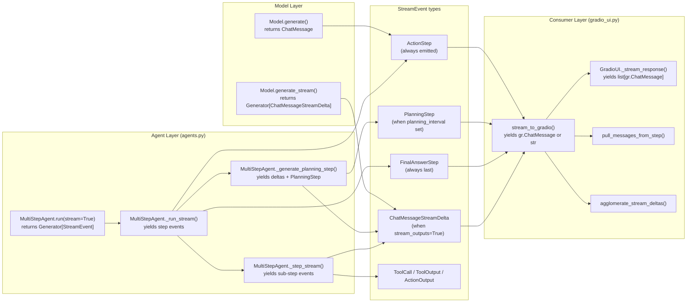

<!-- source: DeepWiki mcp.deepwiki.com · repo huggingface/smolagents · page 8.4 Streaming & Real-time Updates · fetched 2026-10-27 -->

# Streaming & Real-time Updates

<details>
<summary>Relevant source files</summary>

The following files were used as context for generating this wiki page:

- [examples/gradio_ui.py](examples/gradio_ui.py)
- [src/smolagents/gradio_ui.py](src/smolagents/gradio_ui.py)
- [src/smolagents/models.py](src/smolagents/models.py)
- [tests/test_models.py](tests/test_models.py)
- [tests/test_monitoring.py](tests/test_monitoring.py)

</details>


This page covers how `smolagents` implements streaming execution: the `agent.run(stream=True)` API, the internal `_run_stream` generator, the full set of event types it produces, and how `stream_to_gradio` and `GradioUI` consume those events to render real-time output.

For information on the Gradio UI's overall structure and file upload support, see [8.3](). For information on individual step types and memory storage, see [3.4](). For model-level streaming configuration (`generate_stream`), see [4.4]().

---

## Overview

Every agent run is internally driven by a generator. When `stream=False` (the default), the generator is consumed silently and only the final answer is returned. When `stream=True`, the same generator is returned directly to the caller, yielding structured event objects as each step executes.

This design means streaming is not a separate code path — it is the code path. The non-streaming mode simply forces evaluation.

---

## The `run()` Entry Point

`MultiStepAgent.run()` is defined in [src/smolagents/agents.py:436-538]().

| Parameter | Type | Effect |
|---|---|---|
| `stream` | `bool` | If `True`, returns the `_run_stream` generator directly [src/smolagents/agents.py:537-538]() |
| `reset` | `bool` | Whether to clear memory before running [src/smolagents/agents.py:488-493]() |
| `images` | `list[PIL.Image.Image] | None` | Images attached to the task [src/smolagents/agents.py:455-456]() |
| `additional_args` | `dict | None` | Extra variables passed into the agent state [src/smolagents/agents.py:457-458]() |
| `max_steps` | `int | None` | Override the agent's default `max_steps` [src/smolagents/agents.py:454-455]() |

When `stream=True`, `run()` returns immediately with the generator object. **No agent execution happens until the caller iterates over it.** The generator is lazy.

When `stream=False`, `run()` internally calls `list(self._run_stream(...))`, then extracts the final answer from the last element (which is always a `FinalAnswerStep`).

```python
# stream=False path (simplified):
steps = list(self._run_stream(...))    # blocks until complete [src/smolagents/agents.py:521-521]()
# returns result.output [src/smolagents/agents.py:535-535]()
```

Sources: [src/smolagents/agents.py:436-538]()

---

## Stream Event Types

The `StreamEvent` type alias in [src/smolagents/agents.py:256-265]() defines every possible object that can be yielded from the stream:

```python
StreamEvent = Union[
    ChatMessageStreamDelta,   # token chunk from model
    ChatMessageToolCall,      # tool call from model message
    ActionOutput,             # result of one action (code/tool execution)
    ToolCall,                 # a single tool invocation descriptor
    ToolOutput,               # result of a single tool call
    PlanningStep,             # completed planning step (with plan text)
    ActionStep,               # completed action step (always emitted at end of step)
    FinalAnswerStep,          # final answer (always last event)
]
```

**Diagram: StreamEvent Type Hierarchy and Source**



Sources: [src/smolagents/agents.py:256-265](), [src/smolagents/agents.py:772-780]()

---

## ChatMessageStreamDelta Structure

The `ChatMessageStreamDelta` dataclass defined at [src/smolagents/models.py:214-218]() represents a single streaming chunk from the model:

| Field | Type | Description |
|---|---|---|
| `content` | `str | None` | Incremental text content for this chunk |
| `tool_calls` | `list[ChatMessageToolCallStreamDelta] | None` | Incremental tool call data |
| `token_usage` | `TokenUsage | None` | Token counts (typically only on final chunk) |

**ChatMessageToolCallStreamDelta Structure**

Tool call information is streamed incrementally via `ChatMessageToolCallStreamDelta` ([src/smolagents/models.py:204-212]()):

| Field | Type | Description |
|---|---|---|
| `index` | `int | None` | Index of the tool call being updated (for parallel calls) |
| `id` | `str | None` | Unique identifier for the tool call |
| `type` | `str | None` | Type of tool call (typically `"function"`) |
| `function` | `ChatMessageToolCallFunction | None` | Function name and arguments (streamed incrementally) |

The `function.arguments` field accumulates character-by-character across deltas. The `function.name` is typically sent in the first delta for that tool call.

**Diagram: ChatMessageStreamDelta Flow**



Sources: [src/smolagents/models.py:204-218]()

---

## Agglomerating Stream Deltas

The `agglomerate_stream_deltas` function at [src/smolagents/models.py:220-279]() accumulates a list of `ChatMessageStreamDelta` objects into a single complete `ChatMessage`.

**Algorithm:**

1. **Content accumulation**: Concatenate all `delta.content` strings in order [src/smolagents/models.py:231-234]()
2. **Tool call assembly**: Group tool call deltas by `index`, then for each: [src/smolagents/models.py:236-258]()
   - Accumulate `function.arguments` strings incrementally [src/smolagents/models.py:252-253]()
   - Take the first non-empty `function.name` seen for that index [src/smolagents/models.py:250-251]()
   - Use the last `id` and `type` values [src/smolagents/models.py:247-248]()
3. **Token usage summation**: Take the last non-null `token_usage` [src/smolagents/models.py:260-262]()

**Key Implementation Detail: Tool Call Indexing**

Tool calls are tracked by `index` in a dictionary (`accumulated_tool_calls: dict[int, ChatMessageToolCallStreamDelta]`). This supports parallel tool calls, where multiple tools may be invoked in a single model response. Each tool call has its own index, and deltas for that tool call all share the same index.

```python
# From src/smolagents/models.py:236-258
for tool_call_delta in stream_delta.tool_calls:
    if tool_call_delta.index not in accumulated_tool_calls:
        accumulated_tool_calls[tool_call_delta.index] = ChatMessageToolCallStreamDelta(
            id=tool_call_delta.id,
            type=tool_call_delta.type,
            function=ChatMessageToolCallFunction(name="", arguments=""),
        )
    tool_call = accumulated_tool_calls[tool_call_delta.index]
    if tool_call_delta.function:
        if tool_call_delta.function.name:
            tool_call.function.name = tool_call_delta.function.name
        if tool_call_delta.function.arguments:
            tool_call.function.arguments += tool_call_delta.function.arguments
```

**Test Coverage**: The test at [tests/test_models.py:80-139]() validates that content and tool call arguments are correctly accumulated, including handling of parallel tool calls and token usage summation.

Sources: [src/smolagents/models.py:220-279](), [tests/test_models.py:80-139]()

---

## The `_run_stream` Generator

`MultiStepAgent._run_stream()` is the core generator defined at [src/smolagents/agents.py:540-611](). It orchestrates the full agent loop.

**Diagram: _run_stream Event Emission Order**



Key behaviors of `_run_stream`:

- **Planning steps** are interleaved before action steps whenever `planning_interval` is set [src/smolagents/agents.py:566-571](). The `_generate_planning_step` sub-generator first yields token deltas (if applicable), then a `PlanningStep` [src/smolagents/agents.py:658-670]().
- **Action steps** are always terminated by yielding the `ActionStep` object in a `finally` block [src/smolagents/agents.py:594-603](), even if an error occurred. The error is stored on `action_step.error` [src/smolagents/agents.py:592-592]().
- **`FinalAnswerStep`** is always the last yielded event [src/smolagents/agents.py:611-611](), whether the agent succeeded or ran out of steps.
- **`AgentGenerationError`** is re-raised immediately and is not caught internally [src/smolagents/agents.py:588-589](). All other `AgentError` subtypes are stored on the step and execution continues.

Sources: [src/smolagents/agents.py:540-611](), [src/smolagents/agents.py:594-603]()

---

## Token-Level Streaming (`stream_outputs`)

In addition to step-level events, the agent supports token-by-token output from the LLM. This is controlled by the `stream_outputs` attribute on the agent instance.

When `stream_outputs=True` and the model implements `generate_stream()`, the planning and action steps use the streaming API instead of `generate()`. Each token chunk is yielded as a `ChatMessageStreamDelta` before the step's terminal event.

`stream_outputs` defaults to `False` [src/smolagents/agents.py:352](). It can be set to `True` when constructing the agent, as shown in [examples/gradio_ui.py:12]().

**Models that support `generate_stream`** (see [4.3]() and [4.2]()):
- `TransformersModel`
- `LiteLLMModel`
- `InferenceClientModel`
- `OpenAIModel`

The check in `_generate_planning_step` is:

```python
if self.stream_outputs and hasattr(self.model, "generate_stream"):
    # uses model.generate_stream(), yields ChatMessageStreamDelta per token [src/smolagents/agents.py:658-662]()
else:
    # uses model.generate(), no intermediate events [src/smolagents/agents.py:663-667]()
```

Sources: [src/smolagents/agents.py:658-670](), [src/smolagents/agents.py:714-728]()

---

## Consuming the Stream

### Direct Iteration

Callers can iterate over the generator directly and branch on event type:

```python
for event in agent.run(task, stream=True):
    if isinstance(event, FinalAnswerStep):
        print("Answer:", event.output)
    elif isinstance(event, ActionStep):
        print(f"Step {event.step_number} done, error={event.error}")
    elif isinstance(event, ChatMessageStreamDelta):
        print(event.content, end="", flush=True)
```

### `stream_to_gradio()`

`stream_to_gradio()` in [src/smolagents/gradio_ui.py:248-276]() is a standalone function that translates stream events into `gradio.ChatMessage` objects.

**Function Signature:**

```python
def stream_to_gradio(
    agent,
    task: str,
    task_images: list | None = None,
    reset_agent_memory: bool = False,
    additional_args: dict | None = None,
) -> Generator
```

**Diagram: stream_to_gradio Event Processing**



**Event Accumulation Pattern:**

The function maintains an `accumulated_events` list that collects `ChatMessageStreamDelta` objects until a step completion event arrives [src/smolagents/gradio_ui.py:257-276](). At step boundaries, the accumulated deltas are:

1. Agglomerated into a single `ChatMessage` via `agglomerate_stream_deltas()` [src/smolagents/gradio_ui.py:266-266]()
2. Rendered as markdown via `.render_as_markdown()` [src/smolagents/gradio_ui.py:267-267]()
3. Yielded as a string to update the streaming text bubble [src/smolagents/gradio_ui.py:268-268]()
4. Cleared (`accumulated_events = []`) to prepare for the next step [src/smolagents/gradio_ui.py:276-276]()

The `skip_model_outputs` flag is set to `True` when `agent.stream_outputs=True`, preventing duplicate display of the model's text output (once as streaming deltas, and again when the completed `ActionStep` arrives) [src/smolagents/gradio_ui.py:271-271]().

Sources: [src/smolagents/gradio_ui.py:248-276](), [src/smolagents/gradio_ui.py:261-276]()

---

## Step-to-Message Conversion

`pull_messages_from_step()` at [src/smolagents/gradio_ui.py:226-245]() routes to a type-specific helper:

| Input type | Handler | Output |
|---|---|---|
| `ActionStep` | `_process_action_step()` | Step number, model output (thought), tool call block, execution logs, images, error, footnote [src/smolagents/gradio_ui.py:235-236]() |
| `PlanningStep` | `_process_planning_step()` | Plan text, token/duration footnote [src/smolagents/gradio_ui.py:237-238]() |
| `FinalAnswerStep` | `_process_final_answer_step()` | Text, image, or audio depending on output type [src/smolagents/gradio_ui.py:239-240]() |

**`_process_action_step`** ([src/smolagents/gradio_ui.py:80-163]()) yields multiple `gr.ChatMessage` objects in sequence:
1. Step number header [src/smolagents/gradio_ui.py:94-96]()
2. Model reasoning text (`step_log.model_output`) [src/smolagents/gradio_ui.py:101-101]()
3. Tool call block (with code formatting if `python_interpreter`) [src/smolagents/gradio_ui.py:128-128]()
4. Execution logs (`step_log.observations`) [src/smolagents/gradio_ui.py:135-139]()
5. Output images (`step_log.observations_images`) [src/smolagents/gradio_ui.py:143-149]()
6. Error message (`step_log.error`) [src/smolagents/gradio_ui.py:153-155]()
7. Token/duration footnote [src/smolagents/gradio_ui.py:158-162]()

**`_process_final_answer_step`** ([src/smolagents/gradio_ui.py:189-223]()) handles `AgentText`, `AgentImage`, `AgentAudio`, and plain values with different content formats.

Sources: [src/smolagents/gradio_ui.py:80-163](), [src/smolagents/gradio_ui.py:166-186](), [src/smolagents/gradio_ui.py:189-223](), [src/smolagents/gradio_ui.py:226-245]()

---

## `GradioUI._stream_response()`

`GradioUI._stream_response()` at [src/smolagents/gradio_ui.py:378-420]() is the method wired to `gr.ChatInterface`. It extends the `stream_to_gradio` pattern with stateful message list management for the Gradio chatbot component.

**State Management:**

| Variable | Type | Purpose |
|---|---|---|
| `all_messages` | `list[gr.ChatMessage]` | Complete chat history displayed in the UI [src/smolagents/gradio_ui.py:382-382]() |
| `accumulated_events` | `list[ChatMessageStreamDelta]` | Deltas for the current streaming token sequence [src/smolagents/gradio_ui.py:383-383]() |
| `streaming_msg_idx` | `int | None` | Index in `all_messages` of the live streaming bubble [src/smolagents/gradio_ui.py:384-384]() |

**Update Algorithm:**

The key insight is that the streaming bubble is **replaced in-place** during streaming (lines 410-419) by updating `all_messages[streaming_msg_idx]`, then **removed** when the step completes (lines 393-395) to be replaced with the finalized step messages. This prevents duplicate display of the model's output.

**HTML Escaping:** The streaming text is escaped at [src/smolagents/gradio_ui.py:413]() to prevent accidental HTML rendering in the Gradio chat interface.

Sources: [src/smolagents/gradio_ui.py:378-420]()

---

## Summary: Event Flow Reference

**Diagram: Complete Streaming Data Flow from Model to UI**



Sources: [src/smolagents/agents.py:256-265](), [src/smolagents/agents.py:540-611](), [src/smolagents/gradio_ui.py:248-276](), [src/smolagents/gradio_ui.py:378-420]()

---

