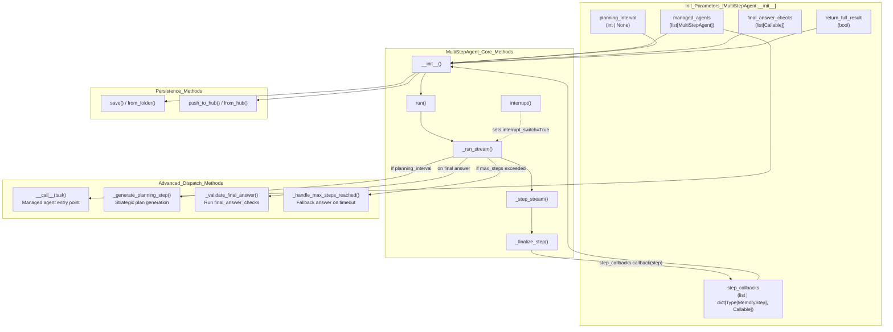
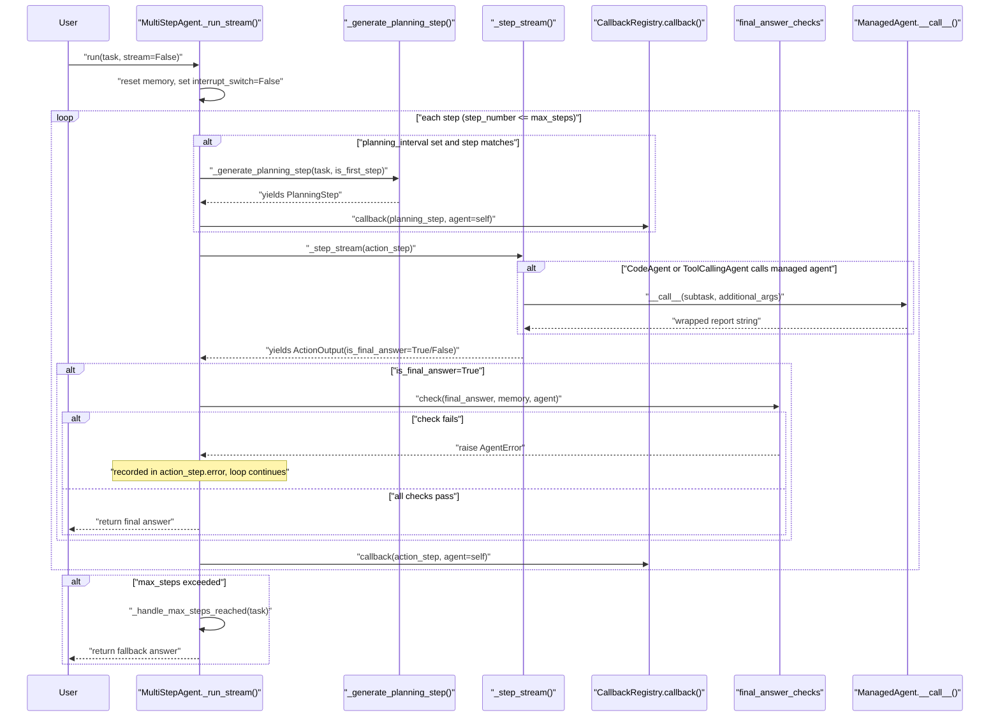
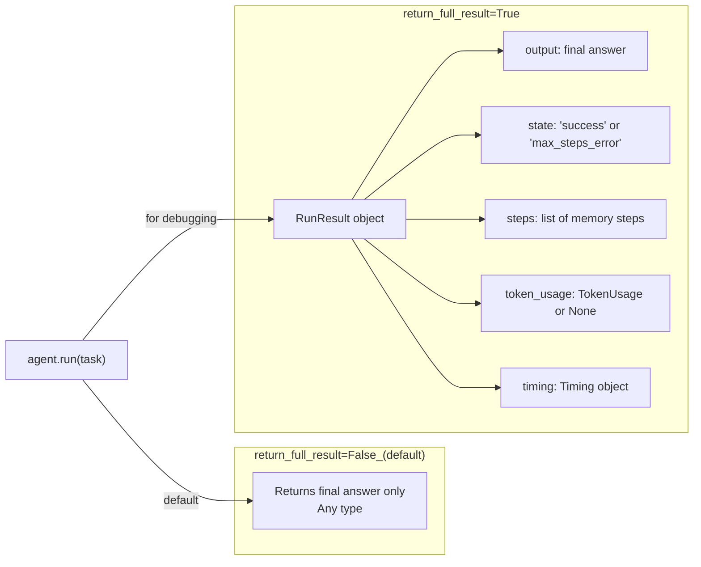
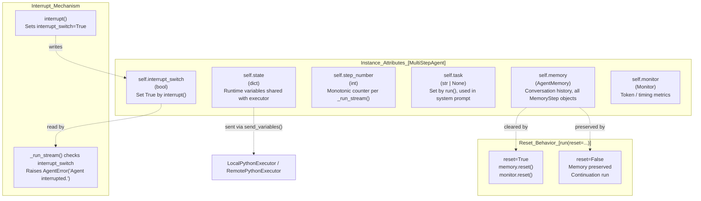

<!-- source: DeepWiki mcp.deepwiki.com · repo huggingface/smolagents · page 9 Advanced Features · fetched 2026-10-27 -->

# Advanced Features

Relevant source files

The following files were used as context for generating this wiki page:

- [docs/source/en/conceptual_guides/intro_agents.md](docs/source/en/conceptual_guides/intro_agents.md)
- [docs/source/en/examples/rag.md](docs/source/en/examples/rag.md)
- [docs/source/en/examples/text_to_sql.md](docs/source/en/examples/text_to_sql.md)
- [docs/source/en/tutorials/building_good_agents.md](docs/source/en/tutorials/building_good_agents.md)
- [docs/source/en/tutorials/tools.md](docs/source/en/tutorials/tools.md)
- [src/smolagents/agents.py](src/smolagents/agents.py)
- [tests/test_agents.py](tests/test_agents.py)

This page documents advanced capabilities of `smolagents` that extend beyond basic agent creation and execution. These features enable complex workflows including multi-agent coordination, strategic planning, robust error recovery, agent sharing, and human-in-the-loop patterns.

For basic agent setup and usage, see [Getting Started](#2). For core agent concepts, see [Key Concepts](#2.3). For detailed agent implementation, see [Agent Framework](#3).

## Overview

Advanced features in `smolagents` are implemented primarily in the `MultiStepAgent` base class [src/smolagents/agents.py:268-292]() and its subclasses `CodeAgent` [src/smolagents/agents.py:900-928]() and `ToolCallingAgent` [src/smolagents/agents.py:1181-1205](). These features are configured through initialization parameters and accessed through specific agent methods:

| Feature | Configuration Parameter | Primary Methods | Covered in Section |
|---------|------------------------|-----------------|-------------------|
| Multi-Agent Systems | `managed_agents` | `__call__()` | [Multi-Agent Systems](#9.1) |
| Planning Strategy | `planning_interval` | `_generate_planning_step()` | [Planning Intervals & Strategy](#9.2) |
| Error Handling | `final_answer_checks` | `_validate_final_answer()` | [Error Handling & Recovery](#9.3) |
| Persistence | N/A | `save()`, `from_folder()`, `push_to_hub()`, `from_hub()` | [Agent Persistence & Hub Integration](#9.4) |
| Human-in-the-Loop | `step_callbacks` | `_finalize_step()` | [Human-in-the-Loop Workflows](#9.5) |

**Sources:** [src/smolagents/agents.py:268-353]()

## Architecture Overview

**`MultiStepAgent` advanced configuration and method relationships**

**Sources:** [src/smolagents/agents.py:268-353](), [src/smolagents/agents.py:436-638](), [src/smolagents/agents.py:754-756]()

## Feature Interaction Patterns

**How advanced features interact inside `_run_stream()`**

**Sources:** [src/smolagents/agents.py:540-611](), [src/smolagents/agents.py:613-637](), [src/smolagents/agents.py:868-886]()

## Return Value Options

Agents support two return modes controlled by `return_full_result` [src/smolagents/agents.py:313]():

The `RunResult` class [src/smolagents/agents.py:196-209]() provides comprehensive execution metadata:

- **`output`**: The final answer from the agent (same as default return) [src/smolagents/agents.py:211]().
- **`state`**: Either `"success"` or `"max_steps_error"` indicating completion status [src/smolagents/agents.py:212]().
- **`steps`**: Full memory history as dictionaries (via `memory.get_full_steps()`) [src/smolagents/agents.py:213]().
- **`token_usage`**: Total tokens consumed if model provides usage data [src/smolagents/agents.py:214]().
- **`timing`**: Execution start time, end time, and duration [src/smolagents/agents.py:215]().

**Sources:** [src/smolagents/agents.py:195-254](), [src/smolagents/agents.py:505-536]()

## Configuration Best Practices

| Use Case | Recommended Configuration |
|----------|--------------------------|
| Simple single-task | No advanced features needed |
| Complex multi-step task | `planning_interval=3`, `max_steps=30` |
| Delegation to specialists | `managed_agents=[specialist1, specialist2]` |
| Quality assurance | `final_answer_checks=[validator_func]` |
| Per-step type callbacks | `step_callbacks={ActionStep: [cb1], PlanningStep: [cb2]}` |
| Post-run inspection | `return_full_result=True` to get `RunResult` |
| Sharing with community | Use `push_to_hub()` after development |
| Graceful stop | Call `agent.interrupt()` to set `interrupt_switch=True` |
| Multi-turn dialogue | Call `agent.run(next_task, reset=False)` |

**Sources:** [src/smolagents/agents.py:294-336](), [src/smolagents/agents.py:754-756](), [tests/test_agents.py:484-496](), [tests/test_agents.py:664-738]()

## Agent State Management

**Runtime attributes and their lifecycle within `MultiStepAgent`**

Key behaviors:

- **`self.state`**: For `CodeAgent`, variables placed here are accessible inside code execution steps by name [src/smolagents/agents.py:331-353]().
- **`self.interrupt_switch`**: Set to `False` at the start of every `run()` call [src/smolagents/agents.py:540-548](). Can be set to `True` from another thread via `interrupt()` to stop execution gracefully at the next iteration boundary [src/smolagents/agents.py:754-756]().
- **`reset=False`**: Allows multi-turn conversations where memory from prior `run()` calls is visible in subsequent calls, enabling stateful dialogue [src/smolagents/agents.py:436-492]().

**Sources:** [src/smolagents/agents.py:331-353](), [src/smolagents/agents.py:436-492](), [src/smolagents/agents.py:540-548](), [src/smolagents/agents.py:754-756](), [tests/test_agents.py:484-496]()

## Advanced Initialization Parameters

Beyond basic `tools` and `model`, `MultiStepAgent` accepts parameters for advanced workflows:

| Parameter | Type | Default | Purpose |
|-----------|------|---------|---------|
| `managed_agents` | `list[MultiStepAgent]` | `None` | Sub-agents callable as tools; each must have `name` and `description` [src/smolagents/agents.py:294](). |
| `planning_interval` | `int \| None` | `None` | Run a planning step every N action steps [src/smolagents/agents.py:302](). |
| `step_callbacks` | `list[Callable] \| dict` | `None` | Hooks invoked by `_finalize_step()` after each step [src/smolagents/agents.py:304](). |
| `final_answer_checks` | `list[Callable]` | `None` | Validators receiving `(final_answer, memory, agent)` [src/smolagents/agents.py:307](). |
| `return_full_result` | `bool` | `False` | Return `RunResult` instead of raw output from `run()` [src/smolagents/agents.py:313](). |
| `provide_run_summary` | `bool` | `False` | Append memory summary to managed agent output [src/smolagents/agents.py:318](). |

**`step_callbacks` registration detail:** When passed as a `list`, all callbacks are registered only for `ActionStep`. When passed as a `dict`, keys are `MemoryStep` subclasses (`ActionStep`, `PlanningStep`, etc.) [src/smolagents/agents.py:416-434](). Internally these are stored in a `CallbackRegistry` instance at `self.step_callbacks` [src/smolagents/agents.py:348]().

**Sources:** [src/smolagents/agents.py:294-353](), [src/smolagents/agents.py:416-434]()

---

This overview introduces the major advanced features. Each subsection provides detailed implementation guidance for its respective feature.

- [Multi-Agent Systems](#9.1) — Explains the `ManagedAgent` wrapper, hierarchical task delegation, and orchestration.
- [Planning Intervals & Strategy](#9.2) — Documents the `planning_interval` parameter and `PlanningStep` logic.
- [Error Handling & Recovery](#9.3) — Details the `AgentError` hierarchy and `final_answer_checks`.
- [Agent Persistence & Hub Integration](#9.4) — Covers `push_to_hub`, `save`, and serialization workflows.
- [Human-in-the-Loop Workflows](#9.5) — Explains `UserInputTool` and step-based interruption patterns.

---

