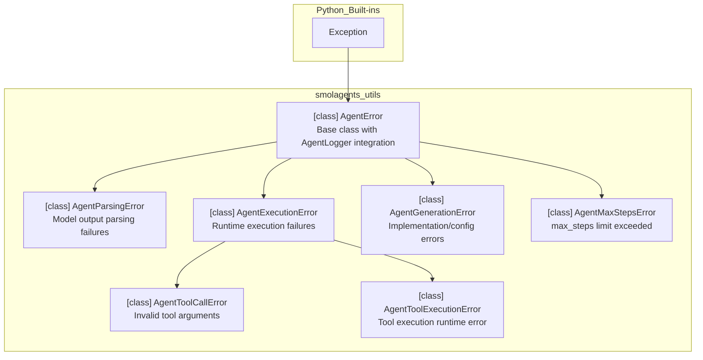
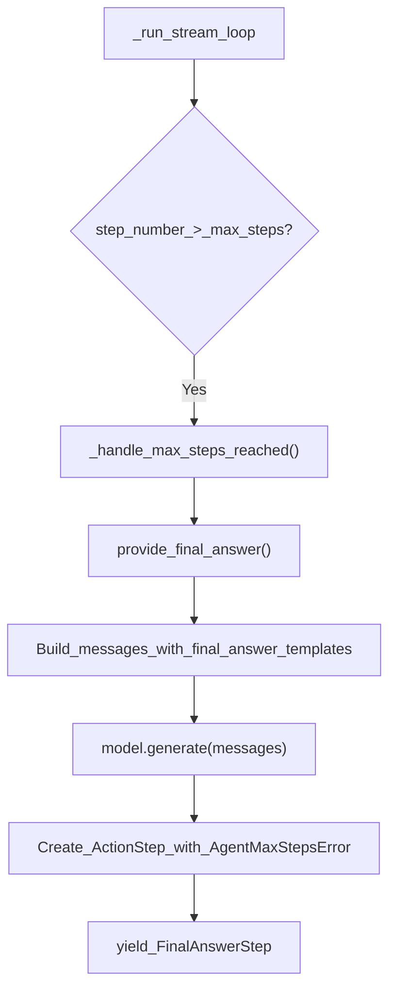
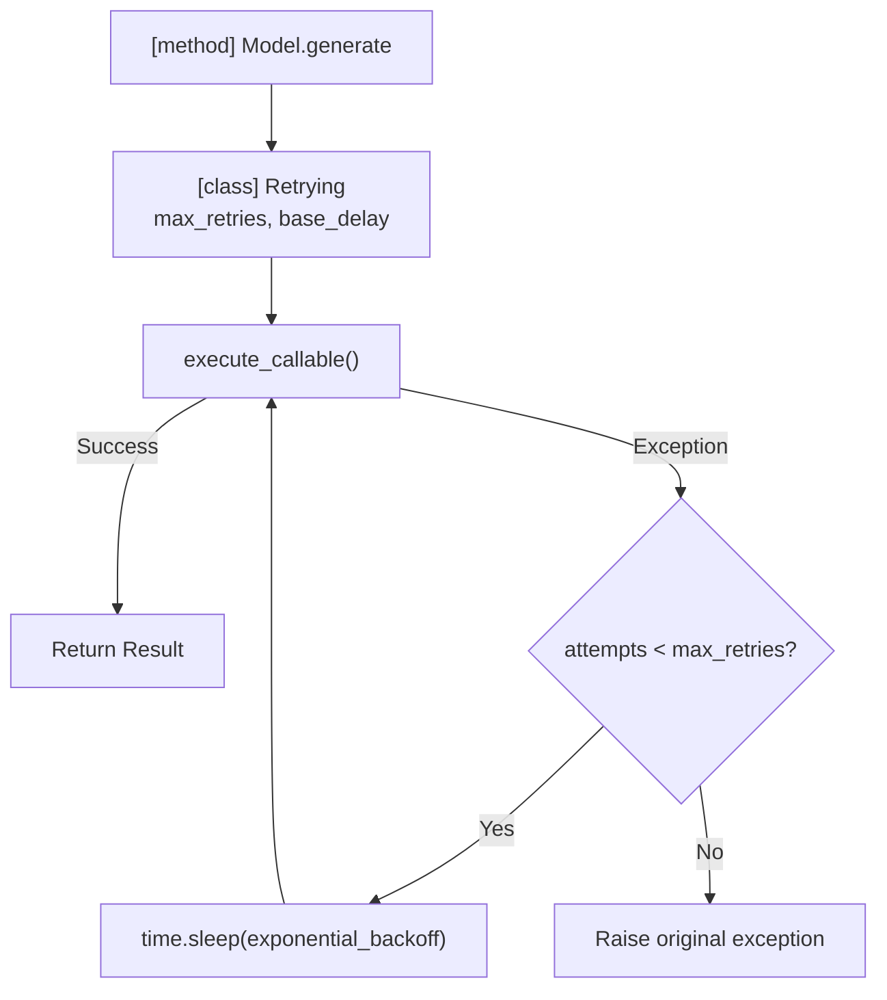

<!-- source: DeepWiki mcp.deepwiki.com · repo huggingface/smolagents · page 9.3 Error Handling & Recovery · fetched 2026-10-27 -->

# Error Handling & Recovery

<details>
<summary>Relevant source files</summary>

The following files were used as context for generating this wiki page:

- [src/smolagents/agents.py](src/smolagents/agents.py)
- [src/smolagents/utils.py](src/smolagents/utils.py)
- [tests/test_agents.py](tests/test_agents.py)
- [tests/test_utils.py](tests/test_utils.py)

</details>


This document covers error handling and recovery mechanisms in `smolagents`. It focuses on the `AgentError` exception hierarchy, how errors are captured in agent memory, recovery strategies for different error types, and validation mechanisms like `final_answer_checks`.

For information about agent memory and step tracking, see [3.4 Agent Memory & State Management](). For execution security, see [6 Code Execution & Security]().

## AgentError Exception Hierarchy

Smolagents implements a typed exception hierarchy that distinguishes between different failure modes and enables appropriate recovery strategies. All custom exceptions are defined in `src/smolagents/utils.py`.

**Natural Language to Code Entity Space: Exception Hierarchy**


**Sources:** [src/smolagents/utils.py:92-137]()

### Error Class Definitions

All agent errors inherit from `AgentError`, which automatically logs errors upon initialization using the provided `AgentLogger` instance [src/smolagents/utils.py:95-98]().

| Class | Purpose | Typical Cause |
|-------|---------|---------------|
| `AgentError` | Base exception, logs to `AgentLogger` | N/A (base class) [src/smolagents/utils.py:92-99]() |
| `AgentParsingError` | Failed to parse model output | Model doesn't follow expected format (JSON/code blocks) [src/smolagents/utils.py:104-107](), [src/smolagents/utils.py:225-227]() |
| `AgentExecutionError` | Execution runtime failures | Code execution errors, tool failures [src/smolagents/utils.py:110-113]() |
| `AgentMaxStepsError` | Step limit reached | Task requires more iterations than `max_steps` allows [src/smolagents/utils.py:116-119]() |
| `AgentToolCallError` | Tool invocation with invalid arguments | Model provides incorrect argument types/names [src/smolagents/utils.py:122-125]() |
| `AgentToolExecutionError` | Tool execution failed | Network errors, permission issues, tool bugs [src/smolagents/utils.py:128-131]() |
| `AgentGenerationError` | Framework implementation errors | Model configuration issues, missing attributes [src/smolagents/utils.py:134-137]() |

**Sources:** [src/smolagents/utils.py:92-137]()

### AgentError Base Class

The `AgentError` class includes a `dict()` method to enable serialization for error storage in `ActionStep.error` [src/smolagents/utils.py:100-101]().

```python
class AgentError(Exception):
    def __init__(self, message, logger: "AgentLogger"):
        super().__init__(message)
        self.message = message
        logger.log_error(message)
    
    def dict(self) -> dict[str, str]:
        return {"type": self.__class__.__name__, "message": str(self.message)}
```
**Sources:** [src/smolagents/utils.py:92-101]()

## Recovery Strategies by Error Type

The agent execution loop in `MultiStepAgent._run_stream` implements different recovery strategies depending on the error type encountered during a step.

| Error Type | Recovery Strategy | Implementation Site |
|------------|-------------------|---------------------|
| `AgentGenerationError` | **Immediate termination** - Raised and exits | [src/smolagents/agents.py:592-594]() |
| `AgentParsingError` | **Log and continue** - Captured in `ActionStep.error` | [src/smolagents/agents.py:596-600]() |
| `AgentExecutionError` | **Log and continue** - Captured in `ActionStep.error` | [src/smolagents/agents.py:596-600]() |
| `AgentToolCallError` | **Log and continue** - Captured in `ActionStep.error` | Subclass of `AgentExecutionError` |
| `AgentToolExecutionError` | **Log and continue** - Captured in `ActionStep.error` | Subclass of `AgentExecutionError` |
| `AgentMaxStepsError` | **Force final answer** - Calls `provide_final_answer()` | [src/smolagents/agents.py:620-632]() |

### Critical vs Recoverable Errors

**Critical Errors (`AgentGenerationError`)**
These indicate implementation or configuration problems (e.g., missing prompts or model setup) that the agent cannot recover from. They are re-raised to stop the loop [src/smolagents/agents.py:592-594]().

**Recoverable Errors (Other `AgentError` Types)**
These errors are typically caused by model behavior (e.g., syntax errors in generated code). The agent:
1. **Captures the error** in the `ActionStep.error` field [src/smolagents/agents.py:597]().
2. **Logs the error** via `AgentLogger` (triggered by the `AgentError` constructor) [src/smolagents/utils.py:98]().
3. **Finalizes the step** and appends it to memory [src/smolagents/agents.py:601]().
4. **Continues** to the next iteration, where the model sees the error in its context and can attempt a correction.

**Sources:** [src/smolagents/agents.py:592-601](), [src/smolagents/utils.py:92-99]()

## Error Capture in Agent Memory

Errors are captured and stored in the agent's memory system, allowing both the model and debugging tools to access error history.

**Error Capture Flow in MultiStepAgent**

```mermaid
sequenceDiagram
    participant Loop as "MultiStepAgent._run_stream"
    participant ActionStep as "[class] ActionStep"
    participant StepStream as "[method] _step_stream"
    participant Logger as "[class] AgentLogger"
    participant Memory as "[class] AgentMemory"
    
    Loop->>ActionStep: Instantiate ActionStep(step_number, timing)
    Loop->>Loop: try: execute step logic
    Loop->>StepStream: _step_stream(action_step)
    
    alt is AgentGenerationError
        StepStream-->>Loop: Raise AgentGenerationError
        Loop->>Loop: Re-raise and terminate
    else is other AgentError
        StepStream-->>Loop: Raise AgentError
        Loop->>ActionStep: action_step.error = e
        Note over ActionStep, Logger: Logged via AgentError.__init__
    else is general Exception
        StepStream-->>Loop: Raise Exception
        Loop->>ActionStep: action_step.error = AgentExecutionError(e)
    end
    
    Loop->>Loop: finally: finalize timing
    Loop->>Memory: self.memory.steps.append(action_step)
    Loop->>Loop: yield action_step
```
**Sources:** [src/smolagents/agents.py:567-602](), [src/smolagents/memory.py:200-250]()

### ActionStep Error Storage

The `ActionStep` class stores error information. When an error occurs, the `AgentError` instance is assigned to `action_step.error` [src/smolagents/agents.py:597](). The step is still finalized and added to memory, ensuring the agent has a record of the failure [src/smolagents/agents.py:601]().

**Sources:** [src/smolagents/memory.py:200-250](), [src/smolagents/agents.py:597-601]()

## Max Steps Recovery with `provide_final_answer`

When the agent reaches `max_steps` without returning a final answer, a special recovery mechanism generates a best-effort answer via `provide_final_answer` [src/smolagents/agents.py:620-632]().

**Max Steps Handling Logic**


**Sources:** [src/smolagents/agents.py:604-607](), [src/smolagents/agents.py:620-632](), [src/smolagents/agents.py:805-848]()

### `provide_final_answer` Implementation

This method uses the `final_answer` prompt templates (configured in `PromptTemplates`) to extract a conclusion from the existing conversation history [src/smolagents/agents.py:805-848]().

```python
def provide_final_answer(self, task: str) -> ChatMessage:
    messages = [
        ChatMessage(role=MessageRole.SYSTEM, content=[{"type": "text", "text": self.prompt_templates["final_answer"]["pre_messages"]}])
    ]
    messages += self.write_memory_to_messages()[1:] # Skip original system prompt
    messages.append(
        ChatMessage(role=MessageRole.USER, content=[{"type": "text", "text": populate_template(self.prompt_templates["final_answer"]["post_messages"], variables={"task": task})}])
    )
    return self.model.generate(messages)
```
**Sources:** [src/smolagents/agents.py:805-848]()

## Final Answer Validation

The `final_answer_checks` parameter allows users to pass a list of validation functions that run before the agent accepts a final answer [src/smolagents/agents.py:333]().

### Validation Execution

Validation occurs inside `_validate_final_answer`. If a check fails (returns `False` or raises an exception), it is wrapped in an `AgentError` and raised, forcing the agent to retry or log the failure [src/smolagents/agents.py:609-614]().

```python
def _validate_final_answer(self, final_answer: Any):
    for check_function in self.final_answer_checks:
        try:
            assert check_function(final_answer, self.memory, agent=self)
        except Exception as e:
            raise AgentError(
                f"Check {check_function.__name__} failed with error: {e}",
                self.logger
            )
```
**Sources:** [src/smolagents/agents.py:609-614]()

### Common Validation Signatures

Validation functions receive the proposed answer, the `AgentMemory` object, and the agent instance itself [src/smolagents/agents.py:611](). This allows for complex checks against historical steps or internal agent state.

## Retrying Utility

The codebase includes a `Retrying` utility (used primarily in model integrations) to handle transient failures like rate limits. It implements exponential backoff [src/smolagents/utils.py:539-573]().

**Natural Language to Code Entity Space: Retrying Logic**


**Sources:** [src/smolagents/utils.py:539-573]()

---

