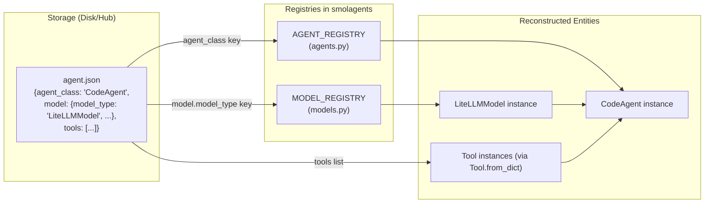
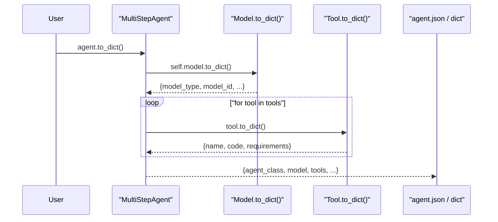
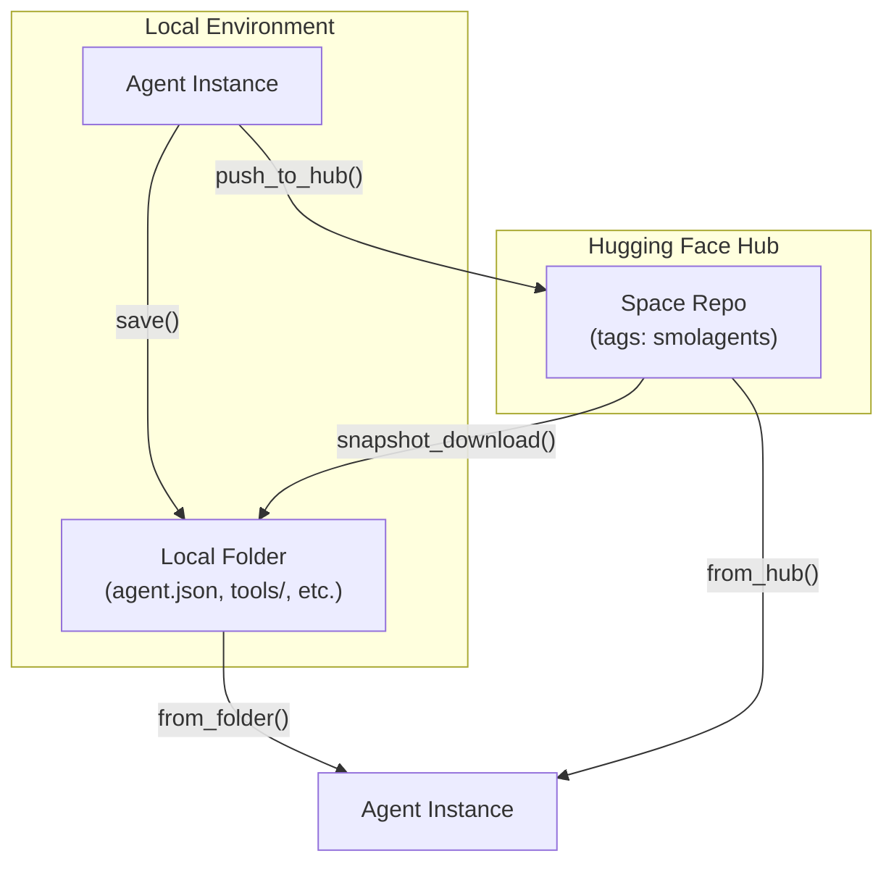
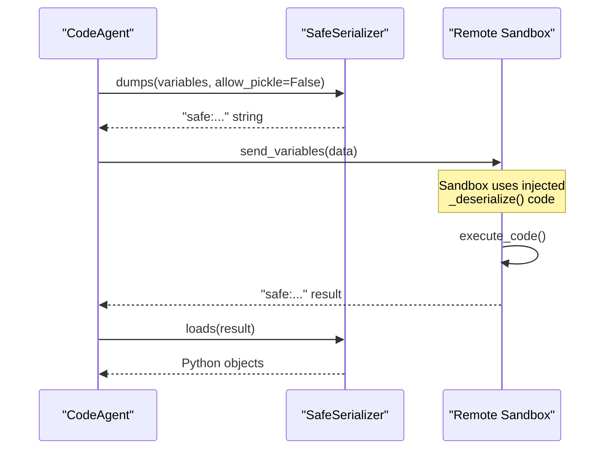

<!-- source: DeepWiki mcp.deepwiki.com · repo huggingface/smolagents · page 9.4 Agent Persistence & Hub Integration · fetched 2026-10-27 -->

# Agent Persistence & Hub Integration

<details>
<summary>Relevant source files</summary>

The following files were used as context for generating this wiki page:

- [src/smolagents/agents.py](src/smolagents/agents.py)
- [src/smolagents/utils.py](src/smolagents/utils.py)
- [tests/test_agents.py](tests/test_agents.py)
- [tests/test_utils.py](tests/test_utils.py)

</details>


This page documents the mechanisms for saving, loading, and publishing agents in `smolagents`. It covers serializing agents to JSON/YAML, local storage, sharing via the Hugging Face Hub, and the registries that facilitate class-name-based deserialization. It also details the `SafeSerializer` used for secure data exchange with remote Python executors.

---

## Overview

Agent persistence in `smolagents` serves two primary purposes:

| Purpose | Mechanism | Implementation |
|---|---|---|
| **Configuration Persistence** | `agent.save()`, `agent.push_to_hub()`, `agent.from_hub()`, `agent.from_folder()` | Captures agent architecture, prompts, and tool code. |
| **Runtime Data Exchange** | `SafeSerializer.dumps()` / `.loads()` | Handles variable transfer between the local process and remote sandboxes. |

The configuration system relies on global registries to reconstruct objects from string identifiers stored in configuration files.

### Serialization Registries

Two global registries enable class reconstruction from string names during deserialization:

1.  **`MODEL_REGISTRY`**: Defined in [src/smolagents/models.py:64](), this registry maps string class names (e.g., `"InferenceClientModel"`, `"LiteLLMModel"`) to their class objects. It is imported and used by agents at [src/smolagents/agents.py:64]().
2.  **`AGENT_REGISTRY`**: Defined in [src/smolagents/agents.py:1339-1343](), this registry maps agent class names (e.g., `"CodeAgent"`, `"ToolCallingAgent"`) to their respective classes.

**Registry-Based Reconstruction Diagram:**


Sources: [src/smolagents/agents.py:64](), [src/smolagents/agents.py:1339-1343](), [src/smolagents/models.py:64]()

---

## Agent Serialization: `to_dict` / `from_dict`

`MultiStepAgent.to_dict()` [src/smolagents/agents.py:940-1002]() produces a plain Python dictionary capturing the agent's structural state.

### `to_dict` Schema

| Key | Type | Description |
|---|---|---|
| `agent_class` | `str` | Class name from `self.agent_name` (e.g., `"CodeAgent"`) [src/smolagents/agents.py:942]() |
| `model` | `dict` | Result of `self.model.to_dict()` [src/smolagents/agents.py:943]() |
| `tools` | `list[dict]` | Each element is `tool.to_dict()`, excluding `final_answer` [src/smolagents/agents.py:945-951]() |
| `prompt_templates` | `dict` | The `PromptTemplates` structure [src/smolagents/agents.py:952]() |
| `max_steps` | `int` | Maximum execution steps [src/smolagents/agents.py:953]() |
| `managed_agents` | `list[dict]` | Recursively serialized sub-agents [src/smolagents/agents.py:958-963]() |

Tool serialization is delegated to `Tool.to_dict()` [src/smolagents/tools.py:292-365](), which captures source code and dependencies.

`MultiStepAgent.from_dict(agent_dict)` [src/smolagents/agents.py:1004-1090]() reverses this process:
1.  Identifies the concrete class via `AGENT_REGISTRY[agent_dict["agent_class"]]` [src/smolagents/agents.py:1007]().
2.  Reconstructs the model using `MODEL_REGISTRY[model_dict["model_type"]].from_dict(model_dict)` [src/smolagents/agents.py:1012]().
3.  Reconstructs tools via `Tool.from_dict(tool_dict)` [src/smolagents/agents.py:1022]().
4.  Recursively handles managed agents [src/smolagents/agents.py:1034-1044]().

**Serialization Sequence:**


Sources: [src/smolagents/agents.py:940-1002](), [src/smolagents/agents.py:1004-1090](), [src/smolagents/tools.py:292-365]()

---

## Persistence Formats

### Directory Structure

When `agent.save(path)` is called [src/smolagents/agents.py:1091-1163](), it generates the following layout:

```text
<output_dir>/
├── agent.json          # Agent configuration (excluding prompts)
├── prompts.yaml        # Jinja2 templates (PromptTemplates dict)
├── requirements.txt    # Aggregated requirements from all tools
├── __init__.py         # Created via make_init_file() [src/smolagents/agents.py:1162]
└── tools/              # Tool source code repository
    ├── search_tool.py
    └── custom_tool.py
```

`prompts.yaml` is separated to allow users to modify system instructions or planning strategies without altering the agent's code structure. It follows the `PromptTemplates` TypedDict defined at [src/smolagents/agents.py:166-181]().

### Local Loading

`MultiStepAgent.from_folder(folder_path, trust_remote_code=False)` [src/smolagents/agents.py:1165-1221]() performs the inverse operation. For security, it requires `trust_remote_code=True` [src/smolagents/agents.py:1181]() because loading the agent involves executing tool code via `Tool.from_code()` [src/smolagents/tools.py:571-597]().

Sources: [src/smolagents/agents.py:1091-1163](), [src/smolagents/agents.py:1165-1221](), [src/smolagents/agents.py:166-181]()

---

## Hub Integration

Hub integration leverages the `huggingface_hub` library [src/smolagents/agents.py:34]().

### `push_to_hub(repo_id, ...)`
Defined at [src/smolagents/agents.py:1223-1261](), this method:
1.  Creates a Gradio Space on the Hub using `create_repo(repo_id, repo_type="space", space_sdk="gradio")` [src/smolagents/agents.py:1246]().
2.  Tags the repository with `["smolagents", "agent"]` via `metadata_update()` [src/smolagents/agents.py:1247]().
3.  Serializes the agent to a temporary directory using `self.save()` [src/smolagents/agents.py:1254]().
4.  Uploads the directory content via `upload_folder()` [src/smolagents/agents.py:1255]().

### `from_hub(repo_id, trust_remote_code=False, ...)`
Defined at [src/smolagents/agents.py:1263-1312](), this method:
1.  Enforces security by requiring `trust_remote_code=True` [src/smolagents/agents.py:1290-1294]().
2.  Downloads the repository using `snapshot_download(repo_id, repo_type="space")` [src/smolagents/agents.py:1301]().
3.  Initializes the agent via `from_folder()` [src/smolagents/agents.py:1308]().

**Hub Lifecycle Diagram:**


Sources: [src/smolagents/agents.py:1223-1261](), [src/smolagents/agents.py:1263-1312]()

---

## Tool Persistence

Tools are serialized by extracting their source code. `Tool.to_dict()` [src/smolagents/tools.py:292-365]() handles two primary cases:
-   **Class-based tools**: Uses `instance_to_source()` [src/smolagents/tools.py:317]() (defined in [src/smolagents/utils.py:208-211]()) to extract the full class definition.
-   **Function-based tools (`@tool`)**: Extracts the `forward` method and wraps it in a standard `Tool` template [src/smolagents/tools.py:330-349]().

Wrappers for external services (e.g., `SpaceToolWrapper`, `LangChainToolWrapper`) cannot be serialized and will raise a `ValueError` [src/smolagents/tools.py:311]().

Sources: [src/smolagents/tools.py:292-365](), [src/smolagents/tools.py:571-597](), [src/smolagents/utils.py:208-211]()

---

## `SafeSerializer`: Remote Data Exchange

The `SafeSerializer` [src/smolagents/serialization.py:45-514]() is responsible for data exchange between the agent process and remote executors (e.g., E2B, Docker). It is **not** used for disk persistence.

### Security and Formats
-   **Safe Mode**: Default mode (`allow_pickle=False`). Uses a custom JSON-based format with type markers (e.g., `{"__type__": "tuple", "data": [1, 2]}`) [src/smolagents/serialization.py:76-171]().
-   **Pickle Mode**: Enabled via `allow_pickle=True`. Uses base64-encoded pickles with a `pickle:` prefix [src/smolagents/serialization.py:294-346](). It issues a `FutureWarning` when used due to security risks [src/smolagents/serialization.py:302]().

### Supported Types in Safe Mode
The serializer supports a wide range of types without requiring pickle:
- **Primitives**: `str`, `int`, `float`, `bool`, `None` [src/smolagents/serialization.py:90]().
- **Collections**: `list`, `tuple`, `dict`, `set`, `frozenset` [src/smolagents/serialization.py:94-114]().
- **Complex Types**: `bytes`, `complex`, `datetime`, `date`, `time`, `timedelta`, `Decimal`, `Path` [src/smolagents/serialization.py:115-141]().
- **Optional Extensions**: `numpy.ndarray`, `PIL.Image.Image`, and `dataclasses` [src/smolagents/serialization.py:144-169]().

### Deserializer Injection
To avoid dependency issues in sandboxes, `get_deserializer_code()` [src/smolagents/serialization.py:452-514]() generates a standalone Python function that can be injected into the remote environment to decode the `safe:` format.

**Data Flow for Remote Execution:**


Sources: [src/smolagents/serialization.py:45-171](), [src/smolagents/serialization.py:252-346](), [src/smolagents/serialization.py:452-514]()

---

