# Page: Overview

# Overview

<details>
<summary>Relevant source files</summary>

The following files were used as context for generating this wiki page:

- [README.md](README.md)
- [docs/source/en/examples/using_different_models.md](docs/source/en/examples/using_different_models.md)
- [docs/source/en/guided_tour.md](docs/source/en/guided_tour.md)
- [docs/source/en/index.md](docs/source/en/index.md)
- [docs/source/en/reference/models.md](docs/source/en/reference/models.md)
- [docs/source/en/tutorials/secure_code_execution.md](docs/source/en/tutorials/secure_code_execution.md)
- [pyproject.toml](pyproject.toml)
- [src/smolagents/__init__.py](src/smolagents/__init__.py)

</details>


This page describes the purpose, design philosophy, and high-level architecture of `smolagents`. It is a map for understanding how the library's subsystems fit together. For installation steps see page [2.1](), for a working first example see [2.2](), and for detailed definitions of individual concepts see [2.3]().

---

## What smolagents Is

`smolagents` is an open-source Python library designed to build and run agents with minimal code [docs/source/en/index.md:9](). Its design goal is minimal abstraction: the core agent logic fits in roughly 1,000 lines of code [README.md:36]().

The library is published on PyPI as `smolagents`. Its current version is defined in [src/smolagents/__init__.py:17]() and [pyproject.toml:7]().

The public API is a flat namespace: everything user-facing is re-exported from [src/smolagents/__init__.py]() via wildcard imports from submodules including `agents`, `models`, `tools`, and `memory` [src/smolagents/__init__.py:19-32]().

---

## Design Philosophy

Two principles drive every design decision:

1. **Code-centric actions.** Rather than having the LLM emit a JSON dictionary of tool names and arguments, `CodeAgent` has the LLM write Python code to invoke tools or perform computations [docs/source/en/index.md:15](). Research shows that code is a better way to express actions due to its composability, object management, and generality [docs/source/en/tutorials/secure_code_execution.md:10-22]().
2. **Minimal abstractions.** The library avoids large inheritance hierarchies. The agent loop, memory, and model interfaces are kept in their simplest forms [README.md:36]().

---

## The Two Agent Paradigms

`smolagents` provides two concrete agent implementations that both extend the base `MultiStepAgent` [src/smolagents/agents.py:268]().

| Agent class | How it acts | Execution target |
|---|---|---|
| `CodeAgent` | Generates tool calls as Python code snippets [docs/source/en/guided_tour.md:12]() | `LocalPythonExecutor` or a `RemotePythonExecutor` subclass |
| `ToolCallingAgent` | Writes tool calls as structured JSON [docs/source/en/guided_tour.md:29]() | `Tool.forward()` called directly |

**CodeAgent path:** The LLM output is parsed for code blocks, which are then executed by a `PythonExecutor`. This allows for complex logic, loops, and dynamic tool composition [docs/source/en/index.md:15]().

**ToolCallingAgent path:** The LLM output contains tool calls that follow the model's native tool-calling interface (JSON/text-based). This is preferred for scenarios where the standard tool-calling paradigm is required [docs/source/en/index.md:17]().

Sources: [src/smolagents/agents.py:268](), [docs/source/en/guided_tour.md:7-61](), [docs/source/en/index.md:15-17]()

---

## Major Subsystems

**Figure 1: Overall System Architecture**

```mermaid
graph TB
    subgraph UserInterfaces["User Interfaces"]
        CLI["smolagent CLI<br/>smolagents.cli"]
        Gradio["GradioUI<br/>smolagents.gradio_ui"]
        WebAgent["webagent<br/>smolagents.vision_web_browser"]
        API["Python API<br/>Direct Integration"]
    end
    
    subgraph CoreAgentSystem["Core Agent System"]
        MA["MultiStepAgent<br/>Base ReAct Framework<br/>src/smolagents/agents.py:268"]
        CA["CodeAgent<br/>Python Code Generation<br/>src/smolagents/agents.py"]
        TCA["ToolCallingAgent<br/>JSON Tool Calls<br/>src/smolagents/agents.py"]
    end
    
    subgraph ModelLayer["Model Layer"]
        ModelAbstraction["Model Interface<br/>src/smolagents/models.py"]
        Local["Local Models<br/>TransformersModel, MLXModel, VLLMModel"]
        Cloud["Cloud APIs<br/>OpenAIModel, LiteLLMModel, AzureOpenAIModel"]
        HF["Hugging Face<br/>InferenceClientModel"]
    end
    
    subgraph ToolSystem["Tool System"]
        ToolDef["Tool Definition<br/>@tool decorator / Tool class<br/>src/smolagents/tools.py"]
        DefaultTools["Default Tools<br/>src/smolagents/default_tools.py"]
        CustomTools["Custom Tools<br/>User-defined"]
        ToolCollections["ToolCollections<br/>Hub/MCP/LangChain"]
    end
    
    subgraph ExecutionEnvironments["Execution Environments"]
        LocalExec["LocalPythonExecutor<br/>AST-based Security<br/>src/smolagents/local_python_executor.py"]
        RemoteExec["RemotePythonExecutor<br/>Sandboxed Environments<br/>src/smolagents/remote_executors.py"]
        Blaxel["BlaxelExecutor"]
        E2B["E2BExecutor"]
        Docker["DockerExecutor"]
        Modal["ModalExecutor"]
    end
    
    subgraph StateObservability["State & Observability"]
        Memory["AgentMemory<br/>Execution History<br/>src/smolagents/memory.py"]
        Logger["AgentLogger<br/>Structured Logging<br/>src/smolagents/monitoring.py"]
        Monitor["Monitor<br/>Token/Time Metrics<br/>src/smolagents/monitoring.py"]
    end
    
    CLI --> MA
    Gradio --> MA
    WebAgent --> MA
    API --> MA
    
    MA --> CA
    MA --> TCA
    
    CA --> ModelAbstraction
    TCA --> ModelAbstraction
    
    ModelAbstraction --> Local
    ModelAbstraction --> Cloud
    ModelAbstraction --> HF
    
    CA --> ToolDef
    TCA --> ToolDef
    
    ToolDef --> DefaultTools
    ToolDef --> CustomTools
    ToolDef --> ToolCollections
    
    CA --> LocalExec
    CA --> RemoteExec
    
    RemoteExec --> Blaxel
    RemoteExec --> E2B
    RemoteExec --> Modal
    RemoteExec --> Docker
    
    MA --> Memory
    MA --> Logger
    MA --> Monitor
```

The system is organized into several major subsystems:
1. **User Interfaces**: CLI tools (`smolagent`, `webagent`), `GradioUI`, and direct Python API integration [pyproject.toml:139-141]().
2. **Core Agent System**: `MultiStepAgent` implements the ReAct (Reasoning + Acting) loop [src/smolagents/agents.py:268]().
3. **Model Layer**: Supports local inference (`TransformersModel`, `MLXModel`, `VLLMModel`) and cloud providers via `InferenceClientModel`, `LiteLLMModel`, `OpenAIModel`, `AzureOpenAIModel`, or `AmazonBedrockModel` [README.md:78-173]().
4. **Tool System**: Extensible framework supporting the `@tool` decorator, MCP servers, LangChain tools, and Hub integrations [README.md:46]().
5. **Execution Environments**: Multiple security levels from local AST-based execution to remote sandboxes like E2B, Blaxel, Modal, or Docker [README.md:38]().
6. **State & Observability**: Structured memory tracking steps (`AgentMemory`) and monitoring for token/timing metrics [src/smolagents/monitoring.py]().

Sources: [src/smolagents/__init__.py](), [src/smolagents/agents.py](), [src/smolagents/models.py](), [src/smolagents/tools.py](), [pyproject.toml:139-141]()

---

**Figure 2: Agent Execution Flow (Natural Language → Code Entities)**

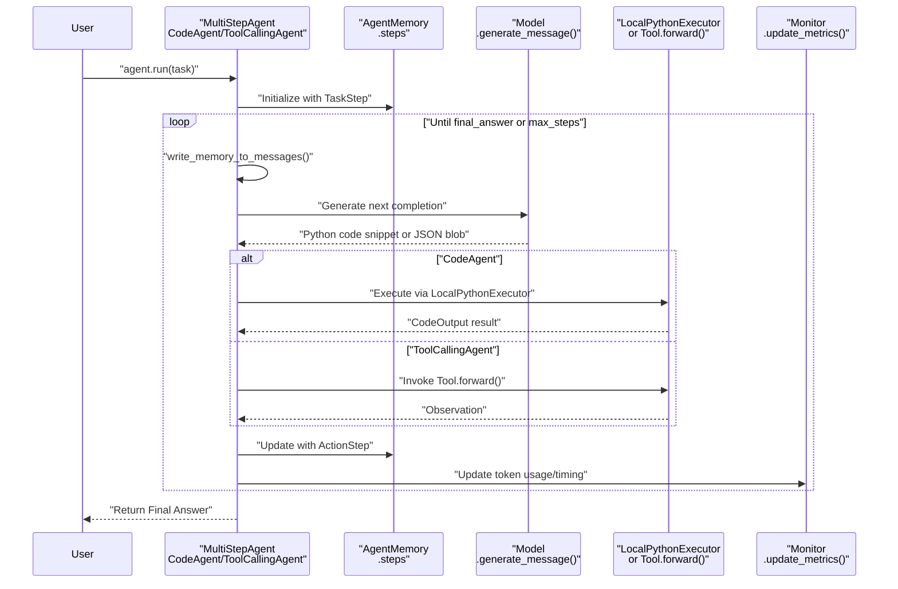

Key architectural features:
- **Memory-Driven**: Every step is stored in `AgentMemory`, including `SystemPromptStep`, `TaskStep`, and `ActionStep` [src/smolagents/memory.py]().
- **ReAct Loop**: Implementation of the Reason + Act framework via `MultiStepAgent` [src/smolagents/agents.py:268]().
- **Monitoring**: Token usage and timing tracked via the `Monitor` class [src/smolagents/monitoring.py]().

Sources: [src/smolagents/agents.py](), [src/smolagents/memory.py](), [src/smolagents/monitoring.py]()

---

## Module Map

The following table maps each major concept to its primary source file.

| Concept | Module | Key classes / functions |
|---|---|---|
| Agent base & loop | `smolagents.agents` | `MultiStepAgent`, `CodeAgent`, `ToolCallingAgent` |
| Memory | `smolagents.memory` | `AgentMemory`, `ActionStep`, `PlanningStep`, `TaskStep` |
| Models | `smolagents.models` | `Model`, `InferenceClientModel`, `LiteLLMModel`, `OpenAIModel`, `TransformersModel`, `VLLMModel`, `MLXModel` |
| Tools | `smolagents.tools` | `Tool`, `ToolCollection`, `@tool` decorator |
| Built-in tools | `smolagents.default_tools` | `FinalAnswerTool`, `WebSearchTool`, `VisitWebpageTool` |
| Local execution | `smolagents.local_python_executor` | `LocalPythonExecutor`, `CodeOutput` |
| Remote execution | `smolagents.remote_executors` | `RemotePythonExecutor`, `E2BExecutor`, `DockerExecutor`, `ModalExecutor`, `BlaxelExecutor` |
| Logging & metrics | `smolagents.monitoring` | `AgentLogger`, `Monitor`, `TokenUsage` |
| CLI | `smolagents.cli` | `main`, `smolagent` command |

Sources: [src/smolagents/__init__.py](), [pyproject.toml:139-141](), [src/smolagents/agents.py](), [src/smolagents/models.py](), [src/smolagents/tools.py]()

---

## Optional Dependency Groups

The library uses optional extras to keep the base install lightweight [pyproject.toml:24-94]().

| Extra | What it enables |
|---|---|
| `toolkit` | `DuckDuckGoSearchTool`, `VisitWebpageTool`, `WebSearchTool` |
| `gradio` | `GradioUI` interface |
| `transformers` | `TransformersModel` (local inference) |
| `litellm` | `LiteLLMModel` and `LiteLLMRouterModel` |
| `openai` | `OpenAIModel` and `AzureOpenAIModel` |
| `bedrock` | `AmazonBedrockModel` |
| `e2b` | `E2BExecutor` for sandboxed execution |
| `docker` | `DockerExecutor` for containerized execution |
| `mcp` | `MCPClient` for Model Context Protocol tools |

Sources: [pyproject.toml:24-94]()

---

## Security Model

**Figure 3: Execution Environment Security Layers**

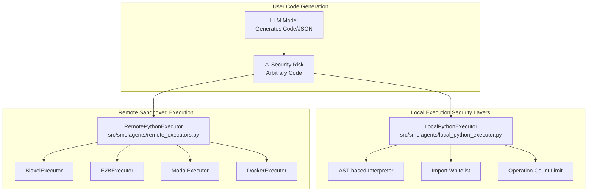

### Local Security
`LocalPythonExecutor` implements security by loading the Abstract Syntax Tree (AST) and executing it operation by operation [docs/source/en/tutorials/secure_code_execution.md:54]().
1. **Import Whitelist**: Imports are disallowed unless explicitly added to an authorization list [docs/source/en/tutorials/secure_code_execution.md:55]().
2. **Operation Limit**: The total count of elementary operations is capped to prevent infinite loops [docs/source/en/tutorials/secure_code_execution.md:58]().
3. **Restricted Submodules**: Access to submodules is disabled by default [docs/source/en/tutorials/secure_code_execution.md:56]().

### Remote Security
For complete isolation, agents can use remote executors which run code in isolated sandboxed environments [README.md:38](). Supported providers include Blaxel, E2B, Modal, or Docker [README.md:38]().

Sources: [src/smolagents/local_python_executor.py](), [src/smolagents/remote_executors.py](), [docs/source/en/tutorials/secure_code_execution.md:49-102]()

---

## Where to Go Next

| Goal | Page |
|---|---|
| Install the library | [Installation & Dependencies](#2.1) |
| Run your first agent | [Quick Start Guide](#2.2) |
| Understand core vocabulary | [Key Concepts](#2.3) |
| Deep-dive into agent execution | [Agent Framework](#3) |
| Choose and configure an LLM backend | [Model Integration](#4) |
| Define or load tools | [Tool System](#5) |
| Understand code execution and security | [Code Execution & Security](#6) |
| Add logging and tracing | [Monitoring & Observability](#7) |

---

# Page: Getting Started

# Getting Started

<details>
<summary>Relevant source files</summary>

The following files were used as context for generating this wiki page:

- [README.md](README.md)
- [docs/source/en/index.md](docs/source/en/index.md)
- [docs/source/en/installation.md](docs/source/en/installation.md)
- [docs/source/en/tutorials/secure_code_execution.md](docs/source/en/tutorials/secure_code_execution.md)
- [pyproject.toml](pyproject.toml)
- [src/smolagents/__init__.py](src/smolagents/__init__.py)

</details>


This section provides everything you need to begin using `smolagents`: installation instructions, your first agent, and an introduction to core concepts. For advanced configuration and deployment patterns, see the Agent Framework section ([Agent Framework](#3)) and later chapters.

## What is smolagents?

`smolagents` is a lightweight Python library designed to make it extremely easy to build and run agents using just a few lines of code [docs/source/en/index.md:9-9](). Unlike traditional agent frameworks where agents output JSON tool calls, `smolagents`' `CodeAgent` writes Python code snippets to perform actions, enabling natural composability like function nesting and loops [docs/source/en/index.md:15-15]().

The framework is deliberately minimal—the core logic fits in approximately 1,000 lines of code [README.md:36-36]()—while providing production-ready features including:

- **Model-agnostic design**: Works with local `transformers`, cloud APIs (OpenAI, Anthropic, etc.), and 100+ providers via `LiteLLM` [README.md:42-42]().
- **Secure execution**: AST-based local interpreter or sandboxed environments via Blaxel, E2B, Modal, Docker, or Pyodide+Deno WebAssembly [README.md:38-38]().
- **Hub integration**: Share and load agents/tools from Hugging Face Hub as Gradio Spaces [docs/source/en/index.md:19-19]().
- **Multiple interfaces**: Python API, CLI (`smolagent`, `webagent`), and Gradio web UI [docs/source/en/index.md:27-27]().

## Package Structure

The library is organized into focused modules with optional dependency groups for different use cases:

"Core Package Architecture"
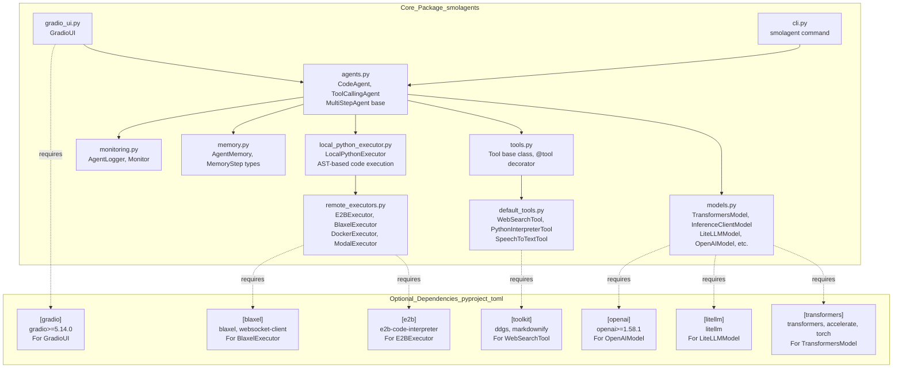

**Sources**: [pyproject.toml:24-94](), [src/smolagents/__init__.py:19-32]()

## Entry Points to Code

The library provides three main ways to interact with agents, each mapping to specific code entry points:

"UI to Code Entity Mapping"
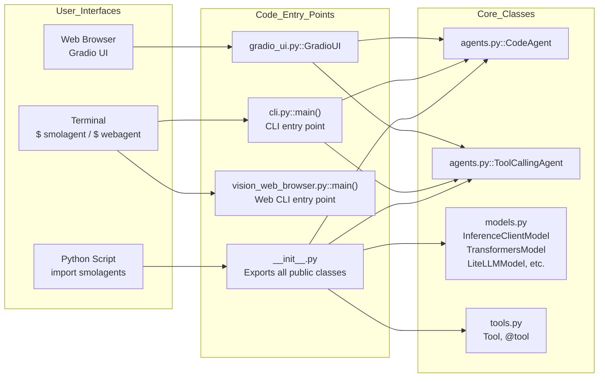

**Sources**: [pyproject.toml:139-141](), [src/smolagents/__init__.py:19-32]()

## Installation

### Minimal Installation

For basic functionality with cloud-based models:

```bash
pip install smolagents
```

This installs core dependencies including `huggingface-hub`, `requests`, `rich`, `jinja2`, `pillow`, and `python-dotenv` [pyproject.toml:14-22]().

### With Default Tools

To enable the built-in toolbox (e.g., `DuckDuckGoSearchTool`, `VisitWebpageTool`):

```bash
pip install "smolagents[toolkit]"
```

### With Local Models

For running models locally using `transformers` or Apple Silicon with `MLX`:

```bash
pip install "smolagents[transformers]"  # Standard transformers [pyproject.toml:79-83]
pip install "smolagents[mlx-lm]"       # Apple Silicon [pyproject.toml:59-61]
```

### Common Combinations

For all available extras (includes remote executors, telemetry, etc.):

```bash
pip install "smolagents[all]"
```

**For detailed dependency information and use-case-specific installations, see [Installation & Dependencies](#2.1).**

**Sources**: [pyproject.toml:24-94](), [docs/source/en/installation.md:38-251]()

## Your First Agent in 30 Seconds

Here's a minimal working example using a cloud-based model and web search:

```python
from smolagents import CodeAgent, DuckDuckGoSearchTool, InferenceClientModel

# Initialize model (uses Hugging Face Inference API)
model = InferenceClientModel()

# Create agent with web search capability
agent = CodeAgent(tools=[DuckDuckGoSearchTool()], model=model)

# Run a task
result = agent.run("What is the current weather in Paris?")
print(result)
```

### What Happens Internally

1. `CodeAgent` receives the task and initializes `AgentMemory` [src/smolagents/__init__.py:25]().
2. The agent enters a ReAct loop:
   - It generates Python code to call tools via `model.generate()` [src/smolagents/models.py:126]().
   - Executes code using `LocalPythonExecutor` (default) [src/smolagents/local_python_executor.py:545]().
   - Stores the execution result in memory steps.
   - Repeats until a final answer is produced.

**For a complete walkthrough with multiple examples, see [Quick Start Guide](#2.2).**

**Sources**: [docs/source/en/index.md:68-79](), [README.md:60-67]()

## Agent Types: CodeAgent vs ToolCallingAgent

The library provides two agent paradigms with different execution models [docs/source/en/index.md:15-17]():

| Aspect | `CodeAgent` | `ToolCallingAgent` |
|--------|-------------|-------------------|
| **Action Format** | Python code snippets | JSON/Text tool calls |
| **Tool Invocation** | `result = tool_name(arg)` | Structured JSON blobs |
| **Execution** | `LocalPythonExecutor` (AST) or Sandbox | Direct tool execution |
| **Strengths** | Composability, loops, reasoning | Standard industry format |

**For detailed comparison and when to use each, see [Key Concepts](#2.3) and [Agent Framework](#3).**

**Sources**: [docs/source/en/index.md:15-17](), [docs/source/en/tutorials/secure_code_execution.md:10-24]()

## Model Integration Overview

The framework is model-agnostic. All models implement the `Model` interface [src/smolagents/models.py:126]():

"Model Provider Architecture"
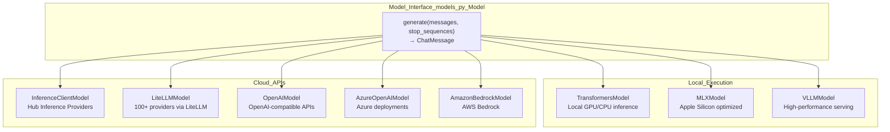

**For complete model configuration and provider-specific examples, see [Model Integration](#4).**

**Sources**: [src/smolagents/models.py:126-785](), [README.md:80-173]()

## Execution Environment Quick Reference

`CodeAgent` requires a Python execution environment. Choice affects security [docs/source/en/tutorials/secure_code_execution.md:43-47]():

| Executor Type | Security Level | Setup Complexity |
|---------------|----------------|------------------|
| **LocalPythonExecutor** (default) | Medium (AST-based) | None |
| **Remote Executors** (E2B, Blaxel, Modal, Docker) | High (Sandboxed) | Requires API keys/Docker |

**LocalPythonExecutor** works by loading the Abstract Syntax Tree (AST) and executing operation by operation with strict rules on imports and resource usage [docs/source/en/tutorials/secure_code_execution.md:54-60]().

**For detailed security models and deployment recommendations, see [Code Execution & Security](#6).**

**Sources**: [docs/source/en/tutorials/secure_code_execution.md:51-103](), [src/smolagents/remote_executors.py:23]().

## Next Steps

Now that you understand the basics:

1. **[Installation & Dependencies](#2.1)**: Detailed dependency groups and environment setup.
2. **[Quick Start Guide](#2.2)**: Step-by-step examples with `CodeAgent` and `ToolCallingAgent`.
3. **[Key Concepts](#2.3)**: Deep dive into the ReAct loop, memory, and tools.

**Sources**: Wiki Table of Contents structure.

---

# Page: Installation & Dependencies

# Installation & Dependencies

<details>
<summary>Relevant source files</summary>

The following files were used as context for generating this wiki page:

- [docs/source/en/installation.md](docs/source/en/installation.md)
- [pyproject.toml](pyproject.toml)
- [src/smolagents/__init__.py](src/smolagents/__init__.py)

</details>


This document explains how to install `smolagents`, describes its core and optional dependencies, and guides you through selecting the appropriate dependency groups for your use case.

## Installation Methods

### Prerequisites
- **Python**: Version 3.10 or newer is required [[pyproject.toml:13](), [docs/source/en/installation.md:6]()].
- **Package Manager**: Supports `pip` or `uv` [[docs/source/en/installation.md:7]()].

### Basic Installation
The minimal installation provides core agent functionality, prompt templating, and basic tool structures without specific model provider SDKs or remote execution environments.

```bash
pip install smolagents
```

This installs the core dependencies defined in [[pyproject.toml:14-22]()]:
- `huggingface-hub>=0.31.2`: Integration for sharing and loading agents/tools.
- `requests>=2.32.3`: HTTP client for API interactions.
- `rich>=13.9.4`: Formatted console logging and trace visualization.
- `jinja2>=3.1.4`: Engine for rendering system and user prompt templates.
- `pillow>=10.0.1`: Image processing (includes security fix for CVE-2023-4863) [[pyproject.toml:20]()].
- `python-dotenv`: Management of environment variables (e.g., API keys).

### Installation with Extras
`smolagents` uses optional dependency groups to keep the core package lightweight. You can install multiple groups using comma-separated values:

```bash
pip install "smolagents[toolkit,openai,e2b]"
```

For a complete installation of all features (audio, vision, all model providers, and all executors):
```bash
pip install "smolagents[all]"
```
The `all` extra aggregates nearly all other optional groups [[pyproject.toml:92-94]()].

**Sources:** [[pyproject.toml:1-142](), [docs/source/en/installation.md:1-250]()]

## Core Dependencies Overview

The following diagram illustrates how core dependencies power the internal systems of `smolagents`.

**Core System Data Flow**
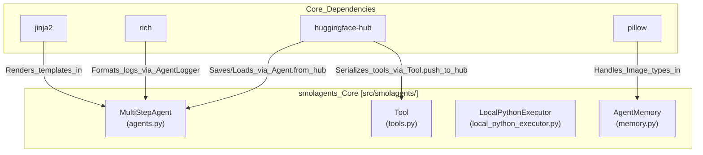
**Sources:** [[src/smolagents/__init__.py:19-32](), [pyproject.toml:14-22]()]

## Optional Dependency Groups

### Model Integration Groups
These enable specific `Model` subclasses for different inference providers.

| Group | Dependencies | Target Component |
| :--- | :--- | :--- |
| `openai` | `openai>=1.58.1` | `OpenAIModel` [[pyproject.toml:66-68]()] |
| `transformers`| `accelerate`, `transformers>=4.0.0`, `smolagents[torch]` | `TransformersModel` [[pyproject.toml:79-83]()] |
| `litellm` | `litellm>=1.60.2` | `LiteLLMModel` [[pyproject.toml:52-54]()] |
| `bedrock` | `boto3>=1.36.18` | `AmazonBedrockModel` [[pyproject.toml:25-27]()] |
| `vllm` | `vllm>=0.10.2`, `torch` | `VLLMModel` [[pyproject.toml:88-91]()] |
| `mlx-lm` | `mlx-lm` | `MLXModel` [[pyproject.toml:59-61]()] |

### Execution & Sandbox Groups
Required for running generated code in isolated environments.

| Group | Dependencies | Target Component |
| :--- | :--- | :--- |
| `e2b` | `e2b-code-interpreter>=1.0.3`, `python-dotenv>=1.0.1` | `E2BExecutor` [[pyproject.toml:45-48]()] |
| `docker` | `docker>=7.1.0`, `websocket-client` | `DockerExecutor` [[pyproject.toml:41-44]()] |
| `blaxel` | `blaxel>=0.2.19`, `websocket-client` | `BlaxelExecutor` [[pyproject.toml:28-31]()] |
| `modal` | `modal>=1.1.3`, `websocket-client` | `ModalExecutor` [[pyproject.toml:62-65]()] |

### Tooling & UI Groups
| Group | Dependencies | Target Component |
| :--- | :--- | :--- |
| `toolkit` | `ddgs>=9.0.0`, `markdownify>=0.14.1` | `DuckDuckGoSearchTool`, `VisitWebpageTool` [[pyproject.toml:75-78]()] |
| `mcp` | `mcp`, `mcpadapt>=0.1.13` | `MCPClient`, `ToolCollection.from_mcp` [[pyproject.toml:55-58]()] |
| `gradio` | `gradio>=5.14.0` | `GradioUI` [[pyproject.toml:49-51]()] |
| `vision` | `helium`, `selenium` | `webagent` CLI (Browser automation) [[pyproject.toml:84-87]()] |
| `telemetry`| `arize-phoenix`, `opentelemetry-sdk`, `opentelemetry-exporter-otlp`, `openinference-instrumentation-smolagents>=0.1.15` | `Monitor` (Tracing) [[pyproject.toml:69-74]()] |

**Sources:** [[pyproject.toml:24-94]()]

## Dependency Hierarchy

The library uses a nested dependency structure where high-level groups (like `all` or `dev`) pull in lower-level functional groups.

**Dependency Resolution Map**
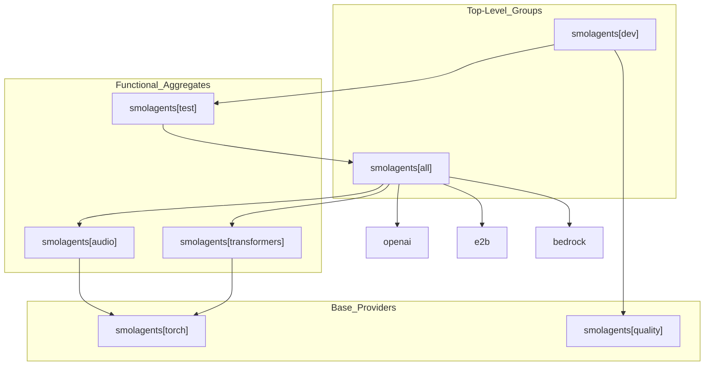
**Sources:** [[pyproject.toml:92-113]()]

## Development Setup

For contributors, a specific set of tools is provided via the `dev` extra.

1. **Clone and Install**:
   ```bash
   git clone https://github.com/huggingface/smolagents.git
   cd smolagents
   pip install -e ".[dev]"
   ```
   This installs `ruff` for linting and `pytest` for testing [[pyproject.toml:95-109]()].

2. **Quality Checks**:
   The `pyproject.toml` defines configuration for maintenance:
   - `ruff`: Configured with line-length 119 and specific lint selections `E`, `F`, `I`, `W` [[pyproject.toml:119-126]()].
   - `pytest`: Configured with `-sv --durations=0` [[pyproject.toml:115-117]()].

**Sources:** [[pyproject.toml:95-135]()]

## Verifying Installation

To verify the installation and check the current version (currently `1.27.0.dev0`):

```python
import smolagents
print(smolagents.__version__)
```
[[src/smolagents/__init__.py:17](), [pyproject.toml:7]()]

### CLI Verification
Installation also registers two global commands via `project.scripts`:
- `smolagent`: The primary CLI for running agents, calling `smolagents.cli:main` [[pyproject.toml:140]()].
- `webagent`: A specialized CLI for vision-based web browsing, calling `smolagents.vision_web_browser:main` [[pyproject.toml:141]()].

**Sources:** [[pyproject.toml:139-142](), [src/smolagents/__init__.py:32]()]

---

# Page: Quick Start Guide

# Quick Start Guide

<details>
<summary>Relevant source files</summary>

The following files were used as context for generating this wiki page:

- [README.md](README.md)
- [docs/source/en/examples/using_different_models.md](docs/source/en/examples/using_different_models.md)
- [docs/source/en/guided_tour.md](docs/source/en/guided_tour.md)
- [docs/source/en/index.md](docs/source/en/index.md)
- [docs/source/en/reference/models.md](docs/source/en/reference/models.md)
- [docs/source/en/tutorials/secure_code_execution.md](docs/source/en/tutorials/secure_code_execution.md)

</details>


This guide provides minimal working examples to get you running quickly with `smolagents`. For installation, see [Installation & Dependencies](#2.1). For detailed conceptual background, see [Key Concepts](#2.3).

---

## Quick Start Flow

The following diagram illustrates the high-level data flow when initializing and running an agent.

Title: Agent Execution Flow
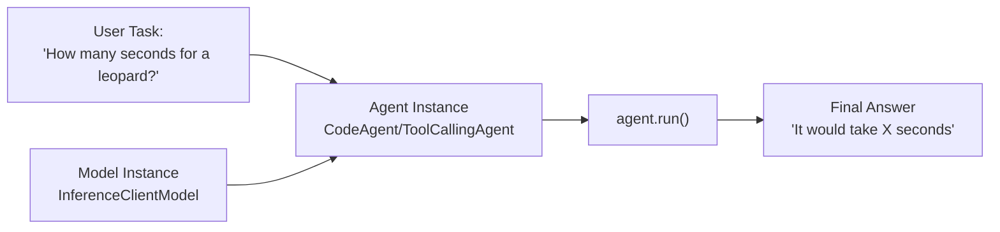

**Typical quick start flow**: A user instantiates a `Model` (e.g., `InferenceClientModel` [src/smolagents/models.py:60-62]()), passes it to an agent constructor (`CodeAgent` [src/smolagents/agents.py:1260-1260]() or `ToolCallingAgent` [src/smolagents/agents.py:1700-1700]()), and invokes `agent.run(task)` [src/smolagents/agents.py:840-840]().

Sources: [src/smolagents/agents.py:840-840](), [docs/source/en/guided_tour.md:121-144](), [README.md:60-67]()

---

## Minimal CodeAgent Example

The `CodeAgent` is the flagship agent type in `smolagents`. It generates Python code to perform actions, allowing for complex logic and data transformation [docs/source/en/guided_tour.md:12-27]().

```python
from smolagents import CodeAgent, InferenceClientModel

# Initialize model and agent
model = InferenceClientModel() # Uses default model if model_id omitted
agent = CodeAgent(tools=[], model=model)

# Run task
result = agent.run("Calculate the sum of numbers from 1 to 10")
print(result)  # Output: 55
```

**How it works**: The agent generates a Python code block, which is extracted by `parse_code_blobs` [src/smolagents/utils.py:94-94]() and executed by the `LocalPythonExecutor` [src/smolagents/local_python_executor.py:52-54](). By default, it uses a restricted set of safe functions and disallows imports unless explicitly authorized via `additional_authorized_imports` [docs/source/en/guided_tour.md:67-71](). To make it secure for production, `smolagents` supports executing in sandboxed environments via Blaxel, E2B, Modal, or Docker [README.md:38-38]().

Sources: [src/smolagents/agents.py:1260-1350](), [docs/source/en/guided_tour.md:63-93](), [docs/source/en/index.md:47-59](), [src/smolagents/local_python_executor.py:52-54](), [src/smolagents/utils.py:94-94]()

---

## Minimal ToolCallingAgent Example

`ToolCallingAgent` follows the industry-standard pattern of generating structured JSON tool calls instead of arbitrary code, making it safer for environments where code execution is restricted [docs/source/en/guided_tour.md:29-50]().

```python
from smolagents import ToolCallingAgent, InferenceClientModel, DuckDuckGoSearchTool

# Initialize model and agent
model = InferenceClientModel()
agent = ToolCallingAgent(tools=[DuckDuckGoSearchTool()], model=model)

# Run task
result = agent.run("What is the current weather in Paris?")
print(result)
```

The agent generates a JSON blob that is parsed by `parse_json_if_needed` [src/smolagents/models.py:71-71]() and executed by calling the tool's `forward()` method [src/smolagents/tools.py:81-81]().

Sources: [src/smolagents/agents.py:1700-1700](), [docs/source/en/guided_tour.md:94-105](), [docs/source/en/index.md:67-79](), [src/smolagents/models.py:71-71](), [src/smolagents/tools.py:81-81]()

---

## CodeAgent vs ToolCallingAgent

The following diagram bridges the natural language intent to the specific code entities responsible for execution.

Title: Bridge - NL Intent to Code Entity Space
```mermaid
graph TB
    subgraph CodeAgentFlow["CodeAgent Execution (Code Entity Space)"]
        CA_Model["Model.generate()"]
        CA_Parse["parse_code_blobs()"]
        CA_Exec["LocalPythonExecutor.__call__()"]
        CA_Result["Python variable state"]
        
        CA_Model --> CA_Parse
        CA_Parse --> CA_Exec
        CA_Exec --> CA_Result
    end
    
    subgraph ToolCallingAgentFlow["ToolCallingAgent Execution (Code Entity Space)"]
        TCA_Model["Model.generate()"]
        TCA_Parse["parse_json_if_needed()"]
        TCA_Validate["validate_tool_arguments()"]
        TCA_Call["BaseTool.forward()"]
        TCA_Result["Tool return value"]
        
        TCA_Model --> TCA_Parse
        TCA_Parse --> TCA_Validate
        TCA_Validate --> TCA_Call
        TCA_Call --> TCA_Result
    end
```

| Aspect | CodeAgent | ToolCallingAgent |
|--------|-----------|------------------|
| **Output Format** | Python code snippets [docs/source/en/guided_tour.md:12-12]() | Structured JSON [docs/source/en/guided_tour.md:29-29]() |
| **Execution** | `LocalPythonExecutor` [src/smolagents/local_python_executor.py:52-52]() | `BaseTool.forward()` [src/smolagents/tools.py:81-81]() |
| **Expressivity** | High (loops, complex logic) [docs/source/en/guided_tour.md:21-21]() | Low (atomic tool calls) [docs/source/en/guided_tour.md:48-48]() |
| **Security** | Local AST execution or Sandbox [docs/source/en/guided_tour.md:88-92]() | Safe by default (No code execution) |

Sources: [docs/source/en/guided_tour.md:7-62](), [src/smolagents/agents.py:1260-1350](), [src/smolagents/agents.py:1700-1700](), [src/smolagents/tools.py:81-81](), [src/smolagents/local_python_executor.py:52-52]()

---

## Choosing a Model

Title: Model Provider Integration
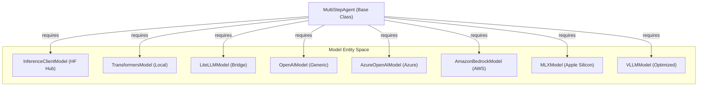

All models inherit from the `Model` base class [src/smolagents/models.py:20-22]().

**Common Configurations:**
- **HF Inference**: `InferenceClientModel(model_id="...", provider="...")` [src/smolagents/models.py:60-62]()
- **Local Transformers**: `TransformersModel(model_id="...", device_map="auto")` [src/smolagents/models.py:30-32]()
- **LiteLLM (100+ Providers)**: `LiteLLMModel(model_id="anthropic/claude-3-5-sonnet-latest")` [src/smolagents/models.py:93-95]()
- **OpenAI-Compatible**: `OpenAIModel(model_id="...", api_base="...")` [src/smolagents/models.py:145-147]()

Sources: [src/smolagents/models.py:20-147](), [docs/source/en/guided_tour.md:121-128](), [docs/source/en/reference/models.md:13-112](), [docs/source/en/examples/using_different_models.md:8-19]()

---

## Adding Tools

Tools can be added via the `tools` list in the agent constructor. You can use built-in tools or create custom ones using the `@tool` decorator [src/smolagents/tools.py:71-71]().

```python
from smolagents import tool, CodeAgent, InferenceClientModel

@tool
def get_weather(location: str) -> str:
    """
    Gets current weather for a location.
    
    Args:
        location: City name
    """
    return f"Weather in {location}: Sunny, 72°F"

agent = CodeAgent(tools=[get_weather], model=InferenceClientModel())
```

- **`@tool` decorator**: Automatically creates a `Tool` instance from a function, using its docstring for the tool description [src/smolagents/tools.py:71-71]().
- **Hub Tools**: Load tools directly from the Hugging Face Hub using `Tool.from_hub("username/tool-name")` [README.md:40-41]().

Sources: [src/smolagents/tools.py:71-71](), [docs/source/en/guided_tour.md:410-531](), [README.md:40-41]()

---

## Inspecting Results

Title: Result and Memory Inspection
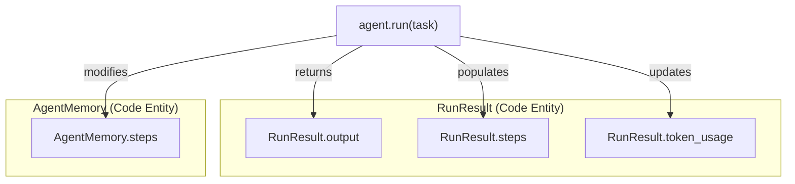

**Full result access**:
```python
agent = CodeAgent(tools=[], model=InferenceClientModel())
# Set stream_outputs=True to see real-time execution logs
agent = CodeAgent(tools=[], model=InferenceClientModel(), stream_outputs=True)
result = agent.run("Calculate 2**10")

print(result) # Final answer
```

The agent maintains a memory of all steps taken, which can be inspected via `agent.memory.steps` [src/smolagents/agents.py:148-148](). The final execution metadata is returned as a `RunResult` object [src/smolagents/agents.py:196-215]().

Sources: [src/smolagents/agents.py:148-215](), [README.md:64-64]()

---

## CLI Quick Start

The `smolagent` CLI allows running agents directly from the terminal without writing Python boilerplate [docs/source/en/guided_tour.md:107-117]().

```bash
# Interactive mode (guides you through model and tool selection)
smolagent

# Direct prompt with tools and authorized imports
smolagent "Plan a trip to Tokyo" --model-type "InferenceClientModel" --tools "web_search" --imports "pandas numpy"
```

The CLI orchestrates agent creation and provides a quick way to test prompts with different configurations [README.md:175-180]().

Sources: [docs/source/en/guided_tour.md:107-117](), [README.md:175-180]()

---

# Page: Key Concepts

# Key Concepts

<details>
<summary>Relevant source files</summary>

The following files were used as context for generating this wiki page:

- [docs/source/en/conceptual_guides/intro_agents.md](docs/source/en/conceptual_guides/intro_agents.md)
- [docs/source/en/conceptual_guides/react.md](docs/source/en/conceptual_guides/react.md)
- [docs/source/en/examples/rag.md](docs/source/en/examples/rag.md)
- [docs/source/en/examples/text_to_sql.md](docs/source/en/examples/text_to_sql.md)
- [docs/source/en/tutorials/building_good_agents.md](docs/source/en/tutorials/building_good_agents.md)
- [docs/source/en/tutorials/tools.md](docs/source/en/tutorials/tools.md)
- [docs/source/hi/conceptual_guides/react.md](docs/source/hi/conceptual_guides/react.md)
- [docs/source/zh/conceptual_guides/react.md](docs/source/zh/conceptual_guides/react.md)

</details>


This page explains the fundamental building blocks of `smolagents`: agents, models, tools, the ReAct loop, memory, and execution environments. These concepts form the foundation for understanding how to build and customize agentic systems.

For detailed API documentation, see the Agent Framework ([#3]()), Model Integration ([#4]()), and Tool System ([#5]()).

---

## The Agent Abstraction

Agents are the central orchestrators in `smolagents`. All agents inherit from `MultiStepAgent` and implement a ReAct-style iterative loop where they think, act, and observe until reaching a final answer [docs/source/en/conceptual_guides/react.md:7-18](). The agent is a system that uses an LLM as its engine rather than being just the LLM itself. Agency is viewed as a spectrum, from simple routers to autonomous code-generating systems [docs/source/en/conceptual_guides/intro_agents:12-23]().

### Agent Hierarchy and Structure

The diagram below bridges the high-level agent concept to the specific class hierarchy and core attributes used in the codebase.

**Diagram: Agent Class Architecture**
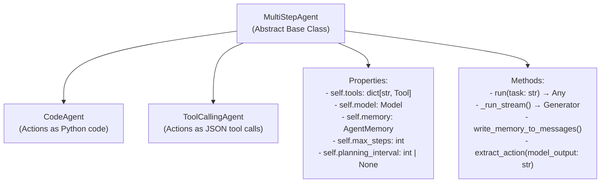

**Agent Type Comparison**

| Aspect | `CodeAgent` | `ToolCallingAgent` |
|--------|-----------|------------------|
| Action format | Python code snippets [docs/source/en/conceptual_guides/react.md:44-44]() | Structured JSON tool calls [docs/source/en/conceptual_guides/react.md:45-45]() |
| Strengths | Expressive logic, complex data handling [docs/source/en/conceptual_guides/intro_agents.md:91-95]() | Standardized, easy to parse for traditional APIs [docs/source/en/conceptual_guides/react.md:45-46]() |
| Execution | Via local interpreter or secure sandboxes | Direct `tool.forward()` calls |
| Use Case | Problem solver, programmer, complex reasoning | Dispatcher, controller, atomic API calls |

Sources: [docs/source/en/conceptual_guides/react.md:7-46](), [docs/source/en/conceptual_guides/intro_agents.md:1-95]()

---

## The Model Interface

Models provide the LLM abstraction layer. All models inherit from a base interface and provide a unified method for generating completions based on chat history.

### Model Integration Mapping

This diagram maps the natural language "Model" concept to specific provider classes and the data flow through chat entities.

**Diagram: Model Entity Space**
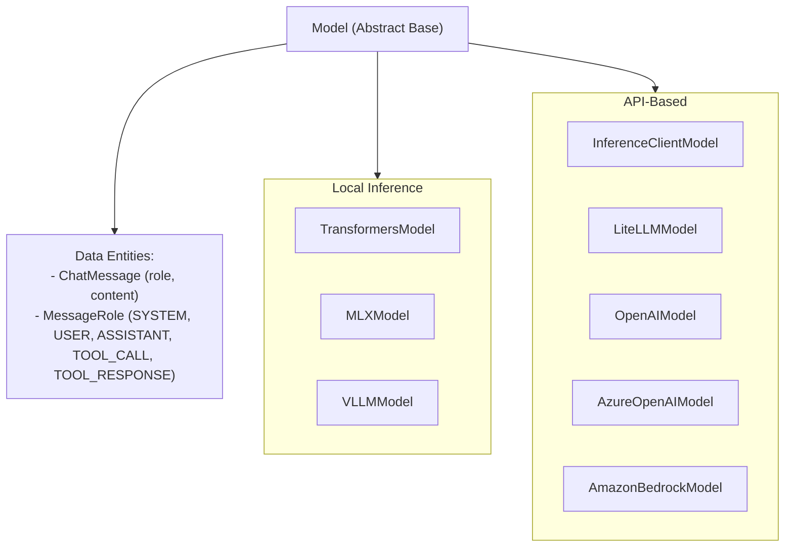

**Message Flow**

Agents convert their internal memory into a list of LLM-readable chat messages using `agent.write_memory_to_messages()` before sending them to the `Model` object [docs/source/en/conceptual_guides/react.md:15-16](). Stronger models (e.g., `Llama-3.3-70B` or `Qwen-Thinking` models) are recommended for complex agentic reasoning [docs/source/en/tutorials/building_good_agents.md:125-127](), [docs/source/en/examples/text_to_sql.md:178-185]().

Sources: [docs/source/en/conceptual_guides/react.md:15-16](), [docs/source/en/tutorials/building_good_agents.md:125-127](), [docs/source/en/examples/text_to_sql.md:128-133]()

---

## The Tool System

A tool is a class that wraps a function with metadata (name, description, inputs, output type) that helps the LLM understand how to use it [docs/source/en/tutorials/tools.md:13-20]().

### Tool Entity Mapping

This diagram bridges the conceptual "Tool" with the class-based implementation requirements in `smolagents`.

**Diagram: Tool Code Entity Space**
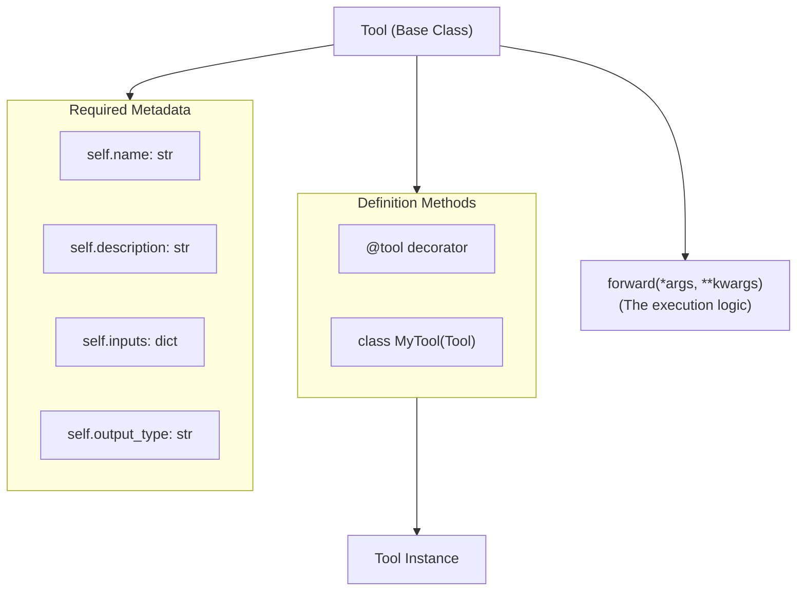

**Tool Components**
- **`name`**: Unique identifier for the tool used in code or JSON calls [docs/source/en/tutorials/tools.md:49-49]().
- **`description`**: Semantic description used to populate the agent's system prompt [docs/source/en/tutorials/tools.md:50-50]().
- **`inputs`**: Dictionary specifying JSON schema-compatible types and descriptions for arguments [docs/source/en/tutorials/tools.md:51-52]().
- **`forward`**: The core method containing the logic to be executed [docs/source/en/tutorials/tools.md:53-53]().

Sources: [docs/source/en/tutorials/tools.md:11-60](), [docs/source/en/examples/text_to_sql.md:97-119](), [docs/source/en/examples/rag.md:107-143]()

---

## The ReAct Loop

The ReAct (Reasoning + Acting) framework is the core execution pattern. Agents solve tasks in steps consisting of reasoning followed by action [docs/source/en/conceptual_guides/react.md:3-5]().

**Execution Lifecycle**
1. **Initialization**: System prompt is stored in `SystemPromptStep`; task is logged in `TaskStep` [docs/source/en/conceptual_guides/react.md:11-11]().
2. **Reasoning**: `agent.write_memory_to_messages()` prepares history for the `Model` [docs/source/en/conceptual_guides/react.md:15-15]().
3. **Action**: `Model` completion is parsed into an action (JSON for `ToolCallingAgent`, Python for `CodeAgent`) [docs/source/en/conceptual_guides/react.md:16-16]().
4. **Execution**: Action is performed (e.g., tool call), and results are logged as an `ActionStep` [docs/source/en/conceptual_guides/react.md:17-17]().
5. **Observation**: Resulting tool output is fed back into memory for the next step iteration.

Sources: [docs/source/en/conceptual_guides/react.md:1-20](), [docs/source/en/conceptual_guides/intro_agents.md:27-35]()

---

## Memory and State

`AgentMemory` maintains the conversation history and execution logs. It allows the LLM to self-correct based on previous errors or observations [docs/source/en/tutorials/building_good_agents.md:16-16]().

| Step Type | Description |
|-----------|-------------|
| `SystemPromptStep` | The base instructions and tool definitions [docs/source/en/conceptual_guides/react.md:11-11](). |
| `TaskStep` | The specific goal provided by the user [docs/source/en/conceptual_guides/react.md:11-11](). |
| `ActionStep` | Records reasoning, the action taken, and the observation (tool output) [docs/source/en/conceptual_guides/react.md:17-17](). |
| `PlanningStep` | (Optional) Periodically revised plan and facts about the task [docs/source/en/conceptual_guides/react.md:20-20](). |

Sources: [docs/source/en/conceptual_guides/react.md:11-20](), [docs/source/en/tutorials/building_good_agents.md:79-80]()

---

## Execution Environments

For `CodeAgent`, the generated Python code must be executed in a controlled environment.

- **Local Execution**: Uses an AST-based interpreter to execute code safely on the host machine.
- **Sandboxed Execution**: Code can be executed in isolated environments like Docker or remote executors (E2B, Blaxel) to prevent unauthorized access to the host system.
- **Tool Logic**: Even in `ToolCallingAgent`, the logic within a tool's `forward` method is executed locally or via defined remote calls [docs/source/en/tutorials/tools.md:39-43]().

Sources: [docs/source/en/conceptual_guides/react.md:43-46](), [docs/source/en/tutorials/tools.md:91-110]()

---

# Page: Agent Framework

# Agent Framework

<details>
<summary>Relevant source files</summary>

The following files were used as context for generating this wiki page:

- [docs/source/en/reference/agents.md](docs/source/en/reference/agents.md)
- [docs/source/hi/reference/agents.md](docs/source/hi/reference/agents.md)
- [docs/source/zh/reference/agents.md](docs/source/zh/reference/agents.md)
- [src/smolagents/agents.py](src/smolagents/agents.py)
- [tests/test_agents.py](tests/test_agents.py)

</details>


This document provides comprehensive documentation of the agent system, the core component of `smolagents`. It covers the agent class hierarchy, execution patterns, memory management, and lifecycle hooks.

For information about specific model integrations, see [Model Integration](#4). For details on the tool system, see [Tool System](#5). For code execution environments, see [Code Execution & Security](#6).

## Architecture Overview

The agent framework implements a **ReAct** (Reasoning + Acting) pattern where agents iteratively think about a task, take actions using tools, observe results, and continue until reaching a final answer. The system is built on three key abstractions:

| Component | Purpose | Key Classes |
|-----------|---------|-------------|
| **Agent Types** | Define how actions are generated and executed | `MultiStepAgent`, `CodeAgent`, `ToolCallingAgent` |
| **Memory System** | Store conversation history and execution steps | `AgentMemory`, `MemoryStep` subclasses |
| **Monitoring & Callbacks** | Track execution and enable custom hooks | `CallbackRegistry`, `Monitor`, `AgentLogger` |

The framework supports two distinct agent paradigms:
- **Code-based agents** (`CodeAgent`): Generate Python code to invoke tools as functions. [src/smolagents/agents.py:891-1177]()
- **Tool-calling agents** (`ToolCallingAgent`): Generate structured JSON tool calls. [src/smolagents/agents.py:1179-1495]()

### System Component Map

The following diagram maps high-level concepts to the specific code entities that implement them.

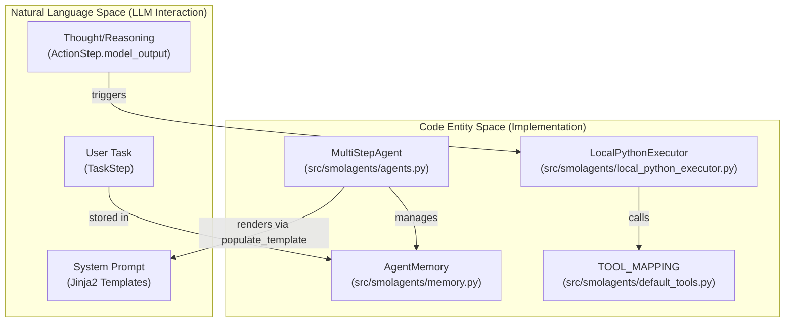

**Sources:** [src/smolagents/agents.py:268-889](), [src/smolagents/memory.py:214-278](), [src/smolagents/local_python_executor.py:186-210](), [src/smolagents/agents.py:102-108]()

## Agent Type Hierarchy

### MultiStepAgent: Abstract Base Class

`MultiStepAgent` is the abstract base class that defines the core agent interface and execution loop. All concrete agent implementations inherit from this class. [src/smolagents/agents.py:268-293]()

**Key Initialization Parameters:**

| Parameter | Type | Description |
|-----------|------|-------------|
| `tools` | `list[Tool]` | Tools available to the agent. [src/smolagents/agents.py:301]() |
| `model` | `Model` | LLM that generates agent actions. [src/smolagents/agents.py:302]() |
| `prompt_templates` | `PromptTemplates` | YAML-based prompt configuration. [src/smolagents/agents.py:304]() |
| `max_steps` | `int` | Maximum iterations (default: 20). [src/smolagents/agents.py:307]() |
| `planning_interval` | `int \| None` | Frequency of planning steps. [src/smolagents/agents.py:311]() |
| `managed_agents` | `list \| None` | Sub-agents for hierarchical delegation. [src/smolagents/agents.py:308]() |

**Sources:** [src/smolagents/agents.py:268-367]()

### CodeAgent: Python Code Generation

`CodeAgent` generates Python code snippets to invoke tools as functions. Code is executed in a `PythonExecutor`. [src/smolagents/agents.py:891-1177]()

**Key Characteristics:**
- Generates code blocks wrapped in `code_block_tags` (default: `<code>...</code>`). [src/smolagents/agents.py:944]()
- Uses `LocalPythonExecutor` by default to run generated code. [src/smolagents/agents.py:925]()
- Tools are exposed as callable Python functions within the execution context. [src/smolagents/agents.py:1012-1025]()

For details, see [CodeAgent](#3.2).

### ToolCallingAgent: JSON Tool Calling

`ToolCallingAgent` generates structured JSON tool calls following standard tool-calling conventions. [src/smolagents/agents.py:1179-1495]()

**Key Characteristics:**
- Model generates `ChatMessageToolCall` objects. [src/smolagents/agents.py:1263-1275]()
- Tools are invoked via `tool.forward(**arguments)`. [src/smolagents/agents.py:1330-1340]()
- Supports parallel tool execution via `ThreadPoolExecutor`. [src/smolagents/agents.py:1321-1335]()

For details, see [ToolCallingAgent](#3.3).

## ReAct Execution Loop

The ReAct loop is the core execution pattern implemented in `MultiStepAgent.run()` and `_run_stream()`. [src/smolagents/agents.py:436-538]()

### Execution Lifecycle

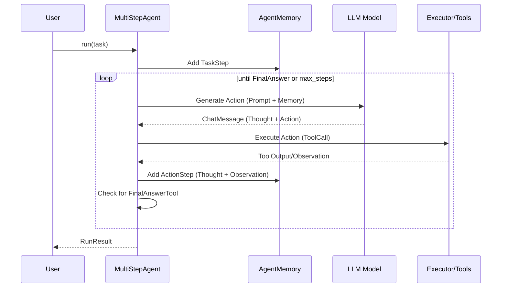

**Main Entry Points:**
- `run()`: Execute agent with task and return a `RunResult`. [src/smolagents/agents.py:436-538]()
- `_run_stream()`: Generator yielding each step as it occurs for real-time monitoring. [src/smolagents/agents.py:540-612]()

For details, see [MultiStepAgent & ReAct Loop](#3.1).

## Agent Memory & State Management

The memory system stores the agent's conversation history as a sequence of typed steps in `AgentMemory`. [src/smolagents/memory.py:214-278]()

### Memory Step Types
- `SystemPromptStep`: Initial instructions and tool definitions. [src/smolagents/memory.py:153-162]()
- `TaskStep`: The user's request and optional images. [src/smolagents/memory.py:165-182]()
- `PlanningStep`: Generated plans and updates based on `planning_interval`. [src/smolagents/memory.py:185-211]()
- `ActionStep`: Core ReAct step containing thought, tool calls, and observations. [src/smolagents/memory.py:50-150]()
- `FinalAnswerStep`: The terminal step containing the agent's conclusive output. [src/smolagents/memory.py:213]()

For details, see [Agent Memory & State Management](#3.4).

## Callbacks & Agent Lifecycle

The `CallbackRegistry` system allows users to hook into the agent's execution lifecycle at various points. [src/smolagents/memory.py:280-317]()

**Lifecycle Hooks:**
- `step_callbacks`: Functions executed after every memory step is completed. [src/smolagents/agents.py:309]()
- `final_answer_checks`: Validation functions for the final output before finishing. [src/smolagents/agents.py:310]()

For details, see [Callbacks & Agent Lifecycle](#3.5).

## Prompt Templates & System Instructions

Agents use Jinja2-templated strings, often loaded from YAML files, to define their behavior. [src/smolagents/agents.py:102-108]()

**Key Templates in `PromptTemplates`:**
- `system_prompt`: The core personality and tool-usage instructions. [src/smolagents/agents.py:177]()
- `planning`: Templates for creating and updating task plans (`initial_plan`, `update_plan_pre_messages`, etc.). [src/smolagents/agents.py:178]()
- `managed_agent`: Templates for interacting with sub-agents (`task`, `report`). [src/smolagents/agents.py:179]()
- `final_answer`: Templates for formatting the terminal response. [src/smolagents/agents.py:180]()

For details, see [Prompt Templates & System Instructions](#3.6).

**Sources:** [src/smolagents/agents.py:102-192](), [src/smolagents/memory.py:280-317](), [src/smolagents/memory.py:42-213]()

---

# Page: MultiStepAgent & ReAct Loop

# MultiStepAgent & ReAct Loop

<details>
<summary>Relevant source files</summary>

The following files were used as context for generating this wiki page:

- [docs/source/en/conceptual_guides/react.md](docs/source/en/conceptual_guides/react.md)
- [docs/source/hi/conceptual_guides/react.md](docs/source/hi/conceptual_guides/react.md)
- [docs/source/zh/conceptual_guides/react.md](docs/source/zh/conceptual_guides/react.md)
- [src/smolagents/agents.py](src/smolagents/agents.py)
- [tests/test_agents.py](tests/test_agents.py)

</details>


## Purpose and Scope

This document explains the `MultiStepAgent` base class and the ReAct (Reasoning + Acting) execution loop that powers all agents in `smolagents`. It covers the core iterative framework, loop mechanics, step-by-step processing, and the `_run_stream` generator lifecycle. For specific agent implementations (code generation vs JSON tool calling), see [CodeAgent](#3.2) and [ToolCallingAgent](#3.3). For memory management details, see [Agent Memory & State Management](#3.4).

**Sources:** [src/smolagents/agents.py:268-274](), [docs/source/en/conceptual_guides/react.md:3-15]()

## The MultiStepAgent Base Class

`MultiStepAgent` is the abstract base class that implements the ReAct framework [src/smolagents/agents.py:268](). It provides the core execution loop while requiring subclasses to implement agent-specific behavior like step execution logic and system prompt initialization.

### Class Definition

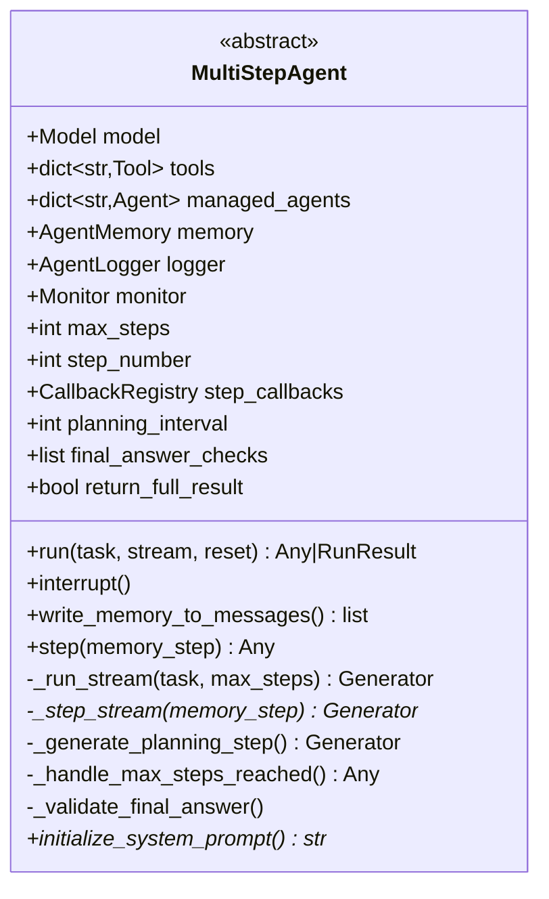

**Sources:** [src/smolagents/agents.py:268-857]()

### Constructor Parameters

The `MultiStepAgent.__init__()` method accepts the following key parameters:

| Parameter | Type | Default | Description |
|-----------|------|---------|-------------|
| `tools` | `list[Tool]` | Required | Tools the agent can use to solve tasks |
| `model` | `Model` | Required | LLM that generates agent actions |
| `prompt_templates` | `PromptTemplates \| None` | `None` | Custom prompt templates for system, planning, final answer |
| `instructions` | `str \| None` | `None` | Custom instructions inserted into system prompt |
| `max_steps` | `int` | `20` | Maximum iteration steps before forced termination |
| `add_base_tools` | `bool` | `False` | Whether to add default toolbox (search, visit webpage, transcriber) |
| `verbosity_level` | `LogLevel` | `LogLevel.INFO` | Logging verbosity level |
| `managed_agents` | `list \| None` | `None` | Sub-agents for hierarchical delegation |
| `step_callbacks` | `list \| dict` | `None` | Callbacks executed at each step |
| `planning_interval` | `int \| None` | `None` | Frequency of planning step generation |
| `name` | `str \| None` | `None` | Agent name (required for managed agents) |
| `description` | `str \| None` | `None` | Agent description (required for managed agents) |
| `final_answer_checks` | `list[Callable] \| None` | `None` | Validation functions for final answers |
| `return_full_result` | `bool` | `False` | Return `RunResult` object vs just final answer |

**Sources:** [src/smolagents/agents.py:294-352]()

### Key Internal State

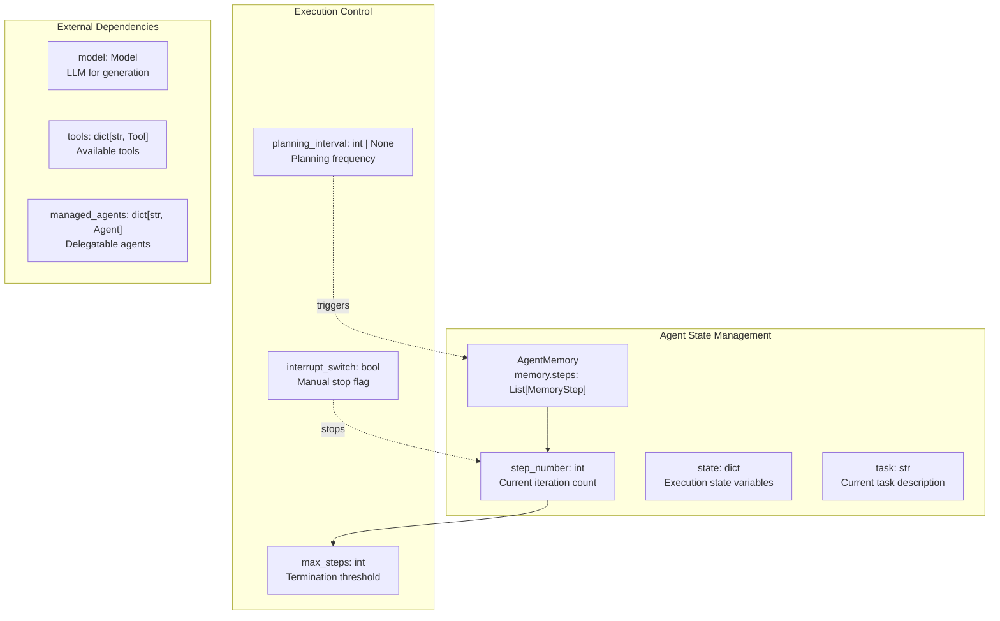

**Sources:** [src/smolagents/agents.py:328-352](), [src/smolagents/memory.py:52-61]()

## The ReAct Framework

ReAct (Reasoning + Acting) is an iterative framework where the agent solves tasks by alternating between reasoning and taking actions [docs/source/en/conceptual_guides/react.md:3-5]().
1. **Reasoning**: The LLM analyzes the task and history to decide the next action.
2. **Acting**: The agent executes the chosen action (tool call or code snippet).
3. **Observing**: The agent receives feedback (observations) from the action.
4. **Repeating**: Steps 1-3 continue until the task is solved or a limit is reached.

### ReAct Cycle Within Each Step

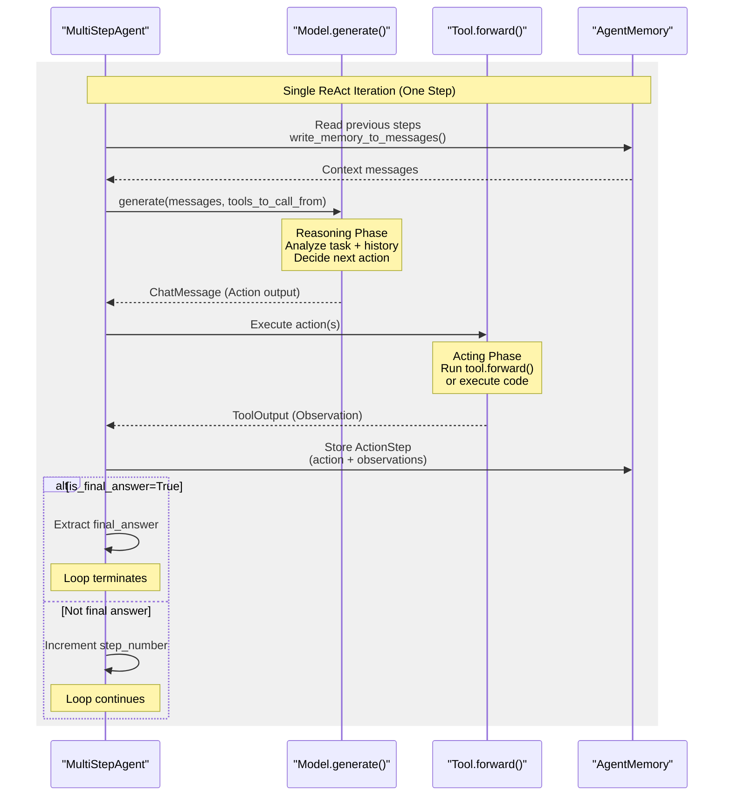

**Sources:** [src/smolagents/agents.py:540-638](), [docs/source/en/conceptual_guides/react.md:13-18](), [src/smolagents/memory.py:50-61]()

## Core Execution Loop

The execution loop is implemented across two primary methods: `run()` (public synchronous/streaming API) and `_run_stream()` (internal generator implementation).

### The run() Method

The `run()` method is the primary entry point [src/smolagents/agents.py:436](). It initializes the task, resets memory if requested, and consumes the `_run_stream` generator if `stream=False`.

```python
def run(
    self,
    task: str,
    stream: bool = False,
    reset: bool = True,
    images: list["PIL.Image.Image"] | None = None,
    additional_args: dict | None = None,
    max_steps: int | None = None,
    return_full_result: bool | None = None,
) -> Any | RunResult:
```

**Execution Flow:**

```mermaid
graph TD
    Start["run(task, ...)"] --> Init["Initialize:<br/>- Set self.task<br/>- Update state with additional_args<br/>- Reset memory if reset=True"]
    Init --> Log["Log task to AgentLogger"]
    Log --> AddTask["Append TaskStep to memory"]
    AddTask --> SendVars["Send variables to executor<br/>(if using PythonExecutor)"]
    
    SendVars --> CheckStream{stream=True?}
    
    CheckStream -->|Yes| ReturnGen["Return generator<br/>_run_stream()"]
    CheckStream -->|No| Consume["Consume generator:<br/>steps = list(_run_stream())"]
    
    Consume --> ExtractAnswer["Extract final answer<br/>from last step"]
    ExtractAnswer --> CheckReturn{return_full_result?}
    
    CheckReturn -->|True| BuildResult["Build RunResult:<br/>- Calculate token_usage<br/>- Determine state<br/>- Convert steps to dicts<br/>- Add timing info"]
    CheckReturn -->|False| ReturnAnswer["Return answer only"]
    
    BuildResult --> ReturnResult["Return RunResult"]
    
    ReturnGen --> End["End"]
    ReturnAnswer --> End
    ReturnResult --> End
```

**Sources:** [src/smolagents/agents.py:436-538]()

### The _run_stream() Generator

The `_run_stream()` method implements the actual ReAct loop as a generator that yields events (deltas, tool calls, completed steps) as they execute [src/smolagents/agents.py:540]().

```mermaid
graph TB
    Start["_run_stream(task, max_steps)"] --> InitStep["step_number = 1<br/>returned_final_answer = False"]
    
    InitStep --> LoopCheck{step_number <= max_steps<br/>AND NOT returned_final_answer}
    
    LoopCheck -->|No| HandleMax["_handle_max_steps_reached()"]
    HandleMax --> YieldFinal["Yield FinalAnswerStep"]
    YieldFinal --> End["End"]
    
    LoopCheck -->|Yes| CheckInterrupt{interrupt_switch?}
    CheckInterrupt -->|Yes| RaiseError["Raise AgentError"]
    RaiseError --> End
    
    CheckInterrupt -->|No| CheckPlanning{planning_interval defined<br/>AND step is planning step?}
    
    CheckPlanning -->|Yes| GenPlan["_generate_planning_step()"]
    GenPlan --> YieldPlan["Yield PlanningStep events"]
    YieldPlan --> StorePlan["Append PlanningStep to memory"]
    StorePlan --> CreateAction
    
    CheckPlanning -->|No| CreateAction["Create ActionStep<br/>(step_number, timing, images)"]
    
    CreateAction --> LogRule["Log step number"]
    LogRule --> TryStep["Try: _step_stream(action_step)"]
    
    TryStep --> YieldStepEvents["Yield step events<br/>(deltas, tool calls, outputs)"]
    YieldStepEvents --> CheckFinal{ActionOutput.is_final_answer?}
    
    CheckFinal -->|Yes| ValidateAnswer["Validate with<br/>final_answer_checks"]
    ValidateAnswer --> SetFinal["Set action_step.is_final_answer = True<br/>returned_final_answer = True"]
    SetFinal --> FinalizeStep
    
    CheckFinal -->|No| FinalizeStep["_finalize_step(action_step)"]
    
    FinalizeStep --> StoreAction["Append ActionStep to memory"]
    StoreAction --> YieldAction["Yield ActionStep"]
    YieldAction --> Increment["step_number += 1"]
    Increment --> LoopCheck
    
    TryStep -.on AgentError.-> CatchError["Catch error:<br/>store in action_step.error"]
    CatchError --> FinalizeStep
```

**Sources:** [src/smolagents/agents.py:540-611]()

### Step Execution: _step_stream()

The `_step_stream()` method is an abstract generator that must be implemented by subclasses [src/smolagents/agents.py:772](). It performs the specific Reasoning → Acting → Observing cycle:

- **CodeAgent**: Generates Python code snippets and executes them via a `PythonExecutor` [src/smolagents/agents.py:1086-1212]().
- **ToolCallingAgent**: Generates JSON tool calls and executes them directly [src/smolagents/agents.py:1542-1713]().

**Sources:** [src/smolagents/agents.py:772-787](), [docs/source/en/conceptual_guides/react.md:43-46]()

## Loop Termination

The ReAct loop terminates under two primary conditions:

### Condition 1: Final Answer Reached

The agent solves the task by calling the `final_answer` tool or function [src/smolagents/agents.py:582]().

```mermaid
graph TB
    StepExec["_step_stream() execution"] --> CheckOutput{ActionOutput.<br/>is_final_answer?}
    
    CheckOutput -->|False| Continue["Continue to next step"]
    
    CheckOutput -->|True| HasChecks{final_answer_checks<br/>defined?}
    
    HasChecks -->|No| SetFlag["Set returned_final_answer = True<br/>Loop will terminate"]
    
    HasChecks -->|Yes| RunChecks["Execute validation functions:<br/>for check in final_answer_checks:<br/>  assert check(answer, memory, agent)"]
    
    RunChecks --> AllPass{All checks<br/>passed?}
    
    AllPass -->|Yes| SetFlag
    AllPass -->|No| LogError["Log validation error<br/>to memory"]
    LogError --> UnsetFlag["Unset is_final_answer flag<br/>Continue execution"]
    UnsetFlag --> Continue
    
    SetFlag --> Terminate["Loop terminates<br/>Yield FinalAnswerStep"]
```

**Sources:** [src/smolagents/agents.py:582-593](), [src/smolagents/agents.py:613-618]()

### Condition 2: Max Steps Reached

If `step_number` exceeds `max_steps`, the agent attempts to synthesize a final answer from history via `_handle_max_steps_reached()` [src/smolagents/agents.py:606]().

```mermaid
sequenceDiagram
    participant Loop as "_run_stream loop"
    participant Agent as "MultiStepAgent"
    participant Model as "Model.generate()"
    participant Memory as "AgentMemory"
    
    rect rgb(250, 230, 230)
        Note over Loop,Memory: Max Steps Reached (step_number = max_steps + 1)
        
        Loop->>Agent: _handle_max_steps_reached(task)
        Agent->>Agent: Create messages from memory<br/>write_memory_to_messages()
        
        Agent->>Model: Summarize final answer
        Note over Model: System prompt + Task + History
        Model-->>Agent: ChatMessage with synthesized answer
        
        Agent->>Memory: Create ActionStep with AgentMaxStepsError
        Memory->>Memory: Append step
        
        Agent-->>Loop: Return synthesized answer
        
        Loop->>Loop: Yield FinalAnswerStep
    end
```

**Sources:** [src/smolagents/agents.py:606-637](), [src/smolagents/agents.py:810-853]()

## Execution Modes

### Streaming vs Non-Streaming

The `stream` parameter in `run()` controls the return type and execution behavior:

| Mode | `stream=False` (Default) | `stream=True` |
|------|-------------------------|---------------|
| **Return Type** | `Any` or `RunResult` | `Generator[StreamEvent]` |
| **Execution** | Consumes entire generator internally | Returns generator for manual iteration |
| **Use Case** | Simple scripts, batch processing | Real-time UI updates, logging |

**Sources:** [src/smolagents/agents.py:494-499](), [src/smolagents/agents.py:540-542]()

### Return Value Options

The `return_full_result` parameter controls whether the agent returns just the final answer or a detailed `RunResult` object [src/smolagents/agents.py:505]().

**RunResult structure:**
```python
@dataclass
class RunResult:
    output: Any | None              # Final answer
    state: Literal["success", "max_steps_error"]
    steps: list[dict]               # Full execution history as dicts
    token_usage: TokenUsage | None  # Total tokens consumed
    timing: Timing                  # Execution duration
```

**Sources:** [src/smolagents/agents.py:195-254](), [src/smolagents/agents.py:505-537]()

## Planning Intervals

When `planning_interval` is set, the agent periodically generates `PlanningStep` objects to revise its strategy [src/smolagents/agents.py:549]().

- **Initial plan** (step 1): The agent receives the task and generates a high-level strategy via `_generate_planning_step()` [src/smolagents/agents.py:654-678]().
- **Plan updates** (every N steps): The agent reviews previous actions and updates the plan [src/smolagents/agents.py:680-747]().
- **Memory Management**: Previous planning messages are typically removed from context to avoid bias, while keeping action results [src/smolagents/agents.py:642-652]().

**Sources:** [src/smolagents/agents.py:549-568](), [src/smolagents/agents.py:639-747]()

## Error Handling in the Loop

Errors during step execution (parsing, execution, tool calls) are caught, logged to memory as an `ActionStep` with an `error` attribute, and the loop continues to allow the agent to self-correct [src/smolagents/agents.py:594-604]().

**Error types stored in memory:**
- `AgentParsingError`: Failed to parse model output [src/smolagents/utils.py:87]().
- `AgentExecutionError`: Code execution failed [src/smolagents/utils.py:84]().
- `AgentToolCallError`: Invalid tool call format [src/smolagents/utils.py:88]().
- `AgentToolExecutionError`: Tool execution raised an exception [src/smolagents/utils.py:89]().

**Sources:** [src/smolagents/agents.py:594-604](), [src/smolagents/utils.py:83-96]()

---

# Page: CodeAgent

# CodeAgent

<details>
<summary>Relevant source files</summary>

The following files were used as context for generating this wiki page:

- [README.md](README.md)
- [docs/source/en/index.md](docs/source/en/index.md)
- [docs/source/en/tutorials/secure_code_execution.md](docs/source/en/tutorials/secure_code_execution.md)
- [src/smolagents/agents.py](src/smolagents/agents.py)
- [tests/test_agents.py](tests/test_agents.py)

</details>


`CodeAgent` is an agent implementation that generates and executes Python code snippets to perform actions and solve tasks. Unlike `ToolCallingAgent` which outputs structured JSON tool calls, `CodeAgent` writes its actions as executable Python code, allowing for more expressive multi-step reasoning, control flow, and dynamic tool composition.

For information about the base agent abstraction and ReAct loop, see [3.1 MultiStepAgent & ReAct Loop](). For the alternative JSON-based agent paradigm, see [3.3 ToolCallingAgent](). For code execution security, see [6.1 Execution Environment Overview]().

---

## Overview & Design Philosophy

`CodeAgent` implements a code-centric agent paradigm where the LLM generates Python code snippets rather than structured API calls. This approach provides several advantages:

- **Expressiveness**: Full Python language capabilities including loops, conditionals, variable assignment, and function composition [src/smolagents/agents.py:908-920]().
- **Tool Composition**: Natural chaining and transformation of tool outputs through standard Python syntax.
- **Object Management**: Ability to store complex outputs (like images or dataframes) in variables for subsequent tool calls [docs/source/en/tutorials/secure_code_execution.md:15-17]().
- **Performance**: Research suggests higher benchmark performance compared to JSON-based tool calling [docs/source/en/tutorials/secure_code_execution.md:10-22]().

The tradeoff is increased complexity in code parsing, execution sandboxing, and security management [src/smolagents/local_python_executor.py:49-55]().

**Sources:** [src/smolagents/agents.py:908-920](), [src/smolagents/local_python_executor.py:49-55](), [docs/source/en/tutorials/secure_code_execution.md:10-22]()

---

## Architecture Overview

### System Components Diagram
The following diagram illustrates the relationship between the `CodeAgent` class, its core components, and the available execution environments.

```mermaid
graph TB
    subgraph "CodeAgent_Class_Hierarchy"
        MultiStepAgent["MultiStepAgent<br/>(Abstract Base)"]
        CodeAgent["CodeAgent<br/>Code-generating agent"]
        ToolCallingAgent["ToolCallingAgent<br/>JSON-based agent"]
        
        MultiStepAgent --> CodeAgent
        MultiStepAgent --> ToolCallingAgent
    end
    
    subgraph "CodeAgent_Components"
        SystemPrompt["initialize_system_prompt()<br/>Tools as Python functions"]
        StepStream["_step_stream()<br/>Code generation & execution"]
        Parser["parse_code_blobs()<br/>Extract code from LLM output"]
        Executor["PythonExecutor<br/>Local or Remote"]
    end
    
    subgraph "Execution_Context"
        LocalExec["LocalPythonExecutor<br/>In-process, restricted"]
        E2BExec["E2BExecutor<br/>Cloud sandbox"]
        DockerExec["DockerExecutor<br/>Container isolation"]
        ModalExec["ModalExecutor<br/>Serverless"]
        BlaxelExec["BlaxelExecutor<br/>Fast VM"]
    end
    
    CodeAgent --> SystemPrompt
    CodeAgent --> StepStream
    StepStream --> Parser
    StepStream --> Executor
    
    Executor --> LocalExec
    Executor --> E2BExec
    Executor --> DockerExec
    Executor --> ModalExec
    Executor --> BlaxelExec
```

**Sources:** [src/smolagents/agents.py:908-920](), [src/smolagents/agents.py:951-1000](), [src/smolagents/remote_executors.py:1-80]()

---

## Initialization and Configuration

### Constructor Parameters

`CodeAgent` extends `MultiStepAgent` with code execution-specific parameters:

| Parameter | Type | Description |
|-----------|------|-------------|
| `executor_type` | `str \| None` | Executor type: `None` (local), `"e2b"`, `"docker"`, `"modal"`, `"blaxel"` [src/smolagents/agents.py:925-926]() |
| `additional_authorized_imports` | `list[str] \| None` | Whitelist of additional Python modules to allow importing [src/smolagents/agents.py:921-922]() |
| `verbose_code_output` | `bool` | Whether to show detailed code execution logs (default: `True`) [src/smolagents/agents.py:928-928]() |
| `python_executor` | `PythonExecutor \| None` | Custom executor instance (overrides `executor_type`) [src/smolagents/agents.py:923-924]() |
| `code_block_tags` | `list[str]` | List of tags to identify code blocks in LLM output (default: `["```python", "```", "<code>"]`) [src/smolagents/agents.py:927-927]() |

It inherits all `MultiStepAgent` parameters including `tools`, `model`, `prompt_templates`, `max_steps`, and `managed_agents` [src/smolagents/agents.py:908-949]().

### Initialization Sequence
When initialized, the agent sets up its execution environment and constructs the system prompt based on the provided tools.

```mermaid
sequenceDiagram
    participant User
    participant CodeAgent
    participant MultiStepAgent
    participant Executor
    participant Tools
    
    User->>CodeAgent: __init__(tools, model, executor_type, ...)
    CodeAgent->>MultiStepAgent: super().__init__(...)
    MultiStepAgent->>MultiStepAgent: _setup_tools()
    
    CodeAgent->>CodeAgent: _setup_python_executor()
    
    alt executor_type is None
        CodeAgent->>Executor: LocalPythonExecutor(additional_authorized_imports)
    else executor_type in ["e2b", "docker", "modal", "blaxel"]
        CodeAgent->>Executor: Remote Executor Instance
    end
    
    Executor-->>CodeAgent: python_executor instance
    
    CodeAgent->>CodeAgent: initialize_system_prompt()
    CodeAgent->>Tools: Generate tool descriptions as Python functions
    Tools-->>CodeAgent: Tool function signatures
```

**Sources:** [src/smolagents/agents.py:951-1000](), [src/smolagents/agents.py:389-402]()

---

## System Prompt Construction

`CodeAgent` generates a system prompt that presents tools as callable Python functions. This allows the LLM to treat the environment as a standard Python coding task.

### Tool Function Generation
For each tool, `CodeAgent` generates a Python function signature [src/smolagents/agents.py:1002-1100](). This includes:
- Function name matching `tool.name`.
- Docstring containing `tool.description`.
- Type-hinted parameters based on `tool.inputs`.
- Return type annotation from `tool.output_type`.

### Prompt Components
The system prompt is typically loaded from YAML templates (e.g., `code_agent.yaml`) and includes:
1. **ReAct Cycle Instructions**: Guidance on using `Thought:`, `Code:`, and `Observation:` sequences [src/smolagents/agents.py:1102-1120]().
2. **Authorized Imports**: Modules listed in `additional_authorized_imports` [src/smolagents/agents.py:921-922]().
3. **Tool Function Signatures**: Dynamically generated signatures for all provided tools [src/smolagents/agents.py:1002-1050]().
4. **Final Answer Instruction**: Requirement to use the `final_answer` tool to conclude the task [src/smolagents/agents.py:48-48]().

**Sources:** [src/smolagents/agents.py:1002-1100](), [src/smolagents/agents.py:921-922]()

---

## Code Generation and Execution Flow

### Single Step Execution
The core of the agent's logic resides in the `_step_stream` generator, which handles the interaction between the LLM and the code executor.

```mermaid
sequenceDiagram
    participant Model as LLM Model
    participant CodeAgent
    participant Parser as parse_code_blobs()
    participant Executor as PythonExecutor
    participant Tools
    participant Memory as ActionStep
    
    CodeAgent->>Model: generate(messages)
    Model-->>CodeAgent: ChatMessage with code
    
    CodeAgent->>Parser: parse_code_blobs(model_output)
    Parser-->>CodeAgent: code_action
    
    CodeAgent->>Memory: Store code_action
    
    CodeAgent->>Executor: execute(code_action, state)
    
    loop For each tool call in code
        Executor->>Tools: tool.forward(**kwargs)
        Tools-->>Executor: tool_output
    end
    
    alt final_answer() called
        Executor-->>CodeAgent: CodeOutput(final_answer, is_final=True)
        CodeAgent->>Memory: is_final_answer = True
    else No final_answer
        Executor-->>CodeAgent: CodeOutput(result, is_final=False)
        CodeAgent->>Memory: observations = str(result)
    end
```

**Sources:** [src/smolagents/agents.py:1102-1238](), [src/smolagents/utils.py:94-94]()

### Code Parsing
The `parse_code_blobs()` utility extracts Python code from LLM output. It identifies code blocks based on configured tags [src/smolagents/utils.py:94-94](). By default, it handles triple-backtick blocks or specific `<code>` tags [src/smolagents/utils.py:91-91](). The `code_block_tags` parameter in `CodeAgent`'s constructor allows customization of these tags [src/smolagents/agents.py:927-927]().

### Variable Persistence
`CodeAgent` maintains state across steps through the executor's `state` dictionary [src/smolagents/agents.py:1146-1147](). Variables assigned in one step remain available in subsequent steps, allowing the agent to perform complex, stateful operations [tests/test_agents.py:562-571]().

**Sources:** [src/smolagents/agents.py:927-927](), [src/smolagents/agents.py:1146-1147](), [src/smolagents/utils.py:91-91](), [src/smolagents/utils.py:94-94](), [tests/test_agents.py:562-571]()

---

## Code Execution Environments

`CodeAgent` supports multiple execution backends with different security profiles.

| Executor | Security | Use Case |
|----------|----------|----------|
| `LocalPythonExecutor` | ⚠️ Restricted (AST-based) | Local development, trusted environments [src/smolagents/local_python_executor.py:49-49]() |
| `E2BExecutor` | ✅ High (Sandboxed) | Production, untrusted code [src/smolagents/remote_executors.py:80-80]() |
| `DockerExecutor` | ✅ High (Isolated) | Self-hosted isolation [src/smolagents/remote_executors.py:80-80]() |
| `ModalExecutor` | ✅ High (Sandboxed) | Serverless execution [src/smolagents/remote_executors.py:80-80]() |
| `BlaxelExecutor` | ✅ High (Sandboxed) | Fast VM execution [src/smolagents/remote_executors.py:80-80]() |

### Import Authorization
`LocalPythonExecutor` restricts imports to a whitelist. By default, it allows a set of safe modules defined in `BASE_BUILTIN_MODULES` [src/smolagents/local_python_executor.py:49-49](). Users can authorize additional modules via `additional_authorized_imports` [src/smolagents/agents.py:921-922]().

**Sources:** [src/smolagents/agents.py:921-922](), [src/smolagents/local_python_executor.py:49-49](), [src/smolagents/remote_executors.py:80-80]()

---

## Error Handling

`CodeAgent` handles various error types during the generation and execution phases:

- **`AgentParsingError`**: Raised when the LLM output does not contain valid code blocks [src/smolagents/utils.py:87-87]().
- **`AgentExecutionError`**: Raised when the generated code fails to execute (e.g., SyntaxError, ImportError) [src/smolagents/utils.py:84-84]().
- **`AgentToolExecutionError`**: Raised when a tool called within the code snippet fails [src/smolagents/utils.py:89-89]().

Errors are captured and fed back into the agent's memory as observations, allowing the LLM to "see" the traceback and attempt to fix the code in the next step [src/smolagents/agents.py:1169-1238]().

**Sources:** [src/smolagents/agents.py:1102-1238](), [src/smolagents/utils.py:83-96]()

---

# Page: ToolCallingAgent

# ToolCallingAgent

<details>
<summary>Relevant source files</summary>

The following files were used as context for generating this wiki page:

- [src/smolagents/agents.py](src/smolagents/agents.py)
- [tests/test_agents.py](tests/test_agents.py)

</details>


## Purpose and Scope

The `ToolCallingAgent` class provides a structured, JSON-based approach to agent tool calling where the LLM generates tool invocations as validated JSON objects rather than executable code. This agent type prioritizes reliability, safety, and interoperability by constraining outputs to a predefined schema and validating all tool arguments before execution.

For information about the code-based alternative that generates Python code for tool calls, see [CodeAgent](3.2). For the base agent framework and ReAct loop implementation, see [MultiStepAgent & ReAct Loop](3.1).

**Sources:** [src/smolagents/agents.py:1181-1210](), [src/smolagents/prompts/toolcalling_agent.yaml:1-26]()

## Architecture Overview

`ToolCallingAgent` inherits from `MultiStepAgent` [src/smolagents/agents.py:1181]() and implements the ReAct (Reasoning + Acting) pattern using structured tool calls instead of code generation. Unlike the `CodeAgent`, it does not require an internal Python interpreter for its logic, as it maps tool calls directly to Python function calls.

### System Architecture Diagram

The following diagram bridges the Natural Language task space to the Code Entity Space by showing how `ToolCallingAgent` orchestrates its internal components.

Title: ToolCallingAgent Component Interaction
```mermaid
graph TB
    subgraph "Natural Language Space"
        Task["User Task String"]
        Thought["LLM Reasoning String"]
    end

    subgraph "Code Entity Space: ToolCallingAgent"
        Agent["ToolCallingAgent Instance<br/>(src/smolagents/agents.py:1181)"]
        Memory["AgentMemory<br/>(src/smolagents/memory.py:516)"]
        Model["Model Interface<br/>(src/smolagents/models.py:157)"]
        Tools["Tool Registry<br/>(dict[str, Tool])"]
        
        subgraph "Execution Logic"
            Step["_run_step()<br/>(src/smolagents/agents.py:1311)"]
            Parallel["ThreadPoolExecutor<br/>(src/smolagents/agents.py:1414)"]
            Validator["validate_tool_arguments()<br/>(src/smolagents/tools.py:81)"]
        end
    end
    
    Task --> Agent
    Agent --> Memory
    Agent --> Model
    Model --> Thought
    Thought --> Step
    Step --> Validator
    Validator --> Parallel
    Parallel --> Tools
```

**Key Distinctions from CodeAgent:**
- No `PythonExecutor` required for general tool orchestration—tools are called directly via their `forward()` method [src/smolagents/agents.py:1451-1453]().
- Model receives tools as JSON schemas via the `tools_to_call_from` parameter in `model.generate()` [src/smolagents/agents.py:1252-1276]().
- Supports parallel execution of multiple tool calls in a single step via `ThreadPoolExecutor` [src/smolagents/agents.py:1414-1425]().
- Includes `PythonInterpreterTool` in base tools when `add_base_tools=True` to allow computation while maintaining a JSON-based outer loop [src/smolagents/agents.py:389-402]().

**Sources:** [src/smolagents/agents.py:1181-1210](), [src/smolagents/agents.py:1311-1509](), [src/smolagents/agents.py:389-402]()

## Tool Call Structure and Validation

The agent expects models to return `ChatMessageToolCall` objects following a standardized structure defined in `src/smolagents/models.py`.

Title: Tool Call Data Structure Mapping
```mermaid
graph LR
    subgraph "Code Entity: ChatMessage"
        CM["ChatMessage (src/smolagents/models.py:65)"]
        TC_List["tool_calls: list[ChatMessageToolCall]"]
    end
    
    subgraph "Code Entity: ChatMessageToolCall"
        TC["ChatMessageToolCall (src/smolagents/models.py:53)"]
        ID["id: str"]
        Func["function: ChatMessageToolCallFunction"]
    end

    subgraph "Code Entity: ChatMessageToolCallFunction"
        TCO["ChatMessageToolCallFunction (src/smolagents/models.py:46)"]
        Name["name: str"]
        Args["arguments: Any (JSON/Dict)"]
    end
    
    CM --> TC_List
    TC_List --> TC
    TC --> Func
    Func --> Name
    Func --> Args
```

**Validation Process:**

The agent validates tool calls through these steps within `_run_step()`:

1. **Tool Existence Check:** Verifies tool name exists in `self.tools` or `self.managed_agents` [src/smolagents/agents.py:1341-1355]().
2. **Argument Schema Validation:** Calls `validate_tool_arguments(tool, arguments)` which checks types and mandatory fields [src/smolagents/agents.py:1360-1365]().
3. **Managed Agent Handling:** If calling a `ManagedAgent`, the primary argument is mapped to `task` and others to `additional_args` [src/smolagents/agents.py:1372-1382]().

**Sources:** [src/smolagents/agents.py:1311-1382](), [src/smolagents/models.py:46-72](), [src/smolagents/tools.py:81]()

## Parallel Tool Execution

The `ToolCallingAgent` can execute multiple tool calls concurrently if the model provides more than one `tool_call` in a single response. This is a significant performance advantage for tasks requiring multiple independent lookups.

### Implementation Details

| Aspect | Implementation |
|--------|---------------|
| Executor | `ThreadPoolExecutor` with `max_workers=5` [src/smolagents/agents.py:1414-1416]() |
| Context Preservation | Uses `copy_context().run(...)` to maintain context variables during threaded execution [src/smolagents/agents.py:1421-1425]() |
| Result Collection | `as_completed(futures)` iterates as results finish to minimize latency [src/smolagents/agents.py:1428-1430]() |
| Output Object | Each result is wrapped in a `ToolOutput` dataclass [src/smolagents/agents.py:117-123]() |

### Parallel Execution Flow

Title: Concurrent Tool Execution Lifecycle
```mermaid
sequenceDiagram
    participant Agent as ToolCallingAgent
    participant Pool as ThreadPoolExecutor
    participant Tool as Tool Instance
    
    Agent->>Pool: submit(handle_tool_call, call_1)
    Agent->>Pool: submit(handle_tool_call, call_2)
    
    par Thread 1
        Pool->>Tool: tool.forward(**args_1)
        Tool-->>Pool: result_1
    and Thread 2
        Pool->>Tool: tool.forward(**args_2)
        Tool-->>Pool: result_2
    end
    
    Pool-->>Agent: as_completed() yields results
    Agent->>Agent: Concatenate observations into step memory
```

**Sources:** [src/smolagents/agents.py:1414-1479](), [src/smolagents/agents.py:117-123]()

## Step Execution Lifecycle

Each iteration of the ReAct loop in `ToolCallingAgent` follows a specific sequence of logic in `_run_step()`:

1. **Context Preparation:** Gathers messages from `AgentMemory` and identifies the current task context [src/smolagents/agents.py:1244-1249]().
2. **Model Generation:** Calls `self.model.generate()` with tool schemas to get the next action [src/smolagents/agents.py:1252-1276]().
3. **Parsing:** Extracts `tool_calls` from the `ChatMessage`. If the model provides a JSON blob in text instead of native tool calls, `parse_json_blob` is used [src/smolagents/agents.py:1316-1335]().
4. **Execution:** Dispatches tool calls. If multiple calls are present, they are executed in parallel via `ThreadPoolExecutor` [src/smolagents/agents.py:1406-1479]().
5. **Final Answer Check:** If `FinalAnswerTool` is invoked, the `is_final_answer` flag is set, terminating the ReAct loop [src/smolagents/agents.py:1468-1470]().
6. **Memory Update:** Appends the `ActionStep` containing observations and tool metadata to `self.memory` [src/smolagents/agents.py:1502-1509]().

**Sources:** [src/smolagents/agents.py:1211-1509](), [src/smolagents/memory.py:51-61]()

## Initialization and Configuration

### Constructor Parameters

| Parameter | Type | Description |
|-----------|------|-------------|
| `tools` | `list[Tool]` | Tools available for the agent to call. |
| `model` | `Model` | The LLM used for decision making and JSON generation. |
| `add_base_tools` | `bool` | If True, adds default tools including `PythonInterpreterTool` [src/smolagents/agents.py:1200](). |
| `planning_interval` | `int` | Frequency of planning steps (inherited from `MultiStepAgent`). |

### Prompt Templates
The agent uses a specific YAML configuration for its system prompt and planning logic, located at `src/smolagents/prompts/toolcalling_agent.yaml`. This template instructs the model to use the `final_answer` tool as the only way to complete the task [src/smolagents/prompts/toolcalling_agent.yaml:20-25](). It also handles the formatting of available tools using `tool.to_tool_calling_prompt()` [src/smolagents/prompts/toolcalling_agent.yaml:94]().

**Sources:** [src/smolagents/agents.py:1181-1210](), [src/smolagents/prompts/toolcalling_agent.yaml:1-120]()

## Comparison: ToolCallingAgent vs CodeAgent

| Feature | ToolCallingAgent | CodeAgent |
|--------|------------------|-----------|
| **Action Format** | JSON Tool Calls [src/smolagents/agents.py:1316]() | Python Code Blobs [src/smolagents/agents.py:772]() |
| **Execution Engine** | Python native calls | `LocalPythonExecutor` (AST) |
| **Parallelism** | Native (Threads) [src/smolagents/agents.py:1414]() | Sequential only |
| **Security** | Schema-bound (High) | Sandboxed Execution (Medium/High) |
| **Tool Definition** | `to_tool_calling_prompt()` | `to_code_prompt()` |

**Sources:** [src/smolagents/agents.py:1181-1210](), [src/smolagents/agents.py:772-787](), [src/smolagents/prompts/code_agent.yaml:1-10]()

---

# Page: Agent Memory & State Management

# Agent Memory & State Management

<details>
<summary>Relevant source files</summary>

The following files were used as context for generating this wiki page:

- [docs/source/en/tutorials/memory.md](docs/source/en/tutorials/memory.md)
- [src/smolagents/memory.py](src/smolagents/memory.py)
- [src/smolagents/monitoring.py](src/smolagents/monitoring.py)
- [tests/test_memory.py](tests/test_memory.py)

</details>


This page documents the memory and state management system in `smolagents`. The agent's memory stores the complete execution history as a sequence of typed steps, enabling context-aware reasoning, error recovery, and execution replay.

## Memory Architecture

The memory system consists of a central `AgentMemory` container that holds a sequence of `MemoryStep` objects. Each step type captures a specific phase of agent execution.

Title: Agent Memory Structure and Hierarchy
```mermaid
graph TB
    subgraph "AgentMemory_Container"
        ["AgentMemory"] -- "system_prompt" --> SystemPrompt["SystemPromptStep"]
        ["AgentMemory"] -- "steps" --> Steps["list[MemoryStep]"]
    end
    
    subgraph "Memory_Step_Hierarchy"
        ["MemoryStep"] -- "Inheritance" --> ["SystemPromptStep"]
        ["MemoryStep"] -- "Inheritance" --> ["TaskStep"]
        ["MemoryStep"] -- "Inheritance" --> ["ActionStep"]
        ["MemoryStep"] -- "Inheritance" --> ["PlanningStep"]
    end
    
    subgraph "Agent_State"
        ["MultiStepAgent.state"] -- "Namespace" --> StateDict["dict[str, Any]"]
    end
    
    Agent["MultiStepAgent"] -- "owns" --> ["AgentMemory"]
    Agent -- "manages" --> ["MultiStepAgent.state"]
```

**Sources:** [src/smolagents/memory.py:214-220](), [src/smolagents/memory.py:42-212](), [src/smolagents/agents.py:488-490]()

## AgentMemory Class

The `AgentMemory` class serves as the central repository for all execution history. It maintains a system prompt and an ordered list of steps. [src/smolagents/memory.py:214-220]()

| Attribute | Type | Description |
|-----------|------|-------------|
| `system_prompt` | `SystemPromptStep` | The system prompt setting agent behavior context |
| `steps` | `list[MemoryStep]` | Ordered sequence of execution steps |

**Key Methods:**

| Method | Return Type | Description |
|--------|-------------|-------------|
| `reset()` | `None` | Clears all steps, preserves system prompt [src/smolagents/memory.py:228-230]() |
| `get_succinct_steps()` | `list[dict]` | Returns step dicts without `model_input_messages` [src/smolagents/memory.py:236-240]() |
| `get_full_steps()` | `list[dict]` | Returns complete step dicts with all fields [src/smolagents/memory.py:242-246]() |
| `replay(logger, detailed=False)` | `None` | Pretty-prints execution history to console using `AgentLogger` [src/smolagents/memory.py:248-271]() |
| `return_full_code()` | `str` | Concatenates all `code_action` strings into single script [src/smolagents/memory.py:273-278]() |

**Sources:** [src/smolagents/memory.py:214-278]()

## Memory Step Types

Each memory step type captures specific information at different phases of agent execution. All steps inherit from the base `MemoryStep` and must implement `to_messages()`. [src/smolagents/memory.py:42-49]()

### SystemPromptStep

Stores the agent's system prompt, which defines its behavior and capabilities. [src/smolagents/memory.py:200-201]()

```python
@dataclass
class SystemPromptStep(MemoryStep):
    system_prompt: str
```

**Sources:** [src/smolagents/memory.py:200-207]()

### TaskStep

Captures the user's task request, including any input images for multimodal agents. [src/smolagents/memory.py:187-190]()

```python
@dataclass
class TaskStep(MemoryStep):
    task: str
    task_images: list["PIL.Image.Image"] | None = None
```

**Sources:** [src/smolagents/memory.py:186-198]()

### ActionStep

The primary step type for the ReAct loop, storing model outputs, tool calls, and execution results. [src/smolagents/memory.py:51-64]()

Title: ActionStep Execution Data Flow
```mermaid
graph TB
    ActionStep["ActionStep"]
    
    subgraph "Input_Phase"
        ["step_number"] -- "int" --> ActionStep
        ["model_input_messages"] -- "list[ChatMessage]" --> ActionStep
    end
    
    subgraph "Model_Output_Phase"
        ["model_output"] -- "str" --> ActionStep
        ["model_output_message"] -- "ChatMessage" --> ActionStep
        ["tool_calls"] -- "list[ToolCall]" --> ActionStep
        ["code_action"] -- "str" --> ActionStep
    end
    
    subgraph "Execution_Phase"
        ["observations"] -- "str" --> ActionStep
        ["observations_images"] -- "list[Image]" --> ActionStep
        ["action_output"] -- "Any" --> ActionStep
        ["error"] -- "AgentError" --> ActionStep
    end
    
    subgraph "Metadata"
        ["timing"] -- "Timing" --> ActionStep
        ["token_usage"] -- "TokenUsage" --> ActionStep
        ["is_final_answer"] -- "bool" --> ActionStep
    end
```

**Sources:** [src/smolagents/memory.py:50-151]()

### PlanningStep

Records planning phases when a planning strategy is active. [src/smolagents/memory.py:154-159]()

**Planning Step Behavior:**
- Generated at specific intervals to guide the agent's long-term strategy.
- Appends "Now proceed and carry out this plan" as a user message to prompt the assistant to act on the plan. [src/smolagents/memory.py:179-181]()
- Omitted from history when `summary_mode=True` to prevent the model from getting stuck in a planning loop. [src/smolagents/memory.py:175-176]()

**Sources:** [src/smolagents/memory.py:153-185]()

## Memory Lifecycle

The following sequence shows how memory is populated during an agent run:

Title: Agent Memory Population Lifecycle
```mermaid
sequenceDiagram
    participant User
    participant Agent as "MultiStepAgent"
    participant Memory as "AgentMemory"
    participant Model as "Model.generate"
    
    User->>Agent: run(task, images, reset=True)
    Agent->>Memory: reset()
    Agent->>Memory: system_prompt = SystemPromptStep(...)
    Agent->>Memory: steps.append(TaskStep(task, images))
    
    loop ReAct Loop
        Agent->>Memory: Create ActionStep(step_number=N)
        Agent->>Memory: ActionStep.to_messages()
        Memory-->>Agent: list[ChatMessage]
        Agent->>Model: generate(messages)
        Model-->>Agent: ChatMessage (with content/tool_calls)
        Agent->>Memory: Update ActionStep(model_output, tool_calls)
        
        Agent->>Agent: Execute Tools / Code
        Agent->>Memory: Update ActionStep(observations, error)
        
        Agent->>Memory: steps.append(ActionStep)
    end
    
    Agent-->>User: Return final_answer
```

**Sources:** [src/smolagents/memory.py:214-278](), [docs/source/en/tutorials/memory.md:114-133](), [src/smolagents/agents.py:781-815]()

## State Management

While `AgentMemory` handles the structured history for the LLM, the `agent.state` dictionary provides a separate namespace for storing arbitrary data shared across steps or with the Python executor. [src/smolagents/agents.py:488-490]()

| Feature | Description |
|----------|-------------|
| **Shared State** | A dictionary (`agent.state`) that holds variables accessible by the agent and tools. [src/smolagents/agents.py:488]() |
| **Executor Sync** | The agent's state is synchronized with the `PythonExecutor` to allow code to interact with variables. [src/smolagents/agents.py:734-735]() |
| **Persistence** | State is preserved across steps within a single `run()` and across runs if `reset=False`. [src/smolagents/agents.py:785-787]() |

**Sources:** [docs/source/en/tutorials/memory.md:32-53](), [src/smolagents/agents.py:488-495]()

## Message Conversion System

The `to_messages()` method in each step type converts raw data into a list of `ChatMessage` objects. [src/smolagents/memory.py:46-47]()

### Summary Mode
The system supports a `summary_mode` which modifies the message conversion to keep context lean:
- **ActionStep**: Omits raw `model_output` to save tokens, focusing on tool calls and observations. [src/smolagents/memory.py:94-95]()
- **PlanningStep**: Returns an empty list to avoid re-including old plans in the context when generating new ones. [src/smolagents/memory.py:175-176]()
- **SystemPromptStep**: Omitted entirely in summary mode. [src/smolagents/memory.py:204-205]()

**Sources:** [src/smolagents/memory.py:92-150](), [src/smolagents/memory.py:174-184]()

## Inspection & Replay

Memory can be inspected programmatically or via built-in logging utilities.

- **Replay**: `agent.replay()` uses `AgentLogger` to reconstruct the execution trace in the console. [src/smolagents/memory.py:248-271]()
- **Succinct Steps**: `agent.memory.get_succinct_steps()` provides a JSON-serializable version of the history without bulky message lists. [src/smolagents/memory.py:236-240]()
- **Code Extraction**: `agent.memory.return_full_code()` extracts every snippet of Python code executed during the run. [src/smolagents/memory.py:273-278]()

**Sources:** [src/smolagents/memory.py:236-278](), [docs/source/en/tutorials/memory.md:8-28]()

## Memory Serialization

The `ActionStep` and `PlanningStep` include complex objects like `Timing`, `TokenUsage`, and `PIL.Image.Image`. The `.dict()` methods handle the serialization of these into standard types. [src/smolagents/memory.py:66-90]()

| Field | Serialization Strategy |
|-------|------------------------|
| `timing` | Converted via `timing.dict()` into start/end/duration floats. [src/smolagents/memory.py:70]() |
| `token_usage` | Converted via `asdict()` into token counts. [src/smolagents/memory.py:88]() |
| `observations_images` | Converted to `bytes` using `image.tobytes()`. [src/smolagents/memory.py:83-85]() |
| `tool_calls` | Serialized into a standard tool call format via `ToolCall.dict()` (id, type, function). [src/smolagents/memory.py:25-38]() |

**Sources:** [src/smolagents/memory.py:25-38](), [src/smolagents/memory.py:66-90](), [src/smolagents/monitoring.py:36-79]()

---

# Page: Callbacks & Agent Lifecycle

# Callbacks & Agent Lifecycle

<details>
<summary>Relevant source files</summary>

The following files were used as context for generating this wiki page:

- [src/smolagents/agents.py](src/smolagents/agents.py)
- [tests/test_agents.py](tests/test_agents.py)

</details>


This page documents the callback system and agent execution lifecycle in `smolagents`. Callbacks provide extensibility points that allow custom code to execute at specific stages of agent execution, enabling use cases like monitoring, human-in-the-loop workflows, memory management, and custom observability.

For information about the memory structures that callbacks operate on, see [Agent Memory & State Management](3.4). For monitoring-specific features like token tracking, see [Monitor & Metrics](7.2).

---

## Purpose and Scope

The callback system enables developers to:
- **Hook into agent execution** at precise lifecycle points (planning steps, action steps, final answers).
- **Access and modify agent state** during execution (memory, observations, images).
- **Implement human-in-the-loop** patterns (review plans, approve actions, modify behavior).
- **Collect custom metrics** beyond built-in monitoring.
- **Manage resources** (clean up old images, limit memory usage).

This document covers:
1. The `CallbackRegistry` class that manages callbacks.
2. How to register callbacks with agents.
3. When callbacks execute in the agent lifecycle.
4. Common callback patterns with code examples.
5. Advanced techniques for callback implementation.

---

## CallbackRegistry Architecture

The `CallbackRegistry` class in [src/smolagents/memory.py:280-317]() stores and manages callbacks associated with specific memory step types. It maintains a dict mapping from step classes to lists of callback functions.

**CallbackRegistry Class Diagram**

```mermaid
graph TB
    Registry["CallbackRegistry<br/>_callbacks: dict[Type[MemoryStep], list[Callable]]"]
    
    ActionKey["ActionStep (key)"]
    PlanningKey["PlanningStep (key)"]
    FinalKey["FinalAnswerStep (key)"]
    MemoryKey["MemoryStep (key)"]
    
    ActionList["[monitor.update_metrics, custom_callback_1, ...]"]
    PlanningList["[interrupt_after_plan, log_plan]"]
    FinalList["[cleanup_callback]"]
    
    Registry --> ActionKey
    Registry --> PlanningKey
    Registry --> FinalKey
    Registry --> MemoryKey
    
    ActionKey --> ActionList
    PlanningKey --> PlanningList
    FinalKey --> FinalList
```

**Key methods:**
- `register(step_cls: Type[MemoryStep], callback: Callable)` [src/smolagents/memory.py:289-298](): Adds a callback to the registry for a specific step class.
- `callback(memory_step, **kwargs)` [src/smolagents/memory.py:300-316](): Executes all registered callbacks using Method Resolution Order (MRO) matching.

The `callback()` method uses MRO traversal to support inheritance: callbacks registered for `MemoryStep` will execute for all step types, while callbacks for `ActionStep` only execute for action steps [src/smolagents/memory.py:314-316]().

Sources: [src/smolagents/memory.py:280-317](), [src/smolagents/agents.py:416-434]()

---

## Registering Callbacks with Agents

Callbacks are registered during agent initialization via the `step_callbacks` parameter in `MultiStepAgent` [src/smolagents/agents.py:304](). Two formats are supported:

### List Format (Backward Compatible)

Registers callbacks that execute only on `ActionStep`:

```python
def my_callback(memory_step: ActionStep, agent: MultiStepAgent) -> None:
    print(f"Action step {memory_step.step_number} completed")

agent = CodeAgent(
    model=model,
    tools=[...],
    step_callbacks=[my_callback, another_callback]
)
```

Implementation in `_setup_step_callbacks()` [src/smolagents/agents.py:420-423]():
```python
if isinstance(step_callbacks, list):
    for callback in step_callbacks:
        self.step_callbacks.register(ActionStep, callback)
```

### Dict Format (Step-Specific)

Registers callbacks for specific step types:

```python
from smolagents import ActionStep, PlanningStep

agent = CodeAgent(
    model=model,
    tools=[...],
    step_callbacks={
        ActionStep: [action_callback],
        PlanningStep: planning_callback
    }
)
```

Implementation in `_setup_step_callbacks()` [src/smolagents/agents.py:425-430]():
```python
elif isinstance(step_callbacks, dict):
    for step_cls, callbacks in step_callbacks.items():
        if not isinstance(callbacks, list):
            callbacks = [callbacks]
        for callback in callbacks:
            self.step_callbacks.register(step_cls, callback)
```

**Callback Signatures:**

The `CallbackRegistry.callback()` method detects the signature using `inspect.signature()` [src/smolagents/memory.py:314-316]():
- **Legacy signature**: `def callback(memory_step: MemoryStep) -> None`
- **Modern signature**: `def callback(memory_step: MemoryStep, agent: MultiStepAgent) -> None`

Sources: [src/smolagents/agents.py:304, 416-434](), [src/smolagents/memory.py:300-316]()

---

## Agent Lifecycle with Callback Execution

Callbacks execute during the agent's ReAct loop inside `_run_stream` [src/smolagents/agents.py:540-612]().

**Agent Execution Flow with Callback Triggers**

```mermaid
sequenceDiagram
    participant Run as "agent.run()"
    participant Stream as "_run_stream()"
    participant GenPlan as "_generate_planning_step()"
    participant StepStream as "_step_stream()"
    participant Finalize as "_finalize_step()"
    participant Registry as "CallbackRegistry.callback()"
    
    Run->>Stream: "Start (line 499)"
    
    loop "while step_number <= max_steps (line 545)"
        alt "planning_interval reached (line 550)"
            Stream->>GenPlan: "Generate plan"
            Stream->>Finalize: "_finalize_step(planning_step) (line 566)"
            Finalize->>Registry: "callback(planning_step, agent=self) (line 623)"
        end
        
        Stream->>StepStream: "_step_stream(action_step)"
        Stream->>Finalize: "_finalize_step(action_step) (line 601)"
        Finalize->>Registry: "callback(action_step, agent=self) (line 623)"
        Note over Registry: "Execute monitor.update_metrics (line 434)"
    end
    
    Stream->>Finalize: "_finalize_step(final_answer_step) (line 610)"
    Finalize->>Registry: "callback(final_answer_step, agent=self)"
```

**Execution points:**

1. **Planning Step Callbacks** [src/smolagents/agents.py:550-567](): Triggered after `_generate_planning_step()` completes. Timing is recorded at [src/smolagents/agents.py:562-564]().
2. **Action Step Callbacks** [src/smolagents/agents.py:569-604](): Triggered after `_step_stream()` completes tool execution.
3. **Final Answer Step Callbacks** [src/smolagents/agents.py:609-611](): Triggered after the final answer is generated.

The `_finalize_step()` method [src/smolagents/agents.py:620-623]() handles the timing closure and callback invocation.

Sources: [src/smolagents/agents.py:540-623](), [src/smolagents/memory.py:300-316]()

---

## Common Callback Patterns

### Monitoring and Metrics Collection

The `Monitor` class uses `update_metrics` [src/smolagents/monitoring.py:100-117]() to track `TokenUsage` and `Timing` per step. This is registered automatically for `ActionStep` during agent init [src/smolagents/agents.py:434]().

### Memory Management: Observation Cleanup

Manage observation images to prevent memory overflow by clearing `observations_images` in previous steps.

```python
def cleanup_old_images(memory_step: ActionStep, agent: MultiStepAgent) -> None:
    current_step = memory_step.step_number
    for step in agent.memory.steps:
        if isinstance(step, ActionStep) and step.step_number < current_step:
            step.observations_images = None
```

### Human-in-the-Loop

Interrupt execution using `agent.interrupt()` or by raising an error within a callback to stop the loop [src/smolagents/agents.py:546-547]().

Sources: [src/smolagents/monitoring.py:100-117](), [src/smolagents/agents.py:434](), [src/smolagents/memory.py:51-90]()

---

## Advanced Callback Techniques

### Accessing Agent State
Callbacks receive the full agent instance, providing access to:
- `agent.memory.steps`: Full conversation and action history [src/smolagents/memory.py:228]().
- `agent.monitor`: Real-time token usage and timing [src/smolagents/monitoring.py:81]().
- `agent.tools`: Access to tool metadata and instances [src/smolagents/agents.py:284]().

### Conditional Execution
Callbacks can inspect `memory_step.error` [src/smolagents/memory.py:56]() to perform specific logic only when a tool execution fails.

Sources: [src/smolagents/memory.py:51-90](), [src/smolagents/monitoring.py:81-98]()

---

## Complete Lifecycle Map

This diagram maps callback execution to code locations in the agent execution flow.

**MultiStepAgent Execution Flow with Code Locations**

```mermaid
graph TB
    subgraph MultiStepAgent["MultiStepAgent._run_stream() [540-612]"]
        Start["Start: step_number = 1 [543]"]
        LoopCheck{"step_number <= max_steps? [545]"}
        
        PlanCheck{"planning_interval reached?<br/>[550-551]"}
        GenPlan["_generate_planning_step() [555-560]"]
        PlanFinalize["_finalize_step(planning_step) [566]"]
        PlanAppend["memory.steps.append(planning_step) [567]"]
        
        CreateAction["ActionStep(step_number, timing, ...) [571-575]"]
        StepStream["_step_stream(action_step) [578-592]"]
        ActionFinalize["_finalize_step(action_step) [601]"]
        ActionAppend["memory.steps.append(action_step) [602]<br/>yield action_step [603]"]
        
        FinalCheck{"is_final_answer? [582]"}
        CreateFinal["FinalAnswerStep(output) [609]"]
        FinalFinalize["_finalize_step(final_answer_step) [610]"]
    end
    
    subgraph CallbackRegistry["CallbackRegistry.callback() [300-316]"]
        IterMRO["Iterate memory_step.__class__.__mro__ [314]"]
        ExecuteCB["Execute callback(memory_step, agent=self) [316]"]
    end
    
    Start --> LoopCheck
    LoopCheck -->|"Yes"| PlanCheck
    PlanCheck -->|"Yes"| GenPlan
    GenPlan --> PlanFinalize
    PlanFinalize --> IterMRO
    IterMRO --> ExecuteCB
    ExecuteCB --> PlanAppend
    
    PlanAppend --> CreateAction
    CreateAction --> StepStream
    StepStream --> ActionFinalize
    ActionFinalize --> IterMRO
    ExecuteCB --> ActionAppend
    
    ActionAppend --> FinalCheck
    FinalCheck -->|"Yes"| CreateFinal
    CreateFinal --> FinalFinalize
    FinalFinalize --> IterMRO
```

**Key code entities and their roles:**

| Code Entity | Location | Role |
|-------------|----------|------|
| `_run_stream()` | [src/smolagents/agents.py:540-612]() | Main ReAct loop orchestrator. |
| `_finalize_step()` | [src/smolagents/agents.py:620-623]() | Sets `timing.end_time` and triggers callbacks. |
| `CallbackRegistry.callback()` | [src/smolagents/memory.py:300-316]() | Executes all registered callbacks using MRO. |
| `Monitor.update_metrics` | [src/smolagents/monitoring.py:100-117]() | Built-in callback for token/timing tracking. |

Sources: [src/smolagents/agents.py:540-623](), [src/smolagents/memory.py:300-316](), [src/smolagents/monitoring.py:100-117]()

---

# Page: Prompt Templates & System Instructions

# Prompt Templates & System Instructions

<details>
<summary>Relevant source files</summary>

The following files were used as context for generating this wiki page:

- [src/smolagents/agents.py](src/smolagents/agents.py)
- [src/smolagents/prompts/code_agent.yaml](src/smolagents/prompts/code_agent.yaml)
- [src/smolagents/prompts/structured_code_agent.yaml](src/smolagents/prompts/structured_code_agent.yaml)
- [src/smolagents/prompts/toolcalling_agent.yaml](src/smolagents/prompts/toolcalling_agent.yaml)
- [tests/test_agents.py](tests/test_agents.py)

</details>


This page documents the prompt template system that controls how agents communicate with LLMs. It covers the structure of `PromptTemplates`, how system prompts are generated, template variables, and customization patterns. For information about agent execution and the ReAct loop, see [MultiStepAgent & ReAct Loop](#3.1). For memory management, see [Agent Memory & State Management](#3.4).

---

## Template Structure & Types

smolagents uses a structured prompt template system defined by the `PromptTemplates` `TypedDict` [src/smolagents/agents.py:166-181](), which organizes all agent prompts into four main categories. The framework also provides an `EMPTY_PROMPT_TEMPLATES` constant as a starting point for full customization [src/smolagents/agents.py:183-192]().

```python
class PromptTemplates(TypedDict):
    system_prompt: str
    planning: PlanningPromptTemplate
    managed_agent: ManagedAgentPromptTemplate
    final_answer: FinalAnswerPromptTemplate
```

### Template Hierarchy

The hierarchy bridges the "Natural Language Space" (Jinja2 strings) to "Code Entity Space" (Memory steps and Agent methods).

**Diagram: Prompt Template to Code Entity Mapping**

```mermaid
graph TB
    PT["PromptTemplates"]
    
    PT --> SP["system_prompt: str"]
    PT --> Planning["planning: PlanningPromptTemplate"]
    PT --> MA["managed_agent: ManagedAgentPromptTemplate"]
    PT --> FA["final_answer: FinalAnswerPromptTemplate"]
    
    Planning --> P1["initial_plan: str"]
    Planning --> P2["update_plan_pre_messages: str"]
    Planning --> P3["update_plan_post_messages: str"]
    
    MA --> MA1["task: str"]
    MA --> MA2["report: str"]
    
    FA --> FA1["pre_messages: str"]
    FA --> FA2["post_messages: str"]
    
    SP -.used_in.-> InitPrompt["AgentMemory.system_prompt<br/>SystemPromptStep"]
    P1 -.used_in.-> PlanGen1["MultiStepAgent._generate_planning_step<br/>first_planning_step"]
    P2 -.used_in.-> PlanGen2["MultiStepAgent._generate_planning_step<br/>subsequent_updates"]
    P3 -.used_in.-> PlanGen2
    MA1 -.used_in.-> Call["ManagedAgent.__call__<br/>managed_agent_invocation"]
    MA2 -.used_in.-> Call
    FA1 -.used_in.-> ProvFinal["MultiStepAgent.provide_final_answer<br/>max_steps_fallback"]
    FA2 -.used_in.-> ProvFinal
```

Sources: [src/smolagents/agents.py:125-181](), [src/smolagents/agents.py:183-192](), [src/smolagents/agents.py:639-747](), [src/smolagents/agents.py:810-853](), [src/smolagents/agents.py:868-890]()

| Template Type | Purpose | When Used |
|---------------|---------|-----------|
| `system_prompt` | Main instruction set for the agent | Initialization, stored in `AgentMemory` as `SystemPromptStep` |
| `planning.initial_plan` | Request initial plan from LLM | First planning step (step 1) |
| `planning.update_plan_pre_messages` | Context for plan updates | Planning interval steps (system message) |
| `planning.update_plan_post_messages` | Request updated plan | Planning interval steps (user message) |
| `managed_agent.task` | Wrap task for sub-agent | When calling managed agents via `__call__` |
| `managed_agent.report` | Wrap sub-agent output | After managed agent completes |
| `final_answer.pre_messages` | Setup for final answer synthesis | When `max_steps` reached |
| `final_answer.post_messages` | Request final answer | When `max_steps` reached |

Sources: [src/smolagents/agents.py:125-181](), [src/smolagents/agents.py:639-747](), [src/smolagents/agents.py:810-853](), [src/smolagents/agents.py:868-890]()

---

## System Prompt Generation

The system prompt is the foundation of agent behavior. It is generated dynamically by the `initialize_system_prompt()` method, which is implemented differently for each agent type.

### System Prompt Flow

This diagram illustrates how code entities like `CodeAgent` and `ToolCallingAgent` transform raw YAML templates into the final instructions stored in `AgentMemory`.

**Diagram: System Prompt Lifecycle**

```mermaid
sequenceDiagram
    participant User
    participant Agent as "MultiStepAgent<br/>(CodeAgent/ToolCallingAgent)"
    participant Property as "system_prompt<br/>@property"
    participant Init as "initialize_system_prompt()<br/>@abstractmethod"
    participant Template as "populate_template()"
    participant Jinja2
    
    User->>Agent: agent = CodeAgent(tools=..., instructions=...)
    Agent->>Agent: __init__()
    Agent->>Agent: self.memory = AgentMemory(self.system_prompt)
    Agent->>Property: access self.system_prompt
    Property->>Init: call initialize_system_prompt()
    
    alt CodeAgent
        Init->>Init: Collect template variables:<br/>- tools (dict)<br/>- managed_agents (dict)<br/>- authorized_imports (list)<br/>- instructions (str)<br/>- code_block_tags (tuple)
        Init->>Template: populate_template(<br/>  prompt_templates["system_prompt"],<br/>  variables={...}<br/>)
    else ToolCallingAgent
        Init->>Init: Collect template variables:<br/>- tools (dict)<br/>- managed_agents (dict)<br/>- instructions (str)
        Init->>Template: populate_template(<br/>  prompt_templates["system_prompt"],<br/>  variables={...}<br/>)
    end
    
    Template->>Jinja2: Template(template).render(**variables)
    Jinja2-->>Template: rendered string
    Template-->>Init: rendered system prompt
    Init-->>Property: system prompt
    Property-->>Agent: system prompt
    Agent->>Agent: Store in AgentMemory.system_prompt<br/>as SystemPromptStep
```

Sources: [src/smolagents/agents.py:102-108](), [src/smolagents/agents.py:354-362](), [src/smolagents/agents.py:749-752](), [src/smolagents/agents.py:1265-1274](), [src/smolagents/agents.py:1621-1637]()

### Implementation Differences

**CodeAgent.initialize_system_prompt()** [src/smolagents/agents.py:1621-1637]():
- Includes `authorized_imports` to tell the LLM which Python packages it can use.
- Passes `code_block_opening_tag` and `code_block_closing_tag` (defaulting to `<code>` and `</code>`) to define the code block syntax [src/smolagents/agents.py:1556-1557]().
- Uses `tool.to_code_prompt()` for tool descriptions [src/smolagents/prompts/code_agent.yaml:135]().

**ToolCallingAgent.initialize_system_prompt()** [src/smolagents/agents.py:1265-1274]():
- Focuses on JSON-based tool call formats.
- Uses `tool.to_tool_calling_prompt()` for tool descriptions [src/smolagents/prompts/toolcalling_agent.yaml:94]().
- Does not require code block tags or import whitelists.

### Read-Only Property

The `system_prompt` property in `MultiStepAgent` is read-only and dynamically computed [src/smolagents/agents.py:354-362](). Attempting to set it directly via `agent.system_prompt = "..."` will raise an `AttributeError`. Users should instead modify `self.prompt_templates["system_prompt"]` [tests/test_agents.py:1015-1023]().

Sources: [src/smolagents/agents.py:354-362](), [tests/test_agents.py:996-1023]()

---

## Template Variables & Jinja2 Rendering

All templates are rendered using Jinja2 through the `populate_template()` function [src/smolagents/agents.py:102-108](), which uses `StrictUndefined` to ensure that any missing variables in the template cause an immediate error [src/smolagents/agents.py:103]().

### Available Variables by Template Type

| Template | Available Variables | Type | Purpose |
|----------|-------------------|------|---------|
| `system_prompt` | `tools` | `dict[str, Tool]` | Tool definitions for the agent |
| | `managed_agents` | `dict[str, MultiStepAgent]` | Sub-agents available for delegation |
| | `custom_instructions` | `str \| None` | User-provided instructions |
| | `authorized_imports` | `str` | (CodeAgent only) Import whitelist |
| | `code_block_opening_tag` | `str` | (CodeAgent only) e.g., `"<code>"` |
| | `code_block_closing_tag` | `str` | (CodeAgent only) e.g., `"</code>"` |
| `planning.initial_plan` | `task` | `str` | Current task description |
| | `tools` | `dict[str, Tool]` | Available tools |
| | `managed_agents` | `dict[str, MultiStepAgent]` | Available sub-agents |
| `planning.update_plan_pre_messages` | `task` | `str` | Current task description |
| `planning.update_plan_post_messages` | `task` | `str` | Current task description |
| | `tools` | `dict[str, Tool]` | Available tools |
| | | `managed_agents` | `dict[str, MultiStepAgent]` | Available sub-agents |
| | `remaining_steps` | `int` | Steps left before max_steps |
| `managed_agent.task` | `name` | `str` | Managed agent's name |
| | `task` | `str` | Task to delegate |
| `managed_agent.report` | `name` | `str` | Managed agent's name |
| | `final_answer` | `Any` | Result from managed agent |

Sources: [src/smolagents/agents.py:650-710](), [src/smolagents/agents.py:839-842](), [src/smolagents/agents.py:872-882](), [src/smolagents/agents.py:1265-1274](), [src/smolagents/agents.py:1621-1637]()

---

## Default Prompt Templates

Each agent type loads default templates from YAML files. These files define the "personality" and operational logic of the agent.

### YAML File Locations

| Agent Type | Condition | YAML File |
|------------|-----------|-----------|
| `CodeAgent` | Default | `smolagents.prompts/code_agent.yaml` [src/smolagents/agents.py:1548-1554]() |
| `CodeAgent` | `use_structured_outputs_internally=True` | `smolagents.prompts/structured_code_agent.yaml` [src/smolagents/agents.py:1548-1554]() |
| `ToolCallingAgent` | Default | `smolagents.prompts/toolcalling_agent.yaml` [src/smolagents/agents.py:1241-1243]() |

The `code_agent.yaml` template specifically instructs the model to use a cycle of `Thought:`, `Code:`, and `Observation:` [src/smolagents/prompts/code_agent.yaml:4-10](). The `toolcalling_agent.yaml` uses an `Action:`/`Observation:` pattern with JSON blobs [src/smolagents/prompts/toolcalling_agent.yaml:5-25](). For models requiring strict JSON schemas, `structured_code_agent.yaml` provides a format with `"thought"` and `"code"` keys [src/smolagents/prompts/structured_code_agent.yaml:10-16]().

---

## Planning Strategies

Planning is handled by the `_generate_planning_step()` method [src/smolagents/agents.py:639-747](). If a `planning_interval` is set, the agent will periodically step back to assess facts and update its strategy.

### Facts Survey Methodology
The default planning templates [src/smolagents/prompts/toolcalling_agent.yaml:121-144](), [src/smolagents/prompts/code_agent.yaml:166-180]() require the LLM to perform a "Facts survey" with three specific headings:
1. **Facts given in the task**: Explicit data provided by the user [src/smolagents/prompts/toolcalling_agent.yaml:128-129]().
2. **Facts to look up**: Information requiring tool use (e.g., search, database) [src/smolagents/prompts/toolcalling_agent.yaml:131-133]().
3. **Facts to derive**: Logical conclusions or computations needed [src/smolagents/prompts/toolcalling_agent.yaml:135-136]().

This strategy forces the model to ground its plan in verified or verifiable information before generating tool calls.

Sources: [src/smolagents/prompts/toolcalling_agent.yaml:121-144](), [src/smolagents/prompts/code_agent.yaml:166-180](), [src/smolagents/agents.py:639-747]()

---

## Managed Agent Integration

Managed agents are treated as special tools within the prompt templates. Their integration allows for hierarchical task delegation.

**Diagram: Managed Agent Prompt Flow**

```mermaid
graph LR
    subgraph "Manager_Space"
        MA["ManagedAgent_Wrapper"]
        MAPT["ManagedAgentPromptTemplate"]
    end

    subgraph "Worker_Space"
        WA["Worker_Agent<br/>(MultiStepAgent)"]
        WMemory["Worker_Agent_Memory"]
    end

    MA -- "1. Wrap Task<br/>(managed_agent.task)" --> WA
    WA -- "2. Run Task" --> WMemory
    WMemory -- "3. Return Result" --> WA
    WA -- "4. Wrap Report<br/>(managed_agent.report)" --> MA
```

In the system prompt, managed agents are presented as callable functions (for `CodeAgent`) or tools (for `ToolCallingAgent`). The `managed_agent.task` template is used to format the request sent to the sub-agent, and `managed_agent.report` formats the sub-agent's response for the manager's memory [src/smolagents/agents.py:839-842](), [src/smolagents/agents.py:872-882]().

Sources: [src/smolagents/agents.py:140-151](), [src/smolagents/agents.py:810-890](), [src/smolagents/prompts/code_agent.yaml:139-158](), [src/smolagents/prompts/toolcalling_agent.yaml:97-107]()

---

## Serialization & Hub Integration

Prompt templates are fully serializable. When an agent is saved using `agent.save(output_dir)`, the templates are written to a `prompts.yaml` file [src/smolagents/agents.py:925-937]().

When pushing to the Hugging Face Hub via `push_to_hub()`, these templates are uploaded as part of the agent repository [src/smolagents/agents.py:1064-1117](). This ensures that when someone else loads the agent using `CodeAgent.from_hub()`, they receive the exact same system instructions and planning logic configured by the original author [src/smolagents/agents.py:1159-1215]().

Sources: [src/smolagents/agents.py:925-937](), [src/smolagents/agents.py:1064-1117](), [src/smolagents/agents.py:1159-1215]()

---

# Page: Model Integration

# Model Integration

<details>
<summary>Relevant source files</summary>

The following files were used as context for generating this wiki page:

- [docs/source/en/examples/using_different_models.md](docs/source/en/examples/using_different_models.md)
- [docs/source/en/guided_tour.md](docs/source/en/guided_tour.md)
- [docs/source/en/reference/models.md](docs/source/en/reference/models.md)
- [src/smolagents/models.py](src/smolagents/models.py)
- [tests/test_models.py](tests/test_models.py)

</details>


## Purpose and Scope

This document provides an overview of the model abstraction layer in `smolagents`, which enables agents to work with diverse LLM providers through a unified interface. The model integration system handles message formatting, tool schema conversion, parameter management, and API communication across multiple model implementations, including local and remote backends. [src/smolagents/models.py:452-460]()

For information about how agents use these models, see [Agent Framework](#3). For detailed API documentation, see the individual sub-pages below.

## Model Abstraction Layer

The model abstraction layer allows agents to swap between different LLM providers (Hugging Face, OpenAI, Anthropic, AWS Bedrock, etc.) without changing agent code. All model implementations inherit from the `Model` base class and implement a standard `__call__` interface. [src/smolagents/models.py:452-460]()

**Key responsibilities of the model layer:**
- Convert agent memory into provider-specific message formats via `get_clean_message_list`. [src/smolagents/models.py:332-340]()
- Transform tool definitions into JSON schemas compatible with each provider using `get_tool_json_schema`. [src/smolagents/models.py:288-295]()
- Handle stop sequences, streaming, and parameter precedence. [src/smolagents/models.py:502-515]()
- Manage rate limiting and retries for API-based models via `RateLimiter` and `Retrying`. [src/smolagents/models.py:633-645]()
- Parse model outputs into standardized `ChatMessage` objects. [src/smolagents/models.py:124-130]()

**Model Class Hierarchy**

```mermaid
graph TB
    Model["Model<br/>(Base Class)"]
    ApiModel["ApiModel<br/>(API Base)"]
    
    TransformersModel["TransformersModel"]
    VLLMModel["VLLMModel"]
    MLXModel["MLXModel"]
    
    InferenceClientModel["InferenceClientModel"]
    LiteLLMModel["LiteLLMModel"]
    LiteLLMRouterModel["LiteLLMRouterModel"]
    OpenAIModel["OpenAIModel"]
    AzureOpenAIModel["AzureOpenAIModel"]
    AmazonBedrockModel["AmazonBedrockModel"]
    
    Model --> ApiModel
    Model --> TransformersModel
    Model --> VLLMModel
    Model --> MLXModel
    
    ApiModel --> InferenceClientModel
    ApiModel --> LiteLLMModel
    ApiModel --> LiteLLMRouterModel
    ApiModel --> OpenAIModel
    ApiModel --> AzureOpenAIModel
    ApiModel --> AmazonBedrockModel
```

Sources: [src/smolagents/models.py:452-460](), [src/smolagents/models.py:633-640](), [src/smolagents/models.py:1006-1015](), [src/smolagents/models.py:1212-1220](), [docs/source/en/examples/using_different_models.md:10-19]()

## Model-Agent Integration

Agents interact with models through a standardized interface. The agent passes messages and tool definitions to the model, and the model returns a `ChatMessage` with the LLM's response. [src/smolagents/models.py:553-565]()

**Agent-Model Communication Flow**

```mermaid
sequenceDiagram
    participant Agent as "MultiStepAgent"
    participant Model as "Model.generate()"
    participant Prepare as "_prepare_completion_kwargs()"
    participant API as "Provider API"
    
    Agent->>Model: "generate(messages, tools_to_call_from, stop_sequences)"
    Model->>Prepare: "messages, tools, stop_sequences, **kwargs"
    
    Note over Prepare: "Convert MessageRole.TOOL_CALL → ASSISTANT"
    Note over Prepare: "Encode images via encode_image_base64"
    Note over Prepare: "Apply get_tool_json_schema() to tools"
    Note over Prepare: "Handle stop_sequences via supports_stop_parameter"
    Note over Prepare: "Apply parameter precedence: self.kwargs > kwargs"
    
    Prepare-->>Model: "completion_kwargs dict"
    Model->>API: "provider-specific API call"
    API-->>Model: "raw response"
    
    Note over Model: "Parse response into ChatMessage"
    Note over Model: "Extract TokenUsage if available"
    
    Model-->>Agent: "ChatMessage object"
```

Sources: [src/smolagents/models.py:502-551](), [src/smolagents/models.py:553-578](), [src/smolagents/models.py:332-397]()

## Model Categories

The framework organizes models into two primary categories:

**Local Inference Models**

These models run on the user's hardware using local libraries: [docs/source/en/examples/using_different_models.md:12-14]()

| Model Class | Backend | Use Case |
|-------------|---------|----------|
| `TransformersModel` | HF Transformers | Local execution with high customizability. [src/smolagents/models.py:1006-1015]() |
| `VLLMModel` | vLLM | High-throughput serving and optimized inference. [src/smolagents/models.py:1212-1220]() |
| `MLXModel` | MLX | Optimized for Apple Silicon devices. [src/smolagents/models.py:1174-1180]() |

**API-Based Models**

These models make HTTP requests to external LLM providers and inherit from `ApiModel`. [src/smolagents/models.py:633-640]()

| Model Class | Provider | Authentication |
|-------------|----------|----------------|
| `InferenceClientModel` | Hugging Face Hub | `token` or `HF_TOKEN` env var. [src/smolagents/models.py:751-760]() |
| `LiteLLMModel` | 100+ Providers | Provider-specific env vars. [src/smolagents/models.py:860-870]() |
| `OpenAIModel` | OpenAI-compatible | `api_key` or `OPENAI_API_KEY` env var. [src/smolagents/models.py:1106-1115]() |
| `AzureOpenAIModel` | Azure OpenAI | `api_key`, `azure_endpoint`. [src/smolagents/models.py:1138-1145]() |
| `AmazonBedrockModel` | AWS Bedrock | AWS credentials via boto3. [src/smolagents/models.py:1248-1255]() |

Sources: [src/smolagents/models.py:633-1255](), [docs/source/en/examples/using_different_models.md:11-19]()

## Message Processing Pipeline

All models follow a common pipeline for processing messages before sending them to the LLM:

**Message Transformation Steps**

```mermaid
graph LR
    Input["List[ChatMessage]"]
    
    RoleConv["Role Conversion<br/>tool_role_conversions"]
    ImageEnc["Image Encoding<br/>encode_image_base64()"]
    Merge["Message Merging<br/>Consecutive same-role"]
    Flatten["Optional Flattening<br/>flatten_messages_as_text"]
    
    Input --> RoleConv
    RoleConv --> ImageEnc
    ImageEnc --> Merge
    Merge --> Flatten
    Flatten --> Output["List[dict]"]
    
    ToolSchema["Tool Schema<br/>get_tool_json_schema()"]
    StopSeq["Stop Sequence<br/>supports_stop_parameter"]
    ParamPrec["Parameter Precedence<br/>self.kwargs override"]
    
    Output --> Completion["completion_kwargs dict"]
    ToolSchema --> Completion
    StopSeq --> Completion
    ParamPrec --> Completion
```

The pipeline is implemented in `get_clean_message_list()` and `_prepare_completion_kwargs()`. [src/smolagents/models.py:332-397](), [src/smolagents/models.py:502-551]()

Sources: [src/smolagents/models.py:332-397](), [src/smolagents/models.py:502-551](), [src/smolagents/models.py:288-329]()

## Parameter Management

Models support flexible parameter configuration through a precedence system. The `REMOVE_PARAMETER` sentinel value allows explicit exclusion of parameters for models that do not support them (e.g., `stop` parameter for certain OpenAI `o3` or Grok models). [src/smolagents/models.py:441-449](), [tests/test_models.py:50-78](), [docs/source/en/examples/using_different_models.md:85-87]()

**Parameter Precedence Hierarchy (highest to lowest)**

1.  **`self.kwargs`**: Parameters passed during model instantiation. [src/smolagents/models.py:488-491]()
2.  **`generate()` kwargs**: Parameters passed during the specific call. [src/smolagents/models.py:502-505]()
3.  **Specific parameters**: Internal defaults like `stop_sequences` or `tools`. [src/smolagents/models.py:512-515]()

Sources: [src/smolagents/models.py:441-449](), [src/smolagents/models.py:502-551](), [tests/test_models.py:50-78]()

## Tool Integration

Models automatically convert `Tool` objects into provider-compatible JSON schemas using `get_tool_json_schema()`. This function handles type normalization (e.g., converting `"any"` to `"string"`) and nullable parameter detection. [src/smolagents/models.py:288-329]()

For `CodeAgent`, tools are typically rendered as Python function signatures in the system prompt. For `ToolCallingAgent`, they are passed as JSON schemas in the model's `tools` parameter. [docs/source/en/guided_tour.md:12-32]()

Sources: [src/smolagents/models.py:288-329](), [docs/source/en/guided_tour.md:12-32]()

## Stop Sequence Handling

The framework detects if a model supports the `stop` parameter via `supports_stop_parameter()`. If unsupported (e.g., OpenAI `o3`/`o4` models), the framework post-processes the generated text using `remove_content_after_stop_sequences()`. [src/smolagents/models.py:418-438](), [src/smolagents/models.py:79-91](), [tests/test_models.py:141-168]()

Sources: [src/smolagents/models.py:418-438](), [src/smolagents/models.py:79-91](), [tests/test_models.py:141-168]()

## Streaming Support

Models can generate responses in streaming mode, yielding `ChatMessageStreamDelta` objects. These deltas are accumulated into a final `ChatMessage` using `agglomerate_stream_deltas()`, which handles concatenating content and merging tool call arguments into `ChatMessageToolCall` structures. [src/smolagents/models.py:204-219](), [src/smolagents/models.py:220-279]()

Sources: [src/smolagents/models.py:204-219](), [src/smolagents/models.py:220-279](), [tests/test_models.py:80-139]()

## Next Steps

- **Model Interface & Data Structures** — See [Model Interface & Data Structures](#4.1) for details on `Model`, `ChatMessage`, `ChatMessageStreamDelta`, and `MessageRole`.
- **API-Based Models** — See [API-Based Models](#4.2) for details on `InferenceClientModel`, `LiteLLMModel`, `OpenAIModel`, and provider-specific configurations.
- **Local Inference Models** — See [Local Inference Models](#4.3) for details on `TransformersModel`, `VLLMModel`, and `MLXModel`.
- **Model Configuration & Advanced Features** — See [Model Configuration & Advanced Features](#4.4) for details on `REMOVE_PARAMETER`, stop sequences, and tool schema generation.

---

# Page: Model Interface & Data Structures

# Model Interface & Data Structures

<details>
<summary>Relevant source files</summary>

The following files were used as context for generating this wiki page:

- [src/smolagents/models.py](src/smolagents/models.py)
- [tests/test_models.py](tests/test_models.py)

</details>


This page documents the core data structures and interfaces that enable model-agnostic agent execution in `smolagents`. All model implementations (local or cloud-based) must conform to these contracts to work with agents. For specific model implementations, see [API-Based Models](4.2) and [Local Inference Models](4.3). For configuration details, see [Model Configuration & Advanced Features](4.4).

**Scope**: This page covers the `Model` base class, message formats, tool call structures, streaming deltas, and utility functions for message processing. It does not cover specific model implementations or configuration parameters.

## Overview: Model Abstraction Layer

The model abstraction layer provides a unified interface between agents and language models. All models inherit from the `Model` base class defined in [src/smolagents/models.py:484-496]() and communicate using standardized `ChatMessage` objects.

**Model Interface Flow**

```mermaid
graph TB
    Agent["MultiStepAgent"]
    Generate["Model.generate()"]
    Stream["Model.generate_stream()"]
    
    subgraph "Input: _prepare_completion_kwargs()"
        Messages["messages: list[ChatMessage]"]
        StopSeq["stop_sequences: list[str] | None"]
        Tools["tools_to_call_from: list[Tool] | None"]
        Format["response_format: dict | None"]
    end
    
    subgraph "Output"
        Response["ChatMessage"]
        Content["content: str | list[dict] | None"]
        ToolCalls["tool_calls: list[ChatMessageToolCall] | None"]
        Usage["token_usage: TokenUsage | None"]
    end
    
    subgraph "Implementations"
        TransformersModel["TransformersModel"]
        MLXModel["MLXModel"]
        VLLMModel["VLLMModel"]
        OpenAIModel["OpenAIModel"]
        LiteLLMModel["LiteLLMModel"]
        InferenceClientModel["InferenceClientModel"]
        AmazonBedrockModel["AmazonBedrockModel"]
        AzureOpenAIModel["AzureOpenAIModel"]
    end
    
    Agent -->|calls| Generate
    Agent -->|calls| Stream
    
    Messages --> Generate
    StopSeq --> Generate
    Tools --> Generate
    Format --> Generate
    
    Generate --> Response
    Stream -->|yields ChatMessageStreamDelta| Response
    
    Response --> Content
    Response --> ToolCalls
    Response --> Usage
    
    Generate -.implemented by.-> TransformersModel
    Generate -.implemented by.-> MLXModel
    Generate -.implemented by.-> VLLMModel
    Generate -.implemented by.-> OpenAIModel
    Generate -.implemented by.-> LiteLLMModel
    Generate -.implemented by.-> InferenceClientModel
    Generate -.implemented by.-> AmazonBedrockModel
    Generate -.implemented by.-> AzureOpenAIModel
```

**Sources**: [src/smolagents/models.py:484-496](), [src/smolagents/models.py:892-1168](), [src/smolagents/models.py:1170-1235](), [src/smolagents/models.py:1237-1393](), [src/smolagents/models.py:1488-1676](), [src/smolagents/models.py:1678-1825](), [src/smolagents/models.py:1831-1885](), [src/smolagents/models.py:1891-2092]()

## Core Message Structures

### MessageRole Enum

The `MessageRole` enum at [src/smolagents/models.py:111-121]() defines valid message roles in conversation history. It extends standard chat roles with agent-specific roles for tool interactions.

**MessageRole Structure**

```mermaid
graph TB
    MessageRole["MessageRole(str, Enum)"]
    
    subgraph "Standard Roles"
        USER["USER = 'user'<br/>User input messages"]
        ASSISTANT["ASSISTANT = 'assistant'<br/>Model responses"]
        SYSTEM["SYSTEM = 'system'<br/>System prompts"]
    end
    
    subgraph "Agent-Specific Roles"
        TOOL_CALL["TOOL_CALL = 'tool-call'<br/>Tool invocations"]
        TOOL_RESPONSE["TOOL_RESPONSE = 'tool-response'<br/>Tool results"]
    end
    
    MessageRole --> USER
    MessageRole --> ASSISTANT
    MessageRole --> SYSTEM
    MessageRole --> TOOL_CALL
    MessageRole --> TOOL_RESPONSE
    
    TOOL_CALL -.tool_role_conversions.-> ASSISTANT
    TOOL_RESPONSE -.tool_role_conversions.-> USER
```

| Role | Value | Usage |
|------|-------|-------|
| `USER` | `"user"` | User input messages |
| `ASSISTANT` | `"assistant"` | Model-generated responses |
| `SYSTEM` | `"system"` | System prompts and instructions |
| `TOOL_CALL` | `"tool-call"` | Agent tool invocations (converted to ASSISTANT by `tool_role_conversions`) |
| `TOOL_RESPONSE` | `"tool-response"` | Tool execution results (converted to USER by `tool_role_conversions`) |

**Sources**: [src/smolagents/models.py:111-121](), [src/smolagents/models.py:314-317]()

### ChatMessage Dataclass

The `ChatMessage` dataclass is the fundamental unit of conversation. It represents a single message in the agent's execution history.

```python
@dataclass
class ChatMessage:
    role: MessageRole
    content: str | list[dict[str, Any]] | None = None
    tool_calls: list[ChatMessageToolCall] | None = None
    raw: Any | None = None
    token_usage: TokenUsage | None = None
```

| Field | Type | Description |
|-------|------|-------------|
| `role` | `MessageRole` | Message author (user, assistant, system, tool-call, tool-response) |
| `content` | `str \| list[dict] \| None` | Text content or multimodal content list (text + images) |
| `tool_calls` | `list[ChatMessageToolCall] \| None` | Tool invocations made by the model |
| `raw` | `Any \| None` | Raw API response for debugging (excluded from serialization) |
| `token_usage` | `TokenUsage \| None` | Token consumption metrics |

**Content Format**: Content can be a simple string or a list of content blocks for multimodal messages. Multimodal content is supported via `AgentImage` and `AgentAudio` types which handle serialization to base64 or temporary paths [src/smolagents/agent_types.py:74-215]().

**Key Methods**:

| Method | Return Type | Purpose |
|--------|-------------|---------|
| `model_dump_json()` | `str` | Serialize to JSON string (excludes `raw` field) [src/smolagents/models.py:136-137]() |
| `from_dict(data)` | `ChatMessage` | Deserialize from dictionary [src/smolagents/models.py:139-155]() |
| `dict()` | `dict` | Convert to dictionary [src/smolagents/models.py:157-158]() |
| `render_as_markdown()` | `str` | Render content and tool calls as markdown [src/smolagents/models.py:160-169]() |

**Sources**: [src/smolagents/models.py:123-170](), [src/smolagents/agent_types.py:74-215]()

## Tool Call Structures

Tool calls enable models to invoke external functions during generation. The structures support both single and parallel tool invocations and are defined in [src/smolagents/models.py:94-108]().

**Tool Call Data Structure**

```mermaid
graph TB
    ChatMessage["ChatMessage<br/>@dataclass"]
    ToolCallsList["tool_calls:<br/>list[ChatMessageToolCall] | None"]
    
    subgraph "ChatMessageToolCall @dataclass"
        ToolCall["ChatMessageToolCall"]
        TCId["id: str"]
        TCType["type: str"]
        TCFunction["function: ChatMessageToolCallFunction"]
    end
    
    subgraph "ChatMessageToolCallFunction @dataclass"
        Function["ChatMessageToolCallFunction"]
        FName["name: str"]
        FArgs["arguments: Any"]
        FDesc["description: str | None = None"]
    end
    
    ChatMessage -->|field| ToolCallsList
    ToolCallsList -->|contains| ToolCall
    ToolCall --> TCId
    ToolCall --> TCType
    ToolCall --> TCFunction
    
    TCFunction -->|is a| Function
    Function --> FName
    Function --> FArgs
    Function --> FDesc
    
    FName -.matches.-> ToolName["Tool.name"]
    FArgs -.parsed by.-> ParseJSON["parse_json_if_needed()"]
```

### ChatMessageToolCallFunction

Represents the function invocation details within a tool call.

```python
@dataclass
class ChatMessageToolCallFunction:
    arguments: Any  # Tool arguments as dict or JSON string
    name: str  # Tool name matching Tool.name
    description: str | None = None
```

**Sources**: [src/smolagents/models.py:94-98]()

### ChatMessageToolCall

Wraps a tool invocation with metadata for tracking and debugging.

```python
@dataclass
class ChatMessageToolCall:
    function: ChatMessageToolCallFunction
    id: str  # Unique identifier
    type: str  # Usually "function"
```

**String Representation**: The `__str__` method formats tool calls for logging:
`Call: {id}: Calling {name} with arguments: {arguments}` [src/smolagents/models.py:107-108]().

**Sources**: [src/smolagents/models.py:101-108]()

### Parsing Tool Calls from Text

Models that don't natively support structured tool calls can have them extracted using `get_tool_call_from_text()` [src/smolagents/models.py:432-447]():

This function parses JSON blobs from text using `parse_json_blob()` and converts them into `ChatMessageToolCall` instances.

**Sources**: [src/smolagents/models.py:432-447]()

## Streaming Structures

Streaming enables real-time token generation and progressive tool call updates. The streaming system uses delta objects defined in [src/smolagents/models.py:203-217]() that accumulate into complete messages via `agglomerate_stream_deltas()` at [src/smolagents/models.py:220-279]().

**Streaming Delta Accumulation Flow**

```mermaid
graph TB
    GenStream["Model.generate_stream()"]
    
    subgraph "Stream Deltas (Generator)"
        Delta1["ChatMessageStreamDelta<br/>content='The'<br/>tool_calls=[index=0, name='search']"]
        Delta2["ChatMessageStreamDelta<br/>content=' weather'<br/>tool_calls=[index=0, args=' {']"]
        Delta3["ChatMessageStreamDelta<br/>content=' is'<br/>tool_calls=[index=0, args='\"q\":\"paris\"}']"]
        DeltaN["ChatMessageStreamDelta<br/>token_usage=TokenUsage(...)"]
    end
    
    Accumulator["agglomerate_stream_deltas()"]
    
    subgraph "Accumulation Logic"
        AccContent["accumulated_content += delta.content"]
        AccToolCalls["accumulated_tool_calls[index] += delta.tool_calls"]
        AccUsage["total_tokens += delta.token_usage"]
    end
    
    Final["ChatMessage<br/>content='The weather is'<br/>tool_calls=[ChatMessageToolCall(...)]<br/>token_usage=TokenUsage(...)"]
    
    GenStream -->|yields| Delta1
    GenStream -->|yields| Delta2
    GenStream -->|yields| Delta3
    GenStream -->|yields| DeltaN
    
    Delta1 --> Accumulator
    Delta2 --> Accumulator
    Delta3 --> Accumulator
    DeltaN --> Accumulator
    
    Accumulator --> AccContent
    Accumulator --> AccToolCalls
    Accumulator --> AccUsage
    
    Accumulator -->|returns| Final
```

### ChatMessageStreamDelta

Represents an incremental update during streaming generation.

```python
@dataclass
class ChatMessageStreamDelta:
    content: str | None = None  # Text chunk
    tool_calls: list[ChatMessageToolCallStreamDelta] | None = None
    token_usage: TokenUsage | None = None  # Cumulative or per-delta
```

**Sources**: [src/smolagents/models.py:213-218]()

### ChatMessageToolCallStreamDelta

Represents an incremental update to a tool call during streaming.

```python
@dataclass
class ChatMessageToolCallStreamDelta:
    index: int | None = None  # Tool call position in list
    id: str | None = None
    type: str | None = None
    function: ChatMessageToolCallFunction | None = None
```

**Sources**: [src/smolagents/models.py:203-211]()

### agglomerate_stream_deltas()

Converts a list of streaming deltas into a single complete `ChatMessage`. Defined at [src/smolagents/models.py:220-279]().

**Algorithm**:
1. Initialize `accumulated_tool_calls` keyed by tool call index [src/smolagents/models.py:227]().
2. For each `stream_delta`, append `content` and accumulate `token_usage` [src/smolagents/models.py:233-241]().
3. Update `tool_calls` by index, appending `function.arguments` incrementally [src/smolagents/models.py:246-271]().
4. Return a `ChatMessage` containing the final merged state [src/smolagents/models.py:273-279]().

**Sources**: [src/smolagents/models.py:220-279](), [tests/test_models.py:80-139]()

## Model Base Class

The `Model` class defines the core interface that all model implementations must follow.

### Class Definition

```python
class Model:
    def __init__(
        self,
        flatten_messages_as_text: bool = False,
        tool_name_key: str = "name",
        tool_arguments_key: str = "arguments",
        model_id: str | None = None,
        **kwargs
    )
```

**Sources**: [src/smolagents/models.py:484-496]()

### Core Interface: generate()

The `generate()` method is the primary interface that all subclasses must implement [src/smolagents/models.py:585-610]().

**Contract**:
1. **Input**: List of `ChatMessage` objects representing conversation history.
2. **Output**: Single `ChatMessage` with model's response.
3. **Stop Sequences**: Must halt generation before any `stop_sequences` string.
4. **Tools**: When provided, model should generate tool calls.

**Sources**: [src/smolagents/models.py:585-610]()

### Parameter Precedence and REMOVE_PARAMETER

The `_prepare_completion_kwargs()` method implements a three-tier parameter precedence system where `self.kwargs` (initialized in the constructor) have the highest precedence [src/smolagents/models.py:534-583]().

**REMOVE_PARAMETER Sentinel**: A special value that explicitly removes a parameter from the final request, even if it would otherwise be included [src/smolagents/models.py:473-481]().

**Sources**: [src/smolagents/models.py:473-481](), [src/smolagents/models.py:534-583](), [tests/test_models.py:50-78]()

### supports_stop_parameter Property

Determines whether a model supports stop sequences based on its `model_id` [src/smolagents/models.py:450-470](). Models like `o3` or `o4-mini` often require post-generation truncation via `remove_content_after_stop_sequences()` because they do not support the `stop` parameter in their API [src/smolagents/models.py:79-91](), [tests/test_models.py:141-169]().

**Sources**: [src/smolagents/models.py:450-470](), [src/smolagents/models.py:79-91](), [tests/test_models.py:141-169]()

## Utility Functions

### get_clean_message_list()

Converts mixed message formats into standardized dictionaries compatible with model APIs. Defined at [src/smolagents/models.py:364-429]().

**Role Conversions**: Uses `tool_role_conversions` to map internal agent roles to standard API roles [src/smolagents/models.py:314-317]().

**Sources**: [src/smolagents/models.py:364-429](), [src/smolagents/models.py:314-317]()

### get_tool_json_schema()

Converts a `Tool` object into OpenAI-compatible JSON schema format for model consumption [src/smolagents/models.py:320-361]().

**Sources**: [src/smolagents/models.py:320-361](), [tests/test_models.py:210-223]()

### Agent Types for Multimodal Data

The framework uses specialized types to handle non-text data [src/smolagents/agent_types.py:32-215]():
- `AgentText`: Behaves as a string [src/smolagents/agent_types.py:62-72]().
- `AgentImage`: Wraps `PIL.Image.Image`, handling serialization to base64 or temporary paths [src/smolagents/agent_types.py:74-175]().
- `AgentAudio`: Wraps audio tensors or paths, requiring `soundfile` and `torch` [src/smolagents/agent_types.py:176-215]().

**Sources**: [src/smolagents/agent_types.py:32-215](), [tests/test_types.py:1-119]()

---

# Page: API-Based Models

# API-Based Models

<details>
<summary>Relevant source files</summary>

The following files were used as context for generating this wiki page:

- [docs/source/en/examples/using_different_models.md](docs/source/en/examples/using_different_models.md)
- [docs/source/en/guided_tour.md](docs/source/en/guided_tour.md)
- [docs/source/en/reference/models.md](docs/source/en/reference/models.md)
- [src/smolagents/models.py](src/smolagents/models.py)
- [tests/test_models.py](tests/test_models.py)

</details>


This page covers all API-backed model classes in `smolagents`: `ApiModel`, `InferenceClientModel`, `LiteLLMModel`, `LiteLLMRouterModel`, `OpenAIModel`, `AzureOpenAIModel`, and `AmazonBedrockModel`. These classes are implemented in [src/smolagents/models.py](). They share a common abstract base (`ApiModel`) that adds rate limiting, retry behavior, and client lifecycle management on top of the core `Model` interface.

For the abstract `Model` base class, `ChatMessage`, `MessageRole`, and the `generate()` contract, see page 4.1. For locally-loaded models (`TransformersModel`, `VLLMModel`, `MLXModel`), see page 4.3. For cross-cutting configuration options like `flatten_messages_as_text`, `REMOVE_PARAMETER`, and streaming, see page 4.4.

---

## Class Hierarchy

**Class hierarchy for API-based models**

```mermaid
classDiagram
    class Model["Model\n(src/smolagents/models.py)"] {
        <<abstract>>
        +model_id: str
        +flatten_messages_as_text: bool
        +kwargs: dict
        +generate(messages, stop_sequences, response_format, tools_to_call_from) ChatMessage
        +_prepare_completion_kwargs(...) dict
        +parse_tool_calls(message) ChatMessage
        +to_dict() dict
        +from_dict(dict) Model
    }
    class ApiModel["ApiModel\n(src/smolagents/models.py)"] {
        <<abstract>>
        +client
        +requests_per_minute: float
        +retry: bool
        +create_client()
    }
    class InferenceClientModel["InferenceClientModel\n(src/smolagents/models.py)"] {
        +provider: str
        +token: str
        +custom_role_conversions: dict
        +generate() ChatMessage
        +generate_stream() Generator
    }
    class LiteLLMModel["LiteLLMModel\n(src/smolagents/models.py)"] {
        +api_base: str
        +api_key: str
        +generate() ChatMessage
        +generate_stream() Generator
        +create_client()
    }
    class LiteLLMRouterModel["LiteLLMRouterModel\n(src/smolagents/models.py)"] {
        +model_list: list
        +client_kwargs: dict
        +generate() ChatMessage
        +create_client()
    }
    class OpenAIModel["OpenAIModel\n(src/smolagents/models.py)"] {
        +api_base: str
        +api_key: str
        +organization: str
        +project: str
        +client_kwargs: dict
        +generate() ChatMessage
        +generate_stream() Generator
        +create_client()
    }
    class AzureOpenAIModel["AzureOpenAIModel\n(src/smolagents/models.py)"] {
        +azure_endpoint: str
        +api_version: str
        +create_client()
    }
    class AmazonBedrockModel["AmazonBedrockModel\n(src/smolagents/models.py)"] {
        +generate() ChatMessage
        +create_client()
    }

    Model <|-- ApiModel
    ApiModel <|-- InferenceClientModel
    ApiModel <|-- LiteLLMModel
    ApiModel <|-- LiteLLMRouterModel
    ApiModel <|-- OpenAIModel
    ApiModel <|-- AmazonBedrockModel
    OpenAIModel <|-- AzureOpenAIModel
```

Sources: [src/smolagents/models.py:330-1110](), [tests/test_models.py:49-43]()

---

## Quick Comparison

| Class | Backend Library | Provider Discovery | Streaming | Structured Output | Install Extra |
|---|---|---|---|---|---|
| `InferenceClientModel` | `huggingface_hub.InferenceClient` | HF Inference Providers | ✅ | Cerebras, Fireworks only | *(bundled)* |
| `LiteLLMModel` | `litellm` | 100+ via LiteLLM | ✅ | Depends on provider | `smolagents[litellm]` |
| `LiteLLMRouterModel` | `litellm.router.Router` | Configured via `model_list` | ❌ | Depends on provider | `smolagents[litellm]` |
| `OpenAIModel` | `openai.OpenAI` | Any OpenAI-compatible API | ✅ | ✅ | `smolagents[openai]` |
| `AzureOpenAIModel` | `openai.AzureOpenAI` | Azure-deployed models | ✅ | ✅ | `smolagents[openai]` |
| `AmazonBedrockModel` | `boto3` | AWS Bedrock | ❌ | ❌ | `smolagents[bedrock]` |

Sources: [src/smolagents/models.py:330-1110](), [docs/source/en/reference/models.md:60-209](), [docs/source/en/examples/using_different_models.md:9-19]()

---

## ApiModel

`ApiModel` is the abstract base for all API-backed models. It adds three capabilities on top of `Model`:

- **Client management**: each subclass implements `create_client()`, which is called at initialization to build the underlying SDK client (e.g., `openai.OpenAI`, `InferenceClient`). [src/smolagents/models.py:330-349]()
- **Rate limiting**: the `requests_per_minute` parameter feeds a `RateLimiter` from `smolagents.utils` that throttles calls to `generate()`. [src/smolagents/models.py:341-343]()
- **Retry on errors**: the `retry` flag enables a `Retrying` utility (also from `smolagents.utils`) that retries on `429 Too Many Requests` errors with exponential backoff. [src/smolagents/models.py:344-345]()

**Retry constants** are defined at the top of the module:

[src/smolagents/models.py:38-41]()

| Constant | Value | Purpose |
|---|---|---|
| `RETRY_WAIT` | `60` | Base wait time in seconds |
| `RETRY_MAX_ATTEMPTS` | `3` | Maximum number of retry attempts |
| `RETRY_EXPONENTIAL_BASE` | `2` | Multiplier for exponential backoff |
| `RETRY_JITTER` | `True` | Adds randomness to wait intervals |

Sources: [src/smolagents/models.py:38-41](), [src/smolagents/models.py:330-349]()

---

## InferenceClientModel

`InferenceClientModel` wraps `huggingface_hub.InferenceClient` and routes requests through [Hugging Face Inference Providers](https://huggingface.co/docs/inference-providers/index).

**Initialization parameters:** [src/smolagents/models.py:352-378]()

| Parameter | Type | Default | Description |
|---|---|---|---|
| `model_id` | `str` | `None` | HF model ID (e.g., `"Qwen/Qwen2.5-Coder-32B-Instruct"`) |
| `token` | `str` | `None` | HF API token; aliases to `api_key` |
| `api_key` | `str` | `None` | Alias for `token`; cannot pass both |
| `provider` | `str` | `None` | Inference provider (e.g., `"together"`, `"novita"`, `"sambanova"`) |
| `requests_per_minute` | `float` | `None` | Rate limit in requests per minute |
| `custom_role_conversions` | `dict` | `None` | Override `MessageRole` mapping before sending to API |
| `**kwargs` | — | — | Forwarded to each `chat_completion` call (e.g., `max_tokens`, `temperature`) |

**Authentication:** `token` and `api_key` are interchangeable. Passing both raises `ValueError`. [src/smolagents/models.py:373-376](). If neither is provided, the library falls back to the `HF_TOKEN` environment variable via the `InferenceClient` default behavior.

**Structured output restriction:** `InferenceClientModel` only supports `response_format` (structured outputs) with providers listed in `STRUCTURED_GENERATION_PROVIDERS` — currently `["cerebras", "fireworks-ai"]`. Passing `response_format` with any other provider raises `ValueError`. [src/smolagents/models.py:42](), [src/smolagents/models.py:433-437]()

**Supported providers (partial list):** Cerebras, Cohere, Fal, Fireworks, HF-Inference, Hyperbolic, Nebius, Novita, Replicate, SambaNova, Together. [docs/source/en/reference/models.md:62-62]()

Sources: [src/smolagents/models.py:352-444](), [docs/source/en/reference/models.md:60-91]()

---

## LiteLLMModel

`LiteLLMModel` wraps the `litellm` library, giving access to 100+ providers using a unified interface. The `model_id` uses LiteLLM's `provider/model-name` convention.

**Initialization parameters:** [src/smolagents/models.py:658-675]()

| Parameter | Type | Default | Description |
|---|---|---|---|
| `model_id` | `str` | required | LiteLLM model string (e.g., `"anthropic/claude-3-5-sonnet-latest"`) |
| `api_base` | `str` | `None` | Override API base URL (e.g., for Ollama) |
| `api_key` | `str` | `None` | API key for the provider |
| `requests_per_minute` | `float` | `None` | Rate limit |
| `flatten_messages_as_text` | `bool` | `False` | Flatten message content to plain text |
| `**kwargs` | — | — | Forwarded to each `litellm.completion()` call |

**Retry behavior:** `LiteLLMModel` participates in the `ApiModel` retry mechanism. The test in `tests/test_models.py` confirms that 429 errors trigger up to `RETRY_MAX_ATTEMPTS` retries with exponential backoff + jitter. [tests/test_models.py:429-475]()

**Example — Ollama:** [docs/source/en/reference/models.md:93-109]()
```python
from smolagents import LiteLLMModel

model = LiteLLMModel(
    model_id="ollama_chat/llama3.2",
    api_base="http://localhost:11434",
    num_ctx=8192,
)
```

Sources: [src/smolagents/models.py:658-755](), [docs/source/en/reference/models.md:93-109]()

---

## LiteLLMRouterModel

`LiteLLMRouterModel` wraps `litellm.router.Router` to distribute requests across multiple model deployments. It supports load balancing, fallback, and priority queuing.

**Initialization parameters:** [src/smolagents/models.py:758-775]()

| Parameter | Type | Description |
|---|---|---|
| `model_id` | `str` | The model group name to route to (must match `model_name` entries in `model_list`) |
| `model_list` | `list[dict]` | List of deployment configs, each with `model_name` and `litellm_params` |
| `client_kwargs` | `dict` | Passed directly to `litellm.router.Router` (e.g., `routing_strategy`) |
| `requests_per_minute` | `float` | Rate limit |
| `**kwargs` | — | Forwarded to each completion call |

**Routing strategies** (passed via `client_kwargs`): `"simple-shuffle"`, `"least-busy"`, `"usage-based-routing"`, `"latency-based-routing"`. [docs/source/en/reference/models.md:113-115]()

Sources: [src/smolagents/models.py:758-825](), [docs/source/en/reference/models.md:111-143]()

---

## OpenAIModel

`OpenAIModel` creates an `openai.OpenAI` client and can target any OpenAI-compatible API by customizing `api_base`. It supports streaming and structured outputs.

**Initialization parameters:** [src/smolagents/models.py:828-850]()

| Parameter | Type | Default | Description |
|---|---|---|---|
| `model_id` | `str` | required | Model name (e.g., `"gpt-4o"`) |
| `api_base` | `str` | `None` | Override base URL (default: OpenAI's API) |
| `api_key` | `str" | `None` | API key; falls back to `OPENAI_API_KEY` env var |
| `organization` | `str" | `None` | OpenAI organization ID |
| `project` | `str" | `None` | OpenAI project ID |
| `client_kwargs` | `dict" | `{}` | Passed to `openai.OpenAI(...)` constructor |
| `requests_per_minute` | `float` | `None` | Rate limit |
| `**kwargs` | — | — | Forwarded to each `chat.completions.create()` call |

**Client creation:** [src/smolagents/models.py:852-861]()

**Compatible providers via `api_base`:**
- **Google Gemini**: `"https://generativelanguage.googleapis.com/v1beta/openai/"` [docs/source/en/examples/using_different_models.md:48-48]()
- **OpenRouter**: `"https://openrouter.ai/api/v1"` [docs/source/en/examples/using_different_models.md:76-76]()

Sources: [src/smolagents/models.py:828-956](), [docs/source/en/examples/using_different_models.md:25-79]()

---

## AzureOpenAIModel

`AzureOpenAIModel` extends `OpenAIModel` and creates an `openai.AzureOpenAI` client instead. The `model_id` should be your Azure deployment name. [src/smolagents/models.py:959-960]()

**Additional parameters (on top of `OpenAIModel`):** [src/smolagents/models.py:961-979]()

| Parameter | Type | Env Var Fallback | Description |
|---|---|---|---|
| `azure_endpoint` | `str` | `AZURE_OPENAI_ENDPOINT` | Azure resource endpoint URL |
| `api_key` | `str` | `AZURE_OPENAI_API_KEY` | Azure API key |
| `api_version` | `str` | `OPENAI_API_VERSION` | API version string |

**Client creation:** [src/smolagents/models.py:981-992]()

Sources: [src/smolagents/models.py:959-1002](), [docs/source/en/reference/models.md:175-194]()

---

## AmazonBedrockModel

`AmazonBedrockModel` calls AWS Bedrock via `boto3`. It does not support streaming or structured outputs directly. [src/smolagents/models.py:1005-1006]()

**Initialization parameters:** [src/smolagents/models.py:1007-1015]()

| Parameter | Type | Description |
|---|---|---|
| `model_id` | `str` | Bedrock model ARN or ID |
| `client` | `boto3.client` | Optional pre-initialized Bedrock runtime client |
| `**kwargs` | — | Additional Bedrock API config (e.g., `inferenceConfig`) |

**Default client creation:** [src/smolagents/models.py:1017-1019]()

Sources: [src/smolagents/models.py:1005-1110](), [docs/source/en/reference/models.md:198-209]()

---

## Shared Behaviors

### Retry on Rate Limit Errors

API-based models use a `Retrying` wrapper. On `429 Too Many Requests` errors, it retries up to `RETRY_MAX_ATTEMPTS` times with exponential backoff.

**Retry behavior diagram**

```mermaid
sequenceDiagram
    participant Caller as "agent.generate()"
    participant Retry as "Retrying (smolagents.utils)"
    participant API as "External API"

    Caller->>Retry: "call generate()"
    Retry->>API: "attempt 1"
    API-->>Retry: "429 Rate Limit Error"
    Note over Retry: "wait RETRY_WAIT * RETRY_EXPONENTIAL_BASE^1 + jitter"
    Retry->>API: "attempt 2"
    API-->>Retry: "429 Rate Limit Error"
    Note over Retry: "wait RETRY_WAIT * RETRY_EXPONENTIAL_BASE^2 + jitter"
    Retry->>API: "attempt 3"
    API-->>Retry: "200 OK"
    Retry-->>Caller: "ChatMessage"
```

| Constant | Value |
|---|---|
| `RETRY_WAIT` | `60` seconds |
| `RETRY_MAX_ATTEMPTS` | `3` |
| `RETRY_EXPONENTIAL_BASE` | `2` |

Sources: [src/smolagents/models.py:38-41](), [src/smolagents/models.py:344-345]()

---

### Stop Parameter Compatibility

Some model families do not support the `stop` parameter in their API. The function `supports_stop_parameter(model_id)` is used to detect this: [src/smolagents/models.py:418-431]()

Models that **do not** support `stop`:
- `o3` and variants (except `o3-mini`) [src/smolagents/models.py:421-424]()
- `o4` and variants [src/smolagents/models.py:425-427]()
- `gpt-5*` family [src/smolagents/models.py:428-429]()
- `grok-*` models [src/smolagents/models.py:430-431]()

When `supports_stop_parameter` returns `False`, the `stop` parameter is omitted from the API call, and `remove_content_after_stop_sequences()` is applied to the output text after generation instead. [src/smolagents/models.py:79-91]()

The `REMOVE_PARAMETER` sentinel can be used to explicitly exclude any kwarg from API calls. [docs/source/en/examples/using_different_models.md:100-117]()

Sources: [src/smolagents/models.py:79-91](), [src/smolagents/models.py:418-431](), [tests/test_models.py:141-169]()

---

### Completion Kwargs Priority

`_prepare_completion_kwargs()` assembles the final dict sent to the API. Priority from highest to lowest: [src/smolagents/models.py:502-551]()

```mermaid
flowchart TD
    A["self.kwargs\n(set at __init__ time)"] -->|"highest priority"| D["Final completion_kwargs"]
    B["explicit kwargs\n(passed to generate())"] --> D
    C["specific params\n(stop_sequences, response_format, tools)"] -->|"lowest priority"| D
```

This means kwargs set at instantiation always override those passed at call time, enabling stable per-model defaults.

Sources: [src/smolagents/models.py:502-551](), [tests/test_models.py:50-79]()

---

### Structured Output / response_format

`CODEAGENT_RESPONSE_FORMAT` is a pre-built JSON schema that `CodeAgent` passes as `response_format` to force the model to return `{"thought": "...", "code": "..."}` responses when structured generation is available. [src/smolagents/models.py:43-67]()

`InferenceClientModel` restricts this to `STRUCTURED_GENERATION_PROVIDERS = ["cerebras", "fireworks-ai"]`. [src/smolagents/models.py:42]().

Sources: [src/smolagents/models.py:42-67](), [src/smolagents/models.py:433-437]()

---

# Page: Local Inference Models

# Local Inference Models

<details>
<summary>Relevant source files</summary>

The following files were used as context for generating this wiki page:

- [src/smolagents/models.py](src/smolagents/models.py)
- [tests/test_models.py](tests/test_models.py)

</details>


This page documents the local model implementations in **smolagents** that enable on-device LLM inference without external API calls: `TransformersModel`, `MLXModel`, and `VLLMModel`. These models run directly on your hardware (CPU/GPU) and are alternatives to cloud-based API models.

For the base `Model` interface and common data structures, see [src/smolagents/models.py:452-631](). For configuration options like rate limiting and streaming that apply across all models, see [src/smolagents/models.py:1149-1234]().

## Local vs API-Based Models

Local inference models differ from API-based models in several key ways:

| Aspect | Local Models | API Models |
|--------|--------------|------------|
| **Execution** | On your hardware | Remote servers |
| **Dependencies** | Heavy (`transformers`, `torch`, `vllm`, `mlx-lm`) | Light (API clients) |
| **Cost** | Hardware/electricity | Per-token charges |
| **Privacy** | Complete data control | Data sent to provider |
| **Latency** | Hardware-dependent | Network + processing |
| **Setup** | Model download required | API key only |

All three local models inherit from the `Model` base class and implement the same core interface, making them interchangeable in agent workflows.

Sources: [src/smolagents/models.py:633-633](), [src/smolagents/models.py:751-751](), [src/smolagents/models.py:860-860]()

## Class Hierarchy and Inheritance

The diagram below bridges the natural language concepts of local inference to the specific code entities in `smolagents/models.py`.

**Bridge: Natural Language to Code Entity Space**

```mermaid
graph TB
    subgraph "Natural_Language_Space"
        LocalInf["Local Inference"]
        HFHub["Hugging Face Hub"]
        AppleSilicon["Apple Silicon (M-series)"]
        HighPerf["High Throughput Serving"]
    end

    subgraph "Code_Entity_Space"
        ModelBase["class Model (src/smolagents/models.py:452)"]
        TransfModel["class TransformersModel (src/smolagents/models.py:860)"]
        MLXMod["class MLXModel (src/smolagents/models.py:751)"]
        VLLMMod["class VLLMModel (src/smolagents/models.py:633)"]
        
        %% Relationships
        ModelBase -- "inherited by" --> TransfModel
        ModelBase -- "inherited by" --> MLXMod
        ModelBase -- "inherited by" --> VLLMMod
        
        %% Implementation details
        TransfModel -- "uses" --> AutoModel["AutoModelForImageTextToText (src/smolagents/models.py:945)"]
        MLXMod -- "uses" --> mlxlm["mlx_lm.load() (src/smolagents/models.py:801)"]
        VLLMMod -- "uses" --> vllm_llm["vllm.LLM (src/smolagents/models.py:660)"]
    end

    %% Mapping
    LocalInf <==> ModelBase
    HFHub <==> TransfModel
    AppleSilicon <==> MLXMod
    HighPerf <==> VLLMMod
```

**Key Inheritance Details:**
- All three inherit `_prepare_completion_kwargs()` from the `Model` base class [src/smolagents/models.py:502-551]().
- All override the `generate()` method with library-specific implementations.
- `TransformersModel` additionally implements `generate_stream()` for real-time output [src/smolagents/models.py:1110-1147]().
- `MLXModel` forces `flatten_messages_as_text` to `True` [src/smolagents/models.py:810]().

Sources: [src/smolagents/models.py:452-1147](), [tests/test_models.py:50-79]()

## TransformersModel - Hugging Face Transformers Integration

`TransformersModel` is the most versatile local option, supporting both text-only and vision-language models (VLM) using the Hugging Face Transformers library.

### Initialization Parameters

| Parameter | Type | Default | Description |
|-----------|------|---------|-------------|
| `model_id` | str | "HuggingFaceTB/SmolLM2-1.7B-Instruct" | HF Hub model identifier [src/smolagents/models.py:906]() |
| `device_map` | str \| None | "cuda" if available | Device placement strategy [src/smolagents/models.py:907]() |
| `torch_dtype` | str \| None | None | Model precision (e.g., "float16") [src/smolagents/models.py:908]() |
| `trust_remote_code` | bool | False | Allow remote code execution [src/smolagents/models.py:909]() |
| `model_kwargs` | dict \| None | None | Kwargs for `from_pretrained()` [src/smolagents/models.py:910]() |

### Architecture and Execution Flow

```mermaid
sequenceDiagram
    participant Agent
    participant TransformersModel
    participant ModelLoader["AutoModel Loader"]
    participant Tokenizer["AutoTokenizer/Processor"]
    participant Model["HF Model Instance"]
    
    Note over Agent,Model: Initialization Phase
    Agent->>TransformersModel: __init__(model_id, device_map)
    TransformersModel->>ModelLoader: AutoModelForImageTextToText.from_pretrained()
    alt Vision Model Success
        ModelLoader-->>TransformersModel: vision_model
        TransformersModel->>Tokenizer: AutoProcessor.from_pretrained()
        Note over TransformersModel: is_vlm = True
    else Text-Only Fallback
        ModelLoader->>ModelLoader: AutoModelForCausalLM.from_pretrained()
        ModelLoader-->>TransformersModel: causal_model
        TransformersModel->>Tokenizer: AutoTokenizer.from_pretrained()
        Note over TransformersModel: is_vlm = False
    end
    
    Note over Agent,Model: Generation Phase
    Agent->>TransformersModel: generate(messages, stop_sequences)
    TransformersModel->>Tokenizer: apply_chat_template(messages)
    Tokenizer-->>TransformersModel: input_ids
    TransformersModel->>Model: generate(input_ids)
    Model-->>TransformersModel: output_ids
    TransformersModel->>Tokenizer: decode(output_ids)
    TransformersModel->>TransformersModel: remove_content_after_stop_sequences()
    TransformersModel-->>Agent: ChatMessage
```

**Key Implementation Details:**

1.  **Model Loading Strategy** [src/smolagents/models.py:945-984](): Attempts `AutoModelForImageTextToText` first to detect VLMs. If it fails, it falls back to `AutoModelForCausalLM`.
2.  **Streaming Support** [src/smolagents/models.py:1110-1147](): Uses `TextIteratorStreamer` in a separate thread to yield `ChatMessageStreamDelta` objects incrementally.
3.  **Stop Sequence Handling** [src/smolagents/models.py:1061-1070](): Uses a custom `StoppingCriteria` class [src/smolagents/models.py:1022-1036]() to check decoded text at each generation step.

Sources: [src/smolagents/models.py:860-1147]()

## MLXModel - Apple Silicon Optimization

`MLXModel` provides optimized inference for Apple Silicon devices (M1/M2/M3) using the MLX framework and `mlx-lm` library.

### Implementation Details

1.  **Forced Text Flattening** [src/smolagents/models.py:810](): Always sets `flatten_messages_as_text=True` because MLX implementation targets text-based causal models.
2.  **Manual Stop Sequence Handling** [src/smolagents/models.py:841-848](): Since `mlx_lm` does not support a `stop` parameter natively, `MLXModel` manually checks the accumulated text for stop sequences during the generation loop and breaks early if found.
3.  **Token Usage Tracking** [src/smolagents/models.py:853-856](): Calculates `input_tokens` from the length of the prompt IDs and increments `output_tokens` for every yielded token in the stream.

Sources: [src/smolagents/models.py:751-858]()

## VLLMModel - High-Performance Serving

`VLLMModel` leverages vLLM for optimized inference, featuring PagedAttention and continuous batching.

### Implementation Details

1.  **Structured Outputs** [src/smolagents/models.py:706-708](): Supports OpenAI-style `response_format`. It extracts the JSON schema and passes it to vLLM's `GuidedDecodingParams` (if available) or `StructuredOutputsParams` for grammar-constrained generation.
2.  **Resource Management** [src/smolagents/models.py:670-685](): Includes a `cleanup()` method that explicitly destroys the model parallel and distributed environments and clears the CUDA cache.
3.  **Sampling Parameters** [src/smolagents/models.py:723-729](): Maps standard model parameters (temperature, max_tokens, stop) to vLLM's `SamplingParams`.

Sources: [src/smolagents/models.py:633-749]()

## Feature Comparison Matrix

| Feature | TransformersModel | MLXModel | VLLMModel |
|---------|------------------|----------|-----------|
| **Platform** | Any (CPU/GPU) | Apple Silicon only | GPU (CUDA/ROCm) |
| **Vision Support** | ✅ Yes [src/smolagents/models.py:945]() | ❌ No | ❌ No |
| **Streaming** | ✅ Native [src/smolagents/models.py:1110]() | ⚠️ Internal only | ❌ No |
| **Structured Outputs** | ❌ No | ❌ No | ✅ Yes [src/smolagents/models.py:706]() |
| **Stop Sequences** | ✅ Criteria [src/smolagents/models.py:1022]() | ⚠️ Manual [src/smolagents/models.py:841]() | ✅ Native [src/smolagents/models.py:726]() |

## Token Usage Tracking

All local models implement token usage tracking, enabling the `Monitor` to report costs and performance.

**Bridge: Token Tracking Data Flow**

```mermaid
graph LR
    subgraph "Model_Output_Space"
        T_Out["Transformers output_ids (src/smolagents/models.py:1063)"]
        M_Out["MLX loop counter (src/smolagents/models.py:856)"]
        V_Out["vLLM RequestOutput (src/smolagents/models.py:745)"]
    end

    subgraph "Internal_Data_Structure"
        TU["class TokenUsage (src/smolagents/monitoring.py)"]
    end

    subgraph "Agent_Memory"
        CM["class ChatMessage (src/smolagents/models.py:124)"]
    end

    T_Out -- "diff len" --> TU
    M_Out -- "inc counter" --> TU
    V_Out -- "token_ids len" --> TU
    
    TU -- "stored in" --> CM
```

Sources: [src/smolagents/models.py:1060-1069](), [src/smolagents/models.py:853-856](), [src/smolagents/models.py:745-746](), [src/smolagents/models.py:124-130]()

---

# Page: Model Configuration & Advanced Features

# Model Configuration & Advanced Features

<details>
<summary>Relevant source files</summary>

The following files were used as context for generating this wiki page:

- [src/smolagents/_function_type_hints_utils.py](src/smolagents/_function_type_hints_utils.py)
- [src/smolagents/agent_types.py](src/smolagents/agent_types.py)
- [src/smolagents/models.py](src/smolagents/models.py)
- [tests/test_function_type_hints_utils.py](tests/test_function_type_hints_utils.py)
- [tests/test_models.py](tests/test_models.py)
- [tests/utils/markers.py](tests/utils/markers.py)

</details>


This page covers configuration options and behavioral features that are shared across model classes in `smolagents`: parameter precedence, message normalization, stop sequences, tool schema generation, and streaming aggregation. It describes the internal mechanics that all models rely on to interact with LLM backends consistently.

- For information about specific model classes and their initialization parameters, see [API-Based Models](#4.2) and [Local Inference Models](#4.3).
- For the abstract `Model` base class and core data structures (`ChatMessage`, `MessageRole`, etc.), see [Model Interface & Data Structures](#4.1).

---

## Parameter Preparation: `_prepare_completion_kwargs`

Every model subclass calls `Model._prepare_completion_kwargs` to assemble the final dictionary of arguments passed to the underlying backend (API call or local inference). This method provides consistent handling of messages, stop sequences, tools, and arbitrary extra parameters.

[src/smolagents/models.py:502-551]()

**Parameter precedence** (highest to lowest):

| Priority | Source | Mechanism |
|---|---|---|
| 1 (highest) | `self.kwargs` | Set at model construction time; always applied last [src/smolagents/models.py:543-544]() |
| 2 | Per-call `**kwargs` | Arguments passed directly to `generate()` [src/smolagents/models.py:541-542]() |
| 3 (lowest) | Explicit named params | `stop_sequences`, `response_format`, `tools_to_call_from` [src/smolagents/models.py:503-539]() |

This means that a value set at construction time (e.g. `max_tokens=100` in `Model(max_tokens=100)`) will always override a per-call override.

**Model Parameter Resolution Flow**
```mermaid
flowchart TD
    A["generate(messages, stop_sequences, response_format, tools, **kwargs)"]
    B["Model._prepare_completion_kwargs()"]
    C["Base: messages dict via get_clean_message_list()"]
    D["Add stop if supports_stop_parameter() is True"]
    E["Add response_format if provided"]
    F["Add tools + tool_choice if tools present"]
    G["Merge per-call **kwargs (override base)"]
    H["Apply self.kwargs (highest priority)"]
    I["REMOVE_PARAMETER sentinel: pop key if present"]
    J["Final completion_kwargs dict"]

    A --> B
    B --> C
    C --> D
    D --> E
    E --> F
    F --> G
    G --> H
    H --> I
    I --> J
```
Sources: [src/smolagents/models.py:502-551](), [tests/test_models.py:50-79]()

### `REMOVE_PARAMETER` Sentinel

When you need to explicitly remove a parameter that might be set by lower-priority sources, pass `REMOVE_PARAMETER` as its value in `self.kwargs` at construction time. This is useful for disabling default behaviors of underlying providers.

```python
from smolagents.models import REMOVE_PARAMETER, Model

model = Model(max_tokens=REMOVE_PARAMETER, temperature=0.7)
```

`_prepare_completion_kwargs` checks for this sentinel and calls `completion_kwargs.pop(kwarg_name, None)` to remove the key.

[src/smolagents/models.py:441-449](), [src/smolagents/models.py:546-550]()

---

## Message Normalization: `get_clean_message_list`

All models pass their message lists through `get_clean_message_list` inside `_prepare_completion_kwargs`. This function performs the necessary transformations to convert internal agent state into provider-compatible payloads.

[src/smolagents/models.py:332-397]()

**Message Normalization Pipeline**
```mermaid
flowchart LR
    IN["list[ChatMessage | dict]"]
    CONV["Apply role_conversions mapping\n(e.g. tool-call -> assistant)"]
    IMG["Encode images via\n_convert_images_to_image_urls"]
    MERGE["Merge consecutive\nsame-role messages"]
    FLAT{"flatten_messages_as_text?"}
    TEXTOUT["content: str\n(plain text)"]
    LISTOUT["content: list[dict]\n(structured)"]
    OUT["list[dict] for LLM backend"]

    IN --> CONV --> IMG --> MERGE --> FLAT
    FLAT -- "True" --> TEXTOUT --> OUT
    FLAT -- "False" --> LISTOUT --> OUT
```
Sources: [src/smolagents/models.py:332-397]()

### `flatten_messages_as_text`

When `True`, the `content` field of each message is a plain string rather than a list of typed dicts. This is required for models that do not accept structured (multi-part) message content.

Default values per model class:

| Model Class | Default | Condition |
|---|---|---|
| `InferenceClientModel` | `False` | Always [src/smolagents/models.py:688-692]() |
| `OpenAIModel` | `False` | Configurable via constructor [src/smolagents/models.py:785-789]() |
| `AzureOpenAIModel` | `False` | Inherits from `OpenAIModel` [src/smolagents/models.py:917]() |
| `AmazonBedrockModel` | `False` | Always [src/smolagents/models.py:1044-1048]() |
| `LiteLLMModel` | `True` | When `model_id` starts with `"ollama"`, `"groq"`, or `"cerebras"` [src/smolagents/models.py:1243-1247]() |
| `LiteLLMModel` | `False` | All other `model_id` values [src/smolagents/models.py:1243-1247]() |
| `TransformersModel` | `False` | Loaded as vision-language model (`AutoModelForImageTextToText`) [src/smolagents/models.py:809-810]() |
| `TransformersModel` | `True` | Loaded as text-only model (`AutoModelForCausalLM`) [src/smolagents/models.py:809-810]() |
| `MLXModel` | `True` | Always (mlx-lm has no VLM support) [src/smolagents/models.py:976-978]() |

---

## Stop Sequences

### `stop_sequences` Parameter

All `generate()` methods accept `stop_sequences: list[str] | None`. When provided and the backend supports it, the strings are forwarded as the `"stop"` key in the completion call. Generation halts when any of the sequences is encountered.

### `supports_stop_parameter`

Some reasoning models (like OpenAI's o1/o3 series) do not accept a `stop` parameter. The module-level function `supports_stop_parameter(model_id)` and the property `Model.supports_stop_parameter` determine whether to include `"stop"` in the completion arguments.

[src/smolagents/models.py:418-438](), [src/smolagents/models.py:498-500]()

Models that **do not** support the `stop` parameter include those matching patterns for `o1`, `o3`, `o4-mini`, `gpt-5`, or `grok-3`. [src/smolagents/models.py:422-436]()

### `remove_content_after_stop_sequences`

For models that do not support the `stop` parameter natively, the output is post-processed using `remove_content_after_stop_sequences`. Any content appearing at or after the first match of a stop sequence is truncated.

[src/smolagents/models.py:79-91]()

**Stop Sequence Logic Flow**
```mermaid
flowchart TD
    S["stop_sequences provided?"]
    SP{"Model.supports_stop_parameter?"}
    ADD["Add 'stop' key to completion_kwargs"]
    SKIP["Do not add 'stop' key"]
    GEN["Call backend generate()"]
    PC{"Post-process content?"}
    TRIM["remove_content_after_stop_sequences(output_text, stop_sequences)"]
    OUT["Return ChatMessage"]

    S -- "Yes" --> SP
    S -- "No" --> GEN
    SP -- "True" --> ADD --> GEN
    SP -- "False" --> SKIP --> GEN
    GEN --> PC
    PC -- "stop_sequences not None\nAND not supports_stop_parameter" --> TRIM --> OUT
    PC -- "else" --> OUT
```
Sources: [src/smolagents/models.py:418-438](), [src/smolagents/models.py:79-91](), [src/smolagents/models.py:534-536]()

---

## Tool Schema Generation

The framework provides two primary ways to generate tool schemas for LLM consumption.

### `get_tool_json_schema` (Model Utility)

This utility in `models.py` generates a JSON schema for a `Tool` instance. It is used to populate the `tools` parameter in API calls for standard tool-calling. It extracts metadata from the tool's `inputs` attribute and `output_type`.

[src/smolagents/models.py:288-329]()

### `get_json_schema` (Function Utility)

The internal `_function_type_hints_utils.py` contains a more general-purpose `get_json_schema` function. It uses Python type hints and Google-style docstrings to generate a schema for any callable. This is particularly useful for chat templates that require tool descriptions in a specific JSON format.

[src/smolagents/_function_type_hints_utils.py:97-203]()

**Schema Generation logic:**
1. **Docstring Parsing**: Extracts the main description and argument descriptions using `inspect.getdoc` and regex. [src/smolagents/_function_type_hints_utils.py:204-230]()
2. **Type Hint Resolution**: Maps Python types (e.g., `int`, `str`, `list`, `Union`) to JSON schema types (e.g., `integer`, `string`, `array`). [src/smolagents/_function_type_hints_utils.py:251-272]()
3. **Enum Support**: Parses `(choices: [...])` from docstrings to populate `enum` fields. [src/smolagents/_function_type_hints_utils.py:172-184]()

---

## Structured Output (`response_format`)

The `generate()` signature accepts `response_format: dict[str, str] | None`. When provided, it is forwarded in the completion call to request JSON-schema-constrained output from the model.

### `CODEAGENT_RESPONSE_FORMAT`

A pre-built response format schema is defined for `CodeAgent` to ensure the model returns a valid JSON object containing `thought` and `code` keys. This is used by providers in `STRUCTURED_GENERATION_PROVIDERS`.

[src/smolagents/models.py:43-67]()

---

## Streaming

Several model classes implement `generate_stream()` in addition to `generate()`. Streaming returns a generator of `ChatMessageStreamDelta` objects.

### `ChatMessageStreamDelta`

[src/smolagents/models.py:214-217]()

| Field | Type | Description |
|---|---|---|
| `content` | `str \| None` | Incremental text content |
| `tool_calls` | `list[ChatMessageToolCallStreamDelta] \| None` | Incremental tool call info |
| `token_usage` | `TokenUsage \| None` | Token counts, typically provided on final chunk |

### `agglomerate_stream_deltas`

Converts a completed list of `ChatMessageStreamDelta` objects into a single `ChatMessage`. It accumulates text content, merges tool call arguments by index, and sums token usage.

[src/smolagents/models.py:220-279]()

**Streaming Aggregation Sequence**
```mermaid
sequenceDiagram
    participant Agent as "MultiStepAgent"
    participant Model as "Model.generate_stream()"
    participant Backend as "LLM Backend"
    participant Agg as "agglomerate_stream_deltas()"

    Agent->>Model: "generate_stream(messages, stop_sequences)"
    Model->>Backend: "completion(..., stream=True)"
    loop "Each chunk"
        Backend-->>Model: "raw stream event"
        Model-->>Agent: "ChatMessageStreamDelta(content, tool_calls, token_usage)"
    end
    Agent->>Agg: "list[ChatMessageStreamDelta]"
    Agg-->>Agent: "ChatMessage (final)"
```
Sources: [src/smolagents/models.py:220-279](), [src/smolagents/models.py:214-217](), [tests/test_models.py:80-139]()

---

## Configuration Reference Summary

**Model Configuration Class Diagram**
```mermaid
classDiagram
    class "Model" {
        +flatten_messages_as_text: bool
        +tool_name_key: str
        +tool_arguments_key: str
        +kwargs: dict
        +supports_stop_parameter: bool
        +_prepare_completion_kwargs() dict
        +parse_tool_calls(message) ChatMessage
    }

    class "ChatMessage" {
        +role: MessageRole
        +content: str | list
        +tool_calls: list[ChatMessageToolCall]
        +token_usage: TokenUsage
    }

    class "get_clean_message_list" {
        "Applies role_conversions"
        "Encodes images"
        "Merges consecutive roles"
    }

    class "REMOVE_PARAMETER" {
        "Sentinel: removes key from completion_kwargs"
    }

    class "agglomerate_stream_deltas" {
        "list[ChatMessageStreamDelta] -> ChatMessage"
    }

    "Model" --> "get_clean_message_list" : "uses in _prepare_completion_kwargs"
    "Model" --> "REMOVE_PARAMETER" : "checks in _prepare_completion_kwargs"
    "Model" ..> "ChatMessage" : "returns"
    "Model" ..> "agglomerate_stream_deltas" : "used for streaming"
```
Sources: [src/smolagents/models.py:452-631](), [src/smolagents/models.py:220-279](), [src/smolagents/models.py:418-438]()

---

# Page: Tool System

# Tool System

<details>
<summary>Relevant source files</summary>

The following files were used as context for generating this wiki page:

- [docs/source/en/_toctree.yml](docs/source/en/_toctree.yml)
- [docs/source/en/reference/default_tools.md](docs/source/en/reference/default_tools.md)
- [docs/source/en/reference/tools.md](docs/source/en/reference/tools.md)
- [src/smolagents/tools.py](src/smolagents/tools.py)
- [tests/test_tools.py](tests/test_tools.py)

</details>


The Tool System provides the abstraction layer that enables agents to perform actions beyond text generation. This document covers tool definition interfaces, validation rules, serialization mechanisms, external integration pathways, and the toolbox ecosystem. For information on how agents invoke tools during execution, see [Agent Framework](#3).

## Tool Base Abstraction

The tool system is built around two core classes: `BaseTool` and `Tool`. `BaseTool` defines the minimal interface requiring only a `name` attribute and a `__call__` method [src/smolagents/tools.py:98-104](), while `Tool` extends this with metadata attributes required for LLM-based agent interaction.

```mermaid
graph TB
    subgraph "Code Entity Space"
        BaseTool["BaseTool (ABC)<br/>name: str<br/>__call__(*args, **kwargs)"]
        Tool["Tool<br/>+ description: str<br/>+ inputs: dict<br/>+ output_type: str<br/>+ output_schema: dict | None<br/>+ forward(*args, **kwargs)"]
        SimpleTool["SimpleTool<br/>(created by @tool decorator)"]
        CustomTool["CustomTool<br/>(user-defined subclass)"]
    end
    
    subgraph "Natural Language Space"
        Decorator["@tool decorator<br/>function → SimpleTool"]
        Subclass["Direct subclassing<br/>class → CustomTool"]
        FromHub["Tool.from_hub()<br/>repo_id → Tool"]
        FromSpace["SpaceToolWrapper.from_space()<br/>space_id → SpaceToolWrapper"]
        FromLangChain["LangChainToolWrapper.from_langchain()<br/>langchain_tool → LangChainToolWrapper"]
        FromMCP["ToolCollection.from_mcp()<br/>mcp_server → ToolCollection"]
    end
    
    BaseTool --> Tool
    Tool --> SimpleTool
    Tool --> CustomTool
    Decorator --> SimpleTool
    Subclass --> CustomTool
    FromHub --> Tool
    FromSpace --> Tool
    FromLangChain --> Tool
    FromMCP --> Tool
```

**Figure 1: Tool Class Hierarchy and Creation Pathways**

The `Tool` class validates its attributes on initialization through the `validate_after_init` decorator [src/smolagents/tools.py:70-79]() and the `validate_arguments` method [src/smolagents/tools.py:144-227](). Validation ensures:

| Validation Rule | Purpose | Implementation |
|----------------|---------|----------------|
| Required attributes | All tools must have `name`, `description`, `inputs`, `output_type` | [src/smolagents/tools.py:145-159]() |
| Valid name | Name must be valid Python identifier, not reserved keyword | [src/smolagents/tools.py:167-170]() |
| Authorized types | Input/output types must be in `AUTHORIZED_TYPES` | [src/smolagents/tools.py:82-93]() |
| Forward signature match | `forward()` parameters must match `inputs` keys | [src/smolagents/tools.py:203-210]() |
| Nullable consistency | Nullable arguments in `inputs` must match function signature | [src/smolagents/tools.py:219-226]() |

**Sources:** [src/smolagents/tools.py:70-227](), [tests/test_tools.py:86-125]()

## Tool Metadata Schema

Every tool exposes a structured metadata schema that agents use to understand tool capabilities. The schema consists of four required components plus one optional component:

```mermaid
graph LR
    subgraph "Natural Language Space"
        Name["name: str<br/>Performative identifier"]
        Description["description: str<br/>Natural language explanation"]
        Inputs["inputs: dict<br/>Parameter descriptions"]
    end

    subgraph "Code Entity Space"
        Schema["get_json_schema()<br/>_convert_type_hints_to_json_schema()"]
        AUTHORIZED_TYPES["AUTHORIZED_TYPES<br/>string, integer, image..."]
        OutputSchema["output_schema: dict | None<br/>JSON schema for results"]
    end
    
    Name --> ToolPrompt["Agent System Prompt"]
    Description --> ToolPrompt
    Inputs --> ToolPrompt
    OutputSchema --> ToolPrompt
    AUTHORIZED_TYPES -.-> Inputs
    Schema -.-> Inputs
```

**Figure 2: Tool Metadata Schema Mapping**

The `inputs` dictionary follows this structure [src/smolagents/tools.py:116-119]():

```python
{
    "parameter_name": {
        "type": "string", # one of AUTHORIZED_TYPES
        "description": "string explaining parameter",
        "nullable": True # optional boolean
    }
}
```

`AUTHORIZED_TYPES` includes: `"string"`, `"boolean"`, `"integer"`, `"number"`, `"image"`, `"audio"`, `"array"`, `"object"`, `"any"`, `"null"` [src/smolagents/tools.py:82-93]().

The `output_schema` attribute is used for tools that return structured data (e.g., MCP tools). When present, it helps agents understand the expected structure of the tool output [src/smolagents/tools.py:122-124]().

**Sources:** [src/smolagents/tools.py:82-136](), [src/smolagents/tools.py:116-119]()

## Tool Creation: Decorator vs Subclassing

There are two primary methods to define custom tools: the `@tool` decorator for simple function-based tools, and direct subclassing for complex tools requiring initialization logic. For details, see [Creating Custom Tools](#5.3).

### Decorator-Based Tool Creation

The `@tool` decorator converts a typed Python function into a `Tool` instance. It extracts metadata from type hints and docstrings using `get_json_schema()` [src/smolagents/_function_type_hints_utils.py:50]().

The decorator performs several transformations [src/smolagents/tools.py:1456-1563]():
1. Extracts function source code and stores it in `forward.__source__`.
2. Converts type hints to JSON schema via `_convert_type_hints_to_json_schema()`.
3. Parses docstring to extract parameter descriptions.
4. Creates `SimpleTool` class with extracted metadata.

**Sources:** [src/smolagents/tools.py:1456-1563](), [src/smolagents/_function_type_hints_utils.py:45-51]()

### Subclass-Based Tool Creation

For tools requiring complex initialization (e.g., loading models via `setup()`), direct subclassing provides more control. Key requirements include setting class-level metadata and implementing the `forward` method. For details, see [Tool Definition & Interface](#5.1).

**Sources:** [src/smolagents/tools.py:106-142](), [src/smolagents/default_tools.py:39-80]()

## Tool Validation System

The validation system operates at two levels: class-level validation for tool definitions and runtime validation for tool arguments. For details, see [Tool Validation & Serialization](#5.5).

### Class-Level Validation

The `validate_tool_attributes()` function [src/smolagents/tool_validation.py:157-263]() inspects tool classes to ensure they follow serialization requirements. It uses `MethodChecker` [src/smolagents/tool_validation.py:11-155]() to perform AST traversal to detect undefined variable references or unauthorized imports.

### Runtime Argument Validation

The `validate_arguments()` method [src/smolagents/tools.py:144-227]() validates tool instances at initialization, checking attribute types and signature consistency.

**Sources:** [src/smolagents/tool_validation.py:11-263](), [src/smolagents/tools.py:144-227]()

## Tool Serialization and Hub Integration

Tools can be serialized to code strings and pushed to the Hugging Face Hub as Gradio Spaces. The `instance_to_source()` utility [src/smolagents/utils.py:58]() is used to convert tool instances back to source code for sharing. For details, see [Tool Validation & Serialization](#5.5).

**Sources:** [src/smolagents/tools.py:292-598](), [src/smolagents/utils.py:58]()

## External Tool Sources

The tool system integrates with multiple external ecosystems. For details, see [External Tool Sources](#5.4).

- **MCP (Model Context Protocol):** Load tools from MCP servers using `ToolCollection.from_mcp()` [src/smolagents/tools.py:947-1064]().
- **Hugging Face Hub:** Load tools from Hub Spaces using `Tool.from_hub()` [src/smolagents/tools.py:421-569]().
- **LangChain:** Wrap LangChain tools using `LangChainToolWrapper.from_langchain()` [src/smolagents/tools.py:793-844]().
- **Gradio Spaces:** Load tools directly from Spaces via `SpaceToolWrapper` [src/smolagents/tools.py:636-791]().

**Sources:** [src/smolagents/tools.py:421-1064]()

## Tool Execution Flow

Tools support lazy initialization and automatic type handling during execution [src/smolagents/tools.py:231-256]().

```mermaid
graph TB
    Call["Tool.__call__<br/>(*args, sanitize_inputs_outputs=False, **kwargs)"]
    
    Setup{"is_initialized?"}
    CallSetup["setup()<br/>Lazy initialization"]
    
    Sanitize{"sanitize_inputs_outputs?"}
    HandleInput["handle_agent_input_types()<br/>Convert AgentImage/AgentAudio"]
    
    Forward["self.forward(**kwargs)<br/>Execute tool logic"]
    
    HandleOutput["handle_agent_output_types()<br/>Convert outputs to agent types"]
    
    Call --> Setup
    Setup -->|No| CallSetup
    Setup -->|Yes| Sanitize
    CallSetup --> Sanitize
    Sanitize -->|Yes| HandleInput
    Sanitize -->|No| Forward
    HandleInput --> Forward
    Forward --> HandleOutput
    Forward --> Return["Return result"]
    HandleOutput --> Return
```

**Figure 3: Tool Execution Flow**

The `sanitize_inputs_outputs` flag controls whether `AgentImage` and `AgentAudio` types are automatically converted [src/smolagents/tools.py:244-248]().

**Sources:** [src/smolagents/tools.py:231-256](), [src/smolagents/agent_types.py:52-109]()

## Built-in Tools

The framework provides several default tools:
- `PythonInterpreterTool`: Evaluates Python code using the internal interpreter [src/smolagents/default_tools.py:39-80]().
- `DuckDuckGoSearchTool`: Performs web searches using the `DDGS` client [src/smolagents/default_tools.py:104-160]().
- `FinalAnswerTool`: Provides the final response to the agent's task [src/smolagents/default_tools.py:83-91]().
- `UserInputTool`: Requests interactive input from the user [src/smolagents/default_tools.py:93-101]().
- `WikipediaSearchTool`: Retrieves information from Wikipedia [docs/source/en/reference/default_tools.md:64]().
- `VisitWebpageTool`: Fetches and processes content from specific web pages [docs/source/en/reference/default_tools.md:55]().
- `SpeechToTextTool`: Converts audio to textual data [docs/source/en/reference/default_tools.md:47]().

For a full list and details, see [Built-in Tools](#5.2).

**Sources:** [src/smolagents/default_tools.py:1-160](), [docs/source/en/reference/default_tools.md:1-66]()

---

# Page: Tool Definition & Interface

# Tool Definition & Interface

<details>
<summary>Relevant source files</summary>

The following files were used as context for generating this wiki page:

- [src/smolagents/_function_type_hints_utils.py](src/smolagents/_function_type_hints_utils.py)
- [src/smolagents/agent_types.py](src/smolagents/agent_types.py)
- [src/smolagents/tools.py](src/smolagents/tools.py)
- [tests/test_function_type_hints_utils.py](tests/test_function_type_hints_utils.py)
- [tests/test_tools.py](tests/test_tools.py)
- [tests/utils/markers.py](tests/utils/markers.py)

</details>


This page documents the core interface for defining tools in smolagents. Tools are atomic functions that agents can invoke to perform specific actions. This page covers the `Tool` base class, the `@tool` decorator, schema structure, type validation, and JSON schema generation.

## Tool Architecture Overview

The tool system provides two primary methods for tool definition: the `@tool` decorator for quick function-based tools and the `Tool` subclass for more complex tools requiring initialization or state management.

```mermaid
graph TB
    subgraph "Tool Definition (Code Entity Space)"
        Decorator["@tool decorator<br/>[src/smolagents/tools.py:882]()"]
        Subclass["Tool subclass<br/>[src/smolagents/tools.py:106]()"]
        SimpleTool["SimpleTool class<br/>[src/smolagents/tools.py:843]()"]
    end
    
    subgraph "Tool Schema (Metadata)"
        Name["name: str"]
        Description["description: str"]
        Inputs["inputs: dict"]
        OutputType["output_type: str"]
        OutputSchema["output_schema: dict | None"]
    end
    
    subgraph "Validation & Processing"
        ValidateArgs["validate_arguments()<br/>[src/smolagents/tools.py:144-227]()"]
        TypeHints["_convert_type_hints_to_json_schema<br/>[src/smolagents/_function_type_hints_utils.py:291]()"]
        DocstringParse["_parse_google_format_docstring<br/>[src/smolagents/tools.py:768]()"]
    end
    
    subgraph "Agent Integration"
        CodePrompt["to_code_prompt()<br/>[src/smolagents/tools.py:258]()"]
        ToolCallPrompt["to_tool_calling_prompt()<br/>[src/smolagents/tools.py:289]()"]
        Forward["forward() method"]
    end
    
    Decorator --> SimpleTool
    Subclass --> Name
    SimpleTool --> Name
    
    Name --> ValidateArgs
    Description --> ValidateArgs
    Inputs --> ValidateArgs
    OutputType --> ValidateArgs
    OutputSchema --> ValidateArgs
    
    ValidateArgs --> TypeHints
    ValidateArgs --> DocstringParse
    
    ValidateArgs --> CodePrompt
    ValidateArgs --> ToolCallPrompt
    ValidateArgs --> Forward
```

**Tool Definition Flow**: Tools are defined either via decorator or subclass, undergo validation, and are then exposed to agents through type-specific prompt methods.

Sources: [src/smolagents/tools.py:106-256](), [src/smolagents/tools.py:843-892](), [src/smolagents/_function_type_hints_utils.py:291-432]()

## Tool Base Class

The `Tool` class provides the foundation for all tool implementations. Every tool must define specific class attributes and implement a `forward` method.

### Required Attributes

| Attribute | Type | Description |
|-----------|------|-------------|
| `name` | `str` | Unique identifier for the tool (must be valid Python identifier) |
| `description` | `str` | Clear explanation of tool purpose and behavior |
| `inputs` | `dict[str, dict]` | Input parameter specifications with type and description |
| `output_type` | `str` | Type of value returned (must be in `AUTHORIZED_TYPES`) |

[src/smolagents/tools.py:131-134]()

### Optional Attributes

| Attribute | Type | Description |
|-----------|------|-------------|
| `output_schema` | `dict[str, Any] \| None` | JSON schema for structured output validation |

[src/smolagents/tools.py:135]()

### Core Methods

The `Tool` class provides several key methods:

- **`forward(*args, **kwargs)`**: Abstract method that subclasses must implement. Contains the tool's execution logic. [src/smolagents/tools.py:228-229]()
- **`__call__(*args, **kwargs)`**: Handles tool invocation, manages initialization via `setup()`, processes input types with `handle_agent_input_types`, and handles output type conversion via `handle_agent_output_types`. [src/smolagents/tools.py:231-249]()
- **`setup()`**: Optional method for expensive initialization operations (e.g., loading models). Called once before first use. [src/smolagents/tools.py:251-256]()
- **`validate_arguments()`**: Validates tool attributes at initialization time, ensuring schema compliance and Python identifier validity for the name. [src/smolagents/tools.py:144-227]()

Sources: [src/smolagents/tools.py:106-256](), [src/smolagents/agent_types.py:52-215]()

## Tool Schema Structure

The tool schema defines how agents understand and invoke tools. Each component serves a specific purpose in the agent's decision-making process.

```mermaid
graph TB
    subgraph "Natural Language Space (LLM Prompting)"
        PromptDesc["Tool Description<br/>'This tool searches the web...'"]
        ArgDesc["Argument Description<br/>'The query to search for'"]
    end

    subgraph "Code Entity Space (Implementation)"
        ToolObj["Tool Object Instance<br/>[src/smolagents/tools.py:106]()"]
        ForwardMethod["forward(*args, **kwargs)<br/>[src/smolagents/tools.py:228]()"]
        InputsDict["inputs attribute<br/>[src/smolagents/tools.py:133]()"]
    end
    
    subgraph "Validation Rules"
        NameValid["is_valid_name()<br/>[src/smolagents/utils.py:59]()"]
        TypeValid["AUTHORIZED_TYPES<br/>[src/smolagents/tools.py:82]()"]
        SigMatch["MethodChecker<br/>[src/smolagents/tool_validation.py:53]()"]
    end
    
    PromptDesc -- "Defined in" --> ToolObj
    ArgDesc -- "Stored in" --> InputsDict
    ToolObj -- "Executes" --> ForwardMethod
    InputsDict -- "Validated by" --> TypeValid
    ForwardMethod -- "Validated by" --> SigMatch
    ToolObj -- "Name checked by" --> NameValid
```

**Schema Validation Pipeline**: Tool schemas undergo multiple validation checks to ensure consistency between declared schema and implementation.

### Input Schema Format

Each input parameter in the `inputs` dictionary must follow this structure:

```python
inputs = {
    "parameter_name": {
        "type": "string",  # or list of types: ["string", "integer"]
        "description": "Clear description of parameter",
        "nullable": True  # Optional: indicates parameter has default value
    }
}
```

The `type` field can be a single string from `AUTHORIZED_TYPES` or a list of strings for union types. [src/smolagents/tools.py:172-194]()

### Output Schema Format

The optional `output_schema` attribute provides structured output specification. When present, `CodeAgent` automatically includes it in the system prompt to help the LLM understand the expected return structure. [src/smolagents/tools.py:122-124](), [src/smolagents/tools.py:268-284]()

Sources: [src/smolagents/tools.py:106-196](), [src/smolagents/tools.py:258-291](), [src/smolagents/utils.py:59]()

## Type System

The tool system enforces a strict type system through `AUTHORIZED_TYPES`, which maps to both Python types and agent-specific types.

### Authorized Types

```python
AUTHORIZED_TYPES = [
    "string",    # str
    "boolean",   # bool
    "integer",   # int
    "number",    # float
    "image",     # AgentImage
    "audio",     # AgentAudio
    "array",     # list, tuple
    "object",    # dict
    "any",       # Any
    "null",      # None
]
```

[src/smolagents/tools.py:82-93]()

### Type Conversion

The `CONVERSION_DICT` maps common Python type names (`str`, `int`, `float`) to their JSON schema equivalents used within the tool system. [src/smolagents/tools.py:95]()

### Agent-Specific Types

Special types for multimodal inputs/outputs like `AgentImage` and `AgentAudio` are handled by `handle_agent_input_types()` and `handle_agent_output_types()` when `sanitize_inputs_outputs=True`. [src/smolagents/tools.py:244-248](), [src/smolagents/agent_types.py:74-215]()

Sources: [src/smolagents/tools.py:82-96](), [src/smolagents/agent_types.py:32-215]()

## Tool Creation: @tool Decorator

The `@tool` decorator automatically extracts tool schema from function signatures and docstrings, creating a `SimpleTool` subclass instance. [src/smolagents/tools.py:882-893]()

### Type Hint to Schema Mapping

The `_convert_type_hints_to_json_schema()` function in `_function_type_hints_utils.py` handles complex type hints, including `Union`, `Literal`, and nested structures like `list[dict[str, Any]]`. [src/smolagents/_function_type_hints_utils.py:291-432]()

Sources: [src/smolagents/tools.py:882-893](), [src/smolagents/_function_type_hints_utils.py:97-432]()

## Tool Creation: Subclassing Tool

For tools requiring initialization, state management, or complex setup, subclassing `Tool` provides full control.

### Validation Requirements

When subclassing, `validate_arguments()` (triggered by `validate_after_init`) enforces:
1. **Name validity**: Must be a valid Python identifier and not a reserved keyword. [src/smolagents/tools.py:166-170]()
2. **Forward signature match**: Parameters in `forward()` must match `inputs` keys. [src/smolagents/tools.py:203-210]()
3. **Nullable consistency**: Parameters with defaults must have `"nullable": True` in inputs. [src/smolagents/tools.py:219-227]()

Sources: [src/smolagents/tools.py:106-256](), [tests/test_tools.py:85-125]()

## Tool Validation

The validation system ensures schema correctness and implementation consistency at tool initialization using the `validate_after_init` wrapper. [src/smolagents/tools.py:70-79]()

```mermaid
graph TB
    subgraph "Validation Entry Points"
        InitSubclass["__init_subclass__<br/>[src/smolagents/tools.py:140]()"]
        ValidateAfter["validate_after_init<br/>[src/smolagents/tools.py:70]()"]
    end
    
    subgraph "Attribute Validation"
        RequiredCheck["Check name, description, inputs, output_type"]
        NameCheck["is_valid_name(name)<br/>[src/smolagents/utils.py:59]()"]
        OutputCheck["output_type in AUTHORIZED_TYPES"]
    end
    
    subgraph "Forward Method Validation"
        SigExtract["inspect.signature(forward)"]
        ParamMatch["Parameters match inputs keys"]
        NullableCheck["Nullable consistency check"]
    end
    
    InitSubclass --> ValidateAfter
    ValidateAfter --> RequiredCheck
    RequiredCheck --> NameCheck
    NameCheck --> OutputCheck
    OutputCheck --> SigExtract
    SigExtract --> ParamMatch
    ParamMatch --> NullableCheck
```

Sources: [src/smolagents/tools.py:144-227](), [src/smolagents/tool_validation.py:53]()

## JSON Schema Generation

The `get_json_schema()` function generates standardized JSON schemas from tool functions, used for LLM tool calling interfaces. It parses Google-style docstrings to extract parameter descriptions and enum choices (via `choices: [...]` blocks). [src/smolagents/_function_type_hints_utils.py:97-231]()

Sources: [src/smolagents/_function_type_hints_utils.py:97-432]()

## Agent Integration Methods

Tools expose themselves differently to `CodeAgent` and `ToolCallingAgent` through specialized prompt generation methods.

### to_code_prompt() for CodeAgent

Generates a Python function signature with a comprehensive docstring. If `output_schema` is defined, it includes a note to the model about the strict return format. [src/smolagents/tools.py:258-287]()

### to_tool_calling_prompt() for ToolCallingAgent

Generates a simple text description showing the name, inputs, and output type for agents that do not use the full code interpreter. [src/smolagents/tools.py:289-290]()

Sources: [src/smolagents/tools.py:258-291]()

## Tool Serialization

Tools can be serialized to dictionaries for persistence and sharing.

### to_dict() Method

Converts a tool to a dictionary containing its source code, metadata, and third-party requirements extracted via `get_imports()`. [src/smolagents/tools.py:292-365]()

### from_dict() and from_code() Methods

Reconstruct a tool from its serialized format by dynamically executing the code within a new module and locating the `Tool` subclass. [src/smolagents/tools.py:368-388](), [src/smolagents/tools.py:572-597]()

Sources: [src/smolagents/tools.py:292-598](), [src/smolagents/utils.py:57-86]()

---

# Page: Built-in Tools

# Built-in Tools

<details>
<summary>Relevant source files</summary>

The following files were used as context for generating this wiki page:

- [docs/source/en/_toctree.yml](docs/source/en/_toctree.yml)
- [docs/source/en/reference/default_tools.md](docs/source/en/reference/default_tools.md)
- [docs/source/en/reference/tools.md](docs/source/en/reference/tools.md)
- [src/smolagents/default_tools.py](src/smolagents/default_tools.py)
- [tests/test_default_tools.py](tests/test_default_tools.py)

</details>


This page documents the default tools provided by `smolagents`. These tools are pre-built, production-ready implementations that agents can use for common tasks including web search, code execution, webpage reading, knowledge retrieval, and audio processing.

For information about the `Tool` base class and creating custom tools, see [Tool Definition & Interface](5.1) and [Creating Custom Tools](5.3). For loading tools from external sources like the Hub or MCP servers, see [External Tool Sources](5.4).

## Overview

Built-in tools are primarily defined in [src/smolagents/default_tools.py:1-661](). All tools inherit from the `Tool` base class [src/smolagents/tools.py:98-106]() and follow a standard interface requiring a `name`, `description`, `inputs` schema, `output_type`, and a `forward()` method.

### Available Built-in Tools

| Tool Class | Tool Name | Purpose | Key Dependencies |
|------------|-----------|---------|------------------|
| `PythonInterpreterTool` | `python_interpreter` | Execute Python code safely | `local_python_executor` |
| `DuckDuckGoSearchTool` | `web_search` | Web search via DuckDuckGo | `ddgs` |
| `GoogleSearchTool` | `web_search` | Web search via Google API | `requests`, `serpapi`/`serper` keys |
| `ApiWebSearchTool` | `web_search` | API-based web search (Brave default) | `requests`, `BRAVE_API_KEY` |
| `WebSearchTool` | `web_search` | Generic web search with HTML parsing | `requests`, `BeautifulSoup` |
| `VisitWebpageTool` | `visit_webpage` | Fetch and convert webpages to markdown | `markdownify`, `requests` |
| `WikipediaSearchTool` | `wikipedia_search` | Search Wikipedia articles | `wikipedia-api` |
| `SpeechToTextTool` | `transcriber` | Transcribe audio to text | `transformers`, `Whisper` |
| `FinalAnswerTool` | `final_answer` | Provide final answer to task | None |
| `UserInputTool` | `user_input` | Request user input interactively | Python `input()` |

Sources: [src/smolagents/default_tools.py:39-661](), [src/smolagents/tools.py:98-106]()

## Tool Architecture

The following diagram maps the Natural Language concepts of "Agent Capabilities" to the specific Code Entities in the `smolagents` library.

### Capability to Code Mapping
```mermaid
graph TB
    subgraph "Natural Language Space (Capabilities)"
        Search["'Search the web'"]
        Compute["'Calculate results'"]
        Read["'Read this URL'"]
        Listen["'Transcribe this audio'"]
        Finish["'I am done'"]
    end

    subgraph "Code Entity Space (smolagents)"
        ToolBase["Tool (Base Class)"]
        
        subgraph "Search Implementations"
            DDG["DuckDuckGoSearchTool"]
            GSearch["GoogleSearchTool"]
            WSearch["WebSearchTool"]
        end
        
        Interpreter["PythonInterpreterTool"]
        WebVisit["VisitWebpageTool"]
        Transcriber["SpeechToTextTool"]
        Final["FinalAnswerTool"]
    end

    Search -.-> DDG
    Search -.-> GSearch
    Search -.-> WSearch
    Compute -.-> Interpreter
    Read -.-> WebVisit
    Listen -.-> Transcriber
    Finish -.-> Final

    DDG -- "inherits" --> ToolBase
    GSearch -- "inherits" --> ToolBase
    WSearch -- "inherits" --> ToolBase
    Interpreter -- "inherits" --> ToolBase
    WebVisit -- "inherits" --> ToolBase
    Transcriber -- "inherits" --> ToolBase
    Final -- "inherits" --> ToolBase
```
Sources: [src/smolagents/default_tools.py:39-661](), [src/smolagents/tools.py:98-106]()

## Code Execution Tools

### PythonInterpreterTool

The `PythonInterpreterTool` evaluates Python code in a restricted execution environment. It is the primary tool used by `CodeAgent` to perform multi-step reasoning and calculations [src/smolagents/default_tools.py:39-41]().

**Key Features:**
- **Import Whitelist**: Configurable via `authorized_imports`. By default, it includes `BASE_BUILTIN_MODULES` [src/smolagents/default_tools.py:51-54]().
- **Safety**: Uses the AST-based `evaluate_python_code` from the `local_python_executor` module [src/smolagents/default_tools.py:65-77]().
- **State Persistence**: Maintains a `state` dictionary to capture `_print_outputs` [src/smolagents/default_tools.py:70-80]().
- **Timeouts**: Respects a `timeout_seconds` parameter (defaulting to `MAX_EXECUTION_TIME_SECONDS`) to prevent long-running operations [src/smolagents/default_tools.py:50, 66]().

**Implementation Detail:**
The `forward()` method returns a string combining `Stdout` (captured print statements) and the final `Output` (the last evaluated expression) [src/smolagents/default_tools.py:80]().

Sources: [src/smolagents/default_tools.py:39-81](), [tests/test_default_tools.py:48-119]()

## Web Search Tools

`smolagents` provides several variants of the `web_search` tool to accommodate different API needs and rate limits.

### DuckDuckGoSearchTool
Uses the `ddgs` package. It is the default for many examples because it requires no API key [src/smolagents/default_tools.py:104-123]().
- **Rate Limiting**: Implements `_enforce_rate_limit()` to prevent IP bans, defaulting to 1 query per second [src/smolagents/default_tools.py:126-131, 148-159]().
- **Output**: Returns a markdown-formatted string of search results containing titles, URLs, and snippets [src/smolagents/default_tools.py:145-146]().

### GoogleSearchTool
Supports `serpapi` and `serper` providers [src/smolagents/default_tools.py:175-185]().
- **Filtering**: Allows an optional `filter_year` input to restrict results [src/smolagents/default_tools.py:167-171]().
- **Requirements**: Requires `SERPAPI_API_KEY` or `SERPER_API_KEY` in environment variables [src/smolagents/default_tools.py:186-189]().

### WebSearchTool (Generic & Exa)
A unified search tool that supports multiple engines including `google`, `duckduckgo`, `brave`, and `exa` [src/smolagents/default_tools.py:246-261]().
- **Exa Integration**: Supports the Exa AI search engine with specialized highlighting features [src/smolagents/default_tools.py:317-347]().
- **Parsing**: When using basic search, it can parse HTML content using `BeautifulSoup` to extract text from result pages [src/smolagents/default_tools.py:397-408]().

### VisitWebpageTool
Fetches a URL and converts its content to Markdown using the `markdownify` library [src/smolagents/default_tools.py:454-460]().
- **Truncation**: Content is truncated to `max_output_length` (default 40,000) to fit within LLM context windows [src/smolagents/default_tools.py:466, 471-476]().
- **Cleaning**: Automatically removes excessive line breaks (more than two) to save tokens [src/smolagents/default_tools.py:497-498]().

Sources: [src/smolagents/default_tools.py:104-507](), [tests/test_default_tools.py:36-47, 138-180]()

## Specialized Content Tools

### WikipediaSearchTool
A specialized tool for high-quality knowledge retrieval [src/smolagents/default_tools.py:510-515]().
- **Modes**: Supports `summary` (short) or `text` (full article) content types [src/smolagents/default_tools.py:534-537]().
- **Policy**: Enforces a non-empty `user_agent` string as required by Wikimedia Foundation policy [src/smolagents/default_tools.py:550-554]().

### SpeechToTextTool
Transcribes audio using Hugging Face `transformers` [src/smolagents/default_tools.py:609-613]().
- **Inheritance**: Subclasses `PipelineTool` to leverage standardized model loading [src/smolagents/default_tools.py:609]().
- **Default Model**: Uses `openai/whisper-large-v3-turbo` [src/smolagents/default_tools.py:618]().
- **Pipeline Flow**:
    1. `encode()`: Prepares the audio tensor using `WhisperProcessor` [src/smolagents/default_tools.py:628-631]().
    2. `forward()`: Runs model inference [src/smolagents/default_tools.py:633-634]().
    3. `decode()`: Converts token IDs back to text using `batch_decode` [src/smolagents/default_tools.py:636-638]().

Sources: [src/smolagents/default_tools.py:510-638](), [tests/test_default_tools.py:120-137]()

## Agent Control & Interaction

### FinalAnswerTool
Used by the agent to return its concluding response. In a `CodeAgent`, calling `final_answer(answer)` [src/smolagents/default_tools.py:89]() returns the answer directly to the agent loop. It supports various output types including strings, images (via `AgentImage`), and audio (via `AgentAudio`).

### UserInputTool
Enables human-in-the-loop workflows by pausing execution to wait for a terminal input using Python's `input()` function [src/smolagents/default_tools.py:93-101]().

### Execution Data Flow
The following diagram illustrates how tools interact with the agent's internal state during a single step.

```mermaid
sequenceDiagram
    participant A as "MultiStepAgent"
    participant M as "AgentMemory"
    participant T as "PythonInterpreterTool"
    participant E as "evaluate_python_code"

    A->>T: "forward(code='print(2+2)')"
    T->>E: "evaluate_python_code(code, state, authorized_imports)"
    E-->>T: "(result=4, is_final_answer=False)"
    T-->>A: "'Stdout: 4\nOutput: 4'"
    A->>M: "Add ActionStep(tool_call, observation)"
```
Sources: [src/smolagents/default_tools.py:69-80](), [src/smolagents/local_python_executor.py:20-25]()

## Tool Registration

Default tools are mapped in the `TOOL_MAPPING` for easy lookup by name [src/smolagents/default_tools.py:641-648]().

| Name | Class |
| :--- | :--- |
| `python_interpreter` | `PythonInterpreterTool` |
| `web_search` | `DuckDuckGoSearchTool` |
| `visit_webpage` | `VisitWebpageTool` |

Sources: [src/smolagents/default_tools.py:641-648]()

---

# Page: Creating Custom Tools

# Creating Custom Tools

<details>
<summary>Relevant source files</summary>

The following files were used as context for generating this wiki page:

- [docs/source/en/conceptual_guides/intro_agents.md](docs/source/en/conceptual_guides/intro_agents.md)
- [docs/source/en/examples/rag.md](docs/source/en/examples/rag.md)
- [docs/source/en/examples/text_to_sql.md](docs/source/en/examples/text_to_sql.md)
- [docs/source/en/tutorials/building_good_agents.md](docs/source/en/tutorials/building_good_agents.md)
- [docs/source/en/tutorials/tools.md](docs/source/en/tutorials/tools.md)
- [src/smolagents/tools.py](src/smolagents/tools.py)
- [tests/test_tools.py](tests/test_tools.py)

</details>


This page guides technical users through implementing custom tools for `smolagents`. Tools can be created using the `@tool` decorator for functional definitions or by subclassing the `Tool` base class for more complex, stateful operations.

## Overview

The `smolagents` framework treats tools as the primary interface between the LLM and the external world. Whether defined as a function or a class, every tool undergoes a validation lifecycle to ensure it can be correctly represented in the agent's system prompt and safely executed.

| Feature | `@tool` Decorator | `Tool` Subclass |
|:---|:---|:---|
| **Primary Use Case** | Simple utility functions, quick prototyping. | Complex tools, stateful logic, lazy loading. |
| **Metadata Extraction** | Automatic (from docstrings and type hints). | Manual (via class attributes). |
| **Lifecycle Hooks** | None (stateless). | Supports `setup()` for heavy initialization. |
| **Validation** | Post-decoration via `SimpleTool`. | Post-instantiation via `validate_after_init`. |

### Natural Language to Code Entity Mapping

The following diagram illustrates how natural language requirements (descriptions and arguments) are transformed into structured code entities that the `smolagents` framework can process.

**Bridge: Requirements to Code Entities**
```mermaid
graph TD
    subgraph "NaturalLanguageSpace"
        NL_Desc["'Tool Description'"]
        NL_Args["'Argument Descriptions'"]
        NL_Returns["'Return Description'"]
    end

    subgraph "CodeEntitySpace"
        T_Class["Tool"]
        T_Name["name:str"]
        T_Desc["description:str"]
        T_Inputs["inputs:dict"]
        T_Out["output_type:str"]
        T_Forward["forward()"]
    end

    NL_Desc --> T_Desc
    NL_Args --> T_Inputs
    NL_Returns --> T_Out
    T_Class --> T_Name
    T_Class --> T_Forward
```
Sources: [src/smolagents/tools.py:106-135](), [src/smolagents/_function_type_hints_utils.py:97-203]()

---

## Using the @tool Decorator

The `@tool` decorator is the recommended way to create tools quickly [src/smolagents/tools.py:794-795](). It uses `get_json_schema` to parse the function's docstring and type hints into a `SimpleTool` instance [src/smolagents/tools.py:804-817]().

### Implementation Requirements
1. **Docstring Format**: Must follow the Google docstring format with an `Args:` section [src/smolagents/_function_type_hints_utils.py:101-103]().
2. **Type Hints**: Every parameter and the return value must have explicit Python type hints [src/smolagents/_function_type_hints_utils.py:103-104]().
3. **Authorized Types**: Types must map to `AUTHORIZED_TYPES` which include `string`, `boolean`, `integer`, `number`, `image`, `audio`, `array`, `object`, `any`, and `null` [src/smolagents/tools.py:82-93]().

### Example: Functional Tool
```python
from smolagents import tool

@tool
def get_weather(city: str, unit: str = "celsius") -> str:
    """
    Retrieves the current weather for a specified city.

    Args:
        city: The name of the city to check.
        unit: The temperature unit (choices: ["celsius", "fahrenheit"]).
    """
    return f"The weather in {city} is 22 {unit}."
```

**Data Flow: Decorator Validation**
```mermaid
graph LR
    Func["PythonFunction"] --> Decorator["@tool"]
    Decorator --> Parser["get_json_schema()"]
    Parser --> Hints["_convert_type_hints_to_json_schema()"]
    Parser --> Doc["DocstringParsing"]
    Doc --> ToolInst["SimpleTool"]
    ToolInst --> Validator["validate_arguments()"]
```
Sources: [src/smolagents/tools.py:794-817](), [src/smolagents/_function_type_hints_utils.py:97-113]()

---

## Subclassing the Tool Class

For tools that require state (e.g., maintaining a database connection) or heavy initialization (e.g., loading a local ML model), subclassing `Tool` is required [docs/source/en/tutorials/tools.md:57-59]().

### Key Components
- **`name`**: A unique string identifier [src/smolagents/tools.py:131]().
- **`description`**: A string explaining the tool's purpose to the LLM [src/smolagents/tools.py:132]().
- **`inputs`**: A dictionary defining the expected parameters, their types, and descriptions [src/smolagents/tools.py:133]().
- **`output_type`**: The expected return type [src/smolagents/tools.py:134]().
- **`forward()`**: The method containing the tool's execution logic [src/smolagents/tools.py:108]().
- **`setup()`**: (Optional) A method for expensive operations called only upon first use [src/smolagents/tools.py:126-128]().

### Validation Lifecycle
The `Tool` class uses `__init_subclass__` to wrap the constructor with `validate_after_init`. This ensures that as soon as a tool is instantiated, its attributes are checked for compliance [src/smolagents/tools.py:140-144]().

**Tool Validation Lifecycle**
```mermaid
sequenceDiagram
    participant U as UserCode
    participant T as ToolInstance
    participant V as validate_arguments()
    participant MC as MethodChecker

    U->>T: Instantiate Tool Subclass
    T->>V: Triggered by validate_after_init
    V->>V: Check "name" via is_valid_name
    V->>V: Check "inputs" in AUTHORIZED_TYPES
    V->>MC: Inspect forward() via get_source
    MC->>MC: Verify no undefined variables
    MC->>MC: Verify no local imports
    V-->>U: Success or TypeError/Exception
```
Sources: [src/smolagents/tools.py:140-144](), [src/smolagents/tool_validation.py:157-170](), [src/smolagents/tools.py:167-170]()

---

## Advanced Features

### Structured Output with `output_schema`
If a tool returns complex data (e.g., a JSON object), you can provide an `output_schema`. This is used by agents to understand the internal structure of the returned object [src/smolagents/tools.py:122-125]().

### Integration with MCP
Tools can be imported from Model Context Protocol (MCP) servers using the `MCPClient`. The client manages the connection lifecycle and exposes server-side tools as `Tool` objects [docs/source/en/tutorials/tools.md:93-110]().

### Handling Multi-modal Data
Tools can accept or return `AgentImage` and `AgentAudio` types [src/smolagents/tools.py:52-52](). The framework uses `handle_agent_input_types` and `handle_agent_output_types` during execution to ensure these modalities are correctly formatted for the agent [src/smolagents/tools.py:238-245]().

---

## Implementation Best Practices

### 1. Self-Contained Methods
The `MethodChecker` validates that all methods are self-contained [src/smolagents/tool_validation.py:11-16](). Any variable used in `forward()` must be:
- A built-in [src/smolagents/tool_validation.py:127]().
- An argument of the method [src/smolagents/tool_validation.py:129]().
- A class attribute accessed via `self` [src/smolagents/tool_validation.py:131]().
- An imported module [src/smolagents/tool_validation.py:132]().

To ensure tools can be serialized and shared (e.g., via `push_to_hub`), all imports should be defined directly within the tool's functions [docs/source/en/tutorials/tools.md:71-71]().

### 2. Initialization vs. Setup
Avoid performing heavy compute (like loading a large model) in `__init__`. Instead, use the `setup()` method. The framework ensures `setup()` is called exactly once before the first execution of `forward()` [src/smolagents/tools.py:126-128](), [src/smolagents/tools.py:251-256]().

### 3. Argument Defaults
In the `Tool` subclass, any argument in `__init__` should have a default value [src/smolagents/tool_validation.py:159-161](). This is because arguments chosen at init are not easily traceable when rebuilding source code or pushing to the Hub [src/smolagents/tool_validation.py:160-161]().

### 4. Informative Logging and Error Handling
Tools should log helpful information and explicit failure cases. Using `try...except` blocks to provide clear error messages for invalid inputs (like date formats) helps the LLM self-correct [docs/source/en/tutorials/building_good_agents.md:81-101]().

**Bridge: System Logic to User Implementation**
```mermaid
graph TD
    subgraph "System Logic (smolagents)"
        V_Attr["validate_tool_attributes()"]
        V_Arg["validate_tool_arguments()"]
        M_Check["MethodChecker"]
    end

    subgraph "User Implementation"
        U_Tool["Custom Tool Class"]
        U_Fwd["forward() method"]
        U_Init["__init__() method"]
    end

    U_Tool -- "Checked by" --> V_Attr
    U_Fwd -- "Parsed by" --> M_Check
    U_Init -- "Validated for defaults" --> V_Attr
    M_Check -- "Ensures self-contained" --> U_Fwd
```
Sources: [src/smolagents/tool_validation.py:11-155](), [src/smolagents/tool_validation.py:157-181]()

Sources: [src/smolagents/tools.py:106-256](), [src/smolagents/tool_validation.py:11-170](), [docs/source/en/tutorials/building_good_agents.md:81-101](), [docs/source/en/tutorials/tools.md:26-110]()

---

# Page: External Tool Sources

# External Tool Sources

<details>
<summary>Relevant source files</summary>

The following files were used as context for generating this wiki page:

- [examples/structured_output_tool.py](examples/structured_output_tool.py)
- [src/smolagents/mcp_client.py](src/smolagents/mcp_client.py)
- [src/smolagents/tools.py](src/smolagents/tools.py)
- [tests/test_mcp_client.py](tests/test_mcp_client.py)
- [tests/test_tools.py](tests/test_tools.py)

</details>


This page covers how to load and integrate tools from sources outside of Python code defined in the local project: the Hugging Face Hub, Hugging Face Spaces, Gradio tools, LangChain tools, Hub tool collections, and MCP servers.

For how to define tools from scratch in Python (via subclass or decorator), see **5.3 Creating Custom Tools**. For the core `Tool` class interface and its required attributes, see **5.1 Tool Definition & Interface**.

---

## Overview

All external loading methods are static or class methods on `Tool` and `ToolCollection`, defined in `src/smolagents/tools.py` [src/smolagents/tools.py:1-951](). `MCPClient` is defined separately in `src/smolagents/mcp_client.py` [src/smolagents/mcp_client.py:33-172](). Each method returns standard `Tool` instances (or lists thereof) that are passed directly to an agent's `tools` parameter.

**Loading method summary:**

| Method | Source type | Returns | Serializable |
|---|---|---|---|
| `Tool.from_hub()` | HF Space repo (`tool.py`) | `Tool` | Yes |
| `load_tool()` | HF Space repo (alias) | `Tool` | Yes |
| `Tool.from_space()` | HF Space (Gradio API) | `SpaceToolWrapper` | No |
| `Tool.from_gradio()` | Gradio tool object | `GradioToolWrapper` | No |
| `Tool.from_langchain()` | LangChain tool object | `LangChainToolWrapper` | No |
| `ToolCollection.from_hub()` | HF collection slug | `ToolCollection` | — |
| `MCPClient` | MCP server (stdio/HTTP) | `list[Tool]` | — |

**Loading path diagram:**

Title: External Tool Integration Paths
```mermaid
graph TD
    HUB["Hugging Face Hub\n(Space repo with tool.py)"]
    SPACE["Hugging Face Space\n(Gradio API endpoint)"]
    GRADIO_OBJ["Gradio tool object"]
    LC_OBJ["LangChain tool object"]
    COLLECTION["HF Collection slug"]
    MCP_SERVER["MCP server\n(stdio or HTTP)"]

    subgraph "smolagents.tools"
        FH["Tool.from_hub()"]
        FC["Tool.from_code()"]
        FS["Tool.from_space()"]
        FG["Tool.from_gradio()"]
        FL["Tool.from_langchain()"]
        TCH["ToolCollection.from_hub()"]
        STW["SpaceToolWrapper(Tool)"]
        GTW["GradioToolWrapper(Tool)"]
        LCTW["LangChainToolWrapper(Tool)"]
        TC["ToolCollection"]
    end

    subgraph "smolagents.mcp_client"
        MCPC["MCPClient"]
        MCPTOOLS["list[Tool]"]
    end

    HUB --> FH --> FC --> TOOL["Tool instance"]
    SPACE --> FS --> STW --> TOOL
    GRADIO_OBJ --> FG --> GTW --> TOOL
    LC_OBJ --> FL --> LCTW --> TOOL
    COLLECTION --> TCH --> TC
    MCP_SERVER --> MCPC --> MCPTOOLS
```

Sources: [src/smolagents/tools.py:516-791](), [src/smolagents/mcp_client.py:1-172]()

---

## `Tool.from_hub` and `load_tool`

Downloads a tool's source code from a Hugging Face Space repository and instantiates it locally.

**Signature** ([src/smolagents/tools.py:516-569]()):
```python
Tool.from_hub(repo_id, token=None, trust_remote_code=False, **kwargs)
```

**Behavior:**
1. Requires `trust_remote_code=True` — raises `ValueError` otherwise [src/smolagents/tools.py:545-549]().
2. Downloads `tool.py` from the Space repo using `hf_hub_download` [src/smolagents/tools.py:556-562]().
3. Passes the source text to `Tool.from_code()` [src/smolagents/tools.py:568]().

`Tool.from_code()` ([src/smolagents/tools.py:571-597]()) executes the code in a fresh `types.ModuleType`, then scans for a class that is a subclass of `Tool` and instantiates it.

`load_tool()` ([src/smolagents/tools.py:840-879]()) is a module-level function that delegates to `Tool.from_hub` with the same signature. It exists as a convenience alias.

**Security note:** The downloaded code is executed in the local Python process. Inspect the space repo before loading, exactly as you would inspect a package before installing it.

**Hub format:** The Space must contain a `tool.py` file at the root that defines a single `Tool` subclass. Tools are pushed to this format using `Tool.push_to_hub()` or `Tool.save()`.

**Example:**
```python
from smolagents import load_tool

tool = load_tool("m-ric/text-to-image", trust_remote_code=True)
```

Sources: [src/smolagents/tools.py:516-597](), [src/smolagents/tools.py:840-879]()

---

## `Tool.from_space`

Creates a `Tool` wrapper around a Hugging Face Space that exposes a Gradio API.

**Signature** ([src/smolagents/tools.py:599-739]()):
```python
Tool.from_space(space_id, name, description="", api_name=None, token=None)
```

**Behavior:**
1. Instantiates a `gradio_client.Client` connecting to the Space [src/smolagents/tools.py:642-644]().
2. Calls `client.view_api(return_format="dict")` to introspect available endpoints [src/smolagents/tools.py:645]().
3. If `api_name` is not specified, uses the first available endpoint (with a warning) [src/smolagents/tools.py:650-655]().
4. Maps the Space's parameter types to smolagents input types. Object-typed parameters are mapped to `"any"` [src/smolagents/tools.py:669-693]().
5. Determines `output_type` from the Gradio component: `Image` → `"image"`, `Audio` → `"audio"`, anything else → `"any"` [src/smolagents/tools.py:702-710]().
6. Returns a `SpaceToolWrapper` instance [src/smolagents/tools.py:739]().

`SpaceToolWrapper` sets `skip_forward_signature_validation = True` because its `forward` uses `*args, **kwargs` [src/smolagents/tools.py:344](). File and PIL Image arguments are converted to Gradio's `handle_file` format automatically before the API call [src/smolagents/tools.py:410-418]().

**Output handling:** If the Space returns a tuple, `SpaceToolWrapper.forward` takes index 0 (handles spaces that also return a seed) [src/smolagents/tools.py:430-431](). File path outputs with image or audio extensions are wrapped in `AgentImage` or `AgentAudio` [src/smolagents/tools.py:435-442]().

**Limitations:** `SpaceToolWrapper` instances cannot be serialized via `to_dict()` or saved to Hub. Attempting this raises `ValueError` [src/smolagents/tools.py:348-351]().

**Example:**
```python
image_generator = Tool.from_space(
    space_id="black-forest-labs/FLUX.1-schnell",
    name="image_generator",
    description="Generate an image from a prompt"
)
```

**Requires:** `pip install gradio-client`

Sources: [src/smolagents/tools.py:599-739]()

---

## `Tool.from_gradio`

Wraps an existing Gradio tool object (e.g., from a `gradio.Tool` subclass) into a smolagents `Tool`.

**Signature** ([src/smolagents/tools.py:741-760]()):
```python
Tool.from_gradio(gradio_tool)
```

**Behavior:**
1. Creates a `GradioToolWrapper` instance [src/smolagents/tools.py:759]().
2. Copies `name` and `description` from the Gradio tool [src/smolagents/tools.py:454-455]().
3. Inspects `gradio_tool.run`'s signature to build `inputs`. Type annotations are converted using `CONVERSION_DICT` (`str` → `"string"`, `int` → `"integer"`, `float` → `"number"`) [src/smolagents/tools.py:461-468]().
4. Sets `output_type = "string"` [src/smolagents/tools.py:456]().
5. Binds `forward` directly to `gradio_tool.run` [src/smolagents/tools.py:470]().

**Limitations:** `GradioToolWrapper` instances cannot be serialized.

**Example:**
```python
from smolagents import Tool

smolagents_tool = Tool.from_gradio(my_gradio_tool)
```

Sources: [src/smolagents/tools.py:741-760](), [src/smolagents/tools.py:451-470]()

---

## `Tool.from_langchain`

Wraps a LangChain tool object into a smolagents `Tool`.

**Signature** ([src/smolagents/tools.py:762-791]()):
```python
Tool.from_langchain(langchain_tool)
```

**Behavior:**
1. Creates a `LangChainToolWrapper` [src/smolagents/tools.py:790]().
2. Copies `name` (lowercased) and `description` from the LangChain tool [src/smolagents/tools.py:483-484]().
3. Copies `args` as `inputs`, stripping the `"title"` key from each input and adding an empty `"description"` [src/smolagents/tools.py:487-493]().
4. Sets `output_type = "string"` [src/smolagents/tools.py:485]().
5. `forward` calls `langchain_tool.run(tool_input)` [src/smolagents/tools.py:504-506]().

`LangChainToolWrapper` sets `skip_forward_signature_validation = True` because its `forward` uses `*args, **kwargs` [src/smolagents/tools.py:481]().

**Limitations:** `LangChainToolWrapper` instances cannot be serialized.

**Example:**
```python
from langchain.agents import load_tools
from smolagents import Tool

lc_tool = load_tools(["serpapi"])[0]
smolagents_tool = Tool.from_langchain(lc_tool)
```

Sources: [src/smolagents/tools.py:762-791](), [src/smolagents/tools.py:473-506]()

---

## `ToolCollection.from_hub`

Loads all Space-based tools from a Hugging Face collection.

**Signature** ([src/smolagents/tools.py:909-950]()):
```python
ToolCollection.from_hub(collection_slug, token=None, trust_remote_code=False)
```

**Behavior:**
1. Fetches the collection metadata via `huggingface_hub.get_collection(collection_slug)` [src/smolagents/tools.py:935]().
2. Iterates over items. Only items of type Space are loaded; models and datasets are skipped [src/smolagents/tools.py:938-941]().
3. Calls `Tool.from_hub(item.item_id, token=token, trust_remote_code=trust_remote_code)` for each Space [src/smolagents/tools.py:943-945]().
4. Returns a `ToolCollection` whose `.tools` list contains all loaded tools [src/smolagents/tools.py:950]().

**`ToolCollection`** ([src/smolagents/tools.py:895-907]()) is a plain container with a single attribute `tools: list[Tool]`. It does not wrap or transform the tools in any way.

**Usage pattern:**
```python
from smolagents import ToolCollection, CodeAgent

collection = ToolCollection.from_hub(
    collection_slug="huggingface-tools/diffusion-tools-6630bb19a942c2306a2cdb6f",
    token="<HF_TOKEN>",
    trust_remote_code=True
)
agent = CodeAgent(tools=[*collection.tools], model=model)
```

Sources: [src/smolagents/tools.py:895-950]()

---

## `MCPClient`

`MCPClient` ([src/smolagents/mcp_client.py:33-171]()) connects to one or more MCP (Model Context Protocol) servers and exposes their tools as standard smolagents `Tool` instances.

### Transport Options

| Transport | `server_parameters` type | Notes |
|---|---|---|
| Stdio subprocess | `mcp.StdioServerParameters` | Spawns a local process [src/smolagents/mcp_client.py:44-45]() |
| Streamable HTTP | `dict` with `"url"` and `"transport": "streamable-http"` | Default for dict input [src/smolagents/mcp_client.py:49-50]() |
| SSE (legacy) | `dict` with `"url"` and `"transport": "sse"` | Deprecated [src/smolagents/mcp_client.py:50]() |

Multiple servers can be connected by passing a list of parameters [src/smolagents/mcp_client.py:42]().

### Constructor Parameters

| Parameter | Type | Description |
|---|---|---|
| `server_parameters` | `StdioServerParameters | dict | list[...]` | Server connection config [src/smolagents/mcp_client.py:87]() |
| `adapter_kwargs` | `dict | None` | Passed to `MCPAdapt` [src/smolagents/mcp_client.py:88]() |
| `structured_output` | `bool | None` | Enables structured output support; defaults to `False` [src/smolagents/mcp_client.py:89-101]() |

### Connection Lifecycle

Title: MCP Tool Bridge Lifecycle
```mermaid
sequenceDiagram
    participant User
    participant MCPClient["MCPClient (smolagents.mcp_client)"]
    participant MCPAdapt["MCPAdapt (mcpadapt.core)"]
    participant SmolAgentsAdapter["SmolAgentsAdapter (mcpadapt.smolagents_adapter)"]
    participant MCPServer["MCP Server"]

    User->>MCPClient: "__init__(server_parameters)"
    MCPClient->>MCPAdapt: "MCPAdapt(server_parameters, SmolAgentsAdapter(...))"
    MCPClient->>MCPClient: "connect()"
    MCPClient->>MCPAdapt: "__enter__()"
    MCPAdapt->>MCPServer: "Start / Connect"
    MCPAdapt->>SmolAgentsAdapter: "adapt tools"
    SmolAgentsAdapter-->>MCPAdapt: "list[Tool]"
    MCPAdapt-->>MCPClient: "_tools: list[Tool]"

    User->>MCPClient: "__enter__() [context manager]"
    MCPClient-->>User: "list[Tool]"

    User->>User: "Use tools in agent"

    User->>MCPClient: "__exit__()"
    MCPClient->>MCPClient: "disconnect()"
    MCPClient->>MCPAdapt: "__exit__()"
    MCPAdapt->>MCPServer: "Disconnect / terminate"
```

Sources: [src/smolagents/mcp_client.py:85-172]()

### Usage Patterns

**Context manager (recommended):**
```python
from smolagents import MCPClient
from mcp import StdioServerParameters

server_params = StdioServerParameters(command="python", args=["-c", server_script])

with MCPClient(server_params, structured_output=True) as tools:
    agent = CodeAgent(tools=tools, model=model)
    agent.run("...")
```

**Manual connect/disconnect with `try/finally`:**
```python
mcp_client = MCPClient(server_params)
try:
    tools = mcp_client.get_tools()
    # use tools
finally:
    mcp_client.disconnect()
```

**Multiple MCP servers simultaneously:**
```python
with MCPClient([server_params_1, server_params_2]) as tools:
    # tools is a flat list of all tools from both servers
    ...
```

### `structured_output` Parameter

When `structured_output=True`:
- MCP tools that define an `outputSchema` have `output_type = "object"` and `output_schema` populated [tests/test_mcp_client.py:64-77]().
- `structuredContent` in MCP responses is handled by the adapter [src/smolagents/mcp_client.py:56-57]().
- `output_schema` is derived from the tool's JSON schema [tests/test_mcp_client.py:72-76]().

When `structured_output=False` (legacy):
- All tool outputs are typically returned as plain strings [tests/test_mcp_client.py:87-101]().

**Note:** The default will change from `False` to `True` in version 1.25. Until then, omitting the parameter raises a `FutureWarning` [src/smolagents/mcp_client.py:92-101]().

**Requires:** `pip install 'smolagents[mcp]'` (installs the `mcpadapt` package) [src/smolagents/mcp_client.py:103-107]() and the `mcp` extra.

Sources: [src/smolagents/mcp_client.py:85-122](), [tests/test_mcp_client.py:55-131](), [examples/structured_output_tool.py:55-77]()

---

## Wrapper Class Relationships

Title: External Tool Wrapper Class Hierarchy
```mermaid
classDiagram
    class Tool {
        <<abstract>>
        +name str
        +description str
        +inputs dict
        +output_type str
        +forward()
        +from_hub() Tool
        +from_space() SpaceToolWrapper
        +from_gradio() GradioToolWrapper
        +from_langchain() LangChainToolWrapper
        +from_code() Tool
        +to_dict() dict
    }

    class SpaceToolWrapper {
        +skip_forward_signature_validation bool
        +client "gradio_client.Client"
        +api_name str
        +sanitize_argument_for_prediction(arg)
        +forward()
    }

    class GradioToolWrapper {
        +_gradio_tool
        +forward "bound to _gradio_tool.run"
    }

    class LangChainToolWrapper {
        +skip_forward_signature_validation bool
        +langchain_tool
        +forward()
    }

    class ToolCollection {
        +tools "list[Tool]"
        +from_hub() ToolCollection
    }

    class MCPClient {
        +_adapter "MCPAdapt"
        +_tools "list[Tool] | None"
        +connect()
        +disconnect()
        +get_tools() "list[Tool]"
        +__enter__() "list[Tool]"
        +__exit__()
    }

    Tool <|-- SpaceToolWrapper
    Tool <|-- GradioToolWrapper
    Tool <|-- LangChainToolWrapper
    ToolCollection o-- Tool
    MCPClient ..> Tool : "produces"
```

**Serialization constraint:** `to_dict()` raises `ValueError` for `SpaceToolWrapper`, `GradioToolWrapper`, and `LangChainToolWrapper`. These wrapper instances cannot be saved to disk or pushed to Hub [src/smolagents/tools.py:348-351]().

Sources: [src/smolagents/tools.py:98-791](), [src/smolagents/mcp_client.py:33-171]()

---

## Dependency Requirements

| Feature | Install command |
|---|---|
| `Tool.from_hub` | Base install |
| `Tool.from_space` | `pip install gradio-client` [src/smolagents/tools.py:642-644]() |
| `Tool.from_gradio` | Gradio tool object in scope |
| `Tool.from_langchain` | LangChain tool object in scope |
| `ToolCollection.from_hub` | Base install |
| `MCPClient` | `pip install 'smolagents[mcp]'` [src/smolagents/mcp_client.py:103-107]() |

Sources: [src/smolagents/tools.py:642-644](), [src/smolagents/mcp_client.py:103-107]()

---

# Page: Tool Validation & Serialization

# Tool Validation & Serialization

<details>
<summary>Relevant source files</summary>

The following files were used as context for generating this wiki page:

- [src/smolagents/tool_validation.py](src/smolagents/tool_validation.py)
- [src/smolagents/utils.py](src/smolagents/utils.py)
- [tests/test_tool_validation.py](tests/test_tool_validation.py)
- [tests/test_utils.py](tests/test_utils.py)

</details>


This page documents the tool validation and serialization system, which ensures tools are self-contained, secure, and shareable. Tools undergo AST-based validation via `validate_tool_attributes()` and `MethodChecker` before being serialized with `to_dict()`, saved locally with `save()`, or pushed to the Hub with `push_to_hub()`. It also covers the `SafeSerializer` used for remote execution communication.

For information about creating custom tools, see page 5.3. For loading tools from external sources (Spaces, LangChain, Gradio, MCP), see page 5.4.

---

## Overview

The smolagents framework provides a validation and serialization system for tools that ensures type safety, self-containment, and shareability:

| Feature | Description | Key Component |
|---------|-------------|---------------|
| **Type System** | Validated input/output types with multimodal support | `AUTHORIZED_TYPES`, `AgentImage`, `AgentAudio` |
| **Validation** | AST-based code checking for self-contained tools | `validate_tool_attributes()` |
| **Serialization** | Convert tools to portable dictionary format | `Tool.to_dict()` |
| **Safe Serialization** | JSON-based serialization for remote execution | `SafeSerializer` |
| **Hub Sharing** | Upload tools as Gradio Spaces | `Tool.push_to_hub()` |

Sources: [src/smolagents/tools.py:82-93](), [src/smolagents/tools.py:292-365](), [src/smolagents/tool_validation.py:157-263](), [src/smolagents/serialization.py:45-56]()

---

## AUTHORIZED_TYPES

### Valid Tool Types

Tools must declare input and output types from the `AUTHORIZED_TYPES` list defined in [src/smolagents/tools.py:82-93]():

```python
AUTHORIZED_TYPES = [
    "string",
    "boolean", 
    "integer",
    "number",
    "image",
    "audio",
    "array",
    "object",
    "any",
    "null",
]
```

**Type Conversion Mapping** ([src/smolagents/tools.py:95]()):
The `CONVERSION_DICT` maps standard Python type names to authorized strings: `{"str": "string", "int": "integer", "float": "number"}`.

### Type Validation Flow

The `Tool.validate_arguments()` method enforces these constraints during tool initialization. It is automatically called after `__init__` via the `validate_after_init` decorator applied in `__init_subclass__` ([src/smolagents/tools.py:70-80](), [src/smolagents/tools.py:140-142]()).

Title: Type Validation Flow in Tool.__init_subclass__()
```mermaid
graph TB
    ValidateArgs["Tool.validate_arguments()<br/>tools.py:144"]
    
    subgraph RequiredAttrs["Required Attribute Validation<br/>tools.py:145-164"]
        CheckDesc["Check 'description': str"]
        CheckName["Check 'name': str"]
        CheckInputs["Check 'inputs': dict"]
        CheckOutput["Check 'output_type': str"]
    end
    
    CheckValidName["is_valid_name(self.name)<br/>tools.py:167-170"]
    
    subgraph InputValidation["Input Validation Loop<br/>tools.py:172-194"]
        CheckInputDict["Each input must be dict<br/>with 'type' and 'description'"]
        CheckAuthorized["All types in AUTHORIZED_TYPES<br/>tools.py:192-194"]
    end
    
    CheckOutputAuth["output_type in AUTHORIZED_TYPES<br/>tools.py:196"]
    
    ValidateArgs --> RequiredAttrs
    RequiredAttrs --> CheckValidName
    CheckValidName --> InputValidation
    InputValidation --> CheckOutputAuth
    
    CheckAuthorized -->|"Invalid type"| RaiseError["ValueError:<br/>'types must be one of AUTHORIZED_TYPES'"]
    CheckOutputAuth -->|"Invalid type"| RaiseError
```

Sources: [src/smolagents/tools.py:82-96](), [src/smolagents/tools.py:144-196](), [src/smolagents/tools.py:70-80]()

---

## Tool Validation

### validate_tool_attributes() Function

The `validate_tool_attributes()` function ([src/smolagents/tool_validation.py:157-263]()) performs AST analysis to ensure tools are self-contained and serializable. It checks that:
1. All `__init__` parameters have default values ([src/smolagents/tool_validation.py:203]()).
2. Class attributes are simple literals (strings or dicts) and not complex expressions ([src/smolagents/tool_validation.py:218-223]()).
3. Methods do not use undefined variables or local file imports ([src/smolagents/tool_validation.py:236-240]()).

### MethodChecker AST Visitor

The `MethodChecker` class ([src/smolagents/tool_validation.py:11-155]()) implements an `ast.NodeVisitor` that tracks variable scopes and validates name usage within tool methods. It specifically handles:
- **Assignments**: Tracks variables defined in `visit_Assign` ([src/smolagents/tool_validation.py:49-57]()), `visit_AnnAssign` ([src/smolagents/tool_validation.py:73-79]()), and `visit_For` loops ([src/smolagents/tool_validation.py:80-88]()).
- **Comprehensions**: Correctly tracks variables in `ListComp`, `DictComp`, and `SetComp` via `_handle_comprehension_generators` ([src/smolagents/tool_validation.py:90-113]()).
- **Context Managers & Exceptions**: Tracks aliases in `with` statements ([src/smolagents/tool_validation.py:59-65]()) and `except` handlers ([src/smolagents/tool_validation.py:67-71]()).
- **Class Scopes**: Tracks local class definitions within methods via `visit_ClassDef` ([src/smolagents/tool_validation.py:119-122]()).

Title: MethodChecker AST Visitor Logic
```mermaid
graph TB
    MethodChecker["MethodChecker<br/>tool_validation.py:11"]
    
    subgraph State["Tracked Scopes"]
        Imports["self.imports"]
        Assigned["self.assigned_names"]
        Args["self.arg_names"]
        ClassAttrs["self.class_attributes"]
        DefinedClasses["self.defined_classes"]
        Builtins["_BUILTIN_NAMES"]
    end
    
    VisitName["visit_Name()<br/>line 124"]
    VisitCall["visit_Call()<br/>line 140"]
    
    CheckName{"Is ID in any<br/>Tracked Scope or<br/>Builtins?"}
    
    Error["Append to self.errors"]
    
    MethodChecker --> State
    VisitName --> CheckName
    VisitCall --> CheckName
    CheckName -->|"No"| Error
```

Sources: [src/smolagents/tool_validation.py:11-155](), [src/smolagents/tool_validation.py:157-263]()

---

## Serialization & Sharing

### instance_to_source()

The `instance_to_source()` utility ([src/smolagents/utils.py:245]()) is a critical part of the serialization pipeline. It reconstructs the source code of a Tool instance, ensuring that its current state (class attributes and methods) can be persisted. It uses `get_source` ([src/smolagents/utils.py:228]()) to fetch the original definition, handling both standard Python environments and IPython/Jupyter sessions by inspecting shell history if necessary ([tests/test_utils.py:162-166]()).

### Tool.to_dict()

The `to_dict()` method ([src/smolagents/tools.py:292-365]()) generates a dictionary containing the tool's name, reconstructed source code, and package requirements. For `SimpleTool` (decorated functions), it automatically adds a `self` argument to the `forward` method to maintain compatibility with the class-based tool interface ([src/smolagents/tools.py:326-336]()).

### SafeSerializer

The `SafeSerializer` ([src/smolagents/serialization.py:45]()) provides a secure mechanism for serializing data between the agent and remote executors. It uses a prefix-based system:
- `safe:`: JSON-serialized data with type markers for complex Python objects like `datetime`, `Path`, `set`, and `numpy.ndarray` ([src/smolagents/serialization.py:58-171]()).
- `pickle:`: Base64-encoded pickle data, only used if `allow_pickle=True` is explicitly passed ([src/smolagents/serialization.py:55]()).

Title: Tool Serialization Pipeline
```mermaid
graph TB
    ToolInst["Tool Instance"]
    ToDict["Tool.to_dict()<br/>tools.py:292"]
    
    subgraph Validation["Validation Phase"]
        V1["validate_tool_attributes()<br/>tool_validation.py:157"]
    end
    
    subgraph SourceReconstruction["Code Generation Phase"]
        I2S["instance_to_source()<br/>utils.py:245"]
        GetImps["get_imports()<br/>_function_type_hints_utils.py:49"]
    end
    
    Result["Result Dict:<br/>- name<br/>- code<br/>- requirements"]
    
    ToolInst --> ToDict
    ToDict --> V1
    V1 --> I2S
    I2S --> GetImps
    GetImps --> Result
```

Sources: [src/smolagents/tools.py:292-365](), [src/smolagents/utils.py:228-245](), [src/smolagents/serialization.py:45-171](), [src/smolagents/_function_type_hints_utils.py:49]()

---

## Hub Integration

### push_to_hub()

The `push_to_hub()` method ([src/smolagents/tools.py:367-471]()) allows users to share tools on the Hugging Face Hub as Gradio Spaces. It performs the following steps:
1. Validates the tool attributes using `validate_tool_attributes` ([src/smolagents/tools.py:414]()).
2. Serializes the tool to a source string using `instance_to_source()` ([src/smolagents/tools.py:415]()).
3. Creates a repository on the Hub (type `space` with `gradio` SDK) ([src/smolagents/tools.py:426-432]()).
4. Uploads `tool.py`, `app.py` (a Gradio UI template generated by `create_agent_gradio_app_template`), and `requirements.txt` ([src/smolagents/tools.py:434-471]()).

### from_hub() and from_code()

Tools are loaded from the Hub by downloading the `tool.py` source and using `Tool.from_code()` to instantiate it. This requires `trust_remote_code=True` because it executes arbitrary code from the downloaded file using `exec()` ([src/smolagents/tools.py:549-552](), [src/smolagents/tools.py:575]()).

Title: Loading Tools from External Source
```mermaid
graph TB
    FromHub["Tool.from_hub()<br/>tools.py:516"]
    
    TrustCheck{"trust_remote_code<br/>== True?"}
    
    Download["hf_hub_download('tool.py')<br/>tools.py:555"]
    
    FromCode["Tool.from_code()<br/>tools.py:571"]
    
    subgraph Instantiation["Dynamic Instantiation"]
        Exec["exec(tool_code)<br/>tools.py:575"]
        FindClass["inspect.getmembers(module)<br/>tools.py:578"]
        NewInst["tool_class(**kwargs)<br/>tools.py:597"]
    end
    
    FromHub --> TrustCheck
    TrustCheck -->|"No"| Raise["ValueError"]
    TrustCheck -->|"Yes"| Download
    Download --> FromCode
    FromCode --> Exec
    Exec --> FindClass
    FindClass --> NewInst
```

Sources: [src/smolagents/tools.py:367-471](), [src/smolagents/tools.py:516-597](), [src/smolagents/tools.py:549-552](), [src/smolagents/tools.py:575-578]()

---

# Page: Code Execution & Security

# Code Execution & Security

<details>
<summary>Relevant source files</summary>

The following files were used as context for generating this wiki page:

- [README.md](README.md)
- [SECURITY.md](SECURITY.md)
- [docs/source/en/index.md](docs/source/en/index.md)
- [docs/source/en/reference/python_executors.md](docs/source/en/reference/python_executors.md)
- [docs/source/en/tutorials/secure_code_execution.md](docs/source/en/tutorials/secure_code_execution.md)
- [docs/source/ko/reference/agents.md](docs/source/ko/reference/agents.md)
- [examples/sandboxed_execution.py](examples/sandboxed_execution.py)

</details>


This document covers the code execution infrastructure in `smolagents` and the security mechanisms that protect against malicious or erroneous LLM-generated code. It explains the `PythonExecutor` interface, the AST-based `LocalPythonExecutor` with its five-layer security model, and the various remote sandbox options (`E2BExecutor`, `BlaxelExecutor`, `ModalExecutor`, `DockerExecutor`).

---

## The Execution Challenge

### Threat Model

When `CodeAgent` (see [CodeAgent](#3.2)) generates Python code to solve tasks, it creates an inherent security risk. The threat model encompasses several attack vectors:

| Attack Vector | Description | Risk Level |
|--------------|-------------|------------|
| **LLM Error** | Model unintentionally generates harmful commands (e.g., file deletion) while attempting to be helpful [docs/source/en/tutorials/secure_code_execution.md:33-33](). | Low but observed |
| **Supply Chain Attack** | Compromised or untrusted LLM generates malicious code [docs/source/en/tutorials/secure_code_execution.md:34-34](). | Extremely low with trusted models |
| **Prompt Injection** | Malicious website injects harmful instructions into agent memory via tools like `VisitWebpageTool` [docs/source/en/tutorials/secure_code_execution.md:35-35](). | Medium for web-browsing agents |
| **Public Agent Exploitation** | Adversarial inputs to publicly accessible agents designed to exploit execution capabilities [docs/source/en/tutorials/secure_code_execution.md:36-36](). | High for exposed agents |

Sources: [docs/source/en/tutorials/secure_code_execution.md:32-41]()

---

## PythonExecutor Interface

### Base Abstraction

All code execution in `smolagents` implements the `PythonExecutor` abstract class.

```mermaid
classDiagram
    class "PythonExecutor" {
        <<interface>>
        +__call__(code_action: str) CodeOutput
        +send_tools(tools: dict)
        +send_variables(variables: dict)
    }
    class "LocalPythonExecutor" {
        +additional_authorized_imports: list
        +__call__(code: str) CodeOutput
    }
    class "RemotePythonExecutor" {
        <<abstract>>
        +additional_imports: list
        +allow_pickle: bool
        +run_code_raise_errors(code: str) CodeOutput
    }
    class "CodeOutput" {
        +output: Any
        +logs: str
        +is_final_answer: bool
    }

    "PythonExecutor" <|-- "LocalPythonExecutor"
    "PythonExecutor" <|-- "RemotePythonExecutor"
    "RemotePythonExecutor" <|-- "E2BExecutor"
    "RemotePythonExecutor" <|-- "DockerExecutor"
    "RemotePythonExecutor" <|-- "BlaxelExecutor"
    "RemotePythonExecutor" <|-- "ModalExecutor"
    "PythonExecutor" ..> "CodeOutput" : "returns"
```

**Key Components:**

- **`PythonExecutor.__call__(code: str)`**: The primary entry point for executing a code string and returning a `CodeOutput` [docs/source/en/reference/python_executors.md:13-13]().
- **`CodeOutput.output`**: The final result of code execution, which can be an arbitrary Python object.
- **`CodeOutput.logs`**: Captured standard output (e.g., `print` statements) from the execution.
- **`CodeOutput.is_final_answer`**: A boolean flag indicating if the agent reached task completion via `final_answer()`.

Sources: [docs/source/en/reference/python_executors.md:13-38](), [docs/source/ko/reference/agents.md:56-75]()

---

## Local Execution: LocalPythonExecutor

### AST-Based Interpretation

`LocalPythonExecutor` executes code without using Python's `eval()` or `exec()` built-ins. Instead, it parses code into an Abstract Syntax Tree (AST) and evaluates nodes individually via an internal walker to ensure it only performs authorized operations [docs/source/en/tutorials/secure_code_execution.md:51-54]().

```mermaid
graph LR
    subgraph "Natural Language Space"
        Task["'Calculate sum of 1 to 10'"]
    end

    subgraph "Code Entity Space"
        Code["CodeAgent.run()"] -- "generates" --> AST["ast.parse(code)"]
        AST -- "processed by" --> Eval["LocalPythonExecutor.__call__"]
        Eval -- "checks" --> DANG["DANGEROUS_FUNCTIONS"]
        Eval -- "checks" --> IMP["additional_authorized_imports"]
    end

    Task -.-> Code
```

**Core Logic:** The executor traverses the AST and maps operations to safe implementations, blocking unauthorized imports like `os` or `sys` unless explicitly permitted in `additional_authorized_imports` [docs/source/en/tutorials/secure_code_execution.md:82-85]().

Sources: [docs/source/en/tutorials/secure_code_execution.md:51-60](), [docs/source/ko/reference/agents.md:60-63]()

### Five Security Layers

#### Layer 1: Import Whitelist
Imports are blocked by default. Users must explicitly authorize packages. Access to submodules must also be authorized or allowed via wildcards like `numpy.*` [docs/source/en/tutorials/secure_code_execution.md:55-57]().

#### Layer 2: Function Whitelist
Only safe functions or provided tools can be called. Access to potentially harmful submodules through authorized packages (e.g., `random._os`) is specifically blocked [docs/source/en/tutorials/secure_code_execution.md:88-91]().

#### Layer 3: Dunder Method Protection
Access to double-underscore (`__dunder__`) attributes is restricted to prevent common Python sandbox escape techniques.

#### Layer 4: Operation Count Limit
The total count of elementary operations processed is capped to prevent resource bloating and denial-of-service via generated code [docs/source/en/tutorials/secure_code_execution.md:58-58]().

#### Layer 5: Execution Timeout / Loop Limits
Infinite loops are interrupted after reaching a maximum number of iterations (e.g., 1,000,000 in `while` loops) [docs/source/en/tutorials/secure_code_execution.md:92-99]().

Sources: [docs/source/en/tutorials/secure_code_execution.md:51-99]()

For details, see [LocalPythonExecutor](#6.2).

---

## Remote Execution: RemotePythonExecutor

Remote executors provide true isolation by running code in separate environments such as containers or VMs. This is the recommended approach for production and handling untrusted code [SECURITY.md:21-21]().

### Sandbox Workflow

Remote executors manage the lifecycle of a remote environment, sending tools and variables before execution.

```mermaid
sequenceDiagram
    participant Agent as "CodeAgent"
    participant Exec as "RemotePythonExecutor"
    participant Sandbox as "Remote Sandbox (E2B/Docker/Blaxel/Modal)"

    Agent->>Exec: "run(code)"
    Exec->>Sandbox: "Upload tools/variables"
    Exec->>Sandbox: "Execute code"
    Sandbox-->>Exec: "Return JSON result"
    Exec-->>Agent: "CodeOutput"
```

**Key Implementations:**
- **`E2BExecutor`**: Uses [E2B](https://e2b.dev/) sandboxes for secure, isolated execution [SECURITY.md:15-15]().
- **`DockerExecutor`**: Runs code in isolated Docker containers [SECURITY.md:19-19]().
- **`BlaxelExecutor`** & **`ModalExecutor`**: High-performance remote execution platforms integrated into `smolagents` [README.md:38-38](), [examples/sandboxed_execution.py:7-24]().

Sources: [docs/source/en/reference/python_executors.md:23-38](), [examples/sandboxed_execution.py:7-24](), [SECURITY.md:13-21]()

For details, see [Remote Executors](#6.3) and [Execution Environment Overview](#6.1).

---

## Security Model & Best Practices

The framework employs several layers of data protection during execution and serialization.

| Component | Role | Security Property |
|-----------|------|-------------------|
| `SafeSerializer` | Handles data transfer | JSON-safe by default; prevents arbitrary code execution unless `allow_pickle=True`. |
| `InterpreterError` | Error handling | Raised when AST evaluation hits a security violation or syntax error [docs/source/en/tutorials/secure_code_execution.md:90-91](). |
| `DANGEROUS_MODULES` | Import Filter | Internal list that blocks access to modules like `os`, `sys`, and `subprocess` by default. |

**Best Practices:**
1. **Prefer Remote Sandboxes**: Use E2B, Docker, Blaxel, or Modal for production environments to ensure environment isolation [SECURITY.md:21-21]().
2. **Restrict Imports**: Only authorize the specific submodules needed for the task (e.g., `numpy`, `pandas`) [docs/source/en/tutorials/secure_code_execution.md:66-67]().
3. **Monitor Resource Usage**: Use the built-in operation limits to prevent resource exhaustion from generated code [docs/source/en/tutorials/secure_code_execution.md:58-58]().

Sources: [docs/source/en/tutorials/secure_code_execution.md:104-110](), [SECURITY.md:1-23]()

For details, see [Security Model & Best Practices](#6.4).

---

# Page: Execution Environment Overview

# Execution Environment Overview

<details>
<summary>Relevant source files</summary>

The following files were used as context for generating this wiki page:

- [README.md](README.md)
- [docs/source/en/conceptual_guides/intro_agents.md](docs/source/en/conceptual_guides/intro_agents.md)
- [docs/source/en/examples/rag.md](docs/source/en/examples/rag.md)
- [docs/source/en/examples/text_to_sql.md](docs/source/en/examples/text_to_sql.md)
- [docs/source/en/index.md](docs/source/en/index.md)
- [docs/source/en/tutorials/building_good_agents.md](docs/source/en/tutorials/building_good_agents.md)
- [docs/source/en/tutorials/secure_code_execution.md](docs/source/en/tutorials/secure_code_execution.md)
- [docs/source/en/tutorials/tools.md](docs/source/en/tutorials/tools.md)

</details>


## Purpose and Scope

This page provides an overview of code execution environments in `smolagents`, explaining the fundamental distinction between local and remote execution, the available executor types, and how to select the appropriate executor for your use case. 

`smolagents` prioritizes **Code Agents**, which write actions in Python rather than JSON [docs/source/en/tutorials/secure_code_execution.md:8-12](). This design choice necessitates a robust and secure execution layer to handle LLM-generated code safely. The framework provides a unified interface for both local AST-based interpretation and various remote sandboxed environments [docs/source/en/tutorials/secure_code_execution.md:43-48]().

Sources: [src/smolagents/local_python_executor.py:17-48](), [src/smolagents/remote_executors.py:53-66](), [docs/source/en/tutorials/secure_code_execution.md:8-12]()

## The PythonExecutor Abstraction

All code executors in `smolagents` implement the `PythonExecutor` abstract base class [src/smolagents/local_python_executor.py:1438-1440](). This defines a minimal interface for executing Python code and returning structured output via the `CodeOutput` data structure.

### Executor Class Hierarchy

The following diagram maps the relationship between the base classes and concrete implementations used for code execution.

**Execution Class Architecture**
```mermaid
classDiagram
    class "PythonExecutor" {
        <<abstract>>
        +__call__(code_action: str, ... ) CodeOutput
    }
    
    class "CodeOutput" {
        +output: Any
        +logs: str
        +is_final_answer: bool
    }
    
    class "LocalPythonExecutor" {
        +additional_authorized_imports: list
        +static_tools: dict
        +custom_tools: dict
        +__call__(code_action: str, ... ) CodeOutput
    }
    
    class "RemotePythonExecutor" {
        <<abstract>>
        +additional_imports: list
        +allow_pickle: bool
        +run_code_raise_errors(code: str) CodeOutput
        +send_tools(tools: dict) void
        +send_variables(variables: dict) void
    }
    
    class "E2BExecutor" {
        +sandbox: Sandbox
        +run_code_raise_errors(code: str) CodeOutput
    }
    
    class "DockerExecutor" {
        +container: Container
        +run_code_raise_errors(code: str) CodeOutput
    }

    class "BlaxelExecutor" {
        +run_code_raise_errors(code: str) CodeOutput
    }

    class "ModalExecutor" {
        +run_code_raise_errors(code: str) CodeOutput
    }
    
    "PythonExecutor" <|-- "LocalPythonExecutor"
    "PythonExecutor" <|-- "RemotePythonExecutor"
    "RemotePythonExecutor" <|-- "E2BExecutor"
    "RemotePythonExecutor" <|-- "DockerExecutor"
    "RemotePythonExecutor" <|-- "BlaxelExecutor"
    "RemotePythonExecutor" <|-- "ModalExecutor"
    "PythonExecutor" ..> "CodeOutput" : "creates"
```
Sources: [src/smolagents/local_python_executor.py:1429-1460](), [src/smolagents/remote_executors.py:42](), [src/smolagents/remote_executors.py:53-78]()

### CodeOutput Data Structure
The `CodeOutput` dataclass is the standard return type for all execution attempts [src/smolagents/local_python_executor.py:1429-1435]():
- `output`: The actual return value of the executed code block [src/smolagents/local_python_executor.py:1432]().
- `logs`: A string containing all captured standard output (e.g., from `print()`) captured by a `PrintContainer` instance [src/smolagents/local_python_executor.py:1433](), [src/smolagents/local_python_executor.py:240-250]().
- `is_final_answer`: A boolean flag indicating if the code execution invoked the `FinalAnswerTool`, signaling the end of the agent's task [src/smolagents/local_python_executor.py:1434]().

Sources: [src/smolagents/local_python_executor.py:1429-1435](), [src/smolagents/local_python_executor.py:240-250]()

## Local vs Remote Execution

The framework distinguishes between **local execution** (using a custom AST interpreter) and **remote execution** (using isolated sandboxes).

### Execution Environment Decision Tree
The following diagram bridges the Natural Language task space to the specific Code Entities used for execution.

**Agent-to-Executor Mapping**
```mermaid
graph TD
    subgraph "NL_Space" ["Natural Language Space"]
        "Task"["'Calculate the sum'"]
        "AgentConfig"["'Use a secure sandbox'"]
    end

    subgraph "Code_Entity_Space" ["Code Entity Space"]
        "CA"["CodeAgent Class"]
        "LPE"["LocalPythonExecutor"]
        "RPE"["RemotePythonExecutor Subclasses"]
        "EPC"["evaluate_python_code()"]
        "SS"["SafeSerializer"]
        
        "CA" -- "executor=None" --> "LPE"
        "CA" -- "executor=RemotePythonExecutor(...)" --> "RPE"
        "LPE" -- "calls" --> "EPC"
        "RPE" -- "uses" --> "SS"
    end

    "Task" --> "CA"
    "AgentConfig" --> "RPE"
```
Sources: [src/smolagents/local_python_executor.py:688-690](), [src/smolagents/remote_executors.py:115-131](), [src/smolagents/remote_executors.py:53-66](), [docs/source/en/tutorials/secure_code_execution.md:15-17]()

### Comparison Matrix

| Feature | `LocalPythonExecutor` | `RemotePythonExecutor` |
| :--- | :--- | :--- |
| **Security** | Restricted AST interpretation [src/smolagents/local_python_executor.py:17-18]() | OS/Container-level isolation [src/smolagents/remote_executors.py:53-56]() |
| **Performance** | High (in-process) | Variable (network/provisioning latency) |
| **Imports** | Whitelist only (`BASE_BUILTIN_MODULES`) [src/smolagents/local_python_executor.py:202]() | Configurable via `additional_imports` [src/smolagents/remote_executors.py:76-80]() |
| **State** | Shared memory `state` dict [src/smolagents/local_python_executor.py:690]() | Serialized via `SafeSerializer` [src/smolagents/remote_executors.py:115-128]() |
| **Recommended Use** | Development & Trusted tasks [docs/source/en/tutorials/secure_code_execution.md:104-106]() | Production & Untrusted inputs [docs/source/en/tutorials/secure_code_execution.md:32-37]() |

Sources: [src/smolagents/local_python_executor.py:51-153](), [src/smolagents/remote_executors.py:53-82](), [docs/source/en/tutorials/secure_code_execution.md:47-48]()

## Security Tradeoffs

### Local Execution Safeguards
The `LocalPythonExecutor` does not use `eval()` or `exec()`. Instead, it manually traverses the Abstract Syntax Tree (AST) [docs/source/en/tutorials/secure_code_execution.md:51-54]().
1. **Import Restrictions**: Only modules in `authorized_imports` are allowed [src/smolagents/local_python_executor.py:156-160](). Dangerous modules like `os`, `sys`, and `subprocess` are explicitly restricted in `DANGEROUS_MODULES` [src/smolagents/local_python_executor.py:130-141]().
2. **Operation Limits**: Caps total operations (`MAX_OPERATIONS` = 10,000,000) and loop iterations (`MAX_WHILE_ITERATIONS` = 1,000,000) to prevent resource exhaustion [src/smolagents/local_python_executor.py:58-60]().
3. **Forbidden Functions**: Blocks dangerous built-ins like `builtins.eval`, `builtins.exec`, and `os.system` via the `DANGEROUS_FUNCTIONS` list [src/smolagents/local_python_executor.py:143-153]().
4. **Attribute Access**: Prevents dunder attribute access (except `__init__`, `__str__`, `__repr__`) via `nodunder_getattr` [src/smolagents/local_python_executor.py:61-71]().

### Remote Execution Isolation
For production environments, `smolagents` supports several sandboxed executors [src/smolagents/remote_executors.py:42]():
- **E2B**: Cloud-based sandboxes via `E2BExecutor` [src/smolagents/remote_executors.py:99]().
- **Docker**: Local container isolation via `DockerExecutor` [src/smolagents/remote_executors.py:42]().
- **Modal**: Serverless execution via `ModalExecutor` [src/smolagents/remote_executors.py:42]().
- **Blaxel**: Managed remote execution via `BlaxelExecutor` [src/smolagents/remote_executors.py:42]().

Remote executors use `SafeSerializer` to move variables between the local agent process and the remote kernel [src/smolagents/remote_executors.py:115-131](). By default, `allow_pickle` is set to `False` to prevent arbitrary code execution during deserialization [src/smolagents/remote_executors.py:74]().

Sources: [src/smolagents/local_python_executor.py:51-153](), [src/smolagents/remote_executors.py:42-78](), [src/smolagents/serialization.py:37-38](), [docs/source/en/tutorials/secure_code_execution.md:43-48]()

## Execution Data Flow

The following diagram illustrates how code moves from the LLM through the agent and into the executor.

**Code Execution Pipeline**
```mermaid
sequenceDiagram
    participant "LLM" as "LLM (Model)"
    participant "Agent" as "CodeAgent"
    participant "Exec" as "LocalPythonExecutor"
    participant "AST" as "evaluate_python_code()"
    
    "LLM"->>"Agent": "Generates Python code block"
    "Agent"->>"Exec": "__call__(code_action, state)"
    "Exec"->>"AST": "processes AST nodes"
    Note over "AST": 1. Check authorized_imports<br/>2. Validate function calls<br/>3. Increment _operations_count
    "AST"-->>"Exec": "Returns result"
    "Exec"-->>"Agent": "CodeOutput(output, logs, is_final_answer)"
```
Sources: [src/smolagents/local_python_executor.py:688-750](), [src/smolagents/local_python_executor.py:1453-1465](), [tests/test_local_python_executor.py:58-70](), [docs/source/en/conceptual_guides/intro_agents.md:28-33]()

---

# Page: LocalPythonExecutor

# LocalPythonExecutor

<details>
<summary>Relevant source files</summary>

The following files were used as context for generating this wiki page:

- [src/smolagents/local_python_executor.py](src/smolagents/local_python_executor.py)
- [tests/test_local_python_executor.py](tests/test_local_python_executor.py)

</details>


`LocalPythonExecutor` provides secure, in-process Python code execution for agents using AST-based evaluation. It enables `CodeAgent` to run LLM-generated Python code with restricted access to imports, built-in functions, and dangerous operations. The executor maintains execution state across multiple code blocks, captures print outputs separately from return values, and enforces resource limits to prevent infinite loops or long-running operations.

For remote, fully-isolated execution environments, see [6.3 Remote Executors](). For general execution environment comparisons, see [6.1 Execution Environment Overview]().

**Sources:** [src/smolagents/local_python_executor.py:1682-1762]()

## Core Architecture

### Class Structure

```mermaid
graph TB
    subgraph "Execution Interface"
        PythonExecutor["PythonExecutor<br/>(ABC)"]
        LocalPythonExecutor["LocalPythonExecutor"]
    end
    
    subgraph "Core Functions"
        evaluate_python_code["evaluate_python_code()<br/>Entry point"]
        evaluate_ast["evaluate_ast()<br/>Recursive AST evaluation"]
        timeout_decorator["@timeout<br/>Execution time limit"]
    end
    
    subgraph "AST Evaluation Functions"
        evaluate_call["evaluate_call()"]
        evaluate_assign["evaluate_assign()"]
        evaluate_for["evaluate_for()"]
        evaluate_if["evaluate_if()"]
        evaluate_class_def["evaluate_class_def()"]
        evaluate_function_def["evaluate_function_def()"]
        evaluate_import["evaluate_import()"]
        others["evaluate_binop(), evaluate_subscript()<br/>evaluate_listcomp(), etc."]
    end
    
    subgraph "Security Checks"
        check_import_authorized["check_import_authorized()"]
        check_safer_result["check_safer_result()"]
        safer_func["safer_func()<br/>Wraps functions"]
        safer_eval["@safer_eval<br/>Decorator"]
    end
    
    subgraph "Data Structures"
        CodeOutput["CodeOutput<br/>output, logs, is_final_answer"]
        PrintContainer["PrintContainer<br/>Accumulates print output"]
        FinalAnswerException["FinalAnswerException<br/>(BaseException)"]
    end
    
    PythonExecutor -->|"inherits"| LocalPythonExecutor
    LocalPythonExecutor -->|"calls"| evaluate_python_code
    evaluate_python_code -->|"wraps with"| timeout_decorator
    evaluate_python_code -->|"parses to AST"| evaluate_ast
    evaluate_ast -->|"dispatches to"| evaluate_call
    evaluate_ast -->|"dispatches to"| evaluate_assign
    evaluate_ast -->|"dispatches to"| evaluate_for
    evaluate_ast -->|"dispatches to"| evaluate_if
    evaluate_ast -->|"dispatches to"| evaluate_class_def
    evaluate_ast -->|"dispatches to"| evaluate_function_def
    evaluate_ast -->|"dispatches to"| evaluate_import
    evaluate_ast -->|"dispatches to"| others
    
    evaluate_import -->|"uses"| check_import_authorized
    evaluate_ast -->|"wrapped by"| safer_eval
    safer_eval -->|"uses"| check_safer_result
    evaluate_call -->|"wraps tools with"| safer_func
    
    evaluate_python_code -->|"catches"| FinalAnswerException
    evaluate_python_code -->|"returns"| CodeOutput
    evaluate_python_code -->|"uses"| PrintContainer
```

**Sources:** [src/smolagents/local_python_executor.py:1671-1681](), [src/smolagents/local_python_executor.py:1682-1760](), [src/smolagents/local_python_executor.py:1577-1661](), [src/smolagents/local_python_executor.py:1410-1563]()

### Key Classes and Functions

| Entity | Type | Purpose | Location |
|--------|------|---------|----------|
| `LocalPythonExecutor` | Class | Main executor with state management | [src/smolagents/local_python_executor.py:1682-1760]() |
| `evaluate_python_code` | Function | Parses and evaluates Python code string | [src/smolagents/local_python_executor.py:1577-1661]() |
| `evaluate_ast` | Function | Recursive AST node evaluator with security checks | [src/smolagents/local_python_executor.py:1410-1563]() |
| `CodeOutput` | Dataclass | Execution result: `output`, `logs`, `is_final_answer` | [src/smolagents/local_python_executor.py:1664-1668]() |
| `FinalAnswerException` | Exception | Signals agent termination (inherits `BaseException`) | [src/smolagents/local_python_executor.py:1566-1574]() |
| `PrintContainer` | Class | Accumulates print outputs with `+=` support | [src/smolagents/local_python_executor.py:240-264]() |
| `InterpreterError` | Exception | Raised for unsupported operations or security violations | [src/smolagents/local_python_executor.py:42-48]() |

**Sources:** [src/smolagents/local_python_executor.py:1-1762]()

## Five-Layer Security Model

The executor implements five distinct layers of security to prevent unauthorized access and resource exhaustion.

### Security Architecture

```mermaid
graph TB
    subgraph "Layer 1: Tool Restriction"
        ToolWhitelist["static_tools dict<br/>Explicitly provided tools"]
        ToolCheck["Check in evaluate_call()<br/>Function must be in static_tools"]
    end
    
    subgraph "Layer 2: Safe Functions"
        BASE_PYTHON_TOOLS["BASE_PYTHON_TOOLS<br/>print, range, int, str, math functions"]
        CustomTools["custom_tools dict<br/>User-defined functions"]
    end
    
    subgraph "Layer 3: Import Control"
        authorized_imports["authorized_imports list<br/>BASE_BUILTIN_MODULES + additional"]
        check_import["check_import_authorized()<br/>Validates import statements"]
    end
    
    subgraph "Layer 4: Submodule Access"
        safer_func_wrapper["safer_func()<br/>Wraps function results"]
        check_result["check_safer_result()<br/>Validates return values"]
        dangerous_list["DANGEROUS_MODULES<br/>DANGEROUS_FUNCTIONS"]
    end
    
    subgraph "Layer 5: Resource Limits"
        operation_limit["MAX_OPERATIONS=10M<br/>Prevents infinite loops"]
        timeout_limit["timeout_seconds=30<br/>Execution time limit"]
        while_limit["MAX_WHILE_ITERATIONS=1M<br/>Iterative limit"]
    end
    
    subgraph "Dunder Protections"
        dunder_blocking["Blocks __class__, __dict__, etc.<br/>nodunder_getattr() wrapper"]
        dunder_methods["ALLOWED_DUNDER_METHODS<br/>__init__, __str__, __repr__"]
    end
    
    ToolWhitelist --> ToolCheck
    BASE_PYTHON_TOOLS --> ToolCheck
    CustomTools --> ToolCheck
    
    authorized_imports --> check_import
    
    ToolCheck --> safer_func_wrapper
    safer_func_wrapper --> check_result
    check_result --> dangerous_list
    
    check_result --> operation_limit
    check_result --> timeout_limit
    check_result --> dunder_blocking
```

**Sources:** [src/smolagents/local_python_executor.py:74-127](), [src/smolagents/local_python_executor.py:129-154](), [src/smolagents/local_python_executor.py:360-380](), [src/smolagents/local_python_executor.py:156-183]()

### Layer 1: Tool Restriction

Code can only call functions explicitly provided in `static_tools`. The executor checks function calls in `evaluate_call()`:

- If `func_name` is in `state`: User-defined function from earlier code [src/smolagents/local_python_executor.py:825-827]().
- If `func_name` is in `static_tools`: Explicitly allowed tool [src/smolagents/local_python_executor.py:832-833]().
- If `func_name` is in `custom_tools`: Custom function defined in current session [src/smolagents/local_python_executor.py:834-835]().
- Otherwise: `InterpreterError` raised [src/smolagents/local_python_executor.py:837-841]().

Attempting to assign to a tool name raises an error to prevent overwriting [src/smolagents/local_python_executor.py:802-805]().

### Layer 2: Safe Functions (BASE_PYTHON_TOOLS)

A whitelist of safe built-in functions and math operations is used by default [src/smolagents/local_python_executor.py:74-127](). This includes:

- **Built-ins**: `print` (mapped to `custom_print`), `range`, `int`, `str`, `list`, `dict`, `len`, `sum`, etc.
- **Math**: `math.ceil`, `math.floor`, `math.sqrt`, `math.sin`, etc.
- **Access Control**: `getattr` is replaced by `nodunder_getattr` to block access to dunder attributes like `__class__` or `__dict__` [src/smolagents/local_python_executor.py:68-71]().

### Layer 3: Import Control

Imports are restricted to modules in `authorized_imports`. By default, only `BASE_BUILTIN_MODULES` are allowed:

```python
BASE_BUILTIN_MODULES = [
    "collections", "datetime", "itertools", "math", "queue",
    "random", "re", "stat", "statistics", "time", "unicodedata"
]
```

The `check_import_authorized()` function validates module names against the whitelist, supporting exact matches and wildcard patterns [src/smolagents/local_python_executor.py:360-369]().

**Sources:** [src/smolagents/utils.py:26-36](), [src/smolagents/local_python_executor.py:360-380]()

### Layer 4: Submodule and Return Value Validation

Even if a module is imported, accessing its dangerous submodules or functions is blocked via `check_safer_result()` [src/smolagents/local_python_executor.py:156-183]():

- Blocks access to `DANGEROUS_MODULES`: `["builtins", "io", "multiprocessing", "os", "pathlib", "pty", "shutil", "socket", "subprocess", "sys"]` [src/smolagents/local_python_executor.py:130-141]().
- Blocks `DANGEROUS_FUNCTIONS`: `["builtins.compile", "builtins.eval", "builtins.exec", "os.popen", "os.system", ...]` [src/smolagents/local_python_executor.py:143-153]().

The `safer_func` and `safer_eval` decorators apply these checks to function results and AST evaluations [src/smolagents/local_python_executor.py:185-237]().

### Layer 5: Resource Limits

| Protection | Mechanism | Default Limit |
|------------|-----------|---------------|
| Operation Counting | `_operations_count` incremented per AST node | `MAX_OPERATIONS = 10,000,000` |
| While Loop Iterations | Counter in `evaluate_while()` | `MAX_WHILE_ITERATIONS = 1,000,000` |
| Execution Timeout | ThreadPoolExecutor with timeout | `MAX_EXECUTION_TIME_SECONDS = 30` |
| Dunder Calls | Only allows `__init__`, `__str__`, `__repr__` | `ALLOWED_DUNDER_METHODS` |

**Sources:** [src/smolagents/local_python_executor.py:58-61](), [src/smolagents/local_python_executor.py:1438-1442](), [src/smolagents/local_python_executor.py:285-320]()

## Execution Pipeline

### Code Execution Flow

```mermaid
graph TB
    input["Python code string"]
    
    subgraph "LocalPythonExecutor.__call__()"
        call_entry["Entry: code_action"]
        call_eval["evaluate_python_code()"]
        call_output["Return CodeOutput"]
    end
    
    subgraph "evaluate_python_code()"
        parse["ast.parse(code)"]
        setup_state["Setup state:<br/>_print_outputs=PrintContainer()<br/>_operations_count={'counter': 0}"]
        wrap_final["Wrap final_answer tool<br/>to raise FinalAnswerException"]
        execute["_execute_code() inner function"]
        timeout_wrap["Apply @timeout decorator"]
        catch_final["Catch FinalAnswerException"]
    end
    
    subgraph "_execute_code()"
        loop_nodes["For each node in expression.body"]
        eval_node["evaluate_ast(node, state, ...)"]
        truncate["Truncate print outputs"]
        return_result["Return (result, is_final_answer)"]
    end
    
    subgraph "evaluate_ast()"
        increment_ops["state['_operations_count']['counter'] += 1"]
        check_max["Check >= MAX_OPERATIONS"]
        dispatch["Dispatch by node type:<br/>ast.Assign → evaluate_assign<br/>ast.Call → evaluate_call<br/>etc."]
        safer_check["@safer_eval decorator<br/>check_safer_result()"]
    end
    
    input --> call_entry
    call_entry --> call_eval
    call_eval --> parse
    parse --> setup_state
    setup_state --> wrap_final
    wrap_final --> execute
    execute --> timeout_wrap
    timeout_wrap --> loop_nodes
    loop_nodes --> eval_node
    eval_node --> increment_ops
    increment_ops --> check_max
    check_max -->|"< MAX_OPERATIONS"| dispatch
    dispatch --> safer_check
    safer_check --> return_result
    return_result --> catch_final
    catch_final --> truncate
    truncate --> call_output
```

**Sources:** [src/smolagents/local_python_executor.py:1741-1752](), [src/smolagents/local_python_executor.py:1577-1661](), [src/smolagents/local_python_executor.py:1410-1563]()

### State Management

`LocalPythonExecutor` maintains persistent state across executions:
- `self.state`: Persistent dictionary of variables [src/smolagents/local_python_executor.py:1703]().
- `send_variables()`: Manually injects variables into the persistent state [src/smolagents/local_python_executor.py:1754-1755]().
- `send_tools()`: Merges agent tools with base tools [src/smolagents/local_python_executor.py:1757-1759]().

Each execution resets the transient `_print_outputs` and `_operations_count` [src/smolagents/local_python_executor.py:1621-1622]().

## FinalAnswer Mechanism

### Special Handling for Agent Termination

The executor uses a unique mechanism to signal that the agent has finished its task.

```mermaid
graph TB
    subgraph "Tool Definition"
        final_answer_tool["final_answer() tool<br/>in static_tools"]
    end
    
    subgraph "Wrapper Installation"
        check["if 'final_answer' in static_tools"]
        save_original["previous_final_answer = static_tools['final_answer']"]
        create_wrapper["def final_answer(*args, **kwargs):<br/>    raise FinalAnswerException(...)"]
        replace["static_tools['final_answer'] = wrapper"]
    end
    
    subgraph "Agent Code Execution"
        agent_call["Agent code calls final_answer(result)"]
        wrapper_raises["Wrapper raises FinalAnswerException"]
    end
    
    subgraph "Exception Handling"
        catch_base["FinalAnswerException inherits BaseException"]
        catch_outer["evaluate_python_code catches FinalAnswerException"]
        extract["Extract e.value"]
        return_final["Return (value, is_final_answer=True)"]
    end
    
    final_answer_tool --> check
    check -->|"Yes"| save_original
    save_original --> create_wrapper
    create_wrapper --> replace
    replace --> agent_call
    agent_call --> wrapper_raises
    wrapper_raises --> catch_base
    catch_base --> catch_outer
    catch_outer --> extract
    extract --> return_final
```

**FinalAnswerException** inherits from `BaseException` instead of `Exception` to ensure it is not caught by generic `try...except Exception` blocks in the agent's code [src/smolagents/local_python_executor.py:1566-1574]().

**Sources:** [src/smolagents/local_python_executor.py:1624-1630](), [src/smolagents/local_python_executor.py:1643-1648]()

## Usage Warnings

The `LocalPythonExecutor` is intended for **development-only** usage or trusted environments.

- **Security Warning:** While it implements multiple layers of security, it runs in the same process as your application. Malicious code could potentially find ways to bypass the AST-based sandbox.
- **Production Recommendation:** For production environments running untrusted code from LLMs, it is strongly recommended to use a [6.3 Remote Executors]() which provides VM-level or container-level isolation.

**Sources:** [src/smolagents/local_python_executor.py:1682-1695]()

---

# Page: Remote Executors

# Remote Executors

<details>
<summary>Relevant source files</summary>

The following files were used as context for generating this wiki page:

- [SECURITY.md](SECURITY.md)
- [docs/source/en/reference/python_executors.md](docs/source/en/reference/python_executors.md)
- [docs/source/ko/reference/agents.md](docs/source/ko/reference/agents.md)
- [examples/sandboxed_execution.py](examples/sandboxed_execution.py)
- [src/smolagents/remote_executors.py](src/smolagents/remote_executors.py)
- [tests/test_remote_executors.py](tests/test_remote_executors.py)

</details>


This page documents the `RemotePythonExecutor` base class and all concrete executor implementations found in [src/smolagents/remote_executors.py](). Remote executors allow a `CodeAgent` to run LLM-generated Python code in an isolated external environment rather than in the local process. For background on the `PythonExecutor` protocol and the choice between local and remote execution, see [6.1](). For the local alternative, see [6.2](). For the security rationale that motivates remote execution, see [6.4]().

---

## Overview

When `CodeAgent` is configured with a remote executor, each code snippet generated by the LLM is shipped to a sandboxed environment, executed there, and only the result is returned to the local process. The agent's LLM calls, tool definitions, and orchestration logic all remain local.

The concrete executor backends are:

| Class | `executor_type` string | Backend technology | Required extra |
|---|---|---|---|
| `E2BExecutor` | `"e2b"` | E2B sandbox API | `smolagents[e2b]` |
| `DockerExecutor` | `"docker"` | Docker + Jupyter Kernel Gateway | `smolagents[docker]` |
| `ModalExecutor` | `"modal"` | Modal sandbox + Jupyter Kernel Gateway | `smolagents[modal]` |
| `BlaxelExecutor` | `"blaxel"` | Blaxel sandbox API | `smolagents[blaxel]` |

All inherit from the abstract `RemotePythonExecutor`, which itself implements the `PythonExecutor` protocol defined in [src/smolagents/local_python_executor.py]().

Sources: [src/smolagents/remote_executors.py:42-42](), [src/smolagents/remote_executors.py:53-53](), [src/smolagents/remote_executors.py:338-338](), [src/smolagents/remote_executors.py:453-453](), [src/smolagents/remote_executors.py:546-546](), [src/smolagents/remote_executors.py:713-713]()

---

## Class Hierarchy

**Diagram: RemotePythonExecutor class hierarchy**

```mermaid
classDiagram
    class PythonExecutor {
        <<abstract>>
        +__call__(code_action) CodeOutput
        +send_variables(variables)
        +send_tools(tools)
    }

    class RemotePythonExecutor {
        <<abstract>>
        +additional_imports list
        +allow_pickle bool
        +installed_packages list
        +run_code_raise_errors(code) CodeOutput
        +send_tools(tools)
        +send_variables(variables)
        +install_packages(imports)
        +_patch_final_answer_with_exception(tool)
        +_deserialize_final_answer(encoded_value, allow_pickle) Any
    }

    class E2BExecutor {
        +sandbox "e2b_code_interpreter.Sandbox"
        +run_code_raise_errors(code) CodeOutput
        +cleanup()
    }

    class DockerExecutor {
        +client "docker.DockerClient"
        +container "docker.Container"
        +kernel_id str
        +ws_url str
        +run_code_raise_errors(code) CodeOutput
        +cleanup()
        +_wait_for_server()
    }

    class ModalExecutor {
        +sandbox "modal.Sandbox"
        +ws_url str
        +run_code_raise_errors(code) CodeOutput
        +cleanup()
        +_wait_for_server(host, token)
    }

    class BlaxelExecutor {
        +sandbox_name str
        +image str
        +memory int
        +region str
        +ws_url str
        +run_code_raise_errors(code) CodeOutput
        +cleanup()
    }

    PythonExecutor <|-- RemotePythonExecutor
    RemotePythonExecutor <|-- E2BExecutor
    RemotePythonExecutor <|-- DockerExecutor
    RemotePythonExecutor <|-- ModalExecutor
    RemotePythonExecutor <|-- BlaxelExecutor
```

Sources: [src/smolagents/remote_executors.py:53-53](), [src/smolagents/remote_executors.py:338-338](), [src/smolagents/remote_executors.py:453-453](), [src/smolagents/remote_executors.py:546-546](), [src/smolagents/remote_executors.py:713-713]()

---

## RemotePythonExecutor (Abstract Base)

`RemotePythonExecutor` [src/smolagents/remote_executors.py:53-335]() defines the shared lifecycle and serialization contract. Concrete subclasses only need to implement `run_code_raise_errors` and optionally `cleanup`.

### Constructor Parameters

| Parameter | Type | Default | Description |
|---|---|---|---|
| `additional_imports` | `list[str]` | required | Python packages to install in the remote environment at startup [src/smolagents/remote_executors.py:72-72]() |
| `logger` | `Logger` | required | Agent logger instance [src/smolagents/remote_executors.py:73-73]() |
| `allow_pickle` | `bool` | `False` | Whether to fall back to pickle serialization for non-JSON-safe objects [src/smolagents/remote_executors.py:74-74]() |

### Core Methods

**`run_code_raise_errors(code: str) -> CodeOutput`**  
Abstract. Executes a Python code string in the remote environment and returns a `CodeOutput`. Raises `AgentError` on execution failures. Detects `FinalAnswerException` and converts it to `CodeOutput(is_final_answer=True)`. [src/smolagents/remote_executors.py:82-92]()

**`__call__(code_action: str) -> CodeOutput`**  
Delegates directly to `run_code_raise_errors`. This satisfies the `PythonExecutor` protocol. [src/smolagents/remote_executors.py:133-135]()

**`send_tools(tools: dict[str, Tool])`**  
Transfers tool definitions to the remote environment [src/smolagents/remote_executors.py:94-114](). Steps performed:
1. Calls `_patch_final_answer_with_exception` on the `"final_answer"` tool if present.
2. Collects required packages from each tool's `to_dict()["requirements"]`.
3. Calls `install_packages` for any not yet installed.
4. Runs `get_tools_definition_code(tools)` to generate class definition code and executes it remotely.

**`send_variables(variables: dict[str, Any])`**  
Serializes a variable dict using `SafeSerializer.dumps` and runs deserialization code in the remote environment [src/smolagents/remote_executors.py:115-131](). Empty dicts are a no-op. Uses prefix-based serialization format (`"safe:..."` or `"pickle:..."`).

**`install_packages(additional_imports: list[str])`**  
Runs `!pip install <packages>` in the remote environment [src/smolagents/remote_executors.py:137-141]().

Sources: [src/smolagents/remote_executors.py:53-141](), [src/smolagents/serialization.py:125-128]()

---

## Final Answer Detection

Remote environments cannot raise Python exceptions that propagate directly to the local process. The framework handles this with a two-part mechanism.

### `_patch_final_answer_with_exception`

[src/smolagents/remote_executors.py:143-307]()

When `send_tools` encounters a `"final_answer"` key, it calls `_patch_final_answer_with_exception`. This modifies the `FinalAnswerTool` instance as follows:

1. A new subclass `_FinalAnswerTool` is created, inheriting from the original. [src/smolagents/remote_executors.py:159-160]()
2. A new `forward` method is injected that:
   - Serializes the result with `_to_json_safe` or `pickle` based on `allow_pickle`. [src/smolagents/remote_executors.py:179-263]()
   - Raises `FinalAnswerException(serialized_value)` instead of returning. [src/smolagents/remote_executors.py:281-281]()
3. The source code of the new `forward` has all logic inlined so it can be sent to the remote environment where external references do not exist. [src/smolagents/remote_executors.py:284-305]()

The constant `FINAL_ANSWER_EXCEPTION = "FinalAnswerException"` [src/smolagents/remote_executors.py:68-68]() is used by each executor's `run_code_raise_errors` to detect this exception by name in the remote error output.

### `_deserialize_final_answer`

[src/smolagents/remote_executors.py:309-335]()

Static method that accepts the serialized string from `FinalAnswerException.value` and reconstructs the Python object. The format is detected by a string prefix:

| Prefix | Handling |
|---|---|
| `"safe:"` | JSON-decoded via `SafeSerializer.from_json_safe` |
| `"pickle:"` | base64-decoded then `pickle.loads` (only when `allow_pickle=True`) |
| anything else | Raises `SerializationError` |

Sources: [src/smolagents/remote_executors.py:143-335](), [src/smolagents/serialization.py:258-277]()

---

## Serialization and the `allow_pickle` Option

Remote execution requires serializing Python objects to pass them between the local process and the remote environment. `RemotePythonExecutor` uses `SafeSerializer` from [src/smolagents/serialization.py]() for this.

**`allow_pickle=False` (default, recommended)**  
Only safe JSON serialization is used. `send_variables` and `FinalAnswerTool.forward` will raise a `SerializationError` if an object cannot be represented in the safe JSON schema. [src/smolagents/remote_executors.py:60-61]()

**`allow_pickle=True` (legacy mode)**  
Safe JSON serialization is tried first. If it fails, pickle is used as a fallback. Pickle deserialization can execute arbitrary code, so this should only be set when the execution environment is fully trusted. [src/smolagents/remote_executors.py:64-66]()

The safe JSON schema supports: primitives, `dict`, `list`, `tuple`, `set`, `bytes`, `complex`, `frozenset`, `PIL.Image`, `datetime`, `date`, `time`, `timedelta`, `Decimal`, `Path`, `numpy.ndarray`, and dataclasses.

Sources: [src/smolagents/remote_executors.py:60-66](), [src/smolagents/remote_executors.py:115-131](), [src/smolagents/serialization.py:37-125]()

---

## Execution Flow

**Diagram: Code execution flow through a remote executor**

```mermaid
sequenceDiagram
    participant CA as "CodeAgent"
    participant RPE as "RemotePythonExecutor"
    participant Remote as "Remote Environment"

    CA->>RPE: "send_tools(tools)"
    RPE->>RPE: "_patch_final_answer_with_exception()"
    RPE->>Remote: "run_code_raise_errors(!pip install ...)"
    RPE->>Remote: "run_code_raise_errors(tool class definitions)"

    CA->>RPE: "__call__(code_action)"
    RPE->>Remote: "run_code_raise_errors(code_action)"

    alt "normal execution"
        Remote-->>RPE: "CodeOutput(output=..., is_final_answer=False)"
    else "FinalAnswerException raised"
        Remote-->>RPE: "error: FinalAnswerException(serialized_value)"
        RPE->>RPE: "_deserialize_final_answer(serialized_value)"
        RPE-->>CA: "CodeOutput(output=value, is_final_answer=True)"
    else "other error"
        Remote-->>RPE: "error traceback"
        RPE-->>CA: "raises AgentError"
    end
```

Sources: [src/smolagents/remote_executors.py:82-141](), [src/smolagents/remote_executors.py:143-307]()

---

## E2BExecutor

[src/smolagents/remote_executors.py:338-450]()

Runs code in an E2B sandbox using the `e2b_code_interpreter` library.

**Constructor parameters** (beyond base):

| Parameter | Default | Description |
|---|---|---|
| `**kwargs` | — | Passed directly to `e2b_code_interpreter.Sandbox` or `Sandbox.create()` (e.g. `api_key`, `template`, `timeout`) |

**Initialization:**
- Imports `e2b_code_interpreter.Sandbox`.
- Supports both e2b v1 (`Sandbox(...)`) and v2 (`Sandbox.create(...)`) constructors, detected via `hasattr(Sandbox, "create")`. [src/smolagents/remote_executors.py:364-370]()
- Calls `install_packages(additional_imports)` immediately. [src/smolagents/remote_executors.py:381-381]()

**`run_code_raise_errors`:**
- Calls `self.sandbox.run_code(code)`. [src/smolagents/remote_executors.py:384-384]()
- Checks `execution.error.name` against `FINAL_ANSWER_EXCEPTION`. [src/smolagents/remote_executors.py:389-389]()
- Handles image outputs (JPEG/PNG) by decoding base64 into a `PIL.Image`. [src/smolagents/remote_executors.py:410-422]()

**`cleanup`:**
- Calls `self.sandbox.kill()` and deletes `self.sandbox`. [src/smolagents/remote_executors.py:448-450]()

Sources: [src/smolagents/remote_executors.py:338-450](), [tests/test_remote_executors.py:91-118]()

---

## DockerExecutor

[src/smolagents/remote_executors.py:546-711]()

Runs a Docker container hosting a Jupyter Kernel Gateway, then communicates with it over WebSocket.

**Constructor parameters** (beyond base):

| Parameter | Default | Description |
|---|---|---|
| `host` | `"127.0.0.1"` | Host for port binding |
| `port` | `8888` | Port for Jupyter Kernel Gateway |
| `image_name` | `"jupyter-kernel"` | Docker image tag |
| `build_new_image` | `True` | Whether to (re)build the image |
| `container_run_kwargs` | `None` | Extra kwargs for `docker.containers.run()` |
| `dockerfile_content` | `None` | Custom Dockerfile; default installs `jupyter_kernel_gateway` |

**Initialization sequence:**
1. Imports `docker` (requires `smolagents[docker]`).
2. Builds or retrieves the Docker image. [src/smolagents/remote_executors.py:586-608]()
3. Starts the container with port `8888/tcp` mapped. [src/smolagents/remote_executors.py:612-622]()
4. Waits for the Jupyter server to respond on `/api/kernelspecs`. [src/smolagents/remote_executors.py:633-633]()
5. Creates a kernel via `_create_kernel_http`. [src/smolagents/remote_executors.py:634-634]()
6. Stores the WebSocket URL as `self.ws_url`. [src/smolagents/remote_executors.py:635-635]()

**`run_code_raise_errors`:**
- Opens a WebSocket connection to `self.ws_url`.
- Delegates to `_websocket_run_code_raise_errors`. [src/smolagents/remote_executors.py:651-653]()

**`cleanup`:**
- Calls `container.stop()` then `container.remove()`. [src/smolagents/remote_executors.py:707-711]()

Sources: [src/smolagents/remote_executors.py:546-711]()

---

## ModalExecutor

[src/smolagents/remote_executors.py:713-823]()

Runs a Modal sandbox hosting a Jupyter Kernel Gateway over an encrypted tunnel.

**Constructor parameters** (beyond base):

| Parameter | Default | Description |
|---|---|---|
| `app_name` | `"smolagent-executor"` | Modal app name |
| `port` | `8888` | Port Jupyter binds to inside the sandbox |
| `create_kwargs` | `None` | Extra kwargs for `modal.Sandbox.create` |

**Initialization sequence:**
1. Imports `modal`.
2. Merges defaults with `create_kwargs`: base image is `modal.Image.debian_slim().uv_pip_install("jupyter_kernel_gateway", "ipykernel")`. [src/smolagents/remote_executors.py:737-750]()
3. Starts the sandbox with the Jupyter Kernel Gateway entrypoint. [src/smolagents/remote_executors.py:764-774]()
4. Resolves the tunnel URL via `self.sandbox.tunnels()[port]`. [src/smolagents/remote_executors.py:778-778]()
5. Stores the secure WebSocket URL with token in `self.ws_url`. [src/smolagents/remote_executors.py:782-782]()

**`run_code_raise_errors`:**
- Opens a WebSocket to `self.ws_url`.
- Delegates to `_websocket_run_code_raise_errors`. [src/smolagents/remote_executors.py:797-799]()

**`cleanup`:**
- Calls `self.sandbox.terminate()`. [src/smolagents/remote_executors.py:821-823]()

Sources: [src/smolagents/remote_executors.py:713-823]()

---

## BlaxelExecutor

[src/smolagents/remote_executors.py:453-543]()

Uses the Blaxel platform's sandbox API to create and manage a remote Jupyter environment.

**Constructor parameters** (beyond base):

| Parameter | Default | Description |
|---|---|---|
| `sandbox_name` | auto-generated | Name for the Blaxel sandbox |
| `image` | `"blaxel/jupyter-notebook"` | Container image |
| `memory` | `4096` | Memory in MB |

Connects to the sandbox kernel via `_create_kernel_http` and communicates over WebSocket, following the same pattern as `DockerExecutor`.

Sources: [src/smolagents/remote_executors.py:453-543]()

---

## WebSocket Execution Helpers

`DockerExecutor`, `ModalExecutor`, and `BlaxelExecutor` all communicate with a Jupyter Kernel Gateway over WebSocket.

**`_websocket_run_code_raise_errors(code, ws, logger, allow_pickle, safe_serialization) -> CodeOutput`** [src/smolagents/remote_executors.py:484-524]()  
Implements the Jupyter messaging protocol over WebSocket:
1. Sends an `execute_request` message.
2. Collects `stream` messages into `logs`.
3. On `execute_result`, stores the result.
4. On `error`, checks `ename` for `FINAL_ANSWER_EXCEPTION`. Otherwise raises `AgentError`.
5. Breaks on `status: idle`.

**Diagram: WebSocket message handling in `_websocket_run_code_raise_errors`**

```mermaid
flowchart TD
    A["send execute_request via ws"] --> B["recv message"]
    B --> C{"msg_id matches?"}
    C -- "No" --> B
    C -- "Yes" --> D{"msg_type?"}
    D -- "stream" --> E["append to logs"] --> B
    D -- "execute_result" --> F["store text/plain result"] --> B
    D -- "error: FINAL_ANSWER_EXCEPTION" --> G["_deserialize_final_answer()"] --> H["return CodeOutput(is_final_answer=True)"]
    D -- "error: other" --> I["raise AgentError"]
    D -- "status: idle" --> J["return CodeOutput(is_final_answer=False)"]
```

Sources: [src/smolagents/remote_executors.py:484-524]()

---

## Connecting to CodeAgent

`CodeAgent` accepts an `executor_type` string or a pre-constructed `PythonExecutor` instance. The string values map to the concrete classes above.

**Diagram: How `executor_type` wires into `CodeAgent`**

```mermaid
flowchart LR
    subgraph "CodeAgent initialization"
        ET["executor_type='e2b'|'docker'|'modal'|'blaxel'"]
        CA["CodeAgent.__init__"]
        LPE["LocalPythonExecutor"]
        RPE["RemotePythonExecutor subclass"]
    end

    ET --> CA
    CA -- "executor_type is None" --> LPE
    CA -- "executor_type string" --> RPE

    subgraph "agent.run()"
        ST["send_tools(self.tools)"]
        SV["send_variables(task_variables)"]
        EX["__call__(code_action)"]
    end

    RPE --> ST --> SV --> EX
```

Sources: [src/smolagents/remote_executors.py:53-141](), [src/smolagents/agents.py:796-820]()

---

# Page: Security Model & Best Practices

# Security Model & Best Practices

<details>
<summary>Relevant source files</summary>

The following files were used as context for generating this wiki page:

- [src/smolagents/remote_executors.py](src/smolagents/remote_executors.py)
- [src/smolagents/serialization.py](src/smolagents/serialization.py)
- [tests/test_remote_executors.py](tests/test_remote_executors.py)
- [tests/test_serialization.py](tests/test_serialization.py)

</details>


This document describes the security architecture of `smolagents` execution environments, the threat model for LLM-generated code, and technical implementation details for safe serialization and tool patching. For implementation details of local execution, see [LocalPythonExecutor](6.2). For remote execution options, see [Remote Executors](6.3).

## Scope

This page covers:
- **Threat model** for LLM-generated code execution.
- **SafeSerializer implementation**: JSON-safe data flow with optional pickle fallback.
- **FinalAnswerTool patching**: How remote executors detect completion via exceptions.
- **Security flags**: Usage of `allow_pickle` and environment isolation.
- **Production security guidelines**: Risk assessment and sandbox selection.

## Threat Model

LLM-generated code execution introduces several attack vectors that differ from traditional software security concerns:

| Attack Vector | Description | Risk Level | Example |
|---------------|-------------|------------|---------|
| **LLM Error** | Model unintentionally generates harmful code while trying to be helpful | Low-Medium | LLM attempts to read system files to "help" debug. |
| **Supply Chain** | Compromised or malicious LLM generates harmful code deliberately | Very Low | Backdoored model on untrusted infrastructure. |
| **Prompt Injection** | Malicious instructions embedded in agent inputs (e.g., web content) | Medium-High | Website contains hidden instructions to exfiltrate data. |
| **Public Exploitation** | Malicious actors craft adversarial inputs to publicly accessible agents | High | Attacker finds input that triggers arbitrary code execution. |

Sources: [src/smolagents/remote_executors.py:53-68](), [src/smolagents/local_python_executor.py:46-75]()

## Safe Serialization & Data Flow

The `SafeSerializer` class handles the transfer of variables between the local agent process and the remote execution sandbox [src/smolagents/serialization.py:18-27](). It uses a prefix-based system to distinguish between safe JSON-serialized data and potentially dangerous pickle data [src/smolagents/serialization.py:53-56]().

### Serialization Logic

The serializer implements a "Safe-First" strategy:
1. **JSON Path**: Attempt to convert the object into a JSON-serializable dictionary with type markers (e.g., `{"__type__": "tuple", "data": [...]}`) via `to_json_safe` [src/smolagents/serialization.py:76-171]().
2. **Type Markers**: Supports extended types including `tuple`, `set`, `bytes`, `datetime`, `Decimal`, `Path`, `numpy.ndarray`, and `PIL.Image` [src/smolagents/serialization.py:98-158]().
3. **Pickle Fallback**: If `allow_pickle=True` and JSON serialization fails, it falls back to `pickle` with a `FutureWarning` [src/smolagents/serialization.py:228-245]().

### Data Flow Diagram
This diagram bridges the high-level data flow (Natural Language Space) to the internal serialization logic (Code Entity Space).

```mermaid
graph TD
    subgraph "Local Python Process"
        Var["Python Object"] --> SS_Dumps["SafeSerializer.dumps()"]
    end

    subgraph "Serialization Logic [src/smolagents/serialization.py]"
        SS_Dumps --> IsSafe["SafeSerializer.to_json_safe()"]
        IsSafe -- "Success" --> PrefixSafe["Prefix 'safe:' + JSON"]
        IsSafe -- "Failure" --> AllowPickle{"allow_pickle==True?"}
        AllowPickle -- "Yes" --> PrefixPickle["Prefix 'pickle:' + Base64(Pickle)"]
        AllowPickle -- "No" --> SerError["Raise SerializationError"]
    end

    subgraph "Remote Sandbox [src/smolagents/remote_executors.py]"
        Payload["Payload String"] --> SS_Loads["SafeSerializer.loads()"]
        SS_Loads --> Dispatch{"Check Prefix"}
        Dispatch -- "safe:" --> JSONParse["SafeSerializer.from_json_safe()"]
        Dispatch -- "pickle:" --> PickleCheck{"allow_pickle==True?"}
        PickleCheck -- "Yes" --> P_Unpickle["pickle.loads()"]
        PickleCheck -- "No" --> P_Reject["Reject with SerializationError"]
    end

    PrefixSafe --> Payload
    PrefixPickle --> Payload
```

Sources: [src/smolagents/serialization.py:45-250](), [src/smolagents/remote_executors.py:115-132](), [tests/test_serialization.py:44-94]()

## FinalAnswerTool Patching Mechanism

Remote executors (E2B, Docker, etc.) cannot inspect the internal stack of the sandboxed Python process directly. To detect when an agent has reached a conclusion, `smolagents` patches the `FinalAnswerTool` [src/smolagents/remote_executors.py:143-156]().

### Implementation Detail

The `RemotePythonExecutor._patch_final_answer_with_exception` method performs the following:
1. **Class Injection**: It creates a subclass of the `FinalAnswerTool` [src/smolagents/remote_executors.py:159-160]().
2. **Method Override**: It replaces the `forward` method with a version that imports its own serialization logic (to ensure it runs standalone in the remote environment) [src/smolagents/remote_executors.py:168-205]().
3. **Exception Signaling**: Instead of returning a value, the patched `forward` raises a `FinalAnswerException`. The exception message contains the serialized result prefixed with `safe:` or `pickle:` [src/smolagents/remote_executors.py:286-308]().

### Execution Lifecycle Diagram
This diagram maps the interaction between the local executor and the remote kernel during the final answer phase.

```mermaid
graph TB
    subgraph "RemotePythonExecutor [src/smolagents/remote_executors.py]"
        PatchCall["_patch_final_answer_with_exception()"]
        SendTools["send_tools()"]
    end

    subgraph "Sandboxed Kernel Namespace"
        FAT["_FinalAnswerTool.forward()"]
        FA_Exc["FinalAnswerException [src/smolagents/remote_executors.py]"]
        Exec["run_code_raise_errors()"]
    end

    PatchCall -->|"Extracts source"| SendTools
    SendTools -->|"Injects patched class"| FAT
    FAT -->|"LLM calls tool"| FA_Exc
    FA_Exc -- "Caught by" --> Exec
    Exec -->|"Returns CodeOutput"| Result["CodeOutput.is_final_answer=True"]
```

Sources: [src/smolagents/remote_executors.py:143-308](), [src/smolagents/remote_executors.py:68-78](), [tests/test_remote_executors.py:158-180]()

## Security Flags & Best Practices

### The `allow_pickle` Flag
The `allow_pickle` parameter is a critical security toggle available in `RemotePythonExecutor` and its subclasses (E2B, Docker, etc.) [src/smolagents/remote_executors.py:60-66]().

- **`allow_pickle=False` (Default/Recommended)**: Enforces strict JSON-only serialization. If the agent attempts to return a complex custom object that isn't handled by `SafeSerializer.to_json_safe`, a `SerializationError` is raised [src/smolagents/remote_executors.py:61-61]().
- **`allow_pickle=True` (Legacy/High-Risk)**: Enables a fallback to Python's `pickle` module. 
    - **Security Warning**: Pickle deserialization can execute arbitrary code. This should only be used if you fully trust the execution environment and the models [src/smolagents/remote_executors.py:64-66]().

### Production Security Guidelines

1. **Use Remote Executors**: For any production or public-facing application, use `E2BExecutor`, `DockerExecutor`, `ModalExecutor`, or `BlaxelExecutor` to ensure process isolation [src/smolagents/remote_executors.py:42]().
2. **Sanitize Imports**: Even in remote environments, restrict `additional_imports` to the bare minimum required for the task [src/smolagents/remote_executors.py:72-76]().
3. **Disable Pickle**: Always set `allow_pickle=False` unless your specific use case requires passing non-standard Python objects that cannot be converted to JSON [src/smolagents/remote_executors.py:74-74]().
4. **Cleanup Resources**: Always call `cleanup()` on remote executors (like `E2BExecutor`) to ensure resources are released and sandboxes are terminated [tests/test_remote_executors.py:119-140]().

Sources: [src/smolagents/remote_executors.py:53-80](), [src/smolagents/serialization.py:24-27](), [tests/test_remote_executors.py:90-140]()

---

# Page: Monitoring & Observability

# Monitoring & Observability

<details>
<summary>Relevant source files</summary>

The following files were used as context for generating this wiki page:

- [examples/gradio_ui.py](examples/gradio_ui.py)
- [src/smolagents/gradio_ui.py](src/smolagents/gradio_ui.py)
- [src/smolagents/memory.py](src/smolagents/memory.py)
- [src/smolagents/monitoring.py](src/smolagents/monitoring.py)
- [tests/test_memory.py](tests/test_memory.py)
- [tests/test_monitoring.py](tests/test_monitoring.py)

</details>


This page provides an overview of the monitoring, logging, metrics, and execution inspection systems in `smolagents`. These systems enable comprehensive observability of agent behavior, performance tracking, and post-run analysis.

The monitoring infrastructure is implemented across `src/smolagents/monitoring.py` and `src/smolagents/memory.py`, and is integrated into every agent run to capture detailed execution data.

For detailed information on specific components:
- **[AgentLogger & LogLevel](#7.1)** — Structured logging with `Rich` console output and visualization tools.
- **[Monitor & Metrics](#7.2)** — Tracking of `TokenUsage`, `Timing`, and real-time performance feedback.
- **[OpenTelemetry Integration](#7.3)** — Distributed tracing with Arize Phoenix and OpenInference.
- **[Memory Inspection & Replay](#7.4)** — Step serialization, succinct summaries, and execution debugging.

---

## Architecture Overview

Every `MultiStepAgent` run produces three complementary streams of observability data:

1.  **Console output** — Real-time, human-readable logs emitted by `AgentLogger` [src/smolagents/monitoring.py:130-137]() with `Rich` formatting.
2.  **In-memory metrics** — Token counts and step durations tracked by `Monitor` [src/smolagents/monitoring.py:81-88]() and attached to each `MemoryStep`.
3.  **Structured memory** — Full execution history stored in `AgentMemory` [src/smolagents/memory.py:230-230]() for post-run inspection and replay.

### Monitoring System Architecture

```mermaid
graph TB
    subgraph "Agent_Execution_Space"
        MultiStepAgent["MultiStepAgent"]
        RunStream["_run_stream()"]
        FinalizeStep["_finalize_step()"]
    end
    
    subgraph "Logging_Space_AgentLogger"
        Logger["AgentLogger"]
        LogMethods["log_task()<br/>log_rule()<br/>log_code()<br/>log_markdown()"]
        Console["rich.console.Console"]
    end
    
    subgraph "Metrics_Space_Monitor"
        Monitor["Monitor"]
        UpdateMetrics["update_metrics()"]
        TokenUsage["TokenUsage dataclass"]
        Timing["Timing dataclass"]
    end
    
    subgraph "Memory_Space_AgentMemory"
        Memory["AgentMemory"]
        Steps["steps: list[MemoryStep]"]
        StepTypes["ActionStep<br/>PlanningStep<br/>TaskStep"]
    end
    
    MultiStepAgent --> RunStream
    RunStream --> FinalizeStep
    
    RunStream -.-> Logger
    Logger --> LogMethods
    LogMethods --> Console
    
    FinalizeStep --> UpdateMetrics
    UpdateMetrics --> Monitor
    Monitor --> TokenUsage
    Monitor --> Timing
    
    RunStream --> Memory
    Memory --> Steps
    Steps --> StepTypes
    
    Memory -- "replay()" --> Logger
```

**Sources:** [src/smolagents/monitoring.py:81-117](), [src/smolagents/monitoring.py:130-210](), [src/smolagents/memory.py:230-230]()

---

## Component Overview

### AgentLogger - Real-time Console Output
The `AgentLogger` class [src/smolagents/monitoring.py:130-137]() provides structured, level-filtered console output using the `Rich` library. Every agent utilizes this to display thoughts, tool calls, and observations.

**Key features:**
- **LogLevels**: `OFF`, `ERROR`, `INFO`, `DEBUG` [src/smolagents/monitoring.py:120-124]().
- **Formatting**: Specialized methods like `log_code` [src/smolagents/monitoring.py:174-188]() and `log_markdown` [src/smolagents/monitoring.py:152-172]().
- **Sanitization**: Uses `sanitize_for_rich` [src/smolagents/monitoring.py:30]() to prevent crashes from stray markup in tool outputs [src/smolagents/monitoring.py:201-208]().

### Monitor - Metrics Accumulation
The `Monitor` class [src/smolagents/monitoring.py:81-88]() tracks cumulative metrics across an agent run. It is updated via `update_metrics(step_log)` [src/smolagents/monitoring.py:100-117]().

**Key features:**
- **Token Tracking**: Aggregates `total_input_token_count` and `total_output_token_count` [src/smolagents/monitoring.py:86-87]().
- **Timing**: Records durations for every step in `step_durations` [src/smolagents/monitoring.py:83]().
- **Console Feedback**: Prints per-step duration and token usage summaries if verbosity allows [src/smolagents/monitoring.py:108-117]().

### AgentMemory - Execution History
The `AgentMemory` class [src/smolagents/memory.py:230-230]() stores the complete sequence of `MemoryStep` objects.

**Key features:**
- **Serialization**: `ActionStep.dict()` [src/smolagents/memory.py:66-90]() converts complex objects (like images and tool calls) into JSON-serializable formats using `make_json_serializable` [src/smolagents/memory.py:87]().
- **Replay**: `memory.replay(logger)` [src/smolagents/memory.py:255-265]() reconstructs the console view of a previous run.
- **Succinct View**: `get_succinct_steps()` [src/smolagents/memory.py:267-275]() provides a condensed version of the history for context window management.

---

## Data Structures

The system relies on specific dataclasses to pass observability data between components:

| Class | Purpose | Key Fields |
| :--- | :--- | :--- |
| `TokenUsage` | Model usage metrics | `input_tokens`, `output_tokens`, `total_tokens` [src/smolagents/monitoring.py:37-48]() |
| `Timing` | Execution duration | `start_time`, `end_time`, `duration` [src/smolagents/monitoring.py:58-69]() |
| `ActionStep` | Detailed step log | `tool_calls`, `observations`, `token_usage`, `timing` [src/smolagents/memory.py:51-64]() |

**Sources:** [src/smolagents/monitoring.py:37-78](), [src/smolagents/memory.py:51-90]()

---

## Integration with UI & Streaming

Monitoring data is not limited to the console. The `GradioUI` [examples/gradio_ui.py:16-16]() and `stream_to_gradio` utility [src/smolagents/gradio_ui.py:186-210]() consume these steps to provide visual feedback. It extracts duration and token usage using `get_step_footnote_content` [src/smolagents/gradio_ui.py:29-36]().

**UI Observability Flow**

```mermaid
sequenceDiagram
    participant Agent as "MultiStepAgent"
    participant Step as "ActionStep"
    participant UI as "gradio_ui.py"
    
    Agent->>Step: Finalize step with Timing/TokenUsage
    Agent->>UI: Yield ActionStep via _run_stream()
    UI->>UI: get_step_footnote_content(step)
    Note over UI: Extracts duration & tokens
    UI->>UI: _process_action_step()
    UI->>User: Display ChatMessage with Metadata
```

**Sources:** [src/smolagents/gradio_ui.py:29-36](), [src/smolagents/gradio_ui.py:80-163](), [tests/test_monitoring.py:108-110]()

---

## Basic Usage

### Accessing Metrics Programmatically
After an agent run, metrics can be extracted from the `monitor` attribute:

```python
from smolagents import CodeAgent

agent = CodeAgent(tools=[], model=my_model)
agent.run("Calculate the fibonacci of 10")

# Access aggregated metrics
metrics = agent.monitor.get_total_token_counts()
print(f"Input: {metrics.input_tokens}, Output: {metrics.output_tokens}")

# Access per-step timing
for i, duration in enumerate(agent.monitor.step_durations):
    print(f"Step {i} took {duration:.2f}s")
```

**Sources:** [src/smolagents/monitoring.py:89-93](), [src/smolagents/monitoring.py:107-108](), [tests/test_monitoring.py:185-186]()

### Controlling Output Detail
The `verbosity_level` directly sets the `LogLevel` of the internal `AgentLogger`.

```python
from smolagents import CodeAgent, LogLevel

# Debug level shows full model inputs/outputs
agent = CodeAgent(tools=[], model=my_model, verbosity_level=LogLevel.DEBUG)
```

**Sources:** [src/smolagents/monitoring.py:120-124](), [src/smolagents/monitoring.py:131-136]()

---

# Page: AgentLogger & LogLevel

# AgentLogger & LogLevel

<details>
<summary>Relevant source files</summary>

The following files were used as context for generating this wiki page:

- [src/smolagents/memory.py](src/smolagents/memory.py)
- [src/smolagents/monitoring.py](src/smolagents/monitoring.py)
- [tests/test_memory.py](tests/test_memory.py)

</details>


This page documents the `AgentLogger` class and the `LogLevel` enum, both defined in [src/smolagents/monitoring.py](). These are the primary interfaces for all console output produced during an agent run, utilizing the `rich` library for structured, human-readable terminal output.

---

## Overview

Every `MultiStepAgent` holds an `AgentLogger` instance. Throughout a run, the agent and its subsystems call methods on this logger to render execution steps, code blocks, and errors. The `LogLevel` enum gates which messages actually print, letting callers filter output from completely silent (`OFF`) to fully verbose (`DEBUG`).

**Key components covered:**
- **LogLevel**: An `IntEnum` for filtering verbosity.
- **AgentLogger**: The primary class for rendering `rich` components.
- **Sanitization**: The `sanitize_for_rich` utility for safe console printing.
- **Visualization**: Tools for rendering agent hierarchies and execution trees.

---

## LogLevel

`LogLevel` is an `IntEnum` defined at [src/smolagents/monitoring.py:120-124]().

| Name | Value | Meaning |
|------|-------|---------|
| `OFF` | `-1` | No output at all |
| `ERROR` | `0` | Only errors and forced output |
| `INFO` | `1` | Normal output — default for most agents |
| `DEBUG` | `2` | Detailed output including full message history |

Because `LogLevel` extends `IntEnum`, levels can be compared numerically. A message at level `n` is printed only if `n <= logger.level` [src/smolagents/monitoring.py:146-147](). The `verbosity_level` parameter on agent constructors maps directly to these values (e.g., `verbosity_level=1` sets the logger to `LogLevel.INFO`).

Sources: [src/smolagents/monitoring.py:120-124](), [src/smolagents/monitoring.py:146-147]()

---

## AgentLogger

`AgentLogger` is the central logging authority, wrapping a `rich.console.Console` instance [src/smolagents/monitoring.py:130-136]().

### Class Architecture

**AgentLogger and LogLevel Relationships**

```mermaid
classDiagram
    class "AgentLogger" as AgentLogger {
        +level: LogLevel
        +console: Console
        +log(*args, level) None
        +log_error(error_message) None
        +log_markdown(content, title, level, style) None
        +log_code(title, content, level) None
        +log_rule(title, level) None
        +log_task(content, subtitle, title, level) None
        +visualize_agent_tree(agent) None
    }

    class "LogLevel" as LogLevel {
        <<IntEnum>>
        OFF = -1
        ERROR = 0
        INFO = 1
        DEBUG = 2
    }

    class "Console" as Console {
        <<rich.console>>
        +print(*args, **kwargs)
    }

    AgentLogger --> LogLevel : "uses for filtering"
    AgentLogger --> Console : "delegates rendering to"
```

Sources: [src/smolagents/monitoring.py:120-147]()

### Sanitization for Rich

A critical utility used by `AgentLogger` is `sanitize_for_rich` [src/smolagents/utils.py:64-89](). It ensures that arbitrary data (like LLM outputs or tool logs) does not crash the `rich` parser or misinterpret square brackets as markup tags.

- **Bytes Handling**: Decodes `bytes`, `bytearray`, or `memoryview` using UTF-8 with replacement [src/smolagents/utils.py:75-76]().
- **Control Characters**: Replaces ASCII control characters (except `\n`, `\t`, `\r`) with hex escape sequences (e.g., `\x01`) [src/smolagents/utils.py:81-89]().
- **Markup Protection**: It is specifically used in `log_task` and `log_error` to prevent stray markup sequences from crashing Rich's parser [src/smolagents/monitoring.py:150](), [src/smolagents/monitoring.py:205-206]().

Sources: [src/smolagents/utils.py:64-89](), [src/smolagents/monitoring.py:150](), [src/smolagents/monitoring.py:205-206]()

---

## Output Methods

### Method Reference

| Method | Rich component(s) used | Primary Usage |
|--------|----------------------|---------------|
| `log()` | `Text` or `Renderable` | Base method for all logging [src/smolagents/monitoring.py:138-147]() |
| `log_error()` | `Text` (bold red) | Logging exceptions and `AgentError` [src/smolagents/monitoring.py:149-150]() |
| `log_markdown()` | `Syntax` (markdown) | Rendering plans and final answers [src/smolagents/monitoring.py:152-172]() |
| `log_code()` | `Panel` + `Syntax` (python) | Rendering `CodeAgent` actions [src/smolagents/monitoring.py:174-188]() |
| `log_rule()` | `Rule` (yellow) | Step boundaries in the ReAct loop [src/smolagents/monitoring.py:190-198]() |
| `log_task()` | `Panel` (yellow border) | Initializing a new `agent.run()` [src/smolagents/monitoring.py:200-218]() |

### visualize_agent_tree()

This method provides a structural overview of the agent and its capabilities [src/smolagents/monitoring.py:224-265](). It renders:
1. A `Tree` of tools and managed agents [src/smolagents/monitoring.py:246-258]().
2. A `Table` of authorized imports if the agent is a `CodeAgent` [src/smolagents/monitoring.py:236-243]().
3. The model ID and description [src/smolagents/monitoring.py:228-233]().

Sources: [src/smolagents/monitoring.py:138-265]()

---

## Data Flow: Logging Lifecycle

The following diagram illustrates how the `MultiStepAgent` interacts with `AgentLogger` and `Monitor` during a task execution.

**Logging and Metrics Data Flow**

```mermaid
sequenceDiagram
    participant Agent as "MultiStepAgent"
    participant Logger as "AgentLogger"
    participant Monitor as "Monitor"
    participant Rich as "rich.Console"

    Agent->>Logger: "log_task(task, subtitle, title)"
    Logger->>Rich: "print(Panel(Text(task)))"
    
    loop "Step N"
        Agent->>Logger: "log_rule('Step N')"
        Logger->>Rich: "print(Rule(yellow))"
        
        Note over Agent: "Agent generates action"
        
        Agent->>Logger: "log_code('Agent Action', code_snippet)"
        Logger->>Rich: "print(Panel(Syntax(python)))"
        
        Note over Agent, Monitor: "Step execution completes"
        
        Agent->>Monitor: "update_metrics(ActionStep)"
        Monitor->>Logger: "log('[Step N: Duration X | Tokens Y]', level=1)"
        Logger->>Rich: "print(Text(dim))"
    end

    Agent->>Logger: "log_markdown(final_answer, title='Final Answer')"
    Logger->>Rich: "print(Group(Rule, Syntax))"
```

Sources: [src/smolagents/monitoring.py:100-117](), [src/smolagents/monitoring.py:138-210]()

---

## AgentMemory and Replay

`AgentMemory` uses `AgentLogger` to reconstruct previous runs through the `replay()` method [src/smolagents/memory.py:220-222]().

- **Forced Output**: Replay calls typically use `level=LogLevel.INFO` or higher to ensure output is visible.
- **Detailed Replay**: If `detailed=True`, the logger uses `log_messages()` to dump the raw JSON representation of `model_input_messages` at `LogLevel.DEBUG` [src/smolagents/monitoring.py:220-222]().

### Error Logging
When an `AgentError` is raised, it automatically triggers a call to `logger.log_error(message)` during initialization [src/smolagents/utils.py:95-98](). This ensures that any exception in the agent framework (such as `AgentParsingError` or `AgentExecutionError`) is immediately logged to the console via the `AgentLogger`.

Sources: [src/smolagents/monitoring.py:220-222](), [src/smolagents/utils.py:92-99]()

---

## Implementation Details

### Console Configuration
By default, `AgentLogger` creates a `rich.console.Console` with `highlight=False` [src/smolagents/monitoring.py:134](). This prevents Rich's default regex-based highlighting from interfering with the specific syntax highlighting applied by `log_code` or `log_markdown`.

### Metrics Integration
The `Monitor` class uses the `AgentLogger` to print real-time performance data [src/smolagents/monitoring.py:81-85](). In `update_metrics`, it calculates the step duration and token usage (if available), formatting them into a dimmed string that is passed to `logger.log(..., level=1)` [src/smolagents/monitoring.py:100-117]().

Sources: [src/smolagents/monitoring.py:131-136](), [src/smolagents/monitoring.py:100-117]()

---

# Page: Monitor & Metrics

# Monitor & Metrics

<details>
<summary>Relevant source files</summary>

The following files were used as context for generating this wiki page:

- [examples/gradio_ui.py](examples/gradio_ui.py)
- [src/smolagents/gradio_ui.py](src/smolagents/gradio_ui.py)
- [src/smolagents/memory.py](src/smolagents/memory.py)
- [src/smolagents/monitoring.py](src/smolagents/monitoring.py)
- [tests/test_memory.py](tests/test_memory.py)
- [tests/test_monitoring.py](tests/test_monitoring.py)

</details>


This page documents the metrics tracking system in `smolagents`, which monitors token usage and execution timing throughout agent runs. The `Monitor` class aggregates metrics across all steps, while `TokenUsage` and `Timing` dataclasses capture step-level information.

For logging and console output, see [7.1 AgentLogger & LogLevel](). For distributed tracing with OpenTelemetry, see [7.3 OpenTelemetry Integration]().

## Overview

The monitoring system tracks two primary metrics:
- **Token usage**: Input and output tokens consumed by LLM calls.
- **Execution timing**: Duration of each step and overall runtime.

These metrics are collected at each step of the ReAct loop and aggregated in the `Monitor` instance attached to each agent. All metric data structures are JSON-serializable for persistence and analysis.

Sources: [src/smolagents/monitoring.py:1-118]()

## Core Data Structures

### TokenUsage Dataclass

The `TokenUsage` dataclass tracks token consumption for a single LLM call or aggregated across multiple calls.

Title: TokenUsage Structure
```mermaid
classDiagram
    class "TokenUsage" {
        +int input_tokens
        +int output_tokens
        +int total_tokens
        +__post_init__()
        +dict() dict
    }
    
    note for "TokenUsage" "total_tokens computed\nautomatically in __post_init__"
```

**Fields:**
- `input_tokens` (`int`): Number of tokens in the prompt/context [src/smolagents/monitoring.py:42-42]().
- `output_tokens` (`int`): Number of tokens generated by the model [src/smolagents/monitoring.py:43-43]().
- `total_tokens` (`int`): Sum of input and output tokens, calculated in `__post_init__` [src/smolagents/monitoring.py:44-47]().

**Methods:**
- `dict()`: Returns a dictionary representation including `input_tokens`, `output_tokens`, and `total_tokens` [src/smolagents/monitoring.py:49-54]().

Sources: [src/smolagents/monitoring.py:36-54]()

### Timing Dataclass

The `Timing` dataclass captures execution duration for a step or operation.

Title: Timing Structure
```mermaid
classDiagram
    class "Timing" {
        +float start_time
        +float|None end_time
        +duration property
        +dict() dict
        +__repr__() str
    }
    
    note for "Timing" "duration is None\nuntil end_time is set"
```

**Fields:**
- `start_time` (`float`): Unix timestamp when execution started [src/smolagents/monitoring.py:63-63]().
- `end_time` (`float | None`): Unix timestamp when execution completed [src/smolagents/monitoring.py:64-64]().

**Properties:**
- `duration`: Computed as `end_time - start_time`. Returns `None` if `end_time` is missing [src/smolagents/monitoring.py:66-68]().

**Methods:**
- `dict()`: Returns dictionary with `start_time`, `end_time`, and `duration` [src/smolagents/monitoring.py:70-75]().

Sources: [src/smolagents/monitoring.py:57-79]()

## The Monitor Class

The `Monitor` class aggregates metrics across all steps of an agent run, providing cumulative token counts and step durations.

Title: Monitor Integration
```mermaid
graph TB
    "Monitor"["Monitor"]
    "MultiStepAgent"["MultiStepAgent"]
    "ActionStep"["ActionStep"]
    "PlanningStep"["PlanningStep"]
    "AgentLogger"["AgentLogger"]
    
    "MultiStepAgent" -->|"has"| "Monitor"
    "MultiStepAgent" -->|"has"| "AgentLogger"
    "Monitor" -->|"logs to"| "AgentLogger"
    "Monitor" -->|"receives"| "ActionStep"
    "Monitor" -->|"receives"| "PlanningStep"
    
    "Monitor" -->|"tracks"| TokenCount["total_input_token_count<br/>total_output_token_count"]
    "Monitor" -->|"tracks"| StepDurations["step_durations: list[float]"]
```

### Initialization

The `Monitor` is initialized with a `tracked_model` and a `logger` [src/smolagents/monitoring.py:81-82](). It maintains the following state:
- `step_durations` (`list`): History of durations for each step [src/smolagents/monitoring.py:83-83]().
- `total_input_token_count` (`int`): Cumulative input tokens [src/smolagents/monitoring.py:86-86]().
- `total_output_token_count` (`int`): Cumulative output tokens [src/smolagents/monitoring.py:87-87]().

Sources: [src/smolagents/monitoring.py:81-88]()

### Tracking Metrics with update_metrics

The `update_metrics()` method is called after each step completes to update cumulative counts and provide console feedback.

Title: Metric Update Lifecycle
```mermaid
sequenceDiagram
    participant Agent as "MultiStepAgent"
    participant Step as "ActionStep/PlanningStep"
    participant Monitor as "Monitor"
    participant Logger as "AgentLogger"
    
    Agent->>Step: "Complete step execution"
    Agent->>Step: "Set timing.end_time"
    Agent->>Step: "Set token_usage"
    Agent->>Monitor: "update_metrics(step_log)"
    Monitor->>Monitor: "Append duration to step_durations"
    Monitor->>Monitor: "Increment total_input_token_count"
    Monitor->>Monitor: "Increment total_output_token_count"
    Monitor->>Logger: "log(metrics summary)"
    Logger-->>Console: "Display step metrics"
```

**Behavior:**
1. Appends the step's `duration` to `step_durations` [src/smolagents/monitoring.py:106-107]().
2. If `token_usage` is present in the step log, it increments `total_input_token_count` and `total_output_token_count` [src/smolagents/monitoring.py:110-115]().
3. Logs a formatted summary to the console at `level=1` (INFO) [src/smolagents/monitoring.py:117-117]().

**Console output format:**
`[Step 1: Duration 2.34 seconds | Input tokens: 1,234 | Output tokens: 567]` [src/smolagents/monitoring.py:108-116]().

Sources: [src/smolagents/monitoring.py:100-118]()

### Utility Methods

- `get_total_token_counts()`: Returns a `TokenUsage` object containing current cumulative counts [src/smolagents/monitoring.py:89-93]().
- `reset()`: Clears all tracked metrics and durations [src/smolagents/monitoring.py:95-98]().

Sources: [src/smolagents/monitoring.py:89-98]()

## Integration with Memory Steps

Metrics are embedded directly into `MemoryStep` subclasses, ensuring that every action or planning phase is recorded with its resource cost.

### ActionStep Metrics

The `ActionStep` dataclass includes:
- `timing` (`Timing`): Captures start and end times of the action [src/smolagents/memory.py:53-53]().
- `token_usage` (`TokenUsage | None`): Captured from the LLM response for that specific step [src/smolagents/memory.py:63-63]().

The `ActionStep.dict()` method ensures these are serialized using their respective `.dict()` methods or `asdict()` [src/smolagents/memory.py:66-90]().

Sources: [src/smolagents/memory.py:51-90]()

### PlanningStep Metrics

When planning is enabled, `PlanningStep` tracks its own overhead:
- `timing` (`Timing`): Duration of the planning generation [src/smolagents/memory.py:158-158]().
- `token_usage` (`TokenUsage | None`): Tokens used to generate the plan [src/smolagents/memory.py:159-159]().

Sources: [src/smolagents/memory.py:153-172]()

## UI Feedback

Metrics are surfaced in real-time within the Gradio interface through the `get_step_footnote_content` function. This utility generates a formatted HTML/Markdown string displaying the duration and token counts for each `ActionStep` or `PlanningStep` [src/smolagents/gradio_ui.py:29-36]().

Title: Gradio Metrics Display
```mermaid
graph LR
    "ActionStep"["ActionStep"] --> "get_step_footnote_content"["get_step_footnote_content"]
    "PlanningStep"["PlanningStep"] --> "get_step_footnote_content"["get_step_footnote_content"]
    "get_step_footnote_content" --> "FootnoteString"["'Input tokens: X | Output tokens: Y | Duration: Zs'"]
```

Sources: [src/smolagents/gradio_ui.py:29-36]()

## Testing and Validation

The monitoring system is validated through several test suites. For example, `test_action_step_dict` verifies that `TokenUsage` and `Timing` are correctly nested within serialized step data [tests/test_memory.py:52-118](). The `test_code_agent_metrics` test ensures that token counts are correctly aggregated in the `Monitor` after an agent run [tests/test_monitoring.py:176-187]().

Title: Memory to Metrics Association
```mermaid
graph LR
    "ActionStep"["ActionStep"] -->|"contains"| "Timing"["Timing"]
    "ActionStep"["ActionStep"] -->|"contains"| "TokenUsage"["TokenUsage"]
    "PlanningStep"["PlanningStep"] -->|"contains"| "Timing"["Timing"]
    "PlanningStep"["PlanningStep"] -->|"contains"| "TokenUsage"["TokenUsage"]
    "AgentMemory"["AgentMemory"] -->|"stores"| "ActionStep"["ActionStep"]
    "AgentMemory"["AgentMemory"] -->|"stores"| "PlanningStep"["PlanningStep"]
```

**Validation details:**
- **Metric Serialization**: `test_action_step_dict` confirms that `action_step_dict["token_usage"]` includes `total_tokens` calculated as the sum of input and output [tests/test_memory.py:89-90]().
- **Aggregation Logic**: `test_code_agent_metrics_max_steps` verifies that metrics are correctly tracked even when an agent reaches its `max_steps` limit [tests/test_monitoring.py:66-85]().
- **Timing Initialization**: `test_return_all_code_actions` demonstrates creating steps with manual `Timing` objects to simulate execution history [tests/test_memory.py:27-34]().

Sources: [tests/test_memory.py:52-118](), [tests/test_monitoring.py:66-85](), [tests/test_monitoring.py:176-187]()

---

# Page: OpenTelemetry Integration

# OpenTelemetry Integration

<details>
<summary>Relevant source files</summary>

The following files were used as context for generating this wiki page:

- [pyproject.toml](pyproject.toml)
- [src/smolagents/__init__.py](src/smolagents/__init__.py)
- [tests/test_telemetry.py](tests/test_telemetry.py)

</details>


This document covers the OpenTelemetry instrumentation for `smolagents`, which enables automatic tracing and observability of agent execution across compatible platforms. This integration allows developers to inspect the "thought process" of agents, including tool calls, code execution, and model interactions in a structured, hierarchical format.

## Purpose and Scope

The OpenTelemetry integration provides production-grade observability by automatically capturing execution traces. Unlike standard logging, these traces preserve the nested relationship between different components of an agent's lifecycle.

Key capabilities include:
- **Automatic Instrumentation**: Capture spans for agent steps (planning, actions, final answers) without modifying core agent logic.
- **Detailed Metadata**: Track token usage, model IDs, and execution timing per step.
- **Code Execution Tracing**: Record the Python code generated by `CodeAgent` and its resulting output or errors.
- **Distributed Tracing**: Follow tasks as they are delegated from a manager agent to managed agents.

This integration relies on the `openinference-instrumentation-smolagents` package, which maps internal `smolagents` structures to the OpenInference standard.

Sources: [pyproject.toml:69-74](), [tests/test_telemetry.py:31-36]()

---

## OpenTelemetry Architecture

The integration bridges the gap between the agent's internal state (`AgentMemory` and `Monitor`) and external observability backends.

### System Architecture Diagram
Title: Telemetry Data Flow
```mermaid
graph TD
    subgraph "smolagents_Internals"
        Agent["MultiStepAgent"]
        Mem["AgentMemory"]
        Mon["Monitor"]
        Exec["LocalPythonExecutor"]
    end

    subgraph "Instrumentation_Layer"
        Inst["SmolagentsInstrumentor"]
        Wrapper["OpenInference_Wrappers"]
    end

    subgraph "OpenTelemetry_SDK"
        TP["TracerProvider"]
        Proc["SimpleSpanProcessor"]
        Exp["SpanExporter"]
    end

    subgraph "Backends"
        Phoenix["Arize_Phoenix"]
        Langfuse["Langfuse"]
        OTLP["OTLP_Endpoint"]
    end

    Agent -- "updates" --> Mem
    Agent -- "updates" --> Mon
    Inst -- "patches" --> Agent
    Inst -- "patches" --> Exec
    
    Wrapper -- "generates_spans" --> TP
    TP --> Proc
    Proc --> Exp
    Exp --> Phoenix
    Exp --> Langfuse
    Exp --> OTLP
```

**Data Flow and Entity Mapping**

The `SmolagentsInstrumentor` wraps key methods in the `smolagents` library. When `agent.run()` is called, it initiates a root span. Each iteration of the ReAct loop creates child spans corresponding to `ActionStep` or `PlanningStep` objects found in `AgentMemory`. The `openinference-instrumentation-smolagents` package specifically handles the extraction of attributes like `TokenUsage`.

Sources: [tests/test_telemetry.py:47-64](), [pyproject.toml:69-74](), [tests/test_telemetry.py:31-31]()

---

## Installation and Setup

The telemetry features are available as an optional dependency group in `pyproject.toml`.

### Installation

```bash
pip install "smolagents[telemetry]"
```

This command installs the following core components:
- `opentelemetry-sdk`: The standard Python OTEL implementation.
- `openinference-instrumentation-smolagents`: The specific bridge for `smolagents` (version `>=0.1.15` for updated `TokenUsage` structure).
- `arize-phoenix`: A local visualization and evaluation backend.
- `opentelemetry-exporter-otlp`: For exporting to external collectors.

Sources: [pyproject.toml:69-74]()

### Basic Initialization

To begin tracing, you must initialize the `SmolagentsInstrumentor` before your agent starts its work. This is typically done by providing a `TracerProvider`.

```python
from openinference.instrumentation.smolagents import SmolagentsInstrumentor
from opentelemetry.sdk.trace import TracerProvider
from opentelemetry.sdk.trace.export import SimpleSpanProcessor, ConsoleSpanExporter

# 1. Setup OTEL Provider
endpoint = TracerProvider()
endpoint.add_span_processor(SimpleSpanProcessor(ConsoleSpanExporter()))

# 2. Instrument smolagents
SmolagentsInstrumentor().instrument(tracer_provider=endpoint)
```

Sources: [tests/test_telemetry.py:31-31](), [tests/test_telemetry.py:47-64]()

---

## Traced Entities and Attributes

The instrumentation captures specific data from the `smolagents` classes and maps them to OpenInference attributes.

### Mapping Code Entities to Spans
Title: Entity Mapping to OpenInference Spans
```mermaid
graph LR
    subgraph "Code_Entity_Space"
        MSAgent["MultiStepAgent.run()"]
        ModelCall["Model.__call__()"]
        ToolCall["Tool.forward()"]
        Step["ActionStep"]
    end

    subgraph "Trace_Span_Space"
        RootSpan["Span: Agent_Run"]
        LLMSpan["Span: LLM_Generation"]
        ToolSpan["Span: Tool_Execution"]
        StepSpan["Span: Agent_Step"]
    end

    MSAgent -- "mapped_via_SmolagentsInstrumentor" --> RootSpan
    ModelCall -- "mapped_to" --> LLMSpan
    ToolCall -- "mapped_to" --> ToolSpan
    Step -- "mapped_to" --> StepSpan
```

### Captured Attributes

The instrumentor extracts the following information:

| Entity | Source Code Reference | Captured Attributes |
| :--- | :--- | :--- |
| **Model** | `smolagents.models.Model` | `model_id`, `input_messages`, `output_messages`, `token_usage` |
| **Tool** | `smolagents.tools.Tool` | `tool_name`, `tool_inputs`, `tool_output` |
| **Step** | `smolagents.memory.ActionStep` | `step_number`, `duration`, `llm_output`, `observations` |
| **Executor** | `smolagents.local_python_executor.LocalPythonExecutor` | `code_block`, `execution_outputs`, `errors` |

Sources: [tests/test_telemetry.py:68-89](), [pyproject.toml:73-74](), [src/smolagents/__init__.py:19-32]()

---

## Arize Phoenix Integration

Arize Phoenix is the recommended local backend for debugging `smolagents`. It provides a web UI to visualize the complex branching of agentic workflows.

### Setup with Phoenix

```python
import phoenix as px
from openinference.instrumentation.smolagents import SmolagentsInstrumentor

# Start Phoenix server
session = px.launch_app()

# Instrument with default Phoenix collector endpoint
SmolagentsInstrumentor().instrument()

# Now run your agent
from smolagents import CodeAgent, DuckDuckGoSearchTool, HfApiModel
agent = CodeAgent(tools=[DuckDuckGoSearchTool()], model=HfApiModel())
agent.run("How many people live in France?")
```

### Visualizing Token Usage

The integration specifically tracks `TokenUsage` objects. When a model returns a response, the `Monitor` updates the cumulative counts, which are then attached to the current span attributes. Version `0.1.15` of the instrumentation is required to support the library's `TokenUsage` structure.

Sources: [pyproject.toml:73-74](), [tests/test_telemetry.py:83-89]()

---

## Distributed Tracing and Multi-Agent Systems

When using `ManagedAgent`, the telemetry integration automatically links the parent agent's span to the child agent's execution.

1. **Context Propagation**: The OpenTelemetry context is passed from the manager agent to the `ManagedAgent`.
2. **Span Hierarchy**: The `ManagedAgent.run()` call appears as a child span within the `ActionStep` where the manager decided to delegate the task.
3. **Tool Equivalence**: Since `ManagedAgent` is treated as a tool by the manager, it generates tool-call spans that contain the nested agent's entire ReAct loop.

Sources: [src/smolagents/__init__.py:19-32](), [tests/test_telemetry.py:55-64]()

---

## Testing and Verification

The codebase includes verification utilities to ensure spans are being generated correctly. In a testing environment, you can use `InMemorySpanExporter` to inspect generated spans programmatically.

```python
# From tests/test_telemetry.py
from opentelemetry.sdk.trace.export.in_memory_span_exporter import InMemorySpanExporter

def test_telemetry_capture():
    exporter = InMemorySpanExporter()
    # ... setup provider with exporter ...
    
    model = InferenceClientModel()
    model(messages=[{"role": "user", "content": "Hello"}])
    
    spans = exporter.get_finished_spans()
    assert len(spans) > 0
    assert spans[0].name == "InferenceClientModel.generate"
```

Sources: [tests/test_telemetry.py:42-52](), [tests/test_telemetry.py:68-89]()

---

# Page: Memory Inspection & Replay

# Memory Inspection & Replay

<details>
<summary>Relevant source files</summary>

The following files were used as context for generating this wiki page:

- [docs/source/en/tutorials/inspect_runs.md](docs/source/en/tutorials/inspect_runs.md)
- [docs/source/zh/tutorials/inspect_runs.md](docs/source/zh/tutorials/inspect_runs.md)
- [src/smolagents/memory.py](src/smolagents/memory.py)
- [src/smolagents/monitoring.py](src/smolagents/monitoring.py)
- [tests/test_memory.py](tests/test_memory.py)

</details>


This page documents methods for inspecting, replaying, and debugging agent execution history through the `AgentMemory` system. For information about the memory data structures themselves, see [Agent Memory & State Management](#3.4). For console output during execution, see [AgentLogger & LogLevel](#7.1). For instrumentation and distributed tracing, see [OpenTelemetry Integration](#7.3).

## Overview

After an agent completes execution, its memory contains a complete trace of all steps taken, including system prompts, tasks, planning steps, action steps, and final answers. The `AgentMemory` class provides methods to access individual memory steps, replay execution with formatted console output, and serialize history for persistence or UI rendering.

Key capabilities include:
- **Replay**: Regenerating the execution trace via `AgentMemory.replay()` [[src/smolagents/memory.py:248-271]]().
- **Serialization**: Converting steps to JSON-safe dictionaries via `ActionStep.dict()` [[src/smolagents/memory.py:66-90]]().
- **Summarization**: Extracting concise step histories via `get_succinct_steps()` [[src/smolagents/memory.py:239-246]]().
- **Debugging**: Inspecting token usage and timing per step via `Monitor` and `ActionStep` [[src/smolagents/monitoring.py:81-118]]().

Sources: [src/smolagents/memory.py:18-18](), [src/smolagents/monitoring.py:81-118]()

## Memory Structure: Natural Language to Code

The `AgentMemory` acts as the bridge between the high-level reasoning process and the underlying data structures.

### Reasoning Bridge
```mermaid
graph TB
    subgraph "NaturalLanguageSpace"["Natural Language Space"]
        UserTask["'What is the GDP growth?'"]
        SystemInstr["'You are a helpful assistant...'"]
        Thought["'I should use the search tool.'"]
        Result["'The growth rate is 2.4%.'"]
    end

    subgraph "CodeEntitySpace"["Code Entity Space"]
        Agent["MultiStepAgent"]
        Memory["AgentMemory"]
        SysStep["SystemPromptStep"]
        TStep["TaskStep"]
        AStep["ActionStep"]
        
        Agent -- "owns" --> Memory
        Memory -- "initializes" --> SysStep
        Memory -- "appends" --> TStep
        Memory -- "records" --> AStep
    end

    UserTask -.-> TStep
    SystemInstr -.-> SysStep
    Thought -.-> AStep
```

Sources: [src/smolagents/memory.py:42-212](), [src/smolagents/memory.py:221-234]()

## Memory Replay and Console Reconstruction

The `replay()` method allows developers to reconstruct the visual flow of an agent's run after the fact. It takes an `AgentLogger` and iterates through the `steps` list.

### Replay Implementation
The `AgentMemory.replay(logger: AgentLogger, detailed: bool = False)` method prints execution history with Rich-formatted output [[src/smolagents/memory.py:248-271]](). 

- **TaskStep**: Triggers `logger.log_task()` [[src/smolagents/memory.py:252-253]]().
- **ActionStep**: Logs model outputs via `logger.log_markdown()` and observations. If `detailed=True`, it also logs the full `model_input_messages` [[src/smolagents/memory.py:256-267]]().
- **PlanningStep**: Logs the generated plan via `logger.log_markdown()` [[src/smolagents/memory.py:269-271]]().

### Execution Debugging with Rich
The `AgentLogger` uses the `Rich` library to provide readable execution traces.
- **`log_task()`**: Renders a task panel with `YELLOW_HEX` border style [[src/smolagents/monitoring.py:200-216]]().
- **`log_code()`**: Uses `rich.syntax.Syntax` with the `monokai` theme to highlight Python actions [[src/smolagents/monitoring.py:174-188]]().
- **`sanitize_for_rich()`**: A critical utility used to escape characters (like `[` or `]`) in LLM outputs to prevent Rich markup parsing errors [[src/smolagents/monitoring.py:30-34]](), [[src/smolagents/monitoring.py:205-205]]().

Sources: [src/smolagents/memory.py:248-271](), [src/smolagents/monitoring.py:130-216]()

## Memory Serialization

The framework provides several ways to serialize agent state for storage or transmission.

### ActionStep.dict() Serialization
The `ActionStep.dict()` method is a custom implementation that handles non-primitive types:
- **Tool Calls**: Converts `ToolCall` objects via their own `.dict()` method [[src/smolagents/memory.py:25-38]](), which uses `make_json_serializable` for arguments [[src/smolagents/memory.py:36-36]]().
- **Messages**: Converts `ChatMessage` dataclasses into nested dictionaries using `get_dict_from_nested_dataclasses` [[src/smolagents/memory.py:71-75]]().
- **Images**: Converts `PIL.Image` observations into bytes using `image.tobytes()` [[src/smolagents/memory.py:84-86]]().
- **Metadata**: Includes serialized `Timing` and `TokenUsage` objects [[src/smolagents/memory.py:70-70]](), [[src/smolagents/memory.py:88-88]]().

### Succinct vs Full Steps
- `get_full_steps()`: Returns all steps as dictionaries, including full input message histories [[src/smolagents/memory.py:236-237]]().
- `get_succinct_steps()`: Returns step dictionaries but excludes `model_input_messages` and `model_output_message` to save space [[src/smolagents/memory.py:239-246]]().

### Code Extraction
The `return_full_code()` method concatenates all `code_action` strings from `ActionStep` instances into a single block, useful for auditing the entire generated script [[src/smolagents/memory.py:273-277]]().

Sources: [src/smolagents/memory.py:66-90](), [src/smolagents/memory.py:236-277](), [tests/test_memory.py:52-117]()

## Monitoring and Metrics

The `Monitor` class tracks execution performance across steps and provides feedback via the logger.

| Metric | Code Entity | Description |
| :--- | :--- | :--- |
| **Duration** | `Timing.duration` | Calculated as `end_time - start_time` [[src/smolagents/monitoring.py:67-68]](). |
| **Tokens** | `TokenUsage` | Tracks `input_tokens`, `output_tokens`, and `total_tokens` [[src/smolagents/monitoring.py:37-54]](). |
| **Aggregation** | `Monitor.update_metrics` | Updates cumulative counts and logs step duration to the console [[src/smolagents/monitoring.py:100-118]](). |

Sources: [src/smolagents/monitoring.py:37-118]()

## UI Reconstruction Flow

In interfaces like Gradio, memory steps are converted into UI-friendly message formats via the `to_messages()` method.

### Data Transformation Flow
```mermaid
graph LR
    subgraph "MemorySource"["Memory Source"]
        Mem["AgentMemory.steps"]
    end

    subgraph "ProcessingLogic"["Processing Logic"]
        ToMsg["MemoryStep.to_messages()"]
    end

    subgraph "UIDisplay"["UI Display"]
        GMsg["ChatMessage (UI entity)"]
    end

    Mem --> ToMsg
    ToMsg --> GMsg
```

The `to_messages()` method in `ActionStep` converts internal state into a list of `ChatMessage` objects, handling the conversion of tool calls, observations, and images into the standard message format used for display [[src/smolagents/memory.py:92-150]]().

Sources: [src/smolagents/memory.py:92-150](), [src/smolagents/monitoring.py:200-216]()

---

# Page: User Interfaces

# User Interfaces

<details>
<summary>Relevant source files</summary>

The following files were used as context for generating this wiki page:

- [examples/agent_from_any_llm.py](examples/agent_from_any_llm.py)
- [examples/gradio_ui.py](examples/gradio_ui.py)
- [src/smolagents/cli.py](src/smolagents/cli.py)
- [src/smolagents/gradio_ui.py](src/smolagents/gradio_ui.py)
- [src/smolagents/vision_web_browser.py](src/smolagents/vision_web_browser.py)
- [tests/test_cli.py](tests/test_cli.py)
- [tests/test_monitoring.py](tests/test_monitoring.py)
- [tests/test_vision_web_browser.py](tests/test_vision_web_browser.py)

</details>


This document describes the primary user-facing interfaces for interacting with `smolagents`: the **Python API**, the **Command Line Interface (CLI)**, and the **Gradio Web UI**. Each interface provides different levels of control and convenience for running agents, from programmatic integration to interactive web-based interaction.

For details on the underlying agent logic, see [Python API](#8.1). For web-specific interaction, see [Gradio Web UI](#8.3).

---

## Overview of User Interface Options

`smolagents` provides three distinct interfaces to accommodate different use cases and user preferences:

Title: UI to Agent Core Mapping
```mermaid
graph TB
    subgraph "NaturalLanguageSpace"
        UserTask["User Task String"]
        FileUpload["Uploaded Files/Images"]
    end

    subgraph "UserInterfaceLayer"
        PythonAPI["Python API<br/>agent.run()"]
        CLI["CLI Commands<br/>smolagent, webagent"]
        GradioUI["GradioUI Class<br/>src/smolagents/gradio_ui.py"]
    end
    
    subgraph "AgentCoreSpace"
        MultiStepAgent["MultiStepAgent<br/>src/smolagents/agents.py"]
        RunStream["_run_stream()<br/>Generator"]
    end
    
    subgraph "ExecutionModes"
        Blocking["Blocking Execution<br/>Returns final result"]
        Streaming["Streaming Execution<br/>Yields steps in real-time"]
    end
    
    subgraph "OutputFormats"
        SimpleOutput["Simple Output<br/>Final answer only"]
        RunResult["RunResult Dataclass<br/>src/smolagents/agents.py"]
        GradioMessages["gradio.ChatMessage<br/>UI-ready format"]
    end
    
    UserTask --> PythonAPI
    UserTask --> CLI
    UserTask --> GradioUI
    FileUpload --> GradioUI

    PythonAPI --> MultiStepAgent
    CLI --> MultiStepAgent
    GradioUI --> MultiStepAgent
    
    MultiStepAgent --> Blocking
    MultiStepAgent --> Streaming
    
    Blocking --> RunStream
    Streaming --> RunStream
    
    PythonAPI --> SimpleOutput
    PythonAPI --> RunResult
    CLI --> SimpleOutput
    GradioUI --> GradioMessages
    
    Streaming --> GradioMessages
```

**Sources:** [src/smolagents/agents.py:436-612](), [src/smolagents/gradio_ui.py:279-323](), [src/smolagents/cli.py:45-107]()

---

## Python API

The Python API provides direct programmatic access to agent functionality through the `agent.run()` method, which is the primary entry point for all agent types such as `CodeAgent` and `ToolCallingAgent`. [src/smolagents/agents.py:436-467]()

### Core Method: `agent.run()`

The `run()` method executes an agent with a given task and returns either the final answer or a comprehensive `RunResult` object. [src/smolagents/agents.py:436-467]()

**Method Signature:**
```python
def run(
    task: str,
    stream: bool = False,
    reset: bool = True,
    images: list[PIL.Image.Image] | None = None,
    additional_args: dict | None = None,
    max_steps: int | None = None,
    return_full_result: bool | None = None,
) -> Any | RunResult
```

### Return Values

#### Simple Output Mode (`return_full_result=False`)
Returns the final answer directly, which can be any type depending on the task (e.g., `AgentImage`, `AgentAudio`, or standard Python types). [src/smolagents/agents.py:538]()

#### Full Result Mode (`return_full_result=True`)
Returns a `RunResult` dataclass containing the final output, execution state, memory steps, and metrics. [src/smolagents/agents.py:535]()

For details, see [Python API](#8.1).

**Sources:** [src/smolagents/agents.py:436-538](), [examples/agent_from_any_llm.py:55-61]()

---

## Command Line Interface

`smolagents` provides two CLI entry points defined in the package structure:

| Command | Module Entry Point | Description |
|---------|--------|-------------|
| `smolagent` | `smolagents.cli:run_smolagent` | General-purpose agent CLI for interactive task execution. |
| `webagent` | `smolagents.vision_web_browser:run_webagent` | Specialized CLI for web browser automation with vision capabilities. |

### CLI Architecture

Title: CLI Entry Point Logic
```mermaid
graph LR
    subgraph "NaturalLanguageCommand"
        ShellCmd["'smolagent --model-id qwen...'"]
    end

    subgraph "CLIEntryLogic"
        ParseArgs["parse_arguments()<br/>cli.py:45"]
        LoadModel["load_model()<br/>cli.py:188"]
        Interactive["interactive_mode()<br/>cli.py:110"]
    end
    
    subgraph "AgentFactory"
        CodeAgent["CodeAgent"]
        ToolCallingAgent["ToolCallingAgent"]
    end
    
    ShellCmd --> ParseArgs
    ParseArgs --> Interactive
    ParseArgs --> LoadModel
    
    LoadModel --> CodeAgent
    LoadModel --> ToolCallingAgent
```

**Sources:** [src/smolagents/cli.py:45-220](), [src/smolagents/vision_web_browser.py:27-63](), [tests/test_cli.py:62-85]()

### Interactive Mode
The CLI features an `interactive_mode()` that guides users through agent setup using `rich.prompt`. This includes selecting action types (`code` or `tool_calling`), selecting tools from `TOOL_MAPPING`, and configuring model providers like `InferenceClientModel`, `OpenAIModel`, or `TransformersModel`. [src/smolagents/cli.py:110-185]()

### Vision Web Browser CLI
The `webagent` command uses `vision_web_browser.py` to provide a vision-enabled browsing experience. It includes specialized tools like `search_item_ctrl_f` and `close_popups`, and utilizes a `save_screenshot` callback to provide visual context to the model by attaching images to `memory_step.observations_images`. [src/smolagents/vision_web_browser.py:66-157]()

For details, see [Command Line Interface](#8.2).

---

## Gradio Web UI

The `GradioUI` class provides a web-based chat interface built on Gradio's `ChatInterface`. It supports multimodal inputs, file uploads, and live streaming of agent thoughts and tool executions. [src/smolagents/gradio_ui.py:279-323]()

### GradioUI Architecture

Title: Gradio UI Component Flow
```mermaid
graph TB
    subgraph "FrontendComponents"
        ChatInterface["gr.ChatInterface"]
        Chatbot["gr.Chatbot"]
        FileUpload["gr.MultimodalInput"]
    end
    
    subgraph "BackendLogic"
        StreamResponse["_stream_response()<br/>gradio_ui.py:378"]
        ProcessMessage["_process_message()<br/>gradio_ui.py:363"]
        SaveFile["_save_uploaded_file()<br/>gradio_ui.py:325"]
    end
    
    subgraph "FormattingPipeline"
        PullMessages["pull_messages_from_step()<br/>gradio_ui.py:226"]
        ProcessAction["_process_action_step()<br/>gradio_ui.py:80"]
        ProcessPlanning["_process_planning_step()<br/>gradio_ui.py:166"]
    end
    
    ChatInterface --> StreamResponse
    FileUpload --> ProcessMessage
    ProcessMessage --> SaveFile
    
    StreamResponse --> PullMessages
    PullMessages --> ProcessAction
    PullMessages --> ProcessPlanning
    
    ProcessAction --> Chatbot
    ProcessPlanning --> Chatbot
```

**Sources:** [src/smolagents/gradio_ui.py:279-462](), [examples/gradio_ui.py:1-16]()

### Key Features
- **File Uploads:** Handled via `_save_uploaded_file`, which sanitizes filenames and saves them to a designated folder. [src/smolagents/gradio_ui.py:325-333]()
- **Step Visualization:** `_process_action_step` generates specific messages for tool calls (e.g., `python_interpreter`), execution logs, and observation images. [src/smolagents/gradio_ui.py:80-150]()
- **Metadata:** Displays token usage and step duration using `get_step_footnote_content`. [src/smolagents/gradio_ui.py:29-36]()

For details, see [Gradio Web UI](#8.3).

---

## Streaming & Real-time Updates

All interfaces can leverage the `_run_stream()` generator to provide real-time updates rather than waiting for the final answer. [src/smolagents/agents.py:540-612]()

### Streaming Pipeline
1. **Deltas:** The model yields `ChatMessageStreamDelta` objects during generation. [src/smolagents/models.py:25]()
2. **Aggregation:** `agglomerate_stream_deltas` combines these chunks into a full message for UI rendering. [src/smolagents/gradio_ui.py:408]()
3. **UI Updates:** The `stream_to_gradio` utility converts these stream events into a format Gradio can display incrementally. [src/smolagents/gradio_ui.py:248-277]()

For details, see [Streaming & Real-time Updates](#8.4).

**Sources:** [src/smolagents/agents.py:540-612](), [src/smolagents/gradio_ui.py:248-277](), [tests/test_monitoring.py:100-118]()

---

# Page: Python API

# Python API

<details>
<summary>Relevant source files</summary>

The following files were used as context for generating this wiki page:

- [docs/source/en/reference/agents.md](docs/source/en/reference/agents.md)
- [docs/source/hi/reference/agents.md](docs/source/hi/reference/agents.md)
- [docs/source/zh/reference/agents.md](docs/source/zh/reference/agents.md)
- [src/smolagents/agents.py](src/smolagents/agents.py)
- [tests/test_agents.py](tests/test_agents.py)

</details>


This page documents the direct Python API for programmatically using agents in `smolagents`. It covers agent initialization, the `run()` and `_run_stream()` methods, configuration parameters, execution control, and result handling.

For command-line usage, see [Command Line Interface](#8.2). For web interface deployment, see [Gradio Web UI](#8.3). For streaming execution details, see [Streaming & Real-time Updates](#8.4).

---

## Agent Initialization

All agents inherit from the `MultiStepAgent` abstract base class and require two primary arguments: a `model` and a list of `tools`.

### Core Agent Classes

The following diagram maps the high-level agent types to their implementation classes and core lifecycle methods.

**Agent Class Hierarchy**
```mermaid
graph TB
    MultiStepAgent["MultiStepAgent<br/>(src/smolagents/agents.py)"]
    CodeAgent["CodeAgent<br/>(src/smolagents/agents.py)"]
    ToolCallingAgent["ToolCallingAgent<br/>(src/smolagents/agents.py)"]
    
    MultiStepAgent --> CodeAgent
    MultiStepAgent --> ToolCallingAgent
    
    MultiStepAgent --> init["__init__()<br/>tools, model, max_steps<br/>planning_interval, callbacks"]
    MultiStepAgent --> run["run()<br/>task, stream, reset<br/>images, additional_args"]
    MultiStepAgent --> step_stream["_run_stream()<br/>Generator lifecycle"]
    MultiStepAgent --> memory["memory: AgentMemory"]
    MultiStepAgent --> monitor["monitor: Monitor"]
```
**Sources:** [src/smolagents/agents.py:268-293](), [src/smolagents/agents.py:1270-1288](), [src/smolagents/agents.py:1463-1478]()

### Initialization Parameters

The `MultiStepAgent.__init__()` method accepts the following parameters:

| Parameter | Type | Default | Description |
|-----------|------|---------|-------------|
| `tools` | `list[Tool]` | Required | List of tools the agent can use. |
| `model` | `Model` | Required | Language model to power the agent. |
| `prompt_templates` | `PromptTemplates` | `None` | Custom Jinja2 templates for prompts. |
| `instructions` | `str` | `None` | Custom instructions inserted into the system prompt. |
| `max_steps` | `int` | `20` | Maximum number of steps per run before `AgentMaxStepsError`. |
| `add_base_tools` | `bool` | `False` | Whether to add default tools like `DuckDuckGoSearchTool`. |
| `verbosity_level` | `LogLevel` | `LogLevel.INFO` | Logging verbosity (OFF/ERROR/INFO/DEBUG). |
| `managed_agents` | `list` | `None` | Child agents for hierarchical delegation. |
| `step_callbacks` | `list[Callable]` | `None` | Callbacks executed at the end of each step. |
| `planning_interval` | `int` | `None` | Interval (in steps) for generating planning steps. |
| `final_answer_checks` | `list[Callable]` | `None` | Validation functions for the final answer. |

**Sources:** [src/smolagents/agents.py:294-353](), [src/smolagents/agents.py:355-434]()

### CodeAgent-Specific Parameters

`CodeAgent` adds parameters for its unique Python execution environment:

| Parameter | Type | Default | Description |
|-----------|------|---------|-------------|
| `additional_authorized_imports` | `list[str]` | `[]` | Python modules authorized for the local interpreter. |
| `executor_type` | `str` | `"local"` | Environment: `"local"`, `"e2b"`, `"docker"`, etc. |
| `executor` | `PythonExecutor` | `None` | Custom executor instance (e.g., `LocalPythonExecutor`). |

**Sources:** [src/smolagents/agents.py:1270-1288]()

---

## The run() Method

The `run()` method is the primary entry point. It orchestrates the full ReAct loop until the agent produces a final answer or reaches the maximum step limit.

### Method Signature

```python
def run(
    self,
    task: str,
    stream: bool = False,
    reset: bool = True,
    images: list["PIL.Image.Image"] | None = None,
    additional_args: dict | None = None,
    max_steps: int | None = None,
    return_full_result: bool | None = None,
) -> Any | RunResult
```
**Sources:** [src/smolagents/agents.py:436-467]()

### Return Values: RunResult Dataclass

When `return_full_result=True`, the agent returns a `RunResult` object containing detailed telemetry and state. Note that the `messages` attribute is deprecated in favor of `steps`.

**Data Flow: Task to Result**
```mermaid
graph LR
    Task["Task String"] --> AgentRun["agent.run()"]
    AgentRun --> Loop["_run_stream() Loop"]
    Loop --> Success["'success'"]
    Loop --> MaxSteps["'max_steps_error'"]
    
    Success --> RR["RunResult"]
    MaxSteps --> RR
    
    subgraph RunResult_Fields ["RunResult (src/smolagents/agents.py)"]
        output["output: Any"]
        state["state: success | max_steps_error"]
        steps["steps: list[dict]"]
        usage["token_usage: TokenUsage"]
        timing["timing: Timing"]
    end
    RR -.-> RunResult_Fields
```
**Sources:** [src/smolagents/agents.py:195-215](), [src/smolagents/agents.py:217-234](), [src/smolagents/agents.py:505-538]()

### Parameters

- **`task`**: The natural language instruction. [src/smolagents/agents.py:468]()
- **`stream`**: If `True`, returns a generator yielding `MemoryStep` objects or `ChatMessageStreamDelta`. [src/smolagents/agents.py:471-472]()
- **`reset`**: If `True` (default), clears memory and metrics before starting. [src/smolagents/agents.py:478-480]()
- **`additional_args`**: Dictionary of variables (like DataFrames) made available to the agent's state. [src/smolagents/agents.py:494-497]()
- **`max_steps`**: Override the default step limit for this specific run. [src/smolagents/agents.py:499-500]()

**Sources:** [src/smolagents/agents.py:468-503]()

---

## Programmatic Usage Patterns

### Pattern 1: Basic Execution
```python
from smolagents import CodeAgent, HfApiModel
agent = CodeAgent(tools=[], model=HfApiModel())
answer = agent.run("What is 2+2?")
```
**Sources:** [src/smolagents/agents.py:436-538]()

### Pattern 2: Multi-turn Conversation
By setting `reset=False`, the agent maintains its `AgentMemory` across calls.
```python
agent.run("My name is Alice.", reset=True)
agent.run("What is my name?", reset=False) # Accesses previous TaskStep
```
**Sources:** [src/smolagents/agents.py:478-480](), [tests/test_agents.py:484-496]()

### Pattern 3: Programmatic Streaming
Streaming allows real-time inspection of the `ActionStep` and `ToolCall` objects as they are generated via the `_run_stream` generator.
```python
for step in agent.run("Search for 'smolagents'", stream=True):
    if hasattr(step, "tool_calls"):
        print(f"Calling tool: {step.tool_calls[0].name}")
```
**Sources:** [src/smolagents/agents.py:540-611](), [src/smolagents/memory.py:51-100]()

---

## Agent State and Memory

The agent's internal state is managed by `AgentMemory`.

| Entity | Role | File Reference |
|--------|------|----------------|
| `AgentMemory` | Container for all steps in the conversation. | [src/smolagents/memory.py:357-360]() |
| `ActionStep` | Records model thoughts, tool calls, and observations. | [src/smolagents/memory.py:51-54]() |
| `TaskStep` | Records the initial user request and images. | [src/smolagents/memory.py:102-104]() |
| `SystemPromptStep` | Records the system instructions used. | [src/smolagents/memory.py:121-123]() |
| `Monitor` | Tracks `TokenUsage` and `Timing` metrics. | [src/smolagents/monitoring.py:168-171]() |

**Memory Architecture**
```mermaid
sequenceDiagram
    participant User
    participant Agent
    participant Memory as AgentMemory
    participant Model
    
    User->>Agent: run(task)
    Agent->>Memory: add TaskStep
    loop ReAct Loop
        Agent->>Model: generate(messages)
        Model-->>Agent: Action (Code/JSON)
        Agent->>Memory: add ActionStep (Thought)
        Agent->>Agent: execute_tool()
        Agent->>Memory: update ActionStep (Observation)
    end
    Agent->>Memory: add FinalAnswerStep
    Agent-->>User: result
```
**Sources:** [src/smolagents/agents.py:540-611](), [src/smolagents/memory.py:357-458]()

### Introspection Methods
- `agent.memory.get_succinct_steps()`: Returns a list of steps as dictionaries, excluding large system prompts. [src/smolagents/memory.py:415-442]()
- `agent.write_memory_to_messages()`: Converts the current memory into a list of `ChatMessage` objects for the LLM. [src/smolagents/agents.py:758-770]()

**Sources:** [src/smolagents/memory.py:415-458](), [src/smolagents/agents.py:758-770]()

---

## Configuration Options

### Interrupting and Callbacks
- **`agent.interrupt()`**: Sets a flag to stop execution at the end of the current step. [src/smolagents/agents.py:754-756]()
- **`step_callbacks`**: A list of functions called within the `CallbackRegistry` system after every iteration. [src/smolagents/agents.py:416-435]()

**Sources:** [src/smolagents/agents.py:754-756](), [src/smolagents/agents.py:416-435]()

### Final Answer Validation
The `final_answer_checks` parameter allows passing functions that validate the output. If a check returns `False`, the agent is notified of the error and must retry until `max_steps` is reached. [src/smolagents/agents.py:613-618]()

**Sources:** [src/smolagents/agents.py:589-591](), [src/smolagents/agents.py:613-618]()

---

# Page: Command Line Interface

# Command Line Interface

<details>
<summary>Relevant source files</summary>

The following files were used as context for generating this wiki page:

- [examples/agent_from_any_llm.py](examples/agent_from_any_llm.py)
- [src/smolagents/cli.py](src/smolagents/cli.py)
- [src/smolagents/vision_web_browser.py](src/smolagents/vision_web_browser.py)
- [tests/test_cli.py](tests/test_cli.py)
- [tests/test_vision_web_browser.py](tests/test_vision_web_browser.py)

</details>


This page documents the two CLI entry points provided by `smolagents`: the general-purpose `smolagent` command (defined in `src/smolagents/cli.py`) and the browser automation `webagent` command (defined in `src/smolagents/vision_web_browser.py`). Both commands are registered as executable scripts in the project configuration and can be run directly after installation.

For information about interacting with agents programmatically, see [Python API](#8.1). For the Gradio web interface, see [Gradio Web UI](#8.3). For detail on the tool and model types referenced by the CLI, see [Tool System](#5) and [Model Integration](#4).

---

## Entry Points

Both commands are declared as console scripts in the project's build configuration:

| Command    | Module + Function                              | Primary Use                                 |
|------------|------------------------------------------------|---------------------------------------------|
| `smolagent` | `smolagents.cli:main`                          | General agent runner with configurable model, tools, and imports |
| `webagent`  | `smolagents.vision_web_browser:main`            | Browser automation agent using Selenium/Helium |

Sources: [src/smolagents/cli.py:262-290](), [src/smolagents/vision_web_browser.py:250-252]()

---

## `smolagent` Command

**Source:** [src/smolagents/cli.py]()

### Argument Reference

The `parse_arguments` function [src/smolagents/cli.py:45-107]() defines the following arguments:

| Argument            | Type     | Default                            | Description                                                                    |
|---------------------|----------|------------------------------------|--------------------------------------------------------------------------------|
| `prompt`            | positional (optional) | `None`                  | Task string to pass to the agent. Omitting triggers interactive mode.          |
| `--model-type`      | str      | `"InferenceClientModel"`           | Model class name to instantiate. Accepted values listed below.                 |
| `--model-id`        | str      | `"Qwen/Qwen3-Next-80B-A3B-Thinking"` | Model identifier passed to the selected model class [src/smolagents/cli.py:69](). |
| `--action-type`     | str      | `"code"`                           | `"code"` → `CodeAgent`; `"tool_calling"` → `ToolCallingAgent` [src/smolagents/cli.py:64](). |
| `--tools`           | list     | `["web_search"]`                   | Space-separated names from `TOOL_MAPPING`, or HuggingFace Space IDs [src/smolagents/cli.py:81](). |
| `--imports`         | list     | `[]`                               | Python modules to add to `additional_authorized_imports` on `CodeAgent` [src/smolagents/cli.py:75](). |
| `--verbosity-level` | int      | `1`                                | Controls `AgentLogger` output verbosity (0–2) [src/smolagents/cli.py:87](). |
| `--provider`        | str      | `None`                             | Inference provider (API models only) [src/smolagents/cli.py:94](). |
| `--api-base`        | str      | `None`                             | Base URL for the model API endpoint [src/smolagents/cli.py:100](). |
| `--api-key`         | str      | `None`                             | API key; falls back to environment variables when not specified [src/smolagents/cli.py:105](). |

**Accepted `--model-type` values:**

| Value                  | Instantiated Class        |
|------------------------|---------------------------|
| `InferenceClientModel` | `InferenceClientModel`    |
| `OpenAIModel`          | `OpenAIModel`             |
| `LiteLLMModel`         | `LiteLLMModel`            |
| `TransformersModel`    | `TransformersModel`       |

Sources: [src/smolagents/cli.py:45-107](), [src/smolagents/cli.py:188-216]()

---

### Execution Flow

**Title: `smolagent` CLI execution flow**

```mermaid
flowchart TD
    A["smolagent [prompt] [options]"] --> B{"prompt provided?"}
    B -- "yes" --> C["parse_arguments()"]
    B -- "no" --> D["interactive_mode()"]
    C --> E["run_smolagent()"]
    D --> E
    E --> F["load_dotenv()"]
    F --> G["load_model(model_type, model_id, ...)"]
    G --> H{"model_type?"}
    H -- "OpenAIModel" --> I["OpenAIModel(api_key, api_base, model_id)"]
    H -- "LiteLLMModel" --> J["LiteLLMModel(model_id, api_key, api_base)"]
    H -- "TransformersModel" --> K["TransformersModel(model_id, device_map=auto)"]
    H -- "InferenceClientModel" --> L["InferenceClientModel(model_id, token, provider)"]
    I --> M["resolve tools"]
    J --> M
    K --> M
    L --> M
    M --> N{"tool_name contains /"}
    N -- "yes" --> O["Tool.from_space(space_id, name, description)"]
    N -- "no" --> P["TOOL_MAPPING[tool_name]()"]
    O --> Q{"action_type?"}
    P --> Q
    Q -- "code" --> R["CodeAgent(tools, model, additional_authorized_imports, stream_outputs=True)"]
    Q -- "tool_calling" --> S["ToolCallingAgent(tools, model, stream_outputs=True)"]
    R --> T["agent.run(prompt)"]
    S --> T
```

Sources: [src/smolagents/cli.py:219-259](), [src/smolagents/cli.py:188-216](), [src/smolagents/cli.py:262-290]()

---

### `load_model` Function

`load_model` [src/smolagents/cli.py:188-216]() centralizes model instantiation for both CLI commands. It accepts `model_type`, `model_id`, and optional `api_base`, `api_key`, and `provider` parameters. Environment variable fallbacks include:

- `OpenAIModel`: `FIREWORKS_API_KEY` (default `api_base` is `https://api.fireworks.ai/inference/v1`) [src/smolagents/cli.py:197-198]().
- `InferenceClientModel`: `HF_TOKEN` [src/smolagents/cli.py:215]().

`load_model` is also imported and reused by `vision_web_browser.py` [src/smolagents/vision_web_browser.py:14]().

---

### `run_smolagent` Function

`run_smolagent` [src/smolagents/cli.py:219-259]() is the main execution function. Key behaviors:

- Calls `load_dotenv()` to read `.env` files before accessing environment variables [src/smolagents/cli.py:230]().
- Iterates `tools` list: names containing `/` are resolved with `Tool.from_space` [src/smolagents/cli.py:236](); all others must be present in `TOOL_MAPPING` from `smolagents.default_tools` [src/smolagents/cli.py:238]().
- Raises `ValueError` if an unrecognized tool name is provided [src/smolagents/cli.py:241]().
- Instantiates `CodeAgent` with `stream_outputs=True` (for `"code"` action type) or `ToolCallingAgent` for `"tool_calling"` [src/smolagents/cli.py:246-258]().
- Calls `agent.run(prompt)` [src/smolagents/cli.py:259]().

---

### Interactive Mode

When no positional `prompt` argument is supplied, `main()` [src/smolagents/cli.py:262-290]() calls `interactive_mode()` [src/smolagents/cli.py:110-185](), which:

1. Prints a styled welcome panel via `rich.console.Console` [src/smolagents/cli.py:112-118]().
2. Prompts for `action_type` (`"code"` or `"tool_calling"`) [src/smolagents/cli.py:124-128]().
3. Displays a `rich.table.Table` of all available tools from `TOOL_MAPPING`, instantiating each to retrieve its `description` [src/smolagents/cli.py:131-144]().
4. Prompts for tool selection, model type, and model ID [src/smolagents/cli.py:150-161]().
5. Optionally prompts for `provider`, `api_base`, `api_key`, and additional imports if the user selects advanced configuration [src/smolagents/cli.py:170-178]().
6. Prompts for the task prompt [src/smolagents/cli.py:181-183]().
7. Returns all values to `main()`, which passes them to `run_smolagent`.

**Title: Interactive mode prompt sequence**

```mermaid
sequenceDiagram
    participant U as "User (terminal)"
    participant I as "interactive_mode()"
    participant R as "rich.prompt.Prompt / Confirm"
    participant M as "main()"

    U->>I: "smolagent (no prompt argument)"
    I->>R: "Prompt.ask: action_type"
    R-->>I: "code | tool_calling"
    I->>R: "Prompt.ask: tools"
    R-->>I: "space-separated tool names"
    I->>R: "Prompt.ask: model_type"
    R-->>I: "InferenceClientModel | ..."
    I->>R: "Prompt.ask: model_id"
    R-->>I: "model ID string"
    I->>R: "Confirm.ask: advanced options?"
    alt "advanced = yes"
        R-->>I: "True"
        I->>R: "Prompt.ask: provider, api_base, api_key, imports"
        R-->>I: "values"
    end
    I->>R: "Prompt.ask: task prompt"
    R-->>I: "task string"
    I-->>M: "(prompt, tools, model_type, model_id, provider, api_base, api_key, imports, action_type)"
    M->>M: "run_smolagent(...)"
```

Sources: [src/smolagents/cli.py:110-185](), [src/smolagents/cli.py:262-290]()

---

## `webagent` Command

**Source:** [src/smolagents/vision_web_browser.py]()

The `webagent` CLI launches a vision-capable browser automation agent. It requires the `helium`, `selenium`, and `Pillow` packages, and a working Chrome installation.

### Argument Reference

Arguments are parsed by `parse_arguments` [src/smolagents/vision_web_browser.py:27-63]():

| Argument        | Default            | Description                                              |
|-----------------|--------------------|----------------------------------------------------------|
| `prompt`        | `search_request`   | Optional task. Defaults to a Wikipedia navigation example [src/smolagents/vision_web_browser.py:33](). |
| `--model-type`  | `"LiteLLMModel"`   | Model class (same values as `smolagent`) [src/smolagents/vision_web_browser.py:39](). |
| `--model-id`    | `"gpt-4o"`         | Model identifier [src/smolagents/vision_web_browser.py:45](). |
| `--provider`    | `None`             | Inference provider [src/smolagents/vision_web_browser.py:50](). |
| `--api-base`    | `None`             | API base URL [src/smolagents/vision_web_browser.py:55](). |
| `--api-key`     | `None`             | API key [src/smolagents/vision_web_browser.py:60](). |

Note: `--imports` and `--tools` are not configurable via `webagent` arguments — they are hardcoded in `initialize_agent` [src/smolagents/vision_web_browser.py:148-157]().

---

### Execution Flow

**Title: `webagent` execution flow**

```mermaid
flowchart TD
    A["webagent [prompt] [options]"] --> B["parse_arguments()"]
    B --> C["run_webagent(prompt, model_type, model_id, ...)"]
    C --> D["load_dotenv()"]
    D --> E["load_model(model_type, model_id, ...)"]
    E --> F["initialize_driver()"]
    F --> G["helium.start_chrome(headless=False, options)"]
    G --> H["initialize_agent(model)"]
    H --> I["CodeAgent(tools=[WebSearchTool, go_back, close_popups, search_item_ctrl_f], model, additional_authorized_imports=['helium'], step_callbacks=[save_screenshot], max_steps=20, verbosity_level=2)"]
    I --> J["agent.python_executor('from helium import *')"]
    J --> K["agent.run(prompt + helium_instructions)"]
```

Sources: [src/smolagents/vision_web_browser.py:217-247](), [src/smolagents/vision_web_browser.py:138-157]()

---

### Built-in Tools for `webagent`

`initialize_agent` [src/smolagents/vision_web_browser.py:148-157]() hard-codes four tools:

| Tool                | Type              | Description                                                     |
|---------------------|-------------------|-----------------------------------------------------------------|
| `WebSearchTool()`   | Default tool      | Web search capability [src/smolagents/vision_web_browser.py:151](). |
| `go_back`           | `@tool` function  | Calls `driver.back()` to navigate to the previous page [src/smolagents/vision_web_browser.py:125-128](). |
| `close_popups`      | `@tool` function  | Sends `Keys.ESCAPE` to dismiss modal overlays [src/smolagents/vision_web_browser.py:131-135](). |
| `search_item_ctrl_f`| `@tool` function  | Finds text on the page via XPath and scrolls to the nth match [src/smolagents/vision_web_browser.py:105-122](). |

The `search_item_ctrl_f` tool uses `_escape_xpath_string` [src/smolagents/vision_web_browser.py:87-102]() to safely construct XPath expressions and prevent injection via malicious search strings.

---

### `save_screenshot` Step Callback

`save_screenshot` [src/smolagents/vision_web_browser.py:66-84]() is registered as a `step_callbacks` entry on the agent. After each step it:

1. Waits 1 second for JavaScript animations to complete [src/smolagents/vision_web_browser.py:67]().
2. Captures a PNG screenshot from the Selenium driver [src/smolagents/vision_web_browser.py:74]().
3. Stores the image in `memory_step.observations_images` [src/smolagents/vision_web_browser.py:77]().
4. Removes screenshots from steps two or more steps back to limit memory usage [src/smolagents/vision_web_browser.py:71-73]().
5. Appends the current URL to `memory_step.observations` [src/smolagents/vision_web_browser.py:80-83]().

---

### `helium_instructions` System Context

`helium_instructions` [src/smolagents/vision_web_browser.py:160-214]() is a multi-line string appended to the user prompt before calling `agent.run`. It instructs the agent how to use the Helium browser automation library, including:

- Using `go_to()` to navigate to URLs [src/smolagents/vision_web_browser.py:167]().
- Using `click()` and `click(Link(...))` to interact with page elements [src/smolagents/vision_web_browser.py:172-177]().
- Using `scroll_down()` / `scroll_up()` for page scrolling [src/smolagents/vision_web_browser.py:186]().
- Using `close_popups()` for modal dismissal [src/smolagents/vision_web_browser.py:192]().
- Using `.exists()` for conditional element checks [src/smolagents/vision_web_browser.py:197]().

---

## Relationship Between CLI Modules

**Title: Module and function dependency map for CLI entry points**

```mermaid
graph TD
    clipy["src/smolagents/cli.py"]
    vwb["src/smolagents/vision_web_browser.py"]

    parse_arguments_cli["parse_arguments() [cli.py]"]
    interactive_mode["interactive_mode()"]
    load_model["load_model()"]
    run_smolagent["run_smolagent()"]
    main_cli["main() [cli.py]"]

    parse_arguments_vwb["parse_arguments() [vision_web_browser.py]"]
    initialize_driver["initialize_driver()"]
    initialize_agent["initialize_agent()"]
    save_screenshot["save_screenshot()"]
    run_webagent["run_webagent()"]
    main_vwb["main() [vision_web_browser.py]"]

    clipy --> parse_arguments_cli
    clipy --> interactive_mode
    clipy --> load_model
    clipy --> run_smolagent
    clipy --> main_cli

    vwb --> parse_arguments_vwb
    vwb --> initialize_driver
    vwb --> initialize_agent
    vwb --> save_screenshot
    vwb --> run_webagent
    vwb --> main_vwb

    vwb -- "imports load_model" --> load_model

    main_cli --> parse_arguments_cli
    main_cli --> interactive_mode
    main_cli --> run_smolagent
    run_smolagent --> load_model

    main_vwb --> parse_arguments_vwb
    main_vwb --> run_webagent
    run_webagent --> load_model
    run_webagent --> initialize_driver
    run_webagent --> initialize_agent
```

Sources: [src/smolagents/cli.py](), [src/smolagents/vision_web_browser.py:14]()

---

## Environment Variables

Both commands call `load_dotenv()` at startup [src/smolagents/cli.py:230](), [src/smolagents/vision_web_browser.py:228](), so a `.env` file in the working directory is automatically sourced.

| Variable           | Used by                  | Purpose                                      |
|--------------------|--------------------------|----------------------------------------------|
| `HF_TOKEN`         | `load_model` (cli.py)    | Token for `InferenceClientModel` when `--api-key` not provided [src/smolagents/cli.py:215](). |
| `FIREWORKS_API_KEY`| `load_model` (cli.py)    | API key for `OpenAIModel` when `--api-key` not provided [src/smolagents/cli.py:197]().        |

Sources: [src/smolagents/cli.py:195-216](), [src/smolagents/vision_web_browser.py:228]()

---

# Page: Gradio Web UI

# Gradio Web UI

<details>
<summary>Relevant source files</summary>

The following files were used as context for generating this wiki page:

- [examples/gradio_ui.py](examples/gradio_ui.py)
- [src/smolagents/gradio_ui.py](src/smolagents/gradio_ui.py)
- [tests/conftest.py](tests/conftest.py)
- [tests/fixtures/agents.py](tests/fixtures/agents.py)
- [tests/test_gradio_ui.py](tests/test_gradio_ui.py)
- [tests/test_monitoring.py](tests/test_monitoring.py)

</details>


This page documents the Gradio-based web interface for `smolagents`, covering the `GradioUI` class and the standalone `stream_to_gradio` utility defined in `src/smolagents/gradio_ui.py`. These components bridge the agent's streaming execution model to a rendered browser chat interface.

This page focuses on rendering and UI concerns. For the underlying streaming event model that feeds the UI, see page 8.4. For the CLI-based interfaces, see page 8.2.

---

## Installation

The Gradio UI requires the optional `gradio` dependency group:

```bash
pip install 'smolagents[gradio]'
```

Both `GradioUI` and `stream_to_gradio` check for the availability of the `gradio` package at runtime using the `_is_package_available` utility. If missing, a `ModuleNotFoundError` is raised with instructions to install the dependency group. [src/smolagents/gradio_ui.py:257-260](), [src/smolagents/gradio_ui.py:288-291]()

**Sources:** `src/smolagents/gradio_ui.py`

---

## Public API Surface

The module exports two primary symbols for web-based interaction:

| Symbol | Type | Purpose |
|---|---|---|
| `stream_to_gradio` | function | Low-level generator; converts agent run events to `gr.ChatMessage` objects or raw strings. |
| `GradioUI` | class | High-level wrapper; builds and launches a `gr.ChatInterface` backed by a `MultiStepAgent`. |

**Sources:** [src/smolagents/gradio_ui.py:248-276](), [src/smolagents/gradio_ui.py:279-461]()

---

## Architecture Overview

**Diagram: GradioUI Component Relationships**

```mermaid
graph TD
    subgraph "Code Entity Space"
        GradioUI["GradioUI"]
        stream_to_gradio["stream_to_gradio()"]
        pull_messages_from_step["pull_messages_from_step()"]
        _stream_response["GradioUI._stream_response()"]
        create_app["GradioUI.create_app()"]
        launch["GradioUI.launch()"]
        _process_action_step["_process_action_step()"]
        _process_planning_step["_process_planning_step()"]
        _process_final_answer_step["_process_final_answer_step()"]
    end

    subgraph "Natural Language Space"
        UserMessage["User Input/Files"]
        AgentThought["Model Reasoning"]
        ToolLogs["Execution Logs"]
        FinalAnswer["Agent Result"]
    end

    GradioUI --> launch
    launch --> create_app
    create_app --> _stream_response
    _stream_response --> pull_messages_from_step
    stream_to_gradio --> pull_messages_from_step
    
    pull_messages_from_step --> _process_action_step
    pull_messages_from_step --> _process_planning_step
    pull_messages_from_step --> _process_final_answer_step

    UserMessage -.-> GradioUI
    _process_action_step -.-> AgentThought
    _process_action_step -.-> ToolLogs
    _process_final_answer_step -.-> FinalAnswer
```

**Sources:** [src/smolagents/gradio_ui.py:80-461]()

---

## `GradioUI` Class

Defined in [src/smolagents/gradio_ui.py:279-461]().

### Constructor

```python
GradioUI(agent, file_upload_folder=None, reset_agent_memory=False)
```

| Parameter | Type | Description |
|---|---|---|
| `agent` | `MultiStepAgent` | The agent instance to wrap. |
| `file_upload_folder` | `str \| None` | Destination directory for uploaded files. If `None`, file upload is disabled. |
| `reset_agent_memory` | `bool` | If `True`, the agent's memory is reset before each user message. |

**Initialization behavior:**
- Converts `file_upload_folder` to a `Path` object and ensures the directory exists via `os.makedirs`. [src/smolagents/gradio_ui.py:314-316]()
- Reads `agent.name` and `agent.description` for display in the UI title. [src/smolagents/gradio_ui.py:318-321]()

**Sources:** [src/smolagents/gradio_ui.py:310-322]()

### `launch(share=True, **kwargs)`

Wraps `create_app().launch()`. It sets `debug=True` and forwards all extra keyword arguments to Gradio's native `launch()` method (e.g., `server_port`, `auth`). [src/smolagents/gradio_ui.py:422-430]()

**Sources:** [src/smolagents/gradio_ui.py:422-430]()

### `create_app()`

Assembles the Gradio application and returns a `gr.ChatInterface` object. 

Key details:
- Configures `gr.Chatbot` with LaTeX delimiter support for math rendering. [src/smolagents/gradio_ui.py:441-443]()
- Sets `multimodal=True` on the interface if a `file_upload_folder` is provided. [src/smolagents/gradio_ui.py:454]()
- Handles Gradio versioning: passes `type="messages"` for compatibility with Gradio 5.x. [src/smolagents/gradio_ui.py:453]()

**Sources:** [src/smolagents/gradio_ui.py:432-461]()

---

## File Upload Handling

The UI provides a mechanism for passing local files to the agent.

### `upload_file(file, file_uploads_log, allowed_file_types=None)`
The entry point for file processing. It defaults to allowing `.pdf`, `.docx`, and `.txt`. [src/smolagents/gradio_ui.py:338-340]() It calls `_save_uploaded_file` and returns a status message and an updated log of paths. [src/smolagents/gradio_ui.py:335-360]()

**Sources:** [src/smolagents/gradio_ui.py:335-360](), [tests/test_gradio_ui.py:43-56]()

### `_save_uploaded_file(file)`
Sanitizes the filename using regex `re.sub(r"[^\w\-.]", "_", original_name)` to prevent directory traversal or shell injection characters. [src/smolagents/gradio_ui.py:328]() It copies the file to `self.file_upload_folder` using `shutil.copy`. [src/smolagents/gradio_ui.py:331]()

**Sources:** [src/smolagents/gradio_ui.py:324-333](), [tests/test_gradio_ui.py:101-116]()

---

## `stream_to_gradio` Function

Defined in [src/smolagents/gradio_ui.py:248-276]().

A standalone utility that executes an agent and yields Gradio-compatible objects. It is used internally by `GradioUI._stream_response`. [src/smolagents/gradio_ui.py:397]()

| Event type | Yielded Content |
|---|---|
| `ActionStep \| PlanningStep \| FinalAnswerStep` | `gr.ChatMessage` objects via `pull_messages_from_step`. |
| `ChatMessageStreamDelta` | Plain `str` (the content of the delta). |

It automatically sets `skip_model_outputs=True` if `agent.stream_outputs` is enabled to prevent duplicate text display during token-by-token streaming. [src/smolagents/gradio_ui.py:266]()

**Sources:** [src/smolagents/gradio_ui.py:248-276](), [tests/test_monitoring.py:100-117]()

---

## Step-to-Message Pipeline

**Diagram: Mapping Code Steps to UI Messages**

```mermaid
flowchart TD
    subgraph "Agent Memory Space"
        AS["ActionStep"]
        PS["PlanningStep"]
        FS["FinalAnswerStep"]
    end

    subgraph "UI Component Space"
        GCM["gr.ChatMessage"]
        GCM_Meta["gr.ChatMessage (metadata title)"]
    end

    AS -->|"_process_action_step"| GCM
    AS -->|"observations"| GCM_Meta
    PS -->|"_process_planning_step"| GCM
    FS -->|"_process_final_answer_step"| GCM

    subgraph "Message Types"
        StepLabel["Step Number (Bold)"]
        Thought["Model Reasoning"]
        ToolCall["🛠️ Used tool (Accordion)"]
        Logs["📝 Execution Logs (Bash)"]
        Footnote["Timing/Tokens (Small)"]
    end

    GCM --> StepLabel
    GCM --> Thought
    GCM_Meta --> ToolCall
    GCM_Meta --> Logs
    GCM --> Footnote
```

**Sources:** [src/smolagents/gradio_ui.py:80-223]()

### `pull_messages_from_step(step_log, skip_model_outputs=False)`
The main dispatcher that converts internal memory steps into one or more `gr.ChatMessage` instances. [src/smolagents/gradio_ui.py:226-245]()

**Sources:** [src/smolagents/gradio_ui.py:226-245](), [tests/test_gradio_ui.py:137-152]()

### Processor Details

1. **`_process_action_step`**: Renders the step number [src/smolagents/gradio_ui.py:94-96](), the model's reasoning [src/smolagents/gradio_ui.py:99-101](), tool calls (formatted via `_format_code_content`) [src/smolagents/gradio_ui.py:104-129](), execution logs [src/smolagents/gradio_ui.py:131-139](), and any generated images (using `AgentImage.to_string()`) [src/smolagents/gradio_ui.py:142-149](). It appends a footnote via `get_step_footnote_content`. [src/smolagents/gradio_ui.py:158-162]()
2. **`_process_planning_step`**: Renders the current agent plan [src/smolagents/gradio_ui.py:179-180]() and associated token/timing metrics [src/smolagents/gradio_ui.py:182-185]().
3. **`_process_final_answer_step`**: Handles different `AgentType` outputs. `AgentImage` and `AgentAudio` are converted to dictionary formats with `path` and `mime_type` for Gradio rendering. [src/smolagents/gradio_ui.py:189-223]()

**Sources:** [src/smolagents/gradio_ui.py:80-223](), [tests/test_monitoring.py:119-154]()

---

## Utility Functions

### Footnote Generation
`get_step_footnote_content` creates a styled HTML span containing the duration (from `step_log.timing.duration`) and token counts (from `step_log.token_usage.input_tokens` and `output_tokens`). [src/smolagents/gradio_ui.py:29-36]()

**Sources:** [src/smolagents/gradio_ui.py:29-36]()

### Output Cleaning
`_clean_model_output` uses regex to remove trailing `<end_code>` tags and extra backticks that some models produce when terminating code blocks. [src/smolagents/gradio_ui.py:39-56]()

**Sources:** [src/smolagents/gradio_ui.py:39-56]()

### Code Formatting
`_format_code_content` ensures that tool arguments or code actions are wrapped in a standard ` ```python ` markdown block for consistent UI highlighting. [src/smolagents/gradio_ui.py:59-77]()

**Sources:** [src/smolagents/gradio_ui.py:59-77]()

---

## Usage Example

The standard way to launch the UI is to wrap an existing agent:

```python
from smolagents import CodeAgent, GradioUI, InferenceClientModel

agent = CodeAgent(
    tools=[],
    model=InferenceClientModel("meta-llama/Llama-3.3-70B-Instruct"),
    stream_outputs=True
)

# Launch with file upload capability
GradioUI(agent, file_upload_folder="./uploads").launch()
```

**Sources:** [examples/gradio_ui.py:1-16]()

---

# Page: Streaming & Real-time Updates

# Streaming & Real-time Updates

<details>
<summary>Relevant source files</summary>

The following files were used as context for generating this wiki page:

- [examples/gradio_ui.py](examples/gradio_ui.py)
- [src/smolagents/gradio_ui.py](src/smolagents/gradio_ui.py)
- [src/smolagents/models.py](src/smolagents/models.py)
- [tests/test_models.py](tests/test_models.py)
- [tests/test_monitoring.py](tests/test_monitoring.py)

</details>


This page covers how `smolagents` implements streaming execution: the `agent.run(stream=True)` API, the internal `_run_stream` generator, the full set of event types it produces, and how `stream_to_gradio` and `GradioUI` consume those events to render real-time output.

For information on the Gradio UI's overall structure and file upload support, see [8.3](). For information on individual step types and memory storage, see [3.4](). For model-level streaming configuration (`generate_stream`), see [4.4]().

---

## Overview

Every agent run is internally driven by a generator. When `stream=False` (the default), the generator is consumed silently and only the final answer is returned. When `stream=True`, the same generator is returned directly to the caller, yielding structured event objects as each step executes.

This design means streaming is not a separate code path — it is the code path. The non-streaming mode simply forces evaluation.

---

## The `run()` Entry Point

`MultiStepAgent.run()` is defined in [src/smolagents/agents.py:436-538]().

| Parameter | Type | Effect |
|---|---|---|
| `stream` | `bool` | If `True`, returns the `_run_stream` generator directly [src/smolagents/agents.py:537-538]() |
| `reset` | `bool` | Whether to clear memory before running [src/smolagents/agents.py:488-493]() |
| `images` | `list[PIL.Image.Image] | None` | Images attached to the task [src/smolagents/agents.py:455-456]() |
| `additional_args` | `dict | None` | Extra variables passed into the agent state [src/smolagents/agents.py:457-458]() |
| `max_steps` | `int | None` | Override the agent's default `max_steps` [src/smolagents/agents.py:454-455]() |

When `stream=True`, `run()` returns immediately with the generator object. **No agent execution happens until the caller iterates over it.** The generator is lazy.

When `stream=False`, `run()` internally calls `list(self._run_stream(...))`, then extracts the final answer from the last element (which is always a `FinalAnswerStep`).

```python
# stream=False path (simplified):
steps = list(self._run_stream(...))    # blocks until complete [src/smolagents/agents.py:521-521]()
# returns result.output [src/smolagents/agents.py:535-535]()
```

Sources: [src/smolagents/agents.py:436-538]()

---

## Stream Event Types

The `StreamEvent` type alias in [src/smolagents/agents.py:256-265]() defines every possible object that can be yielded from the stream:

```python
StreamEvent = Union[
    ChatMessageStreamDelta,   # token chunk from model
    ChatMessageToolCall,      # tool call from model message
    ActionOutput,             # result of one action (code/tool execution)
    ToolCall,                 # a single tool invocation descriptor
    ToolOutput,               # result of a single tool call
    PlanningStep,             # completed planning step (with plan text)
    ActionStep,               # completed action step (always emitted at end of step)
    FinalAnswerStep,          # final answer (always last event)
]
```

**Diagram: StreamEvent Type Hierarchy and Source**

```mermaid
graph TD
    subgraph "TokenLevel[Token-level events (stream_outputs=True)]"
        D["ChatMessageStreamDelta"]
    end

    subgraph "SubStep[Sub-step events (from _step_stream)]"
        E["ToolCall"]
        F["ToolOutput"]
        G["ActionOutput"]
        H["ChatMessageToolCall"]
    end

    subgraph "StepCompletion[Step-completion events (always emitted)]"
        A["PlanningStep"]
        B["ActionStep"]
        C["FinalAnswerStep"]
    end

    MultiStepAgent__run_stream["MultiStepAgent._run_stream"] --> D
    MultiStepAgent__run_stream --> A
    MultiStepAgent__run_stream --> B
    MultiStepAgent__run_stream --> C
    MultiStepAgent__step_stream["MultiStepAgent._step_stream"] --> E
    MultiStepAgent__step_stream --> F
    MultiStepAgent__step_stream --> G
    MultiStepAgent__step_stream --> H
    MultiStepAgent__run_stream --> MultiStepAgent__step_stream
```

Sources: [src/smolagents/agents.py:256-265](), [src/smolagents/agents.py:772-780]()

---

## ChatMessageStreamDelta Structure

The `ChatMessageStreamDelta` dataclass defined at [src/smolagents/models.py:214-218]() represents a single streaming chunk from the model:

| Field | Type | Description |
|---|---|---|
| `content` | `str | None` | Incremental text content for this chunk |
| `tool_calls` | `list[ChatMessageToolCallStreamDelta] | None` | Incremental tool call data |
| `token_usage` | `TokenUsage | None` | Token counts (typically only on final chunk) |

**ChatMessageToolCallStreamDelta Structure**

Tool call information is streamed incrementally via `ChatMessageToolCallStreamDelta` ([src/smolagents/models.py:204-212]()):

| Field | Type | Description |
|---|---|---|
| `index` | `int | None` | Index of the tool call being updated (for parallel calls) |
| `id` | `str | None` | Unique identifier for the tool call |
| `type` | `str | None` | Type of tool call (typically `"function"`) |
| `function` | `ChatMessageToolCallFunction | None` | Function name and arguments (streamed incrementally) |

The `function.arguments` field accumulates character-by-character across deltas. The `function.name` is typically sent in the first delta for that tool call.

**Diagram: ChatMessageStreamDelta Flow**

```mermaid
sequenceDiagram
    participant Model as "model.generate_stream()"
    participant Agent as "MultiStepAgent"
    participant Consumer as "Consumer (UI/caller)"

    loop "For each token/chunk"
        Model->>Agent: "ChatMessageStreamDelta(content='Hello')"
        Agent->>Consumer: "yield delta"
        Model->>Agent: "ChatMessageStreamDelta(content=' world')"
        Agent->>Consumer: "yield delta"
        Model->>Agent: "ChatMessageStreamDelta(tool_calls=[...])"
        Agent->>Consumer: "yield delta"
        Model->>Agent: "ChatMessageStreamDelta(token_usage=...)"
        Agent->>Consumer: "yield delta (final)"
    end
```

Sources: [src/smolagents/models.py:204-218]()

---

## Agglomerating Stream Deltas

The `agglomerate_stream_deltas` function at [src/smolagents/models.py:220-279]() accumulates a list of `ChatMessageStreamDelta` objects into a single complete `ChatMessage`.

**Algorithm:**

1. **Content accumulation**: Concatenate all `delta.content` strings in order [src/smolagents/models.py:231-234]()
2. **Tool call assembly**: Group tool call deltas by `index`, then for each: [src/smolagents/models.py:236-258]()
   - Accumulate `function.arguments` strings incrementally [src/smolagents/models.py:252-253]()
   - Take the first non-empty `function.name` seen for that index [src/smolagents/models.py:250-251]()
   - Use the last `id` and `type` values [src/smolagents/models.py:247-248]()
3. **Token usage summation**: Take the last non-null `token_usage` [src/smolagents/models.py:260-262]()

**Key Implementation Detail: Tool Call Indexing**

Tool calls are tracked by `index` in a dictionary (`accumulated_tool_calls: dict[int, ChatMessageToolCallStreamDelta]`). This supports parallel tool calls, where multiple tools may be invoked in a single model response. Each tool call has its own index, and deltas for that tool call all share the same index.

```python
# From src/smolagents/models.py:236-258
for tool_call_delta in stream_delta.tool_calls:
    if tool_call_delta.index not in accumulated_tool_calls:
        accumulated_tool_calls[tool_call_delta.index] = ChatMessageToolCallStreamDelta(
            id=tool_call_delta.id,
            type=tool_call_delta.type,
            function=ChatMessageToolCallFunction(name="", arguments=""),
        )
    tool_call = accumulated_tool_calls[tool_call_delta.index]
    if tool_call_delta.function:
        if tool_call_delta.function.name:
            tool_call.function.name = tool_call_delta.function.name
        if tool_call_delta.function.arguments:
            tool_call.function.arguments += tool_call_delta.function.arguments
```

**Test Coverage**: The test at [tests/test_models.py:80-139]() validates that content and tool call arguments are correctly accumulated, including handling of parallel tool calls and token usage summation.

Sources: [src/smolagents/models.py:220-279](), [tests/test_models.py:80-139]()

---

## The `_run_stream` Generator

`MultiStepAgent._run_stream()` is the core generator defined at [src/smolagents/agents.py:540-611](). It orchestrates the full agent loop.

**Diagram: _run_stream Event Emission Order**

```mermaid
sequenceDiagram
    participant Caller as "Caller (for event in agent.run(stream=True))"
    participant RS as "MultiStepAgent._run_stream"
    participant PS as "MultiStepAgent._generate_planning_step"
    participant SS as "MultiStepAgent._step_stream"

    loop "Each step (up to max_steps)"
        alt "planning_interval scheduled"
            RS->>PS: "call _generate_planning_step()"
            PS-->>Caller: "ChatMessageStreamDelta × N (if stream_outputs=True)"
            PS-->>Caller: "PlanningStep"
        end

        RS->>SS: "call _step_stream(action_step)"
        SS-->>Caller: "ChatMessageStreamDelta × N (if stream_outputs=True)"
        SS-->>Caller: "ToolCall / ToolOutput / ActionOutput"

        RS-->>Caller: "ActionStep (always, in finally block)"
    end

    RS-->>Caller: "FinalAnswerStep (always last)"
```

Key behaviors of `_run_stream`:

- **Planning steps** are interleaved before action steps whenever `planning_interval` is set [src/smolagents/agents.py:566-571](). The `_generate_planning_step` sub-generator first yields token deltas (if applicable), then a `PlanningStep` [src/smolagents/agents.py:658-670]().
- **Action steps** are always terminated by yielding the `ActionStep` object in a `finally` block [src/smolagents/agents.py:594-603](), even if an error occurred. The error is stored on `action_step.error` [src/smolagents/agents.py:592-592]().
- **`FinalAnswerStep`** is always the last yielded event [src/smolagents/agents.py:611-611](), whether the agent succeeded or ran out of steps.
- **`AgentGenerationError`** is re-raised immediately and is not caught internally [src/smolagents/agents.py:588-589](). All other `AgentError` subtypes are stored on the step and execution continues.

Sources: [src/smolagents/agents.py:540-611](), [src/smolagents/agents.py:594-603]()

---

## Token-Level Streaming (`stream_outputs`)

In addition to step-level events, the agent supports token-by-token output from the LLM. This is controlled by the `stream_outputs` attribute on the agent instance.

When `stream_outputs=True` and the model implements `generate_stream()`, the planning and action steps use the streaming API instead of `generate()`. Each token chunk is yielded as a `ChatMessageStreamDelta` before the step's terminal event.

`stream_outputs` defaults to `False` [src/smolagents/agents.py:352](). It can be set to `True` when constructing the agent, as shown in [examples/gradio_ui.py:12]().

**Models that support `generate_stream`** (see [4.3]() and [4.2]()):
- `TransformersModel`
- `LiteLLMModel`
- `InferenceClientModel`
- `OpenAIModel`

The check in `_generate_planning_step` is:

```python
if self.stream_outputs and hasattr(self.model, "generate_stream"):
    # uses model.generate_stream(), yields ChatMessageStreamDelta per token [src/smolagents/agents.py:658-662]()
else:
    # uses model.generate(), no intermediate events [src/smolagents/agents.py:663-667]()
```

Sources: [src/smolagents/agents.py:658-670](), [src/smolagents/agents.py:714-728]()

---

## Consuming the Stream

### Direct Iteration

Callers can iterate over the generator directly and branch on event type:

```python
for event in agent.run(task, stream=True):
    if isinstance(event, FinalAnswerStep):
        print("Answer:", event.output)
    elif isinstance(event, ActionStep):
        print(f"Step {event.step_number} done, error={event.error}")
    elif isinstance(event, ChatMessageStreamDelta):
        print(event.content, end="", flush=True)
```

### `stream_to_gradio()`

`stream_to_gradio()` in [src/smolagents/gradio_ui.py:248-276]() is a standalone function that translates stream events into `gradio.ChatMessage` objects.

**Function Signature:**

```python
def stream_to_gradio(
    agent,
    task: str,
    task_images: list | None = None,
    reset_agent_memory: bool = False,
    additional_args: dict | None = None,
) -> Generator
```

**Diagram: stream_to_gradio Event Processing**

```mermaid
flowchart TD
    Start["for event in agent.run(stream=True)"] --> TypeCheck{"isinstance(event, ...)"}

    TypeCheck -->|"ActionStep | PlanningStep | FinalAnswerStep"| StepPath["pull_messages_from_step(event,<br/>skip_model_outputs=agent.stream_outputs)"]
    StepPath --> YieldMessages["yield gr.ChatMessage × N"]
    YieldMessages --> ClearAccum["accumulated_events = []"]

    TypeCheck -->|"ChatMessageStreamDelta"| DeltaPath["accumulated_events.append(event)"]
    DeltaPath --> Agglom["agglomerate_stream_deltas(accumulated_events)<br/>.render_as_markdown()"]
    Agglom --> YieldText["yield text (str)"]

    TypeCheck -->|"ToolCall / ToolOutput / ActionOutput<br/>ChatMessageToolCall"| Skip["(not handled, implicitly skipped)"]
```

**Event Accumulation Pattern:**

The function maintains an `accumulated_events` list that collects `ChatMessageStreamDelta` objects until a step completion event arrives [src/smolagents/gradio_ui.py:257-276](). At step boundaries, the accumulated deltas are:

1. Agglomerated into a single `ChatMessage` via `agglomerate_stream_deltas()` [src/smolagents/gradio_ui.py:266-266]()
2. Rendered as markdown via `.render_as_markdown()` [src/smolagents/gradio_ui.py:267-267]()
3. Yielded as a string to update the streaming text bubble [src/smolagents/gradio_ui.py:268-268]()
4. Cleared (`accumulated_events = []`) to prepare for the next step [src/smolagents/gradio_ui.py:276-276]()

The `skip_model_outputs` flag is set to `True` when `agent.stream_outputs=True`, preventing duplicate display of the model's text output (once as streaming deltas, and again when the completed `ActionStep` arrives) [src/smolagents/gradio_ui.py:271-271]().

Sources: [src/smolagents/gradio_ui.py:248-276](), [src/smolagents/gradio_ui.py:261-276]()

---

## Step-to-Message Conversion

`pull_messages_from_step()` at [src/smolagents/gradio_ui.py:226-245]() routes to a type-specific helper:

| Input type | Handler | Output |
|---|---|---|
| `ActionStep` | `_process_action_step()` | Step number, model output (thought), tool call block, execution logs, images, error, footnote [src/smolagents/gradio_ui.py:235-236]() |
| `PlanningStep` | `_process_planning_step()` | Plan text, token/duration footnote [src/smolagents/gradio_ui.py:237-238]() |
| `FinalAnswerStep` | `_process_final_answer_step()` | Text, image, or audio depending on output type [src/smolagents/gradio_ui.py:239-240]() |

**`_process_action_step`** ([src/smolagents/gradio_ui.py:80-163]()) yields multiple `gr.ChatMessage` objects in sequence:
1. Step number header [src/smolagents/gradio_ui.py:94-96]()
2. Model reasoning text (`step_log.model_output`) [src/smolagents/gradio_ui.py:101-101]()
3. Tool call block (with code formatting if `python_interpreter`) [src/smolagents/gradio_ui.py:128-128]()
4. Execution logs (`step_log.observations`) [src/smolagents/gradio_ui.py:135-139]()
5. Output images (`step_log.observations_images`) [src/smolagents/gradio_ui.py:143-149]()
6. Error message (`step_log.error`) [src/smolagents/gradio_ui.py:153-155]()
7. Token/duration footnote [src/smolagents/gradio_ui.py:158-162]()

**`_process_final_answer_step`** ([src/smolagents/gradio_ui.py:189-223]()) handles `AgentText`, `AgentImage`, `AgentAudio`, and plain values with different content formats.

Sources: [src/smolagents/gradio_ui.py:80-163](), [src/smolagents/gradio_ui.py:166-186](), [src/smolagents/gradio_ui.py:189-223](), [src/smolagents/gradio_ui.py:226-245]()

---

## `GradioUI._stream_response()`

`GradioUI._stream_response()` at [src/smolagents/gradio_ui.py:378-420]() is the method wired to `gr.ChatInterface`. It extends the `stream_to_gradio` pattern with stateful message list management for the Gradio chatbot component.

**State Management:**

| Variable | Type | Purpose |
|---|---|---|
| `all_messages` | `list[gr.ChatMessage]` | Complete chat history displayed in the UI [src/smolagents/gradio_ui.py:382-382]() |
| `accumulated_events` | `list[ChatMessageStreamDelta]` | Deltas for the current streaming token sequence [src/smolagents/gradio_ui.py:383-383]() |
| `streaming_msg_idx` | `int | None` | Index in `all_messages` of the live streaming bubble [src/smolagents/gradio_ui.py:384-384]() |

**Update Algorithm:**

The key insight is that the streaming bubble is **replaced in-place** during streaming (lines 410-419) by updating `all_messages[streaming_msg_idx]`, then **removed** when the step completes (lines 393-395) to be replaced with the finalized step messages. This prevents duplicate display of the model's output.

**HTML Escaping:** The streaming text is escaped at [src/smolagents/gradio_ui.py:413]() to prevent accidental HTML rendering in the Gradio chat interface.

Sources: [src/smolagents/gradio_ui.py:378-420]()

---

## Summary: Event Flow Reference

**Diagram: Complete Streaming Data Flow from Model to UI**

```mermaid
graph LR
    subgraph "Model Layer"
        GM["Model.generate()\nreturns ChatMessage"]
        GS["Model.generate_stream()\nreturns Generator[ChatMessageStreamDelta]"]
    end

    subgraph "Agent Layer (agents.py)"
        RUN["MultiStepAgent.run(stream=True)\nreturns Generator[StreamEvent]"]
        RUNSTREAM["MultiStepAgent._run_stream()\nyields step events"]
        STEPSTREAM["MultiStepAgent._step_stream()\nyields sub-step events"]
        PLANSTREAM["MultiStepAgent._generate_planning_step()\nyields deltas + PlanningStep"]
    end

    subgraph "StreamEvent types"
        AS["ActionStep\n(always emitted)"]
        PLAN["PlanningStep\n(when planning_interval set)"]
        FA["FinalAnswerStep\n(always last)"]
        DELTA["ChatMessageStreamDelta\n(when stream_outputs=True)"]
        OTHER["ToolCall / ToolOutput / ActionOutput"]
    end

    subgraph "Consumer Layer (gradio_ui.py)"
        STG["stream_to_gradio()\nyields gr.ChatMessage or str"]
        GRADIO["GradioUI._stream_response()\nyields list[gr.ChatMessage]"]
        PMS["pull_messages_from_step()"]
        AGG["agglomerate_stream_deltas()"]
    end

    GS --> DELTA
    GM --> AS
    RUNSTREAM --> PLANSTREAM
    RUNSTREAM --> STEPSTREAM
    PLANSTREAM --> DELTA
    PLANSTREAM --> PLAN
    STEPSTREAM --> DELTA
    STEPSTREAM --> OTHER
    RUNSTREAM --> AS
    RUNSTREAM --> FA
    RUN --> RUNSTREAM

    AS --> STG
    PLAN --> STG
    FA --> STG
    DELTA --> STG
    STG --> PMS
    STG --> AGG
    STG --> GRADIO
```

Sources: [src/smolagents/agents.py:256-265](), [src/smolagents/agents.py:540-611](), [src/smolagents/gradio_ui.py:248-276](), [src/smolagents/gradio_ui.py:378-420]()

---

# Page: Advanced Features

# Advanced Features

<details>
<summary>Relevant source files</summary>

The following files were used as context for generating this wiki page:

- [docs/source/en/conceptual_guides/intro_agents.md](docs/source/en/conceptual_guides/intro_agents.md)
- [docs/source/en/examples/rag.md](docs/source/en/examples/rag.md)
- [docs/source/en/examples/text_to_sql.md](docs/source/en/examples/text_to_sql.md)
- [docs/source/en/tutorials/building_good_agents.md](docs/source/en/tutorials/building_good_agents.md)
- [docs/source/en/tutorials/tools.md](docs/source/en/tutorials/tools.md)
- [src/smolagents/agents.py](src/smolagents/agents.py)
- [tests/test_agents.py](tests/test_agents.py)

</details>


This page documents advanced capabilities of `smolagents` that extend beyond basic agent creation and execution. These features enable complex workflows including multi-agent coordination, strategic planning, robust error recovery, agent sharing, and human-in-the-loop patterns.

For basic agent setup and usage, see [Getting Started](#2). For core agent concepts, see [Key Concepts](#2.3). For detailed agent implementation, see [Agent Framework](#3).

## Overview

Advanced features in `smolagents` are implemented primarily in the `MultiStepAgent` base class [src/smolagents/agents.py:268-292]() and its subclasses `CodeAgent` [src/smolagents/agents.py:900-928]() and `ToolCallingAgent` [src/smolagents/agents.py:1181-1205](). These features are configured through initialization parameters and accessed through specific agent methods:

| Feature | Configuration Parameter | Primary Methods | Covered in Section |
|---------|------------------------|-----------------|-------------------|
| Multi-Agent Systems | `managed_agents` | `__call__()` | [Multi-Agent Systems](#9.1) |
| Planning Strategy | `planning_interval` | `_generate_planning_step()` | [Planning Intervals & Strategy](#9.2) |
| Error Handling | `final_answer_checks` | `_validate_final_answer()` | [Error Handling & Recovery](#9.3) |
| Persistence | N/A | `save()`, `from_folder()`, `push_to_hub()`, `from_hub()` | [Agent Persistence & Hub Integration](#9.4) |
| Human-in-the-Loop | `step_callbacks` | `_finalize_step()` | [Human-in-the-Loop Workflows](#9.5) |

**Sources:** [src/smolagents/agents.py:268-353]()

## Architecture Overview

**`MultiStepAgent` advanced configuration and method relationships**

```mermaid
graph TB
    subgraph "Init_Parameters_[MultiStepAgent.__init__]"
        MA["managed_agents<br/>(list[MultiStepAgent])"]
        PI["planning_interval<br/>(int | None)"]
        SC["step_callbacks<br/>(list | dict[Type[MemoryStep], Callable])"]
        FAC["final_answer_checks<br/>(list[Callable])"]
        RFR["return_full_result<br/>(bool)"]
    end

    subgraph "MultiStepAgent_Core_Methods"
        Init["__init__()"]
        Run["run()"]
        RunStream["_run_stream()"]
        StepStream["_step_stream()"]
        Finalize["_finalize_step()"]
        Interrupt["interrupt()"]
    end

    subgraph "Advanced_Dispatch_Methods"
        Call["__call__(task)<br/>Managed agent entry point"]
        Plan["_generate_planning_step()<br/>Strategic plan generation"]
        Validate["_validate_final_answer()<br/>Run final_answer_checks"]
        MaxSteps["_handle_max_steps_reached()<br/>Fallback answer on timeout"]
    end

    subgraph "Persistence_Methods"
        Save["save() / from_folder()"]
        PushHub["push_to_hub() / from_hub()"]
    end

    MA --> Init
    PI --> Init
    SC --> Init
    FAC --> Init
    RFR --> Init

    Init --> Run
    Run --> RunStream
    RunStream --> StepStream
    StepStream --> Finalize
    Interrupt -.->|"sets interrupt_switch=True"| RunStream

    RunStream -->|"if planning_interval"| Plan
    RunStream -->|"on final answer"| Validate
    RunStream -->|"if max_steps exceeded"| MaxSteps
    Finalize -->|"step_callbacks.callback(step)"| SC

    MA --> Call
    Init --> Save
    Init --> PushHub
```

**Sources:** [src/smolagents/agents.py:268-353](), [src/smolagents/agents.py:436-638](), [src/smolagents/agents.py:754-756]()

## Feature Interaction Patterns

**How advanced features interact inside `_run_stream()`**

```mermaid
sequenceDiagram
    participant User
    participant Agent as "MultiStepAgent._run_stream()"
    participant PlanStep as "_generate_planning_step()"
    participant StepStream as "_step_stream()"
    participant Registry as "CallbackRegistry.callback()"
    participant Checks as "final_answer_checks"
    participant Sub as "ManagedAgent.__call__()"

    User->>Agent: "run(task, stream=False)"
    Agent->>Agent: "reset memory, set interrupt_switch=False"

    loop "each step (step_number <= max_steps)"
        alt "planning_interval set and step matches"
            Agent->>PlanStep: "_generate_planning_step(task, is_first_step)"
            PlanStep-->>Agent: "yields PlanningStep"
            Agent->>Registry: "callback(planning_step, agent=self)"
        end

        Agent->>StepStream: "_step_stream(action_step)"

        alt "CodeAgent or ToolCallingAgent calls managed agent"
            StepStream->>Sub: "__call__(subtask, additional_args)"
            Sub-->>StepStream: "wrapped report string"
        end

        StepStream-->>Agent: "yields ActionOutput(is_final_answer=True/False)"

        alt "is_final_answer=True"
            Agent->>Checks: "check(final_answer, memory, agent)"
            alt "check fails"
                Checks-->>Agent: "raise AgentError"
                Note over Agent: "recorded in action_step.error, loop continues"
            else "all checks pass"
                Agent-->>User: "return final answer"
            end
        end

        Agent->>Registry: "callback(action_step, agent=self)"
    end

    alt "max_steps exceeded"
        Agent->>Agent: "_handle_max_steps_reached(task)"
        Agent-->>User: "return fallback answer"
    end
```

**Sources:** [src/smolagents/agents.py:540-611](), [src/smolagents/agents.py:613-637](), [src/smolagents/agents.py:868-886]()

## Return Value Options

Agents support two return modes controlled by `return_full_result` [src/smolagents/agents.py:313]():

```mermaid
graph LR
    Run["agent.run(task)"]
    
    subgraph "return_full_result=False_(default)"
        SimpleOutput["Returns final answer only<br/>Any type"]
    end
    
    subgraph "return_full_result=True"
        RunResult["RunResult object"]
        Output["output: final answer"]
        State["state: 'success' or 'max_steps_error'"]
        Steps["steps: list of memory steps"]
        Tokens["token_usage: TokenUsage or None"]
        Timing["timing: Timing object"]
        
        RunResult --> Output
        RunResult --> State
        RunResult --> Steps
        RunResult --> Tokens
        RunResult --> Timing
    end
    
    Run -->|default| SimpleOutput
    Run -->|for debugging| RunResult
```

The `RunResult` class [src/smolagents/agents.py:196-209]() provides comprehensive execution metadata:

- **`output`**: The final answer from the agent (same as default return) [src/smolagents/agents.py:211]().
- **`state`**: Either `"success"` or `"max_steps_error"` indicating completion status [src/smolagents/agents.py:212]().
- **`steps`**: Full memory history as dictionaries (via `memory.get_full_steps()`) [src/smolagents/agents.py:213]().
- **`token_usage`**: Total tokens consumed if model provides usage data [src/smolagents/agents.py:214]().
- **`timing`**: Execution start time, end time, and duration [src/smolagents/agents.py:215]().

**Sources:** [src/smolagents/agents.py:195-254](), [src/smolagents/agents.py:505-536]()

## Configuration Best Practices

| Use Case | Recommended Configuration |
|----------|--------------------------|
| Simple single-task | No advanced features needed |
| Complex multi-step task | `planning_interval=3`, `max_steps=30` |
| Delegation to specialists | `managed_agents=[specialist1, specialist2]` |
| Quality assurance | `final_answer_checks=[validator_func]` |
| Per-step type callbacks | `step_callbacks={ActionStep: [cb1], PlanningStep: [cb2]}` |
| Post-run inspection | `return_full_result=True` to get `RunResult` |
| Sharing with community | Use `push_to_hub()` after development |
| Graceful stop | Call `agent.interrupt()` to set `interrupt_switch=True` |
| Multi-turn dialogue | Call `agent.run(next_task, reset=False)` |

**Sources:** [src/smolagents/agents.py:294-336](), [src/smolagents/agents.py:754-756](), [tests/test_agents.py:484-496](), [tests/test_agents.py:664-738]()

## Agent State Management

**Runtime attributes and their lifecycle within `MultiStepAgent`**

```mermaid
graph TB
    subgraph "Instance_Attributes_[MultiStepAgent]"
        Memory["self.memory<br/>(AgentMemory)<br/>Conversation history, all MemoryStep objects"]
        State["self.state<br/>(dict)<br/>Runtime variables shared with executor"]
        StepNum["self.step_number<br/>(int)<br/>Monotonic counter per _run_stream()"]
        Task["self.task<br/>(str | None)<br/>Set by run(), used in system prompt"]
        ISwitch["self.interrupt_switch<br/>(bool)<br/>Set True by interrupt()"]
        Monitor["self.monitor<br/>(Monitor)<br/>Token / timing metrics"]
    end

    subgraph "Reset_Behavior_[run(reset=...)]"
        ResetTrue["reset=True<br/>memory.reset()<br/>monitor.reset()"]
        ResetFalse["reset=False<br/>Memory preserved<br/>Continuation run"]
    end

    subgraph "Interrupt_Mechanism"
        IntMethod["interrupt()<br/>Sets interrupt_switch=True"]
        Check["_run_stream() checks interrupt_switch<br/>Raises AgentError('Agent interrupted.')"]
    end

    Memory -.->|"cleared by"| ResetTrue
    Memory -.->|"preserved by"| ResetFalse
    State -.->|"sent via send_variables()"| PythonExecutor["LocalPythonExecutor / RemotePythonExecutor"]
    ISwitch -.->|"read by"| Check
    IntMethod -.->|"writes"| ISwitch
```

Key behaviors:

- **`self.state`**: For `CodeAgent`, variables placed here are accessible inside code execution steps by name [src/smolagents/agents.py:331-353]().
- **`self.interrupt_switch`**: Set to `False` at the start of every `run()` call [src/smolagents/agents.py:540-548](). Can be set to `True` from another thread via `interrupt()` to stop execution gracefully at the next iteration boundary [src/smolagents/agents.py:754-756]().
- **`reset=False`**: Allows multi-turn conversations where memory from prior `run()` calls is visible in subsequent calls, enabling stateful dialogue [src/smolagents/agents.py:436-492]().

**Sources:** [src/smolagents/agents.py:331-353](), [src/smolagents/agents.py:436-492](), [src/smolagents/agents.py:540-548](), [src/smolagents/agents.py:754-756](), [tests/test_agents.py:484-496]()

## Advanced Initialization Parameters

Beyond basic `tools` and `model`, `MultiStepAgent` accepts parameters for advanced workflows:

| Parameter | Type | Default | Purpose |
|-----------|------|---------|---------|
| `managed_agents` | `list[MultiStepAgent]` | `None` | Sub-agents callable as tools; each must have `name` and `description` [src/smolagents/agents.py:294](). |
| `planning_interval` | `int \| None` | `None` | Run a planning step every N action steps [src/smolagents/agents.py:302](). |
| `step_callbacks` | `list[Callable] \| dict` | `None` | Hooks invoked by `_finalize_step()` after each step [src/smolagents/agents.py:304](). |
| `final_answer_checks` | `list[Callable]` | `None` | Validators receiving `(final_answer, memory, agent)` [src/smolagents/agents.py:307](). |
| `return_full_result` | `bool` | `False` | Return `RunResult` instead of raw output from `run()` [src/smolagents/agents.py:313](). |
| `provide_run_summary` | `bool` | `False` | Append memory summary to managed agent output [src/smolagents/agents.py:318](). |

**`step_callbacks` registration detail:** When passed as a `list`, all callbacks are registered only for `ActionStep`. When passed as a `dict`, keys are `MemoryStep` subclasses (`ActionStep`, `PlanningStep`, etc.) [src/smolagents/agents.py:416-434](). Internally these are stored in a `CallbackRegistry` instance at `self.step_callbacks` [src/smolagents/agents.py:348]().

**Sources:** [src/smolagents/agents.py:294-353](), [src/smolagents/agents.py:416-434]()

---

This overview introduces the major advanced features. Each subsection provides detailed implementation guidance for its respective feature.

- [Multi-Agent Systems](#9.1) — Explains the `ManagedAgent` wrapper, hierarchical task delegation, and orchestration.
- [Planning Intervals & Strategy](#9.2) — Documents the `planning_interval` parameter and `PlanningStep` logic.
- [Error Handling & Recovery](#9.3) — Details the `AgentError` hierarchy and `final_answer_checks`.
- [Agent Persistence & Hub Integration](#9.4) — Covers `push_to_hub`, `save`, and serialization workflows.
- [Human-in-the-Loop Workflows](#9.5) — Explains `UserInputTool` and step-based interruption patterns.

---

# Page: Multi-Agent Systems

# Multi-Agent Systems

<details>
<summary>Relevant source files</summary>

The following files were used as context for generating this wiki page:

- [docs/source/en/examples/multiagents.md](docs/source/en/examples/multiagents.md)
- [docs/source/hi/examples/multiagents.md](docs/source/hi/examples/multiagents.md)
- [docs/source/zh/examples/multiagents.md](docs/source/zh/examples/multiagents.md)
- [src/smolagents/agents.py](src/smolagents/agents.py)
- [tests/test_agents.py](tests/test_agents.py)

</details>


Multi-agent systems in `smolagents` enable hierarchical task decomposition by allowing a manager agent to coordinate multiple specialist agents. This architecture improves performance on complex tasks by specializing agents for specific capabilities while maintaining isolated memory contexts and reducing context window pressure on the manager.

## Overview

Multi-agent systems in `smolagents` follow a **hierarchical delegation model** where:
- A **manager agent** orchestrates task execution by delegating to **managed agents**.
- Each managed agent specializes in specific capabilities (e.g., web search, code generation, data analysis).
- Managed agents maintain **isolated memory** — the manager doesn't inherit their full execution history, preventing context window saturation [src/smolagents/agents.py:341-358]().
- Managed agents are **exposed to the manager like tools**, allowing the LLM to reason about when to delegate using standard tool-calling patterns [src/smolagents/agents.py:843-855]().

**Hierarchical Multi-Agent Architecture**

```mermaid
graph TB
    subgraph ManagerAgent["CodeAgent / ToolCallingAgent (Manager)"]
        ManagerModel["Model.generate()"]
        ManagerMem["AgentMemory"]
        ManagedAgentsDict["managed_agents: dict[str, ManagedAgent]"]
    end
    
    subgraph ManagedAgent1["ManagedAgent (web_search_agent)"]
        MA1Internal["Internal Agent Instance"]
        MA1Model["Model.generate()"]
        MA1Memory["AgentMemory (isolated)"]
        MA1Tools["tools: [WebSearchTool, VisitWebpageTool]"]
    end
    
    subgraph ManagedAgent2["ManagedAgent (code_executor)"]
        MA2Internal["Internal Agent Instance"]
        MA2Model["Model.generate()"]
        MA2Memory["AgentMemory (isolated)"]
        MA2Tools["tools: [PythonInterpreterTool]"]
    end
    
    ManagedAgentsDict -->|"contains"| ManagedAgent1
    ManagedAgentsDict -->|"contains"| ManagedAgent2
    
    ManagerModel -->|"invokes via ManagedAgent.__call__"| ManagedAgent1
    ManagerModel -->|"invokes via ManagedAgent.__call__"| ManagedAgent2
    
    ManagedAgent1 -->|"returns formatted report"| ManagerMem
    ManagedAgent2 -->|"returns formatted report"| ManagerMem
```

**Sources:** [src/smolagents/agents.py:341-358](), [src/smolagents/agents.py:404-414](), [docs/source/en/examples/multiagents.md:7-22]()

## ManagedAgent Wrapper

In `smolagents`, any `MultiStepAgent` (like `CodeAgent` or `ToolCallingAgent`) can be used as a managed agent. While the framework allows passing agents directly to the `managed_agents` list, they are internally wrapped in a `ManagedAgent` class [src/smolagents/agents.py:821-830](). This wrapper treats the agent as a tool with specific input/output schemas [src/smolagents/agents.py:843-866]().

### Agent Requirements

To function within a multi-agent system, an agent must have two required attributes:

| Attribute | Type | Purpose | Validation |
|-----------|------|---------|------------|
| `name` | `str` | Identifier used by the manager to call the agent. | Must be a valid Python identifier [src/smolagents/agents.py:364-367](). |
| `description` | `str` | Explains the agent's purpose to the manager's LLM. | Used to generate the tool-like schema in the system prompt [src/smolagents/agents.py:378-387](). |

### Automatic Schema Generation

When an agent is added to a manager, the framework automatically configures its input/output schema so the manager can treat it as a tool. This happens in `_setup_managed_agents()` within the `MultiStepAgent` initialization [src/smolagents/agents.py:369-377]().

**Code Entity Space: Managed Agent Schema Mapping**

```mermaid
graph LR
    subgraph "MultiStepAgent Instance"
        AgentObj["MultiStepAgent"]
        NameAttr["agent.name"]
        DescAttr["agent.description"]
        InputsAttr["agent.inputs"]
        OutputAttr["agent.output_type"]
    end

    subgraph "Manager Prompt Space"
        ToolDef["Tool Definition in System Prompt"]
    end

    NameAttr -->|"maps to tool name"| ToolDef
    DescAttr -->|"maps to tool description"| ToolDef
    InputsAttr -->|"defines tool arguments"| ToolDef
    OutputAttr -->|"defines return type"| ToolDef

    InputsAttr -.->|"default key: request"| TaskParam["'The task to be performed'"]
```

**Sources:** [src/smolagents/agents.py:378-387](), [src/smolagents/agents.py:364-367](), [src/smolagents/agents.py:843-855]()

## Configuring Managed Agents

### Basic Setup

Initialize managed agents with a `name` and `description`, then pass them to the manager via the `managed_agents` parameter [src/smolagents/agents.py:307-311]().

```python
from smolagents import CodeAgent, ToolCallingAgent, InferenceClientModel, WebSearchTool

model = InferenceClientModel(model_id="Qwen/Qwen2.5-72B-Instruct")

# 1. Create the specialist (Managed Agent)
web_agent = ToolCallingAgent(
    tools=[WebSearchTool()],
    model=model,
    name="web_search_agent",
    description="Runs web searches for you. Give it your query as an argument."
)

# 2. Create the manager
manager_agent = CodeAgent(
    tools=[], 
    model=model, 
    managed_agents=[web_agent] # Internally wrapped in ManagedAgent
)
```

**Sources:** [docs/source/en/examples/multiagents.md:108-142](), [src/smolagents/agents.py:307-311](), [src/smolagents/agents.py:821-830]()

### Name Validation and Uniqueness

The framework enforces strict naming rules to ensure the manager's code-generation or JSON-parsing logic doesn't fail.
- **Python Identifiers**: Agent names must pass `is_valid_name()`, meaning no spaces, no hyphens, and no reserved keywords [src/smolagents/utils.py:92-92]().
- **Uniqueness**: The manager validates that all tool names and managed agent names are unique to prevent namespace collisions during the `_setup_managed_agents` call [src/smolagents/agents.py:404-414]().

**Sources:** [src/smolagents/agents.py:404-414](), [src/smolagents/utils.py:92-92]()

## Hierarchical Task Delegation

When a manager decides to use a managed agent, it triggers the `ManagedAgent.__call__` method [src/smolagents/agents.py:868-870](). This method acts as the bridge between the manager's context and the worker's execution loop.

### Communication Pattern: The `__call__` Method

The delegation follows a specific lifecycle defined in `ManagedAgent.__call__`:

1.  **Task Wrapping**: The input `request` from the manager is wrapped using the `managed_agent.task` prompt template [src/smolagents/agents.py:872-876]().
2.  **Execution**: The managed agent's `run()` method is called with the wrapped task. This creates a new, isolated execution context [src/smolagents/agents.py:876-876]().
3.  **Reporting**: The result is wrapped in the `managed_agent.report` template [src/smolagents/agents.py:879-883]().
4.  **Summary (Optional)**: If `provide_run_summary` is `True`, a condensed version of the managed agent's memory steps is appended to the report [src/smolagents/agents.py:884-889]().

**Data Flow: Manager to Worker**

```mermaid
sequenceDiagram
    participant Manager as Manager Agent
    participant WorkerWrapper as ManagedAgent Wrapper
    participant Worker as Internal MultiStepAgent
    participant Memory as Worker Memory

    Manager->>WorkerWrapper: __call__(request="Find X")
    Note over WorkerWrapper: populate_template("managed_agent.task")
    WorkerWrapper->>Worker: run(full_task)
    loop ReAct Loop
        Worker->>Memory: Record ActionStep/PlanningStep
    end
    Worker-->>WorkerWrapper: FinalAnswer
    Note over WorkerWrapper: populate_template("managed_agent.report")
    WorkerWrapper-->>Manager: return "Report: Here is X..."
```

**Sources:** [src/smolagents/agents.py:868-889](), [src/smolagents/agents.py:140-150]()

## Manager/Worker Patterns

### The "Thinking" Manager
It is recommended to use `CodeAgent` as the manager. Its ability to write Python logic allows it to handle complex planning, conditional logic, and data manipulation between calls to specialist agents [docs/source/en/examples/multiagents.md:131-136]().

### Specialist Workers
Workers are often `ToolCallingAgent` instances if their task is linear (like web browsing) or `CodeAgent` instances if they need to perform local data processing before returning a result to the manager [docs/source/en/examples/multiagents.md:104-108]().

### Memory Isolation
A critical feature of this multi-agent system is that the manager's `AgentMemory` only sees the final report returned by the managed agent. The internal `ActionStep`, `PlanningStep`, and intermediate tool outputs of the worker are contained within the worker's own `AgentMemory` [src/smolagents/agents.py:343](), [src/smolagents/memory.py:214-230]().

**Sources:** [src/smolagents/agents.py:876-889](), [docs/source/en/examples/multiagents.md:131-136]()

## Implementation Details: `ManagedAgent` Logic

While users interact with agents, the framework treats them as specialized tools via the `ManagedAgent` class [src/smolagents/agents.py:821-830](). The `PromptTemplates` class defines how these interactions are formatted.

| Template Key | Purpose | Default Behavior |
|--------------|---------|------------------|
| `managed_agent.task` | How the manager's request is presented to the worker. | Defined in `ManagedAgentPromptTemplate` [src/smolagents/agents.py:140-150](). |
| `managed_agent.report` | How the worker's answer is presented back to the manager. | Formats the `final_answer` into a report string [src/smolagents/agents.py:140-150](). |

These templates are managed via `Jinja2` and the `populate_template` utility [src/smolagents/agents.py:102-108]().

**Sources:** [src/smolagents/agents.py:140-150](), [src/smolagents/agents.py:166-180](), [src/smolagents/agents.py:872-883]()

---

# Page: Planning Intervals & Strategy

# Planning Intervals & Strategy

<details>
<summary>Relevant source files</summary>

The following files were used as context for generating this wiki page:

- [docs/source/en/examples/plan_customization.md](docs/source/en/examples/plan_customization.md)
- [examples/plan_customization/README.md](examples/plan_customization/README.md)
- [examples/plan_customization/plan_customization.py](examples/plan_customization/plan_customization.py)
- [src/smolagents/agents.py](src/smolagents/agents.py)
- [tests/test_agents.py](tests/test_agents.py)

</details>


## Purpose and Scope

This document explains the **planning interval** feature in `smolagents`, which allows agents to periodically pause action execution to generate strategic plans. Planning intervals enable agents to assess progress and create or update high-level plans for completing complex tasks.

This page covers:
- The planning interval mechanism and triggering logic in `MultiStepAgent`.
- Planning prompt templates and the Facts survey methodology.
- Integration with the ReAct loop and `PlanningStep` in memory.
- Customization through callbacks for Human-in-the-Loop (HITL) workflows.

---

## Planning Interval Mechanism

### Triggering Logic

Planning intervals control when an agent generates a strategic plan during task execution. If `planning_interval` is set to an integer `N`, the agent generates a plan at step 1 (initial plan) and then every `N` action steps thereafter.

The triggering condition is evaluated within the `_run_stream` generator of the `MultiStepAgent` class [src/smolagents/agents.py:549-551]().

**Title: Planning Interval Decision Flow**
```mermaid
graph TB
    Start["Agent Run Starts<br/>step_number = 1"]
    CheckPlanning{"planning_interval<br/>is set?"}
    IsInitial["step_number == 1<br/>OR<br/>(step_number - 1) % planning_interval == 0"]
    GeneratePlan["Generate PlanningStep<br/>via _generate_planning_step"]
    ExecuteAction["Execute ActionStep<br/>via _run_step"]
    IncrementStep["step_number++"]
    CheckComplete{"Final answer<br/>OR<br/>max_steps reached?"}
    End["End Run"]
    
    Start --> CheckPlanning
    CheckPlanning -->|"Yes"| IsInitial
    CheckPlanning -->|"No"| ExecuteAction
    IsInitial -->|"Yes"| GeneratePlan
    IsInitial -->|"No"| ExecuteAction
    GeneratePlan --> ExecuteAction
    ExecuteAction --> IncrementStep
    IncrementStep --> CheckComplete
    CheckComplete -->|"No"| CheckPlanning
    CheckComplete -->|"Yes"| End
```

**Configuration Example:**
```python
agent = CodeAgent(
    tools=[search_tool],
    model=model,
    planning_interval=5  # Plan at steps 1, 6, 11, 16...
)
```

Sources: [src/smolagents/agents.py:549-567](), [src/smolagents/agents.py:305]()

---

## Planning Prompt Templates & Methodology

### Prompt Template Structure

Planning uses strategies defined in the `PlanningPromptTemplate` [src/smolagents/agents.py:125-138](). The templates are typically loaded from YAML files or initialized via the `PromptTemplates` typed dictionary [src/smolagents/agents.py:166-182]().

| Template Field | When Used | Purpose |
|----------------|-----------|---------|
| `initial_plan` | Step 1 | Prompt agent to create initial strategy and "Facts Survey". |
| `update_plan_pre_messages` | Steps N > 1 | Context provided before showing execution history. |
| `update_plan_post_messages` | Steps N > 1 | Prompt after history to request an updated plan. |

Sources: [src/smolagents/agents.py:125-138](), [src/smolagents/agents.py:183-192]()

### Facts Survey Methodology

The default planning strategy follows a structured "Facts Survey" approach before generating the plan. This forces the model to perform a preparatory analysis using three specific headings:
1. **Facts given in the task**: Specific names, dates, or values provided by the user.
2. **Facts to look up**: Information required but currently missing (e.g., search queries).
3. **Facts to derive**: Logic, computations, or reasoning needed from gathered facts.

This methodology is applied in both `CodeAgent` and `ToolCallingAgent` via their respective prompt configurations stored in `PromptTemplates` [src/smolagents/agents.py:166-182]().

Sources: [src/smolagents/agents.py:125-138](), [src/smolagents/agents.py:166-182]()

---

## Planning Step Execution

### Initial vs. Update Logic

The `_generate_planning_step` method handles the logic for both the first step and subsequent updates [src/smolagents/agents.py:641-744]().

**Title: Planning Logic Flow (Code Entity Space)**
```mermaid
graph TD
    subgraph "Natural Language Space"
        Task["User Task String"]
        Facts["Facts Survey Analysis"]
        PlanText["High-level Action Plan"]
    end

    subgraph "Code Entity Space"
        MSA["MultiStepAgent"]
        GPS["_generate_planning_step()"]
        Template["PlanningPromptTemplate"]
        PStep["PlanningStep (MemoryStep)"]
        Model["Model.generate()"]
    end

    Task -- "Passed to" --> GPS
    GPS -- "Uses initial_plan from" --> Template
    GPS -- "Populates with task/tools" --> Model
    Model -- "Returns text containing" --> Facts
    Model -- "Returns text containing" --> PlanText
    PlanText -- "Stored in .plan of" --> PStep
    PStep -- "Appended to" --> MSA
```

**Implementation Details:**
- **Initial Plan**: Populates `initial_plan` with `task`, `tools`, and `managed_agents` [src/smolagents/agents.py:643-657]().
- **Plan Updates**: Uses `update_plan_pre_messages` and `update_plan_post_messages`. It includes the full memory context using `self.memory.get_succinct_steps()` to provide history without overwhelming the context window [src/smolagents/agents.py:681-713]().

Sources: [src/smolagents/agents.py:641-744](), [src/smolagents/memory.py:163-178]()

---

## PlanningStep in Memory

Each planning event results in a `PlanningStep` object stored in `AgentMemory.steps` [src/smolagents/memory.py:163]().

| Attribute | Description |
|-----------|-------------|
| `plan` | The generated text (Facts + Plan) [src/smolagents/memory.py:164](). |
| `model_input_messages` | The exact messages sent to the LLM for this step [src/smolagents/memory.py:165](). |
| `token_usage` | `TokenUsage` dataclass for this specific generation [src/smolagents/memory.py:167](). |
| `timing` | `Timing` dataclass (start, end, duration) [src/smolagents/memory.py:168](). |

The `plan` content is automatically formatted into a markdown block for subsequent model steps to ensure the agent follows its own strategy [src/smolagents/agents.py:678-680]().

Sources: [src/smolagents/memory.py:163-178](), [src/smolagents/agents.py:678-680]()

---

## Human-in-the-Loop Strategy

### Callback Integration

Users can intercept the planning process using `step_callbacks`. By targeting the `PlanningStep` type, developers can implement interactive plan review [docs/source/en/examples/plan_customization.md:17-30]().

**Title: HITL Plan Customization (Code Entity Space)**
```mermaid
sequenceDiagram
    participant User as "Human User"
    participant Agent as "CodeAgent"
    participant Callback as "interrupt_after_plan()"
    participant PStep as "PlanningStep"

    Agent->>Agent: _generate_planning_step()
    Agent->>Callback: triggers via CallbackRegistry
    Callback->>User: display_plan(PStep.plan)
    User-->>Callback: "Modify Step 2 to use Google Search"
    Callback->>PStep: memory_step.plan = modified_plan
    Callback->>Agent: return (Continue execution)
    Agent->>Agent: _run_step() using modified plan
```

**Key Implementation Pattern:**
1. Set `planning_interval` to a non-null value [examples/plan_customization/plan_customization.py:109]().
2. Define a callback that checks `if isinstance(memory_step, PlanningStep)` [examples/plan_customization/plan_customization.py:67]().
3. Modify `memory_step.plan` directly within the callback [examples/plan_customization/plan_customization.py:86]().
4. Use `agent.run(task, reset=False)` to resume execution after an interruption while preserving memory [examples/plan_customization/plan_customization.py:155]().

Sources: [examples/plan_customization/plan_customization.py:62-98](), [docs/source/en/examples/plan_customization.md:32-61](), [src/smolagents/agents.py:623](), [src/smolagents/memory.py:163]()

---

# Page: Error Handling & Recovery

# Error Handling & Recovery

<details>
<summary>Relevant source files</summary>

The following files were used as context for generating this wiki page:

- [src/smolagents/agents.py](src/smolagents/agents.py)
- [src/smolagents/utils.py](src/smolagents/utils.py)
- [tests/test_agents.py](tests/test_agents.py)
- [tests/test_utils.py](tests/test_utils.py)

</details>


This document covers error handling and recovery mechanisms in `smolagents`. It focuses on the `AgentError` exception hierarchy, how errors are captured in agent memory, recovery strategies for different error types, and validation mechanisms like `final_answer_checks`.

For information about agent memory and step tracking, see [3.4 Agent Memory & State Management](). For execution security, see [6 Code Execution & Security]().

## AgentError Exception Hierarchy

Smolagents implements a typed exception hierarchy that distinguishes between different failure modes and enables appropriate recovery strategies. All custom exceptions are defined in `src/smolagents/utils.py`.

**Natural Language to Code Entity Space: Exception Hierarchy**

```mermaid
graph TD
    subgraph "Python_Built-ins"
        BaseException["Exception"]
    end

    subgraph "smolagents_utils"
        BaseException --> AgentError["[class] AgentError<br/>Base class with AgentLogger integration"]
        
        AgentError --> AgentParsingError["[class] AgentParsingError<br/>Model output parsing failures"]
        AgentError --> AgentExecutionError["[class] AgentExecutionError<br/>Runtime execution failures"]
        AgentError --> AgentGenerationError["[class] AgentGenerationError<br/>Implementation/config errors"]
        AgentError --> AgentMaxStepsError["[class] AgentMaxStepsError<br/>max_steps limit exceeded"]
        
        AgentExecutionError --> AgentToolCallError["[class] AgentToolCallError<br/>Invalid tool arguments"]
        AgentExecutionError --> AgentToolExecutionError["[class] AgentToolExecutionError<br/>Tool execution runtime error"]
    end
```
**Sources:** [src/smolagents/utils.py:92-137]()

### Error Class Definitions

All agent errors inherit from `AgentError`, which automatically logs errors upon initialization using the provided `AgentLogger` instance [src/smolagents/utils.py:95-98]().

| Class | Purpose | Typical Cause |
|-------|---------|---------------|
| `AgentError` | Base exception, logs to `AgentLogger` | N/A (base class) [src/smolagents/utils.py:92-99]() |
| `AgentParsingError` | Failed to parse model output | Model doesn't follow expected format (JSON/code blocks) [src/smolagents/utils.py:104-107](), [src/smolagents/utils.py:225-227]() |
| `AgentExecutionError` | Execution runtime failures | Code execution errors, tool failures [src/smolagents/utils.py:110-113]() |
| `AgentMaxStepsError` | Step limit reached | Task requires more iterations than `max_steps` allows [src/smolagents/utils.py:116-119]() |
| `AgentToolCallError` | Tool invocation with invalid arguments | Model provides incorrect argument types/names [src/smolagents/utils.py:122-125]() |
| `AgentToolExecutionError` | Tool execution failed | Network errors, permission issues, tool bugs [src/smolagents/utils.py:128-131]() |
| `AgentGenerationError` | Framework implementation errors | Model configuration issues, missing attributes [src/smolagents/utils.py:134-137]() |

**Sources:** [src/smolagents/utils.py:92-137]()

### AgentError Base Class

The `AgentError` class includes a `dict()` method to enable serialization for error storage in `ActionStep.error` [src/smolagents/utils.py:100-101]().

```python
class AgentError(Exception):
    def __init__(self, message, logger: "AgentLogger"):
        super().__init__(message)
        self.message = message
        logger.log_error(message)
    
    def dict(self) -> dict[str, str]:
        return {"type": self.__class__.__name__, "message": str(self.message)}
```
**Sources:** [src/smolagents/utils.py:92-101]()

## Recovery Strategies by Error Type

The agent execution loop in `MultiStepAgent._run_stream` implements different recovery strategies depending on the error type encountered during a step.

| Error Type | Recovery Strategy | Implementation Site |
|------------|-------------------|---------------------|
| `AgentGenerationError` | **Immediate termination** - Raised and exits | [src/smolagents/agents.py:592-594]() |
| `AgentParsingError` | **Log and continue** - Captured in `ActionStep.error` | [src/smolagents/agents.py:596-600]() |
| `AgentExecutionError` | **Log and continue** - Captured in `ActionStep.error` | [src/smolagents/agents.py:596-600]() |
| `AgentToolCallError` | **Log and continue** - Captured in `ActionStep.error` | Subclass of `AgentExecutionError` |
| `AgentToolExecutionError` | **Log and continue** - Captured in `ActionStep.error` | Subclass of `AgentExecutionError` |
| `AgentMaxStepsError` | **Force final answer** - Calls `provide_final_answer()` | [src/smolagents/agents.py:620-632]() |

### Critical vs Recoverable Errors

**Critical Errors (`AgentGenerationError`)**
These indicate implementation or configuration problems (e.g., missing prompts or model setup) that the agent cannot recover from. They are re-raised to stop the loop [src/smolagents/agents.py:592-594]().

**Recoverable Errors (Other `AgentError` Types)**
These errors are typically caused by model behavior (e.g., syntax errors in generated code). The agent:
1. **Captures the error** in the `ActionStep.error` field [src/smolagents/agents.py:597]().
2. **Logs the error** via `AgentLogger` (triggered by the `AgentError` constructor) [src/smolagents/utils.py:98]().
3. **Finalizes the step** and appends it to memory [src/smolagents/agents.py:601]().
4. **Continues** to the next iteration, where the model sees the error in its context and can attempt a correction.

**Sources:** [src/smolagents/agents.py:592-601](), [src/smolagents/utils.py:92-99]()

## Error Capture in Agent Memory

Errors are captured and stored in the agent's memory system, allowing both the model and debugging tools to access error history.

**Error Capture Flow in MultiStepAgent**

```mermaid
sequenceDiagram
    participant Loop as "MultiStepAgent._run_stream"
    participant ActionStep as "[class] ActionStep"
    participant StepStream as "[method] _step_stream"
    participant Logger as "[class] AgentLogger"
    participant Memory as "[class] AgentMemory"
    
    Loop->>ActionStep: Instantiate ActionStep(step_number, timing)
    Loop->>Loop: try: execute step logic
    Loop->>StepStream: _step_stream(action_step)
    
    alt is AgentGenerationError
        StepStream-->>Loop: Raise AgentGenerationError
        Loop->>Loop: Re-raise and terminate
    else is other AgentError
        StepStream-->>Loop: Raise AgentError
        Loop->>ActionStep: action_step.error = e
        Note over ActionStep, Logger: Logged via AgentError.__init__
    else is general Exception
        StepStream-->>Loop: Raise Exception
        Loop->>ActionStep: action_step.error = AgentExecutionError(e)
    end
    
    Loop->>Loop: finally: finalize timing
    Loop->>Memory: self.memory.steps.append(action_step)
    Loop->>Loop: yield action_step
```
**Sources:** [src/smolagents/agents.py:567-602](), [src/smolagents/memory.py:200-250]()

### ActionStep Error Storage

The `ActionStep` class stores error information. When an error occurs, the `AgentError` instance is assigned to `action_step.error` [src/smolagents/agents.py:597](). The step is still finalized and added to memory, ensuring the agent has a record of the failure [src/smolagents/agents.py:601]().

**Sources:** [src/smolagents/memory.py:200-250](), [src/smolagents/agents.py:597-601]()

## Max Steps Recovery with `provide_final_answer`

When the agent reaches `max_steps` without returning a final answer, a special recovery mechanism generates a best-effort answer via `provide_final_answer` [src/smolagents/agents.py:620-632]().

**Max Steps Handling Logic**

```mermaid
graph TD
    Start["_run_stream_loop"] --> CheckStep{"step_number_>_max_steps?"}
    CheckStep -- "Yes" --> HandleMax["_handle_max_steps_reached()"]
    HandleMax --> ProvideFinal["provide_final_answer()"]
    ProvideFinal --> BuildMsgs["Build_messages_with_final_answer_templates"]
    BuildMsgs --> ModelGen["model.generate(messages)"]
    ModelGen --> CreateStep["Create_ActionStep_with_AgentMaxStepsError"]
    CreateStep --> YieldFinal["yield_FinalAnswerStep"]
```
**Sources:** [src/smolagents/agents.py:604-607](), [src/smolagents/agents.py:620-632](), [src/smolagents/agents.py:805-848]()

### `provide_final_answer` Implementation

This method uses the `final_answer` prompt templates (configured in `PromptTemplates`) to extract a conclusion from the existing conversation history [src/smolagents/agents.py:805-848]().

```python
def provide_final_answer(self, task: str) -> ChatMessage:
    messages = [
        ChatMessage(role=MessageRole.SYSTEM, content=[{"type": "text", "text": self.prompt_templates["final_answer"]["pre_messages"]}])
    ]
    messages += self.write_memory_to_messages()[1:] # Skip original system prompt
    messages.append(
        ChatMessage(role=MessageRole.USER, content=[{"type": "text", "text": populate_template(self.prompt_templates["final_answer"]["post_messages"], variables={"task": task})}])
    )
    return self.model.generate(messages)
```
**Sources:** [src/smolagents/agents.py:805-848]()

## Final Answer Validation

The `final_answer_checks` parameter allows users to pass a list of validation functions that run before the agent accepts a final answer [src/smolagents/agents.py:333]().

### Validation Execution

Validation occurs inside `_validate_final_answer`. If a check fails (returns `False` or raises an exception), it is wrapped in an `AgentError` and raised, forcing the agent to retry or log the failure [src/smolagents/agents.py:609-614]().

```python
def _validate_final_answer(self, final_answer: Any):
    for check_function in self.final_answer_checks:
        try:
            assert check_function(final_answer, self.memory, agent=self)
        except Exception as e:
            raise AgentError(
                f"Check {check_function.__name__} failed with error: {e}",
                self.logger
            )
```
**Sources:** [src/smolagents/agents.py:609-614]()

### Common Validation Signatures

Validation functions receive the proposed answer, the `AgentMemory` object, and the agent instance itself [src/smolagents/agents.py:611](). This allows for complex checks against historical steps or internal agent state.

## Retrying Utility

The codebase includes a `Retrying` utility (used primarily in model integrations) to handle transient failures like rate limits. It implements exponential backoff [src/smolagents/utils.py:539-573]().

**Natural Language to Code Entity Space: Retrying Logic**

```mermaid
graph TD
    CallSite["[method] Model.generate"] --> RetryInit["[class] Retrying<br/>max_retries, base_delay"]
    RetryInit --> Execute["execute_callable()"]
    Execute -- "Success" --> ReturnResult["Return Result"]
    Execute -- "Exception" --> CheckRetry{"attempts < max_retries?"}
    CheckRetry -- "Yes" --> Wait["time.sleep(exponential_backoff)"]
    Wait --> Execute
    CheckRetry -- "No" --> RaiseError["Raise original exception"]
```
**Sources:** [src/smolagents/utils.py:539-573]()

---

# Page: Agent Persistence & Hub Integration

# Agent Persistence & Hub Integration

<details>
<summary>Relevant source files</summary>

The following files were used as context for generating this wiki page:

- [src/smolagents/agents.py](src/smolagents/agents.py)
- [src/smolagents/utils.py](src/smolagents/utils.py)
- [tests/test_agents.py](tests/test_agents.py)
- [tests/test_utils.py](tests/test_utils.py)

</details>


This page documents the mechanisms for saving, loading, and publishing agents in `smolagents`. It covers serializing agents to JSON/YAML, local storage, sharing via the Hugging Face Hub, and the registries that facilitate class-name-based deserialization. It also details the `SafeSerializer` used for secure data exchange with remote Python executors.

---

## Overview

Agent persistence in `smolagents` serves two primary purposes:

| Purpose | Mechanism | Implementation |
|---|---|---|
| **Configuration Persistence** | `agent.save()`, `agent.push_to_hub()`, `agent.from_hub()`, `agent.from_folder()` | Captures agent architecture, prompts, and tool code. |
| **Runtime Data Exchange** | `SafeSerializer.dumps()` / `.loads()` | Handles variable transfer between the local process and remote sandboxes. |

The configuration system relies on global registries to reconstruct objects from string identifiers stored in configuration files.

### Serialization Registries

Two global registries enable class reconstruction from string names during deserialization:

1.  **`MODEL_REGISTRY`**: Defined in [src/smolagents/models.py:64](), this registry maps string class names (e.g., `"InferenceClientModel"`, `"LiteLLMModel"`) to their class objects. It is imported and used by agents at [src/smolagents/agents.py:64]().
2.  **`AGENT_REGISTRY`**: Defined in [src/smolagents/agents.py:1339-1343](), this registry maps agent class names (e.g., `"CodeAgent"`, `"ToolCallingAgent"`) to their respective classes.

**Registry-Based Reconstruction Diagram:**

```mermaid
flowchart LR
    subgraph "Storage_Source" ["Storage (Disk/Hub)"]
        J["agent.json<br/>{agent_class: 'CodeAgent',<br/>model: {model_type: 'LiteLLMModel', ...},<br/>tools: [...]}"]
    end

    subgraph "Internal_Registries" ["Registries in smolagents"]
        AR["AGENT_REGISTRY<br/>(agents.py)"]
        MR["MODEL_REGISTRY<br/>(models.py)"]
    end

    subgraph "Reconstructed_Entities" ["Reconstructed Entities"]
        A["CodeAgent instance"]
        M["LiteLLMModel instance"]
        T["Tool instances (via Tool.from_dict)"]
    end

    J -->|"agent_class key"| AR
    J -->|"model.model_type key"| MR
    J -->|"tools list"| T
    AR --> A
    MR --> M
    T --> A
    M --> A
```
Sources: [src/smolagents/agents.py:64](), [src/smolagents/agents.py:1339-1343](), [src/smolagents/models.py:64]()

---

## Agent Serialization: `to_dict` / `from_dict`

`MultiStepAgent.to_dict()` [src/smolagents/agents.py:940-1002]() produces a plain Python dictionary capturing the agent's structural state.

### `to_dict` Schema

| Key | Type | Description |
|---|---|---|
| `agent_class` | `str` | Class name from `self.agent_name` (e.g., `"CodeAgent"`) [src/smolagents/agents.py:942]() |
| `model` | `dict` | Result of `self.model.to_dict()` [src/smolagents/agents.py:943]() |
| `tools` | `list[dict]` | Each element is `tool.to_dict()`, excluding `final_answer` [src/smolagents/agents.py:945-951]() |
| `prompt_templates` | `dict` | The `PromptTemplates` structure [src/smolagents/agents.py:952]() |
| `max_steps` | `int` | Maximum execution steps [src/smolagents/agents.py:953]() |
| `managed_agents` | `list[dict]` | Recursively serialized sub-agents [src/smolagents/agents.py:958-963]() |

Tool serialization is delegated to `Tool.to_dict()` [src/smolagents/tools.py:292-365](), which captures source code and dependencies.

`MultiStepAgent.from_dict(agent_dict)` [src/smolagents/agents.py:1004-1090]() reverses this process:
1.  Identifies the concrete class via `AGENT_REGISTRY[agent_dict["agent_class"]]` [src/smolagents/agents.py:1007]().
2.  Reconstructs the model using `MODEL_REGISTRY[model_dict["model_type"]].from_dict(model_dict)` [src/smolagents/agents.py:1012]().
3.  Reconstructs tools via `Tool.from_dict(tool_dict)` [src/smolagents/agents.py:1022]().
4.  Recursively handles managed agents [src/smolagents/agents.py:1034-1044]().

**Serialization Sequence:**

```mermaid
sequenceDiagram
    participant User
    participant Agent as "MultiStepAgent"
    participant Model as "Model.to_dict()"
    participant Tool as "Tool.to_dict()"
    participant Output as "agent.json / dict"

    User->>Agent: agent.to_dict()
    Agent->>Model: self.model.to_dict()
    Model-->>Agent: {model_type, model_id, ...}
    loop "for tool in tools"
        Agent->>Tool: tool.to_dict()
        Tool-->>Agent: {name, code, requirements}
    end
    Agent-->>Output: {agent_class, model, tools, ...}
```
Sources: [src/smolagents/agents.py:940-1002](), [src/smolagents/agents.py:1004-1090](), [src/smolagents/tools.py:292-365]()

---

## Persistence Formats

### Directory Structure

When `agent.save(path)` is called [src/smolagents/agents.py:1091-1163](), it generates the following layout:

```text
<output_dir>/
├── agent.json          # Agent configuration (excluding prompts)
├── prompts.yaml        # Jinja2 templates (PromptTemplates dict)
├── requirements.txt    # Aggregated requirements from all tools
├── __init__.py         # Created via make_init_file() [src/smolagents/agents.py:1162]
└── tools/              # Tool source code repository
    ├── search_tool.py
    └── custom_tool.py
```

`prompts.yaml` is separated to allow users to modify system instructions or planning strategies without altering the agent's code structure. It follows the `PromptTemplates` TypedDict defined at [src/smolagents/agents.py:166-181]().

### Local Loading

`MultiStepAgent.from_folder(folder_path, trust_remote_code=False)` [src/smolagents/agents.py:1165-1221]() performs the inverse operation. For security, it requires `trust_remote_code=True` [src/smolagents/agents.py:1181]() because loading the agent involves executing tool code via `Tool.from_code()` [src/smolagents/tools.py:571-597]().

Sources: [src/smolagents/agents.py:1091-1163](), [src/smolagents/agents.py:1165-1221](), [src/smolagents/agents.py:166-181]()

---

## Hub Integration

Hub integration leverages the `huggingface_hub` library [src/smolagents/agents.py:34]().

### `push_to_hub(repo_id, ...)`
Defined at [src/smolagents/agents.py:1223-1261](), this method:
1.  Creates a Gradio Space on the Hub using `create_repo(repo_id, repo_type="space", space_sdk="gradio")` [src/smolagents/agents.py:1246]().
2.  Tags the repository with `["smolagents", "agent"]` via `metadata_update()` [src/smolagents/agents.py:1247]().
3.  Serializes the agent to a temporary directory using `self.save()` [src/smolagents/agents.py:1254]().
4.  Uploads the directory content via `upload_folder()` [src/smolagents/agents.py:1255]().

### `from_hub(repo_id, trust_remote_code=False, ...)`
Defined at [src/smolagents/agents.py:1263-1312](), this method:
1.  Enforces security by requiring `trust_remote_code=True` [src/smolagents/agents.py:1290-1294]().
2.  Downloads the repository using `snapshot_download(repo_id, repo_type="space")` [src/smolagents/agents.py:1301]().
3.  Initializes the agent via `from_folder()` [src/smolagents/agents.py:1308]().

**Hub Lifecycle Diagram:**

```mermaid
flowchart TD
    subgraph "Local_Environment" ["Local Environment"]
        A1["Agent Instance"]
        D["Local Folder<br/>(agent.json, tools/, etc.)"]
    end

    subgraph "HF_Hub" ["Hugging Face Hub"]
        HF["Space Repo<br/>(tags: smolagents)"]
    end

    A1 -->|"push_to_hub()"| HF
    A1 -->|"save()"| D
    HF -->|"snapshot_download()"| D
    D -->|"from_folder()"| A2["Agent Instance"]
    HF -->|"from_hub()"| A2
```
Sources: [src/smolagents/agents.py:1223-1261](), [src/smolagents/agents.py:1263-1312]()

---

## Tool Persistence

Tools are serialized by extracting their source code. `Tool.to_dict()` [src/smolagents/tools.py:292-365]() handles two primary cases:
-   **Class-based tools**: Uses `instance_to_source()` [src/smolagents/tools.py:317]() (defined in [src/smolagents/utils.py:208-211]()) to extract the full class definition.
-   **Function-based tools (`@tool`)**: Extracts the `forward` method and wraps it in a standard `Tool` template [src/smolagents/tools.py:330-349]().

Wrappers for external services (e.g., `SpaceToolWrapper`, `LangChainToolWrapper`) cannot be serialized and will raise a `ValueError` [src/smolagents/tools.py:311]().

Sources: [src/smolagents/tools.py:292-365](), [src/smolagents/tools.py:571-597](), [src/smolagents/utils.py:208-211]()

---

## `SafeSerializer`: Remote Data Exchange

The `SafeSerializer` [src/smolagents/serialization.py:45-514]() is responsible for data exchange between the agent process and remote executors (e.g., E2B, Docker). It is **not** used for disk persistence.

### Security and Formats
-   **Safe Mode**: Default mode (`allow_pickle=False`). Uses a custom JSON-based format with type markers (e.g., `{"__type__": "tuple", "data": [1, 2]}`) [src/smolagents/serialization.py:76-171]().
-   **Pickle Mode**: Enabled via `allow_pickle=True`. Uses base64-encoded pickles with a `pickle:` prefix [src/smolagents/serialization.py:294-346](). It issues a `FutureWarning` when used due to security risks [src/smolagents/serialization.py:302]().

### Supported Types in Safe Mode
The serializer supports a wide range of types without requiring pickle:
- **Primitives**: `str`, `int`, `float`, `bool`, `None` [src/smolagents/serialization.py:90]().
- **Collections**: `list`, `tuple`, `dict`, `set`, `frozenset` [src/smolagents/serialization.py:94-114]().
- **Complex Types**: `bytes`, `complex`, `datetime`, `date`, `time`, `timedelta`, `Decimal`, `Path` [src/smolagents/serialization.py:115-141]().
- **Optional Extensions**: `numpy.ndarray`, `PIL.Image.Image`, and `dataclasses` [src/smolagents/serialization.py:144-169]().

### Deserializer Injection
To avoid dependency issues in sandboxes, `get_deserializer_code()` [src/smolagents/serialization.py:452-514]() generates a standalone Python function that can be injected into the remote environment to decode the `safe:` format.

**Data Flow for Remote Execution:**

```mermaid
sequenceDiagram
    participant Agent as "CodeAgent"
    participant Ser as "SafeSerializer"
    participant Sandbox as "Remote Sandbox"

    Agent->>Ser: dumps(variables, allow_pickle=False)
    Ser-->>Agent: "safe:..." string
    Agent->>Sandbox: send_variables(data)
    Note over Sandbox: Sandbox uses injected<br/>_deserialize() code
    Sandbox->>Sandbox: execute_code()
    Sandbox-->>Agent: "safe:..." result
    Agent->>Ser: loads(result)
    Ser-->>Agent: Python objects
```
Sources: [src/smolagents/serialization.py:45-171](), [src/smolagents/serialization.py:252-346](), [src/smolagents/serialization.py:452-514]()

---

# Page: Human-in-the-Loop Workflows

# Human-in-the-Loop Workflows

<details>
<summary>Relevant source files</summary>

The following files were used as context for generating this wiki page:

- [src/smolagents/agents.py](src/smolagents/agents.py)
- [src/smolagents/default_tools.py](src/smolagents/default_tools.py)
- [tests/test_agents.py](tests/test_agents.py)
- [tests/test_default_tools.py](tests/test_default_tools.py)

</details>


This page describes the mechanisms available in `smolagents` for inserting human oversight or control into a running agent. It covers the `UserInputTool`, step callbacks, the interrupt mechanism, final answer validation, and manual step-by-step execution patterns.

## Mechanisms Overview

There are five main entry points for human-in-the-loop (HITL) control within the `MultiStepAgent` lifecycle:

| Mechanism | Primary API | When It Fires |
|---|---|---|
| **Direct Interaction** | `UserInputTool` | When the agent explicitly calls the tool to ask a question. [src/smolagents/default_tools.py:93-102]() |
| **Step Callbacks** | `step_callbacks` constructor arg | After every step execution, before the next step begins. [src/smolagents/agents.py:304-304]() |
| **Interrupt Signal** | `agent.interrupt()` | At the start of the next loop iteration in `_run_stream`. [src/smolagents/agents.py:754-756]() |
| **Final Answer Validation** | `final_answer_checks` | After a final answer is generated but before it is returned. [src/smolagents/agents.py:309-309]() |
| **Manual Step-by-Step** | `agent.step(memory_step)` | Under the caller's full programmatic control, bypassing the main loop. [src/smolagents/agents.py:782-787]() |

### Lifecycle Integration Diagram

The following diagram maps the logical flow of an agent run to the specific code entities that handle human intervention.

**Natural Language to Code Entity Space: Execution Flow**

```mermaid
flowchart TD
    A["agent.run(task)"] --> B["MultiStepAgent._run_stream()"]
    B --> C{"self.task_interrupted?"}
    C -->|"True"| D["raise AgentError('Interrupted')"]
    C -->|"False"| E["MultiStepAgent._step_stream()"]
    E --> F["MultiStepAgent._finalize_step(action_step)"]
    F --> G["CallbackRegistry.callback(step, agent=self)"]
    G --> H["Registered callbacks execute"]
    H --> I{"Callback calls\nagent.interrupt()?"}
    I -->|"Yes"| J["self.task_interrupted = True"]
    J --> B
    I -->|"No"| K["AgentMemory.steps.append(action_step)"]
    K --> B
```

Sources: [src/smolagents/agents.py:540-611](), [src/smolagents/agents.py:620-623](), [src/smolagents/agents.py:754-756]()

---

## UserInputTool

The `UserInputTool` is a built-in tool that allows the agent to pause execution and wait for a string input from the user via the standard Python `input()` function. [src/smolagents/default_tools.py:93-102]()

- **Role**: It acts as a bridge for the agent to request clarification, missing credentials, or preferences. [src/smolagents/default_tools.py:95-95]()
- **Implementation**: The `forward` method prompts the user with a `question` string using `input(f"{question} => Type your answer here:")` and returns the resulting input as the tool's observation. [src/smolagents/default_tools.py:99-101]()

```python
from smolagents import CodeAgent, UserInputTool

# The agent can now choose to call user_input() like any other tool
agent = CodeAgent(tools=[UserInputTool()], model=model)
agent.run("Ask me what my favorite color is and then tell me a joke about it.")
```

Sources: [src/smolagents/default_tools.py:93-102]()

---

## Step Callbacks

### Registration

Step callbacks are registered via the `step_callbacks` parameter in the `MultiStepAgent` constructor. [src/smolagents/agents.py:304-304]()

The `step_callbacks` argument is processed by the `CallbackRegistry` and supports two formats:
1. **`list[Callable]`**: Each callable is registered to trigger on `ActionStep` events. [src/smolagents/agents.py:426-428]()
2. **`dict[Type[MemoryStep], list[Callable]]`**: Callables are mapped to specific step types (e.g., `PlanningStep`, `ActionStep`, `FinalAnswerStep`). [src/smolagents/agents.py:416-425]()

### Callback Execution

Callbacks are executed at the end of `_finalize_step`. Each callback receives the current `MemoryStep` and the `agent` instance as arguments via `self.callbacks.callback(step, agent=self)`. [src/smolagents/agents.py:620-623]()

| Step Class | Trigger Point |
|---|---|
| `ActionStep` | After a tool call or code execution cycle completes. [src/smolagents/memory.py:195-214]() |
| `PlanningStep` | After the agent generates or updates its internal plan. [src/smolagents/memory.py:186-193]() |
| `FinalAnswerStep` | When the agent produces a `FinalAnswerTool` call. [src/smolagents/memory.py:236-240]() |

Sources: [src/smolagents/agents.py:416-434](), [src/smolagents/agents.py:620-623](), [src/smolagents/memory.py:186-240]()

---

## Interrupt Signal

### `agent.interrupt()`

The `interrupt()` method sets the internal `task_interrupted` flag to `True`. [src/smolagents/agents.py:754-756]()

The execution loop in `_run_stream` checks this flag at the start of every iteration. If `True`, it raises an `AgentError` with the message `"Task interrupted by user"`. [src/smolagents/agents.py:546-547]() This allows an external process or a callback to pause the agent safely between steps.

### Resuming Interrupted Tasks

To resume an interrupted agent without losing progress, call `run()` with `reset=False`. [src/smolagents/agents.py:478-479]() This preserves the existing `AgentMemory` and prevents the agent from re-initializing the task.

Sources: [src/smolagents/agents.py:546-547](), [src/smolagents/agents.py:754-756](), [src/smolagents/agents.py:478-479]()

---

## Final Answer Validation

The `final_answer_checks` parameter allows users to provide a list of validation functions. These are executed within `_validate_final_answer` after the agent proposes a final result. [src/smolagents/agents.py:309-309](), [src/smolagents/agents.py:613-618]()

**Validation Logic:**
- If a check returns `False` or raises an exception, the agent logs an `AgentError` to its memory explaining the failure. [src/smolagents/agents.py:589-591]()
- The agent then continues its loop, using the error message as feedback to attempt a corrected answer.

**Natural Language to Code Entity Space: Validation Logic**

```mermaid
flowchart LR
    A["Agent proposes FinalAnswer"] --> B["MultiStepAgent._validate_final_answer()"]
    B --> C{"Check Functions pass?"}
    C -->|"Yes"| D["Return to caller"]
    C -->|"No"| E["Create AgentError\nAppend to AgentMemory\nContinue _run_stream()"]
```

Sources: [src/smolagents/agents.py:589-591](), [src/smolagents/agents.py:613-618]()

---

## Manual Step-by-Step Execution

For maximum control, developers can bypass the automated `run()` loop and invoke `agent.step()` directly. [src/smolagents/agents.py:782-787]()

**Manual Workflow:**
1. Manually initialize the agent's memory (e.g., adding a `TaskStep`). [src/smolagents/memory.py:177-184]()
2. Instantiate an `ActionStep` with the appropriate `step_number`. [src/smolagents/memory.py:195-214]()
3. Call `agent.step(action_step)`. This function performs the LLM generation and tool execution for that specific step. [src/smolagents/agents.py:782-787]()
4. Inspect the `action_step` for outputs or errors before deciding whether to proceed to the next step.

```mermaid
sequenceDiagram
    participant Dev as Developer Code
    participant Agent as MultiStepAgent
    participant Mem as AgentMemory

    Dev->>Mem: steps.append(TaskStep)
    loop until FinalAnswer
        Dev->>Dev: step_obj = ActionStep(step_number=N)
        Dev->>Agent: step(step_obj)
        Agent-->>Dev: returns tool_output or None
        Dev->>Mem: steps.append(step_obj)
    end
```

Sources: [src/smolagents/agents.py:782-787](), [src/smolagents/memory.py:177-214]()

---

# Page: Examples & Use Cases

# Examples & Use Cases

<details>
<summary>Relevant source files</summary>

The following files were used as context for generating this wiki page:

- [examples/multiple_tools.py](examples/multiple_tools.py)
- [examples/open_deep_research/README.md](examples/open_deep_research/README.md)
- [examples/open_deep_research/app.py](examples/open_deep_research/app.py)
- [examples/open_deep_research/run.py](examples/open_deep_research/run.py)
- [examples/open_deep_research/run_gaia.py](examples/open_deep_research/run_gaia.py)
- [examples/open_deep_research/visual_vs_text_browser.ipynb](examples/open_deep_research/visual_vs_text_browser.ipynb)
- [examples/rag.py](examples/rag.py)
- [examples/rag_using_chromadb.py](examples/rag_using_chromadb.py)

</details>


This page provides practical examples demonstrating common agent patterns and real-world applications. These examples show how to use the framework's core components—agents, models, and tools—to build functional agentic systems.

For detailed information about specific framework components, see: Agent Framework ([MultiStepAgent & ReAct Loop](#3.1)), Model Integration ([Model Integration](#4)), Tool System ([Tool System](#5)), and User Interfaces ([User Interfaces](#8)).

---

## Basic Agent Usage

The simplest agent requires only a model and optionally a list of tools. The framework supports two primary agent types: `CodeAgent` (writes actions as Python code) and `ToolCallingAgent` (writes actions as JSON tool calls).

### Minimal Agent Workflow

```mermaid
graph LR
    ["UserTask"] -- "Task String" --> ["CodeAgent/ToolCallingAgent"]
    ["Model"] -- "LLM Engine" --> ["CodeAgent/ToolCallingAgent"]
    ["CodeAgent/ToolCallingAgent"] -- "Python Code" --> ["LocalPythonExecutor"]
    ["LocalPythonExecutor"] -- "Execution Result" --> ["FinalAnswerTool"]
```

**Basic Implementation Patterns**
Users can initialize agents using various model providers. A common pattern involves defining tools with the `@tool` decorator [examples/multiple_tools.py:15-16]() and passing them to a `CodeAgent` [examples/multiple_tools.py:205-210](). The framework also supports using an `InferenceClientModel` for a serverless experience [examples/multiple_tools.py:8]().

For more simple examples of agent creation, tool usage, and task execution, see **[Basic Agent Usage](#10.1)**.

**Sources:** [examples/multiple_tools.py:1-210]()

---

## Web Automation & Browser Control

Web automation allows agents to interact with live websites using specialized tools and browser drivers.

### Browser Control Architecture

```mermaid
graph TD
    subgraph "Natural Language Space"
        ["UserPrompt"] -- "'Search for X'" --> ["AgentAction"]
    end

    subgraph "Code Entity Space"
        ["AgentAction"] -- "exec()" --> ["CodeAgent"]
        ["CodeAgent"] -- "call" --> ["GoogleSearchTool"]
        ["CodeAgent"] -- "call" --> ["VisitTool"]
        ["VisitTool"] -- "wraps" --> ["SimpleTextBrowser"]
    end
```

**Browser Implementation Patterns**
Advanced browser control often involves a `SimpleTextBrowser` [examples/open_deep_research/run.py:71]() combined with a suite of navigation tools such as `VisitTool`, `PageUpTool`, and `FinderTool` [examples/open_deep_research/run.py:74-79](). For visual tasks, the framework supports vision-based browser control using `helium` and screenshots [examples/open_deep_research/visual_vs_text_browser.ipynb:171-189]().

For examples using the `webagent` CLI, vision-based browser control, and advanced scraping patterns, see **[Web Automation & Browser Control](#10.2)**.

**Sources:** [examples/open_deep_research/run.py:71-81](), [examples/open_deep_research/visual_vs_text_browser.ipynb:153-205]()

---

## Retrieval-Augmented Generation (RAG)

RAG examples demonstrate how to combine search tools with document processing to provide agents with external knowledge.

### Agentic RAG Workflow

```mermaid
graph LR
    ["KnowledgeBase"] -- "load_dataset" --> ["RecursiveCharacterTextSplitter"]
    ["RecursiveCharacterTextSplitter"] -- "DocumentChunks" --> ["RetrieverTool"]
    ["RetrieverTool"] -- "forward(query)" --> ["BM25Retriever/Chroma"]
    ["BM25Retriever/Chroma"] -- "Context" --> ["CodeAgent"]
```

**Implementation Patterns**
Agentic RAG transforms a static pipeline into a reasoning-driven process. Implementations typically involve subclassing the `Tool` base class to create a `RetrieverTool` [examples/rag.py:29-38](). This tool can wrap a lexical search engine like `BM25Retriever` [examples/rag.py:42]() or a vector store like `Chroma` for semantic search [examples/rag_using_chromadb.py:68-71]().

For details on document processing and vector store integration, see **[Retrieval-Augmented Generation (RAG)](#10.3)**.

**Sources:** [examples/rag.py:26-52](), [examples/rag_using_chromadb.py:71-96]()

---

## Async Integration & Web Applications

Agents can be integrated into larger applications or exposed via interactive web interfaces.

**Web Deployment**
The library provides a `GradioUI` class to quickly deploy an agent as a web application [examples/open_deep_research/app.py:8](). This interface allows users to interact with the agent in a chat-like environment and see the underlying tool execution steps.

**Multi-Tool Integration**
Applications often require multiple tools to be available simultaneously, such as weather lookups, currency conversion, and news fetching [examples/multiple_tools.py:15-115](). The `CodeAgent` manages these by generating Python scripts that call the necessary tools in sequence or conditionally [examples/multiple_tools.py:205-210]().

For examples of Gradio deployment and async usage, see **[Async Integration & Web Applications](#10.4)**.

**Sources:** [examples/open_deep_research/app.py:1-11](), [examples/multiple_tools.py:1-210]()

---

## Multi-Agent Orchestration

Multi-agent systems divide tasks among specialized agents, improving performance through hierarchical delegation.

### Hierarchical Orchestration

```mermaid
graph TB
    subgraph "Natural Language Space"
        ["UserGoal"] -- "Deep Research" --> ["ManagerLogic"]
    end

    subgraph "Code Entity Space"
        ["ManagerLogic"] -- "instance of" --> ["CodeAgent"]
        ["CodeAgent"] -- "manages" --> ["ManagedAgent"]
        ["ManagedAgent"] -- "wraps" --> ["ToolCallingAgent"]
        ["ToolCallingAgent"] -- "uses" --> ["GoogleSearchTool"]
    end
```

**Delegation Patterns**
The "Open Deep Research" example demonstrates a hierarchical pattern where a `CodeAgent` acts as a manager [examples/open_deep_research/run.py:101-109](). It delegates web-intensive tasks to a `search_agent` (a `ToolCallingAgent`) [examples/open_deep_research/run.py:82-96](). The manager can also use tools like `TextInspectorTool` and `visualizer` for direct data processing [examples/open_deep_research/run.py:102-103]().

For details on delegation patterns and multi-agent benchmarks like GAIA, see **[Multi-Agent Orchestration](#10.5)**.

**Sources:** [examples/open_deep_research/run.py:60-109](), [examples/open_deep_research/run_gaia.py:82-134]()

---

# Page: Basic Agent Usage

# Basic Agent Usage

<details>
<summary>Relevant source files</summary>

The following files were used as context for generating this wiki page:

- [docs/source/en/examples/using_different_models.md](docs/source/en/examples/using_different_models.md)
- [docs/source/en/guided_tour.md](docs/source/en/guided_tour.md)
- [docs/source/en/reference/models.md](docs/source/en/reference/models.md)
- [examples/agent_from_any_llm.py](examples/agent_from_any_llm.py)
- [src/smolagents/cli.py](src/smolagents/cli.py)
- [src/smolagents/vision_web_browser.py](src/smolagents/vision_web_browser.py)
- [tests/test_cli.py](tests/test_cli.py)
- [tests/test_vision_web_browser.py](tests/test_vision_web_browser.py)

</details>


This page demonstrates the fundamental patterns for creating and running agents in `smolagents`. It covers agent initialization, task execution, tool usage, and model switching through simple examples found in the codebase and `examples/` directory.

## Overview

The basic agent workflow consists of three steps:
1.  **Initialize** an agent with a model and optional tools.
2.  **Run** the agent with a task description.
3.  **Inspect** the results and agent memory.

All agents in `smolagents` follow the ReAct (Reasoning and Acting) paradigm, iteratively generating actions and observing results until reaching a final answer [docs/source/en/guided_tour.md:1-27](). The library emphasizes **Code Agents**, where actions are expressed as Python snippets rather than structured JSON [docs/source/en/guided_tour.md:12-27]().

### Natural Language to Code Entity Mapping: High-Level Architecture

The following diagram maps high-level agent concepts to the specific classes and methods implemented in the `smolagents` library.

```mermaid
graph TD
    subgraph "NaturalLanguageSpace"["Natural Language Space"]
        Task["'Task: Calculate the average price'"]
        Reasoning["'Reasoning Step'"]
        Action["'Action (Code/JSON)'"]
    end

    subgraph "CodeEntitySpace"["Code Entity Space (smolagents)"]
        Agent["MultiStepAgent (Base Class)"]
        CodeAgent["CodeAgent (Implementation)"]
        ToolCallingAgent["ToolCallingAgent (Implementation)"]
        RunMethod["agent.run(task)"]
        Memory["AgentMemory"]
        Step["ActionStep / TaskStep"]
        Model["Model (InferenceClientModel, etc.)"]
    end

    Task --> RunMethod
    RunMethod --> Agent
    Agent --> CodeAgent
    Agent --> ToolCallingAgent
    CodeAgent --> Reasoning
    Reasoning --> Model
    Model --> Action
    Action --> Step
    Step --> Memory
```

**Sources:** [docs/source/en/guided_tour.md:7-62](), [src/smolagents/agents.py:734-738](), [src/smolagents/agents.py:1053-1057]()

## Creating an Agent

Agents require two core components: a `model` to power reasoning and an optional list of `tools` for actions.

### Choosing an Agent Type

`smolagents` provides two primary agent classes [docs/source/en/guided_tour.md:7-10]():

| Agent Class | Action Format | Execution | Best For |
| :--- | :--- | :--- | :--- |
| `CodeAgent` | Python Code | Local/Remote Interpreter | Complex logic, tool chaining, reasoning [docs/source/en/guided_tour.md:12-27]() |
| `ToolCallingAgent` | Structured JSON | Framework-side dispatch | Atomic API calls, high reliability [docs/source/en/guided_tour.md:29-50]() |

### Minimal Agent

The simplest agent initialization requires only a model. By default, `CodeAgent` is used for code-centric reasoning [docs/source/en/guided_tour.md:63-65]().

```python
from smolagents import CodeAgent, InferenceClientModel

model = InferenceClientModel() # Uses default model from HF Hub
agent = CodeAgent(tools=[], model=model)
agent.run("Calculate the sum of numbers from 1 to 10")
```

**Sources:** [docs/source/en/guided_tour.md:71-77](), [docs/source/en/guided_tour.md:121-128]()

## Running Tasks

### Basic Execution

The `run()` method executes a task and returns the final answer. It handles the loop of generating thoughts, executing actions, and updating memory [docs/source/en/guided_tour.md:76-77]().

```python
from smolagents import CodeAgent, WebSearchTool, InferenceClientModel

model = InferenceClientModel()
agent = CodeAgent(tools=[WebSearchTool()], model=model)
result = agent.run("What is the current weather in Paris?")
```

### Execution Flow: Internal Data Path

This diagram illustrates how data flows from the user input through the model and back to the execution environment.

```mermaid
sequenceDiagram
    participant U as "User"
    participant A as "CodeAgent"
    participant Mem as "AgentMemory"
    participant M as "Model"
    participant E as "LocalPythonExecutor"
    
    U->>A: ".run(task)"
    A->>Mem: ".steps.append(TaskStep)"
    loop Step Loop
        A->>M: ".__call__(messages)"
        M-->>A: "ChatMessage (Thought + Code)"
        A->>E: ".__call__(code, authorized_imports)"
        E-->>A: "Execution Output / Observation"
        A->>Mem: ".steps.append(ActionStep)"
    end
    A-->>U: "Final Answer"
```

**Sources:** [docs/source/en/guided_tour.md:63-92](), [src/smolagents/agents.py:796-840](), [src/smolagents/local_python_executor.py:48-52]()

## Model Switching

`smolagents` is model-agnostic. You can switch between different providers by changing the `model` instance passed to the agent [docs/source/en/examples/using_different_models.md:1-19]().

### Inference Client (Hugging Face Hub)
Supports providers like Cerebras, Together, and Nebius via `huggingface_hub` [docs/source/en/reference/models.md:60-62]().
```python
from smolagents import InferenceClientModel
model = InferenceClientModel(model_id="deepseek-ai/DeepSeek-R1", provider="together")
```
**Sources:** [docs/source/en/reference/models.md:60-91](), [examples/agent_from_any_llm.py:19-20]()

### Transformers (Local Inference)
Requires `transformers` and `torch` installed [docs/source/en/reference/models.md:55-56]().
```python
from smolagents import TransformersModel
model = TransformersModel(model_id="Qwen/Qwen2.5-Coder-32B-Instruct", device_map="auto")
```
**Sources:** [docs/source/en/reference/models.md:30-58](), [examples/agent_from_any_llm.py:22-23]()

### LiteLLM (Multi-provider Support)
Allows access to 100+ LLMs including Anthropic and OpenAI [docs/source/en/reference/models.md:93-96]().
```python
from smolagents import LiteLLMModel
model = LiteLLMModel(model_id="anthropic/claude-3-5-sonnet-latest", temperature=0.2)
```
**Sources:** [docs/source/en/reference/models.md:93-109](), [examples/agent_from_any_llm.py:33-35]()

### OpenAI / Compatible
Can be used for OpenAI, OpenRouter, or Google Gemini [docs/source/en/examples/using_different_models.md:24-51]().
```python
from smolagents import OpenAIModel
model = OpenAIModel(model_id="gpt-4o", api_key="sk-...")
```
**Sources:** [docs/source/en/reference/models.md:145-173](), [examples/agent_from_any_llm.py:37-39]()

## Using the CLI

The `smolagent` CLI allows for quick testing without writing code. It supports both direct prompts and an interactive mode [docs/source/en/guided_tour.md:107-118]().

```bash
# Direct prompt with specific model and tools
smolagent "Plan a trip to Tokyo" --model-type "InferenceClientModel" --tools "web_search"

# Interactive mode setup
smolagent
```

The CLI utilizes `smolagents.cli.load_model` to instantiate the requested backend [src/smolagents/cli.py:188-194]() and `smolagents.cli.interactive_mode` to guide users through configuration [src/smolagents/cli.py:110-185]().

**Sources:** [docs/source/en/guided_tour.md:107-118](), [src/smolagents/cli.py:45-107](), [src/smolagents/cli.py:188-210]()

## Advanced Usage Examples

### Web Browser Automation
The `vision_web_browser.py` script provides a specialized implementation of `CodeAgent` for browser automation using the `helium` library [src/smolagents/vision_web_browser.py:148-157](). It utilizes `step_callbacks` to capture screenshots after each agent action via the `save_screenshot` function, which updates the `ActionStep` in memory [src/smolagents/vision_web_browser.py:66-84]().

```python
agent = CodeAgent(
    tools=[WebSearchTool(), go_back, close_popups, search_item_ctrl_f],
    model=model,
    additional_authorized_imports=["helium"],
    step_callbacks=[save_screenshot],
    max_steps=20
)
```

**Sources:** [src/smolagents/vision_web_browser.py:148-157](), [src/smolagents/vision_web_browser.py:66-84]()

### Multi-Model Comparison
The `examples/agent_from_any_llm.py` file demonstrates how to compare `ToolCallingAgent` and `CodeAgent` using the same model backend, which is useful for evaluating which paradigm performs better for a specific task [examples/agent_from_any_llm.py:55-61]().

```python
# Comparison logic
agent_tc = ToolCallingAgent(tools=[get_weather], model=model)
agent_code = CodeAgent(tools=[get_weather], model=model)

agent_tc.run("What's the weather like in Paris?")
agent_code.run("What's the weather like in Paris?")
```

**Sources:** [examples/agent_from_any_llm.py:55-61]()

## Error Handling and Security

### Secure Code Execution
`CodeAgent` does not use the vanilla Python interpreter. It uses a `LocalPythonExecutor` that executes code via the Abstract Syntax Tree (AST) to prevent arbitrary execution of dangerous built-ins [docs/source/en/guided_tour.md:67-70](). 

Key safeguards include:
- **Import Restrictions**: Only explicitly authorized imports are allowed via `additional_authorized_imports` [docs/source/en/guided_tour.md:71-77]().
- **Sandboxing**: Support for remote execution in Blaxel, E2B, or Docker [docs/source/en/guided_tour.md:88-88]().

```python
agent = CodeAgent(
    tools=[],
    model=model,
    additional_authorized_imports=['requests', 'bs4']
)
```

### Self-Correction
If the generated code results in an error, the execution stops at that line, and the error is passed back to the agent as an observation. This allows the agent to attempt to fix its own code in the next iteration [docs/source/en/guided_tour.md:83-87]().

**Sources:** [docs/source/en/guided_tour.md:63-92](), [src/smolagents/local_python_executor.py:6-7]()

---

# Page: Web Automation & Browser Control

# Web Automation & Browser Control

<details>
<summary>Relevant source files</summary>

The following files were used as context for generating this wiki page:

- [docs/source/en/examples/web_browser.md](docs/source/en/examples/web_browser.md)
- [examples/agent_from_any_llm.py](examples/agent_from_any_llm.py)
- [src/smolagents/cli.py](src/smolagents/cli.py)
- [src/smolagents/vision_web_browser.py](src/smolagents/vision_web_browser.py)
- [tests/test_cli.py](tests/test_cli.py)
- [tests/test_vision_web_browser.py](tests/test_vision_web_browser.py)

</details>


This page documents **smolagents**' capabilities for web automation and browser control, ranging from text-based scraping with `VisitWebpageTool` to full vision-based interaction using `helium` and `selenium`. These features enable agents to gather information from the web, navigate complex SPAs (Single Page Applications), and perform automated browser tasks.

---

## Overview of Web Automation Capabilities

smolagents provides three primary approaches to web automation:

1.  **Text-based web tools**: High-efficiency tools that fetch and parse web content into Markdown (e.g., `VisitWebpageTool`, `WebSearchTool`).
2.  **Vision-based browser control**: Using the `webagent` CLI or `vision_web_browser.py` to drive a real browser instance, capturing screenshots for VLM (Vision Language Model) interpretation.
3.  **Programmatic Browser Scripting**: Direct use of libraries like `helium` within a `CodeAgent`'s execution environment.

**Architecture Overview**

Title: "Web Automation Architecture"
```mermaid
graph TB
    subgraph "Entry_Points"
        WebAgentCLI["webagent CLI<br/>(vision_web_browser.py)"]
        SmolagentCLI["smolagent CLI<br/>(cli.py)"]
        PythonAPI["Python API<br/>(CodeAgent/ToolCallingAgent)"]
    end
    
    subgraph "Core_Components"
        CodeAgent["CodeAgent<br/>(agents.py)"]
        HeliumDriver["Helium/Selenium<br/>(Browser Instance)"]
        VLM["Vision Model<br/>(e.g. Qwen2-VL)"]
    end
    
    subgraph "Tools_&_Callbacks"
        WebTools["VisitWebpageTool<br/>WebSearchTool"]
        ScreenshotCB["save_screenshot<br/>(Callback)"]
    end
    
    WebAgentCLI --> CodeAgent
    SmolagentCLI --> CodeAgent
    PythonAPI --> CodeAgent
    
    CodeAgent --> WebTools
    CodeAgent -- "Executes" --> HeliumDriver
    CodeAgent -- "Step Hook" --> ScreenshotCB
    
    ScreenshotCB -- "Captures" --> HeliumDriver
    ScreenshotCB -- "Updates" --> ActionStep["ActionStep.observations_images"]
    
    ActionStep -- "Fed to" --> VLM
    VLM -- "Generates Code" --> CodeAgent
```

Sources: [src/smolagents/vision_web_browser.py:148-157](), [src/smolagents/cli.py:45-107](), [docs/source/en/examples/web_browser.md:111-132]()

---

## Vision-Based Browser Control

The framework supports advanced browser automation where the agent "sees" the page via screenshots. This is primarily implemented in `vision_web_browser.py` and exposed via the `webagent` command.

### Key Components

1.  **Helium Integration**: Uses `helium` for high-level browser actions (e.g., `click()`, `go_to()`) which are more robust than raw Selenium selectors [src/smolagents/vision_web_browser.py:160-181]().
2.  **Screenshot Callbacks**: The `save_screenshot` function is registered as a `step_callbacks` entry. It captures the current state of the browser after each agent step, attaching it to the `ActionStep` [src/smolagents/vision_web_browser.py:66-84]().
3.  **Memory Management**: To prevent context window overflow, `save_screenshot` iterates through `agent.memory.steps` and clears older images from previous steps, keeping only the most recent visual context [src/smolagents/vision_web_browser.py:71-73]().

### Specialized Browser Tools

Beyond standard search, the vision-based agent uses specific tools defined in `vision_web_browser.py`:

*   **`search_item_ctrl_f`**: Uses XPath to find text occurrences and scrolls them into view using `driver.execute_script` [src/smolagents/vision_web_browser.py:106-122](). It includes a safety wrapper `_escape_xpath_string` to prevent XPath injection [src/smolagents/vision_web_browser.py:87-103]().
*   **`go_back`**: Navigates to the previous page in history using `driver.back()` [src/smolagents/vision_web_browser.py:125-128]().
*   **`close_popups`**: Sends an `ESCAPE` key command via `webdriver.ActionChains` to dismiss modals [src/smolagents/vision_web_browser.py:131-136]().

### Browser Automation Data Flow

Title: "Browser Automation Step Lifecycle"
```mermaid
sequenceDiagram
    participant A as "CodeAgent"
    participant E as "LocalPythonExecutor"
    participant H as "Helium/Chrome"
    participant C as "save_screenshot (Callback)"
    participant M as "AgentMemory"

    A->>E: "Execute: go_to('google.com')"
    E->>H: "helium.go_to(...)"
    A->>C: "Trigger Callback (End of Step)"
    C->>H: "driver.get_screenshot_as_png()"
    H-->>C: "PNG Bytes"
    C->>M: "Update ActionStep.observations_images"
    M-->>A: "Context for Next Step (Image + URL)"
```

Sources: [src/smolagents/vision_web_browser.py:66-84](), [docs/source/en/examples/web_browser.md:91-109](), [tests/test_vision_web_browser.py:78-133]()

---

## webagent CLI

The `webagent` CLI is a specialized entry point for browser tasks. It pre-configures a `CodeAgent` with the `helium` environment and vision-specific instructions.

**Example Command:**
```bash
webagent "Navigate to Wikipedia, find Chicago, and find a 1992 accident" --model-id "gpt-4o"
```

**Internal Configuration:**
*   **Imports**: Automatically authorizes `helium` in `additional_authorized_imports` [src/smolagents/vision_web_browser.py:153]().
*   **Instructions**: Appends `helium_instructions` to the prompt, teaching the agent how to use `click()`, `scroll_down()`, and `.exists()` [src/smolagents/vision_web_browser.py:160-203]().
*   **Model Loading**: Uses `load_model` from the CLI module to initialize `LiteLLMModel`, `OpenAIModel`, or `InferenceClientModel` [src/smolagents/cli.py:188-212]().

Sources: [src/smolagents/vision_web_browser.py:27-63](), [src/smolagents/cli.py:110-185]()

---

## Web Search & Page Visiting Tools

For tasks not requiring a full visual browser, smolagents provides high-performance text tools.

### WebSearchTool Variants
The framework maps the string `"web_search"` to different implementations based on configuration in `TOOL_MAPPING` [src/smolagents/cli.py:37]().

| Tool | Backend | Features |
| :--- | :--- | :--- |
| `DuckDuckGoSearchTool` | DuckDuckGo | No API key required, includes rate limiting. |
| `GoogleSearchTool` | SerpAPI/Serper | Requires API key, supports advanced filtering. |
| `ApiWebSearchTool` | Brave/Custom | Customizable endpoint and JSON extraction. |

### VisitWebpageTool
This tool is the primary way agents "read" the web. It fetches a URL and converts the HTML to Markdown using the `markdownify` library.

**Implementation Logic:**
1.  **Fetch**: Uses `requests.get` with a defined timeout.
2.  **Convert**: Transforms HTML to Markdown to reduce token usage.
3.  **Truncate**: Limits output length to protect the LLM context window.

Sources: [src/smolagents/cli.py:37-38](), [src/smolagents/cli.py:131-144]()

---

## Implementation Patterns

### Pattern: Vision-Language Model (VLM) Setup
When using models like `Qwen2-VL` or `gpt-4o`, the agent is initialized with vision capabilities and a screenshot callback.

```python
model = InferenceClientModel(model_id="Qwen/Qwen2-VL-72B-Instruct")
agent = CodeAgent(
    tools=[WebSearchTool(), go_back, close_popups],
    model=model,
    additional_authorized_imports=["helium"],
    step_callbacks=[save_screenshot]
)
# Initialize helium in the agent's state
agent.python_executor("from helium import *", agent.state)
```
Sources: [docs/source/en/examples/web_browser.md:114-132](), [src/smolagents/vision_web_browser.py:148-157]()

### Pattern: Safe XPath Interaction
To interact with specific text safely, the framework uses an escaping utility `_escape_xpath_string` to prevent injection during `driver.find_elements` calls [src/smolagents/vision_web_browser.py:87-103](). This handles single quotes, double quotes, and mixed quotes by utilizing the XPath `concat()` function [src/smolagents/vision_web_browser.py:101-102]().

```python
def _escape_xpath_string(s: str) -> str:
    if "'" not in s: return f"'{s}'"
    if '"' not in s: return f'"{s}"'
    parts = s.split("'")
    return "concat(" + ', "\'", '.join(f"'{p}'" for p in parts) + ")"
```
Sources: [src/smolagents/vision_web_browser.py:87-103](), [tests/test_vision_web_browser.py:19-76]()

### Pattern: Multi-Inference Web Agent
The CLI and examples demonstrate how to swap backends (OpenAI, LiteLLM, Transformers) while maintaining the same web automation logic [examples/agent_from_any_llm.py:19-40]().

Title: "Model Provider to Agent Association"
```mermaid
graph LR
    subgraph "Model_Providers"
        InferenceClientModel["InferenceClientModel<br/>(HF Hub)"]
        LiteLLMModel["LiteLLMModel<br/>(Anthropic/Ollama)"]
        OpenAIModel["OpenAIModel<br/>(OpenAI/Fireworks)"]
        TransformersModel["TransformersModel<br/>(Local)"]
    end
    
    subgraph "Agent_Logic"
        CodeAgent["CodeAgent"]
        ToolCallingAgent["ToolCallingAgent"]
    end
    
    InferenceClientModel --> CodeAgent
    LiteLLMModel --> CodeAgent
    OpenAIModel --> CodeAgent
    TransformersModel --> CodeAgent
    
    InferenceClientModel --> ToolCallingAgent
```
Sources: [examples/agent_from_any_llm.py:19-40](), [src/smolagents/cli.py:188-212](), [tests/test_cli.py:16-56]()

---

# Page: Retrieval-Augmented Generation (RAG)

# Retrieval-Augmented Generation (RAG)

<details>
<summary>Relevant source files</summary>

The following files were used as context for generating this wiki page:

- [docs/source/en/conceptual_guides/intro_agents.md](docs/source/en/conceptual_guides/intro_agents.md)
- [docs/source/en/examples/rag.md](docs/source/en/examples/rag.md)
- [docs/source/en/examples/text_to_sql.md](docs/source/en/examples/text_to_sql.md)
- [docs/source/en/tutorials/building_good_agents.md](docs/source/en/tutorials/building_good_agents.md)
- [docs/source/en/tutorials/tools.md](docs/source/en/tutorials/tools.md)
- [examples/multiple_tools.py](examples/multiple_tools.py)
- [examples/rag.py](examples/rag.py)
- [examples/rag_using_chromadb.py](examples/rag_using_chromadb.py)

</details>


This page documents Retrieval-Augmented Generation (RAG) implementation in `smolagents`, demonstrating how to build systems that combine LLM reasoning with external knowledge retrieval. The framework emphasizes **Agentic RAG**, where retrieval is treated as a tool within a ReAct loop, enabling multi-step reasoning, query refinement, and self-correction.

Sources: [docs/source/en/examples/rag.md:1-44]()

## Traditional RAG vs. Agentic RAG

Traditional RAG follows a linear pipeline (Retrieve -> Augment -> Generate). `smolagents` shifts this to an iterative process where the agent can critique its own search results and refine its strategy.

| Feature | Traditional RAG | Agentic RAG (`smolagents`) |
| :--- | :--- | :--- |
| **Workflow** | Fixed Pipeline | Dynamic ReAct Loop [docs/source/en/conceptual_guides/intro_agents.md:25-33]() |
| **Retrieval** | Single Step | Multi-turn/Iterative [docs/source/en/examples/rag.md:37-37]() |
| **Query Logic** | Raw User Query | Optimized/HyDE Queries [docs/source/en/examples/rag.md:42-42]() |
| **Reasoning** | Limited to Generation | Synthesis across multiple hops [docs/source/en/examples/rag.md:38-38]() |

Sources: [docs/source/en/examples/rag.md:19-44](), [docs/source/en/conceptual_guides/intro_agents.md:25-33]()

## System Architecture

### Component Overview
The architecture bridges the "Natural Language Space" (user intent) to the "Code Entity Space" (executable tools and agents).

**Natural Language to Code Entity Mapping**
```mermaid
graph TD
    subgraph "NaturalLanguageSpace"
        Task["'Answer using documentation'"]
        Query["'How do I push to Hub?'"]
    end

    subgraph "CodeEntitySpace"
        Agent["CodeAgent"]
        Model["InferenceClientModel"]
        Tool["RetrieverTool"]
        Memory["AgentMemory"]
    end

    Task -.-> Agent
    Query -.-> Tool
    Agent --> Model
    Agent --> Tool
    Agent --> Memory
    Tool --> VectorStore["Chroma/BM25Retriever"]
```
Sources: [examples/rag.py:58-65](), [examples/rag_using_chromadb.py:119-125](), [docs/source/en/tutorials/tools.md:13-20]()

### Data Flow: The RAG ReAct Loop
The `CodeAgent` executes a loop where retrieval is an action that produces an observation for the next thought step.

```mermaid
sequenceDiagram
    participant U as "User"
    participant A as "CodeAgent"
    participant M as "AgentMemory"
    participant T as "RetrieverTool"
    participant KB as "KnowledgeBase"

    U->>A: run("Question")
    loop "ReActSteps"
        A->>A: "Thought: I need to search for X"
        A->>T: "forward(query='X')"
        T->>KB: "similarity_search / invoke"
        KB-->>T: "Document Chunks"
        T-->>A: "Formatted String Output"
        A->>M: "Store ActionStep"
        A->>A: "Evaluate: Is info sufficient?"
    end
    A->>U: "final_answer"
```
Sources: [docs/source/en/conceptual_guides/intro_agents.md:25-33](), [examples/rag.py:58-67](), [docs/source/en/tutorials/building_good_agents.md:128-135]()

## Implementation: RetrieverTool

The core of a RAG system in `smolagents` is a subclass of `Tool`. This allows the agent to call retrieval logic just like any other function.

### Lexical Retrieval (BM25)
Used for keyword-heavy search where exact matches are important.

- **Class**: `RetrieverTool` [examples/rag.py:29-52]()
- **Engine**: `BM25Retriever` from `langchain_community` [examples/rag.py:7-7]()
- **Data Flow**: `forward()` accepts a string `query`, calls `self.retriever.invoke(query)`, and returns a formatted string of chunks [examples/rag.py:44-52]().

### Semantic Retrieval (ChromaDB)
Used for concept-based search using vector embeddings.

- **Class**: `RetrieverTool` [examples/rag_using_chromadb.py:71-93]()
- **Engine**: `Chroma` vector store [examples/rag_using_chromadb.py:6-6]()
- **Embeddings**: `HuggingFaceEmbeddings` (e.g., `sentence-transformers/all-MiniLM-L6-v2`) [examples/rag_using_chromadb.py:63-63]()
- **Logic**: Uses `self.vector_store.similarity_search(query, k=3)` [examples/rag_using_chromadb.py:90-90]().

Sources: [examples/rag.py:29-52](), [examples/rag_using_chromadb.py:71-93]()

## Data Processing Pipeline

Before the agent can retrieve, documents must be processed and indexed. For PDF processing, `PyPDFLoader` can be used to populate `source_docs` [examples/rag_using_chromadb.py:28-38]().

| Step | Entity/Function | Configuration |
| :--- | :--- | :--- |
| **Loading** | `datasets.load_dataset` | `m-ric/huggingface_doc` [examples/rag.py:10-10]() |
| **Splitting** | `RecursiveCharacterTextSplitter` | `chunk_size=500`, `chunk_overlap=50` [examples/rag.py:17-23]() |
| **Tokenization** | `AutoTokenizer` | `thenlper/gte-small` (for Chroma example) [examples/rag_using_chromadb.py:41-41]() |
| **Indexing** | `Chroma.from_documents` | `persist_directory="./chroma_db"` [examples/rag_using_chromadb.py:68-68]() |

Sources: [examples/rag.py:10-24](), [examples/rag_using_chromadb.py:28-68]()

## Key Classes and Roles

| Class | Role |
| :--- | :--- |
| `Tool` | Abstract base for creating the `RetrieverTool`. [docs/source/en/tutorials/tools.md:26-46]() |
| `CodeAgent` | Orchestrates the RAG loop, writing Python code to call the retriever. [examples/rag.py:59-65]() |
| `InferenceClientModel` | The LLM engine (e.g., Qwen2.5) that decides which queries to run. [examples/rag.py:61-61]() |
| `RetrieverTool` | Custom implementation wrapping retrieval logic for the agent. [examples/rag.py:29-52]() |

Sources: [examples/rag.py:55-65](), [examples/rag_using_chromadb.py:14-15](), [docs/source/en/tutorials/tools.md:48-54]()

## Specialized RAG: Text-to-SQL

RAG is not limited to unstructured text. `smolagents` supports structured RAG through SQL tools.

- **Tool Definition**: Use the `@tool` decorator to wrap a SQL engine execution [docs/source/en/examples/text_to_sql.md:99-119]().
- **Metadata**: The tool's `description` should include the database schema (table names and columns) so the LLM knows how to construct queries [docs/source/en/examples/text_to_sql.md:103-109]().
- **Agentic Advantage**: Unlike standard text-to-SQL, an agent can inspect query results, identify errors, and rewrite the SQL until it satisfies the task [docs/source/en/examples/text_to_sql.md:11-12]().

Sources: [docs/source/en/examples/text_to_sql.md:99-135]()

## Best Practices for Agentic RAG

### 1. Descriptive Tool Metadata
The `description` and `inputs` dictionary are crucial. They tell the LLM *how* to search. For example, advising the agent to use "affirmative forms" helps implement **HyDE** (Hypothetical Document Embeddings) naturally.
- **Source**: [examples/rag.py:31-37]()

### 2. Logging and Error Handling
Tools should provide clear feedback. Each tool should log (e.g., using `print` statements in its logic) information useful for the LLM engine to self-correct [docs/source/en/tutorials/building_good_agents.md:41-42](). If a search returns no results or an error, raising informative exceptions or returning descriptive strings helps the agent reverse engineer the fix [docs/source/en/tutorials/building_good_agents.md:79-81]().

### 3. Model Selection
RAG performance scales with the model's reasoning capability. High-parameter models like `Qwen/Qwen3-Next-80B-A3B-Thinking` are recommended for complex synthesis and handling difficult queries [examples/rag.py:61-61](), [docs/source/en/tutorials/building_good_agents.md:125-127]().

### 4. Simplified Workflows
Whenever possible, group related logic. If the agent always needs two pieces of info (e.g., weather and distance), create one tool that returns both to reduce LLM calls, costs, and latency [docs/source/en/tutorials/building_good_agents.md:12-23]().

Sources: [docs/source/en/tutorials/building_good_agents.md:12-101](), [examples/rag.py:31-37]()

---

# Page: Async Integration & Web Applications

# Async Integration & Web Applications

<details>
<summary>Relevant source files</summary>

The following files were used as context for generating this wiki page:

- [docs/source/en/examples/async_agent.md](docs/source/en/examples/async_agent.md)
- [examples/async_agent/README.md](examples/async_agent/README.md)
- [examples/async_agent/main.py](examples/async_agent/main.py)
- [examples/async_agent/requirements.txt](examples/async_agent/requirements.txt)
- [examples/server/README.md](examples/server/README.md)
- [examples/server/main.py](examples/server/main.py)

</details>


This page documents the integration of `smolagents` into asynchronous web environments and user interfaces. It covers the Gradio-based UI components for browser interaction and the patterns for deploying agents within async web frameworks like Starlette and FastAPI.

## Overview

`smolagents` supports web deployment through two primary patterns:
1.  **Gradio UI**: A built-in, high-level class (`GradioUI`) that provides a complete chat interface with support for streaming, file uploads, and multimodal outputs [src/smolagents/gradio_ui.py:279-281]().
2.  **Async Web Frameworks**: Integration with frameworks like Starlette or FastAPI using background threads to prevent synchronous agent execution from blocking the async event loop [docs/source/en/examples/async_agent.md:12-15](), [examples/server/README.md:10-10]().

### Web & Async Architecture

The following diagram bridges the natural language request space to the code entities responsible for execution.

Title: Web Request to Agent Execution Mapping
```mermaid
graph TB
    subgraph "User_Interface_Layer"
        Browser["Browser Client"]
        GradioApp["Gradio Interface"]
        CustomUI["Custom Web UI<br/>(Starlette/FastAPI)"]
    end
    
    subgraph "Async_Integration_Logic"
        GradioUIClass["GradioUI Class<br/>(gradio_ui.py)"]
        ToThread["anyio.to_thread.run_sync<br/>(Background Threading)"]
        StreamToGradio["stream_to_gradio()<br/>(Generator Pipeline)"]
    end
    
    subgraph "Code-Centric_Agent"
        Agent["MultiStepAgent<br/>(CodeAgent / ToolCallingAgent)"]
        RunSync["agent.run()<br/>(Synchronous Execution)"]
        Memory["AgentMemory"]
    end

    Browser --> GradioApp
    Browser --> CustomUI
    
    GradioApp --> GradioUIClass
    GradioUIClass --> StreamToGradio
    StreamToGradio --> RunSync
    
    CustomUI --> ToThread
    ToThread --> RunSync
    
    RunSync --> Agent
    Agent --> Memory
```

**Sources:** [src/smolagents/gradio_ui.py:1-464](), [docs/source/en/examples/async_agent.md:1-20](), [examples/server/main.py:1-27]()

## Async Web Framework Integration

Since `MultiStepAgent.run()` is a synchronous, blocking operation, it must be offloaded to a background thread when used in asynchronous web applications (ASGI). This prevents the agent's computation from blocking the server's event loop, ensuring the application remains responsive to other concurrent requests [docs/source/en/examples/async_agent.md:12-15](), [examples/async_agent/README.md:20-22]().

### Threaded Execution Pattern

The recommended approach uses `anyio.to_thread.run_sync` to execute the agent's logic without blocking the main event loop [examples/async_agent/main.py:29-30](), [examples/server/main.py:201-201]().

| Component | Role | File Reference |
|-----------|------|----------------|
| `Starlette` | ASGI application framework used for routing and lifecycle management | [examples/server/main.py:207-214]() |
| `anyio.to_thread.run_sync` | Utility to offload blocking `agent.run` to a worker thread | [examples/async_agent/main.py:29-30]() |
| `JSONResponse` | Starlette response class to return agent results as JSON | [examples/async_agent/main.py:40-42]() |

### Implementation Example (Starlette/FastAPI)

In a typical implementation, the `chat` or `run_agent_endpoint` function awaits the result of the threaded execution [examples/server/main.py:197-204](), [examples/async_agent/main.py:33-42]().

```python
import anyio.to_thread
from starlette.applications import Starlette
from starlette.responses import JSONResponse
from smolagents import CodeAgent

agent = CodeAgent(model=my_model, tools=[])

async def chat_endpoint(request):
    data = await request.json()
    message = data.get("message", "")
    # Offload blocking run to a thread to avoid blocking the event loop
    result = await anyio.to_thread.run_sync(agent.run, message)
    return JSONResponse({"reply": str(result)})

app = Starlette(routes=[Route("/chat", chat_endpoint, methods=["POST"])])
```
**Sources:** [examples/async_agent/main.py:8-50](), [examples/server/main.py:197-204](), [docs/source/en/examples/async_agent.md:46-51]()

## Gradio UI Integration

The `GradioUI` class [src/smolagents/gradio_ui.py:279-281]() wraps an agent to provide a real-time web interface. It handles the conversion of agent internal steps into Gradio `ChatMessage` objects.

### Streaming Pipeline

The `stream_to_gradio()` utility [src/smolagents/gradio_ui.py:248-250]() acts as the bridge between agent execution events and UI updates, iterating over the agent's generator. It handles both full steps and incremental stream deltas [src/smolagents/gradio_ui.py:263-271]().

Title: Gradio Streaming Event Flow
```mermaid
sequenceDiagram
    participant UI as GradioUI
    participant Bridge as stream_to_gradio
    participant Agent as MultiStepAgent
    
    UI->>Bridge: task, images
    Bridge->>Agent: run(stream=True)
    
    loop Agent Execution
        Agent-->>Bridge: ActionStep / PlanningStep
        Bridge->>Bridge: pull_messages_from_step()
        Bridge-->>UI: yield gr.ChatMessage
        
        Agent-->>Bridge: ChatMessageStreamDelta
        Bridge->>Bridge: agglomerate_stream_deltas()
        Bridge-->>UI: yield Updated Markdown
    end
    
    Agent-->>Bridge: FinalAnswerStep
    Bridge-->>UI: yield Final Answer
```

**Sources:** [src/smolagents/gradio_ui.py:248-277](), [src/smolagents/gradio_ui.py:378-421]()

### Step Processing Details

The UI converts different `MemoryStep` types into specific visual components via `pull_messages_from_step` [src/smolagents/gradio_ui.py:227-229]():

*   **ActionStep**: Displays the "Step #" header, LLM reasoning (thought), tool calls (formatted as code for the Python interpreter), and execution logs [src/smolagents/gradio_ui.py:80-140]().
*   **PlanningStep**: Renders the current plan and progress [src/smolagents/gradio_ui.py:166-187]().
*   **Observations**: Images generated or captured during a step are yielded as separate messages with appropriate MIME types [src/smolagents/gradio_ui.py:142-150]().
*   **Footnotes**: Each step includes a footnote with duration and token usage via `get_step_footnote_content()` [src/smolagents/gradio_ui.py:29-36]().

**Sources:** [src/smolagents/gradio_ui.py:29-224]()

## File Uploads and Multimodal Input

`GradioUI` supports file uploads when initialized with a `file_upload_folder` [src/smolagents/gradio_ui.py:316-318]().

### File Handling Logic

1.  **Validation**: The `upload_file()` method [src/smolagents/gradio_ui.py:335-337]() checks for allowed extensions (default: `.pdf`, `.docx`, `.txt`).
2.  **Sanitization**: `_save_uploaded_file()` [src/smolagents/gradio_ui.py:324-326]() uses regex `re.sub(r"[^\w\-.]", "_", original_name)` to replace unsafe characters in filenames.
3.  **Persistence**: Files are copied to the local upload directory using `shutil.copy()` [src/smolagents/gradio_ui.py:332-333]().
4.  **Agent Injection**: Paths to uploaded files are appended to the user's task description before being sent to `agent.run()` [src/smolagents/gradio_ui.py:369-375]().

**Sources:** [src/smolagents/gradio_ui.py:324-376]()

## Server Integration with MCP

For complex environments, agents can be deployed as servers that interact with the **Model Context Protocol (MCP)** to access remote tools [examples/server/main.py:9-20](), [examples/server/README.md:49-66]().

### MCP Server Example

The server setup involves connecting an `MCPClient` to a remote server and passing its tools to a `CodeAgent` [examples/server/main.py:14-20]().

Title: MCP Server and Agent Integration
```mermaid
graph LR
    subgraph "Web_Server_Starlette"
        App["app = Starlette()"]
        ChatRoute["/chat endpoint"]
        AgentInstance["CodeAgent"]
    end
    
    subgraph "External_Services"
        MCPServer["MCP Server<br/>(Remote Tools)"]
        LLM["InferenceClientModel<br/>(Qwen/Qwen3-Next)"]
    end

    ChatRoute --> AgentInstance
    AgentInstance -- "get_tools()" --> MCPClientObj["MCPClient"]
    MCPClientObj -- "streamable-http" --> MCPServer
    AgentInstance -- "generate" --> LLM
```

| Entity | Role | File Reference |
|--------|------|----------------|
| `mcp_client` | Connects to the MCP server via `streamable-http` | [examples/server/main.py:14-14]() |
| `agent` | `CodeAgent` initialized with tools from `mcp_client.get_tools()` | [examples/server/main.py:17-20]() |
| `shutdown` | Handler to call `mcp_client.disconnect()` when the server stops | [examples/server/main.py:24-25]() |

**Sources:** [examples/server/main.py:9-25](), [examples/server/README.md:43-79]()

## Summary of Key UI Classes & Functions

| Symbol | Type | Description |
|--------|------|-------------|
| `GradioUI` | Class | Main entry point for launching the Gradio-based agent web UI [src/smolagents/gradio_ui.py:279-281](). |
| `stream_to_gradio` | Function | Generator that yields Gradio-compatible messages from an agent's stream [src/smolagents/gradio_ui.py:248-250](). |
| `pull_messages_from_step` | Function | Dispatches a `MemoryStep` to specific processors for UI rendering [src/smolagents/gradio_ui.py:227-229](). |
| `_clean_model_output` | Function | Sanitizes raw LLM output by removing trailing `<end_code>` tags [src/smolagents/gradio_ui.py:39-41](). |

**Sources:** [src/smolagents/gradio_ui.py:39-279]()

---

# Page: Multi-Agent Orchestration

# Multi-Agent Orchestration

<details>
<summary>Relevant source files</summary>

The following files were used as context for generating this wiki page:

- [examples/inspect_multiagent_run.py](examples/inspect_multiagent_run.py)
- [examples/multi_llm_agent.py](examples/multi_llm_agent.py)
- [examples/open_deep_research/README.md](examples/open_deep_research/README.md)
- [examples/open_deep_research/app.py](examples/open_deep_research/app.py)
- [examples/open_deep_research/run.py](examples/open_deep_research/run.py)
- [examples/open_deep_research/run_gaia.py](examples/open_deep_research/run_gaia.py)
- [examples/open_deep_research/visual_vs_text_browser.ipynb](examples/open_deep_research/visual_vs_text_browser.ipynb)

</details>


Multi-agent orchestration enables hierarchical delegation where a manager agent coordinates multiple specialist agents to solve complex tasks. Each specialist agent has its own tools and memory, allowing efficient specialization. This architecture empirically yields better performance on benchmarks like **GAIA** and **Open Deep Research** by decomposing complex tasks into subtasks handled by domain experts.

For general information about managed agents as a feature, see [Multi-Agent Systems]().

## Purpose and Scope

This page demonstrates practical patterns for building multi-agent systems in `smolagents`, including:
- Hierarchical agent orchestration with manager-specialist relationships.
- Implementation of the **Open Deep Research** agent achieving 55% on GAIA.
- Configuring agents for delegation and task decomposition.
- Communication patterns between manager and managed agents.
- Real-world examples with web search, vision, and code generation specialists.

## Multi-Agent Architecture

The following diagram bridges the conceptual "Natural Language Space" (how the manager thinks about the team) to the "Code Entity Space" (how `smolagents` implements it).

### Agent Hierarchy and Entity Mapping
```mermaid
graph TB
    subgraph "NaturalLanguageSpace"
        Task["User Task Prompt"]
        Desc["Managed Agent Descriptions"]
    end

    subgraph "CodeEntitySpace"
        Manager["CodeAgent (Manager)<br/>managed_agents: list[ManagedAgent]"]
        
        subgraph "ManagedAgentWrapper"
            MA_Wrapper["ManagedAgent Object"]
            Specialist["ToolCallingAgent / CodeAgent"]
        end
        
        Interpreter["PythonInterpreterTool"]
        Browser["SimpleTextBrowser / WebSearchTool"]
    end

    Task --> Manager
    Desc -.-> |"Rendered into system prompt"| Manager
    Manager --> |"Calls __call__"| MA_Wrapper
    MA_Wrapper --> |"Triggers run()"| Specialist
    Specialist --> |"Uses"| Browser
    Manager --> |"Uses"| Interpreter

    subgraph "LogicFlow"
        Step1["1. Manager plans step"]
        Step2["2. Manager calls Specialist as a Tool"]
        Step3["3. Specialist executes ReAct loop"]
        Step4["4. Specialist returns FinalAnswer string"]
    end
```
**Sources:** [examples/open_deep_research/run.py:82-109](), [examples/open_deep_research/run_gaia.py:105-134]()

## Setting Up Managed Agents

Managed agents must have `name` and `description` attributes. These are mandatory because the manager agent treats the managed agent as a tool. The `description` is what the manager's LLM uses to decide when to delegate a task.

| Attribute | Role in Orchestration |
| :--- | :--- |
| `name` | Used as the function name in the manager's code or tool-call block [examples/open_deep_research/run.py:88-88](). |
| `description` | Injected into the manager's system prompt to explain the specialist's capabilities [examples/open_deep_research/run.py:89-94](). |
| `provide_run_summary` | If `True`, the specialist returns a summary of its internal steps to the manager [examples/open_deep_research/run.py:95-95](). |

```python
# Implementation pattern from Open Deep Research
text_webbrowser_agent = ToolCallingAgent(
    model=model,
    tools=WEB_TOOLS,
    max_steps=20,
    name="search_agent", # Identifier for the manager
    description="A team member that will search the internet to answer your question.",
    provide_run_summary=True,
)

manager_agent = CodeAgent(
    model=model,
    tools=[visualizer, TextInspectorTool(model, text_limit)],
    managed_agents=[text_webbrowser_agent], # Orchestration link
)
```
**Sources:** [examples/open_deep_research/run.py:82-109](), [examples/open_deep_research/run_gaia.py:105-134]()

## Case Study: Open Deep Research (GAIA Benchmark)

The `smolagents` repository includes a replication of OpenAI's Deep Research. This system uses a hierarchical structure to achieve **55% pass@1** on the GAIA validation set [examples/open_deep_research/README.md:8-9]().

### Orchestration Structure
In `examples/open_deep_research/run.py`, the system is orchestrated with a `CodeAgent` manager and a `ToolCallingAgent` specialist for web browsing.

| Agent | Class | Role | Tools |
|-------|-------|------|-------|
| **Manager** | `CodeAgent` | Planning, reasoning, and visual inspection of local files [examples/open_deep_research/run.py:101-109](). | `visualizer`, `TextInspectorTool` |
| **Search Specialist** | `ToolCallingAgent` | Navigating the web, searching, and reading online documents [examples/open_deep_research/run.py:82-96](). | `GoogleSearchTool`, `VisitTool`, `FinderTool`, `ArchiveSearchTool` |

### Code Implementation
The `create_agent` function demonstrates how to bridge these entities:

```python
# From examples/open_deep_research/run.py
def create_agent(model_id="o1"):
    # ... model setup ...
    
    # 1. Define Specialist Tools
    WEB_TOOLS = [
        GoogleSearchTool(provider="serper"),
        VisitTool(browser),
        PageUpTool(browser),
        PageDownTool(browser),
        FinderTool(browser),
        FindNextTool(browser),
        ArchiveSearchTool(browser),
        TextInspectorTool(model, text_limit),
    ]
    
    # 2. Create the Specialist (Search Agent)
    text_webbrowser_agent = ToolCallingAgent(
        model=model,
        tools=WEB_TOOLS,
        max_steps=20,
        name="search_agent",
        description="""A team member that will search the internet to answer your question...""",
        provide_run_summary=True 
    )

    # 3. Create the Manager
    manager_agent = CodeAgent(
        model=model,
        tools=[visualizer, TextInspectorTool(model, text_limit)],
        managed_agents=[text_webbrowser_agent], # Orchestration link
        planning_interval=4 # Re-evaluates plan every 4 steps
    )
    return manager_agent
```
**Sources:** [examples/open_deep_research/run.py:60-111](), [examples/open_deep_research/run_gaia.py:82-134]()

## Task Delegation Flow

The interaction between a manager and a managed agent follows a specific sequence where the manager's action triggers the specialist's entire lifecycle.

### Sequential Delegation Logic
```mermaid
sequenceDiagram
    participant M as Manager (CodeAgent)
    participant S as Specialist (ToolCallingAgent)
    participant T as Tools (e.g. WebSearch)

    M->>M: Step 1: LLM generates code<br/>search_agent(task='Find GDP of France')
    M->>S: Calls Specialist.__call__(task=...)
    Note over S: Specialist starts its own ReAct loop
    S->>T: Step 1: Call WebSearch
    T-->>S: Return Result
    S->>S: Step 2: Formulate Final Answer
    S-->>M: Return String Report (Run Summary)
    M->>M: Step 2: LLM processes report<br/>and continues execution
```
**Sources:** [examples/open_deep_research/run_gaia.py:105-134](), [examples/open_deep_research/run.py:119-121](), [examples/inspect_multiagent_run.py:21-37]()

## Evaluation and Benchmarking

`smolagents` provides robust evaluation scripts for testing multi-agent systems against standard benchmarks like GAIA.

### GAIA Evaluation Pipeline
The `run_gaia.py` script provides a full evaluation pipeline using `ThreadPoolExecutor` for high concurrency [examples/open_deep_research/run_gaia.py:1-6]().

- **Concurrency**: Configurable via `--concurrency` (default 8) to run multiple questions in parallel [examples/open_deep_research/run_gaia.py:51-51]().
- **Annotated Data**: Uses `smolagents/GAIA-annotated` which includes manual screenshots of PDFs and Excel files to aid vision-based reasoning [examples/open_deep_research/README.md:58-64]().
- **Token Tracking**: Uses `agent.monitor.get_total_token_counts()` to aggregate costs across the manager and all specialists via a callback [examples/open_deep_research/run_gaia.py:99-103]().
- **Custom Tools**: Incorporates specialized tools like `TextInspectorTool` for document parsing [examples/open_deep_research/run_gaia.py:195-195]() and `visualizer` for image analysis [examples/open_deep_research/run_gaia.py:30-30]().

**Sources:** [examples/open_deep_research/run_gaia.py:82-104](), [examples/open_deep_research/run_gaia.py:137-169](), [examples/open_deep_research/README.md:58-64]()

## Load Balancing and Multi-LLM Orchestration

For high-volume multi-agent tasks, `smolagents` supports distributing the model workload across different providers or instances using `LiteLLMRouterModel`.

### Multi-LLM Routing Diagram
```mermaid
graph LR
    Agent["CodeAgent / ToolCallingAgent"]
    Router["LiteLLMRouterModel"]
    Group1["model-group-1"]
    ProviderA["gpt-4o-mini (OpenAI)"]
    ProviderB["Claude-3 (Bedrock)"]

    Agent --> Router
    Router --> Group1
    Group1 --> ProviderA
    Group1 --> ProviderB
```

In `examples/multi_llm_agent.py`, a `LiteLLMRouterModel` is configured with a `routing_strategy="simple-shuffle"` to load balance between OpenAI and AWS Bedrock endpoints [examples/multi_llm_agent.py:37-41](). This is particularly useful in multi-agent systems where many parallel calls are made by different specialists.

**Sources:** [examples/multi_llm_agent.py:8-41]()

## Best Practices for Orchestration

1. **Agent Selection**: Use `CodeAgent` for the manager to allow complex data manipulation and `ToolCallingAgent` for specialists performing linear tasks like web browsing [examples/open_deep_research/run.py:82-109]().
2. **Task Summarization**: Set `provide_run_summary=True` on managed agents. This ensures the manager receives a concise summary of the specialist's actions rather than just the final answer [examples/open_deep_research/run.py:95-95]().
3. **Planning Intervals**: Use the `planning_interval` parameter in the manager (e.g., `planning_interval=4`) to force the manager to re-evaluate the global goal after several delegation steps [examples/open_deep_research/run.py:107-107]().
4. **Authorized Imports**: When the manager is a `CodeAgent`, provide necessary libraries for data processing (e.g., `additional_authorized_imports=["*"]`) so it can process the data returned by specialists [examples/open_deep_research/run.py:106-106]().
5. **Specialized Inspection**: Use a `TextInspectorTool` for large text files to prevent context window overflow by having the model summarize the document before passing it to the manager [examples/open_deep_research/run_gaia.py:195-195]().
6. **Token Monitoring**: Aggregate token usage from managed agents using `monitor.get_total_token_counts()` in a `final_answer_checks` callback to get a complete view of the system cost [examples/open_deep_research/run_gaia.py:99-103]().

**Sources:** [examples/open_deep_research/run.py:82-109](), [examples/open_deep_research/run_gaia.py:195-195](), [examples/multi_llm_agent.py:37-41](), [examples/open_deep_research/run_gaia.py:99-103]()

---

# Page: Reference

# Reference

<details>
<summary>Relevant source files</summary>

The following files were used as context for generating this wiki page:

- [CODE_OF_CONDUCT.md](CODE_OF_CONDUCT.md)
- [CONTRIBUTING.md](CONTRIBUTING.md)
- [Makefile](Makefile)
- [pyproject.toml](pyproject.toml)
- [src/smolagents/__init__.py](src/smolagents/__init__.py)

</details>


This section provides technical reference documentation for developers and contributors working with `smolagents`. It covers the package structure, dependency management, error handling, utility functions, and extension points for customizing the framework.

For user-facing API documentation of agents, see [Agent Framework](#3). For tool system details, see [Tool System](#5). For model integration, see [Model Integration](#4).

## Project Structure & Module Organization

The `smolagents` package is organized into focused modules, each handling a specific aspect of the agent framework. The main package exports are defined in `src/smolagents/__init__.py`.

### Module Hierarchy

**Natural Language to Code Entity Space: Package Architecture**

```mermaid
graph TB
    subgraph "smolagents Package [src/smolagents/]"
        init["__init__.py<br/>Package Exports"]
        
        subgraph "Core Modules"
            agent_types["agent_types.py<br/>Type definitions"]
            agents["agents.py<br/>MultiStepAgent, CodeAgent,<br/>ToolCallingAgent"]
            memory["memory.py<br/>AgentMemory, MemoryStep types"]
            monitoring["monitoring.py<br/>Monitor, AgentLogger, LogLevel"]
        end
        
        subgraph "Model Integration"
            models["models.py<br/>Model base classes,<br/>API and local models"]
        end
        
        subgraph "Tool System"
            tools["tools.py<br/>Tool base class, @tool decorator"]
            default_tools["default_tools.py<br/>Built-in tools"]
            mcp_client["mcp_client.py<br/>MCP server integration"]
        end
        
        subgraph "Execution"
            local_python_executor["local_python_executor.py<br/>LocalPythonExecutor,<br/>AST-based interpreter"]
            remote_executors["remote_executors.py<br/>RemotePythonExecutor,<br/>E2B, Blaxel, Modal, Docker"]
        end
        
        subgraph "User Interfaces"
            cli["cli.py<br/>smolagent command"]
            gradio_ui["gradio_ui.py<br/>GradioUI"]
        end
        
        subgraph "Infrastructure"
            utils["utils.py<br/>Helper functions, RateLimiter"]
            serialization["serialization.py<br/>save/load, Hub integration"]
        end
    end
    
    init --> agent_types
    init --> agents
    init --> memory
    init --> monitoring
    init --> models
    init --> tools
    init --> default_tools
    init --> mcp_client
    init --> local_python_executor
    init --> remote_executors
    init --> cli
    init --> gradio_ui
    init --> utils
    init --> serialization
```

**Sources:** [src/smolagents/__init__.py:1-33]()

### Key Export Patterns

The package uses wildcard imports to expose public APIs from each module in the top-level namespace.

| Module | Key Exports |
|--------|-------------|
| `agent_types` | Type definitions and enums used across the framework |
| `agents` | `MultiStepAgent`, `CodeAgent`, `ToolCallingAgent` |
| `memory` | `AgentMemory`, `SystemPromptStep`, `TaskStep`, `ActionStep`, `PlanningStep` |
| `monitoring` | `Monitor`, `AgentLogger`, `LogLevel`, `TokenUsage`, `Timing` |
| `models` | `Model`, `TransformersModel`, `OpenAIModel`, `LiteLLMModel`, etc. |
| `tools` | `Tool`, `@tool` decorator, `ToolCollection` |
| `default_tools` | `PythonInterpreterTool`, `DuckDuckGoSearchTool`, `VisitWebpageTool` |
| `local_python_executor` | `LocalPythonExecutor` |
| `remote_executors` | `RemotePythonExecutor`, `E2BExecutor`, `DockerExecutor` |
| `utils` | `AgentError`, `parse_json_blob`, `parse_code_blobs` |

**Sources:** [src/smolagents/__init__.py:19-32]()

## Dependency Management

The project uses a sophisticated optional dependency system in `pyproject.toml` to minimize installation footprint while supporting diverse use cases.

### Core Dependencies

The minimal installation requires only essential packages for Hub communication and basic processing.

```toml
dependencies = [
  "huggingface-hub>=0.31.2",
  "requests>=2.32.3",
  "rich>=13.9.4",
  "jinja2>=3.1.4",
  "pillow>=10.0.1",
  "python-dotenv",
]
```

**Sources:** [pyproject.toml:14-22]()

### Optional Dependency Groups

The framework provides numerous optional dependency groups for specific model providers and tools.

| Group | Purpose | Key Packages |
|-------|---------|--------------|
| `toolkit` | Search and web tools | `ddgs`, `markdownify` |
| `transformers` | Local HF models | `transformers`, `accelerate`, `torch` |
| `openai` | OpenAI API client | `openai` |
| `litellm` | LiteLLM proxy | `litellm` |
| `e2b` | E2B sandbox | `e2b-code-interpreter` |
| `docker` | Docker sandbox | `docker`, `websocket-client` |
| `gradio` | Web UI | `gradio` |
| `mcp` | MCP servers | `mcp`, `mcpadapt` |
| `telemetry` | Observability | `arize-phoenix`, `opentelemetry-sdk` |

**Sources:** [pyproject.toml:24-91]()

### Script Entry Points

The package defines two CLI entry points:
- **`smolagent`**: Main CLI for running agents via `smolagents.cli:main`.
- **`webagent`**: Specialized browser agent via `smolagents.vision_web_browser:main`.

**Sources:** [pyproject.toml:139-142]()

## Error Types & Exception Hierarchy

The framework defines a structured exception hierarchy for different failure modes, all inheriting from the base `AgentError`.

### Error Class Hierarchy

**Natural Language to Code Entity Space: Exception Structure**

```mermaid
graph TB
    subgraph "Base Exception [Python]"
        Exception["Exception"]
    end

    subgraph "Framework Base [src/smolagents/utils.py]"
        AgentError["[class] AgentError"]
    end

    subgraph "Specialized Errors [src/smolagents/utils.py]"
        AgentParsingError["[class] AgentParsingError"]
        AgentExecutionError["[class] AgentExecutionError"]
        AgentMaxStepsError["[class] AgentMaxStepsError"]
        AgentGenerationError["[class] AgentGenerationError"]
        AgentToolCallError["[class] AgentToolCallError"]
        AgentToolExecutionError["[class] AgentToolExecutionError"]
    end

    Exception --> AgentError
    AgentError --> AgentParsingError
    AgentError --> AgentExecutionError
    AgentError --> AgentMaxStepsError
    AgentError --> AgentGenerationError
    AgentExecutionError --> AgentToolCallError
    AgentExecutionError --> AgentToolExecutionError
```

**Sources:** [src/smolagents/utils.py:92-138]()

### Error Type Reference

| Exception | Raised When |
|-----------|-------------|
| `AgentParsingError` | Errors in parsing LLM output (e.g., missing code blocks). |
| `AgentExecutionError` | Errors during the execution phase of the agent. |
| `AgentMaxStepsError` | Agent reaches the `max_steps` limit without a final answer. |
| `AgentToolCallError` | Incorrect arguments are passed to a tool. |
| `AgentToolExecutionError` | An error occurs while running a tool's logic. |
| `AgentGenerationError` | Errors during the LLM generation process. |

**Sources:** [src/smolagents/utils.py:104-138]()

## Utility Functions & Helpers

The `utils.py` module contains critical helpers for parsing LLM outputs and managing code objects.

### Key Utilities

- **`parse_json_blob(json_blob)`**: Extracts a JSON object from text, often used by `ToolCallingAgent`. [src/smolagents/utils.py:166-187]()
- **`parse_code_blobs(text, code_block_tags)`**: Extracts Python code from LLM output, supporting both custom tags and standard markdown blocks. [src/smolagents/utils.py:198-225]()
- **`make_json_serializable(obj)`**: Recursively converts complex objects (including custom classes) into JSON-safe formats. [src/smolagents/utils.py:140-164]()
- **`sanitize_for_rich(value)`**: Prepares strings for terminal output by escaping control characters. [src/smolagents/utils.py:64-89]()

**Sources:** [src/smolagents/utils.py:64-225]()

## Testing & Validation

The framework uses `pytest` for its test suite, with configurations defined in `pyproject.toml`.

- **Linter**: `ruff` is used for quality checks with a line length of 119. [pyproject.toml:119-126]()
- **CI/Dev Environment**: Developers can install dev dependencies using the `[dev]` optional group, which includes quality and test requirements. [pyproject.toml:110-113]()
- **Testing Scripts**: A `Makefile` provides convenient shortcuts for running quality checks (`make quality`), formatting code (`make style`), and running the full test suite (`make test`). [Makefile:1-17]()

**Sources:** [pyproject.toml:98-126](), [Makefile:1-17](), [CONTRIBUTING.md:115-132]()

## Extending the Framework

For details on extending specific components, see the following child pages:
- **Project Structure & Dependencies**: Detailed package configuration and build system. See [Project Structure & Dependencies](#11.1).
- **Error Types & Exception Hierarchy**: Detailed exception reference and handling patterns. See [Error Types & Exception Hierarchy](#11.2).
- **Utility Functions & Helpers**: Comprehensive utility reference for parsing and serialization. See [Utility Functions & Helpers](#11.3).
- **Testing & Validation**: Guide to framework testing, quality standards, and validation logic. See [Testing & Validation](#11.4).
- **Extending the Framework**: Guide for creating custom agents, models, and tools. See [Extending the Framework](#11.5).

---

# Page: Project Structure & Dependencies

# Project Structure & Dependencies

<details>
<summary>Relevant source files</summary>

The following files were used as context for generating this wiki page:

- [.github/workflows/quality.yml](.github/workflows/quality.yml)
- [.github/workflows/tests.yml](.github/workflows/tests.yml)
- [pyproject.toml](pyproject.toml)
- [src/smolagents/__init__.py](src/smolagents/__init__.py)
- [tests/test_import.py](tests/test_import.py)

</details>


This page provides technical reference documentation for developers working with or extending the `smolagents` codebase. It covers the package structure, dependency organization, and build configuration.

For information about installation and setup for end users, see [Installation & Dependencies](#2.1). For extending the framework with custom components, see [Extending the Framework](#11.5).

## Package Organization

The `smolagents` package is organized into focused modules, each responsible for a specific subsystem. The public API is exported through a single entry point at `src/smolagents/__init__.py`.

### Module Structure Diagram

```mermaid
graph TB
    subgraph "smolagents Package"
        init["__init__.py<br/>Public API Entry Point"]
        
        subgraph "Core Agent System"
            agent_types["agent_types.py<br/>AgentError, RunResult, LogLevel"]
            agents["agents.py<br/>MultiStepAgent, CodeAgent<br/>ToolCallingAgent"]
            memory["memory.py<br/>AgentMemory, MemoryStep types"]
            monitoring["monitoring.py<br/>AgentLogger, Monitor<br/>CallbackRegistry"]
        end
        
        subgraph "Model Integration"
            models["models.py<br/>Model, ChatMessage<br/>API/Local model classes"]
        end
        
        subgraph "Tool System"
            tools["tools.py<br/>Tool, @tool decorator<br/>ToolCollection"]
            default_tools["default_tools.py<br/>WebSearch, PythonInterpreter<br/>VisitWebpage, etc."]
            mcp_client["mcp_client.py<br/>MCP server integration"]
        end
        
        subgraph "Execution Environments"
            local_python_executor["local_python_executor.py<br/>LocalPythonExecutor<br/>AST evaluation"]
            remote_executors["remote_executors.py<br/>E2BExecutor, DockerExecutor<br/>ModalExecutor, etc."]
        end
        
        subgraph "Infrastructure"
            utils["utils.py<br/>parse_json_blob, parse_code_blobs<br/>RateLimiter, Retrying"]
            serialization["serialization.py<br/>SafeSerializer, push_to_hub<br/>instance_to_source"]
        end
        
        subgraph "User Interfaces"
            cli["cli.py<br/>smolagent, webagent commands"]
            gradio_ui["gradio_ui.py<br/>GradioUI class"]
        end
        
        init --> agent_types
        init --> agents
        init --> memory
        init --> monitoring
        init --> models
        init --> tools
        init --> default_tools
        init --> mcp_client
        init --> local_python_executor
        init --> remote_executors
        init --> utils
        init --> serialization
        init --> cli
        init --> gradio_ui
    end
```

**Sources:** [src/smolagents/__init__.py:1-33]()

### Module Responsibilities

| Module | Primary Classes/Functions | Purpose |
|--------|---------------------------|---------|
| `agent_types` | `AgentError`, `RunResult`, `LogLevel` | Type definitions and exceptions |
| `agents` | `MultiStepAgent`, `CodeAgent`, `ToolCallingAgent` | Core agent implementations |
| `memory` | `AgentMemory`, `SystemPromptStep`, `TaskStep`, `ActionStep`, `PlanningStep`, `FinalAnswerStep` | Conversation history and state |
| `monitoring` | `AgentLogger`, `Monitor`, `CallbackRegistry` | Logging, metrics, and callbacks |
| `models` | `Model`, `ChatMessage`, `TransformersModel`, `OpenAIModel`, `LiteLLMModel`, etc. | LLM abstraction and integrations |
| `tools` | `Tool`, `@tool`, `ToolCollection` | Tool definition and validation |
| `default_tools` | `DuckDuckGoSearchTool`, `PythonInterpreterTool`, `VisitWebpageTool`, etc. | Pre-built tool implementations |
| `mcp_client` | MCP integration utilities | Model Context Protocol support |
| `local_python_executor` | `LocalPythonExecutor`, `evaluate_python_code` | AST-based local code execution |
| `remote_executors` | `E2BExecutor`, `DockerExecutor`, `ModalExecutor`, `BlaxelExecutor` | Sandboxed code execution |
| `utils` | `parse_json_blob`, `parse_code_blobs`, `RateLimiter`, `Retrying` | Parsing and utility functions |
| `serialization` | `SafeSerializer`, `push_to_hub`, `instance_to_source` | Serialization and Hub integration |
| `cli` | `main()` functions | Command-line interface |
| `gradio_ui` | `GradioUI` | Web-based UI component |

**Sources:** [src/smolagents/__init__.py:19-32]()

## Core Dependencies

The `smolagents` package requires a minimal set of dependencies to function. These are always installed regardless of which features you use.

### Required Dependencies Table

| Dependency | Minimum Version | Purpose |
|------------|-----------------|---------|
| `huggingface-hub` | 0.31.2 | Hub integration, model/tool sharing |
| `requests` | 2.32.3 | HTTP requests for tools and APIs |
| `rich` | 13.9.4 | Console formatting and logging |
| `jinja2` | 3.1.4 | Prompt template rendering |
| `pillow` | 10.0.1 | Image processing (security fix) |
| `python-dotenv` | (any) | Environment variable loading |

**Note:** The minimum Python version is 3.10 as specified in `requires-python = ">=3.10"`.

**Sources:** [pyproject.toml:13-22]()

### Core Dependency Diagram

```mermaid
graph LR
    subgraph "Core smolagents"
        Core["smolagents core"]
    end
    
    subgraph "Required Dependencies"
        HFHub["huggingface-hub<br/>Hub integration"]
        Requests["requests<br/>HTTP client"]
        Rich["rich<br/>Console UI"]
        Jinja["jinja2<br/>Templates"]
        Pillow["pillow<br/>Images"]
        DotEnv["python-dotenv<br/>Config"]
    end
    
    Core --> HFHub
    Core --> Requests
    Core --> Rich
    Core --> Jinja
    Core --> Pillow
    Core --> DotEnv
```

**Sources:** [pyproject.toml:14-22]()

## Optional Dependency Groups

The `smolagents` package uses optional dependency groups to keep the core installation lightweight while enabling advanced features when needed. Install groups using `pip install smolagents[group1,group2]`.

### Feature-Enabling Dependencies

```mermaid
graph TB
    subgraph "Model Providers"
        openai_group["openai<br/>openai>=1.58.1"]
        litellm_group["litellm<br/>litellm>=1.60.2"]
        bedrock_group["bedrock<br/>boto3>=1.36.18"]
    end
    
    subgraph "Local Inference"
        transformers_group["transformers<br/>transformers, accelerate<br/>smolagents[torch]"]
        mlx_group["mlx-lm<br/>mlx-lm"]
        vllm_group["vllm<br/>vllm>=0.10.2, torch"]
    end
    
    subgraph "Remote Execution"
        e2b_group["e2b<br/>e2b-code-interpreter>=1.0.3"]
        docker_group["docker<br/>docker>=7.1.0<br/>websocket-client"]
        modal_group["modal<br/>modal>=1.1.3<br/>websocket-client"]
        blaxel_group["blaxel<br/>blaxel>=0.2.19<br/>websocket-client"]
    end
    
    subgraph "Tool Features"
        toolkit_group["toolkit<br/>ddgs>=9.0.0<br/>markdownify>=0.14.1"]
        mcp_group["mcp<br/>mcpadapt>=0.1.13<br/>mcp"]
        audio_group["audio<br/>soundfile<br/>smolagents[torch]"]
        vision_group["vision<br/>helium, selenium"]
    end
    
    subgraph "Infrastructure"
        gradio_group["gradio<br/>gradio>=5.14.0"]
        telemetry_group["telemetry<br/>arize-phoenix<br/>opentelemetry-sdk<br/>opentelemetry-exporter-otlp<br/>openinference-instrumentation"]
        torch_group["torch<br/>torch, torchvision<br/>numpy>=1.21.2"]
    end
```

**Sources:** [pyproject.toml:24-94]()

### Dependency Group Reference

#### Model Provider Groups

| Group | Dependencies | Enables | Documentation |
|-------|--------------|---------|---------------|
| `openai` | `openai>=1.58.1` | `OpenAIModel` for OpenAI, Gemini, OpenRouter APIs | See [API-Based Models](#4.2) |
| `litellm` | `litellm>=1.60.2` | `LiteLLMModel` for 100+ model providers | See [API-Based Models](#4.2) |
| `bedrock` | `boto3>=1.36.18` | `AmazonBedrockModel` for AWS Bedrock | See [API-Based Models](#4.2) |

**Sources:** [pyproject.toml:25-27,52-54,66-68]()

#### Local Inference Groups

| Group | Dependencies | Enables | Documentation |
|-------|--------------|---------|---------------|
| `transformers` | `transformers>=4.0.0`, `accelerate`, `smolagents[torch]` | `TransformersModel` with HuggingFace models | See [Local Inference Models](#4.3) |
| `mlx-lm` | `mlx-lm` | `MLXModel` for Apple Silicon | See [Local Inference Models](#4.3) |
| `vllm` | `vllm>=0.10.2`, `torch` | `VLLMModel` for high-throughput inference | See [Local Inference Models](#4.3) |
| `torch` | `torch`, `torchvision`, `numpy>=1.21.2` | PyTorch-based models and tools | Base dependency for other groups |

**Sources:** [pyproject.toml:32-36,59-61,79-83,88-91]()

#### Remote Executor Groups

| Group | Dependencies | Enables | Documentation |
|-------|--------------|---------|---------------|
| `e2b` | `e2b-code-interpreter>=1.0.3`, `python-dotenv>=1.0.1` | `E2BExecutor` for cloud sandboxing | See [Remote Executors](#6.3) |
| `docker` | `docker>=7.1.0`, `websocket-client` | `DockerExecutor` for container execution | See [Remote Executors](#6.3) |
| `modal` | `modal>=1.1.3`, `websocket-client` | `ModalExecutor` for serverless containers | See [Remote Executors](#6.3) |
| `blaxel` | `blaxel>=0.2.19`, `websocket-client` | `BlaxelExecutor` for fast hibernating VMs | See [Remote Executors](#6.3) |

**Sources:** [pyproject.toml:28-31,41-44,45-48,62-65]()

#### Tool and Feature Groups

| Group | Dependencies | Enables | Documentation |
|-------|--------------|---------|---------------|
| `toolkit` | `ddgs>=9.0.0`, `markdownify>=0.14.1` | `DuckDuckGoSearchTool`, `VisitWebpageTool` | See [Built-in Tools](#5.2) |
| `mcp` | `mcpadapt>=0.1.13`, `mcp` | Model Context Protocol tool integration | See [External Tool Sources](#5.4) |
| `audio` | `soundfile`, `smolagents[torch]` | `SpeechToTextTool` with Whisper | See [Built-in Tools](#5.2) |
| `vision` | `helium`, `selenium` | Browser automation for `webagent` CLI | See [Command Line Interface](#8.2) |
| `gradio` | `gradio>=5.14.0` | `GradioUI` web interface | See [Gradio Web UI](#8.3) |
| `telemetry` | `arize-phoenix`, `opentelemetry-sdk`, `opentelemetry-exporter-otlp`, `openinference-instrumentation-smolagents>=0.1.15` | OpenTelemetry tracing and Arize Phoenix | See [OpenTelemetry Integration](#7.3) |

**Sources:** [pyproject.toml:37-40,49-51,55-58,69-74,75-78,84-87]()

#### Development Groups

| Group | Dependencies | Purpose |
|-------|--------------|---------|
| `all` | All optional groups | Install all features at once |
| `quality` | `ruff>=0.9.0` | Code linting and formatting |
| `test` | `pytest>=8.1.0`, `ipython>=8.31.0`, `pandas>=2.2.3`, etc. | Testing infrastructure |
| `dev` | `smolagents[quality,test]`, `sqlalchemy` | Complete development environment |

**Sources:** [pyproject.toml:92-113]()

## Build Configuration

The package uses `setuptools` as its build backend with specific configurations for packaging and distribution.

### Build System Configuration

| Setting | Value | Purpose |
|---------|-------|---------|
| Build system | `setuptools` | Package builder |
| Build backend | `setuptools.build_meta` | Build backend module |
| Package name | `smolagents` | PyPI package name |
| Version | `1.27.0.dev0` | Current development version |
| Python requirement | `>=3.10` | Minimum Python version |

**Sources:** [pyproject.toml:1-7,13]()

### Package Data

The package includes non-Python files that are shipped with the distribution:

```python
[tool.setuptools.package-data]
"smolagents.prompts" = ["*.yaml"]
```

This configuration ensures all YAML files in `src/smolagents/prompts/` are included in the package distribution. These files contain prompt templates used by agents.

**Sources:** [pyproject.toml:136-137]()

### Entry Points (CLI Scripts)

Two command-line entry points are defined:

| Script Name | Module Function | Purpose |
|-------------|-----------------|---------|
| `smolagent` | `smolagents.cli:main` | General-purpose agent CLI |
| `webagent` | `smolagents.vision_web_browser:main` | Browser automation CLI |

These are automatically installed as executable scripts when the package is installed.

**Sources:** [pyproject.toml:139-141]()

## Version Management

The package version is defined in two locations:

1. **pyproject.toml**: `version = "1.27.0.dev0"` [pyproject.toml:7]()
2. **__init__.py**: `__version__ = "1.27.0.dev0"` [src/smolagents/__init__.py:17]()

The `.dev0` suffix indicates this is a development version. Version numbers follow semantic versioning (MAJOR.MINOR.PATCH).

**Sources:** [pyproject.toml:7](), [src/smolagents/__init__.py:17]()

## Code Quality Configuration

The project uses `ruff` for linting and formatting with the following configuration:

### Ruff Settings

| Setting | Value | Purpose |
|---------|-------|---------|
| Line length | 119 characters | Maximum line length |
| Ignored rules | `F403` (import star), `E501` (line too long) | Exceptions to linting |
| Selected rules | `E`, `F`, `I`, `W` | Error, pyflakes, isort, warning checks |
| Known first-party | `smolagents` | Import sorting configuration |
| Lines after imports | 2 | Blank lines after import blocks |

### Per-File Ignores

```toml
[tool.ruff.lint.per-file-ignores]
"examples/*" = [
  "E402",  # module-import-not-at-top-of-file
]
```

Example files are allowed to have imports not at the top, enabling demonstration-focused code organization.

**Sources:** [pyproject.toml:119-134]()

## Test Configuration

The project uses `pytest` with specific configuration:

```toml
[tool.pytest.ini_options]
addopts = "-sv --durations=0"
```

| Option | Purpose |
|--------|---------|
| `-s` | Disable output capturing (show print statements) |
| `-v` | Verbose output |
| `--durations=0` | Show all test durations |

Additional test dependencies include timeout support (`pytest-timeout`), data directory fixtures (`pytest-datadir`), and environment variable handling (`python-dotenv`). The project also ensures the library can be imported without extra dependencies via automated tests.

**Sources:** [pyproject.toml:115-117,98-109](), [tests/test_import.py:6-31]()

## Dependency Selection Guide

Use this decision tree to determine which optional dependencies to install:

```mermaid
graph TD
    Start["Which features do you need?"]
    
    Start --> Models{"Which models?"}
    Models -->|"OpenAI/Gemini/OpenRouter"| InstallOpenAI["install smolagents[openai]"]
    Models -->|"100+ providers"| InstallLiteLLM["install smolagents[litellm]"]
    Models -->|"AWS Bedrock"| InstallBedrock["install smolagents[bedrock]"]
    Models -->|"Local HF models"| InstallTransformers["install smolagents[transformers]"]
    Models -->|"Apple Silicon"| InstallMLX["install smolagents[mlx-lm]"]
    Models -->|"High-throughput"| InstallVLLM["install smolagents[vllm]"]
    
    Start --> Execution{"Code execution?"}
    Execution -->|"Development only"| UseLocal["Use LocalPythonExecutor<br/>No extra deps needed"]
    Execution -->|"Production cloud"| InstallE2B["install smolagents[e2b]"]
    Execution -->|"Self-hosted Docker"| InstallDocker["install smolagents[docker]"]
    Execution -->|"Serverless"| InstallModal["install smolagents[modal]"]
    Execution -->|"Fast VMs"| InstallBlaxel["install smolagents[blaxel]"]
    
    Start --> Tools{"Which tools?"}
    Tools -->|"Web search/scraping"| InstallToolkit["install smolagents[toolkit]"]
    Tools -->|"MCP servers"| InstallMCP["install smolagents[mcp]"]
    Tools -->|"Speech-to-text"| InstallAudio["install smolagents[audio]"]
    Tools -->|"Browser automation"| InstallVision["install smolagents[vision]"]
    
    Start --> UI{"Which interface?"}
    UI -->|"Gradio web UI"| InstallGradio["install smolagents[gradio]"]
    UI -->|"CLI only"| CoreOnly["Core package sufficient"]
    
    Start --> Monitoring{"Telemetry?"}
    Monitoring -->|"OpenTelemetry/Phoenix"| InstallTelemetry["install smolagents[telemetry]"]
    Monitoring -->|"Basic logging"| CoreLogging["Use AgentLogger<br/>No extra deps needed"]
```

**Sources:** [pyproject.toml:24-94]()

---

# Page: Error Types & Exception Hierarchy

# Error Types & Exception Hierarchy

<details>
<summary>Relevant source files</summary>

The following files were used as context for generating this wiki page:

- [src/smolagents/local_python_executor.py](src/smolagents/local_python_executor.py)
- [src/smolagents/utils.py](src/smolagents/utils.py)
- [tests/test_local_python_executor.py](tests/test_local_python_executor.py)
- [tests/test_utils.py](tests/test_utils.py)

</details>


This page documents every exception class defined in `smolagents`, their inheritance relationships, when each is raised, and how to catch them. It covers exceptions in the agent orchestration layer, the Python code execution layer, and the serialization layer.

For context on how errors are recorded in agent memory after they occur, see [9.3](). For how the local executor's safety limits trigger errors, see [6.2]().

---

## Exception Hierarchy Overview

`smolagents` exceptions fall into four distinct groups:

1.  **Agent-level errors** — raised during orchestration, parsing, model calls, and tool execution. Defined in `src/smolagents/utils.py`.
2.  **Executor errors** — raised during Python code interpretation. Defined in `src/smolagents/local_python_executor.py`.
3.  **Serialization errors** — raised when data cannot be safely transferred to/from remote executors. (Referenced in framework security logic).
4.  **Internal flow-control exceptions** — private to `LocalPythonExecutor`; not intended to be caught by user code.

**Full Exception Hierarchy**

```mermaid
classDiagram
    class Exception["Exception (Python built-in)"]
    class ValueError["ValueError (Python built-in)"]

    class AgentError["AgentError\n(smolagents.utils)"] {
        +message: str
        +dict() dict
    }
    class AgentParsingError["AgentParsingError\n(smolagents.utils)"]
    class AgentExecutionError["AgentExecutionError\n(smolagents.utils)"]
    class AgentMaxStepsError["AgentMaxStepsError\n(smolagents.utils)"]
    class AgentToolCallError["AgentToolCallError\n(smolagents.utils)"]
    class AgentToolExecutionError["AgentToolExecutionError\n(smolagents.utils)"]
    class AgentGenerationError["AgentGenerationError\n(smolagents.utils)"]

    class InterpreterError["InterpreterError\n(smolagents.local_python_executor)"]
    class ExecutionTimeoutError["ExecutionTimeoutError\n(smolagents.local_python_executor)"]
    
    class BreakException["BreakException (internal)"]
    class ContinueException["ContinueException (internal)"]
    class ReturnException["ReturnException (internal)"]

    Exception <|-- AgentError
    AgentError <|-- AgentParsingError
    AgentError <|-- AgentExecutionError
    AgentError <|-- AgentMaxStepsError
    AgentError <|-- AgentGenerationError
    AgentExecutionError <|-- AgentToolCallError
    AgentExecutionError <|-- AgentToolExecutionError

    ValueError <|-- InterpreterError
    Exception <|-- ExecutionTimeoutError
    Exception <|-- BreakException
    Exception <|-- ContinueException
    Exception <|-- ReturnException
```

Sources: [src/smolagents/utils.py:92-137](), [src/smolagents/local_python_executor.py:42-48](), [src/smolagents/local_python_executor.py:308-311](), [src/smolagents/local_python_executor.py:688-705]()

---

## Agent-Level Exceptions

All agent-level exceptions share a common base class `AgentError`, defined in [src/smolagents/utils.py:92-101](). A key characteristic of `AgentError` is that **construction itself logs the error**: the constructor calls `logger.log_error(message)` immediately, so the error is always captured in the agent's observable output even if the exception is later swallowed [src/smolagents/utils.py:95-98]().

Every `AgentError` subclass also exposes a `dict()` method returning `{"type": "<ClassName>", "message": "<message>"}`, which is how errors are serialized into `ActionStep` records in agent memory [src/smolagents/utils.py:100-101]().

### Quick Reference

| Exception | Parent | Source location | Raised when |
| :--- | :--- | :--- | :--- |
| `AgentError` | `Exception` | [src/smolagents/utils.py:92-101]() | Base class only; not raised directly |
| `AgentParsingError` | `AgentError` | [src/smolagents/utils.py:104-107]() | LLM output could not be parsed (e.g., missing code block, malformed JSON) |
| `AgentExecutionError` | `AgentError` | [src/smolagents/utils.py:110-113]() | General failure during an agent execution step |
| `AgentMaxStepsError` | `AgentError` | [src/smolagents/utils.py:116-119]() | Agent reached `max_steps` without producing a final answer |
| `AgentToolCallError` | `AgentExecutionError` | [src/smolagents/utils.py:122-125]() | Incorrect arguments were passed to a tool (argument validation failure) |
| `AgentToolExecutionError` | `AgentExecutionError` | [src/smolagents/utils.py:128-131]() | A tool's `forward()` method raised an exception during execution |
| `AgentGenerationError` | `AgentError` | [src/smolagents/utils.py:134-137]() | The LLM model call failed to return a valid response |

Sources: [src/smolagents/utils.py:92-137]()

---

### `AgentParsingError`

Raised when the agent receives a response from the model that cannot be converted into a valid action.

*   **For `CodeAgent`:** occurs when `parse_code_blobs()` cannot find a valid code block in the model output (e.g., the model forgot to wrap code in the expected tags) [src/smolagents/utils.py:198-211]().
*   **For `ToolCallingAgent`:** occurs when structured tool-call JSON is missing or malformed, handled by `parse_json_blob()` [src/smolagents/utils.py:166-186]().

---

### `AgentExecutionError`

The direct parent of `AgentToolCallError` and `AgentToolExecutionError`. Represents a failure that occurred while carrying out an action (as opposed to generating one) [src/smolagents/utils.py:110-113]().

---

### `AgentToolCallError`

Raised when a tool is called with incorrect or missing arguments — for example, when required parameters are absent or have the wrong type. This is often triggered during the parsing of model arguments for a specific tool [src/smolagents/utils.py:122-125]().

---

### `AgentToolExecutionError`

Raised when a tool's `forward()` method itself raises an exception during execution. The original exception is wrapped and its message is passed as the error message [src/smolagents/utils.py:128-131]().

---

### `AgentMaxStepsError`

Raised at the end of the `run()` loop when the agent exhausts its `max_steps` budget without calling `final_answer` [src/smolagents/utils.py:116-119]().

---

### `AgentGenerationError`

Raised when the model backend fails to generate a usable response — for example, due to a network error, API rate limit, or the model returning an empty output [src/smolagents/utils.py:134-137]().

---

## Executor Exceptions

These exceptions originate inside the code execution layer. They are defined in `src/smolagents/local_python_executor.py` and are **not** subclasses of `AgentError`. They propagate upward to the agent, which catches them and wraps relevant details into an `AgentExecutionError` or `AgentToolExecutionError` for storage in agent memory.

**How executor exceptions flow into agent memory**

```mermaid
sequenceDiagram
    participant Agent as "CodeAgent / ToolCallingAgent"
    participant Exec as "LocalPythonExecutor"
    participant Interp as "evaluate_python_code"

    Agent->>Exec: "execute code blob"
    Exec->>Interp: "AST evaluation"
    Interp-->>Exec: "raises InterpreterError"
    Exec-->>Agent: "raises InterpreterError"
    Agent->>Agent: "catch and store in ActionStep.error"
    Agent->>Agent: "continue to next step"
```

Sources: [src/smolagents/local_python_executor.py:42-48](), [src/smolagents/local_python_executor.py:308-311]()

---

### `InterpreterError`

**Inheritance:** `ValueError` → `InterpreterError`

**Definition:** [src/smolagents/local_python_executor.py:42-48]()

The primary exception raised by the AST-based Python interpreter inside `LocalPythonExecutor`. It signals that the interpreter encountered code it could not safely or correctly evaluate. Common causes:

| Cause | Example trigger |
| :--- | :--- |
| Unauthorized import | `import os` without `os` in `authorized_imports` [src/smolagents/local_python_executor.py:168-170]() |
| Forbidden access to module | Accessing a `DANGEROUS_MODULES` member [src/smolagents/local_python_executor.py:130-141]() |
| Dunder attribute access | `obj.__class__` (except `ALLOWED_DUNDER_METHODS`) [src/smolagents/local_python_executor.py:68-71]() |
| Undefined variable | Referencing a name not in scope |
| Assignment to a tool name | `print = "hello"` (would overwrite a tool) [tests/test_local_python_executor.py:78-81]() |
| Forbidden function call | Calling a builtin like `eval()` or `exec()` [src/smolagents/local_python_executor.py:143-153]() |
| Unpacking error | Unpacking a non-dict value in `**kwargs` [tests/test_local_python_executor.py:171-201]() |

Because `InterpreterError` extends `ValueError` (not `Exception` directly), it can be caught with either `except InterpreterError` or `except ValueError`.

---

### `ExecutionTimeoutError`

**Inheritance:** `Exception` → `ExecutionTimeoutError`

**Definition:** [src/smolagents/local_python_executor.py:308-311]()

Raised when code execution exceeds `MAX_EXECUTION_TIME_SECONDS` (default: 30 seconds). The timeout is enforced using a `ThreadPoolExecutor`-based decorator (`timeout`) that wraps the execution logic [src/smolagents/local_python_executor.py:279-305](). This approach is cross-platform (works on Windows) and thread-safe, unlike signal-based timeouts.

---

## Internal Flow-Control Exceptions

The following exceptions are **private implementation details** of `LocalPythonExecutor`. They are used to implement Python control-flow semantics within the AST interpreter and should never be caught by user code.

| Exception | Purpose |
| :--- | :--- |
| `BreakException` | Implements `break` inside `for`/`while` loops [src/smolagents/local_python_executor.py:688-691]() |
| `ContinueException` | Implements `continue` inside `for`/`while` loops [src/smolagents/local_python_executor.py:695-698]() |
| `ReturnException` | Implements `return` from user-defined functions; carries the return value in `.value` [src/smolagents/local_python_executor.py:702-705]() |

**Definition:** [src/smolagents/local_python_executor.py:688-705]()

---

## Where Exceptions Are Raised: Code Entity Map

This diagram maps each exception to the specific code construct that raises it.

```mermaid
graph TD
    subgraph utils["src/smolagents/utils.py"]
        AgentParsingError["AgentParsingError"]
        AgentMaxStepsError["AgentMaxStepsError"]
    end

    subgraph lpe["src/smolagents/local_python_executor.py"]
        InterpreterError["InterpreterError"]
        ExecutionTimeoutError["ExecutionTimeoutError"]
    end

    subgraph executor_logic["LocalPythonExecutor Logic"]
        timeout_dec["timeout() decorator"]
        evaluate_python_code["evaluate_python_code()"]
        check_safer_result["check_safer_result()"]
        nodunder_getattr["nodunder_getattr()"]
    end

    parse_code_blobs["parse_code_blobs()"] -->|"fails to find code"| AgentParsingError
    parse_json_blob["parse_json_blob()"] -->|"malformed JSON"| AgentParsingError
    
    timeout_dec -->|"wall-clock > limit"| ExecutionTimeoutError
    evaluate_python_code -->|"AST evaluation failure"| InterpreterError
    check_safer_result -->|"unauthorized module/func"| InterpreterError
    nodunder_getattr -->|"dunder access"| InterpreterError
```

Sources: [src/smolagents/utils.py:92-137](), [src/smolagents/local_python_executor.py:42-71](), [src/smolagents/local_python_executor.py:156-183](), [src/smolagents/utils.py:166-186]()

---

## Catching Exceptions

### Catching agent-level errors

```python
from smolagents import AgentError
from smolagents.utils import AgentParsingError, AgentMaxStepsError

try:
    result = agent.run("some task")
except AgentMaxStepsError:
    # agent ran out of steps
    ...
except AgentParsingError:
    # model output could not be parsed
    ...
except AgentError as e:
    # catch any other agent-level failure
    print(e.message)
    print(e.dict())  # {"type": "...", "message": "..."}
```

### Catching executor errors

```python
from smolagents.local_python_executor import (
    InterpreterError,
    ExecutionTimeoutError,
)

try:
    output = executor(code_string)
except ExecutionTimeoutError:
    # code ran for too long
    ...
except InterpreterError as e:
    # code could not be evaluated safely
    ...
```

---

## Public Exports

The following exceptions are re-exported or intended for public reference:

| Symbol | Defined in |
| :--- | :--- |
| `AgentError` | `src/smolagents/utils.py` [src/smolagents/utils.py:41]() |
| `AgentParsingError` | `src/smolagents/utils.py` [src/smolagents/utils.py:104]() |
| `AgentExecutionError` | `src/smolagents/utils.py` [src/smolagents/utils.py:110]() |
| `AgentMaxStepsError` | `src/smolagents/utils.py` [src/smolagents/utils.py:116]() |
| `AgentToolCallError` | `src/smolagents/utils.py` [src/smolagents/utils.py:122]() |
| `AgentToolExecutionError` | `src/smolagents/utils.py` [src/smolagents/utils.py:128]() |
| `AgentGenerationError` | `src/smolagents/utils.py` [src/smolagents/utils.py:134]() |
| `InterpreterError` | `src/smolagents/local_python_executor.py` [src/smolagents/local_python_executor.py:42]() |
| `ExecutionTimeoutError` | `src/smolagents/local_python_executor.py` [src/smolagents/local_python_executor.py:308]() |

Sources: [src/smolagents/utils.py:41-137](), [src/smolagents/local_python_executor.py:42-48](), [src/smolagents/local_python_executor.py:308-311]()

---

# Page: Utility Functions & Helpers

# Utility Functions & Helpers

<details>
<summary>Relevant source files</summary>

The following files were used as context for generating this wiki page:

- [src/smolagents/utils.py](src/smolagents/utils.py)
- [tests/test_utils.py](tests/test_utils.py)

</details>


This page documents the utility functions and helper classes in [src/smolagents/utils.py]() that support core framework functionality. These low-level utilities handle tasks like JSON serialization, code parsing, source code extraction, rate limiting, retry logic, and text processing.

For error types and exception handling, see [Error Types & Exception Hierarchy (11.2)](). For agent-level configuration and structure, see [Project Structure & Dependencies (11.1)]().

---

## Overview of Utility Categories

The utilities in `smolagents` are organized into functional categories that bridge the gap between high-level agent logic and low-level system execution.

### System Architecture Diagram

```mermaid
graph TB
    subgraph JSON["JSON Utilities"]
        MakeJSON["make_json_serializable()"]
        ParseJSON["parse_json_blob()"]
    end
    
    subgraph Code["Code Parsing Utilities"]
        ExtractCode["extract_code_from_text()"]
        ParseCode["parse_code_blobs()"]
    end
    
    subgraph Source["Source Code Extraction"]
        GetSource["get_source()"]
        InstanceToSource["instance_to_source()"]
        ImportFinder["ImportFinder class"]
    end
    
    subgraph RateRetry["Rate Limiting & Retry"]
        RateLimiter["RateLimiter class"]
        Retrying["Retrying class"]
    end
    
    subgraph Text["Text Processing"]
        Sanitize["sanitize_for_rich()"]
        Truncate["truncate_content()"]
    end
    
    subgraph Template["Template Utilities"]
        CreateTemplate["create_agent_gradio_app_template()"]
    end
    
    JSON --> |"Used by"| AgentSerialization["Agent/Tool Serialization"]
    Code --> |"Used by"| CodeAgent["CodeAgent Execution"]
    Source --> |"Used by"| ToolSharing["Tool Hub Sharing"]
    RateRetry --> |"Used by"| APIModels["API Model Calls"]
    Text --> |"Used by"| Logging["AgentLogger Output"]
    Template --> |"Used by"| HubDeployment["push_to_hub()"]
```

**Sources:** [src/smolagents/utils.py:1-607]()

---

## JSON Utilities

### make_json_serializable

The `make_json_serializable()` function recursively converts arbitrary Python objects into JSON-serializable data structures. It handles nested structures and attempts to parse strings that look like JSON objects.

**Function Signature:**
```python
def make_json_serializable(obj: Any) -> Any
```

**Conversion Rules:**

| Input Type | Output |
|------------|--------|
| `None`, `str`, `int`, `float`, `bool` | Unchanged (native JSON types) [src/smolagents/utils.py:142-144]() |
| `str` starting with `{` or `[` | Attempts `json.loads()`, recursively converts result [src/smolagents/utils.py:146-152]() |
| `list`, `tuple` | List with recursively converted items [src/smolagents/utils.py:154-155]() |
| `dict` | Dict with string keys and recursively converted values [src/smolagents/utils.py:156-157]() |
| Custom objects with `__dict__` | Dict with `{"_type": class_name, ...attributes}` [src/smolagents/utils.py:158-160]() |
| Other types | Converted to string via `str()` [src/smolagents/utils.py:163-163]() |

**Sources:** [src/smolagents/utils.py:140-164]()

### parse_json_blob

The `parse_json_blob()` function extracts JSON data from text that may contain additional content before or after the JSON. It is specifically designed to handle LLM outputs where the model provides a "thought" followed by a JSON action.

**Function Signature:**
```python
def parse_json_blob(json_blob: str) -> tuple[dict[str, str], str]
```

**Returns:**
- `tuple[0]`: Parsed JSON data as dictionary.
- `tuple[1]`: Text appearing before the JSON blob (the "thought" prefix) [src/smolagents/utils.py:173-173]().

**Error Handling:**
- Raises `ValueError` if no JSON blob found (no `{` or `}` characters) [src/smolagents/utils.py:174-175]().
- Raises `ValueError` with specific message if multiple tool calls detected (the `},\n` pattern) [src/smolagents/utils.py:178-181]().
- Provides context on decoding errors, showing characters around the failure point [src/smolagents/utils.py:182-186]().

**Sources:** [src/smolagents/utils.py:166-187](), [tests/test_utils.py:31-31]()

---

## Code Parsing Utilities

These utilities extract Python code from LLM-generated text that may include markdown formatting or custom tags.

### Data Flow for Code Extraction

```mermaid
graph LR
    LLMOutput["LLM Text Output"]
    
    LLMOutput --> ExtractCode["extract_code_from_text()"]
    LLMOutput --> ParseCode["parse_code_blobs()"]
    
    ExtractCode --> |"Regex extraction"| CodeMatches["Code string or None"]
    
    ParseCode --> ExtractCode
    ParseCode --> |"Fallback 1"| MarkdownPattern["Markdown code block pattern"]
    ParseCode --> |"Fallback 2"| ASTValidation["ast.parse() validation"]
    
    ASTValidation --> |"Success"| RawCode["Return raw text as code"]
    ASTValidation --> |"Failure"| ValueError["ValueError with hints"]
```

**Sources:** [src/smolagents/utils.py:189-251]()

### extract_code_from_text

Extracts code using custom delimiter tags via regex pattern matching.

**Function Signature:**
```python
def extract_code_from_text(text: str, code_block_tags: tuple[str, str]) -> str | None
```

**Behavior:**
- Uses regex pattern: `{opening_tag}(.*?){closing_tag}` with `re.DOTALL` [src/smolagents/utils.py:191-192]().
- Joins multiple code blocks with `\n\n` [src/smolagents/utils.py:194-194]().

**Sources:** [src/smolagents/utils.py:189-195]()

### parse_code_blobs

Primary code extraction function used by `CodeAgent`. It attempts multiple extraction strategies in order.

**Extraction Strategy:**
1. **Custom tags**: Try `extract_code_from_text()` with provided tags [src/smolagents/utils.py:212-212]().
2. **Markdown fallback**: Try markdown pattern ````python` or ````py` [src/smolagents/utils.py:214-214]().
3. **Raw code validation**: Attempt `ast.parse()` on raw text [src/smolagents/utils.py:218-220]().
4. **Final Answer Hint**: If text contains "final" and "answer", raises error suggesting `final_answer()` [src/smolagents/utils.py:224-227]().

**Sources:** [src/smolagents/utils.py:198-251](), [tests/test_utils.py:103-143]()

---

## Source Code Extraction

These utilities extract source code from Python objects, supporting both standard environments and interactive shells (Jupyter/IPython).

### get_source

Extracts source code from classes or functions, with fallback for IPython history.

**Function Signature:**
```python
def get_source(obj) -> str
```

**Extraction Strategy:**
1. **Standard**: Use `inspect.getsource()` [src/smolagents/utils.py:387-388]().
2. **IPython Fallback**: If `inspect` fails (common in Jupyter), it parses the IPython history [src/smolagents/utils.py:391-423]().
   - Accesses `IPython.get_ipython().user_ns['In']` [src/smolagents/utils.py:403-403]().
   - Uses `ast.parse` on cell history to find the definition node matching `obj.__name__` [src/smolagents/utils.py:408-417]().

**Sources:** [src/smolagents/utils.py:376-427](), [tests/test_utils.py:155-203]()

### instance_to_source

Converts a class instance to complete source code representation, including required imports and class attributes. This is used when pushing tools to the Hub.

**Generated Code Structure:**
1. **Imports**: Auto-discovered via `ImportFinder` [src/smolagents/utils.py:284-290]().
2. **Class Declaration**: Includes base class if provided [src/smolagents/utils.py:314-315]().
3. **Methods**: Excludes methods with identical bytecode to the base class [src/smolagents/utils.py:349-355]().

**ImportFinder Class:**
An `ast.NodeVisitor` that scans the object's source code for `import` and `from ... import` statements to identify external dependencies [src/smolagents/utils.py:268-281]().

**Sources:** [src/smolagents/utils.py:268-373](), [tests/test_utils.py:205-265]()

---

## Rate Limiting & Retry Logic

### RateLimiter

Enforces a minimum delay between consecutive requests, typically used for API models.

**Implementation:**
- Calculates a `_interval` based on `requests_per_minute` [src/smolagents/utils.py:503-503]().
- The `throttle()` method checks `time.time()` against `_last_call` and sleeps if the interval hasn't passed [src/smolagents/utils.py:515-523]().

**Sources:** [src/smolagents/utils.py:497-525]()

### Retrying

A controller for executing functions with exponential backoff and jitter.

**Logic Flow:**
```mermaid
graph TB
    Start["Call Retrying(fn)"]
    Start --> Execute["Execute function"]
    
    Execute --> |"Success"| Return["Return result"]
    Execute --> |"Exception"| CheckPredicate{"retry_predicate(e)?"}
    
    CheckPredicate --> |"False"| Raise["Raise exception"]
    CheckPredicate --> |"True"| CheckMax{"attempts < max_attempts?"}
    
    CheckMax --> |"No"| Raise
    CheckMax --> |"Yes"| CalcBackoff["Calculate delay with jitter"]
    
    CalcBackoff --> Sleep["time.sleep(delay)"]
    Sleep --> Execute
```

**Backoff Calculation:**
The delay increases exponentially using `exponential_base` and adds a random jitter if `jitter=True` [src/smolagents/utils.py:584-585]().

**Sources:** [src/smolagents/utils.py:528-606]()

---

## Text Processing

### sanitize_for_rich

Converts values into safe strings for the Rich library, handling bytes and control characters.

- Decodes bytes using UTF-8 with replacement [src/smolagents/utils.py:75-76]().
- Replaces ASCII control characters (code < 32 or 127) with visible escape sequences like `\xNN`, while preserving `\n`, `\t`, and `\r` [src/smolagents/utils.py:83-88]().

**Sources:** [src/smolagents/utils.py:64-89]()

### truncate_content

Truncates long strings (default > 20,000 chars) by keeping the start and end and inserting a truncation notice in the middle [src/smolagents/utils.py:254-265]().

**Sources:** [src/smolagents/utils.py:254-265]()

---

## Additional Helper Utilities

### Package and Import Helpers
- `_is_package_available(package_name)`: Uses `importlib.util.find_spec` to check if a dependency is installed [src/smolagents/utils.py:45-46]().

### JSON Schema Generation
The utility `get_json_schema(func)` (internal helper, often used in model integration) generates a tool-compatible JSON schema from a function's docstring and type hints. It supports:
- **Google-style docstrings**: Extracts descriptions for `Args` and `Returns`.
- **Enum Choices**: Parses `(choices: ["a", "b"])` patterns in docstrings.
- **Complex Types**: Handles `Union`, `Optional`, `List`, `Dict`, and `Tuple` type hints.

---

## Reference Constants

| Constant | Description | Value |
|----------|-------------|-------|
| `BASE_BUILTIN_MODULES` | Whitelisted modules for `LocalPythonExecutor` | `collections`, `datetime`, `math`, `re`, etc. [src/smolagents/utils.py:49-61]() |
| `MAX_LENGTH_TRUNCATE_CONTENT` | Default threshold for text truncation | `20000` [src/smolagents/utils.py:254-254]() |

**Sources:** [src/smolagents/utils.py:49-61](), [src/smolagents/utils.py:254-254]()

---

# Page: Testing & Validation

# Testing & Validation

<details>
<summary>Relevant source files</summary>

The following files were used as context for generating this wiki page:

- [.github/workflows/quality.yml](.github/workflows/quality.yml)
- [.github/workflows/tests.yml](.github/workflows/tests.yml)
- [tests/conftest.py](tests/conftest.py)
- [tests/fixtures/agents.py](tests/fixtures/agents.py)
- [tests/test_all_docs.py](tests/test_all_docs.py)
- [tests/test_final_answer.py](tests/test_final_answer.py)
- [tests/test_gradio_ui.py](tests/test_gradio_ui.py)
- [tests/test_import.py](tests/test_import.py)
- [tests/test_search.py](tests/test_search.py)
- [tests/test_types.py](tests/test_types.py)

</details>


This page documents the testing infrastructure, validation utilities, and testing patterns used in the `smolagents` framework. It covers tool validation via AST analysis, test fixtures, global configuration, CI workflows, and specialized components like `DocCodeExtractor` for documentation testing.

## Overview of Testing Architecture

The `smolagents` testing strategy combines static analysis for tool safety and compatibility with dynamic functional testing for agents, models, and UI components.

Title: Testing Pipeline Architecture
```mermaid
graph TD
    subgraph "Validation_Layer_Static"
        MC["MethodChecker (AST)"]
        VTA["validate_tool_attributes"]
    end

    subgraph "Test_Execution_Dynamic"
        PT["pytest Suite"]
        TMM["Mock Models (tests/fixtures)"]
        DCE["DocCodeExtractor"]
        GUI["GradioUITester"]
    end

    subgraph "CI_CD_Pipeline"
        GW_Tests["tests.yml (Python 3.10, 3.12)"]
        GW_Qual["quality.yml (Ruff)"]
    end

    MC --> VTA
    VTA --> PT
    TMM --> PT
    DCE --> PT
    GUI --> PT
    PT --> GW_Tests
```

**Sources:** [.github/workflows/tests.yml:1-44](), [.github/workflows/quality.yml:1-32](), [tests/test_all_docs.py:59-80](), [tests/fixtures/agents.py:4-130](), [tests/test_gradio_ui.py:31-41]()

## Tool & Type Validation

To ensure tools and custom types can be safely handled by agents, `smolagents` employs rigorous validation of both data structures and code logic.

### Static Analysis with MethodChecker
The `MethodChecker` class (referenced in tool validation) performs static analysis on tool methods to ensure they are self-contained and secure. It tracks assigned names, argument names, and imports to detect usage of undefined variables across various Python scopes.

### Agent Type Integrity
Tests in `tests/test_types.py` validate the behavior of `AgentAudio`, `AgentImage`, and `AgentText` [tests/test_types.py:22-24]().
*   **Tensor Management**: Validates that `AgentAudio` [tests/test_types.py:34-67]() and `AgentImage` [tests/test_types.py:70-110]() correctly wrap tensors and can convert them to raw formats (e.g., `PIL.Image.Image`) or file paths.
*   **Persistence**: Ensures that generated temporary files (from `to_string()`) persist even after the agent type object is deleted [tests/test_types.py:48-49](), [tests/test_types.py:84-85]().

### Final Answer Tool Validation
The `FinalAnswerTool` [tests/test_final_answer.py:31]() is a critical component that concludes agent loops. Its validation ensures:
*   **Argument Handling**: It correctly processes answers provided as positional arguments or keyword arguments [tests/test_final_answer.py:33-39]().
*   **Output Sanitization**: When `sanitize_inputs_outputs=True` is set, the tool wraps raw outputs into their corresponding `AgentType` using `_AGENT_TYPE_MAPPING` [tests/test_final_answer.py:41-46]().

**Sources:** [tests/test_types.py:22-119](), [tests/test_final_answer.py:21-57]()

## Test Infrastructure & Fixtures

### Versioned Agent Fixtures
The `tests/fixtures/agents.py` file maintains a registry called `AGENT_DICTS` [tests/fixtures/agents.py:4](). This registry stores serialized agent configurations for different versions to test backward compatibility:
*   **v1.9**: Baseline configuration including `prompt_templates` and `model` data [tests/fixtures/agents.py:5-44]().
*   **v1.10**: Introduces `executor_type`, `executor_kwargs`, and `max_print_outputs_length` [tests/fixtures/agents.py:46-88]().
*   **v1.20**: Refines the schema by removing legacy fields like `grammar` and token counts from the model data [tests/fixtures/agents.py:90-129]().

### Global Configuration (conftest.py)
The framework uses `tests/conftest.py` to manage global test behavior. A key utility is the automatic patching of `MultiStepAgent.__init__` to suppress logging during tests unless explicitly enabled, ensuring clean test output [tests/conftest.py:15-24]().

**Sources:** [tests/fixtures/agents.py:4-138](), [tests/conftest.py:1-24]()

## Documentation Testing (DocCodeExtractor)

To prevent "documentation rot," `smolagents` includes a system to extract and execute code snippets from Markdown files.

Title: Documentation Code Extraction Pipeline
```mermaid
graph LR
    subgraph "Natural_Language_Space_Docs"
        MD["Markdown Files (.md, .mdx)"]
        CB["Code Blocks (python/py)"]
    end

    subgraph "Code_Entity_Space_Tests"
        DCE["DocCodeExtractor"]
        TS["test_script.py"]
        PC["pytest ./tests/test_all_docs.py"]
        SCC["SubprocessCallException"]
    end

    MD -->|Regex_Search| CB
    CB -->|extract_python_code| DCE
    DCE -->|create_test_script| TS
    TS -->|run_command| PC
    PC -->|Error_Capture| SCC
```

The `DocCodeExtractor` [tests/test_all_docs.py:59-80]() logic:
1.   **Extraction**: Uses regex `r"```(?:python|py)\n(.*?)\n```"` to identify Python blocks [tests/test_all_docs.py:63-67]().
2.   **Exclusion**: Skips snippets containing keywords like `ToolCollection`, `image_generation_tool`, or `from_langchain` to avoid heavy dependencies or expensive API calls during CI [tests/test_all_docs.py:114-129]().
3.   **Syntax Check**: Every extracted block is passed through `ast.parse(block)` to ensure valid Python syntax before execution [tests/test_all_docs.py:134-135]().
4.   **Execution**: Blocks are merged into a single script, tokens (like `HF_TOKEN`) are injected from environment variables, and the script is run via `subprocess` [tests/test_all_docs.py:140-149]().

**Sources:** [tests/test_all_docs.py:31-154]()

## CI Workflow Structure

The repository uses GitHub Actions to automate validation across environments.

| Workflow | Purpose | Key Commands / Steps |
| :--- | :--- | :--- |
| **Python tests** | Functional testing on Ubuntu (3.10, 3.12) | `uv pip install "smolagents[test] @ ."` [ .github/workflows/tests.yml:38](), `pytest ./tests/` [ .github/workflows/tests.yml:43]() |
| **Quality Check** | Linting and formatting | `ruff check`, `ruff format --check` [ .github/workflows/quality.yml:30-31]() |

**Sources:** [.github/workflows/tests.yml:1-44](), [.github/workflows/quality.yml:1-32]()

## UI and Integration Testing

Testing for interactive components like `GradioUI` focuses on security and the streaming pipeline.

*   **File Upload Security**: `GradioUITester` validates that `GradioUI.upload_file` correctly enforces `allowed_file_types`. It ensures `.pdf` and `.txt` are accepted while `.exe` or `.py` are rejected with a "File type disallowed" message [tests/test_gradio_ui.py:43-69]().
*   **Streaming Logic**: The `TestStreamToGradio` class validates `stream_to_gradio` [tests/test_gradio_ui.py:134](). It uses `unittest.mock.patch` to verify that `ActionStep` objects trigger `pull_messages_from_step` and that `ChatMessageStreamDelta` content is correctly yielded to the UI [tests/test_gradio_ui.py:137-163]().
*   **Dependency Isolation**: `test_import_smolagents_without_extras` verifies that the core package can be imported in a clean environment without optional dependencies, ensuring modularity [tests/test_import.py:6-31]().

**Sources:** [tests/test_gradio_ui.py:31-173](), [tests/test_import.py:6-31]()

---

# Page: Extending the Framework

# Extending the Framework

<details>
<summary>Relevant source files</summary>

The following files were used as context for generating this wiki page:

- [src/smolagents/agents.py](src/smolagents/agents.py)
- [src/smolagents/models.py](src/smolagents/models.py)
- [src/smolagents/remote_executors.py](src/smolagents/remote_executors.py)
- [tests/test_agents.py](tests/test_agents.py)
- [tests/test_models.py](tests/test_models.py)
- [tests/test_remote_executors.py](tests/test_remote_executors.py)

</details>


This guide provides technical reference for extending `smolagents` by creating custom agents, models, tools, and executors. It documents the base classes, required interfaces, validation requirements, and integration patterns needed to implement custom components.

For usage examples of built-in components, see **Getting Started**. For tool creation patterns specifically, see **Creating Custom Tools**.

---

## Extension Points Overview

The `smolagents` framework provides four primary extension points, each with well-defined interfaces:

**Diagram: smolagents Code Entity Space**
```mermaid
graph TB
    subgraph "ExtensionPoints"
        Agent["MultiStepAgent<br/>src/smolagents/agents.py"]
        Model["Model<br/>src/smolagents/models.py"]
        Tool["Tool<br/>src/smolagents/tools.py"]
        Executor["PythonExecutor<br/>src/smolagents/local_python_executor.py"]
    end
    
    subgraph "CoreImplementations"
        CodeAgent["CodeAgent"]
        ToolCallingAgent["ToolCallingAgent"]
        
        TransformersModel["TransformersModel"]
        OpenAIModel["OpenAIModel"]
        InferenceClientModel["InferenceClientModel"]
        
        SimpleTool["@tool (SimpleTool)"]
        ToolSubclass["Tool subclass"]
        
        LocalPythonExecutor["LocalPythonExecutor"]
        RemotePythonExecutor["RemotePythonExecutor"]
    end
    
    Agent --> CodeAgent
    Agent --> ToolCallingAgent
    
    Model --> TransformersModel
    Model --> OpenAIModel
    Model --> InferenceClientModel
    
    Tool --> SimpleTool
    Tool --> ToolSubclass
    
    Executor --> LocalPythonExecutor
    Executor --> RemotePythonExecutor
```

**Sources:** [src/smolagents/agents.py:268-293](), [src/smolagents/models.py:452-482](), [src/smolagents/tools.py:98-136](), [src/smolagents/local_python_executor.py:49-55]()

---

## Creating Custom Agents

### Agent Interface Requirements

Custom agents must subclass `MultiStepAgent` and implement the abstract method `_step_stream()`. The base class handles the ReAct loop, memory management, and lifecycle hooks.

**Required Methods:**

| Method | Return Type | Purpose |
|--------|------------|---------|
| `initialize_system_prompt()` | `str` | Generate system prompt with tool descriptions and instructions. |
| `_step_stream()` | `Generator` | Execute one ReAct step, yielding intermediate outputs or deltas. |

**Sources:** [src/smolagents/agents.py:268-293](), [src/smolagents/agents.py:749-752](), [src/smolagents/agents.py:772-780]()

### System Prompt Construction

The `initialize_system_prompt()` method typically uses `populate_template()` to inject tools and instructions into a Jinja2 template.

```python
# Pattern from MultiStepAgent
def initialize_system_prompt(self) -> str:
    return populate_template(
        self.prompt_templates["system_prompt"],
        variables={
            "tools": self.tools,
            "tool_descriptions": self.tool_descriptions,
            "managed_agents": self.managed_agents,
        }
    )
```

**Sources:** [src/smolagents/agents.py:102-107](), [src/smolagents/agents.py:354-362](), [src/smolagents/agents.py:166-181]()

### Step Execution Implementation

The `_step_stream()` method receives a `MemoryStep` (usually an `ActionStep`) and must:

1. Generate LLM output via `self.model.generate()`.
2. Parse the output to extract actions (code or JSON).
3. Execute actions and capture observations.
4. Update the `ActionStep` object with results.
5. Yield `ActionOutput` or `ChatMessageStreamDelta`.

**Sources:** [src/smolagents/agents.py:772-788](), [src/smolagents/agents.py:1020-1131](), [src/smolagents/agents.py:1342-1449]()

---

## Creating Custom Models

### Model Interface Requirements

Custom models must subclass `Model` and implement the `generate()` method. Optionally implement `generate_stream()` for real-time updates.

**Required Methods:**

| Method | Return Type | Purpose |
|--------|------------|---------|
| `generate(messages, ...)` | `ChatMessage` | Process a list of `ChatMessage` and return the assistant response. |

**Optional Methods:**

| Method | Return Type | Purpose |
|--------|------------|---------|
| `generate_stream(messages, ...)` | `Generator` | Yield `ChatMessageStreamDelta` objects during generation. |

**Sources:** [src/smolagents/models.py:452-482](), [src/smolagents/models.py:553-578]()

### Message Processing and Stop Sequences

The base `Model` class provides `_prepare_completion_kwargs()` which standardizes inputs. It handles:
- **Parameter Precedence:** `self.kwargs` overrides parameters passed to `generate()`. [tests/test_models.py:50-78]()
- **Stop Sequences:** Automatically filters sequences if the provider doesn't support the `stop` parameter via `remove_content_after_stop_sequences`. [src/smolagents/models.py:79-91]()
- **Multimodal Content:** Encodes images to Base64 via `encode_image_base64`. [src/smolagents/models.py:29]()

**Sources:** [src/smolagents/models.py:502-551](), [src/smolagents/models.py:441-449]()

---

## Creating Custom Tools

### Tool Definition Approaches

`smolagents` validates tools through `validate_tool_attributes()` and `MethodChecker`.

**Diagram: Tool Validation Data Flow**
```mermaid
graph TD
    "ToolClassOrFunc"["Tool Class/Func"] --> "validate_after_init"["validate_after_init"]
    "validate_after_init" --> "validate_arguments"["validate_arguments()"]
    "validate_arguments" --> "is_valid_name"["is_valid_name()"]
    "validate_arguments" --> "MethodChecker"["MethodChecker.check_method()"]
    "MethodChecker" --> "ast_parse"["ast.parse(source)"]
    "ast_parse" --> "ImportFinder"["ImportFinder"]
    "ImportFinder" --> "UndefinedNameCheck"["Undefined Name Check"]
    "ImportFinder" --> "LocalImportCheck"["Local Import Check"]
```

**Sources:** [src/smolagents/tools.py:70-79](), [src/smolagents/tools.py:144-160]()

### Requirements for Subclassing `Tool`

When subclassing `Tool`, you must provide:
- `name`: A valid Python identifier. [src/smolagents/tools.py:167-170]()
- `description`: String used in the system prompt.
- `inputs`: A dictionary defining `type` and `description` for each argument.
- `output_type`: A string from `AUTHORIZED_TYPES`. [src/smolagents/tools.py:82-93]()

**Sources:** [src/smolagents/tools.py:106-136](), [src/smolagents/tools.py:144-160]()

---

## Creating Custom Executors

### Remote Executor Interface

To create a custom sandboxed environment, subclass `RemotePythonExecutor`. This class handles variable serialization and tool patching automatically.

**Key functions to override or use:**

| Function | File | Purpose |
|----------|------|---------|
| `run_code_raise_errors` | `src/smolagents/remote_executors.py:82` | Abstract method to execute code on the remote target. |
| `send_variables` | `src/smolagents/remote_executors.py:115` | Serializes local state for the remote kernel. |
| `send_tools` | `src/smolagents/remote_executors.py:94` | Sends tool source code to the remote environment. |
| `_patch_final_answer_with_exception` | `src/smolagents/remote_executors.py:143` | Modifies `FinalAnswerTool` to signal completion via exceptions. |

**Sources:** [src/smolagents/remote_executors.py:53-84](), [src/smolagents/remote_executors.py:143-157]()

### Serialization Logic

`RemotePythonExecutor` uses `SafeSerializer` to move data. It supports a prefix-based format:
- `safe:` for JSON-compatible data.
- `pickle:` for complex objects (only if `allow_pickle=True`). [src/smolagents/remote_executors.py:74-78]()

**Sources:** [src/smolagents/remote_executors.py:115-131](), [src/smolagents/remote_executors.py:143-186]()

---

## Integration Patterns

### Multi-Agent Systems
Custom agents can be wrapped as `ManagedAgent` instances. This allows a "manager" agent to call them as if they were tools.
- **Task Delegation:** The manager sends a task string to the managed agent via the `task` prompt template. [src/smolagents/agents.py:149]()
- **Reporting:** The managed agent returns a result which is formatted via the `report` template and injected back into the manager's memory. [src/smolagents/agents.py:150]()

**Sources:** [src/smolagents/agents.py:140-151](), [src/smolagents/agents.py:369-388]()

### Custom Callbacks
The `CallbackRegistry` allows injecting logic into the agent lifecycle. You can register functions to trigger on specific step types (e.g., `ActionStep`, `PlanningStep`).
- **Registration:** Use `agent.register_callback()`. [src/smolagents/agents.py:326-333]()
- **Execution:** The agent calls `self.callbacks.on_step_end(step)` at the end of every ReAct loop iteration. [src/smolagents/agents.py:817-818]()

**Sources:** [src/smolagents/memory.py:465-475](), [src/smolagents/agents.py:817-818]()

---

# Page: Glossary

# Glossary

<details>
<summary>Relevant source files</summary>

The following files were used as context for generating this wiki page:

- [pyproject.toml](pyproject.toml)
- [src/smolagents/__init__.py](src/smolagents/__init__.py)
- [src/smolagents/agents.py](src/smolagents/agents.py)
- [src/smolagents/local_python_executor.py](src/smolagents/local_python_executor.py)
- [src/smolagents/models.py](src/smolagents/models.py)
- [src/smolagents/remote_executors.py](src/smolagents/remote_executors.py)
- [src/smolagents/tools.py](src/smolagents/tools.py)
- [tests/test_agents.py](tests/test_agents.py)
- [tests/test_local_python_executor.py](tests/test_local_python_executor.py)
- [tests/test_models.py](tests/test_models.py)
- [tests/test_remote_executors.py](tests/test_remote_executors.py)
- [tests/test_tools.py](tests/test_tools.py)

</details>


This glossary defines codebase-specific terms, jargon, and domain concepts used within the `smolagents` framework. It provides technical definitions and pointers to the underlying implementation to assist onboarding engineers in navigating the system.

## Core Concepts

### Agent
An autonomous entity that uses a Large Language Model (LLM) to perform tasks by interacting with tools. In `smolagents`, agents are primarily "code-centric," meaning they generate and execute Python code to achieve goals rather than just predicting JSON or text.
*   **Base Class**: `MultiStepAgent` [src/smolagents/agents.py:270-272]()
*   **Implementation**: `CodeAgent` [src/smolagents/agents.py:917-919]() and `ToolCallingAgent` [src/smolagents/agents.py:1164-1166]()

### ReAct Loop
A "Reason-then-Act" execution pattern where the agent iterates through steps consisting of a thought (reasoning) and an action (tool call or code execution).
*   **Logic**: Handled within `MultiStepAgent.run()` [src/smolagents/agents.py:724-726]() and the step generator `_run_stream()` [src/smolagents/agents.py:534-536]().

### Tool
A Python function or class wrapped to be callable by an agent. Tools provide the agent with external capabilities like web searching, image generation, or mathematical computation.
*   **Base Class**: `Tool` [src/smolagents/tools.py:106-108]()
*   **Key Method**: `forward()` (the logic executed when the tool is called).

---

## Technical Jargon & Abbreviations

### AST (Abstract Syntax Tree)
The `smolagents` framework uses Python's `ast` module to parse and execute code generated by the agent in a secure, controlled manner without using the dangerous `exec()` or `eval()` functions directly.
*   **Implementation**: `LocalPythonExecutor` [src/smolagents/local_python_executor.py:465-467]() uses `ast.parse` [src/smolagents/local_python_executor.py:1042-1044]() and recursive node evaluation in `evaluate_python_code` [src/smolagents/local_python_executor.py:1042-1044]().

### Dunder Methods
Double-underscore methods in Python (e.g., `__init__`, `__call__`). The framework explicitly restricts access to most dunder methods in its execution environments for security.
*   **Restriction**: `nodunder_getattr` [src/smolagents/local_python_executor.py:68-71]() and `ALLOWED_DUNDER_METHODS` [src/smolagents/local_python_executor.py:61]().

### Managed Agent
An agent that is treated as a "tool" by another agent (the manager). This allows for hierarchical multi-agent systems where a manager delegates complex sub-tasks to specialized workers.
*   **Class**: `ManagedAgent` [src/smolagents/agents.py:1241-1243]()
*   **Logic**: The manager calls the worker via its `__call__` method [src/smolagents/agents.py:1274-1276]().

### MCP (Model Context Protocol)
A protocol used to integrate external tool servers. `smolagents` can connect to MCP servers to dynamically pull tool definitions.
*   **Implementation**: `ToolCollection.from_mcp()` [src/smolagents/tools.py:1015-1017]().

---

## Code-Centric Entities

### ActionStep
A single iteration of the agent's loop stored in memory. It contains the model's reasoning (thought), the action taken (tool call or code), and the resulting observation.
*   **Class**: `ActionStep` [src/smolagents/memory.py:133-135]()

### PythonExecutor
An abstraction for running Python code. It has two primary flavors: local (AST-based) and remote (sandboxed).
*   **Base Class**: `PythonExecutor` [src/smolagents/local_python_executor.py:377-379]()
*   **Local**: `LocalPythonExecutor` [src/smolagents/local_python_executor.py:465-467]()
*   **Remote**: `RemotePythonExecutor` [src/smolagents/remote_executors.py:53-55]()

### PromptTemplates
A dictionary structure containing Jinja2 templates for system prompts, planning, and agent communication.
*   **Type**: `PromptTemplates` [src/smolagents/agents.py:166-168]()
*   **Default**: Loaded from YAML files like `code_agent.yaml` [src/smolagents/agents.py:937-939]().

---

## Data Flow Diagrams

### From Natural Language Task to Code Execution
The following diagram bridges the gap between a user's natural language request and the internal code entities that process it.

**Task Execution Flow**
```mermaid
graph TD
    UserTask["User Task (Natural Language)"] --> AgentRun["Agent.run()"]
    AgentRun --> ReActLoop["_run_stream() (Generator)"]
    ReActLoop --> ModelGen["Model.generate()"]
    ModelGen --> ChatMsg["ChatMessage (role='assistant')"]
    ChatMsg --> CodeExtract["extract_code_from_text()"]
    CodeExtract --> Executor["PythonExecutor.run_code_raise_errors()"]
    Executor --> AST["ast.parse() & evaluate_python_code()"]
    AST --> ToolCall["Tool.forward()"]
    ToolCall --> Observation["ActionStep.observations"]
    Observation --> ReActLoop
```
Sources: [src/smolagents/agents.py:724-730](), [src/smolagents/agents.py:534-550](), [src/smolagents/utils.py:189-195](), [src/smolagents/local_python_executor.py:465-480](), [src/smolagents/local_python_executor.py:1042-1055]()

### Tool Definition and Validation
How a Python function becomes a tool entity usable by the LLM.

**Tool Transformation Flow**
```mermaid
graph LR
    subgraph "Natural Language Space"
        Doc["Docstring (Description)"]
        Hints["Type Hints (Inputs/Output)"]
    end

    subgraph "Code Entity Space"
        Func["@tool decorated function"]
        ToolObj["Tool Instance"]
        JSON["get_tool_json_schema()"]
    end

    Func --> ToolObj
    Doc --> ToolObj
    Hints --> ToolObj
    ToolObj --> MethodChecker["MethodChecker.check()"]
    MethodChecker --> ToolObj
    ToolObj --> JSON
    JSON --> SystemPrompt["SystemPromptStep"]
```
Sources: [src/smolagents/tools.py:797-805](), [src/smolagents/tools.py:144-160](), [src/smolagents/models.py:382-385](), [src/smolagents/tool_validation.py:53-55]()

---

## Key Class Summary

| Term | Code Pointer | Description |
| :--- | :--- | :--- |
| **Model** | [src/smolagents/models.py:277]() | Abstract base class for LLM providers (OpenAI, Transformers, etc.). |
| **AgentMemory** | [src/smolagents/memory.py:280]() | Manages the sequence of `MemoryStep` objects. |
| **ActionOutput** | [src/smolagents/agents.py:111]() | Dataclass holding the result of an agent action and whether it's final. |
| **TokenUsage** | [src/smolagents/monitoring.py:38]() | Tracks input, output, and total tokens during a run. |
| **SafeSerializer** | [src/smolagents/serialization.py:28]() | Handles secure serialization for remote execution environments. |
| **ChatMessage** | [src/smolagents/models.py:124]() | Standardized message format for communication with models. |
| **ToolCall** | [src/smolagents/memory.py:45]() | Dataclass representing a specific tool invocation within a step. |
| **CodeOutput** | [src/smolagents/local_python_executor.py:365]() | Structure containing the result of code execution and associated logs. |

**Sources:**
*   `src/smolagents/agents.py`
*   `src/smolagents/models.py`
*   `src/smolagents/tools.py`
*   `src/smolagents/memory.py`
*   `src/smolagents/local_python_executor.py`
*   `src/smolagents/remote_executors.py`
*   `src/smolagents/utils.py`
*   `src/smolagents/monitoring.py`
*   `src/smolagents/serialization.py`
*   `src/smolagents/tool_validation.py`