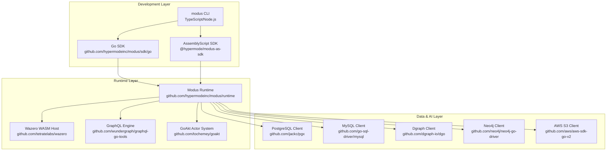
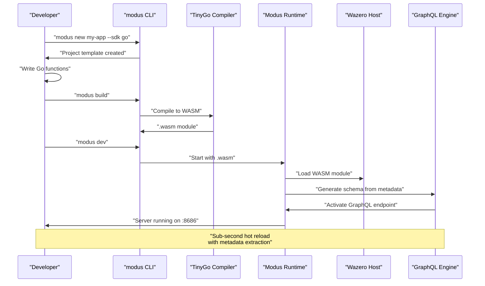
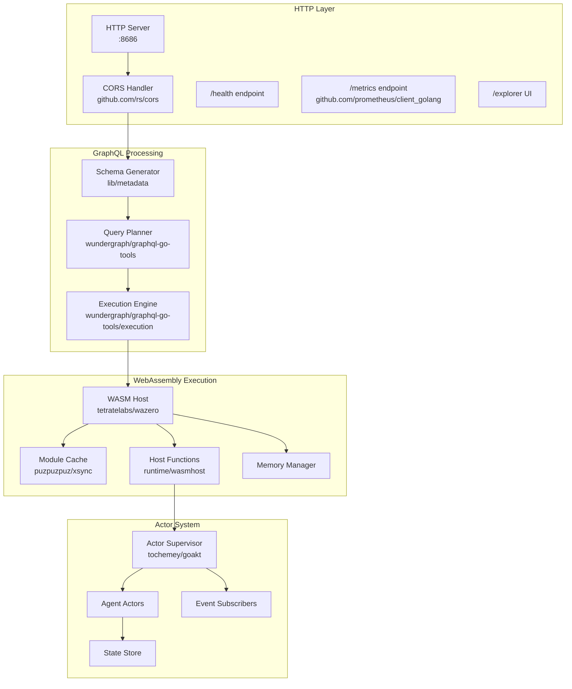
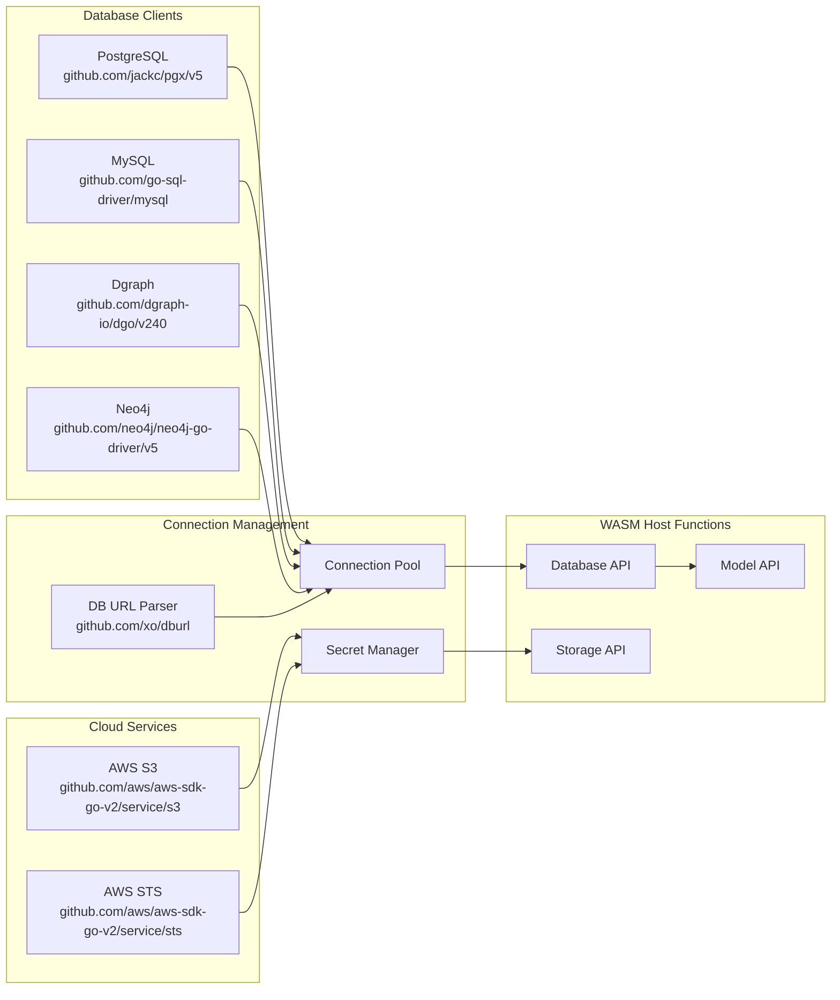
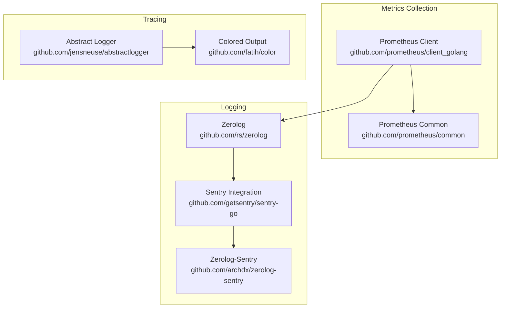

<!-- source: DeepWiki mcp.deepwiki.com · repo hypermodeinc/modus · page 1 Overview · fetched 2026-10-27 -->

# Overview

Relevant source files

The following files were used as context for generating this wiki page:

- [README.md](README.md)
- [lib/manifest/go.mod](lib/manifest/go.mod)
- [lib/metadata/go.mod](lib/metadata/go.mod)
- [lib/wasmextractor/go.mod](lib/wasmextractor/go.mod)
- [runtime/go.mod](runtime/go.mod)
- [runtime/go.sum](runtime/go.sum)
- [runtime/languages/golang/testdata/go.mod](runtime/languages/golang/testdata/go.mod)
- [runtime/languages/golang/testdata/go.sum](runtime/languages/golang/testdata/go.sum)
- [sdk/go/go.mod](sdk/go/go.mod)
- [sdk/go/go.sum](sdk/go/go.sum)
- [sdk/go/templates/default/go.mod](sdk/go/templates/default/go.mod)
- [sdk/go/templates/default/go.sum](sdk/go/templates/default/go.sum)

This document provides a comprehensive overview of the Modus framework architecture, its core components, and how they work together to enable serverless AI application development. It covers the entire system from developer tools through runtime execution, focusing on the technical implementation and code structure.

For specific implementation details of individual components, see [CLI Commands Reference](#3.1), [Go SDK](#4.1), [Runtime Architecture](#5.1), and [GraphQL Engine](#5.2).

## What is Modus

Modus is an open-source, serverless framework for building agentic systems and AI applications using WebAssembly. It compiles code written in Go or AssemblyScript into WASM modules, then executes them in a sandboxed runtime environment with automatic GraphQL API generation.

The framework consists of four primary components:
- **Modus CLI** - Development toolchain for project management and compilation
- **SDKs** - Language-specific development kits for Go and AssemblyScript
- **Modus Runtime** - WebAssembly host with GraphQL engine and service integrations
- **Supporting Libraries** - Shared utilities for manifest processing, metadata extraction, and WASM analysis

Sources: [README.md:22-26](), [runtime/go.mod:1](), [sdk/go/go.mod:1]()

## System Architecture

The architecture follows a layered approach where developers interact with language-specific SDKs through the CLI, which compiles code into WASM modules executed by the runtime layer with integrated data and AI services.

Sources: [runtime/go.mod:7-59](), [sdk/go/go.mod:7-21]()

## Core Components

### Modus CLI
The command-line interface provides project scaffolding, SDK management, and development server functionality. Built with Node.js and TypeScript, it orchestrates the entire development workflow from project creation to local testing.

### WebAssembly Runtime
The runtime uses [Wazero](https://github.com/tetratelabs/wazero) as the WebAssembly host, providing a sandboxed execution environment for compiled Go and AssemblyScript modules. The `github.com/tetratelabs/wazero` dependency enables WASI-compliant WebAssembly execution.

### GraphQL API Generation
Automatic GraphQL schema generation and query processing is powered by [Wundergraph's GraphQL Go Tools](https://github.com/wundergraph/graphql-go-tools). The runtime extracts function metadata from WASM modules and generates corresponding GraphQL resolvers.

### Actor-Based Concurrency
State management and concurrent processing uses the [GoAkt](https://github.com/Tochemey/goakt) actor framework, enabling stateful agents and event-driven processing patterns through the `github.com/tochemey/goakt/v3` dependency.

Sources: [runtime/go.mod:42](), [runtime/go.mod:48-49](), [runtime/go.mod:45]()

## Development Workflow

The development process follows a compile-to-WASM approach where source code is compiled to WebAssembly modules, then loaded into the runtime for execution with automatic API generation.

Sources: [sdk/go/templates/default/go.mod:1-9](), [runtime/languages/golang/testdata/go.mod:1-9]()

## Runtime Execution Architecture

The runtime architecture implements a multi-layered execution model where HTTP requests flow through GraphQL processing into WebAssembly execution, supported by an actor-based concurrency system for stateful operations.

Sources: [runtime/go.mod:37](), [runtime/go.mod:36](), [runtime/go.mod:48](), [runtime/go.mod:45]()

## Data Integration Layer

The data integration layer provides unified access to multiple database types and cloud services through a connection pooling system that exposes APIs to WebAssembly modules via host functions.

Sources: [runtime/go.mod:29](), [runtime/go.mod:20](), [runtime/go.mod:15](), [runtime/go.mod:33](), [runtime/go.mod:11-12](), [runtime/go.mod:50]()

## Compilation and Build System

The framework supports multiple compilation paths depending on the target language:

### Go Compilation Path
Go code is compiled using TinyGo to produce optimized WebAssembly modules. The `sdk/go` package provides the necessary runtime interfaces and build tooling.

### AssemblyScript Compilation Path  
AssemblyScript code compiles directly to WebAssembly using the AssemblyScript compiler, with the AssemblyScript SDK providing Modus-specific APIs and type definitions.

### Module Processing Pipeline
1. **Source Analysis** - Extract function signatures and metadata
2. **WASM Compilation** - Compile to WebAssembly with optimization
3. **Metadata Extraction** - Parse WASM custom sections for function information  
4. **Schema Generation** - Generate GraphQL schema from extracted metadata
5. **Runtime Loading** - Load compiled modules into Wazero host with caching

Sources: [sdk/go/go.mod:8-9](), [lib/metadata/go.mod:8](), [lib/wasmextractor/go.mod:1]()

## Monitoring and Observability

The observability stack combines Prometheus metrics, structured logging with Zerolog, and optional Sentry error tracking to provide comprehensive monitoring of runtime operations and WASM execution.

Sources: [runtime/go.mod:34-35](), [runtime/go.mod:39](), [runtime/go.mod:19](), [runtime/go.mod:9](), [runtime/go.mod:18]()

---

