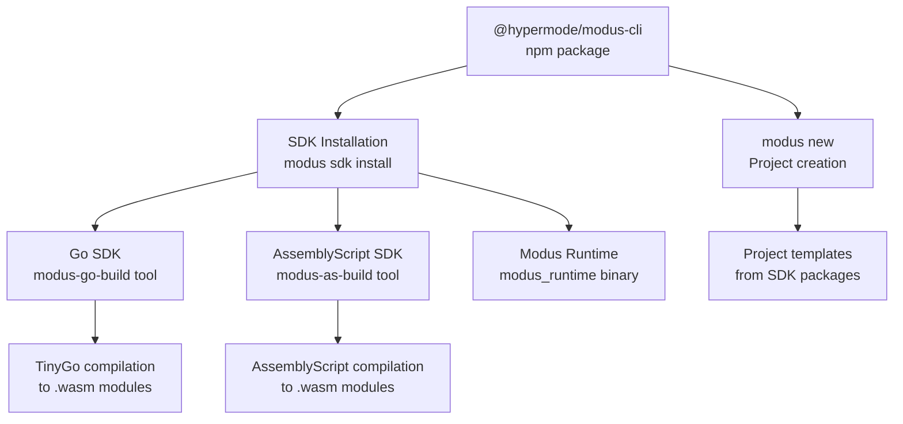
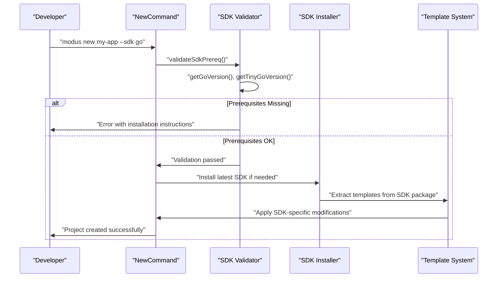
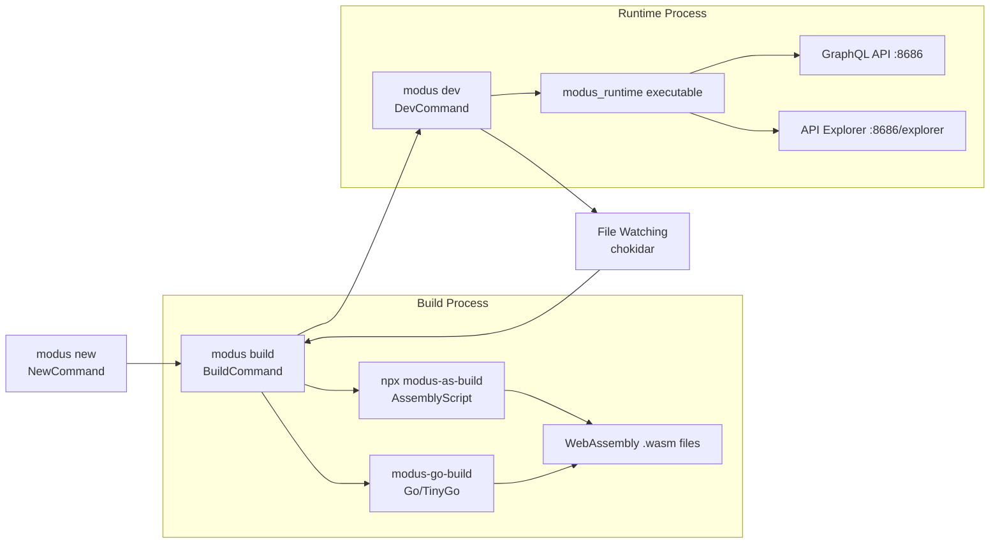
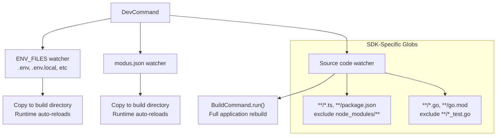
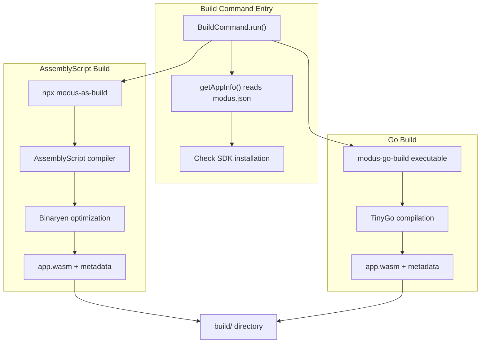
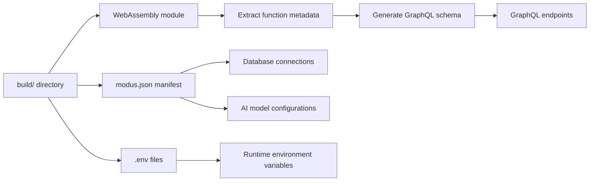

<!-- source: DeepWiki mcp.deepwiki.com · repo hypermodeinc/modus · page 2 Getting Started · fetched 2026-10-27 -->

# Getting Started

Relevant source files

The following files were used as context for generating this wiki page:

- [CHANGELOG.md](CHANGELOG.md)
- [cli/package-lock.json](cli/package-lock.json)
- [cli/package.json](cli/package.json)
- [cli/src/commands/build/index.ts](cli/src/commands/build/index.ts)
- [cli/src/commands/dev/index.ts](cli/src/commands/dev/index.ts)
- [cli/src/commands/info/index.ts](cli/src/commands/info/index.ts)
- [cli/src/commands/new/index.ts](cli/src/commands/new/index.ts)
- [cli/src/commands/runtime/install/index.ts](cli/src/commands/runtime/install/index.ts)
- [cli/src/commands/runtime/list/index.ts](cli/src/commands/runtime/list/index.ts)
- [cli/src/commands/runtime/remove/index.ts](cli/src/commands/runtime/remove/index.ts)
- [cli/src/commands/sdk/install/index.ts](cli/src/commands/sdk/install/index.ts)
- [cli/src/commands/sdk/list/index.ts](cli/src/commands/sdk/list/index.ts)
- [cli/src/commands/sdk/remove/index.ts](cli/src/commands/sdk/remove/index.ts)
- [cli/src/custom/help.ts](cli/src/custom/help.ts)
- [cli/src/util/installer.ts](cli/src/util/installer.ts)
- [cli/src/util/systemVersions.ts](cli/src/util/systemVersions.ts)
- [runtime/languages/assemblyscript/testdata/build/testdata.wasm](runtime/languages/assemblyscript/testdata/build/testdata.wasm)
- [runtime/languages/assemblyscript/testdata/package-lock.json](runtime/languages/assemblyscript/testdata/package-lock.json)
- [sdk/assemblyscript/templates/default/package-lock.json](sdk/assemblyscript/templates/default/package-lock.json)
- [sdk/assemblyscript/templates/default/package.json](sdk/assemblyscript/templates/default/package.json)
- [tools/release-info/package-lock.json](tools/release-info/package-lock.json)
- [tools/release-info/package.json](tools/release-info/package.json)

This page provides an overview of how to get started with Modus, covering installation, creating your first application, and understanding the basic development workflow. For detailed installation instructions, see [Installation](#2.1). For a step-by-step tutorial, see [Quick Start Tutorial](#2.2).

Modus is a framework for building AI-enabled applications using WebAssembly. It provides SDKs for Go and AssemblyScript, a CLI for development workflow management, and a runtime for executing applications with built-in AI model integration, database connectivity, and GraphQL API generation.

## Prerequisites and Dependencies

Before getting started with Modus, you need to install the appropriate development tools depending on which SDK you plan to use.

### For AssemblyScript Development

- **Node.js**: Version 22 or newer
- **NPM**: Automatically installed with Node.js

### For Go Development  

- **Go**: Version 1.23.0 or newer
- **TinyGo**: Version 0.35.0 or newer  
- **Binaryen**: Required for WebAssembly optimization

The Modus CLI will validate these prerequisites when creating new projects and provide installation guidance if any are missing.

**Sources:** [cli/src/commands/new/index.ts:183-269](), [cli/src/custom/globals.js:21]()

## Installation Overview

Modus installation involves three main components that work together:

The CLI automatically manages SDK and runtime versions, downloading compatible versions as needed during development.

**Sources:** [cli/src/commands/sdk/install/index.ts:86-155](), [cli/src/util/installer.ts:19-94]()

## Creating Your First Application

The `modus new` command provides an interactive way to create applications:

### Command Flow and Validation

### Project Structure Creation

The CLI uses templates from SDK packages and applies language-specific configurations:

- **AssemblyScript**: Updates `package.json` name, runs `npm install`
- **Go**: Updates `go.mod` module name and Go version, runs `go mod download` and `go mod tidy`

**Sources:** [cli/src/commands/new/index.ts:271-378](), [cli/src/commands/new/index.ts:348-363]()

## Development Workflow

The core development cycle involves three main CLI commands that orchestrate the build and runtime systems:

### Development Command Flow

### File Watching and Hot Reload

The `DevCommand` implements sophisticated file watching to enable hot reload during development:

**Sources:** [cli/src/commands/dev/index.ts:196-359](), [cli/src/commands/dev/index.ts:366-385]()

## Build Process Architecture

The build system bridges high-level source code to WebAssembly modules that the runtime can execute:

### SDK Build Tool Integration

### Runtime Integration

The runtime consumes the build artifacts and generates APIs:

**Sources:** [cli/src/commands/build/index.ts:39-110](), [cli/src/commands/dev/index.ts:140-182]()

## Key Files and Entry Points

The following table maps common development tasks to their code entry points:

| Task | CLI Command | Primary Implementation | Build Tool |
|------|-------------|----------------------|------------|
| Create new app | `modus new` | [NewCommand]() | Template extraction |
| Build application | `modus build` | [BuildCommand]() | `modus-as-build` or `modus-go-build` |
| Start development | `modus dev` | [DevCommand]() | Runtime + file watching |
| Install SDK | `modus sdk install` | [SDKInstallCommand]() | Download and extract |
| Runtime management | `modus runtime install` | [RuntimeInstallCommand]() | Binary download |

**Sources:** [cli/package.json:61-84](), [cli/src/commands/build/index.ts:24](), [cli/src/commands/dev/index.ts:34]()

## Next Steps

Once you have Modus installed, you can:

1. **Create your first application**: Use [Quick Start Tutorial](#2.2) for a hands-on walkthrough
2. **Explore CLI commands**: See [CLI Commands Reference](#3.1) for complete command documentation  
3. **Choose your SDK**: Review [Go SDK](#4.1) or [AssemblyScript SDK](#4.2) guides
4. **Understand the runtime**: Read [Runtime Architecture](#5.1) to learn how applications execute

The development workflow centers around the `modus dev` command, which provides live reload and integrates all the components shown above into a seamless development experience.

---

