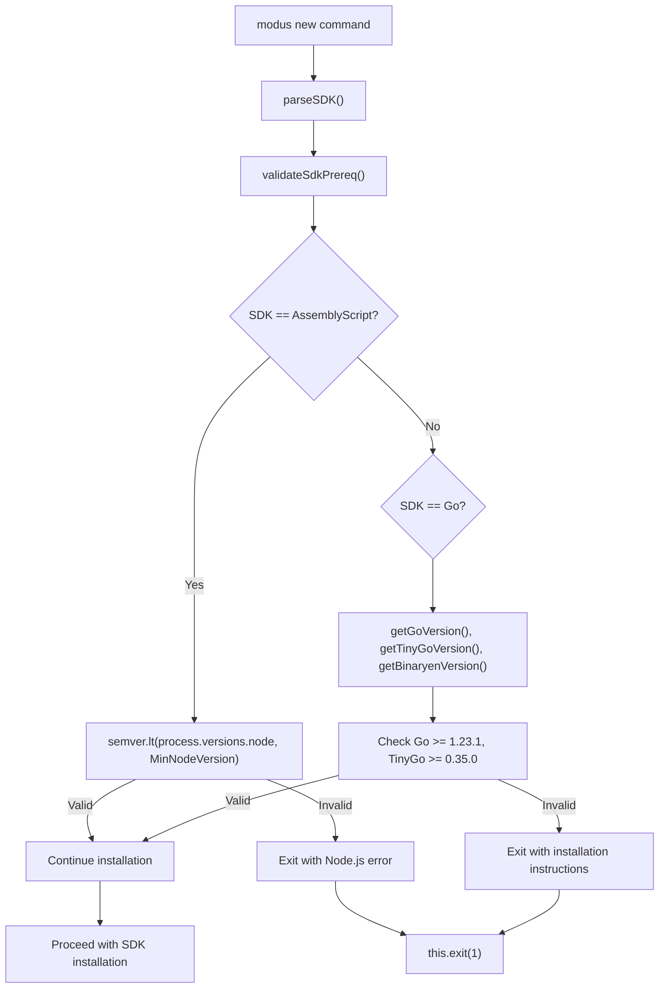
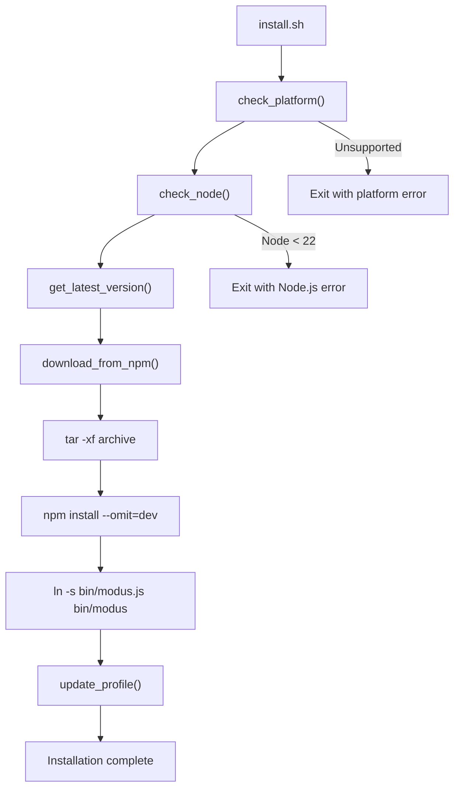
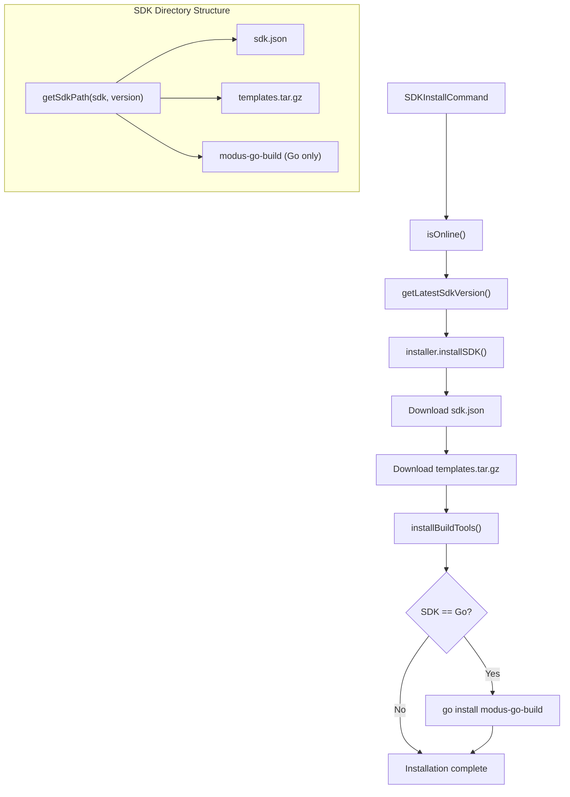
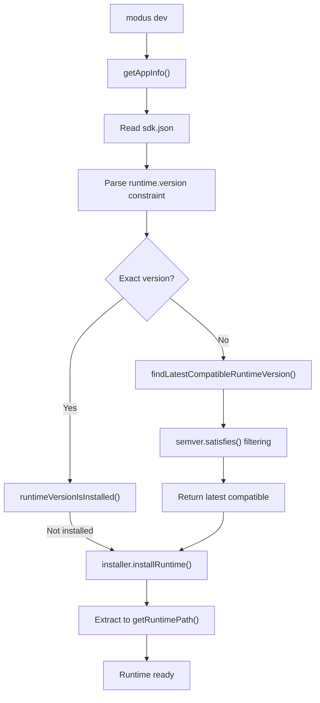
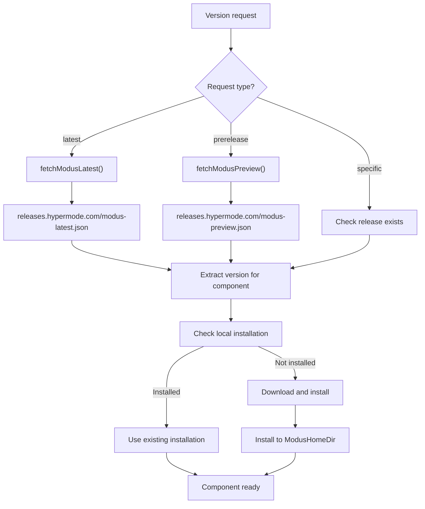

<!-- source: DeepWiki mcp.deepwiki.com · repo hypermodeinc/modus · page 2.1 Installation · fetched 2026-10-27 -->

# Installation

<details>
<summary>Relevant source files</summary>

The following files were used as context for generating this wiki page:

- [CHANGELOG.md](CHANGELOG.md)
- [cli/install.sh](cli/install.sh)
- [cli/src/commands/build/index.ts](cli/src/commands/build/index.ts)
- [cli/src/commands/dev/index.ts](cli/src/commands/dev/index.ts)
- [cli/src/commands/info/index.ts](cli/src/commands/info/index.ts)
- [cli/src/commands/new/index.ts](cli/src/commands/new/index.ts)
- [cli/src/commands/runtime/install/index.ts](cli/src/commands/runtime/install/index.ts)
- [cli/src/commands/runtime/list/index.ts](cli/src/commands/runtime/list/index.ts)
- [cli/src/commands/runtime/remove/index.ts](cli/src/commands/runtime/remove/index.ts)
- [cli/src/commands/sdk/install/index.ts](cli/src/commands/sdk/install/index.ts)
- [cli/src/commands/sdk/list/index.ts](cli/src/commands/sdk/list/index.ts)
- [cli/src/commands/sdk/remove/index.ts](cli/src/commands/sdk/remove/index.ts)
- [cli/src/custom/globals.ts](cli/src/custom/globals.ts)
- [cli/src/custom/help.ts](cli/src/custom/help.ts)
- [cli/src/util/http.ts](cli/src/util/http.ts)
- [cli/src/util/index.ts](cli/src/util/index.ts)
- [cli/src/util/installer.ts](cli/src/util/installer.ts)
- [cli/src/util/systemVersions.ts](cli/src/util/systemVersions.ts)
- [cli/src/util/versioninfo.ts](cli/src/util/versioninfo.ts)
- [runtime/plugins/plugins.go](runtime/plugins/plugins.go)
- [sdk/assemblyscript/src/plugin.asconfig.json](sdk/assemblyscript/src/plugin.asconfig.json)
- [sdk/go/tools/modus-go-build/compiler/compiler.go](sdk/go/tools/modus-go-build/compiler/compiler.go)

</details>


This page provides detailed instructions for installing the Modus CLI and its dependencies. It covers the complete installation process from prerequisites through CLI installation, SDK setup, and runtime configuration.

For information about creating your first Modus application after installation, see [Quick Start Tutorial](#2.2). For details about managing SDK and runtime versions after installation, see [Version Management](#3.2).

## Prerequisites

Before installing Modus, ensure your system meets the following requirements:

| Component | Minimum Version | Required For |
|-----------|----------------|--------------|
| Node.js | 22.0.0 | CLI and AssemblyScript SDK |
| npm | Latest | CLI installation |
| Go | 1.23.1 | Go SDK development |
| TinyGo | 0.35.0 | Go SDK compilation |
| Binaryen | Latest | WebAssembly optimization |

The Modus CLI validates these prerequisites during SDK installation and provides specific guidance for missing dependencies.

**Prerequisites Validation Flow**



Sources: [cli/src/commands/new/index.ts:183-269](), [cli/src/custom/globals.ts:16-18](), [cli/src/util/systemVersions.ts:18-56]()

## CLI Installation

### Automated Installation

The recommended method uses the official installation script:

```bash
curl install.hypermode.com/modus.sh -sSfL | bash
```

This script automatically:
- Downloads the latest CLI version from npm
- Installs to `$MODUS_HOME/cli` (defaults to `~/.modus/cli`)
- Configures PATH in your shell profile
- Validates Node.js compatibility

**CLI Installation Process**



Sources: [cli/install.sh:278-295](), [cli/install.sh:167-235]()

### Manual Installation

For manual installation or CI environments:

```bash
# Set installation directory
export MODUS_CLI="$HOME/.modus/cli"

# Download and extract
npm pack @hypermode/modus-cli
tar -xf modus-cli-*.tgz
mv package/* "$MODUS_CLI"
cd "$MODUS_CLI" && npm install --omit=dev

# Add to PATH
export PATH="$MODUS_CLI/bin:$PATH"
```

### Environment Variables

| Variable | Default | Purpose |
|----------|---------|---------|
| `MODUS_HOME` | `~/.modus` | Base directory for all Modus files |
| `MODUS_CLI` | `$MODUS_HOME/cli` | CLI installation directory |

Sources: [cli/install.sh:15](), [cli/src/custom/globals.ts:14]()

## SDK Installation

SDKs provide language-specific tools and libraries for building Modus applications. Installation is managed through the CLI.

### Installing SDKs

```bash
# Install latest stable SDK
modus sdk install go
modus sdk install assemblyscript

# Install specific version
modus sdk install go v0.17.0

# Install prerelease version
modus sdk install go --prerelease

# Install all SDKs
modus sdk install all
```

**SDK Installation Architecture**



Sources: [cli/src/commands/sdk/install/index.ts:86-155](), [cli/src/util/installer.ts:19-94](), [cli/src/util/versioninfo.ts:18-24]()

### SDK Directory Structure

Each installed SDK follows a consistent directory layout:

```
$MODUS_HOME/sdk/
├── go/
│   └── v0.17.0/
│       ├── sdk.json              # SDK metadata and runtime compatibility
│       ├── templates.tar.gz      # Project templates
│       └── modus-go-build        # Go-specific build tool
└── assemblyscript/
    └── v0.17.0/
        ├── sdk.json
        └── templates.tar.gz
```

The `sdk.json` file contains runtime compatibility information used for automatic runtime installation:

```json
{
  "runtime": {
    "version": ">=0.17.0 <0.18.0"
  }
}
```

Sources: [cli/src/util/versioninfo.ts:18-24](), [cli/src/util/installer.ts:28-36]()

## Runtime Installation

The Modus Runtime executes compiled WebAssembly modules. It's automatically installed when needed, but can also be managed manually.

### Automatic Runtime Installation

The CLI automatically installs compatible runtime versions:

```bash
# Runtime installed automatically during 'modus dev'
modus dev

# Runtime installed automatically during 'modus new'
modus new my-app
```

**Runtime Compatibility Resolution**



Sources: [cli/src/commands/dev/index.ts:112-138](), [cli/src/util/versioninfo.ts:287-319]()

### Manual Runtime Installation

```bash
# Install latest runtime
modus runtime install

# Install specific version  
modus runtime install v0.17.0

# Install prerelease
modus runtime install --prerelease
```

### Runtime Directory Structure

```
$MODUS_HOME/runtime/
└── v0.17.0/
    ├── modus_runtime          # Main runtime binary
    └── (other runtime files)
```

Sources: [cli/src/commands/runtime/install/index.ts:44-77](), [cli/src/util/versioninfo.ts:22-24]()

## Version Management

Modus uses a sophisticated version management system that ensures compatibility between CLI, SDKs, and runtime components.

**Version Resolution System**



Sources: [cli/src/util/versioninfo.ts:40-171](), [cli/src/custom/globals.ts:14]()

### Version Information Sources

The CLI fetches version information from centralized JSON endpoints:

| Endpoint | Purpose | Content |
|----------|---------|---------|
| `modus-latest.json` | Stable releases | Latest stable versions for all components |
| `modus-preview.json` | Prerelease versions | Latest prerelease versions |
| `modus-all.json` | All versions | Complete version history |
| `modus-preview-all.json` | All prereleases | Complete prerelease history |

Sources: [cli/src/util/versioninfo.ts:43-106]()

### Compatibility Matrix

The system maintains compatibility between components using semantic versioning constraints defined in each SDK's `sdk.json` file:

```javascript
// Example compatibility check
const constraint = ">=0.17.0 <0.18.0";
const availableVersions = ["v0.17.0", "v0.17.1", "v0.18.0"];
const compatibleVersions = versions.filter(v => 
  semver.satisfies(v.slice(1), constraint)
);
```

Sources: [cli/src/util/versioninfo.ts:271-318]()

## Installation Verification

After installation, verify your setup:

```bash
# Check CLI installation
modus --version

# View installation details
modus info

# List installed components
modus sdk list
modus runtime list
```

The `modus info` command provides comprehensive system information including installed versions, system requirements, and dependency status.

Sources: [cli/src/commands/info/index.ts:18-93](), [cli/src/commands/sdk/list/index.ts:22-54](), [cli/src/commands/runtime/list/index.ts:21-43]()

---

