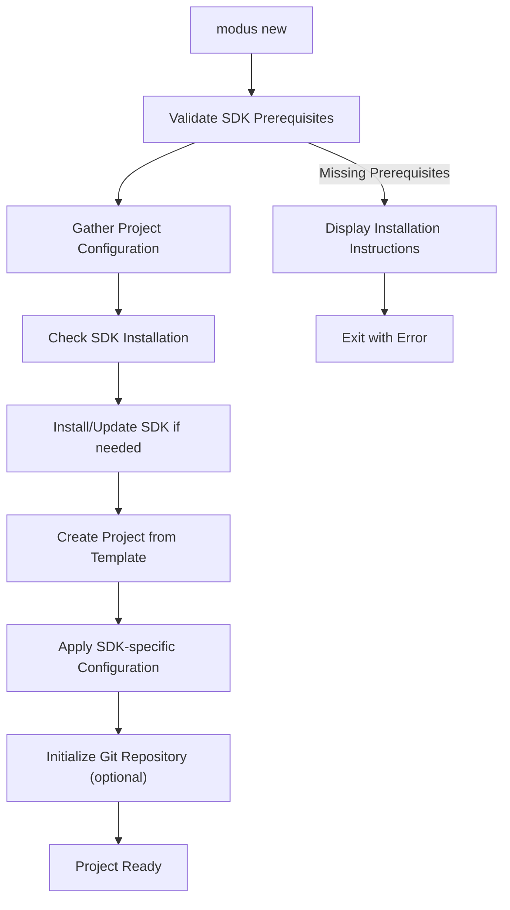
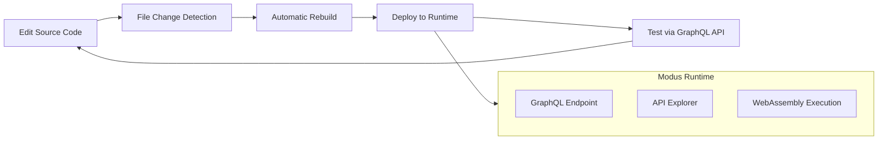

<!-- source: DeepWiki mcp.deepwiki.com · repo hypermodeinc/modus · page 2.2 Quick Start Tutorial · fetched 2026-10-27 -->

# Quick Start Tutorial

<details>
<summary>Relevant source files</summary>

The following files were used as context for generating this wiki page:

- [CHANGELOG.md](CHANGELOG.md)
- [cli/src/commands/build/index.ts](cli/src/commands/build/index.ts)
- [cli/src/commands/dev/index.ts](cli/src/commands/dev/index.ts)
- [cli/src/commands/info/index.ts](cli/src/commands/info/index.ts)
- [cli/src/commands/new/index.ts](cli/src/commands/new/index.ts)
- [cli/src/commands/runtime/install/index.ts](cli/src/commands/runtime/install/index.ts)
- [cli/src/commands/runtime/list/index.ts](cli/src/commands/runtime/list/index.ts)
- [cli/src/commands/runtime/remove/index.ts](cli/src/commands/runtime/remove/index.ts)
- [cli/src/commands/sdk/install/index.ts](cli/src/commands/sdk/install/index.ts)
- [cli/src/commands/sdk/list/index.ts](cli/src/commands/sdk/list/index.ts)
- [cli/src/commands/sdk/remove/index.ts](cli/src/commands/sdk/remove/index.ts)
- [cli/src/custom/help.ts](cli/src/custom/help.ts)
- [cli/src/util/installer.ts](cli/src/util/installer.ts)
- [cli/src/util/systemVersions.ts](cli/src/util/systemVersions.ts)
- [sdk/assemblyscript/examples/auth/package-lock.json](sdk/assemblyscript/examples/auth/package-lock.json)
- [sdk/assemblyscript/examples/neo4j/package-lock.json](sdk/assemblyscript/examples/neo4j/package-lock.json)
- [sdk/assemblyscript/examples/simple/package-lock.json](sdk/assemblyscript/examples/simple/package-lock.json)
- [sdk/assemblyscript/examples/vectors/package-lock.json](sdk/assemblyscript/examples/vectors/package-lock.json)
- [sdk/go/examples/anthropic-functions/go.mod](sdk/go/examples/anthropic-functions/go.mod)
- [sdk/go/examples/auth/go.mod](sdk/go/examples/auth/go.mod)
- [sdk/go/examples/classification/go.mod](sdk/go/examples/classification/go.mod)
- [sdk/go/examples/dgraph/go.mod](sdk/go/examples/dgraph/go.mod)
- [sdk/go/examples/embedding/go.mod](sdk/go/examples/embedding/go.mod)
- [sdk/go/examples/graphql/go.mod](sdk/go/examples/graphql/go.mod)
- [sdk/go/examples/http/go.mod](sdk/go/examples/http/go.mod)
- [sdk/go/examples/postgresql/go.mod](sdk/go/examples/postgresql/go.mod)
- [sdk/go/examples/simple/go.mod](sdk/go/examples/simple/go.mod)
- [sdk/go/examples/textgeneration/go.mod](sdk/go/examples/textgeneration/go.mod)
- [sdk/go/examples/vectors/go.mod](sdk/go/examples/vectors/go.mod)

</details>


This tutorial provides a step-by-step guide to creating and running your first Modus application. It covers the essential workflow from installation through local development and demonstrates how Modus automatically generates GraphQL APIs from your WebAssembly functions.

For detailed installation instructions, see [Installation](#2.1). For comprehensive CLI command reference, see [CLI Commands Reference](#3.1).

## Prerequisites and Installation

Before creating your first Modus application, you need to install the Modus CLI and the appropriate SDK dependencies based on your preferred programming language.

### Installing the Modus CLI

The Modus CLI is the primary tool for creating, building, and running Modus applications. Install it using npm:

```bash
npm install -g @hypermode/modus-cli
```

Verify the installation:

```bash
modus --version
```

### SDK Prerequisites

Modus supports two SDKs: Go and AssemblyScript. Choose the one that matches your preferred language:

**For Go SDK:**
- Go v1.23.0 or newer
- TinyGo v0.34.0 or newer  
- Binaryen (for WebAssembly optimization)

**For AssemblyScript SDK:**
- Node.js v22 or newer

The CLI will validate these prerequisites when creating new projects and provide installation guidance if dependencies are missing.

Sources: [cli/src/commands/new/index.ts:183-268](), [cli/src/util/systemVersions.ts:18-56]()

## Creating Your First Application

Use the `modus new` command to create a new Modus application. The CLI provides an interactive setup process:

```bash
modus new
```

This will prompt you to:
1. Select an SDK (Go or AssemblyScript)
2. Choose an application name
3. Specify the directory location
4. Optionally initialize a Git repository

Alternatively, you can create an application non-interactively:

```bash
modus new --name my-app --sdk go --dir ./my-app
```

### Project Creation Flow



The CLI automatically downloads and installs the latest compatible SDK and runtime versions. It uses templates from the SDK packages to scaffold the project structure.

Sources: [cli/src/commands/new/index.ts:271-378](), [cli/src/commands/sdk/install/index.ts:86-154]()

## Project Structure

After creating a project, you'll find the following structure:

```
my-app/
├── modus.json          # Application manifest
├── .env                # Environment variables (optional)
├── build/              # Build output (auto-generated)
└── [SDK-specific files]
```

### Go SDK Projects

```
├── go.mod              # Go module definition
├── go.sum              # Go module checksums  
├── main.go             # Application entry point
└── functions.go        # Example functions
```

### AssemblyScript SDK Projects

```
├── package.json        # Node.js package definition
├── asconfig.json       # AssemblyScript configuration
├── assembly/
│   ├── index.ts        # Application entry point
│   └── functions.ts    # Example functions
└── node_modules/       # Dependencies
```

The `modus.json` manifest file defines your application configuration, including connections to external services and runtime settings.

Sources: [cli/src/commands/new/index.ts:344-362]()

## Building and Running Locally

### Building Your Application

Build your application to generate WebAssembly modules:

```bash
modus build
```

This command:
1. Validates the project structure
2. Installs any missing SDK dependencies
3. Compiles your code to WebAssembly
4. Generates metadata for GraphQL schema creation
5. Outputs files to the `build/` directory

### Development Server

Start the local development server:

```bash
modus dev
```

This launches the Modus runtime with your application and provides:
- GraphQL API endpoint at `http://localhost:8686/graphql`
- API Explorer at `http://localhost:8686/explorer`
- Health check endpoint at `http://localhost:8686/health`
- Automatic rebuilds when source files change

### Development Workflow



The development server automatically watches for changes in your source files and rebuilds the application when modifications are detected. This provides a fast feedback loop for development.

Sources: [cli/src/commands/dev/index.ts:143-204](), [cli/src/commands/build/index.ts:62-96]()

## Understanding Function Execution

When you run `modus dev`, the runtime analyzes your compiled WebAssembly module and automatically generates a GraphQL schema based on your exported functions.

### Function to GraphQL Mapping

```mermaid
flowchart TD
    subgraph Source["Source Code"]
        GoFunc["Go Function: func Hello(name string) string"]
        ASFunc["AssemblyScript Function: export function hello(name: string): string"]
    end
    
    subgraph Build["Build Process"]
        Compile["Compile to WebAssembly"]
        Extract["Extract Function Metadata"]
    end
    
    subgraph Runtime["Modus Runtime"]
        Schema["Generate GraphQL Schema"]
        Resolve["Function Resolver"]
        Execute["WASM Execution"]
    end
    
    subgraph GraphQL["Generated API"]
        Query["query { hello(name: \"World\") }"]
        Response["{ \"data\": { \"hello\": \"Hello, World!\" } }"]
    end
    
    Source --> Build
    Build --> Runtime  
    Runtime --> GraphQL
```

Your exported functions become GraphQL queries or mutations automatically. The runtime handles:
- Type conversion between GraphQL and WebAssembly
- Function parameter validation
- Response serialization
- Error handling

Sources: [cli/src/commands/dev/index.ts:164-182]()

## Testing Your Application

### Using the API Explorer

Navigate to `http://localhost:8686/explorer` to access the built-in API Explorer. This provides:
- Interactive GraphQL query editor
- Schema documentation
- Real-time query execution
- Response inspection

### Making GraphQL Requests

You can also make direct HTTP requests to the GraphQL endpoint:

```bash
curl -X POST http://localhost:8686/graphql \
  -H "Content-Type: application/json" \
  -d '{"query": "{ hello(name: \"World\") }"}'
```

### Development Monitoring

The runtime provides several monitoring endpoints:

| Endpoint | Purpose |
|----------|---------|
| `/health` | Health check and system status |
| `/metrics` | Runtime performance metrics |
| `/explorer` | Interactive API documentation |

Sources: [cli/src/commands/dev/index.ts:148-163]()

## File Watching and Hot Reloading

The development server implements intelligent file watching that responds to different types of changes:

### Watched Files by SDK

```mermaid
flowchart TD
    subgraph Go["Go SDK Watching"]
        GoFiles["*.go files"]
        GoMod["go.mod"]
        GoExclude["Excludes: *_test.go, *_generated.go"]
    end
    
    subgraph AS["AssemblyScript SDK Watching"]  
        TSFiles["*.ts files"]
        ASConfig["asconfig.json"]
        TSConfig["tsconfig.json"]
        Package["package.json"]
        ASExclude["Excludes: node_modules/**"]
    end
    
    subgraph Common["Common Files"]
        Manifest["modus.json"]
        EnvFiles[".env files"]
    end
    
    subgraph Actions["Rebuild Actions"]
        CodeChange["Source Code Change"] --> FullRebuild["Full Application Rebuild"]
        ManifestChange["Manifest Change"] --> CopyManifest["Copy to Build Directory"]
        EnvChange["Environment Change"] --> CopyEnv["Copy to Build Directory"]
    end
    
    Go --> Actions
    AS --> Actions
    Common --> Actions
```

The file watcher uses different strategies based on the type of change:
- Source code changes trigger a full rebuild
- Manifest changes are copied to the build directory for runtime reload
- Environment file changes are synchronized without rebuilding

Sources: [cli/src/commands/dev/index.ts:300-359](), [cli/src/commands/dev/index.ts:366-385]()

## Next Steps

After completing this tutorial, you can:

1. **Explore Examples**: Examine the SDK example projects for common patterns like database connections, AI model integration, and HTTP requests
2. **Configure Connections**: Learn about connecting to external services in [Connections and Secrets](#6.2)
3. **Deploy Applications**: Understand production deployment options in [Docker Deployment](#8.1)
4. **Debug Applications**: Set up debugging workflows in [Development Environment](#7.1)

The Modus framework provides a comprehensive platform for building WebAssembly-based applications with automatic GraphQL API generation, making it easy to create scalable, high-performance services.

Sources: [CHANGELOG.md:504-562](), [cli/src/commands/new/index.ts:371-378]()

---

