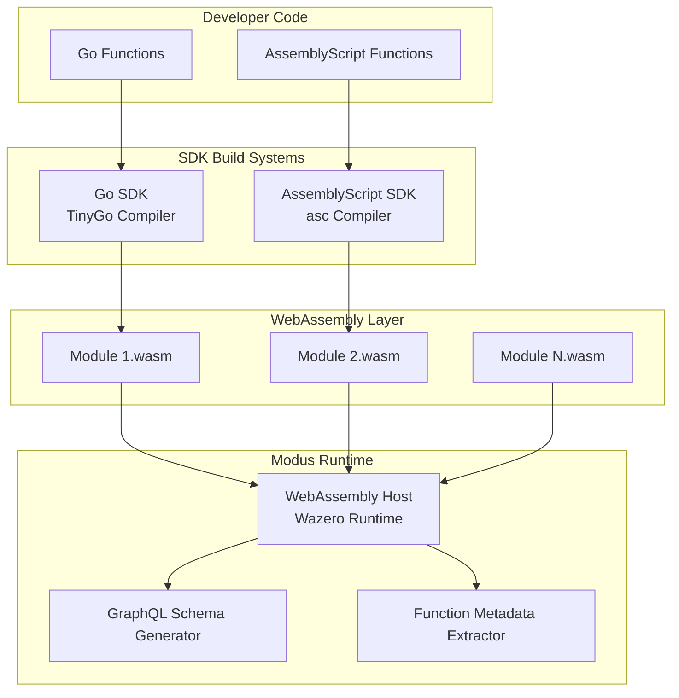
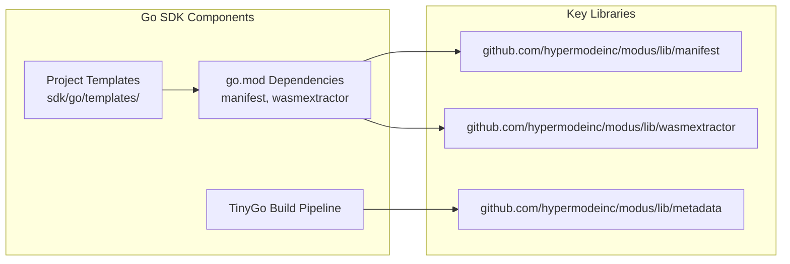
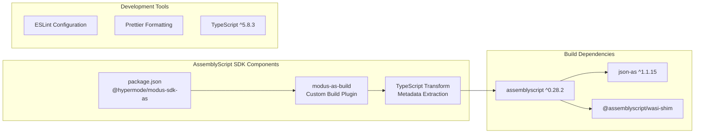
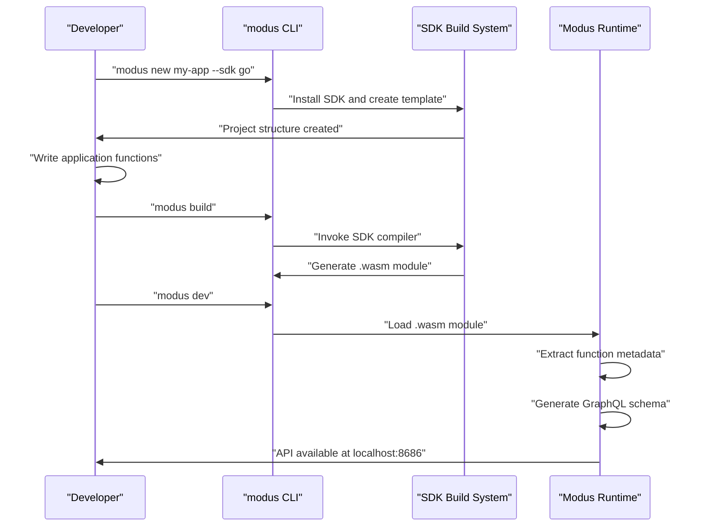
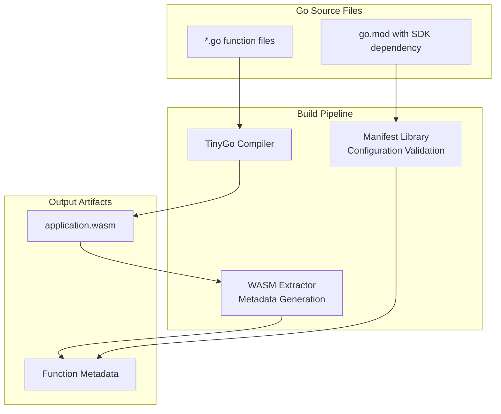
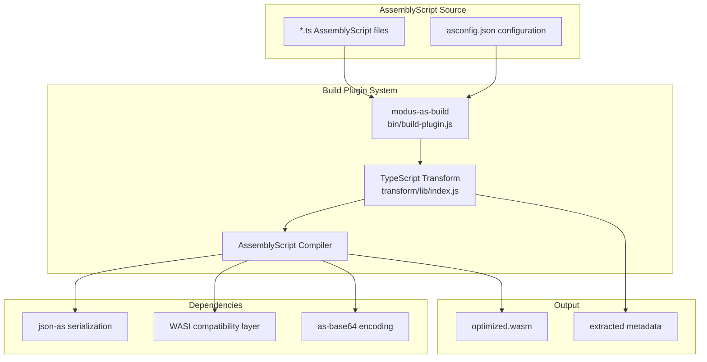

<!-- source: DeepWiki mcp.deepwiki.com · repo hypermodeinc/modus · page 4 Software Development Kits · fetched 2026-10-27 -->

# Software Development Kits

Relevant source files

The following files were used as context for generating this wiki page:

- [lib/manifest/go.mod](lib/manifest/go.mod)
- [lib/metadata/go.mod](lib/metadata/go.mod)
- [lib/wasmextractor/go.mod](lib/wasmextractor/go.mod)
- [runtime/go.mod](runtime/go.mod)
- [runtime/go.sum](runtime/go.sum)
- [runtime/languages/golang/testdata/go.mod](runtime/languages/golang/testdata/go.mod)
- [runtime/languages/golang/testdata/go.sum](runtime/languages/golang/testdata/go.sum)
- [sdk/assemblyscript/examples/anthropic-functions/package-lock.json](sdk/assemblyscript/examples/anthropic-functions/package-lock.json)
- [sdk/assemblyscript/examples/classification/package-lock.json](sdk/assemblyscript/examples/classification/package-lock.json)
- [sdk/assemblyscript/examples/dgraph/package-lock.json](sdk/assemblyscript/examples/dgraph/package-lock.json)
- [sdk/assemblyscript/examples/embedding/package-lock.json](sdk/assemblyscript/examples/embedding/package-lock.json)
- [sdk/assemblyscript/examples/graphql/package-lock.json](sdk/assemblyscript/examples/graphql/package-lock.json)
- [sdk/assemblyscript/examples/http/package-lock.json](sdk/assemblyscript/examples/http/package-lock.json)
- [sdk/assemblyscript/examples/postgresql/package-lock.json](sdk/assemblyscript/examples/postgresql/package-lock.json)
- [sdk/assemblyscript/examples/textgeneration/package-lock.json](sdk/assemblyscript/examples/textgeneration/package-lock.json)
- [sdk/assemblyscript/src/package-lock.json](sdk/assemblyscript/src/package-lock.json)
- [sdk/assemblyscript/src/package.json](sdk/assemblyscript/src/package.json)
- [sdk/go/go.mod](sdk/go/go.mod)
- [sdk/go/go.sum](sdk/go/go.sum)
- [sdk/go/templates/default/go.mod](sdk/go/templates/default/go.mod)
- [sdk/go/templates/default/go.sum](sdk/go/templates/default/go.sum)

This document covers the available Software Development Kits (SDKs) provided by Modus for building WebAssembly applications. The SDKs enable developers to write functions in their preferred programming language that compile to WebAssembly modules executed by the Modus Runtime. 

For information about the CLI tools used to manage SDKs, see [Modus CLI](#3). For details about the runtime that executes SDK-generated WebAssembly modules, see [Modus Runtime](#5).

## SDK Architecture Overview

Modus provides multiple language SDKs that follow a consistent architecture pattern. Each SDK compiles source code to WebAssembly modules that integrate with the Modus Runtime through a standardized interface.

Sources: [runtime/go.mod:26-28](), [sdk/go/go.mod:1-34](), [sdk/assemblyscript/src/package.json:1-60]()

## Available SDKs

Modus currently provides two production-ready SDKs with distinct characteristics and use cases.

### Go SDK

The Go SDK leverages TinyGo to compile Go source code to WebAssembly. It provides a familiar Go development experience with automatic type mapping to GraphQL schemas.

**Key Features:**
- Full Go language support via TinyGo
- Automatic GraphQL schema generation from Go types
- Built-in support for common Go patterns and standard library subset
- Template-based project initialization

**Module Configuration:**
- Module path: `github.com/hypermodeinc/modus/sdk/go`
- Go version: `1.23.1` with toolchain `go1.24.4`
- Key dependencies: manifest library, wasmextractor library

Sources: [sdk/go/go.mod:1-34](), [sdk/go/templates/default/go.mod:1-10]()

### AssemblyScript SDK

The AssemblyScript SDK provides a TypeScript-like development experience that compiles directly to optimized WebAssembly without requiring a Go toolchain.

**Key Features:**
- TypeScript-like syntax with WebAssembly-native compilation
- Custom build plugin for Modus integration
- JSON serialization support via `json-as`
- Comprehensive linting and formatting tools

**Package Configuration:**
- Package name: `@hypermode/modus-sdk-as`
- Node.js requirement: `>=22`
- Build command: `modus-as-build` binary

Sources: [sdk/assemblyscript/src/package.json:1-60](), [sdk/assemblyscript/src/package-lock.json:1-50]()

## SDK Selection Guidance

Choose the appropriate SDK based on your team's experience and project requirements:

| Factor | Go SDK | AssemblyScript SDK |
|--------|--------|-------------------|
| **Language Familiarity** | Go developers | TypeScript/JavaScript developers |
| **Type System** | Strong static typing | TypeScript-like typing |
| **Compilation Target** | TinyGo → WASM | Direct WASM compilation |
| **Standard Library** | TinyGo standard library subset | AssemblyScript standard library |
| **Toolchain** | Requires Go/TinyGo installation | Node.js-based toolchain |
| **Performance** | Optimized via TinyGo | Direct WASM optimization |

Sources: [sdk/go/go.mod:3-5](), [sdk/assemblyscript/src/package.json:31-33]()

## Development Workflow

Both SDKs follow a consistent development workflow managed through the Modus CLI:

Sources: [sdk/go/templates/default/go.mod:1-10](), [sdk/assemblyscript/src/package.json:9-11]()

## Build Systems

Each SDK implements a specialized build system optimized for its target language and WebAssembly compilation requirements.

### Go SDK Build System

The Go SDK uses TinyGo for WebAssembly compilation with manifest and metadata extraction:

Sources: [sdk/go/go.mod:7-10](), [runtime/languages/golang/testdata/go.mod:7-9]()

### AssemblyScript SDK Build System

The AssemblyScript SDK provides a custom build plugin that handles compilation and metadata extraction:

Sources: [sdk/assemblyscript/src/package.json:9-11](), [sdk/assemblyscript/src/package.json:44-47](), [sdk/assemblyscript/src/package.json:22-28]()

## Examples and Templates

Both SDKs provide comprehensive examples demonstrating integration patterns with various external systems and services.

### Go SDK Templates

The Go SDK includes project templates for rapid application bootstrap:

- **Default Template**: Basic project structure at [sdk/go/templates/default/]()
- **Test Cases**: Runtime integration examples at [runtime/languages/golang/testdata/]()

Sources: [sdk/go/templates/default/go.mod:1-10](), [runtime/languages/golang/testdata/go.mod:1-9]()

### AssemblyScript SDK Examples

The AssemblyScript SDK provides multiple working examples covering common integration patterns:

| Example | Purpose | Location |
|---------|---------|-----------|
| **GraphQL** | GraphQL API integration | [sdk/assemblyscript/examples/graphql/]() |
| **PostgreSQL** | Database connectivity | [sdk/assemblyscript/examples/postgresql/]() |
| **HTTP** | HTTP client usage | [sdk/assemblyscript/examples/http/]() |
| **Dgraph** | Graph database integration | [sdk/assemblyscript/examples/dgraph/]() |
| **Classification** | AI model integration | [sdk/assemblyscript/examples/classification/]() |
| **Embedding** | Vector embedding generation | [sdk/assemblyscript/examples/embedding/]() |
| **Anthropic Functions** | Function calling with AI models | [sdk/assemblyscript/examples/anthropic-functions/]() |

Each example includes complete project configuration with dependencies, build scripts, and linting setup.

Sources: [sdk/assemblyscript/examples/graphql/package-lock.json:1-50](), [sdk/assemblyscript/examples/postgresql/package-lock.json:1-50](), [sdk/assemblyscript/examples/http/package-lock.json:1-50](), [sdk/assemblyscript/examples/dgraph/package-lock.json:1-50](), [sdk/assemblyscript/examples/classification/package-lock.json:1-50](), [sdk/assemblyscript/examples/embedding/package-lock.json:1-50](), [sdk/assemblyscript/examples/anthropic-functions/package-lock.json:1-50]()

---

