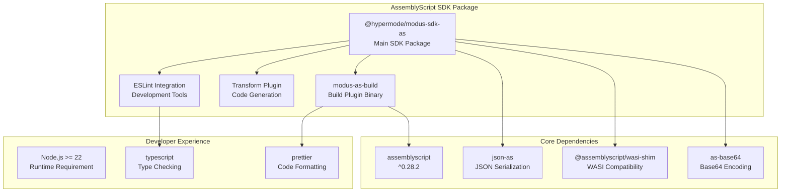
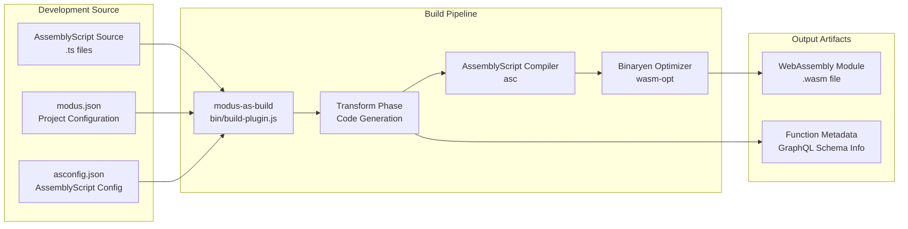
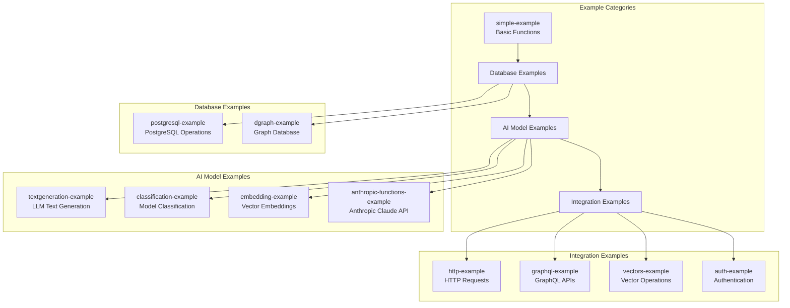
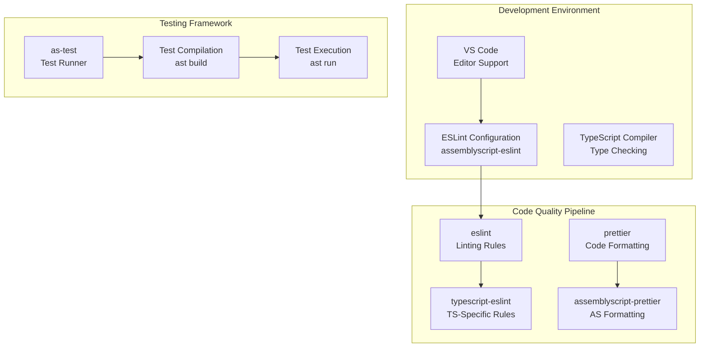
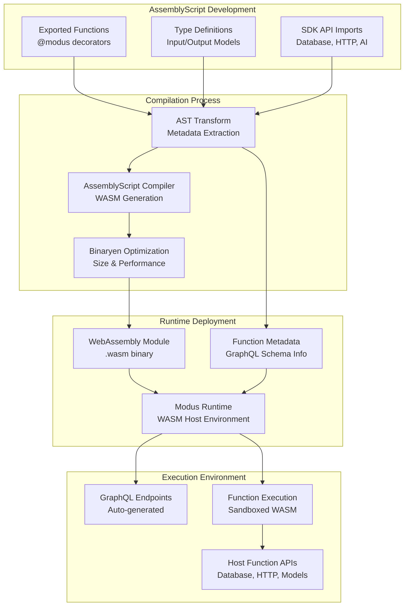

<!-- source: DeepWiki mcp.deepwiki.com · repo hypermodeinc/modus · page 4.2 AssemblyScript SDK · fetched 2026-10-27 -->

# AssemblyScript SDK

Relevant source files

The following files were used as context for generating this wiki page:

- [sdk/assemblyscript/examples/anthropic-functions/package-lock.json](sdk/assemblyscript/examples/anthropic-functions/package-lock.json)
- [sdk/assemblyscript/examples/auth/package-lock.json](sdk/assemblyscript/examples/auth/package-lock.json)
- [sdk/assemblyscript/examples/classification/package-lock.json](sdk/assemblyscript/examples/classification/package-lock.json)
- [sdk/assemblyscript/examples/dgraph/package-lock.json](sdk/assemblyscript/examples/dgraph/package-lock.json)
- [sdk/assemblyscript/examples/embedding/package-lock.json](sdk/assemblyscript/examples/embedding/package-lock.json)
- [sdk/assemblyscript/examples/graphql/package-lock.json](sdk/assemblyscript/examples/graphql/package-lock.json)
- [sdk/assemblyscript/examples/http/package-lock.json](sdk/assemblyscript/examples/http/package-lock.json)
- [sdk/assemblyscript/examples/neo4j/package-lock.json](sdk/assemblyscript/examples/neo4j/package-lock.json)
- [sdk/assemblyscript/examples/postgresql/package-lock.json](sdk/assemblyscript/examples/postgresql/package-lock.json)
- [sdk/assemblyscript/examples/simple/package-lock.json](sdk/assemblyscript/examples/simple/package-lock.json)
- [sdk/assemblyscript/examples/textgeneration/package-lock.json](sdk/assemblyscript/examples/textgeneration/package-lock.json)
- [sdk/assemblyscript/examples/vectors/package-lock.json](sdk/assemblyscript/examples/vectors/package-lock.json)
- [sdk/assemblyscript/src/package-lock.json](sdk/assemblyscript/src/package-lock.json)
- [sdk/assemblyscript/src/package.json](sdk/assemblyscript/src/package.json)

This document covers the Modus AssemblyScript SDK, which enables developers to write Modus applications using AssemblyScript that compile to WebAssembly. The SDK provides APIs for database access, AI model integration, HTTP requests, and other Modus platform capabilities.

For information about the Go SDK, see [Go SDK](#4.1). For details about the Modus Runtime that executes compiled WASM modules, see [Runtime Architecture](#5.1).

## SDK Overview

The AssemblyScript SDK is distributed as the `@hypermode/modus-sdk-as` npm package and provides a TypeScript-like development experience that compiles to WebAssembly. The SDK includes core APIs, build tools, development utilities, and extensive examples demonstrating various Modus platform features.

**Sources:** [sdk/assemblyscript/src/package.json:1-60]()

## Build System Architecture

The SDK's build system centers around the `modus-as-build` binary, which handles AssemblyScript compilation with Modus-specific transformations and optimizations.

**Sources:** [sdk/assemblyscript/src/package.json:9-10](), [sdk/assemblyscript/src/package.json:17](), [sdk/assemblyscript/src/package.json:44-46]()

## Example Projects Structure

The SDK includes comprehensive examples demonstrating different Modus platform capabilities. Each example follows a consistent project structure and dependency pattern.

**Sources:** [sdk/assemblyscript/examples/simple/package-lock.json:6-7](), [sdk/assemblyscript/examples/postgresql/package-lock.json:6-7](), [sdk/assemblyscript/examples/classification/package-lock.json:6-7](), [sdk/assemblyscript/examples/embedding/package-lock.json:6-7](), [sdk/assemblyscript/examples/http/package-lock.json:6-7](), [sdk/assemblyscript/examples/dgraph/package-lock.json:6-7](), [sdk/assemblyscript/examples/anthropic-functions/package-lock.json:6-7](), [sdk/assemblyscript/examples/textgeneration/package-lock.json:6-7](), [sdk/assemblyscript/examples/auth/package-lock.json:6-7](), [sdk/assemblyscript/examples/vectors/package-lock.json:6-7](), [sdk/assemblyscript/examples/graphql/package-lock.json:6-7]()

## Development Tools and Quality Assurance

The SDK provides comprehensive development tooling including ESLint integration, TypeScript support, and testing frameworks to ensure code quality and developer productivity.

| Tool Category | Package | Version | Purpose |
|---------------|---------|---------|---------|
| **Build Tools** | `assemblyscript` | ^0.28.2 | Core AssemblyScript compiler |
| **Build Tools** | `modus-as-build` | - | Custom build plugin binary |
| **Code Quality** | `eslint` | ^9.28.0 | JavaScript/TypeScript linting |
| **Code Quality** | `typescript-eslint` | ^8.34.0 | TypeScript-specific ESLint rules |
| **Code Quality** | `prettier` | ^3.5.3 | Code formatting |
| **Code Quality** | `assemblyscript-prettier` | ^3.0.1 | AssemblyScript-specific formatting |
| **Testing** | `as-test` | ^0.4.4 | AssemblyScript testing framework |
| **Runtime** | `@assemblyscript/wasi-shim` | ^0.1.0 | WASI compatibility layer |
| **Utilities** | `json-as` | ^1.1.15 | JSON serialization for AssemblyScript |

**Sources:** [sdk/assemblyscript/src/package.json:30-40](), [sdk/assemblyscript/src/package.json:12-20](), [sdk/assemblyscript/src/package.json:44-48]()

## Runtime Integration and WASM Execution

The compiled AssemblyScript modules integrate with the Modus Runtime through a well-defined WebAssembly interface, supporting function metadata extraction and GraphQL schema generation.

**Sources:** [sdk/assemblyscript/src/package.json:22-28](), [sdk/assemblyscript/src/package.json:44-46]()

---

