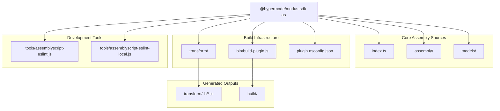
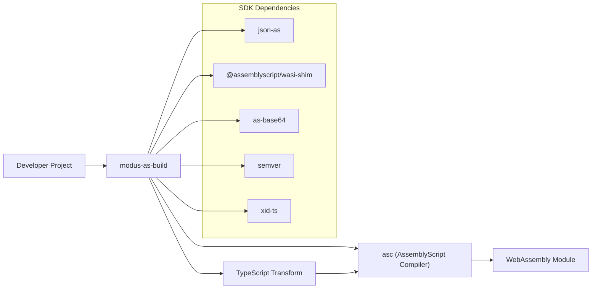
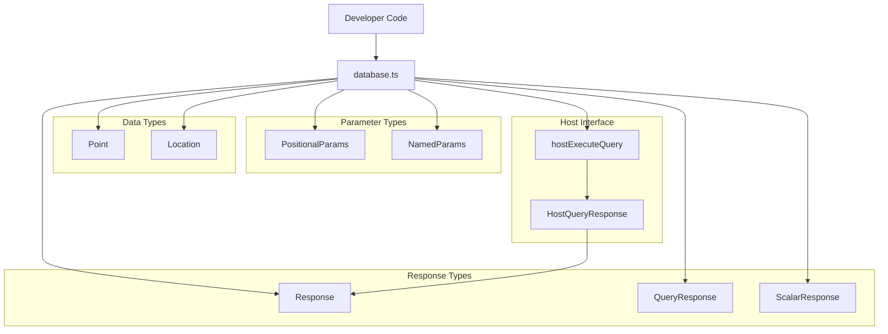
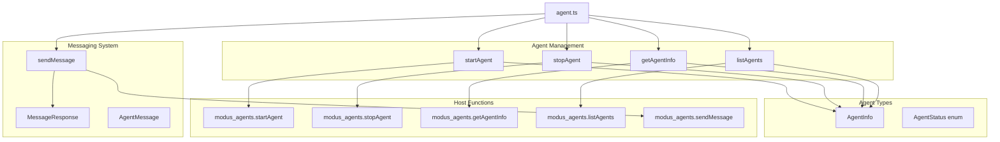
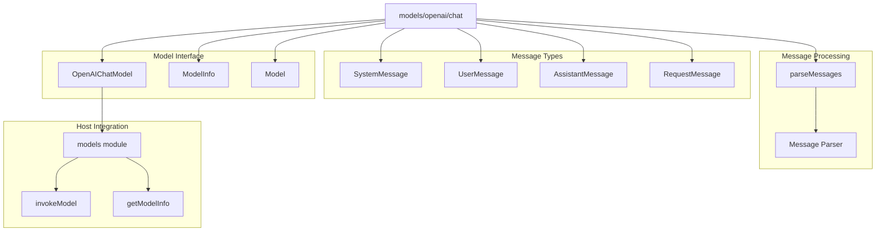
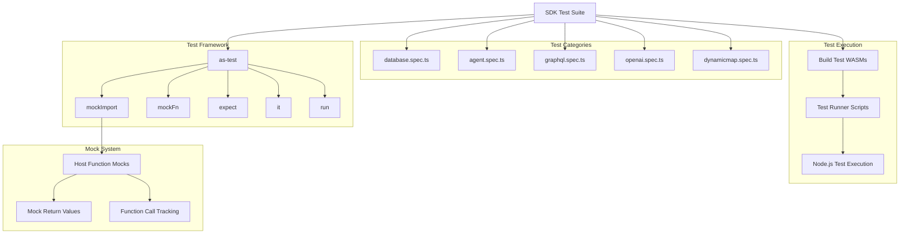
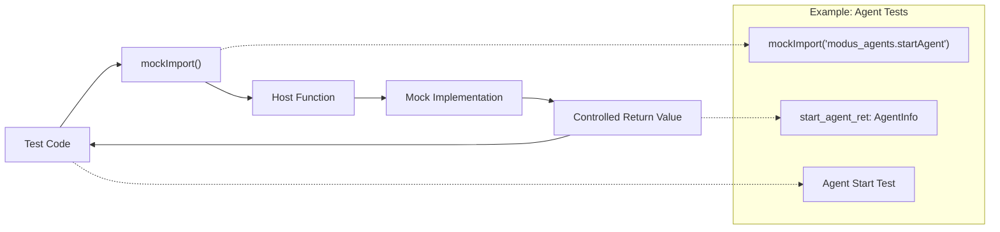
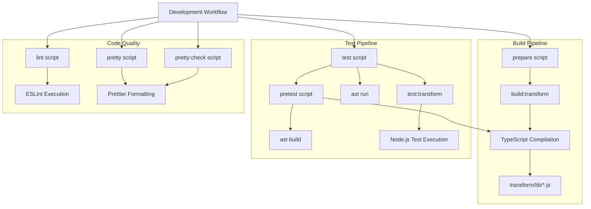

<!-- source: DeepWiki mcp.deepwiki.com · repo hypermodeinc/modus · page 4.3 SDK Internals · fetched 2026-10-27 -->

# SDK Internals

Relevant source files

The following files were used as context for generating this wiki page:

- [sdk/assemblyscript/examples/anthropic-functions/package-lock.json](sdk/assemblyscript/examples/anthropic-functions/package-lock.json)
- [sdk/assemblyscript/examples/classification/package-lock.json](sdk/assemblyscript/examples/classification/package-lock.json)
- [sdk/assemblyscript/examples/dgraph/package-lock.json](sdk/assemblyscript/examples/dgraph/package-lock.json)
- [sdk/assemblyscript/examples/embedding/package-lock.json](sdk/assemblyscript/examples/embedding/package-lock.json)
- [sdk/assemblyscript/examples/graphql/package-lock.json](sdk/assemblyscript/examples/graphql/package-lock.json)
- [sdk/assemblyscript/examples/http/package-lock.json](sdk/assemblyscript/examples/http/package-lock.json)
- [sdk/assemblyscript/examples/postgresql/package-lock.json](sdk/assemblyscript/examples/postgresql/package-lock.json)
- [sdk/assemblyscript/examples/textgeneration/package-lock.json](sdk/assemblyscript/examples/textgeneration/package-lock.json)
- [sdk/assemblyscript/src/assembly/__tests__/agent.spec.ts](sdk/assemblyscript/src/assembly/__tests__/agent.spec.ts)
- [sdk/assemblyscript/src/assembly/__tests__/database.spec.ts](sdk/assemblyscript/src/assembly/__tests__/database.spec.ts)
- [sdk/assemblyscript/src/assembly/__tests__/dynamicmap.spec.ts](sdk/assemblyscript/src/assembly/__tests__/dynamicmap.spec.ts)
- [sdk/assemblyscript/src/assembly/__tests__/graphql.spec.ts](sdk/assemblyscript/src/assembly/__tests__/graphql.spec.ts)
- [sdk/assemblyscript/src/assembly/__tests__/openai.spec.ts](sdk/assemblyscript/src/assembly/__tests__/openai.spec.ts)
- [sdk/assemblyscript/src/assembly/__tests__/src/taskagent.ts](sdk/assemblyscript/src/assembly/__tests__/src/taskagent.ts)
- [sdk/assemblyscript/src/assembly/database.ts](sdk/assemblyscript/src/assembly/database.ts)
- [sdk/assemblyscript/src/package-lock.json](sdk/assemblyscript/src/package-lock.json)
- [sdk/assemblyscript/src/package.json](sdk/assemblyscript/src/package.json)
- [sdk/assemblyscript/src/tests/agent.run.ts](sdk/assemblyscript/src/tests/agent.run.ts)
- [sdk/assemblyscript/src/tests/database.run.ts](sdk/assemblyscript/src/tests/database.run.ts)
- [sdk/assemblyscript/src/tests/openai.run.ts](sdk/assemblyscript/src/tests/openai.run.ts)

This document provides a detailed technical overview of the Modus AssemblyScript SDK implementation, including its package structure, build system, core components, and testing infrastructure. It covers the internal architecture that enables developers to write WebAssembly modules in AssemblyScript for the Modus runtime.

For information about using the AssemblyScript SDK to develop applications, see [AssemblyScript SDK](#4.2). For details about the Go SDK implementation, see [Go SDK](#4.1).

## Package Architecture

The AssemblyScript SDK is distributed as an NPM package `@hypermode/modus-sdk-as` with a sophisticated build system supporting both development and production workflows.

### Package Structure

The package exports multiple entry points through its `exports` field, enabling modular consumption of SDK components.

**Sources:** [sdk/assemblyscript/src/package.json:44-48]()

### Build System Integration

The SDK includes a custom build plugin `modus-as-build` that extends the standard AssemblyScript compilation process:

**Sources:** [sdk/assemblyscript/src/package.json:9-10](), [sdk/assemblyscript/src/package.json:22-28]()

## Core Runtime Components

The SDK provides several core modules that interface with the Modus runtime through WebAssembly host functions.

### Database Client Architecture

The database module provides typed query execution with support for PostgreSQL, MySQL, Dgraph, and Neo4j through a unified interface.

**Sources:** [sdk/assemblyscript/src/assembly/database.ts:14-20](), [sdk/assemblyscript/src/assembly/database.ts:33-65](), [sdk/assemblyscript/src/assembly/database.ts:67-79]()

### Agent System Components

**Sources:** [sdk/assemblyscript/src/assembly/__tests__/agent.spec.ts:24-45]()

### Dynamic Data Structures

The SDK includes a `DynamicMap` class that provides flexible JSON-compatible data handling:

```mermaid
graph TD
    DynamicMap["DynamicMap"]
    
    subgraph "Core Operations"
        Set["set<T>(key, value)"]
        Get["get<T>(key)"]
        Has["has(key)"]
        Delete["delete(key)"]
    end
    
    subgraph "JSON Integration"
        JSONParse["JSON.parse<DynamicMap>"]
        JSONStringify["JSON.stringify(DynamicMap)"]
        Serialize["serialize()"]
        Deserialize["deserialize()"]
    end
    
    subgraph "Type Handling"
        ValueType["ValueType enum"]
        NullHandling["Null Value Support"]
        ComplexTypes["Nested Objects/Arrays"]
    end
    
    DynamicMap --> Set
    DynamicMap --> Get
    DynamicMap --> Has
    DynamicMap --> Delete
    
    DynamicMap --> JSONParse
    DynamicMap --> JSONStringify
    DynamicMap --> Serialize
    DynamicMap --> Deserialize
    
    DynamicMap --> ValueType
    DynamicMap --> NullHandling
    DynamicMap --> ComplexTypes
```

**Sources:** [sdk/assemblyscript/src/assembly/__tests__/dynamicmap.spec.ts:12](), [sdk/assemblyscript/src/assembly/__tests__/dynamicmap.spec.ts:25-32](), [sdk/assemblyscript/src/assembly/__tests__/dynamicmap.spec.ts:80-94]()

## Model Integration System

The SDK provides typed interfaces for AI model interactions, with OpenAI as the primary implementation.

### OpenAI Chat Model Architecture

**Sources:** [sdk/assemblyscript/src/assembly/__tests__/openai.spec.ts:13-20](), [sdk/assemblyscript/src/assembly/__tests__/openai.spec.ts:22]()

## Testing Infrastructure

The SDK employs a comprehensive testing framework built on `as-test` with mock capabilities for host function testing.

### Test Architecture

**Sources:** [sdk/assemblyscript/src/assembly/__tests__/agent.spec.ts:10](), [sdk/assemblyscript/src/assembly/__tests__/agent.spec.ts:24-45](), [sdk/assemblyscript/src/tests/agent.run.ts:11-17]()

### Mock Testing Pattern

The testing infrastructure provides sophisticated mocking capabilities for host functions:

**Sources:** [sdk/assemblyscript/src/assembly/__tests__/agent.spec.ts:17-26](), [sdk/assemblyscript/src/assembly/__tests__/graphql.spec.ts:14-21]()

## Development Workflow Integration

The SDK integrates with standard Node.js development workflows through NPM scripts and tooling.

### Build and Test Pipeline

**Sources:** [sdk/assemblyscript/src/package.json:12-21]()

### Example Project Structure

The SDK includes multiple example projects demonstrating different capabilities:

| Example | Purpose | Key Features |
|---------|---------|--------------|
| `classification` | AI model classification | OpenAI integration, model invocation |
| `embedding` | Vector embeddings | Embedding model usage |
| `graphql` | GraphQL client usage | Query execution, type safety |
| `postgresql` | Database integration | PostgreSQL queries, typed results |
| `http` | HTTP client functionality | External API calls |
| `dgraph` | Graph database | Dgraph-specific operations |
| `anthropic-functions` | Function calling | Anthropic model integration |
| `textgeneration` | Text generation | Text completion models |

Each example follows a consistent structure with its own `package-lock.json` and dependencies on the core SDK.

**Sources:** [sdk/assemblyscript/examples/graphql/package-lock.json:2-22](), [sdk/assemblyscript/examples/postgresql/package-lock.json:2-22](), [sdk/assemblyscript/examples/classification/package-lock.json:2-22]()

## SDK Dependencies and External Integrations

The SDK maintains a careful balance of external dependencies to provide functionality while keeping the runtime footprint minimal:

### Core Dependencies

| Package | Version | Purpose |
|---------|---------|---------|
| `@assemblyscript/wasi-shim` | ^0.1.0 | WASI compatibility layer |
| `as-base64` | ^0.2.0 | Base64 encoding/decoding |
| `chalk` | ^5.4.1 | Terminal output formatting |
| `json-as` | ^1.1.15 | JSON serialization for AssemblyScript |
| `semver` | ^7.7.2 | Semantic version handling |
| `xid-ts` | ^1.1.4 | Unique ID generation |

### Development Dependencies

The SDK uses modern development tooling including ESLint 9.x, TypeScript 5.x, and AssemblyScript 0.28.x for maintaining code quality and compatibility.

**Sources:** [sdk/assemblyscript/src/package.json:22-40]()

---

