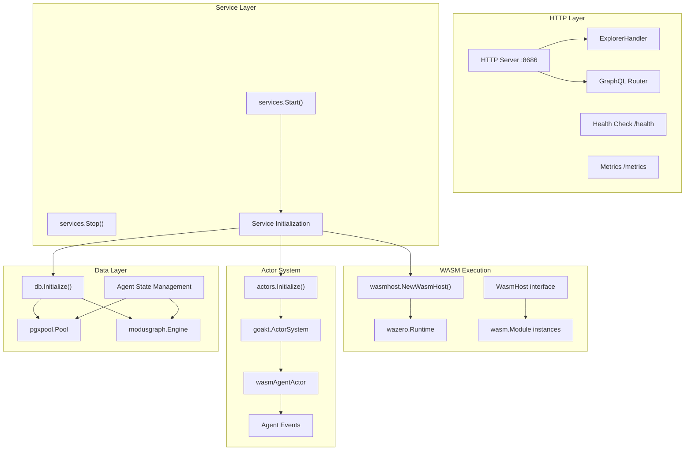
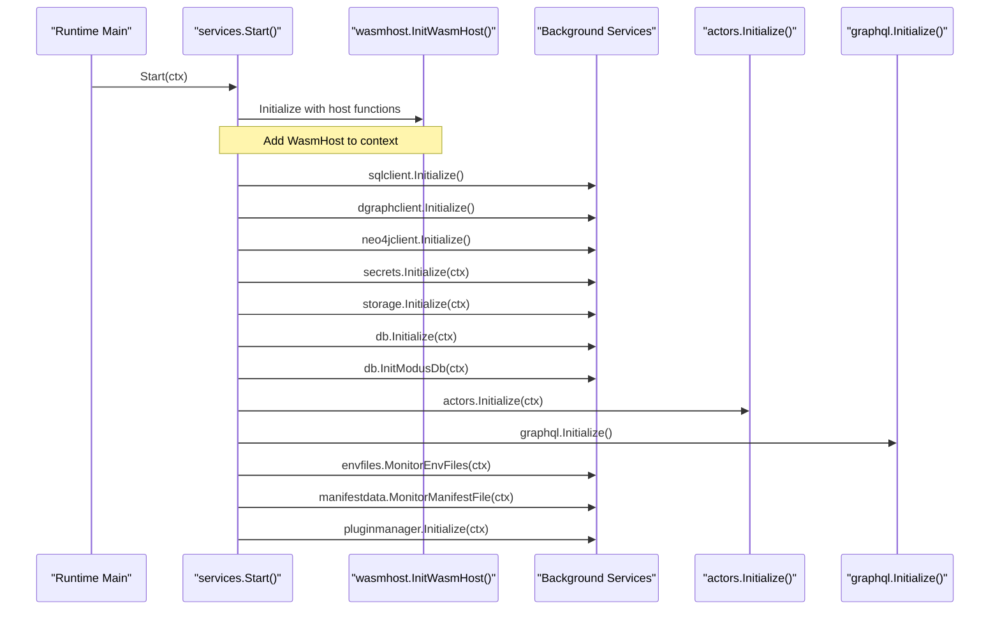
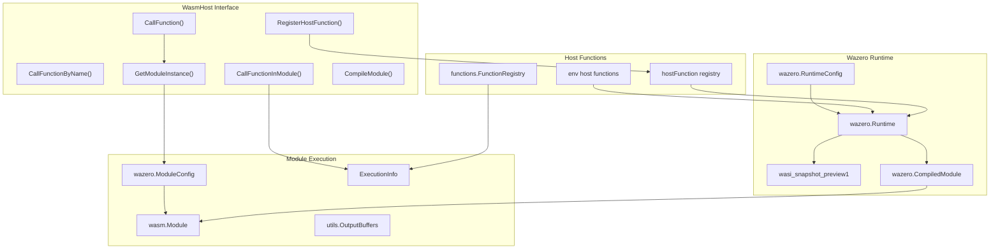
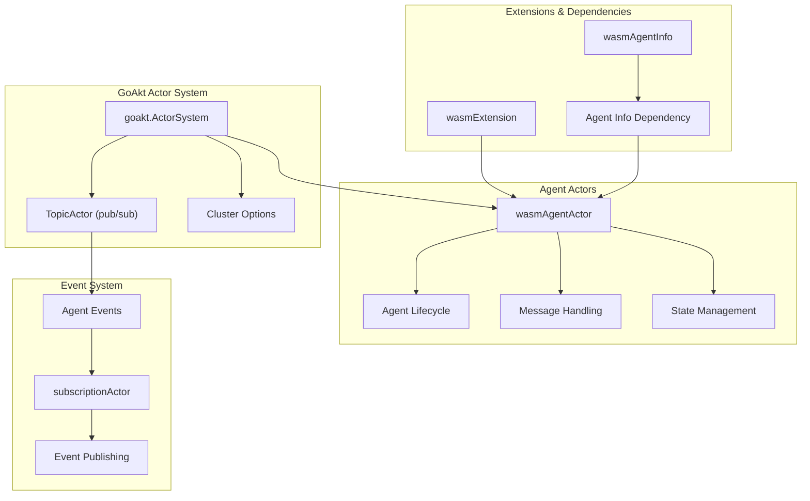
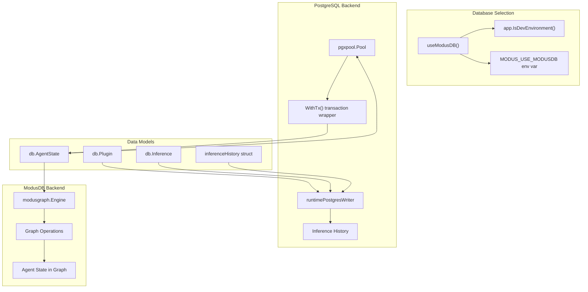
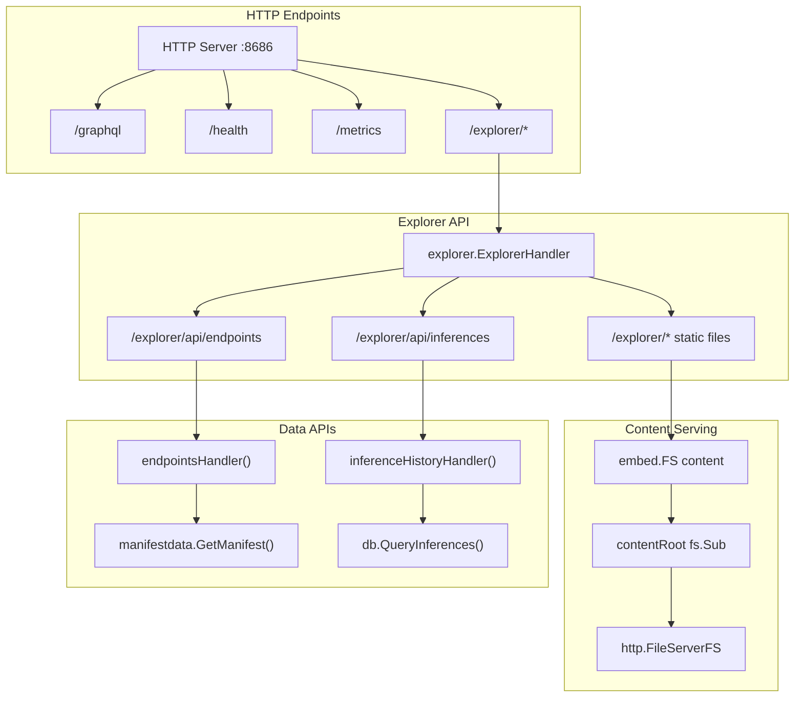

<!-- source: DeepWiki mcp.deepwiki.com · repo hypermodeinc/modus · page 5.1 Runtime Architecture · fetched 2026-10-27 -->

# Runtime Architecture

Relevant source files

The following files were used as context for generating this wiki page:

- [.trunk/configs/cspell.json](.trunk/configs/cspell.json)
- [.vscode/launch.json](.vscode/launch.json)
- [runtime/actors/actorsystem.go](runtime/actors/actorsystem.go)
- [runtime/actors/subscriber.go](runtime/actors/subscriber.go)
- [runtime/actors/wasmagent.go](runtime/actors/wasmagent.go)
- [runtime/app/app.go](runtime/app/app.go)
- [runtime/db/agentstate.go](runtime/db/agentstate.go)
- [runtime/db/db.go](runtime/db/db.go)
- [runtime/db/inferencehistory.go](runtime/db/inferencehistory.go)
- [runtime/db/modusdb.go](runtime/db/modusdb.go)
- [runtime/explorer/explorer.go](runtime/explorer/explorer.go)
- [runtime/services/services.go](runtime/services/services.go)
- [runtime/wasmhost/wasmhost.go](runtime/wasmhost/wasmhost.go)
- [sdk/assemblyscript/examples/agents/.gitignore](sdk/assemblyscript/examples/agents/.gitignore)
- [sdk/assemblyscript/src/assembly/exports.ts](sdk/assemblyscript/src/assembly/exports.ts)
- [sdk/go/examples/agents/.gitignore](sdk/go/examples/agents/.gitignore)

This document covers the core architecture of the Modus Runtime system, including service initialization, WebAssembly hosting, actor system management, and data persistence. The runtime serves as the execution environment for user-defined functions compiled to WebAssembly, with support for GraphQL APIs, agent-based concurrency, and database integration.

For information about the GraphQL schema generation and query processing, see [GraphQL Engine](#5.2). For details about the agent lifecycle and message passing, see [Agent System](#5.3). For database client configuration and connection management, see [Database Integration](#5.4).

## Runtime Overview

The Modus Runtime is built around a layered architecture that handles WebAssembly module execution, HTTP request processing, and background service management. The runtime initializes multiple interdependent services and provides a sandboxed execution environment for user functions.

**Core Runtime Architecture**

Sources: [runtime/services/services.go:34-63](), [runtime/wasmhost/wasmhost.go:51-79](), [runtime/actors/actorsystem.go:28-56](), [runtime/db/db.go:64-75]()

## Service Initialization

The runtime startup follows a specific initialization sequence managed by the `services` package. Services are started in dependency order to ensure proper system initialization.

**Service Startup Sequence**

The initialization order is critical, as shown in [runtime/services/services.go:45-61](). The WASM host must be initialized first and placed in the context before other services can access it. Database services are initialized before the actor system, which depends on state persistence.

Sources: [runtime/services/services.go:34-63](), [runtime/hostfunctions/hostfunctions.go](), [runtime/wasmhost/wasmhost.go:51-79]()

## WebAssembly Host Architecture

The WASM host provides the core execution environment for user functions. It uses the Wazero runtime with WASI support and manages module instantiation, host function registration, and execution context.

**WASM Host Components**

The `wasmHost` struct implements the `WasmHost` interface defined in [runtime/wasmhost/wasmhost.go:33-43](). Module instances are created per invocation with specific configuration including environment variables, timezone, JWT claims, and output capturing as shown in [runtime/wasmhost/wasmhost.go:135-183]().

Sources: [runtime/wasmhost/wasmhost.go:33-43](), [runtime/wasmhost/wasmhost.go:45-49](), [runtime/wasmhost/wasmhost.go:135-183]()

## Actor System Integration

The runtime uses GoAkt actors for managing agent lifecycle and concurrent execution. The actor system handles agent state persistence, message routing, and cluster coordination.

**Actor System Architecture**

The actor system is initialized with specific options including pub/sub support, timeouts, and the `wasmExtension` for WASM host access in [runtime/actors/actorsystem.go:34-41](). Agent actors implement the full lifecycle with `PreStart`, `Receive`, and `PostStop` handlers as defined in [runtime/actors/wasmagent.go:43-151]().

Sources: [runtime/actors/actorsystem.go:28-56](), [runtime/actors/wasmagent.go:31-41](), [runtime/actors/actorsystem.go:128-136]()

## Database Architecture

The runtime supports dual database backends: PostgreSQL for production and ModusDB (graph database) for development. The database layer handles agent state persistence, inference history, and plugin metadata.

**Database Layer Components**

The database selection logic is implemented in [runtime/db/db.go:111-124]() using the `useModusDB()` function. Agent state operations are abstracted through functions like `WriteAgentState()` and `GetAgentState()` that route to the appropriate backend in [runtime/db/agentstate.go:32-62]().

Sources: [runtime/db/db.go:111-124](), [runtime/db/agentstate.go:32-62](), [runtime/db/modusdb.go:27-47](), [runtime/db/inferencehistory.go:28-33]()

## HTTP Server and API Endpoints

The runtime exposes HTTP endpoints for GraphQL queries, health checks, metrics, and the API Explorer interface. The server configuration supports both single-node and cluster deployments.

**HTTP API Architecture**

The Explorer handler is defined in [runtime/explorer/explorer.go:27-37]() and serves both static content from embedded files and dynamic API endpoints. The endpoints handler extracts GraphQL endpoint information from the manifest in [runtime/explorer/explorer.go:39-61]().

Sources: [runtime/explorer/explorer.go:27-37](), [runtime/explorer/explorer.go:39-61](), [runtime/explorer/explorer.go:65-83](), [.vscode/launch.json:15-19]()

## Development and Debugging Support

The runtime includes extensive debugging support through VS Code launch configurations, environment variable controls, and development-specific features like automatic refresh and local database management.

**Development Configuration**

| Environment Variable | Purpose | Default |
|---------------------|---------|---------|
| `MODUS_ENV` | Environment mode | production |
| `MODUS_DEBUG` | Enable debug logging | false |
| `MODUS_USE_MODUSDB` | Use local graph database | dev environment |
| `MODUS_CLUSTER_MODE` | Enable cluster mode | disabled |
| `FORCE_COLOR` | Force colored output | auto-detect |

The VS Code launch configurations in [.vscode/launch.json:5-19]() provide multiple debugging scenarios including cluster mode, AWS storage, and different SDK examples. The runtime supports hot reload through the `--refresh` parameter for development workflows.

Sources: [.vscode/launch.json:5-43](), [runtime/app/app.go:37-43](), [runtime/db/db.go:111-124]()

---

