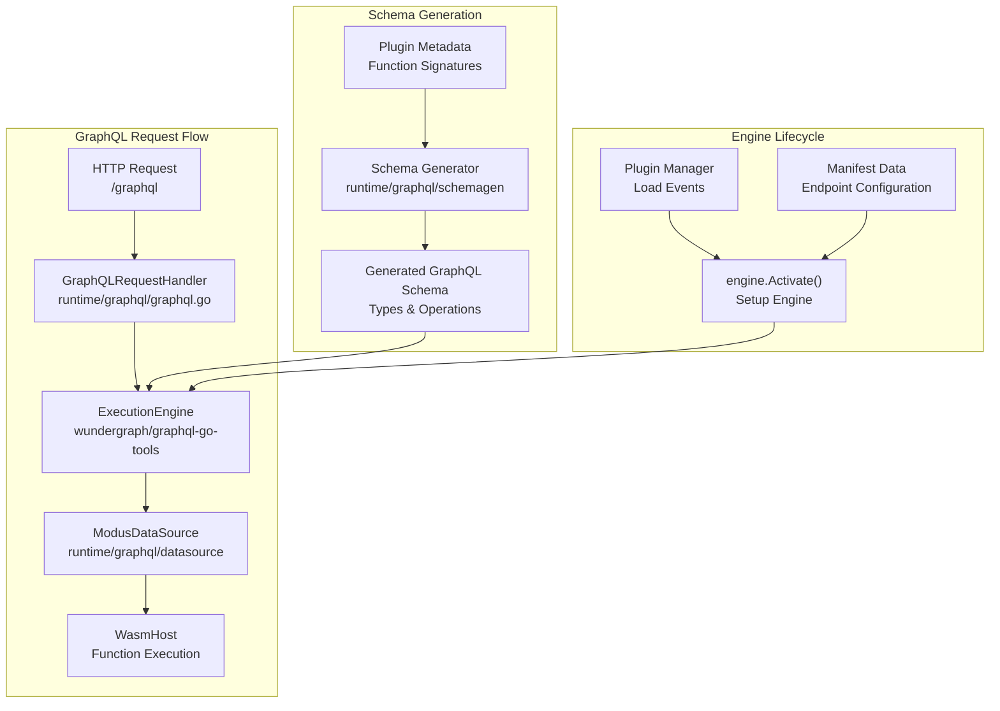
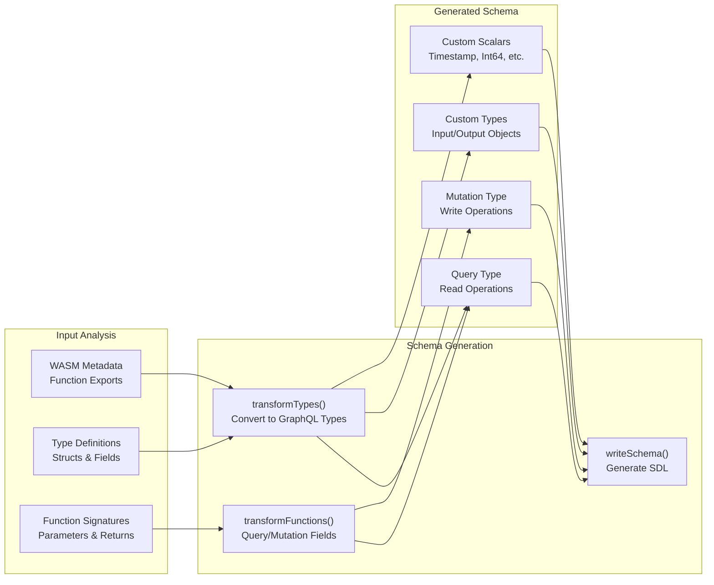
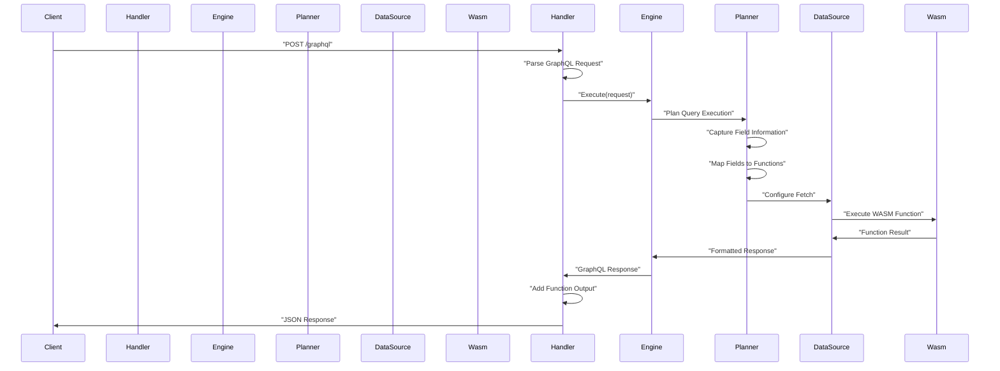
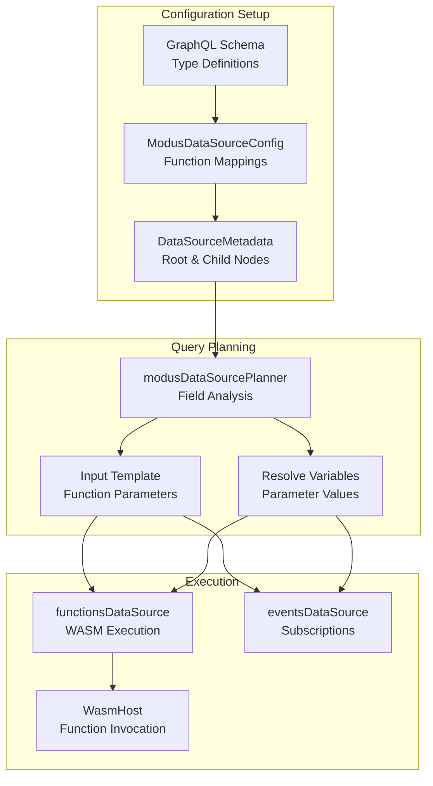
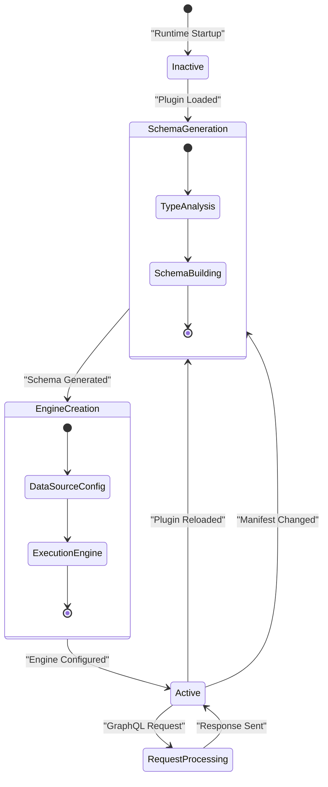
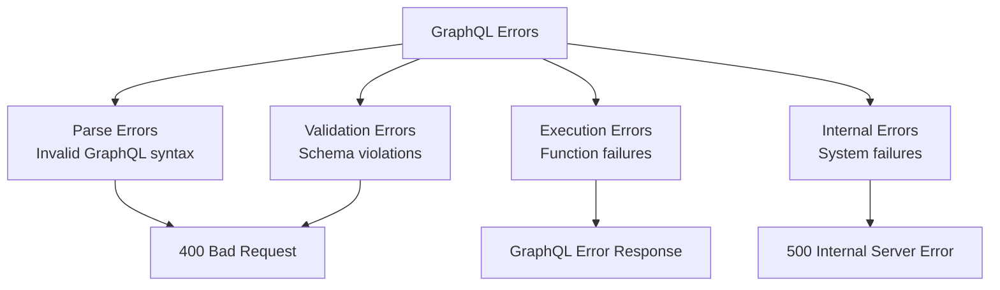

<!-- source: DeepWiki mcp.deepwiki.com · repo hypermodeinc/modus · page 5.2 GraphQL Engine · fetched 2026-10-27 -->

# GraphQL Engine

<details>
<summary>Relevant source files</summary>

The following files were used as context for generating this wiki page:

- [runtime/graphql/datasource/configuration.go](runtime/graphql/datasource/configuration.go)
- [runtime/graphql/datasource/planner.go](runtime/graphql/datasource/planner.go)
- [runtime/graphql/engine/engine.go](runtime/graphql/engine/engine.go)
- [runtime/graphql/graphql.go](runtime/graphql/graphql.go)
- [runtime/graphql/schemagen/schemagen.go](runtime/graphql/schemagen/schemagen.go)
- [runtime/graphql/schemagen/schemagen_as_test.go](runtime/graphql/schemagen/schemagen_as_test.go)
- [runtime/graphql/schemagen/schemagen_go_test.go](runtime/graphql/schemagen/schemagen_go_test.go)
- [runtime/httpserver/dynamicMux.go](runtime/httpserver/dynamicMux.go)
- [runtime/httpserver/server.go](runtime/httpserver/server.go)
- [runtime/integration_tests/postgresql_integration_test.go](runtime/integration_tests/postgresql_integration_test.go)
- [runtime/main.go](runtime/main.go)

</details>


The GraphQL Engine is responsible for automatically generating GraphQL schemas from WebAssembly module metadata and processing GraphQL queries by executing the corresponding WASM functions. It serves as the primary API interface for Modus applications, dynamically creating GraphQL endpoints based on exported functions from loaded plugins.

For information about the broader runtime architecture, see [Runtime Architecture](#5.1). For details about how agents integrate with GraphQL subscriptions, see [Agent System](#5.3).

## Architecture Overview

The GraphQL Engine consists of several interconnected components that work together to provide dynamic GraphQL API generation and execution.



Sources: [runtime/graphql/graphql.go:40-316](), [runtime/graphql/engine/engine.go:52-73](), [runtime/graphql/schemagen/schemagen.go:33-94]()

## Schema Generation Process

The GraphQL Engine automatically generates schemas by analyzing WebAssembly module metadata and transforming function signatures into GraphQL operations.



Sources: [runtime/graphql/schemagen/schemagen.go:105-149](), [runtime/graphql/schemagen/schemagen.go:181-231](), [runtime/graphql/schemagen/schemagen.go:308-432]()

### Type System Mapping

The schema generator maps WebAssembly types to GraphQL types with language-specific handling:

| WASM Type (Go) | WASM Type (AssemblyScript) | GraphQL Type | Notes |
|----------------|----------------------------|--------------|-------|
| `string` | `~lib/string/String` | `String!` | Non-nullable by default |
| `int32` | `i32` | `Int!` | Standard integer |
| `int64` | `i64` | `Int64!` | Custom scalar |
| `float64` | `f64` | `Float!` | Standard float |
| `[]T` | `~lib/array/Array<T>` | `[T!]!` | Non-nullable array |
| `map[K]V` | `~lib/map/Map<K,V>` | `[KVPair!]!` | Key-value pairs |
| `*T` | `T \| null` | `T` | Nullable type |
| `time.Time` | `~lib/date/Date` | `Timestamp!` | Custom scalar |

Sources: [runtime/graphql/schemagen/schemagen_go_test.go:385-599](), [runtime/graphql/schemagen/schemagen_as_test.go:343-555]()

## Query Execution Flow

When GraphQL queries are received, the engine processes them through a multi-stage execution pipeline.



Sources: [runtime/graphql/graphql.go:74-251](), [runtime/graphql/datasource/planner.go:93-270]()

## Data Source System

The GraphQL Engine uses a custom data source implementation to bridge GraphQL operations with WebAssembly function execution.

### Data Source Configuration



Sources: [runtime/graphql/datasource/configuration.go:17-22](), [runtime/graphql/datasource/planner.go:27-39](), [runtime/graphql/engine/engine.go:106-148]()

### Field Mapping Process

The planner captures detailed information about GraphQL fields and maps them to WebAssembly functions:

```go
type fieldInfo struct {
    Name       string      `json:"name"`
    Alias      string      `json:"alias,omitempty"`
    TypeName   string      `json:"type,omitempty"`
    ParentType string      `json:"parentType,omitempty"`
    Fields     []fieldInfo `json:"fields,omitempty"`
    IsMapType  bool        `json:"isMapType,omitempty"`
}
```

Sources: [runtime/graphql/datasource/planner.go:41-51]()

## Engine Lifecycle Management

The GraphQL Engine integrates with the plugin management system to dynamically activate and update schemas as WebAssembly modules are loaded.



Sources: [runtime/graphql/graphql.go:52-72](), [runtime/graphql/engine/engine.go:52-73]()

### Plugin Integration

The engine registers callbacks with the plugin manager to automatically regenerate schemas when modules are loaded:

```go
func Initialize() {
    pluginmanager.RegisterPluginLoadedCallback(engine.Activate)
    manifestdata.RegisterManifestLoadedCallback(func(ctx context.Context) error {
        plugins := pluginmanager.GetRegisteredPlugins()
        // ... activate engine with loaded plugins
    })
}
```

Sources: [runtime/graphql/graphql.go:52-72]()

## Request Processing Details

### HTTP Request Handling

The `GraphQLRequestHandler` processes incoming requests with support for both regular queries and Server-Sent Events for subscriptions:

| Feature | Implementation | Purpose |
|---------|----------------|---------|
| Content Negotiation | Accept header checking | Redirect browsers to explorer |
| SSE Support | `text/event-stream` handling | Real-time subscriptions |
| Variable Context | Request headers & context | Time zone, tracing options |
| Error Handling | Structured error responses | Development vs production |

Sources: [runtime/graphql/graphql.go:74-251]()

### Response Enhancement

The engine adds execution metadata to GraphQL responses, including function invocation details and console output:

```go
func addOutputToResponse(response []byte, output map[string]wasmhost.ExecutionInfo) ([]byte, error) {
    // Add execution IDs and log messages to response extensions
    for key, item := range output {
        // Include execution ID and filtered log messages
    }
    return sjson.SetRawBytesOptions(response, "extensions.invocations", invocations, jsonOptions)
}
```

Sources: [runtime/graphql/graphql.go:253-305]()

## Integration with Runtime Components

The GraphQL Engine integrates with several other runtime components:

| Component | Integration Point | Purpose |
|-----------|------------------|---------|
| Plugin Manager | Load callbacks | Schema regeneration |
| Manifest Data | Configuration changes | Endpoint updates |
| WASM Host | Function execution | Query resolution |
| Agent System | Subscriptions | Real-time events |
| HTTP Server | Route registration | Endpoint exposure |

Sources: [runtime/httpserver/server.go:125-231](), [runtime/main.go:49-52]()

## Error Handling and Development Features

The GraphQL Engine provides comprehensive error handling and development-focused features:

### Development Mode Features

- Automatic redirection to API Explorer for browsers
- Detailed error logging (suppressed in production)
- Schema debugging output with color formatting
- Introspection query support with empty schema fallback

### Error Classification



Sources: [runtime/graphql/graphql.go:186-220](), [runtime/graphql/engine/engine.go:84-90]()

## Testing and Validation

The GraphQL Engine includes comprehensive test coverage for schema generation and type conversion:

### Integration Testing

The system includes integration tests that verify end-to-end GraphQL query processing with real database connections and WebAssembly module execution.

Sources: [runtime/integration_tests/postgresql_integration_test.go:160-441]()

### Schema Generation Testing

Extensive unit tests validate the conversion of various type systems (Go and AssemblyScript) to GraphQL schemas, ensuring compatibility across different WebAssembly compilation targets.

Sources: [runtime/graphql/schemagen/schemagen_go_test.go:25-383](), [runtime/graphql/schemagen/schemagen_as_test.go:26-341]()

---

