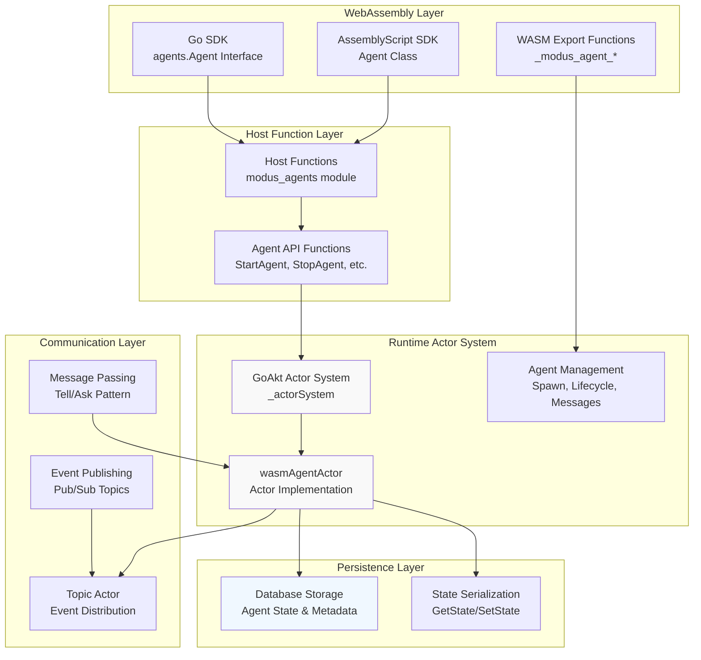
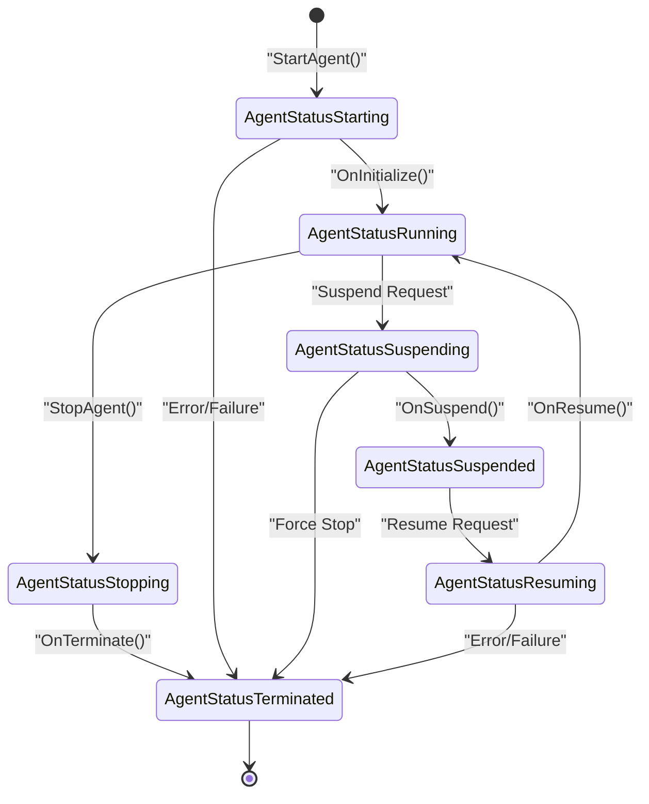
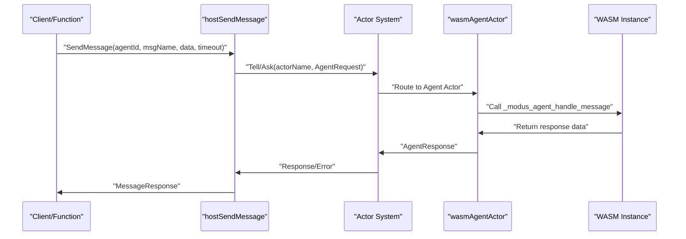
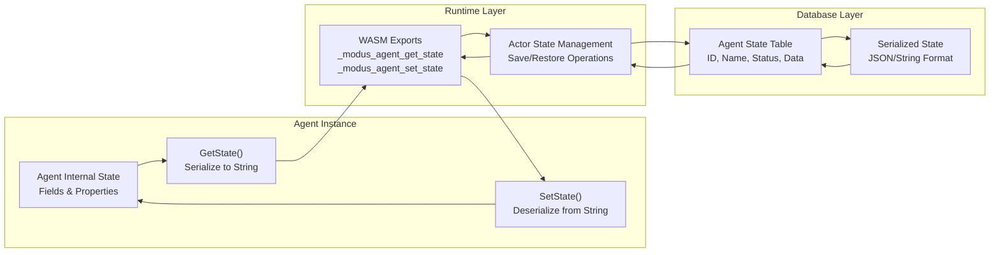
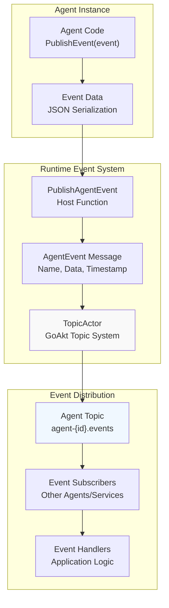
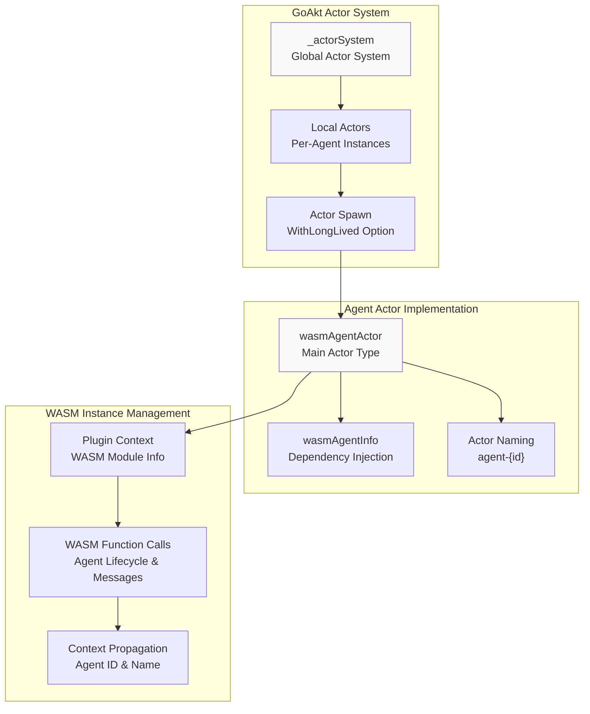

<!-- source: DeepWiki mcp.deepwiki.com · repo hypermodeinc/modus · page 5.3 Agent System · fetched 2026-10-27 -->

# Agent System

Relevant source files

The following files were used as context for generating this wiki page:

- [runtime/actors/agents.go](runtime/actors/agents.go)
- [runtime/hostfunctions/agents.go](runtime/hostfunctions/agents.go)
- [runtime/httpserver/health.go](runtime/httpserver/health.go)
- [sdk/assemblyscript/examples/agents/assembly/counterAgent.ts](sdk/assemblyscript/examples/agents/assembly/counterAgent.ts)
- [sdk/assemblyscript/examples/agents/assembly/index.ts](sdk/assemblyscript/examples/agents/assembly/index.ts)
- [sdk/assemblyscript/src/assembly/agent.ts](sdk/assemblyscript/src/assembly/agent.ts)
- [sdk/assemblyscript/src/assembly/agents.ts](sdk/assemblyscript/src/assembly/agents.ts)
- [sdk/assemblyscript/src/assembly/enums.ts](sdk/assemblyscript/src/assembly/enums.ts)
- [sdk/go/examples/agents/counterAgent.go](sdk/go/examples/agents/counterAgent.go)
- [sdk/go/examples/agents/main.go](sdk/go/examples/agents/main.go)
- [sdk/go/pkg/agents/agents.go](sdk/go/pkg/agents/agents.go)
- [sdk/go/pkg/agents/imports_mock.go](sdk/go/pkg/agents/imports_mock.go)
- [sdk/go/pkg/agents/imports_wasi.go](sdk/go/pkg/agents/imports_wasi.go)

The Agent System provides actor-based concurrency for long-running stateful processes within the Modus Runtime. It enables WebAssembly modules to create, manage, and communicate with persistent agent instances that can maintain state across requests and system restarts. For information about the overall runtime architecture, see [Runtime Architecture](#5.1). For details about database persistence used by agents, see [Database Integration](#5.4).

## Architecture Overview

The Agent System is built on the GoAkt actor framework and integrates with the WebAssembly host to provide a seamless agent experience for both Go and AssemblyScript applications.

### Core Components

Sources: [runtime/actors/agents.go:1-304](), [sdk/go/pkg/agents/agents.go:1-393](), [sdk/assemblyscript/src/assembly/agent.ts:1-325](), [runtime/hostfunctions/agents.go:1-54]()

## Agent Lifecycle Management

The Agent System manages the complete lifecycle of agent instances through well-defined states and transitions.

### Agent States and Transitions

### Key Lifecycle Functions

| Function | Runtime Implementation | Purpose |
|----------|----------------------|---------|
| `StartAgent` | [agents.go:65-77]() | Creates new agent instance with unique ID |
| `StopAgent` | [agents.go:101-122]() | Initiates agent termination |
| `GetAgentInfo` | [agents.go:135-157]() | Retrieves current agent status |
| `ListActiveAgents` | [agents.go:266-282]() | Lists all non-terminated agents |

The lifecycle is managed through the `wasmAgentActor` which handles state transitions and ensures proper cleanup.

Sources: [runtime/actors/agents.go:42-52](), [runtime/actors/agents.go:65-122](), [sdk/go/pkg/agents/agents.go:36-46]()

## Message Passing System

Agents communicate through a message-passing system that supports both synchronous and asynchronous communication patterns.

### Message Flow Architecture

### Message Types and Patterns

| Pattern | Timeout | Return Value | Use Case |
|---------|---------|--------------|----------|
| Synchronous | > 0 | Response data | Request-response operations |
| Asynchronous | 0 | None | Fire-and-forget notifications |
| Blocking | `math.MaxInt64` | Response data | Wait indefinitely for response |

The message system uses the `AgentRequest` and `AgentResponse` message types for communication between the runtime and WebAssembly instances.

Sources: [runtime/actors/agents.go:172-202](), [sdk/go/pkg/agents/agents.go:336-392](), [sdk/assemblyscript/src/assembly/agents.ts:29-74]()

## State Management

Agents maintain persistent state through serialization mechanisms that survive agent restarts and system shutdowns.

### State Persistence Flow

### State Management Interface

The state management interface requires agents to implement two key methods:

- `GetState()`: Serializes the current agent state to a string representation
- `SetState(data)`: Deserializes and restores agent state from a string

Sources: [runtime/actors/agents.go:124-133](), [sdk/go/pkg/agents/agents.go:234-240](), [sdk/assemblyscript/src/assembly/agent.ts:42-50]()

## Event System

Agents can publish events to subscribers using a topic-based publish-subscribe system built on GoAkt's messaging infrastructure.

### Event Publishing Architecture

### Event Message Structure

Events are structured as protobuf messages containing:
- `Name`: Event type identifier
- `Data`: Serialized event payload as `structpb.Value`
- `Timestamp`: Event creation timestamp

The topic naming convention follows the pattern `agent-{agentId}.events` for agent-specific event channels.

Sources: [runtime/actors/agents.go:204-256](), [sdk/go/pkg/agents/agents.go:294-304](), [sdk/assemblyscript/src/assembly/agent.ts:94-98]()

## Runtime Implementation Details

The runtime implementation centers around the `wasmAgentActor` which integrates with the GoAkt actor system to provide agent functionality.

### Actor System Integration

### Key Runtime Components

| Component | File Location | Purpose |
|-----------|---------------|---------|
| `spawnActorForAgent` | [agents.go:79-99]() | Creates new actor instance for agent |
| `getActorName` | [agents.go:258-260]() | Generates unique actor names |
| `getAgentTopic` | [agents.go:262-264]() | Creates topic names for events |
| `wasmAgentInfo` | [agents.go:93-96]() | Dependency injection for actor context |

The actor system uses long-lived actors with dependency injection to maintain agent context and enable proper cleanup.

Sources: [runtime/actors/agents.go:79-99](), [runtime/actors/agents.go:258-264]()

## SDK Interfaces

The Agent System provides consistent interfaces across both Go and AssemblyScript SDKs for agent development.

### SDK Function Mapping

| Operation | Go SDK | AssemblyScript SDK | Runtime Function |
|-----------|--------|-------------------|------------------|
| Agent Registration | `agents.Register()` | `agents.register<T>()` | N/A (compile-time) |
| Start Agent | `agents.Start()` | `agents.start()` | `StartAgent` |
| Stop Agent | `agents.Stop()` | `agents.stop()` | `StopAgent` |
| Send Message | `agents.SendMessage()` | `agents.sendMessage()` | `SendAgentMessage` |
| Publish Event | `agent.PublishEvent()` | `agent.publishEvent()` | `PublishAgentEvent` |

### Agent Interface Requirements

Both SDKs require agents to implement core interface methods:

**Go SDK Interface:**
- `Name() string` - Agent identifier
- `GetState() *string` - State serialization  
- `SetState(data *string)` - State deserialization
- `OnInitialize() error` - Lifecycle callbacks
- `OnReceiveMessage(msgName string, data *string) (*string, error)` - Message handling

**AssemblyScript SDK Interface:**
- `get name(): string` - Agent identifier
- `getState(): string | null` - State serialization
- `setState(data: string | null): void` - State deserialization  
- `onInitialize(): void` - Lifecycle callbacks
- `onReceiveMessage(msgName: string, data: string | null): string | null` - Message handling

Sources: [sdk/go/pkg/agents/agents.go:220-263](), [sdk/assemblyscript/src/assembly/agent.ts:22-99](), [runtime/hostfunctions/agents.go:18-53]()

---

