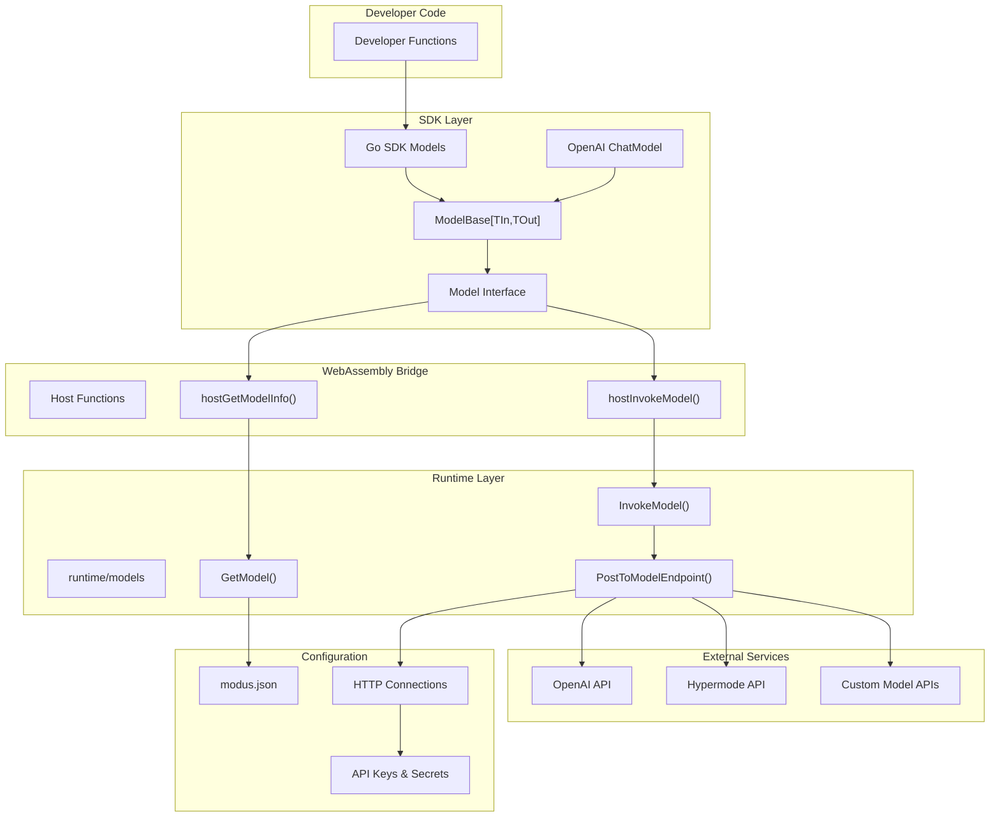
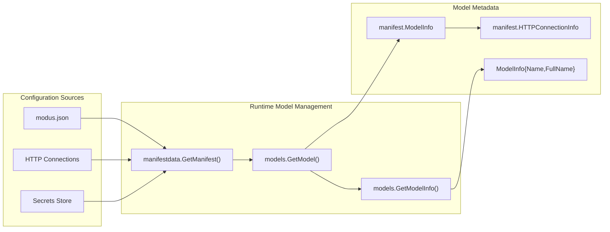
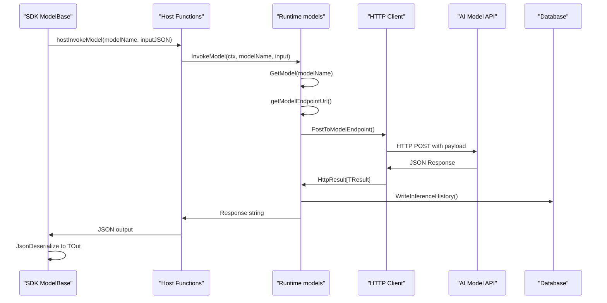
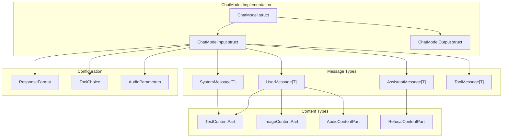
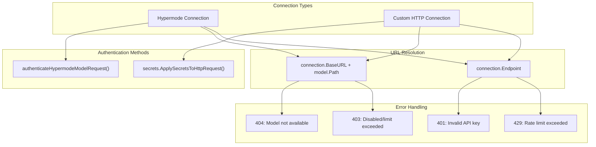

<!-- source: DeepWiki mcp.deepwiki.com · repo hypermodeinc/modus · page 5.5 AI Model Integration · fetched 2026-10-27 -->

# AI Model Integration

<details>
<summary>Relevant source files</summary>

The following files were used as context for generating this wiki page:

- [runtime/models/models.go](runtime/models/models.go)
- [runtime/utils/http.go](runtime/utils/http.go)
- [runtime/utils/http_test.go](runtime/utils/http_test.go)
- [runtime/wasmhost/fncall.go](runtime/wasmhost/fncall.go)
- [runtime/wasmhost/hostfns.go](runtime/wasmhost/hostfns.go)
- [sdk/go/pkg/models/models.go](sdk/go/pkg/models/models.go)
- [sdk/go/pkg/models/openai/chat.go](sdk/go/pkg/models/openai/chat.go)
- [sdk/go/tools/modus-go-build/codegen/preprocess.go](sdk/go/tools/modus-go-build/codegen/preprocess.go)

</details>


This document covers how the Modus Runtime integrates with AI models, including the architecture for model invocation, connection management, and the SDK interfaces developers use to interact with models. The system provides a type-safe, language-agnostic way to invoke AI models through WebAssembly host functions.

For information about database integration, see [Database Integration](#5.4). For details about the agent system, see [Agent System](#5.3).

## System Architecture

The AI model integration system consists of three primary layers that work together to provide seamless model invocation:

### Model Integration Architecture



Sources: [runtime/models/models.go:1-144](), [sdk/go/pkg/models/models.go:1-117](), [sdk/go/pkg/models/openai/chat.go:1-100]()

## Model Configuration and Manifest Integration

Models are configured in the application manifest and accessed through the runtime's model management system:

### Model Configuration Flow



Sources: [runtime/models/models.go:28-49](), [runtime/manifestdata](), [lib/manifest]()

## Model Invocation Process

The model invocation process involves several steps from SDK call to HTTP response:

### Model Invocation Flow



Sources: [runtime/models/models.go:51-118](), [sdk/go/pkg/models/models.go:76-116](), [runtime/utils/http.go:68-130]()

## SDK Model Interface

The SDK provides a generic, type-safe interface for model interaction:

### Core Model Types

| Type | Purpose | Key Methods |
|------|---------|-------------|
| `Model[TIn, TOut]` | Generic model interface | `Info()`, `Invoke()` |
| `ModelBase[TIn, TOut]` | Base implementation | `Invoke()`, `setInfo()` |
| `ModelInfo` | Model metadata | `Name`, `FullName` fields |

### Generic Model Usage Pattern

The SDK uses Go generics to provide type safety:

```go
// Get a model instance
model, err := GetModel[ChatModel](modelName)

// Invoke with typed input/output
output, err := model.Invoke(input)
```

The `GetModel` function signature demonstrates the generic pattern:
```go
func GetModel[TModel Model[TIn, TOut], TIn, TOut any, P modelPtr[TModel]](name string) (*TModel, error)
```

Sources: [sdk/go/pkg/models/models.go:30-74](), [sdk/go/pkg/models/models.go:76-116]()

## OpenAI Chat API Implementation

The OpenAI Chat API implementation provides a comprehensive example of the model integration pattern:

### OpenAI Chat Model Structure



### Key OpenAI Features

| Feature | Implementation | Purpose |
|---------|----------------|---------|
| Multi-modal Input | `TextContentPart`, `ImageContentPart`, `AudioContentPart` | Support text, images, and audio |
| Tool Calling | `ToolChoice`, `ToolCall`, `FunctionCall` | Enable function calling |
| Response Formats | `ResponseFormatText`, `ResponseFormatJson`, `ResponseFormatJsonSchema` | Control output format |
| Audio Output | `AudioParameters`, `AudioOutput` | Generate spoken responses |

Sources: [sdk/go/pkg/models/openai/chat.go:31-302](), [sdk/go/pkg/models/openai/chat.go:360-1050]()

## HTTP Connection Management

The runtime manages HTTP connections and handles authentication for different model providers:

### Connection Types and Authentication



Sources: [runtime/models/models.go:66-118](), [runtime/models/models.go:120-143](), [runtime/httpclient](), [runtime/secrets]()

## Host Function Integration

The WebAssembly host functions bridge the SDK and runtime layers:

### Host Function Registration

The runtime registers model-related host functions that the SDK can call:

| Host Function | Purpose | Parameters |
|---------------|---------|------------|
| `hostGetModelInfo` | Retrieve model metadata | `modelName string` |
| `hostInvokeModel` | Invoke model with input | `modelName string, input string` |

### Host Function Implementation Pattern

The host functions follow the standard pattern established in the WebAssembly host system:

1. **Parameter Decoding**: Convert WebAssembly stack values to Go types
2. **Context Propagation**: Pass execution context through the call chain
3. **Error Handling**: Log errors and handle different error types
4. **Result Encoding**: Convert Go return values back to WebAssembly format

Sources: [runtime/wasmhost/hostfns.go:86-350](), [sdk/go/pkg/models/models.go:65-116]()

## Error Handling and Logging

The model integration system provides comprehensive error handling:

### Error Categories

| Error Type | HTTP Status | Handling |
|------------|-------------|----------|
| Model Not Found | 404 | Environment-specific messaging |
| Authentication Error | 401 | API key validation message |
| Access Forbidden | 403 | Usage limit/disabled message |
| Rate Limited | 429 | Rate limit exceeded message |
| Invalid Response | N/A | JSON validation and parsing |

### Inference History Logging

All model invocations are logged to the database for tracking and debugging:

```go
db.WriteInferenceHistory(ctx, model, payload, res.Data, res.StartTime, res.EndTime)
```

Sources: [runtime/models/models.go:94-118](), [runtime/db]()

## Performance and Monitoring

The system includes performance monitoring and metrics collection:

### HTTP Request Timing

The `HttpResult[T]` type captures timing information:
- `StartTime`: Request initiation
- `EndTime`: Response completion  
- `Duration()`: Calculated execution time

### Sentry Integration

All model operations are instrumented with Sentry spans for distributed tracing:

```go
span, ctx := utils.NewSentrySpanForCurrentFunc(ctx)
defer span.Finish()
```

Sources: [runtime/utils/http.go:58-66](), [runtime/models/models.go:67-68](), [runtime/utils]()

---

