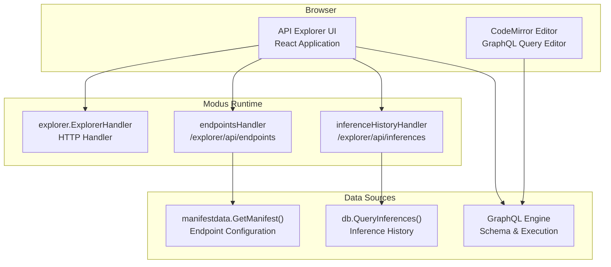
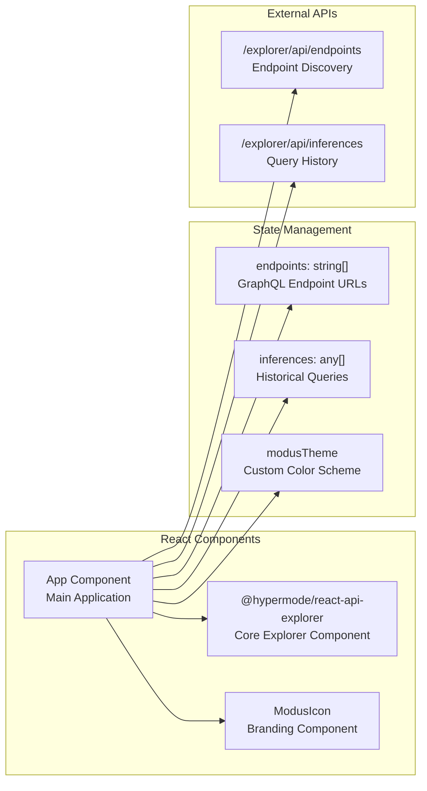
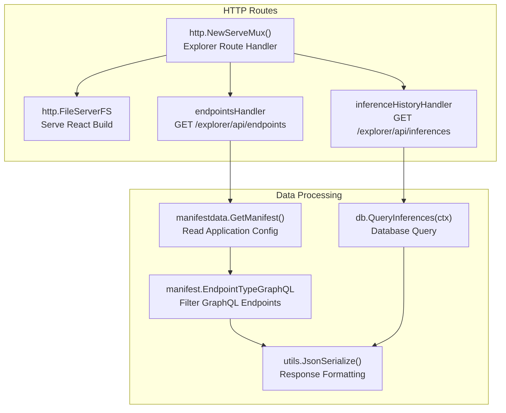
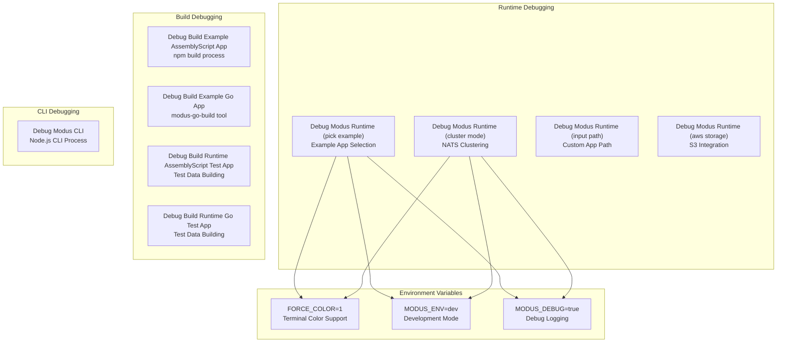
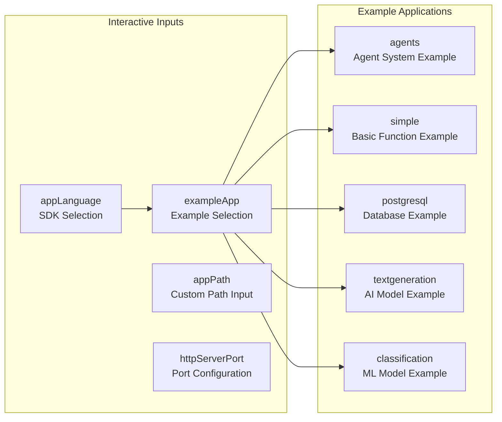
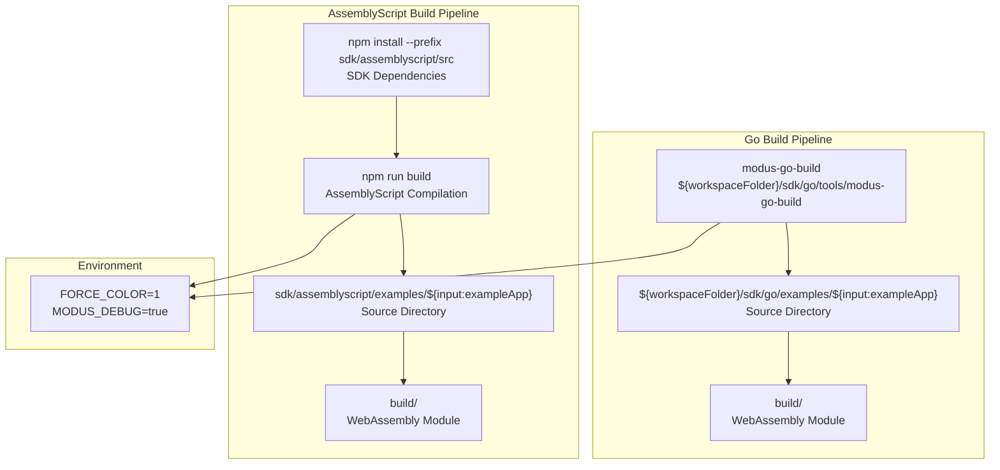
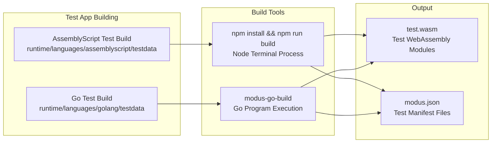

<!-- source: DeepWiki mcp.deepwiki.com · repo hypermodeinc/modus · page 7 Development Tools · fetched 2026-10-27 -->

# Development Tools

Relevant source files

The following files were used as context for generating this wiki page:

- [.trunk/configs/cspell.json](.trunk/configs/cspell.json)
- [.trunk/trunk.yaml](.trunk/trunk.yaml)
- [.vscode/launch.json](.vscode/launch.json)
- [go.work](go.work)
- [runtime/.gitignore](runtime/.gitignore)
- [runtime/db/db.go](runtime/db/db.go)
- [runtime/db/modusdb.go](runtime/db/modusdb.go)
- [runtime/explorer/content/ModusIcon.tsx](runtime/explorer/content/ModusIcon.tsx)
- [runtime/explorer/content/index.css](runtime/explorer/content/index.css)
- [runtime/explorer/content/index.html](runtime/explorer/content/index.html)
- [runtime/explorer/content/main.tsx](runtime/explorer/content/main.tsx)
- [runtime/explorer/content/package-lock.json](runtime/explorer/content/package-lock.json)
- [runtime/explorer/content/package.json](runtime/explorer/content/package.json)
- [runtime/explorer/content/postcss.config.js](runtime/explorer/content/postcss.config.js)
- [runtime/explorer/content/tailwind.config.js](runtime/explorer/content/tailwind.config.js)
- [runtime/explorer/content/vite.config.ts](runtime/explorer/content/vite.config.ts)
- [runtime/explorer/explorer.go](runtime/explorer/explorer.go)
- [runtime/services/services.go](runtime/services/services.go)
- [sdk/assemblyscript/examples/agents/.gitignore](sdk/assemblyscript/examples/agents/.gitignore)
- [sdk/assemblyscript/src/assembly/index.ts](sdk/assemblyscript/src/assembly/index.ts)
- [sdk/go/examples/agents/.gitignore](sdk/go/examples/agents/.gitignore)

This document covers the development tools and interfaces available for building, testing, and debugging Modus applications. It includes the web-based API Explorer, VS Code debugging configurations, and local development server capabilities.

For information about the CLI commands used during development, see [Modus CLI](#3). For details about setting up the development environment and workflows, see [Development Environment](#7.1).

## API Explorer

The API Explorer is a web-based interface that provides GraphQL introspection, query execution, and inference history tracking for Modus applications. It runs embedded within the Modus Runtime and is accessible at `http://localhost:8686/explorer` during local development.

### Architecture

The API Explorer consists of a React frontend that communicates with REST APIs exposed by the runtime to fetch endpoint configurations and inference history.

Sources: [runtime/explorer/explorer.go:1-84](), [runtime/explorer/content/main.tsx:1-113](), [runtime/explorer/content/package.json:1-29]()

### Frontend Implementation

The API Explorer frontend is built using React 19 with TypeScript and uses the `@hypermode/react-api-explorer` component library. The main application component manages endpoint discovery and inference history fetching.

The application automatically discovers available GraphQL endpoints and displays inference history for debugging and testing purposes.

Sources: [runtime/explorer/content/main.tsx:19-112](), [runtime/explorer/content/package.json:11-17]()

### Backend API Handlers

The runtime exposes two REST endpoints to support the API Explorer interface:

| Endpoint | Handler Function | Purpose |
|----------|------------------|---------|
| `/explorer/api/endpoints` | `endpointsHandler` | Returns available GraphQL endpoints from manifest |
| `/explorer/api/inferences` | `inferenceHistoryHandler` | Returns historical AI model inference data |

The endpoints handler filters the application manifest to return only GraphQL endpoints, while the inferences handler queries the database for historical AI model execution data.

Sources: [runtime/explorer/explorer.go:39-83](), [runtime/explorer/explorer.go:23-37]()

## VS Code Integration

Modus provides comprehensive VS Code debugging configurations for runtime debugging, application building, and CLI development. The configurations support multiple development scenarios including cluster mode testing and AWS storage integration.

### Debug Configurations

Each configuration includes specific environment variables and command-line arguments tailored for different debugging scenarios.

Sources: [.vscode/launch.json:1-260]()

### Input Prompts and Selection

The VS Code configuration uses input prompts to provide interactive selection of debugging targets:

| Input ID | Type | Options | Purpose |
|----------|------|---------|---------|
| `appLanguage` | `pickString` | AssemblyScript, Go | Select SDK language |
| `exampleApp` | `pickString` | 16+ example apps | Choose specific example |
| `appPath` | `promptString` | User input | Custom build directory path |
| `httpServerPort` | `promptString` | Default: 8686 | Runtime server port |

The configuration supports debugging over 16 different example applications across multiple categories including database clients, AI models, and agent systems.

Sources: [.vscode/launch.json:136-259]()

### Runtime Debug Modes

The runtime debugging configurations support different operational modes:

```mermaid
graph TD
    subgraph "Standard Development"
        StandardRuntime["program: ${workspaceFolder}/runtime<br/>Direct Runtime Execution"]
        StandardEnv["MODUS_ENV=dev<br/>MODUS_DEBUG=true"]
        StandardArgs["--refresh=1s<br/>--appPath build/"]
    end
    
    subgraph "Cluster Mode"
        ClusterRuntime["program: ${workspaceFolder}/runtime<br/>Runtime with Clustering"]
        ClusterEnv["MODUS_CLUSTER_MODE=NATS<br/>MODUS_CLUSTER_NATS_URL=nats://localhost:4222"]
        ClusterDB["MODUS_USE_MODUSDB=false<br/>PostgreSQL Connection"]
    end
    
    subgraph "AWS Integration"
        AWSRuntime["program: ${workspaceFolder}/runtime<br/>Runtime with S3 Storage"]
        AWSEnv["AWS_REGION, AWS_PROFILE<br/>AWS_SDK_LOAD_CONFIG=true"]
        AWSArgs["--useAwsStorage<br/>--s3bucket, --s3path"]
    end
    
    StandardRuntime --> StandardEnv
    StandardEnv --> StandardArgs
    
    ClusterRuntime --> ClusterEnv
    ClusterEnv --> ClusterDB
    
    AWSRuntime --> AWSEnv
    AWSEnv --> AWSArgs
```

Each mode configures the runtime for specific testing scenarios, from basic local development to distributed cluster operations.

Sources: [.vscode/launch.json:4-78]()

## Build Tool Integration

The debugging configurations integrate with the SDK build tools to provide seamless development workflows for both Go and AssemblyScript applications.

### SDK Build Tools

The build configurations support both SDK compilation pipelines and can build test applications for runtime validation.

Sources: [.vscode/launch.json:90-124]()

### Test Data Building

Special configurations exist for building test applications used by the runtime's internal testing:

| Configuration | Tool | Target Directory | Purpose |
|---------------|------|------------------|---------|
| Debug Build Runtime AssemblyScript Test App | npm build | `runtime/languages/assemblyscript/testdata` | Runtime test validation |
| Debug Build Runtime Go Test App | modus-go-build | `runtime/languages/golang/testdata` | Runtime test validation |

These configurations enable debugging of the runtime's language support by building test applications with known behavior.

Sources: [.vscode/launch.json:103-124]()

---

