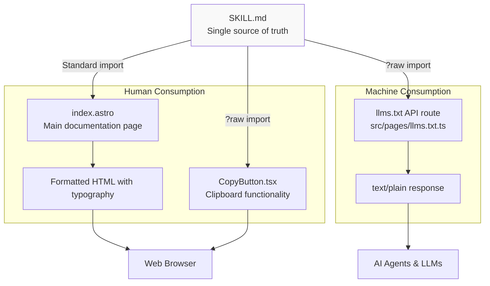
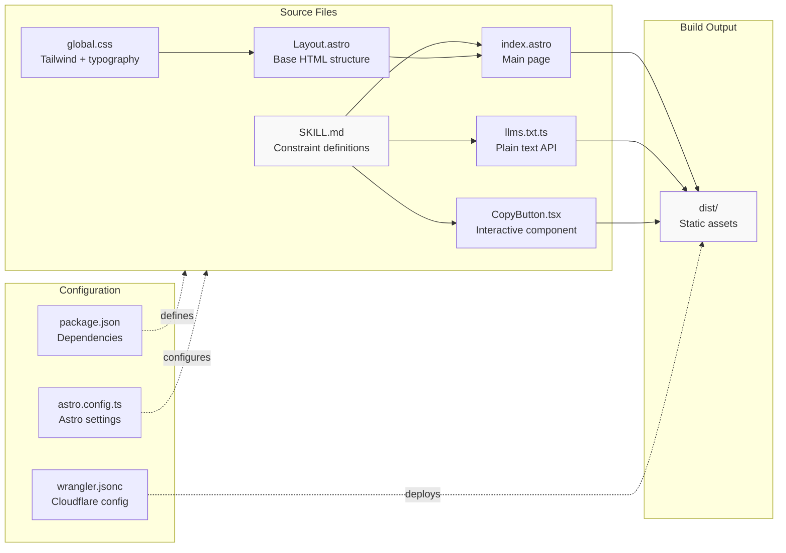
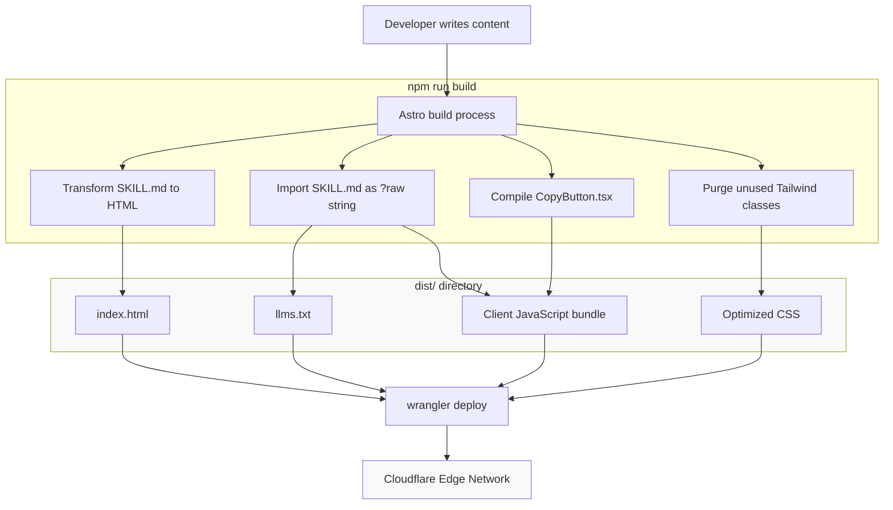

<!-- source: DeepWiki mcp.deepwiki.com · repo ibelick/ui-skills · page 1 Overview · fetched 2026-10-27 -->

# Overview

Relevant source files

The following files were used as context for generating this wiki page:

- [README.md](README.md)
- [package.json](package.json)
- [src/SKILL.md](src/SKILL.md)

## Purpose and Scope

This document provides an overview of the **ui-skills** repository, a documentation website that publishes opinionated constraints for guiding AI agents in building user interfaces. The repository serves as both a human-readable website and a machine-consumable API endpoint.

For detailed information about specific subsystems:
- Architecture and technology choices: see [Architecture](#2)
- UI Skills constraint content: see [UI Skills Documentation](#3)
- Page rendering and components: see [Page Structure and Rendering](#4)
- Interactive features: see [Interactive Components](#5)
- Setup and configuration: see [Configuration and Setup](#6)

**Sources:** [README.md:1-14](), [src/SKILL.md:1-75]()

## What UI Skills Is

UI Skills is a curated set of **opinionated, evolving constraints** designed to guide AI agents when building user interfaces. As stated in the README, "Every rule comes from things that bored me when using agents to build UI" [README.md:7]().

The constraint system is organized into eight categories:

| Category | Focus | Examples |
|----------|-------|----------|
| **Stack** | Technology choices | Tailwind CSS defaults, `motion/react` for animation, `cn` utility |
| **Components** | Accessible primitives | Base UI, React Aria, Radix; never rebuild keyboard behavior |
| **Interaction** | User experience patterns | AlertDialog for destructive actions, structural skeletons, `h-dvh` not `h-screen` |
| **Animation** | Performance-aware motion | Compositor props only, `ease-out` on entrance, respect `prefers-reduced-motion` |
| **Typography** | Text rendering | `text-balance` for headings, `tabular-nums` for data |
| **Layout** | Spatial organization | Fixed `z-index` scale, `size-x` for square elements |
| **Performance** | Optimization rules | No large `blur()` animations, no `useEffect` for render logic |
| **Design** | Visual constraints | No gradients unless requested, limit accent colors |

Each constraint is written with a severity level: `MUST` (mandatory), `SHOULD` (recommended), or `NEVER` (prohibited).

**Sources:** [src/SKILL.md:1-75](), [README.md:5-7]()

## Dual-Audience Architecture

The repository serves two distinct audiences from a single source of truth (`SKILL.md`):

**Diagram: Dual-Path Content Distribution from SKILL.md**

The system implements three distinct consumption paths:

1. **Formatted HTML Rendering**: `index.astro` imports and renders `SKILL.md` as styled HTML with Tailwind CSS typography classes [src/pages/index.astro]()
2. **Plain Text API**: `src/pages/llms.txt.ts` serves the raw markdown content at the `/llms.txt` endpoint using Vite's `?raw` import modifier
3. **Clipboard Copy**: `CopyButton.tsx` embeds the raw markdown string for one-click copying [src/components/CopyButton.tsx]()

**Sources:** [src/pages/index.astro](), [src/pages/llms.txt.ts](), [src/components/CopyButton.tsx]()

## Repository Structure

**Diagram: Repository File Organization**

**Sources:** [package.json:1-32](), [src/SKILL.md:1-4]()

## Technology Stack Summary

The repository uses a modern static site generation approach:

| Layer | Technology | Version | Purpose |
|-------|-----------|---------|---------|
| **Framework** | Astro | 5.16.7 | Static site generation with island architecture |
| **UI Library** | React | 19.2.3 | Interactive components (selective hydration) |
| **Styling** | Tailwind CSS | 4.1.18 | Utility-first CSS framework |
| **Typography** | @tailwindcss/typography | 0.5.19 | Prose styling for markdown content |
| **Animation** | motion/react | 12.24.12 | Declarative animations (formerly framer-motion) |
| **Deployment** | Cloudflare Workers | - | Edge computing platform |
| **Build Tool** | Vite | (via Astro) | Module bundling and dev server |

**Sources:** [package.json:14-31]()

## Key Features

### 1. Static Site with Selective Hydration

Astro's island architecture allows the site to be primarily static HTML with JavaScript only where needed. The `CopyButton` component uses `client:load` directive for interactivity while the rest remains static [src/pages/index.astro]().

### 2. LLMs.txt Standard Implementation

The repository implements the [llms.txt standard](https://github.com/llms-txt/llms-txt), providing a dedicated endpoint for machine-readable documentation at `/llms.txt` [src/pages/llms.txt.ts]().

### 3. Edge Deployment

Built assets deploy to Cloudflare Workers via Wrangler CLI, distributing content globally across Cloudflare's edge network for minimal latency [wrangler.jsonc]().

### 4. Performance-First Design

- No client-side JavaScript for content rendering
- Minimal CSS (Tailwind purges unused styles)
- Static HTML generation at build time
- CDN edge distribution

**Sources:** [package.json:1-32](), [README.md:1-14]()

## Build and Deployment Flow

**Diagram: Build and Deployment Pipeline from Source to Edge**

The build process:
1. `npm run build` triggers Astro's build system [package.json:8]()
2. Astro processes `.astro` files, transforming markdown to HTML
3. Vite bundles React components and applies Tailwind CSS
4. Output goes to `dist/` directory
5. `wrangler deploy` publishes to Cloudflare Workers [wrangler.jsonc]()

**Sources:** [package.json:6-12](), [wrangler.jsonc]()

## Project Metadata

- **Name**: ui-skills
- **Version**: 0.0.1
- **License**: MIT [README.md:13]()
- **Type**: module (ESM)
- **Repository**: https://github.com/ibelick/ui-skills

**Sources:** [package.json:1-5](), [README.md:11-13]()

---

