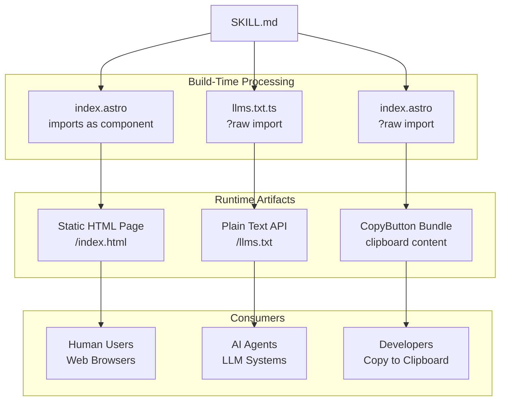
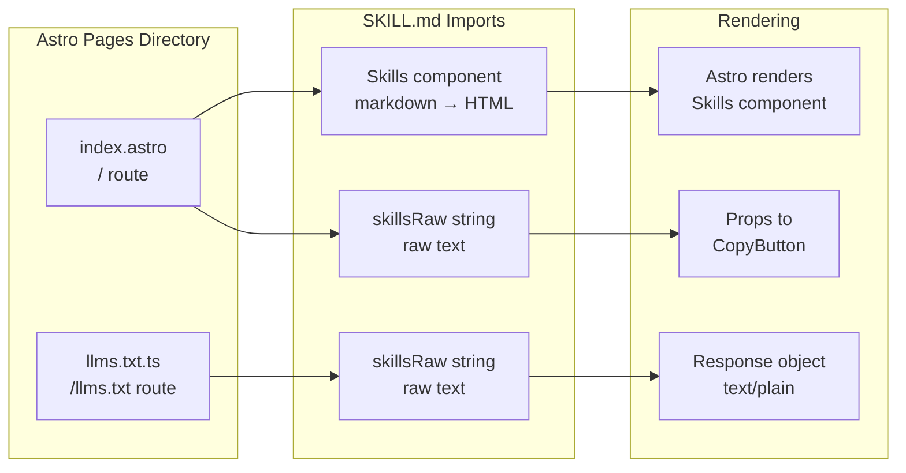
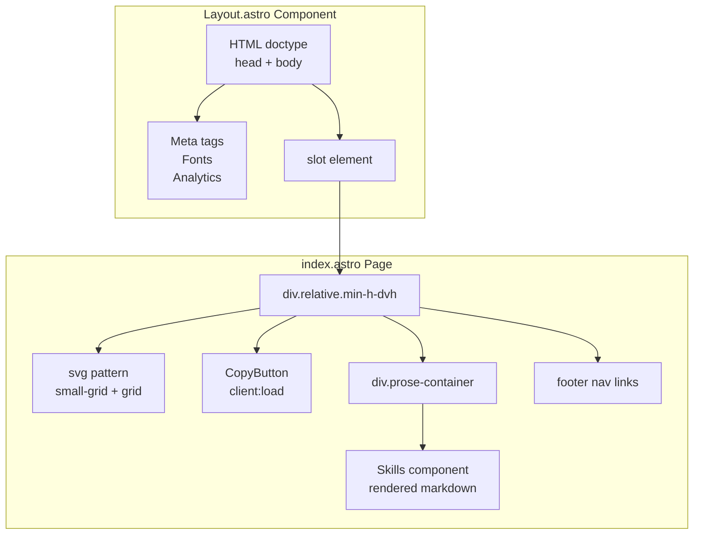
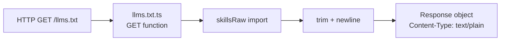
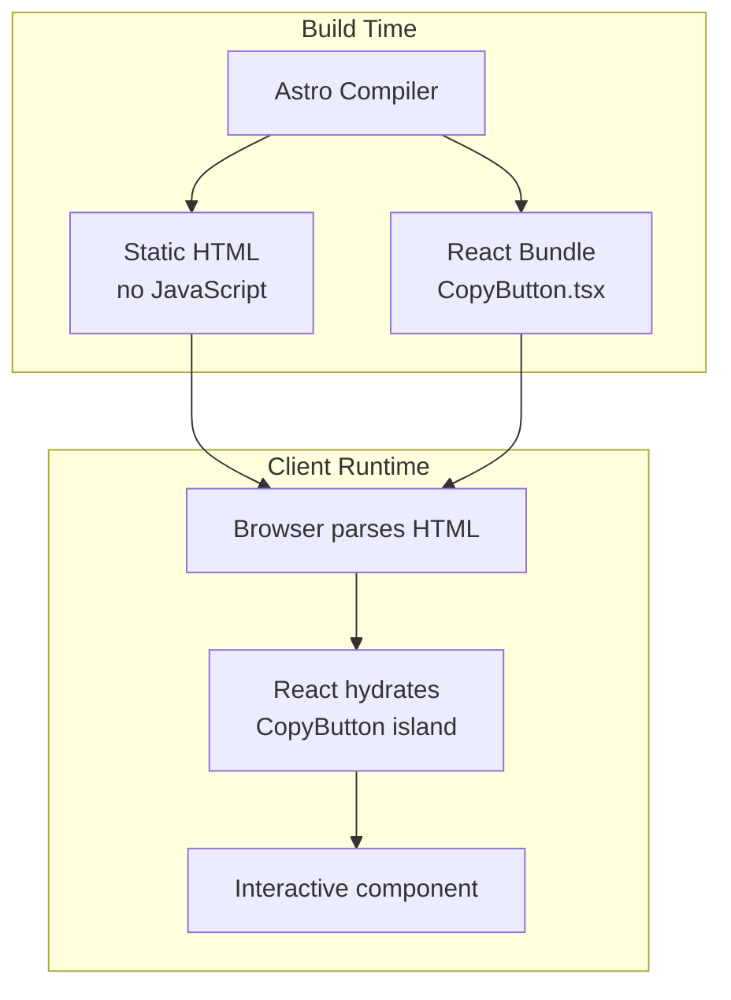
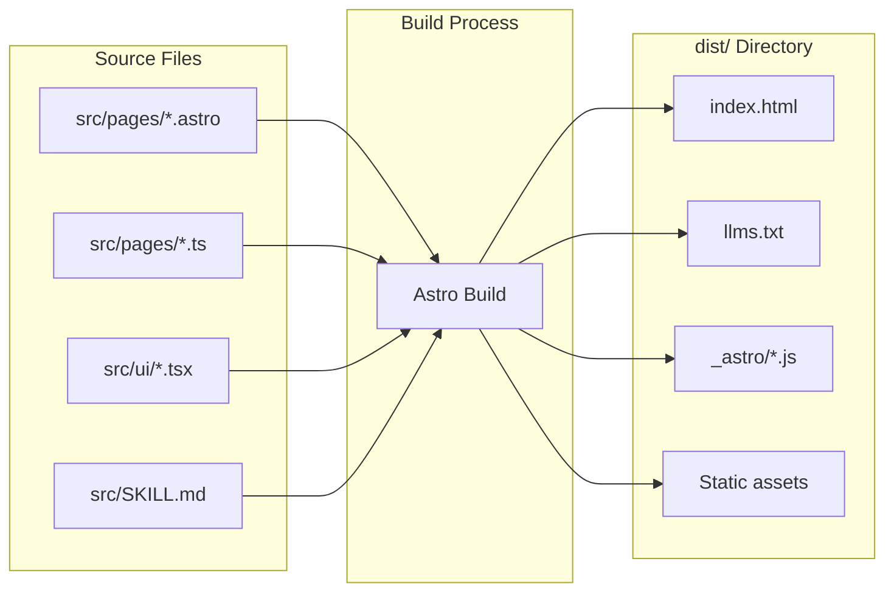

<!-- source: DeepWiki mcp.deepwiki.com · repo ibelick/ui-skills · page 2 Architecture · fetched 2026-10-27 -->

# Architecture

Relevant source files

The following files were used as context for generating this wiki page:

- [README.md](README.md)
- [src/layouts/Layout.astro](src/layouts/Layout.astro)
- [src/pages/index.astro](src/pages/index.astro)
- [src/pages/llms.txt.ts](src/pages/llms.txt.ts)

## Purpose and Scope

This document describes the high-level architecture of the ui-skills repository, focusing on the system's structural design, component relationships, and content distribution strategy. It covers how the system serves dual audiences (humans and LLMs) from a single source of truth, the integration between Astro's static site generation and React's interactive components, and the overall data flow from content creation to consumption.

For detailed information about individual technologies and their integration, see [Technology Stack](#2.1). For specifics about content rendering paths, see [Content Dual-Path Architecture](#2.2). For deployment mechanics, see [Build and Deployment Pipeline](#2.3).

## System Overview

The ui-skills repository implements a documentation website with a single-source-of-truth architecture. The `SKILL.md` file contains all UI constraint documentation, which is consumed through three distinct paths:

**Diagram: Single Source of Truth Distribution**

The architecture follows a static site generation pattern with selective hydration. Astro processes `.astro` files at build time, generating optimized HTML. React components marked with `client:load` directives are hydrated on the client for interactivity.

**Sources:** [src/pages/index.astro:1-89](), [src/pages/llms.txt.ts:1-12](), [src/layouts/Layout.astro:1-52]()

## Core Architectural Components

### Entry Points and Routing

The system defines two primary routes:

| Route | File | Purpose | Content-Type |
|-------|------|---------|--------------|
| `/` | `src/pages/index.astro` | Human-readable documentation | `text/html` |
| `/llms.txt` | `src/pages/llms.txt.ts` | Machine-readable API | `text/plain` |

The `index.astro` page imports SKILL.md in two ways:
- As a component: `import Skills from "../SKILL.md"` [src/pages/index.astro:3]()
- As raw text: `import skillsRaw from "../SKILL.md?raw"` [src/pages/index.astro:4]()

The `llms.txt.ts` route exports a `GET` function that returns raw SKILL.md content [src/pages/llms.txt.ts:4-12]().

**Diagram: Route Processing and Import Strategies**

**Sources:** [src/pages/index.astro:3-4](), [src/pages/llms.txt.ts:1-12]()

### Layout Layer

The `Layout.astro` component [src/layouts/Layout.astro:1-52]() provides the base HTML structure for all pages. Key responsibilities:

- **Document Head Configuration**: SEO meta tags, Open Graph metadata, Twitter cards [src/layouts/Layout.astro:7-33]()
- **External Resources**: Google Fonts (`JetBrains Mono`), analytics script (`stonks.js`) [src/layouts/Layout.astro:11-34]()
- **Base Styling**: Global CSS import, inline styles for html/body reset [src/layouts/Layout.astro:2,41-51]()
- **Slot Pattern**: Uses Astro's `<slot />` for content injection [src/layouts/Layout.astro:37]()

The layout defines the page title as "UI Skills - Opinionated UI constraints for agents" [src/layouts/Layout.astro:16]() and includes a favicon reference [src/layouts/Layout.astro:10]().

**Sources:** [src/layouts/Layout.astro:1-52]()

### Content Rendering Layer

The `index.astro` page [src/pages/index.astro:1-89]() assembles the visual presentation:

1. **Layout Wrapper**: Wraps content in `<Layout>` [src/pages/index.astro:8]()
2. **Background SVG**: Nested grid pattern using inline SVG with `#small-grid` and `#grid` pattern definitions [src/pages/index.astro:16-47]()
3. **CopyButton Component**: React component with `client:load` directive, receives `skillsRaw` as content prop [src/pages/index.astro:50]()
4. **Content Container**: Styled div with responsive borders, shadows, and prose classes [src/pages/index.astro:52-62]()
5. **Skills Component**: Renders SKILL.md as HTML within prose styling [src/pages/index.astro:59]()
6. **Footer Navigation**: Links to GitHub, Claude Skills docs, and `/llms.txt` endpoint [src/pages/index.astro:64-86]()

**Diagram: Page Assembly Hierarchy**

**Sources:** [src/pages/index.astro:1-89](), [src/layouts/Layout.astro:1-52]()

## Content Distribution Architecture

### Import Strategy

Astro's import system enables multiple consumption patterns from a single source file:

| Import Type | Syntax | Result | Use Case |
|-------------|--------|--------|----------|
| Component | `import Skills from "../SKILL.md"` | Astro component | Rendered HTML output |
| Raw String | `import skillsRaw from "../SKILL.md?raw"` | String content | API responses, clipboard |

The `?raw` suffix is a Vite import feature that bypasses transformation, returning file contents as a string [src/pages/index.astro:4](), [src/pages/llms.txt.ts:2]().

### API Endpoint Implementation

The `/llms.txt` endpoint implements the llms.txt standard for machine-readable documentation:

**Diagram: API Endpoint Data Flow**

The `GET` function [src/pages/llms.txt.ts:4-12]() performs minimal processing:
- Trims whitespace from raw content [src/pages/llms.txt.ts:5]()
- Adds trailing newline for POSIX compliance [src/pages/llms.txt.ts:5]()
- Returns with `text/plain; charset=utf-8` Content-Type header [src/pages/llms.txt.ts:9]()

**Sources:** [src/pages/llms.txt.ts:1-12]()

## Component Hydration Strategy

The architecture uses Astro's island architecture with selective hydration. By default, all components render as static HTML. The `client:load` directive enables client-side JavaScript:

**Diagram: Island Hydration Pattern**

In the codebase, only `CopyButton` uses hydration [src/pages/index.astro:50](). The directive `client:load` instructs Astro to:
1. Generate static HTML placeholder during build
2. Bundle React component and dependencies
3. Load bundle on page load
4. Hydrate component with props (`content={skillsRaw}`)

All other content (layout, markdown rendering, SVG background, footer) remains static HTML without JavaScript overhead.

**Sources:** [src/pages/index.astro:50]()

## Styling Architecture

Styling follows a utility-first approach with Tailwind CSS:

- **Global Styles**: Imported in Layout [src/layouts/Layout.astro:2]()
- **Typography Plugin**: Prose classes for markdown styling [src/pages/index.astro:57-58]()
- **Responsive Design**: Breakpoint-aware classes (`sm:`, mobile-first) [src/pages/index.astro:10,53]()
- **Background Color**: `#fafaf5` defined in both inline styles and utility classes [src/layouts/Layout.astro:47](), [src/pages/index.astro:10]()

Prose configuration [src/pages/index.astro:57-58]() customizes typography:
- Base size: `prose-sm`
- Color: `prose-neutral`
- Heading styles: `prose-headings:text-balance`, `prose-headings:font-medium`, `prose-headings:text-[15px]`
- Paragraph styles: `prose-p:text-[15px]`, `prose-p:text-neutral-500`
- List styles: `prose-li:text-[15px]`, `prose-li:marker:text-neutral-300`

**Sources:** [src/pages/index.astro:57-58](), [src/layouts/Layout.astro:2,41-51]()

## Build Output Structure

The build process generates a static site structure:

**Diagram: Build Output Generation**

The Astro build system:
- Compiles `.astro` files to HTML
- Bundles React components marked with client directives
- Executes TypeScript API routes to generate text responses
- Optimizes and fingerprints assets

**Sources:** Referenced in context from high-level diagrams

## Summary

The architecture achieves simplicity through strategic design choices:

| Design Choice | Implementation | Benefit |
|---------------|----------------|---------|
| Single source of truth | SKILL.md | Consistent content across all interfaces |
| Dual import strategy | Component + `?raw` imports | Multiple consumption patterns from one file |
| Selective hydration | `client:load` on CopyButton only | Minimal JavaScript, fast page loads |
| Static generation | Astro build process | No server-side rendering overhead |
| Plain text API | llms.txt endpoint | Machine-readable documentation standard |

This architecture enables the system to serve both human developers and AI agents efficiently from a single codebase while maintaining performance and simplicity.

**Sources:** [src/pages/index.astro:1-89](), [src/pages/llms.txt.ts:1-12](), [src/layouts/Layout.astro:1-52]()

---

