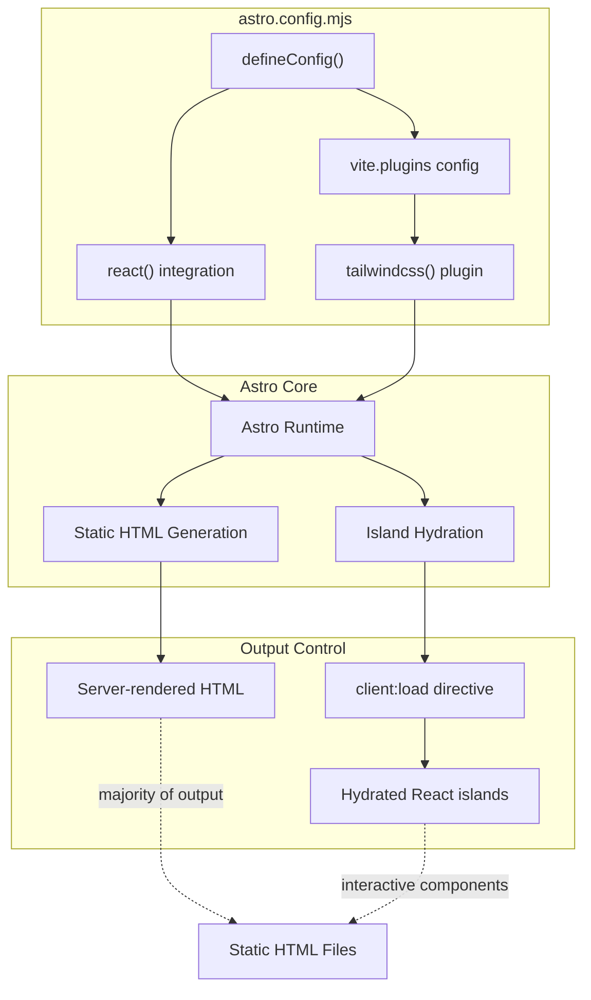
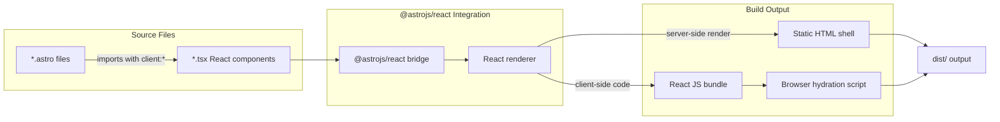
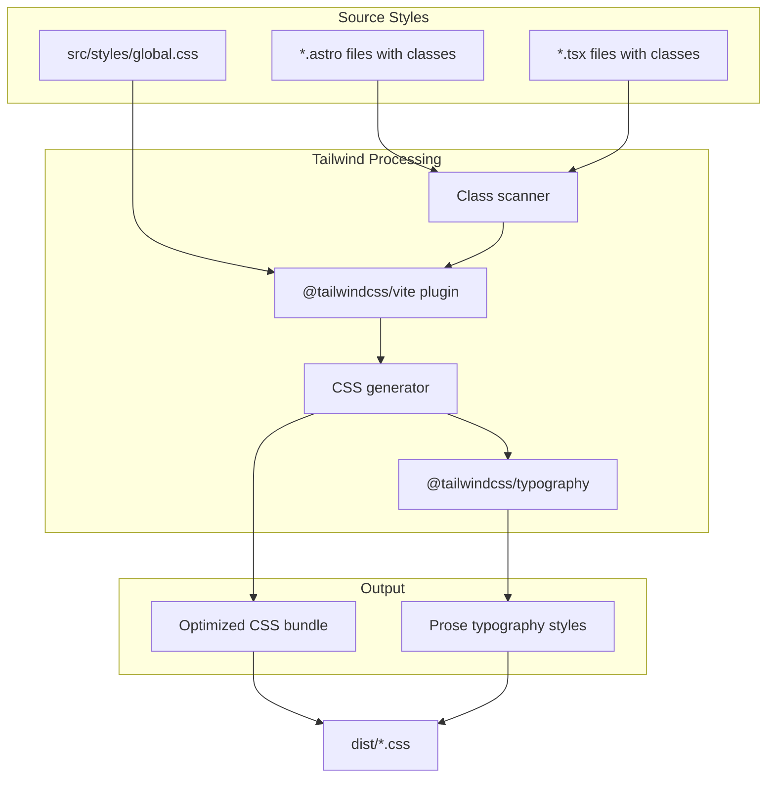
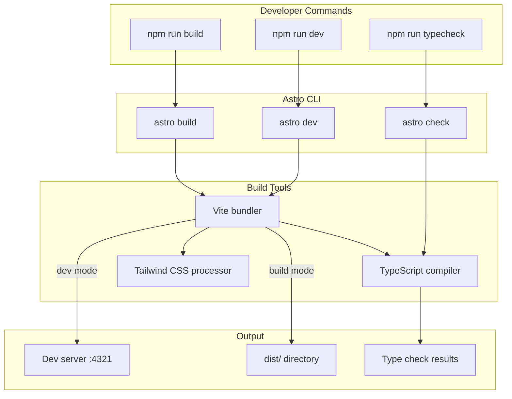

<!-- source: DeepWiki mcp.deepwiki.com · repo ibelick/ui-skills · page 2.1 Technology Stack · fetched 2026-10-27 -->

# Technology Stack

Relevant source files

The following files were used as context for generating this wiki page:

- [astro.config.mjs](astro.config.mjs)
- [package.json](package.json)
- [tsconfig.json](tsconfig.json)

## Purpose and Scope

This document details the technology choices and dependencies used in the ui-skills project, explaining how each technology integrates to create the static documentation website. This covers the framework layer, UI libraries, styling system, animation tools, and build tooling. For information about deployment configuration and Cloudflare Workers setup, see [Deployment Configuration](#6.2). For the build process workflow, see [Build and Deployment Pipeline](#2.3).

## Core Dependencies Overview

The ui-skills project uses a modern web technology stack optimized for static site generation with selective client-side interactivity. All dependencies are defined in [package.json:1-32]().

| Category | Technology | Version | Purpose |
|----------|-----------|---------|---------|
| Framework | Astro | 5.16.7 | Static site generator with island architecture |
| UI Library | React | 19.2.3 | Interactive component rendering |
| Integration | @astrojs/react | 4.4.2 | Bridges Astro and React |
| Styling | Tailwind CSS | 4.1.18 | Utility-first CSS framework |
| Styling Plugin | @tailwindcss/vite | 4.1.18 | Vite integration for Tailwind |
| Typography | @tailwindcss/typography | 0.5.19 | Prose styling for markdown content |
| Animation | motion | 12.24.12 | Declarative animation library |
| Build Tool | Vite | (via Astro) | Fast build tool and dev server |
| Type System | TypeScript | 5.6.3 | Static type checking |
| Code Formatting | Prettier | 3.3.3 | Code style enforcement |

**Sources:** [package.json:14-31]()

## Framework Layer: Astro

### Astro Static Site Generator

Astro 5.16.7 serves as the primary framework, orchestrating the entire build process. Astro's "island architecture" enables selective hydration where only interactive components (React) are sent to the client as JavaScript, while everything else renders as static HTML.

**Diagram: Astro Integration Architecture**

**Sources:** [astro.config.mjs:1-11](), [package.json:19]()

### Configuration

The Astro configuration file [astro.config.mjs:1-11]() specifies two key integrations:

1. **React Integration** [astro.config.mjs:7]() - Enables React component usage within Astro pages via `@astrojs/react`
2. **Vite Plugins** [astro.config.mjs:8-10]() - Configures Tailwind CSS processing through `@tailwindcss/vite`

**Sources:** [astro.config.mjs:1-11]()

## UI Library: React Integration

### React 19 with Astro

React 19.2.3 [package.json:21]() provides interactive component capabilities. The integration uses `@astrojs/react` 4.4.2 [package.json:15]() to bridge the two frameworks, allowing React components to be imported into `.astro` files.

**Diagram: React Component Hydration Flow**

**Sources:** [package.json:15](), [package.json:21-22](), [astro.config.mjs:7]()

### TypeScript Configuration for React

The TypeScript configuration [tsconfig.json:1-14]() is specifically set up for React JSX support:

- **JSX Mode:** `"react-jsx"` [tsconfig.json:11]() enables the modern JSX transform
- **JSX Import Source:** `"react"` [tsconfig.json:12]() specifies React as the JSX runtime
- **Base Config:** Extends `"astro/tsconfigs/strict"` [tsconfig.json:2]() for Astro-specific type definitions

**Sources:** [tsconfig.json:10-13]()

## Styling System: Tailwind CSS

### Tailwind CSS 4 Integration

Tailwind CSS 4.1.18 [package.json:23]() provides utility-first styling. The integration uses `@tailwindcss/vite` 4.1.18 [package.json:16]() as a Vite plugin, configured in [astro.config.mjs:9]().

**Diagram: Tailwind CSS Processing Pipeline**

**Sources:** [package.json:16](), [package.json:23](), [astro.config.mjs:8-10]()

### Typography Plugin

The `@tailwindcss/typography` plugin 0.5.19 [package.json:26]() provides beautiful default styling for markdown-rendered prose content. This is applied to the rendered SKILL.md content using the `prose` class utilities. See [Styling System](#4.3) for more details on usage.

**Sources:** [package.json:26]()

## Animation Library: Motion

The `motion` package 12.24.12 [package.json:20]() (formerly Framer Motion) provides declarative animation capabilities for React components. This library enables the text morphing animations in interactive components. See [TextMorph Component](#5.2) for implementation details.

**Sources:** [package.json:20]()

## Build Tooling

### Vite Build System

Vite is integrated into Astro as its underlying build tool and development server. The Vite configuration is specified within [astro.config.mjs:8-10](), where plugins like `@tailwindcss/vite` are registered.

**Diagram: Build Tool Chain**

**Sources:** [package.json:6-12](), [astro.config.mjs:8-10]()

### TypeScript

TypeScript 5.6.3 [package.json:30]() provides static type checking. The configuration extends Astro's strict TypeScript preset and includes React type definitions [package.json:17-18]().

**Key TypeScript Settings:**

- **Config Base:** Extends `astro/tsconfigs/strict` for strict type checking [tsconfig.json:2]()
- **Include Paths:** Type definitions and all source files [tsconfig.json:3-5]()
- **Exclude Paths:** Build output directory [tsconfig.json:7-9]()
- **React Support:** Configured for React JSX [tsconfig.json:10-13]()

**Sources:** [tsconfig.json:1-14](), [package.json:30]()

## Development Tools

### Prettier Code Formatting

Prettier 3.3.3 [package.json:27]() enforces consistent code style across the project. The setup includes two Prettier plugins:

- **prettier-plugin-astro** 0.14.1 [package.json:28]() - Formats `.astro` files
- **prettier-plugin-tailwindcss** 0.6.8 [package.json:29]() - Sorts Tailwind CSS classes

The `npm run format` command [package.json:11]() runs Prettier across all files using the configuration from `.prettierrc.json`.

**Sources:** [package.json:11](), [package.json:27-29]()

## Technology Integration Summary

**Diagram: Complete Stack Integration**

```mermaid
graph TB
    subgraph "package.json Dependencies"
        Astro["astro@5.16.7"]
        React["react@19.2.3"]
        ReactDOM["react-dom@19.2.3"]
        AstroReact["@astrojs/react@4.4.2"]
        Tailwind["tailwindcss@4.1.18"]
        TailwindVite["@tailwindcss/vite@4.1.18"]
        TailwindTypography["@tailwindcss/typography@0.5.19"]
        Motion["motion@12.24.12"]
        TypeScript["typescript@5.6.3"]
        ReactTypes["@types/react@19.2.7"]
        ReactDOMTypes["@types/react-dom@19.2.3"]
    end
    
    subgraph "astro.config.mjs"
        ConfigFile["defineConfig()"]
        IntegrationsArray["integrations: [react()]"]
        VitePlugins["vite.plugins: [tailwindcss()]"]
    end
    
    subgraph "tsconfig.json"
        TSConfig["TypeScript Config"]
        JSXSettings["jsx: react-jsx"]
    end
    
    subgraph "Runtime Capabilities"
        StaticSiteGen["Static HTML generation"]
        SelectiveHydration["Selective React hydration"]
        UtilityCSS["Utility-first styling"]
        ProseFormatting["Prose typography"]
        Animations["Declarative animations"]
        TypeSafety["Static type checking"]
    end
    
    Astro --> ConfigFile
    AstroReact --> IntegrationsArray
    TailwindVite --> VitePlugins
    
    ConfigFile --> IntegrationsArray
    ConfigFile --> VitePlugins
    
    React --> AstroReact
    ReactDOM --> AstroReact
    ReactTypes --> TypeScript
    ReactDOMTypes --> TypeScript
    
    TypeScript --> TSConfig
    TSConfig --> JSXSettings
    
    Astro --> StaticSiteGen
    AstroReact --> SelectiveHydration
    Tailwind --> UtilityCSS
    TailwindTypography --> ProseFormatting
    Motion --> Animations
    TypeScript --> TypeSafety
    
    StaticSiteGen --> Output["Production Build"]
    SelectiveHydration --> Output
    UtilityCSS --> Output
    ProseFormatting --> Output
```

**Sources:** [package.json:14-31](), [astro.config.mjs:1-11](), [tsconfig.json:1-14]()

The technology stack is designed for optimal performance through static generation (Astro), selective interactivity (React islands), efficient styling (Tailwind CSS), and developer experience (TypeScript, Prettier). All technologies integrate through standard npm package management and configuration files, creating a cohesive build system that outputs optimized static assets for edge deployment.

---

