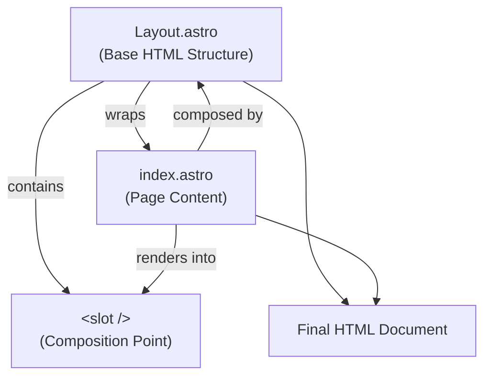
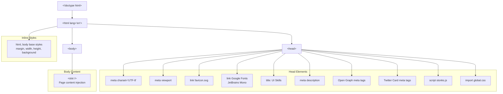
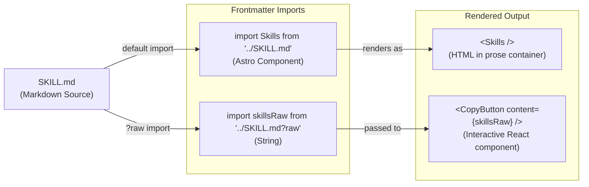
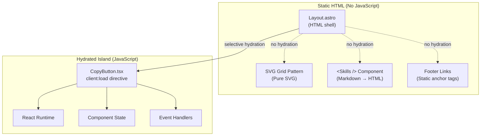
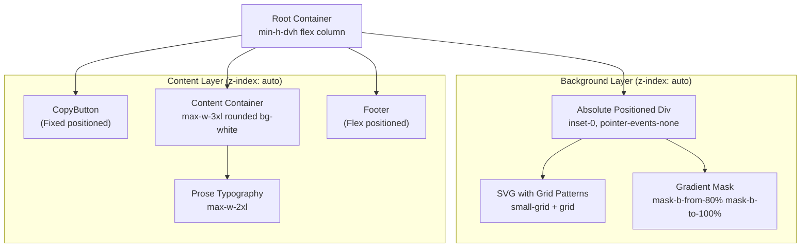

<!-- source: DeepWiki mcp.deepwiki.com · repo ibelick/ui-skills · page 4 Page Structure and Rendering · fetched 2026-10-27 -->

# Page Structure and Rendering

<details>
<summary>Relevant source files</summary>

The following files were used as context for generating this wiki page:

- [src/layouts/Layout.astro](src/layouts/Layout.astro)
- [src/pages/index.astro](src/pages/index.astro)

</details>


## Purpose and Scope

This document explains how pages are structured and rendered in the ui-skills application, covering the base HTML structure, content composition, and Astro's island architecture for selective hydration. For details on the Layout component itself, see [Layout Component](#4.1). For the main index page implementation, see [Main Index Page](#4.2). For styling specifics, see [Styling System](#4.3).

## Page Composition Architecture

The application uses a two-layer composition pattern where `Layout.astro` provides the foundational HTML structure and `index.astro` builds the page-specific content on top of it. This separation enables consistent document structure across pages while allowing flexible content implementations.

**Diagram: Page Composition Flow**



Sources: [src/layouts/Layout.astro:1-52](), [src/pages/index.astro:1-89]()

The composition mechanism works as follows:

| Component | Role | Key Elements |
|-----------|------|--------------|
| `Layout.astro` | Base HTML shell | `<head>` metadata, fonts, analytics, base styles |
| `<slot />` | Composition point | Receives content from child pages |
| `index.astro` | Page content | Background, content container, Skills rendering, CopyButton |

The index page declares its layout dependency at [src/pages/index.astro:2]() with `import Layout from "../layouts/Layout.astro"` and wraps its entire output with the `<Layout>` component at [src/pages/index.astro:8]().

Sources: [src/layouts/Layout.astro:37](), [src/pages/index.astro:8]()

## HTML Document Structure

The `Layout.astro` component generates a complete HTML5 document with all necessary metadata, external resources, and base styling. The structure follows standard HTML conventions with enhanced SEO and social sharing capabilities.

**Diagram: Layout.astro Document Structure**



Sources: [src/layouts/Layout.astro:5-52]()

### Head Configuration

The `<head>` section at [src/layouts/Layout.astro:7-35]() includes:

- **Character encoding**: UTF-8 at line 8
- **Viewport**: Responsive viewport configuration at line 9
- **Favicon**: SVG icon at [src/layouts/Layout.astro:10]()
- **External fonts**: JetBrains Mono from Google Fonts at [src/layouts/Layout.astro:11-14]()
- **Page title**: "UI Skills - Opinionated UI constraints for agents" at line 16
- **Meta description**: SEO description at [src/layouts/Layout.astro:17-20]()
- **Open Graph tags**: Social sharing metadata at [src/layouts/Layout.astro:21-26]()
- **Twitter Card tags**: Twitter-specific metadata at [src/layouts/Layout.astro:27-33]()
- **Analytics**: External analytics script at line 34

The global CSS is imported at [src/layouts/Layout.astro:2]() via Astro's frontmatter, making Tailwind and custom styles available throughout the application.

Sources: [src/layouts/Layout.astro:7-35]()

### Body and Base Styles

The `<body>` element at [src/layouts/Layout.astro:36-38]() contains only the `<slot />` element, which serves as the injection point for page-specific content. Inline base styles are defined at [src/layouts/Layout.astro:41-51]() to establish document-wide defaults:

```
html, body {
  margin: 0;
  width: 100%;
  height: 100%;
  background-color: #fafaf5;
  -webkit-font-smoothing: antialiased;
  -moz-osx-font-smoothing: grayscale;
}
```

The background color `#fafaf5` (warm off-white) is set at the document level, with font smoothing enabled for improved text rendering on both WebKit and Gecko engines.

Sources: [src/layouts/Layout.astro:36-51]()

## Content Rendering Pipeline

The main index page orchestrates multiple rendering paths to transform the `SKILL.md` markdown content into HTML while also providing raw text for the copy functionality. This demonstrates Astro's flexible import system.

**Diagram: Content Import and Rendering Flow**



Sources: [src/pages/index.astro:3-5](), [src/pages/index.astro:50](), [src/pages/index.astro:59]()

### Import Mechanisms

The frontmatter at [src/pages/index.astro:1-6]() demonstrates two import patterns:

1. **Default import** at line 3: `import Skills from "../SKILL.md"` transforms the markdown into an Astro component that can be rendered directly as JSX
2. **Raw import** at line 4: `import skillsRaw from "../SKILL.md?raw"` imports the file contents as a plain string without any transformation

### Markdown-to-HTML Transformation

The `Skills` component is rendered at [src/pages/index.astro:59]() within a styled prose container. The transformation occurs at build time, converting markdown syntax into semantic HTML elements. The rendered output is wrapped in a `<div>` with extensive Tailwind typography classes at [src/pages/index.astro:56-58]() that control the visual presentation of headings, paragraphs, lists, and other markdown elements.

Sources: [src/pages/index.astro:3-4](), [src/pages/index.astro:56-60]()

## Astro Island Architecture

The application uses Astro's island architecture to achieve optimal performance by rendering most content as static HTML while selectively hydrating only interactive components. This approach minimizes JavaScript bundle size and improves initial page load.

**Diagram: Static vs Hydrated Components**



Sources: [src/pages/index.astro:8-88]()

### Static Components

The following components are rendered as pure HTML with no client-side JavaScript:

- **SVG grid background** at [src/pages/index.astro:12-48](): Pure SVG pattern definitions and rendering
- **Skills content** at [src/pages/index.astro:52-62](): Transformed markdown rendered as static HTML
- **Footer links** at [src/pages/index.astro:64-87](): Static anchor tags with hover styles

These components exist only as HTML in the final output, requiring zero JavaScript for functionality.

Sources: [src/pages/index.astro:12-87]()

### Hydrated Island: CopyButton

The `CopyButton` component is the only interactive element requiring JavaScript. It uses the `client:load` directive at [src/pages/index.astro:50]():

```astro
<CopyButton content={skillsRaw} client:load />
```

The `client:load` directive instructs Astro to:
1. Include the React runtime and component JavaScript in the final bundle
2. Hydrate the component immediately on page load
3. Enable full client-side interactivity including state management and event handling

This selective hydration means the React library and component code are only loaded for this single button, while the rest of the page remains static HTML. The button receives the raw markdown content via the `content` prop, which is the string imported at [src/pages/index.astro:4]().

Sources: [src/pages/index.astro:4](), [src/pages/index.astro:50]()

### Hydration Strategy Comparison

| Directive | Timing | Use Case | Applied To |
|-----------|--------|----------|------------|
| `client:load` | Page load | Immediately visible interactive components | CopyButton |
| `client:idle` | Browser idle | Deferred non-critical components | (Not used) |
| `client:visible` | Enters viewport | Below-the-fold components | (Not used) |
| (No directive) | Never | Static content | Everything else |

The application uses only `client:load` because the CopyButton is visible above the fold and provides critical functionality.

Sources: [src/pages/index.astro:50]()

## Visual Layer

The index page implements a layered visual structure with background patterns, content containers, and responsive layout controls.

**Diagram: Visual Layer Stack**



Sources: [src/pages/index.astro:9-87]()

### Background Grid Pattern

The background layer at [src/pages/index.astro:12-48]() creates a subtle grid pattern using nested SVG patterns:

1. **Small grid pattern** (`#small-grid`) at lines 18-30: 10×10px grid with thin strokes
2. **Large grid pattern** (`#grid`) at lines 31-44: 50×50px grid containing the small grid
3. **Gradient mask** at line 13: Fades the pattern at the bottom (80-100% height)

The container uses `absolute` positioning with `inset-0` and `pointer-events-none` at lines 12-13 to overlay the pattern without interfering with user interaction.

Sources: [src/pages/index.astro:12-48]()

### Content Container

The main content container at [src/pages/index.astro:52-62]() implements a card-like design with responsive behavior:

- **Width constraints**: `max-w-3xl` limits maximum width
- **Responsive rounding**: `rounded-none sm:rounded-[8px]` - square on mobile, rounded on desktop
- **Responsive borders**: `border-t border-b sm:border-none` - top/bottom borders on mobile, no borders on desktop
- **Elevation**: `shadow-2xs sm:ring-1 sm:ring-black/10` - subtle shadow with optional ring
- **Background**: `bg-white` creates contrast against the off-white page background
- **Spacing**: `px-6 py-12` provides internal padding

The prose content is further constrained to `max-w-2xl` at line 55 for optimal reading line length.

Sources: [src/pages/index.astro:52-62]()

### Responsive Layout

The root container at [src/pages/index.astro:9-11]() uses flexbox for vertical layout:

```
class="relative flex min-h-dvh flex-col items-center justify-end bg-[#fafaf5] px-0 sm:px-4"
```

- `min-h-dvh`: Minimum height of dynamic viewport height (accounts for mobile browser chrome)
- `flex-col`: Vertical stacking
- `justify-end`: Content pushed toward bottom
- `items-center`: Horizontal centering
- `px-0 sm:px-4`: No horizontal padding on mobile, 1rem padding on desktop

This layout ensures the content card floats above the grid background with proper spacing on all screen sizes.

Sources: [src/pages/index.astro:9-11]()

---

