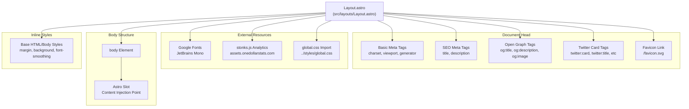
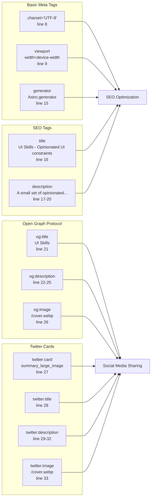
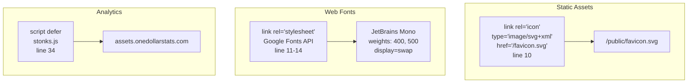
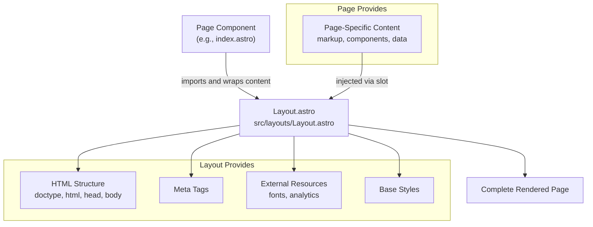

<!-- source: DeepWiki mcp.deepwiki.com · repo ibelick/ui-skills · page 4.1 Layout Component · fetched 2026-10-27 -->

# Layout Component

<details>
<summary>Relevant source files</summary>

The following files were used as context for generating this wiki page:

- [src/layouts/Layout.astro](src/layouts/Layout.astro)

</details>


## Purpose and Scope

The `Layout.astro` component serves as the foundational HTML wrapper for all pages in the ui-skills application. It establishes the document structure, configures SEO metadata, loads external resources (fonts and analytics), and applies base styling. This component is implemented as an Astro layout component using the `.astro` file format.

For information about how this layout is used by specific pages, see [Main Index Page](#4.2). For details on the styling system imported by this layout, see [Styling System](#4.3).

## Component Architecture

The `Layout.astro` component is organized into four primary sections: document head configuration, external resource loading, body structure with content slot, and inline base styles.



**Sources:** [src/layouts/Layout.astro:1-52]()

## HTML Document Structure

The component begins with standard HTML5 document declarations and frontmatter that imports the global stylesheet:

| Line Numbers | Element/Feature | Purpose |
|--------------|----------------|---------|
| [1-2]() | Frontmatter | Imports `../styles/global.css` for Tailwind and typography styles |
| [5]() | `<!doctype html>` | HTML5 document type declaration |
| [6]() | `<html lang="en">` | Root element with English language attribute |
| [7-35]() | `<head>` | Contains all metadata, links, and scripts |
| [36-38]() | `<body>` | Body element with Astro slot for content injection |
| [41-51]() | `<style>` | Inline scoped styles for base layout |

**Sources:** [src/layouts/Layout.astro:1-52]()

## Meta Tag Configuration

The layout implements comprehensive meta tag coverage for SEO, social sharing, and browser behavior:



### Meta Tag Details

| Category | Tag | Value | Line |
|----------|-----|-------|------|
| **Basic** | `charset` | `UTF-8` | [8]() |
| **Basic** | `viewport` | `width=device-width` | [9]() |
| **Basic** | `generator` | `{Astro.generator}` | [15]() |
| **SEO** | `title` | `UI Skills - Opinionated UI constraints for agents` | [16]() |
| **SEO** | `description` | `A small set of opinionated UI constraints to help agents ship better interfaces.` | [17-20]() |
| **Open Graph** | `og:title` | `UI Skills` | [21]() |
| **Open Graph** | `og:description` | Same as SEO description | [22-25]() |
| **Open Graph** | `og:image` | `/cover.webp` | [26]() |
| **Twitter** | `twitter:card` | `summary_large_image` | [27]() |
| **Twitter** | `twitter:title` | `UI Skills` | [28]() |
| **Twitter** | `twitter:description` | Same as SEO description | [29-32]() |
| **Twitter** | `twitter:image` | `/cover.webp` | [33]() |

The Open Graph and Twitter Card tags enable rich previews when the site is shared on social media platforms, displaying the title, description, and cover image.

**Sources:** [src/layouts/Layout.astro:8-33]()

## External Resource Loading

The layout loads three categories of external resources: favicon, web fonts, and analytics.



### Favicon

The favicon is loaded as an SVG image from the public directory:
- **Type:** `image/svg+xml`
- **Path:** `/favicon.svg`
- **Line:** [10]()

### Typography Font

The layout loads JetBrains Mono from Google Fonts:
- **Font Family:** JetBrains Mono
- **Weights:** 400 (regular), 500 (medium)
- **Loading Strategy:** `display=swap` (prevents invisible text during font load)
- **URL:** `https://fonts.googleapis.com/css2?family=JetBrains+Mono:wght@400;500&display=swap`
- **Lines:** [11-14]()

This monospace font is used throughout the application for code-like presentation of the UI constraints.

### Analytics Script

Analytics tracking is implemented via the stonks.js script:
- **Script Source:** `https://assets.onedollarstats.com/stonks.js`
- **Loading Strategy:** `defer` (loads after HTML parsing)
- **Service:** One Dollar Stats
- **Line:** [34]()

The `defer` attribute ensures the analytics script doesn't block page rendering.

**Sources:** [src/layouts/Layout.astro:10-14,34]()

## Global Styling Import

The layout imports the global stylesheet in its frontmatter:

```astro
---
import "../styles/global.css";
---
```

This import occurs at [line 2]() and loads the Tailwind CSS configuration, typography plugin styles, and custom CSS rules. The global stylesheet is processed at build time by Astro's Vite integration with the Tailwind plugin. For details on the contents of this stylesheet, see [Styling System](#4.3).

**Sources:** [src/layouts/Layout.astro:1-2]()

## Base Inline Styles

The layout defines minimal inline styles for the root HTML and body elements:

```css
html,
body {
  margin: 0;
  width: 100%;
  height: 100%;
  background-color: #fafaf5;
  -webkit-font-smoothing: antialiased;
  -moz-osx-font-smoothing: grayscale;
}
```

| Property | Value | Purpose |
|----------|-------|---------|
| `margin` | `0` | Removes default browser margins |
| `width`, `height` | `100%` | Ensures full viewport coverage |
| `background-color` | `#fafaf5` | Light beige/cream background |
| `-webkit-font-smoothing` | `antialiased` | Improves font rendering on WebKit browsers |
| `-moz-osx-font-smoothing` | `grayscale` | Improves font rendering on Firefox/macOS |

These styles are scoped to the component using Astro's built-in `<style>` tag behavior and establish the foundational visual appearance.

**Sources:** [src/layouts/Layout.astro:41-51]()

## Content Slot Mechanism

The layout uses Astro's slot mechanism to inject page-specific content:

```astro
<body>
  <slot />
</body>
```

The `<slot />` component at [line 37]() acts as a placeholder where child page content is inserted. When a page uses this layout, the page's content replaces the slot. For example, the main index page (see [Main Index Page](#4.2)) wraps its content with this layout:

```astro
---
import Layout from '../layouts/Layout.astro';
---

<Layout>
  <!-- Page content goes here and replaces <slot /> -->
</Layout>
```

This pattern follows Astro's standard layout composition model, enabling consistent document structure across all pages while allowing content variation.

**Sources:** [src/layouts/Layout.astro:36-38]()

## Usage Pattern

The following diagram illustrates how page components utilize the Layout component:



**Sources:** [src/layouts/Layout.astro:1-52]()

---

