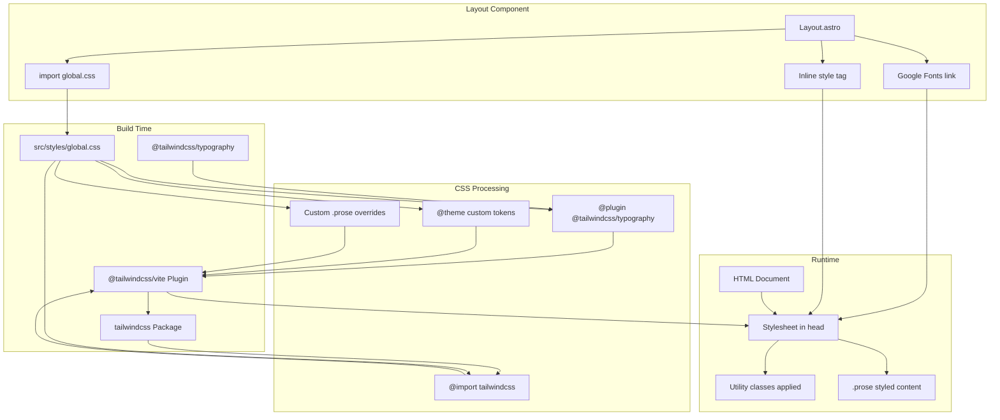
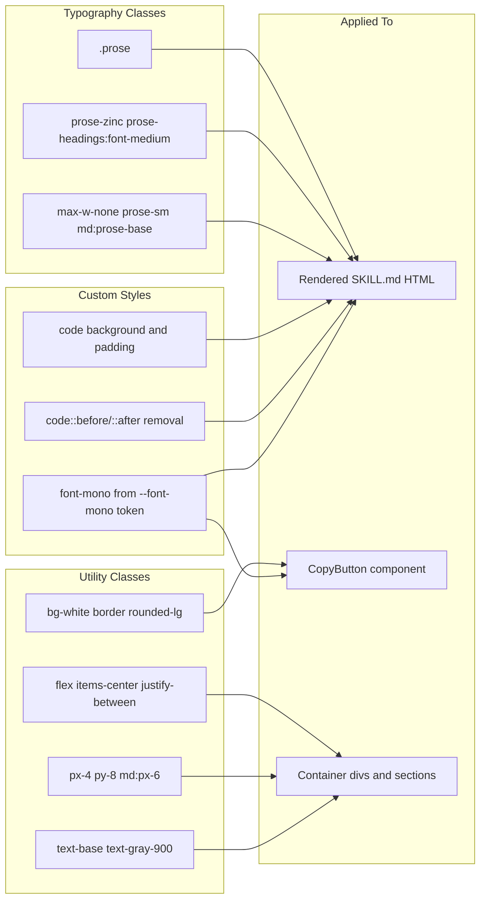
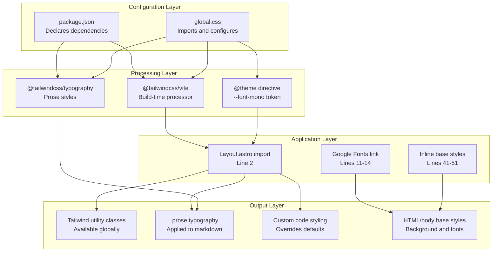

<!-- source: DeepWiki mcp.deepwiki.com · repo ibelick/ui-skills · page 4.3 Styling System · fetched 2026-10-27 -->

# Styling System

<details>
<summary>Relevant source files</summary>

The following files were used as context for generating this wiki page:

- [package.json](package.json)
- [src/layouts/Layout.astro](src/layouts/Layout.astro)
- [src/styles/global.css](src/styles/global.css)

</details>


## Purpose and Scope

This document describes the styling system used in the ui-skills project. It covers the Tailwind CSS 4 configuration, typography plugin integration, global CSS customizations, and base styling applied through the layout component. This system provides the visual presentation layer for the documentation content.

For information about the layout component structure that applies these styles, see [Layout Component](#4.1). For the main page that uses these styles, see [Main Index Page](#4.2).

## Overview

The styling system uses a utility-first approach with Tailwind CSS 4 as the foundation. It consists of three primary layers:

| Layer | Location | Purpose |
|-------|----------|---------|
| Tailwind Base | `@tailwindcss/vite` plugin | Core utility classes and CSS reset |
| Typography Plugin | `@tailwindcss/typography` | Prose styling for markdown content |
| Global Customizations | `src/styles/global.css` | Custom theme tokens and component overrides |
| Layout Base Styles | `src/layouts/Layout.astro` | Root-level HTML/body styling |

The system is integrated via the Vite build pipeline through the `@tailwindcss/vite` plugin, which processes utility classes at build time.

Sources: [package.json:14-31](), [src/styles/global.css:1-27](), [src/layouts/Layout.astro:1-52]()

## Tailwind CSS 4 Integration

### Vite Plugin Configuration

Tailwind CSS 4 is integrated through the `@tailwindcss/vite` plugin rather than a traditional PostCSS setup. The dependency is declared in `package.json`:

```
@tailwindcss/vite: ^4.1.18
tailwindcss: ^4.1.18
```

The integration happens automatically when Astro processes the global CSS file. No separate `tailwind.config.js` is required because Tailwind CSS 4 uses CSS-based configuration.

### CSS Import

The global CSS file imports Tailwind at [src/styles/global.css:1]():

```css
@import "tailwindcss";
```

This single import provides access to all Tailwind utility classes throughout the application. The Layout component then imports this file at [src/layouts/Layout.astro:2]():

```astro
import "../styles/global.css";
```

Sources: [package.json:16-23](), [src/styles/global.css:1](), [src/layouts/Layout.astro:2]()

## Typography System

### Typography Plugin

The `@tailwindcss/typography` plugin provides the `.prose` class for styling markdown-rendered content. It is declared as a dev dependency at [package.json:26]() and imported in the global CSS at [src/styles/global.css:2]():

```css
@plugin "@tailwindcss/typography";
```

The `.prose` class applies opinionated typography styles to HTML elements rendered from markdown, including headings, paragraphs, lists, links, and code blocks.

### Custom Font Configuration

The system uses JetBrains Mono as the monospace font family. This is configured in two places:

1. **CSS Theme Token** at [src/styles/global.css:4-7]():
```css
@theme {
  --font-mono: "JetBrains Mono", ui-monospace, SFMono-Regular, ...
}
```

2. **Font Loading** at [src/layouts/Layout.astro:11-14]():
```html
<link
  rel="stylesheet"
  href="https://fonts.googleapis.com/css2?family=JetBrains+Mono:wght@400;500&display=swap"
/>
```

The font weights 400 (regular) and 500 (medium) are loaded with `display=swap` for optimal loading performance.

Sources: [src/styles/global.css:4-7](), [src/layouts/Layout.astro:11-14](), [package.json:26]()

## Global CSS Customizations

### Code Block Styling

The global CSS file overrides the default typography plugin code styling at [src/styles/global.css:9-26]():

```css
.prose :where(code):not(:where([class~="not-prose"], [class~="not-prose"] *)) {
  background-color: #f4f4f5;
  font-weight: 500;
  padding: 0.1em 0.35em;
  border-radius: 0.25rem;
}
```

This targets inline `<code>` elements within `.prose` containers that are not excluded by the `not-prose` class. The styling provides:

- Light gray background (`#f4f4f5`)
- Medium font weight (500)
- Horizontal padding for readability
- Rounded corners (0.25rem)

### Pseudo-element Removal

The typography plugin adds backticks before and after code elements by default. These are removed at [src/styles/global.css:17-26]():

```css
.prose :where(code):not(:where([class~="not-prose"], [class~="not-prose"] *))::before,
.prose :where(code):not(:where([class~="not-prose"], [class~="not-prose"] *))::after {
  content: "";
}
```

This ensures inline code appears with the background styling only, without decorative backticks.

Sources: [src/styles/global.css:9-26]()

## Base Layout Styles

### Root Element Styling

The Layout component includes inline styles for the root HTML elements at [src/layouts/Layout.astro:41-51]():

```css
html, body {
  margin: 0;
  width: 100%;
  height: 100%;
  background-color: #fafaf5;
  -webkit-font-smoothing: antialiased;
  -moz-osx-font-smoothing: grayscale;
}
```

These styles establish:

| Property | Value | Purpose |
|----------|-------|---------|
| `margin` | `0` | Remove default browser margins |
| `width`, `height` | `100%` | Full viewport coverage |
| `background-color` | `#fafaf5` | Off-white background (warm tone) |
| `-webkit-font-smoothing` | `antialiased` | Smoother text rendering on WebKit |
| `-moz-osx-font-smoothing` | `grayscale` | Smoother text rendering on Firefox/macOS |

The `#fafaf5` background color is slightly warmer than pure white, providing a softer reading experience.

Sources: [src/layouts/Layout.astro:41-51]()

## Style Integration Flow



**Style Integration Flow**

This diagram shows how styling flows from build-time configuration through CSS processing to runtime application. The `@tailwindcss/vite` plugin processes the global CSS file, which imports Tailwind core, loads the typography plugin, defines custom theme tokens, and applies component overrides. The Layout component imports this processed CSS and adds Google Fonts and inline base styles. At runtime, the HTML document receives all these styles in the head, enabling both utility classes and prose-styled content.

Sources: [package.json:16-26](), [src/styles/global.css:1-27](), [src/layouts/Layout.astro:2-51]()

## CSS Class Application Architecture



**CSS Class Application Architecture**

This diagram illustrates how different categories of CSS classes are applied to components. Utility classes (flex, spacing, text, background) are applied directly to layout elements and interactive components. Typography classes (`.prose` and its modifiers) are specifically applied to the markdown-rendered content from SKILL.md. Custom styles override specific prose elements like inline code. The `font-mono` token defined in `@theme` is applied to both the CopyButton and code elements within markdown content, ensuring consistent monospace typography.

Sources: [src/styles/global.css:1-27](), [src/layouts/Layout.astro:41-51]()

## Font Loading Strategy

The system uses a hybrid font loading approach:

| Font Type | Family | Loading Method | Location |
|-----------|--------|----------------|----------|
| Monospace | JetBrains Mono | External (Google Fonts) | [Layout.astro:11-14]() |
| Monospace Fallbacks | ui-monospace, SFMono-Regular, etc. | System fonts | [global.css:5-6]() |

The font loading strategy prioritizes:

1. **External font** loaded via Google Fonts with `display=swap` parameter for non-blocking render
2. **System fallbacks** defined in CSS custom property with comprehensive fallback chain
3. **Font weights** limited to 400 and 500 to minimize HTTP requests and file size

The `display=swap` parameter at [src/layouts/Layout.astro:13]() ensures text remains visible during font loading, using fallback fonts until JetBrains Mono is available.

Sources: [src/layouts/Layout.astro:11-14](), [src/styles/global.css:4-7]()

## Styling System Summary

The styling system architecture can be summarized as follows:



**Styling System Summary**

This comprehensive view shows the complete styling system flow. Configuration begins with package.json dependencies and global.css imports. These are processed by the Tailwind Vite plugin and typography plugin, along with custom theme tokens. The Layout component imports the processed styles and adds external font loading and inline base styles. The output provides four categories of styles: utility classes available globally, prose typography for markdown content, custom code overrides, and base HTML/body styles for the document foundation.

Sources: [package.json:14-31](), [src/styles/global.css:1-27](), [src/layouts/Layout.astro:1-51]()

---

