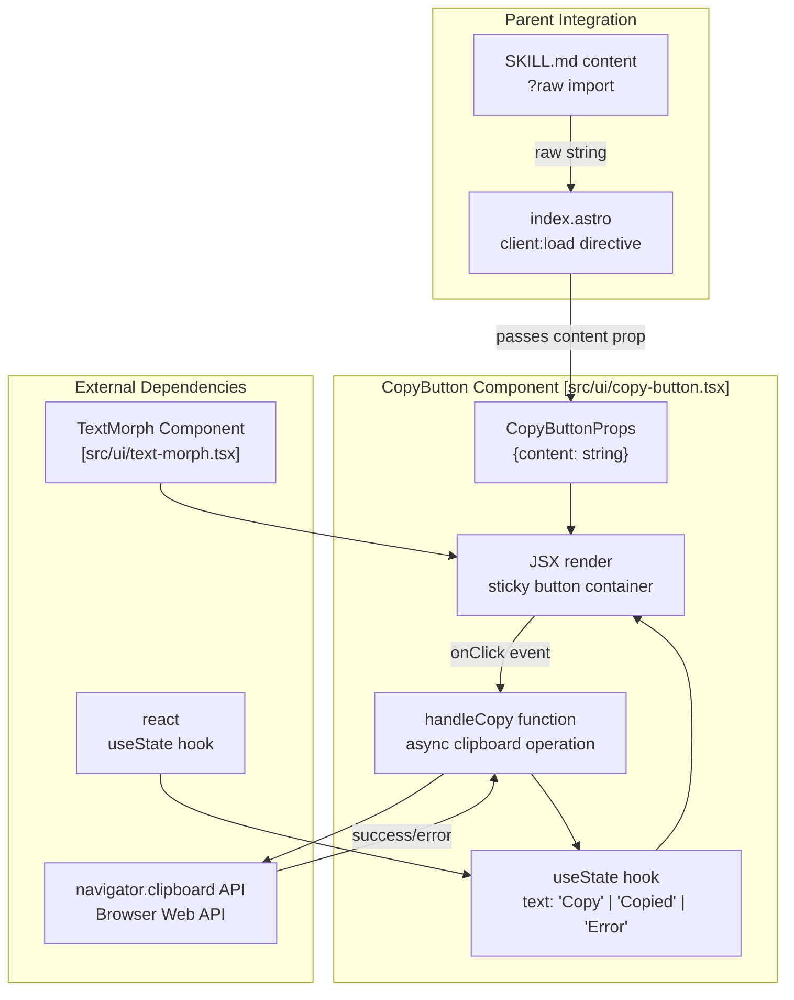
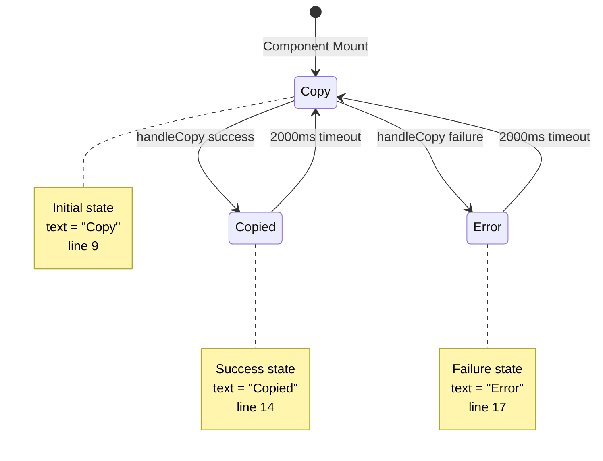
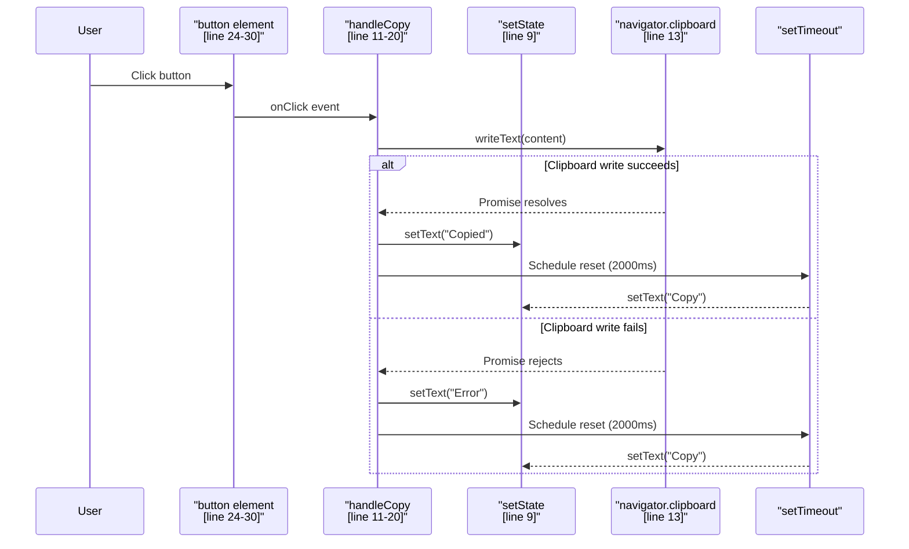
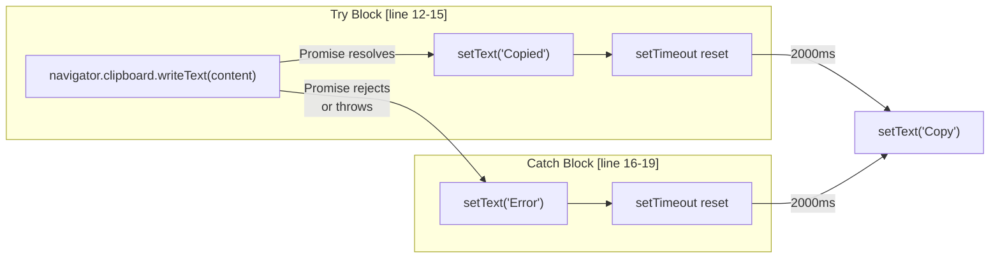
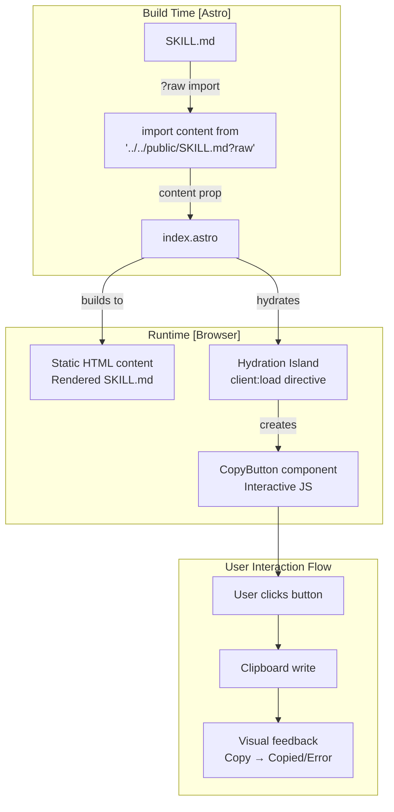

<!-- source: DeepWiki mcp.deepwiki.com · repo ibelick/ui-skills · page 5.1 CopyButton Component · fetched 2026-10-27 -->

# CopyButton Component

<details>
<summary>Relevant source files</summary>

The following files were used as context for generating this wiki page:

- [src/ui/copy-button.tsx](src/ui/copy-button.tsx)

</details>


This document details the `CopyButton` React component that provides clipboard functionality for copying the UI Skills documentation content. The component manages user interaction, clipboard API operations, visual feedback states, and integrates with the TextMorph animation component for smooth text transitions.

For information about the TextMorph animation component used by CopyButton, see [TextMorph Component](#5.2). For information about how the component is integrated into the main page, see [Main Index Page](#4.2).

## Purpose and Functionality

The `CopyButton` component is the primary interactive element on the UI Skills documentation website. It enables users to copy the entire SKILL.md content to their clipboard with a single click, providing visual feedback through animated text state transitions.

The component is implemented as a client-side hydrated React component in Astro's island architecture, making it one of the few JavaScript-dependent elements on an otherwise static page.

**Sources:** [src/ui/copy-button.tsx:1-34]()

## Component Architecture



**Sources:** [src/ui/copy-button.tsx:1-34]()

## Props Interface

The component accepts a single prop via the `CopyButtonProps` type:

| Prop | Type | Required | Description |
|------|------|----------|-------------|
| `content` | `string` | Yes | The text content to be copied to clipboard when the button is clicked |

The `content` prop receives the raw contents of SKILL.md, imported as a string using Vite's `?raw` import syntax in the parent Astro page.

**Sources:** [src/ui/copy-button.tsx:4-6]()

## State Management



The component maintains a single piece of local state using React's `useState` hook:

- **State variable:** `text` (string)
- **State setter:** `setText` (function)
- **Initial value:** `"Copy"`
- **Possible values:** `"Copy"`, `"Copied"`, `"Error"`

State transitions are managed exclusively through the `handleCopy` function, which updates the text based on clipboard operation results and schedules automatic resets via `setTimeout`.

**Sources:** [src/ui/copy-button.tsx:9](), [src/ui/copy-button.tsx:14](), [src/ui/copy-button.tsx:17]()

## Clipboard Operation Flow



The clipboard operation follows this sequence:

1. **User Interaction:** User clicks the button element [src/ui/copy-button.tsx:24-30]()
2. **Event Handler Invocation:** `onClick` triggers `handleCopy` async function [src/ui/copy-button.tsx:11]()
3. **Try Block Execution:** Attempts `navigator.clipboard.writeText(content)` [src/ui/copy-button.tsx:13]()
4. **Success Path:** On success, sets text to "Copied" and schedules 2-second reset [src/ui/copy-button.tsx:14-15]()
5. **Error Path:** On failure, sets text to "Error" and schedules 2-second reset [src/ui/copy-button.tsx:17-18]()
6. **Automatic Reset:** After 2000ms, text reverts to "Copy" [src/ui/copy-button.tsx:15,18]()

**Sources:** [src/ui/copy-button.tsx:11-20]()

## Error Handling Strategy

The component implements defensive error handling for clipboard operations:



The error handling approach:

- **Catch-all handler:** Empty catch block catches any exception [src/ui/copy-button.tsx:16]()
- **No error propagation:** Errors are absorbed and converted to user feedback
- **Silent failures:** No console logging or error reporting
- **User notification:** "Error" state provides immediate visual feedback [src/ui/copy-button.tsx:17]()
- **Graceful recovery:** Automatic return to initial state after 2 seconds [src/ui/copy-button.tsx:18]()

Common failure scenarios handled include:
- Browser lacks clipboard API support
- User denied clipboard permissions
- Security context restrictions (non-HTTPS)
- Browser or OS clipboard access issues

**Sources:** [src/ui/copy-button.tsx:16-19]()

## Visual Feedback Integration

```mermaid
graph TB
    subgraph "CopyButton Render [line 22-33]"
        Container["div.sticky.top-4.z-10<br/>Sticky positioning container"]
        ButtonEl["button element<br/>Rounded full button"]
        TextMorphEl["TextMorph component<br/>{text} prop"]
    end
    
    subgraph "TextMorph Component [src/ui/text-morph.tsx]"
        Animation["motion.span<br/>Character-level animation"]
    end
    
    Container --> ButtonEl
    ButtonEl --> TextMorphEl
    TextMorphEl --> Animation
    
    State["text state<br/>'Copy' | 'Copied' | 'Error'"]
    State -->|"dynamic value"| TextMorphEl
    
    note right of Animation
        Provides smooth
        character transitions
        between states
    end note
```

The component uses the `TextMorph` component to animate text transitions:

- **Import:** `TextMorph` imported from `"./text-morph"` [src/ui/copy-button.tsx:2]()
- **Usage:** Wraps the dynamic `text` state value [src/ui/copy-button.tsx:29]()
- **Effect:** Provides smooth character-by-character morphing between "Copy" → "Copied" → "Error" → "Copy"
- **Purpose:** Enhances user experience with subtle, professional animations

The TextMorph component handles the low-level animation details, while CopyButton manages the state transitions that trigger those animations.

**Sources:** [src/ui/copy-button.tsx:2](), [src/ui/copy-button.tsx:29]()

## Styling and Layout

The component uses Tailwind CSS utility classes for styling:

| Element | Classes | Purpose |
|---------|---------|---------|
| Container `div` | `sticky top-4 z-10` | Fixed positioning 1rem from top, high z-index for overlay |
| Container `div` | `flex w-full items-center justify-end` | Flexbox layout, full width, right-aligned content |
| Container `div` | `px-4 sm:px-0` | Responsive padding: 1rem on mobile, none on desktop |
| Button | `flex h-8 w-[80px]` | Fixed dimensions: 2rem height, 80px width |
| Button | `items-center justify-center` | Centers content horizontally and vertically |
| Button | `rounded-full` | Fully rounded corners (pill shape) |
| Button | `text-sm font-medium` | Small text size, medium font weight |
| Button | `text-neutral-400` | Default neutral gray text color |
| Button | `hover:text-neutral-900` | Dark text on hover for contrast |
| Button | `transition-colors` | Smooth color transitions |

The sticky positioning ensures the button remains visible as users scroll through the documentation content, providing constant access to the copy functionality.

**Sources:** [src/ui/copy-button.tsx:23-30]()

## Component Integration Pattern



The CopyButton integrates into the larger system as follows:

1. **Content Source:** SKILL.md imported as raw string in parent Astro component
2. **Hydration Directive:** Component uses `client:load` directive for immediate hydration
3. **Island Architecture:** Only the button requires JavaScript; surrounding content is static HTML
4. **Prop Passing:** Raw SKILL.md content passed as `content` prop from Astro to React
5. **Event Handling:** Browser-native clipboard API accessed only when button clicked
6. **Feedback Rendering:** TextMorph animations rendered via React's reconciliation

This integration pattern minimizes JavaScript bundle size by hydrating only necessary interactive components while keeping the majority of the page static.

**Sources:** [src/ui/copy-button.tsx:1-34]()

## API Surface and Exports

The component exports a single named export:

```typescript
export function CopyButton({ content }: CopyButtonProps)
```

**Export Details:**
- **Type:** Named function export [src/ui/copy-button.tsx:8]()
- **Name:** `CopyButton`
- **Parameters:** Destructured props object with `content` property
- **Return Type:** JSX.Element (implicit)
- **Usage Pattern:** Import and render with content prop in parent Astro/React components

**TypeScript Type Exports:**
- `CopyButtonProps` type is defined but not explicitly exported [src/ui/copy-button.tsx:4-6]()
- Type is available for type inference in consuming components

**Sources:** [src/ui/copy-button.tsx:4-8]()

---

