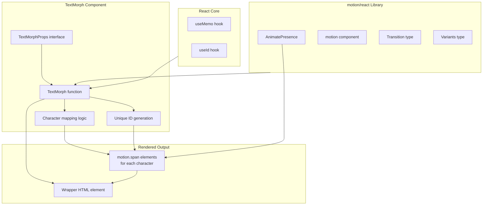
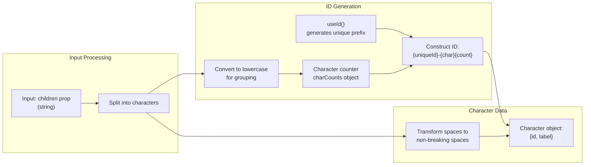
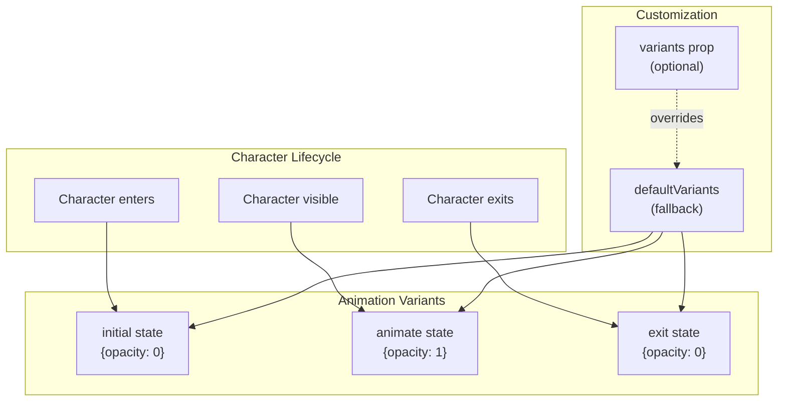
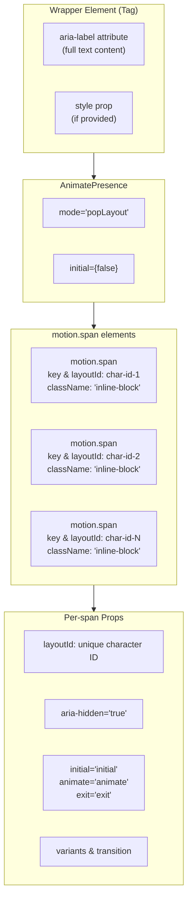
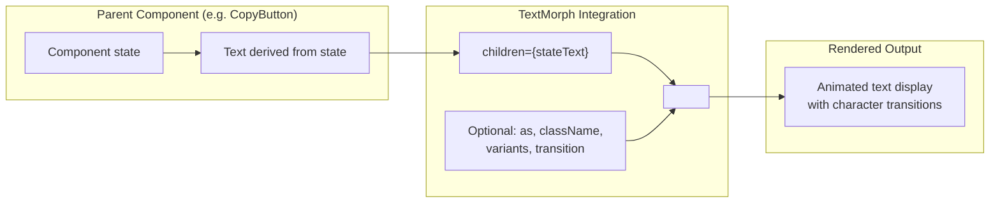

<!-- source: DeepWiki mcp.deepwiki.com · repo ibelick/ui-skills · page 5.2 TextMorph Component · fetched 2026-10-27 -->

# TextMorph Component

Relevant source files

The following files were used as context for generating this wiki page:

- [src/ui/text-morph.tsx](src/ui/text-morph.tsx)

## Purpose and Scope

The `TextMorph` component provides character-level text animation for smooth transitions between different text content. It splits text into individual characters and animates each character's entrance and exit using the motion/react library. This component is used within the CopyButton component (see [CopyButton Component](#5.1)) to provide visual feedback during state transitions.

Sources: [src/ui/text-morph.tsx:1-82]()

## Component Architecture

The following diagram shows the component's structure and its dependencies:

Sources: [src/ui/text-morph.tsx:1-82]()

## Component Props API

The `TextMorphProps` interface defines the configuration options for the component:

| Prop | Type | Default | Description |
|------|------|---------|-------------|
| `children` | `string` | Required | The text content to animate |
| `as` | `React.ElementType` | `"p"` | HTML element type for the wrapper |
| `className` | `string` | `undefined` | CSS class names for the wrapper |
| `style` | `React.CSSProperties` | `undefined` | Inline styles for the wrapper |
| `variants` | `Variants` | See default | Animation variants for character states |
| `transition` | `Transition` | See default | Spring physics configuration |

Sources: [src/ui/text-morph.tsx:9-16]()

## Character ID Generation

The component generates unique identifiers for each character occurrence to enable layout animations. This mechanism ensures that identical characters at different positions are tracked separately:

The character tracking system works as follows:

1. **Unique Prefix**: `useId()` generates a component-scoped unique identifier [src/ui/text-morph.tsx:26]()
2. **Character Counting**: A `charCounts` object tracks occurrence numbers for each lowercase character [src/ui/text-morph.tsx:35-39]()
3. **ID Construction**: Each character gets an ID in the format `{uniqueId}-{lowerChar}{count}` [src/ui/text-morph.tsx:42]()
4. **Space Handling**: Regular spaces are converted to non-breaking spaces (`\u00A0`) for proper layout [src/ui/text-morph.tsx:43]()

This approach ensures that when text changes, motion can track character positions and animate them appropriately using layout animations.

Sources: [src/ui/text-morph.tsx:26-46]()

## Animation System

The component uses motion/react's animation system with three key elements:

### Animation Variants

The default variants configuration [src/ui/text-morph.tsx:48-52]():
- **initial**: Characters start with `opacity: 0` (invisible)
- **animate**: Characters transition to `opacity: 1` (visible)
- **exit**: Characters fade out to `opacity: 0` before removal

### Transition Configuration

The default spring physics configuration [src/ui/text-morph.tsx:54-59]():

| Property | Value | Effect |
|----------|-------|--------|
| `type` | `"spring"` | Uses spring-based physics |
| `stiffness` | `280` | Controls animation speed (higher = faster) |
| `damping` | `18` | Controls oscillation (higher = less bounce) |
| `mass` | `0.3` | Affects inertia (lower = lighter feel) |

### AnimatePresence Configuration

The component wraps characters in `AnimatePresence` with specific settings [src/ui/text-morph.tsx:63]():
- **mode**: `"popLayout"` - Enables layout animations where exiting elements pop out before entering elements animate in
- **initial**: `false` - Prevents initial animations on mount

Sources: [src/ui/text-morph.tsx:48-80]()

## Rendering Structure

The following diagram illustrates the DOM structure produced by the component:

Each `motion.span` element [src/ui/text-morph.tsx:65-77]():
- Uses `layoutId` for shared layout animations between text changes
- Has `className="inline-block"` for proper layout behavior
- Contains motion animation props (`initial`, `animate`, `exit`)
- Receives the character label (with spaces converted to non-breaking spaces)

Sources: [src/ui/text-morph.tsx:61-81]()

## Accessibility Implementation

The component implements accessibility features to ensure the animated text remains accessible:

| Feature | Implementation | Purpose |
|---------|---------------|---------|
| Wrapper `aria-label` | Set to full `children` text | Screen readers announce complete text |
| Individual span `aria-hidden` | Set to `"true"` | Hides individual character spans from screen readers |
| Non-breaking spaces | Spaces converted to `\u00A0` | Preserves spacing in visual layout |

This pattern ensures screen readers receive the complete text content via the wrapper's `aria-label`, while the animated character spans are hidden from the accessibility tree to prevent redundant character-by-character announcements [src/ui/text-morph.tsx:62-69]().

Sources: [src/ui/text-morph.tsx:29-44](), [src/ui/text-morph.tsx:62-77]()

## Component Usage Pattern

The following diagram shows how the TextMorph component is typically integrated:

When the `children` prop changes, the component:
1. Computes new character IDs via `useMemo` [src/ui/text-morph.tsx:34-46]()
2. `AnimatePresence` detects removed and added characters
3. Characters with matching `layoutId` values animate their positions
4. New characters fade in, removed characters fade out
5. Spring physics govern the animation timing

Sources: [src/ui/text-morph.tsx:18-82]()

## Performance Considerations

The component uses React optimization patterns:

- **`useMemo`**: Character ID computation is memoized based on `children` and `uniqueId` dependencies [src/ui/text-morph.tsx:34-46]()
- **`useId`**: Generates stable, unique IDs across renders for consistent layout animations [src/ui/text-morph.tsx:26]()
- **Inline-block display**: Each span uses `inline-block` to minimize layout reflow [src/ui/text-morph.tsx:68]()

The memoization ensures character IDs are only recalculated when the text content changes, preventing unnecessary re-computations during parent component re-renders.

Sources: [src/ui/text-morph.tsx:26-46](), [src/ui/text-morph.tsx:65-77]()

---

