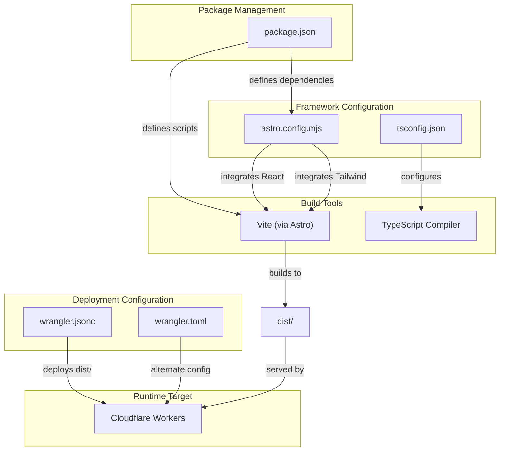
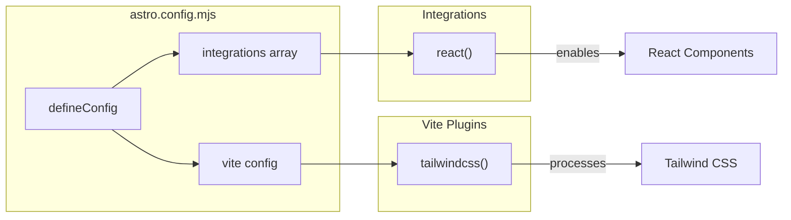
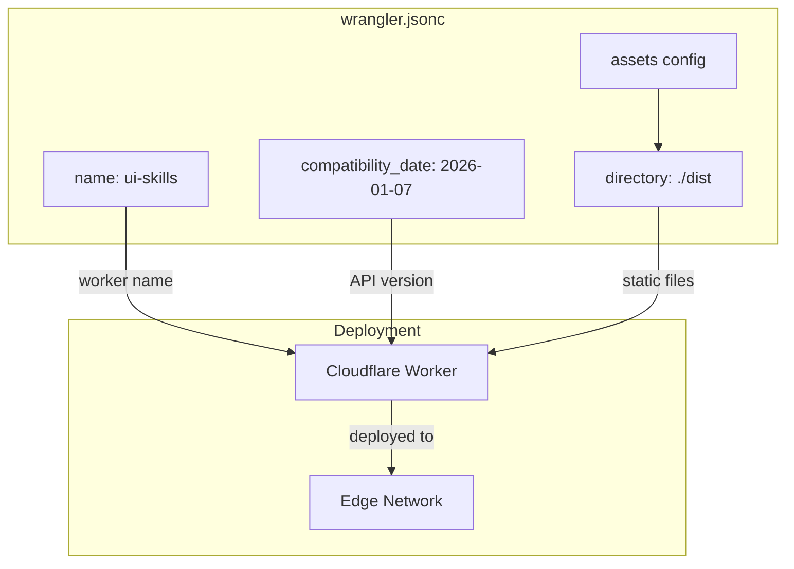
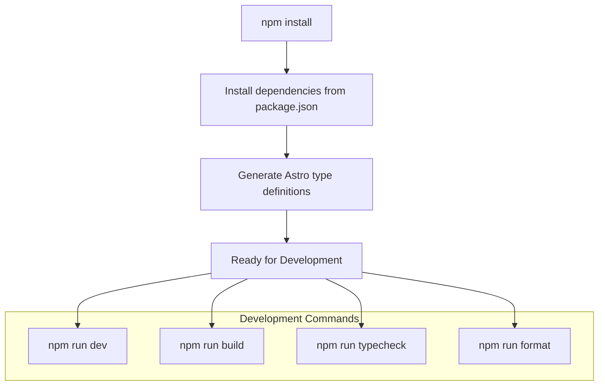
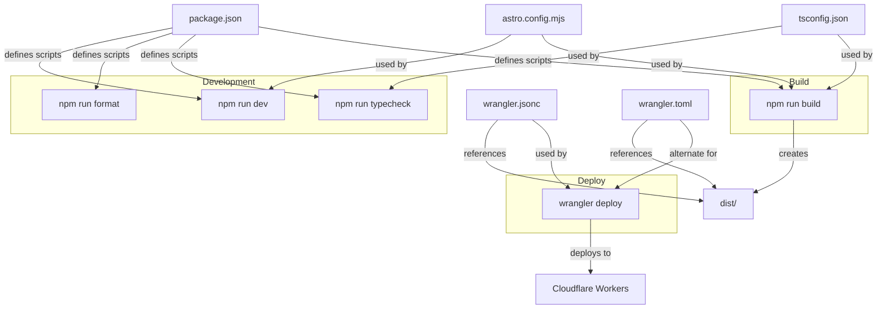

<!-- source: DeepWiki mcp.deepwiki.com · repo ibelick/ui-skills · page 6 Configuration and Setup · fetched 2026-10-27 -->

# Configuration and Setup

<details>
<summary>Relevant source files</summary>

The following files were used as context for generating this wiki page:

- [astro.config.mjs](astro.config.mjs)
- [package.json](package.json)
- [tsconfig.json](tsconfig.json)
- [wrangler.jsonc](wrangler.jsonc)
- [wrangler.toml](wrangler.toml)

</details>


This document describes all configuration files and setup requirements for the ui-skills repository. It covers project dependencies, framework configuration, TypeScript settings, and deployment configuration for Cloudflare Workers. For information about the actual build and deployment process, see [Build and Deployment Pipeline](#2.3). For details on development workflow and component development, see [Interactive Components](#5).

## Configuration Overview

The ui-skills project uses multiple configuration files that control different aspects of the build, development, and deployment pipeline. These files define dependencies, compiler options, framework integrations, and deployment targets.

### Configuration Files and Their Roles



**Sources:** [package.json:1-33](), [astro.config.mjs:1-12](), [tsconfig.json:1-14](), [wrangler.jsonc:1-7](), [wrangler.toml:1-5]()

## Project Dependencies

The [package.json:1-33]() file defines all project dependencies and scripts. The project uses npm as its package manager, as indicated by the `type: "module"` field that enables ES modules.

### Core Dependencies

| Package | Version | Purpose |
|---------|---------|---------|
| `astro` | ^5.16.7 | Static site generator framework |
| `@astrojs/react` | ^4.4.2 | Astro integration for React components |
| `react` | ^19.2.3 | UI library for interactive components |
| `react-dom` | ^19.2.3 | React DOM renderer |
| `tailwindcss` | ^4.1.18 | Utility-first CSS framework |
| `@tailwindcss/vite` | ^4.1.18 | Vite plugin for Tailwind CSS 4 |
| `motion` | ^12.24.12 | Animation library (formerly Framer Motion) |

**Sources:** [package.json:14-24]()

### Development Dependencies

| Package | Version | Purpose |
|---------|---------|---------|
| `@tailwindcss/typography` | ^0.5.19 | Typography plugin for prose content |
| `prettier` | ^3.3.3 | Code formatter |
| `prettier-plugin-astro` | ^0.14.1 | Prettier plugin for Astro files |
| `prettier-plugin-tailwindcss` | ^0.6.8 | Prettier plugin for Tailwind class sorting |
| `typescript` | ^5.6.3 | TypeScript compiler and type checker |
| `@types/react` | ^19.2.7 | TypeScript definitions for React |
| `@types/react-dom` | ^19.2.3 | TypeScript definitions for React DOM |

**Sources:** [package.json:25-31]()

### NPM Scripts

The [package.json:6-13]() file defines the following scripts:

| Script | Command | Purpose |
|--------|---------|---------|
| `dev` | `astro dev` | Start development server with hot reload |
| `build` | `astro build` | Build project for production |
| `preview` | `astro preview` | Preview production build locally |
| `astro` | `astro` | Direct access to Astro CLI |
| `format` | `prettier --write .` | Format all files with Prettier |
| `typecheck` | `astro check` | Type-check TypeScript files |

**Sources:** [package.json:6-13]()

## Framework Configuration

### Astro Configuration

The [astro.config.mjs:1-12]() file configures the Astro framework using the `defineConfig` function. The configuration is minimal and focused:



**Configuration Details:**

- **React Integration** ([astro.config.mjs:7]()): The `@astrojs/react` integration is configured via `integrations: [react()]`, enabling React components to be used within Astro pages with client-side hydration directives.

- **Tailwind CSS Integration** ([astro.config.mjs:8-10]()): Tailwind CSS 4 is integrated through the Vite plugin system using `@tailwindcss/vite`. This plugin is added to `vite.plugins` array rather than using a dedicated Astro integration, following Tailwind CSS 4's new architecture.

**Sources:** [astro.config.mjs:1-12]()

### TypeScript Configuration

The [tsconfig.json:1-14]() file configures TypeScript compilation with strict settings optimized for Astro development:

| Setting | Value | Purpose |
|---------|-------|---------|
| `extends` | `"astro/tsconfigs/strict"` | Inherits strict TypeScript settings from Astro |
| `include` | `[".astro/types.d.ts", "**/*"]` | Includes Astro-generated types and all project files |
| `exclude` | `["dist"]` | Excludes build output directory |
| `compilerOptions.jsx` | `"react-jsx"` | Uses modern React JSX transform (no import React needed) |
| `compilerOptions.jsxImportSource` | `"react"` | Specifies React as JSX runtime source |

The `jsx: "react-jsx"` setting ([tsconfig.json:11]()) enables the modern JSX transform introduced in React 17, which eliminates the need to import React in files that contain JSX.

**Sources:** [tsconfig.json:1-14]()

## Deployment Configuration

### Cloudflare Workers Configuration

The project includes two equivalent Cloudflare Workers configuration files: `wrangler.jsonc` (JSON with comments) and `wrangler.toml` (TOML format). Both configure the same deployment settings.

#### wrangler.jsonc Configuration



**Configuration Fields:**

- **name** ([wrangler.jsonc:2]()): `"ui-skills"` - The worker name used in Cloudflare's dashboard and deployment URLs
- **compatibility_date** ([wrangler.jsonc:3]()): `"2026-01-07"` - Specifies the Cloudflare Workers API compatibility version
- **assets.directory** ([wrangler.jsonc:5]()): `"./dist"` - Points to the directory containing static files to deploy

**Sources:** [wrangler.jsonc:1-7]()

#### wrangler.toml Configuration

The [wrangler.toml:1-5]() file contains identical configuration in TOML format:

```toml
name = "ui-skills"
compatibility_date = "2026-01-07"

[assets]
directory = "./dist"
```

This file serves as an alternative configuration format. Wrangler CLI will use either file.

**Sources:** [wrangler.toml:1-5]()

### Deployment Assets Structure

Both configuration files specify `./dist` as the assets directory. This directory is generated by the `astro build` command and contains:

- Static HTML files (including `index.html`)
- JavaScript bundles for client-side components
- CSS files processed by Tailwind
- Static assets from the `/public` directory
- The `/llms.txt` API route output

**Sources:** [wrangler.jsonc:4-6](), [wrangler.toml:4-5]()

## Development Environment Setup

### Required Setup Steps



1. **Install Dependencies**: Run `npm install` to install all packages defined in [package.json:14-31]()
2. **Type Generation**: Astro automatically generates type definitions in `.astro/types.d.ts` (referenced in [tsconfig.json:4]())
3. **Development**: Run `npm run dev` to start the development server ([package.json:7]())

### Code Formatting

The project uses Prettier for code formatting with three plugins:

- **prettier-plugin-astro** ([package.json:28]()): Formats `.astro` files
- **prettier-plugin-tailwindcss** ([package.json:29]()): Automatically sorts Tailwind CSS classes
- **prettier** ([package.json:27]()): Base formatter for JavaScript, TypeScript, JSON, and Markdown

Run `npm run format` ([package.json:11]()) to format all files in the project.

**Sources:** [package.json:11](), [package.json:27-29]()

### Type Checking

TypeScript type checking is performed via the `astro check` command ([package.json:12]()), which:

1. Validates TypeScript files using [tsconfig.json:1-14]() settings
2. Checks `.astro` files for type errors
3. Verifies React component prop types
4. Validates JSX usage with the `react-jsx` transform

**Sources:** [package.json:12](), [tsconfig.json:1-14]()

## Configuration Dependencies Graph



**Sources:** [package.json:1-33](), [astro.config.mjs:1-12](), [tsconfig.json:1-14](), [wrangler.jsonc:1-7](), [wrangler.toml:1-5]()

---

