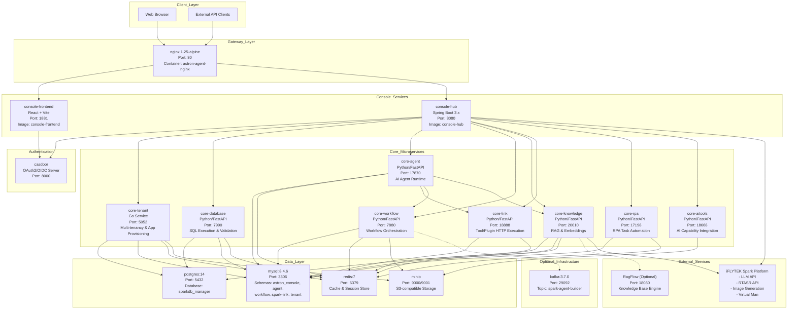

<!-- source: DeepWiki mcp.deepwiki.com · repo iflytek/astron-agent · page 1 Astron Agent Platform Overview · fetched 2026-10-27 -->

# Astron Agent Platform Overview

Relevant source files

The following files were used as context for generating this wiki page:

- [README.md](README.md)
- [console/backend/hub/src/main/resources/application.yml](console/backend/hub/src/main/resources/application.yml)
- [console/frontend/index.html](console/frontend/index.html)
- [console/frontend/public/runtime-config.js](console/frontend/public/runtime-config.js)
- [core/common/audit_system/audit_api/iflytek/ifly_audit_api.py](core/common/audit_system/audit_api/iflytek/ifly_audit_api.py)
- [core/common/audit_system/orchestrator.py](core/common/audit_system/orchestrator.py)
- [core/common/audit_system/strategy/base_strategy.py](core/common/audit_system/strategy/base_strategy.py)
- [core/common/audit_system/strategy/text_strategy.py](core/common/audit_system/strategy/text_strategy.py)
- [core/common/otlp/log_trace/node_log.py](core/common/otlp/log_trace/node_log.py)
- [core/common/otlp/log_trace/node_trace_log.py](core/common/otlp/log_trace/node_trace_log.py)
- [core/common/otlp/metrics/metric.py](core/common/otlp/metrics/metric.py)
- [core/common/otlp/trace/span.py](core/common/otlp/trace/span.py)
- [core/common/otlp/trace/trace.py](core/common/otlp/trace/trace.py)
- [core/common/service/__init__.py](core/common/service/__init__.py)
- [core/common/service/log/factory.py](core/common/service/log/factory.py)
- [docker/astronAgent/.env.example](docker/astronAgent/.env.example)
- [docker/astronAgent/docker-compose.yaml](docker/astronAgent/docker-compose.yaml)
- [docker/astronAgent/nginx/nginx.conf](docker/astronAgent/nginx/nginx.conf)
- [docker/ragflow/docker-compose-macos.yml](docker/ragflow/docker-compose-macos.yml)
- [docs/CONFIGURATION.md](docs/CONFIGURATION.md)
- [docs/CONFIGURATION_zh.md](docs/CONFIGURATION_zh.md)
- [docs/CONTRIBUTING_CN.md](docs/CONTRIBUTING_CN.md)
- [docs/DEPLOYMENT_GUIDE.md](docs/DEPLOYMENT_GUIDE.md)
- [docs/DEPLOYMENT_GUIDE_zh.md](docs/DEPLOYMENT_GUIDE_zh.md)
- [docs/README-zh.md](docs/README-zh.md)

## Purpose and Scope

This document provides a comprehensive overview of the Astron Agent platform, an enterprise-grade, commercial-friendly Agentic Workflow development platform. It covers the high-level architecture, core microservices, deployment infrastructure, and integration patterns that enable organizations to build scalable, production-ready intelligent agent applications. [README.md:13-28](), [docs/README-zh.md:13-28]()

The platform integrates AI workflow orchestration, model management, tool/plugin integration (including MCP protocol), RPA automation, and team collaboration features. It supports high-availability deployment through Docker Compose orchestration and offers flexible integration with external AI services like iFLYTEK Spark and RagFlow. [README.md:13-28](), [docs/DEPLOYMENT_GUIDE.md:6-11]()

For detailed information about specific subsystems:
- System architecture details: see [System Architecture](#1.1)
- Technology stack breakdown: see [Technology Stack](#1.2)
- Individual service documentation: see [Key Components and Services](#1.3)
- Deployment procedures: see [Getting Started](#2)

**Sources:** [README.md:13-28](), [docs/README-zh.md:13-28](), [docs/DEPLOYMENT_GUIDE.md:6-11]()

---

## Platform Architecture

The Astron Agent platform follows a multi-tier microservices architecture with clear separation between client-facing services, business logic orchestration, core domain services, and infrastructure components. [docker/astronAgent/docker-compose.yaml:1-658]()

### High-Level Service Topology

The following diagram illustrates the relationship between the major architectural layers and the specific code entities (containers and services) defined in the deployment configuration.

**Sources:** [docker/astronAgent/docker-compose.yaml:1-658](), [docker/astronAgent/.env.example:88-102](), [docker/astronAgent/nginx/nginx.conf:1-186]()

---

## Core Components Summary

The platform consists of several containerized services organized into functional layers. The backend services are primarily written in Java (Spring Boot), Python (FastAPI), and Go. [docker/astronAgent/docker-compose.yaml:1-658]()

### Core Service Matrix

| Service Name | Technology | Port | Primary Responsibilities | Database Dependencies |
|-------------|------------|------|-------------------------|---------------------|
| **nginx** | Nginx 1.25 | 80 | Reverse proxy, static assets, SSE support | None |
| **console-frontend** | React 18 + Vite | 1881 | Web UI, runtime config injection | None |
| **console-hub** | Spring Boot 3.x | 8080 | Business logic, bot management, publishing | MySQL, Redis, MinIO |
| **casdoor** | Go-based OAuth2 | 8000 | Authentication, SSO, user management | Built-in |
| **core-tenant** | Go 1.21+ | 5052 | Multi-tenancy, app provisioning, API keys | PostgreSQL, MySQL, Redis, MinIO |
| **core-database** | Python + FastAPI | 7990 | Memory DB, SQL execution with validation | PostgreSQL, MySQL, Redis |
| **core-agent** | Python + FastAPI | 17870 | Agent runtime, LLM orchestration, tool calling | MySQL, Redis |
| **core-workflow** | Python + FastAPI | 7880 | Workflow engine, node execution, SSE streaming | MySQL, Redis, MinIO, Kafka |
| **core-knowledge** | Python + FastAPI | 20010 | RAG, embeddings, chunk retrieval | PostgreSQL, MySQL, Redis |
| **core-link** | Python + FastAPI | 18888 | HTTP tool execution, MCP client | MySQL, Redis |
| **core-rpa** | Python + FastAPI | 17198 | RPA task creation and querying | MySQL, Redis |
| **core-aitools** | Python + FastAPI | 18668 | AI service integration (translation, TTS, etc.) | MinIO |

**Sources:** [docker/astronAgent/docker-compose.yaml:1-658](), [console/backend/hub/src/main/resources/application.yml:1-233](), [docker/astronAgent/.env.example:88-102]()

---

## Docker Compose Service Orchestration

The deployment architecture uses Docker Compose with explicit dependency chains and health checks to ensure proper startup sequencing of the infrastructure and application layers. [docker/astronAgent/docker-compose.yaml:1-658]()

### Service Dependency and Infrastructure Mapping

The following diagram maps the logical service dependencies to the specific health check commands and database entities used in the `docker-compose.yaml` configuration.

```mermaid
graph TB
    subgraph "Infrastructure_Tier"
        postgres["postgres<br/>Health: pg_isready -U spark -d sparkdb_manager"]
        mysql["mysql<br/>Health: mysqladmin ping"]
        redis["redis<br/>Health: redis-cli ping"]
        minio["minio<br/>Health: curl /minio/health/live"]
    end
    
    subgraph "Core_Service_Tier"
        core_tenant["core-tenant<br/>depends_on:<br/>postgres, mysql, redis, minio"]
        core_database["core-database<br/>depends_on:<br/>postgres, mysql, redis"]
        core_agent["core-agent<br/>depends_on:<br/>mysql, redis"]
        core_workflow["core-workflow<br/>depends_on:<br/>mysql, redis, minio"]
        core_knowledge["core-knowledge<br/>depends_on:<br/>postgres, mysql, redis"]
        core_link["core-link<br/>depends_on:<br/>mysql, redis"]
        core_rpa["core-rpa<br/>depends_on:<br/>mysql, redis"]
        core_aitools["core-aitools<br/>depends_on:<br/>minio"]
    end
    
    subgraph "Console_Tier"
        console_hub["console-hub<br/>depends_on:<br/>postgres, mysql, redis, minio"]
        console_frontend["console-frontend<br/>No dependencies"]
    end
    
    subgraph "Gateway_Tier"
        nginx_svc["nginx<br/>depends_on:<br/>console-frontend, console-hub"]
    end
    
    postgres -.->|"condition: service_healthy"| core_tenant
    mysql -.->|"condition: service_healthy"| core_tenant
    redis -.->|"condition: service_healthy"| core_tenant
    minio -.->|"condition: service_healthy"| core_tenant
    
    postgres -.->|"condition: service_healthy"| core_database
    mysql -.->|"condition: service_healthy"| core_database
    redis -.->|"condition: service_healthy"| core_database
    
    mysql -.->|"condition: service_healthy"| core_agent
    redis -.->|"condition: service_healthy"| core_agent
    
    mysql -.->|"condition: service_healthy"| core_workflow
    redis -.->|"condition: service_healthy"| core_workflow
    minio -.->|"condition: service_healthy"| core_workflow
    
    postgres -.->|"condition: service_healthy"| core_knowledge
    mysql -.->|"condition: service_healthy"| core_knowledge
    redis -.->|"condition: service_healthy"| core_knowledge
    
    mysql -.->|"condition: service_healthy"| core_link
    redis -.->|"condition: service_healthy"| core_link
    
    mysql -.->|"condition: service_healthy"| core_rpa
    redis -.->|"condition: service_healthy"| core_rpa
    
    minio -.->|"condition: service_healthy"| core_aitools
    
    postgres -.->|"condition: service_healthy"| console_hub
    mysql -.->|"condition: service_healthy"| console_hub
    redis -.->|"condition: service_healthy"| console_hub
    minio -.->|"condition: service_healthy"| console_hub
    
    console_frontend --> nginx_svc
    console_hub --> nginx_svc
```

**Key Configuration Details:**

- **Main Orchestration:** [docker/astronAgent/docker-compose.yaml]()
- **Environment Template:** [docker/astronAgent/.env.example:1-317]()
- **Health Check Settings:** Default interval is 30s with a timeout of 10s and 60 retries. [docker/astronAgent/docker-compose.yaml:21-25]()

**Service-Specific Configurations:**
Each core service utilizes a specific configuration environment file or toml:
- `core-tenant` configuration: [docker/astronAgent/config/tenant/config.toml:1-15]()
- Inter-service communication URLs (Link, Workflow, Knowledge) for the agent runtime: [docker/astronAgent/.env.example:146-177]()

**Sources:** [docker/astronAgent/docker-compose.yaml:1-658](), [docker/astronAgent/.env.example:1-317]()

---

## Technology Stack

The platform leverages a modern polyglot technology stack to handle various domain requirements:

### Backend Technologies
- **Console Hub:** Java 21 with Spring Boot 3.x, using MyBatis-Plus for ORM and Flyway for database migrations. [console/backend/hub/src/main/resources/application.yml:12-82]()
- **Core Microservices:** Primarily Python 3.11 with FastAPI for high-performance async API handling.
- **Tenant Service:** Written in Go for efficient multi-tenancy management.
- **Messaging:** Apache Kafka for telemetry and event streaming (e.g., `spark-agent-builder` topic). [docker/astronAgent/.env.example:46-52](), [docker/astronAgent/.env.example:159]()

### Frontend Technologies
- **Framework:** React with Vite as the build tool. [console/frontend/index.html:78-80]()
- **State & Config:** Uses a dynamic `runtime-config.js` injection pattern to handle environment variables at runtime without rebuilding the image. [console/frontend/index.html:17](), [docker/astronAgent/nginx/nginx.conf:55-66]()

### Data & Infrastructure
- **PostgreSQL:** Primary storage for metadata management (`sparkdb_manager`). [docker/astronAgent/docker-compose.yaml:11-13]()
- **MySQL:** Multi-schema storage for core service data (agent, workflow, link, etc.). [docker/astronAgent/.env.example:29](), [docker/astronAgent/.env.example:154]()
- **Redis:** Distributed caching and session management. [docker/astronAgent/docker-compose.yaml:46-60]()
- **MinIO:** S3-compatible object storage for files and workflow assets. [docker/astronAgent/docker-compose.yaml:126-147]()

**Sources:** [console/backend/hub/src/main/resources/application.yml:1-233](), [docker/astronAgent/docker-compose.yaml:1-658](), [docker/astronAgent/.env.example:1-317]()

---

## Summary

The Astron Agent platform provides a production-ready, enterprise-grade foundation for building agentic AI applications. Key architectural characteristics include:

1. **Microservices Architecture:** Specialized core services with clear domain boundaries.
2. **Polyglot Persistence:** Optimized use of PostgreSQL, MySQL, Redis, and MinIO.
3. **Flexible Deployment:** Robust Docker Compose orchestration with health checks.
4. **Centralized Authentication:** Integrated Casdoor OAuth2/OIDC support.
5. **External AI Integration:** Native support for iFLYTEK Spark and optional RagFlow integration.
6. **Runtime Configurability:** Environment-based configuration for both frontend and backend.

For detailed deployment procedures, see [Getting Started](#2). For individual service documentation, refer to the child pages under [Key Components and Services](#1.3).

**Sources:** [README.md:13-28](), [docker/astronAgent/docker-compose.yaml:1-658](), [docker/astronAgent/.env.example:1-317]()

---

