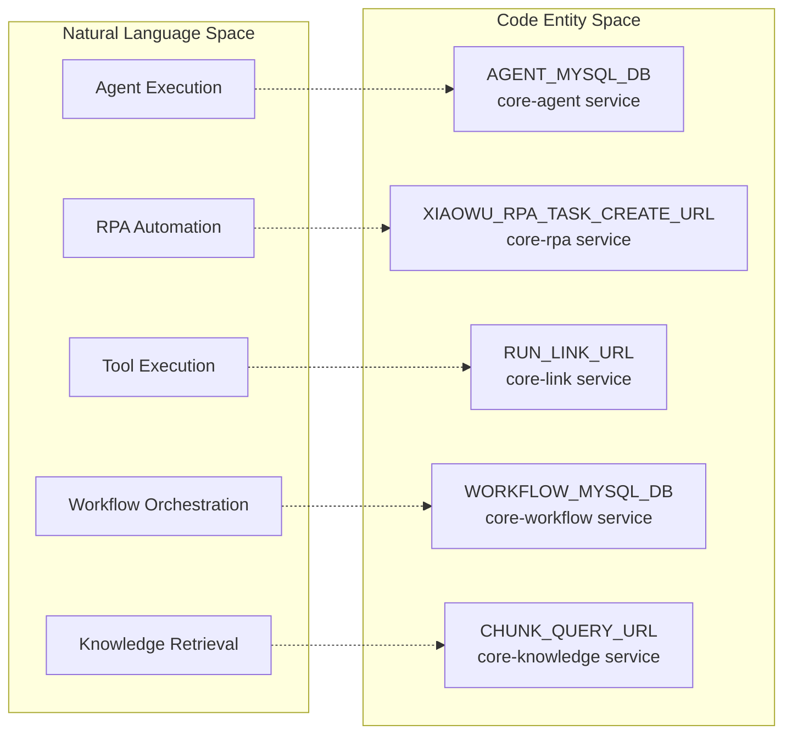
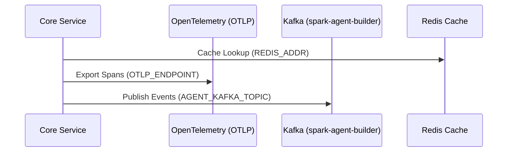

<!-- source: DeepWiki mcp.deepwiki.com · repo iflytek/astron-agent · page 1.3 Key Components and Services · fetched 2026-10-27 -->

# Key Components and Services

Relevant source files

The following files were used as context for generating this wiki page:

- [README.md](README.md)
- [console/backend/hub/src/main/resources/application.yml](console/backend/hub/src/main/resources/application.yml)
- [console/frontend/index.html](console/frontend/index.html)
- [console/frontend/public/runtime-config.js](console/frontend/public/runtime-config.js)
- [core/agent/api/schemas/base_inputs.py](core/agent/api/schemas/base_inputs.py)
- [core/agent/api/schemas/completion_chunk.py](core/agent/api/schemas/completion_chunk.py)
- [core/agent/api/v1/base_api.py](core/agent/api/v1/base_api.py)
- [core/agent/config.env](core/agent/config.env)
- [core/agent/domain/models/base.py](core/agent/domain/models/base.py)
- [core/agent/engine/nodes/base.py](core/agent/engine/nodes/base.py)
- [core/agent/engine/nodes/chat/chat_runner.py](core/agent/engine/nodes/chat/chat_runner.py)
- [core/agent/engine/nodes/cot/cot_runner.py](core/agent/engine/nodes/cot/cot_runner.py)
- [core/agent/engine/nodes/cot_process/cot_process_runner.py](core/agent/engine/nodes/cot_process/cot_process_runner.py)
- [core/agent/service/builder/base_builder.py](core/agent/service/builder/base_builder.py)
- [core/agent/service/plugin/knowledge.py](core/agent/service/plugin/knowledge.py)
- [core/agent/service/plugin/link.py](core/agent/service/plugin/link.py)
- [core/agent/service/plugin/mcp.py](core/agent/service/plugin/mcp.py)
- [core/agent/service/plugin/workflow.py](core/agent/service/plugin/workflow.py)
- [core/agent/service/runner/workflow_agent_runner.py](core/agent/service/runner/workflow_agent_runner.py)
- [core/agent/tests/test_base_builder.py](core/agent/tests/test_base_builder.py)
- [core/agent/tests/test_base_llm_model.py](core/agent/tests/test_base_llm_model.py)
- [core/agent/tests/test_runner_base_and_chat_cot.py](core/agent/tests/test_runner_base_and_chat_cot.py)
- [core/plugin/aitools/app/start_server.py](core/plugin/aitools/app/start_server.py)
- [core/plugin/aitools/common/clients/websockets_client.py](core/plugin/aitools/common/clients/websockets_client.py)
- [core/plugin/aitools/common/log/logger.py](core/plugin/aitools/common/log/logger.py)
- [core/plugin/aitools/config.env](core/plugin/aitools/config.env)
- [core/plugin/aitools/const/const.py](core/plugin/aitools/const/const.py)
- [core/plugin/aitools/main.py](core/plugin/aitools/main.py)
- [core/plugin/link/app/start_server.py](core/plugin/link/app/start_server.py)
- [core/plugin/link/main.py](core/plugin/link/main.py)
- [core/plugin/link/tests/unit/test_main.py](core/plugin/link/tests/unit/test_main.py)
- [core/plugin/rpa/tests/unit/api/test_app.py](core/plugin/rpa/tests/unit/api/test_app.py)
- [core/plugin/rpa/tests/unit/test_main.py](core/plugin/rpa/tests/unit/test_main.py)
- [docker/astronAgent/.env.example](docker/astronAgent/.env.example)
- [docker/astronAgent/docker-compose.yaml](docker/astronAgent/docker-compose.yaml)
- [docker/astronAgent/nginx/nginx.conf](docker/astronAgent/nginx/nginx.conf)
- [docker/ragflow/docker-compose-macos.yml](docker/ragflow/docker-compose-macos.yml)
- [docs/CONFIGURATION.md](docs/CONFIGURATION.md)
- [docs/CONFIGURATION_zh.md](docs/CONFIGURATION_zh.md)
- [docs/CONTRIBUTING_CN.md](docs/CONTRIBUTING_CN.md)
- [docs/DEPLOYMENT_GUIDE.md](docs/DEPLOYMENT_GUIDE.md)
- [docs/DEPLOYMENT_GUIDE_zh.md](docs/DEPLOYMENT_GUIDE_zh.md)
- [docs/README-zh.md](docs/README-zh.md)

This document provides a comprehensive overview of the Astron Agent platform's service architecture, including the eight core microservices, console application services, and infrastructure components. It explains each service's responsibility, configuration, inter-service communication, and deployment model.

---

## Service Overview

The Astron Agent platform consists of **8 core microservices**, **3 console services**, and **5 infrastructure services**. Each core service is a standalone microservice with specific domain responsibilities, deployed as independent Docker containers with health checks and dependency management defined in the orchestration layer [docker/astronAgent/docker-compose.yaml:1-350]().

### Core Services Summary

| Service | Port | Technology | Primary Responsibility | Database Dependencies |
|---------|------|------------|----------------------|---------------------|
| **core-tenant** | 5052 | Go | Multi-tenancy management, app provisioning, API key generation | PostgreSQL, MySQL, Redis, MinIO |
| **core-database** | 7990 | Python/FastAPI | SQL execution with multi-tenant isolation, DML/DDL validation | PostgreSQL, MySQL, Redis |
| **core-rpa** | 17198 | Python/FastAPI | RPA task orchestration, external RPA cloud integration | PostgreSQL, MySQL, Redis |
| **core-link** | 18888 | Python/FastAPI | HTTP tool execution, OpenAPI schema validation, MCP protocol | MySQL, Redis |
| **core-aitools** | 18668 | Python/FastAPI | AI capability integration (translation, speech, image gen) | MinIO |
| **core-agent** | 17870 | Python/FastAPI | Agent runtime, workflow execution, plugin integration | MySQL, Redis |
| **core-knowledge** | 20010 | Python/FastAPI | RAG knowledge base, embedding, chunk retrieval | PostgreSQL, MySQL, Redis |
| **core-workflow** | 7880 | Python/FastAPI | Workflow orchestration, node execution, SSE streaming | MySQL, Redis, MinIO, Kafka |

**Sources:** [docker/astronAgent/.env.example:95-102](), [docker/astronAgent/docker-compose.yaml:165-350](), [docs/DEPLOYMENT_GUIDE.md:5-11]()

### Console Services Summary

| Service | Port | Technology | Primary Responsibility |
|---------|------|------------|----------------------|
| **console-frontend** | 80 | React/Vite | Web UI, runtime config injection, Casdoor OAuth2 client |
| **console-hub** | 8080 | Spring Boot | REST API gateway, bot lifecycle, publishing, chat orchestration |
| **nginx** | 80 | Nginx | Reverse proxy, SSE support, static caching, API routing |

**Sources:** [docker/astronAgent/.env.example:83-85](), [console/backend/hub/src/main/resources/application.yml:1-12](), [docker/astronAgent/docker-compose.yaml:500-550](), [docker/astronAgent/nginx/nginx.conf:45-186]()

---

## Core Services Architecture

The following diagram illustrates the eight core microservices and their relationships to the underlying infrastructure and external providers.

Title: Platform Service Topology

```mermaid
graph TB
    subgraph "Core Microservices Layer"
        Tenant["core-tenant<br/>:5052<br/>Go Service<br/>Multi-tenancy & App Mgmt"]
        Database["core-database<br/>:7990<br/>FastAPI<br/>Memory DB / SQL Execution"]
        RPA["core-rpa<br/>:17198<br/>FastAPI<br/>RPA Task Orchestration"]
        Link["core-link<br/>:18888<br/>FastAPI<br/>Tool Execution / MCP"]
        AITools["core-aitools<br/>:18668<br/>FastAPI<br/>AI Capabilities"]
        Agent["core-agent<br/>:17870<br/>FastAPI<br/>Agent Runtime"]
        Knowledge["core-knowledge<br/>:20010<br/>FastAPI<br/>RAG / Knowledge Base"]
        Workflow["core-workflow<br/>:7880<br/>FastAPI<br/>Workflow Engine"]
    end
    
    subgraph "Infrastructure Dependencies"
        PG["PostgreSQL :5432<br/>sparkdb_manager"]
        MY["MySQL :3306<br/>astron_console"]
        RD["Redis :6379<br/>Cache & Sessions"]
        MN["MinIO :9000<br/>S3 Object Storage"]
        KF["Kafka :29092<br/>spark-agent-builder"]
    end
    
    subgraph "External Providers"
        Spark["iFLYTEK Spark API"]
        RagFlow["RagFlow (Optional)"]
        RPACloud["RPA Cloud Platforms"]
    end
    
    Tenant --> PG
    Tenant --> MY
    Tenant --> RD
    Tenant --> MN
    
    Database --> PG
    Database --> MY
    Database --> RD
    
    RPA --> PG
    RPA --> MY
    RPA --> RD
    RPA --> RPACloud
    
    Link --> MY
    Link --> RD
    
    AITools --> MN
    AITools --> Spark
    
    Agent --> MY
    Agent --> RD
    Agent --> Spark
    
    Knowledge --> PG
    Knowledge --> MY
    Knowledge --> RD
    Knowledge --> RagFlow
    
    Workflow --> MY
    Workflow --> RD
    Workflow --> MN
    Workflow -.-> KF
```

**Sources:** [docker/astronAgent/docker-compose.yaml:7-147](), [docker/astronAgent/.env.example:117-189](), [docs/DEPLOYMENT_GUIDE.md:5-11]()

---

## Core Service Details

### core-tenant (Multi-Tenancy Management)

The tenant service manages multi-tenancy isolation, application provisioning, and API credential generation. It is written in Go and provides REST APIs for creating applications and managing tenant resources.

**Key Responsibilities:**
- Application creation with unique app IDs.
- API key and secret generation for service-to-service authentication.
- Tenant metadata management in PostgreSQL and MySQL [docker/astronAgent/.env.example:125]().
- Resource provisioning across tenant schemas.

**Sources:** [docker/astronAgent/.env.example:117-132](), [docker/astronAgent/docker-compose.yaml:165-194]()

---

### core-database (Memory Database Service)

The database service provides secure SQL execution with multi-tenant isolation. It validates and rewrites DML/DDL queries, enforces row-level security, and manages tenant-specific PostgreSQL schemas.

**Key Responsibilities:**
- DML query execution with automatic `uid` filtering and `LIMIT` injection.
- DDL validation with allowed operation whitelists.
- SQL injection prevention via AST-based parameterization.
- Schema-level isolation: `prod_{uid}_{dbid}` and `test_{uid}_{dbid}` schemas.

**Sources:** [docker/astronAgent/.env.example:134](), [docker/astronAgent/docker-compose.yaml:197-225]()

---

### core-rpa (RPA Automation)

The RPA service integrates with external RPA cloud platforms for task execution and status monitoring. It provides APIs for creating and querying RPA workflow executions.

**Key Implementation:**
- Entry point: `RPAServer.start()` in the RPA service application layer.
- Integration: Connects to external endpoints defined by `XIAOWU_RPA_TASK_CREATE_URL` [docker/astronAgent/.env.example:140]().
- Uses `RPA_URL` as the base for public cloud interaction [docker/astronAgent/.env.example:138]().

**Sources:** [docker/astronAgent/.env.example:136-141](), [docker/astronAgent/docker-compose.yaml:227-255]()

---

### core-link (Tool/Plugin Execution)

The link service executes HTTP-based tools and plugins with parameter validation, authentication injection, and MCP (Model Context Protocol) support for SSE-based tool communication.

**Key Implementation:**
- Entry point: `SparkLinkServer.start()` in `core/plugin/link/app/start_server.py:27-40]().
- Schema Validation: Loads OpenAPI and MCP schemas on startup via `load_http_run_schema()` and `load_mcp_register_schema()` [core/plugin/link/app/start_server.py:158-160]().
- MCP Support: Handles tool listing and calling through dedicated endpoints like `LIST_MCP_PLUGIN_URL` [docker/astronAgent/.env.example:170]().
- Remote Config: Supports Polaris for dynamic environment variable overrides [core/plugin/link/app/start_server.py:42-78]().

**Sources:** [core/plugin/link/app/start_server.py:134-167](), [docker/astronAgent/.env.example:161-171]()

---

### core-aitools (AI Tool Integration)

The aitools service provides AI capabilities including translation, speech recognition/synthesis, and image generation through iFLYTEK Spark APIs.

**Key Responsibilities:**
- Integration with iFLYTEK AI services including Spark LLM, RTASR, and Image generation [console/backend/hub/src/main/resources/application.yml:127-140]().
- File storage integration using MinIO S3 buckets [docker/astronAgent/.env.example:62-65]().
- FastAPI server initialization with configurable worker counts (default 20) [core/plugin/aitools/app/start_server.py:71]().

**Sources:** [core/plugin/aitools/app/start_server.py:106-126](), [docker/astronAgent/.env.example:99]()

---

### core-agent (Agent Runtime)

The agent service executes AI agents with tool calling, workflow integration, knowledge base queries, and MCP plugin support.

**Key Responsibilities:**
- Agent runtime execution using `BaseLLMModel` for completion calls [core/agent/domain/models/base.py:15-37]().
- Orchestrates Reasoning/CoT (Chain of Thought) loops and plugin interactions.
- Communicates with `core-link` for tool execution using `RUN_LINK_URL` [docker/astronAgent/.env.example:163]().

**Sources:** [docker/astronAgent/.env.example:146-177](), [core/agent/domain/models/base.py:1-118]()

---

### core-knowledge (Knowledge Base)

The knowledge service manages RAG (Retrieval-Augmented Generation) knowledge bases with embedding, chunking, and retrieval. It supports both RagFlow and Xinghuo RAG backends.

**Key Responsibilities:**
- Knowledge base document management and chunk query via `CHUNK_QUERY_URL` [docker/astronAgent/.env.example:168]().
- Integration with RagFlow using `RAGFLOW_API_TOKEN` [docker/astronAgent/.env.example:180]().
- Support for Xinghuo dataset IDs [docker/astronAgent/.env.example:183]().

**Sources:** [docker/astronAgent/.env.example:179-184](), [docs/DEPLOYMENT_GUIDE.md:88-114]()

---

### core-workflow (Workflow Orchestration)

The workflow service executes workflow graphs with node orchestration, SSE streaming responses, and integration with external MaaS platforms for workflow versioning and publishing.

**Key Responsibilities:**
- Workflow graph execution with node-based processing [console/backend/hub/src/main/resources/application.yml:153-162]().
- SSE (Server-Sent Events) streaming for real-time progress via Nginx proxy [docker/astronAgent/nginx/nginx.conf:81-106]().
- Integration with MaaS platform for publishing via `MAAS_PUBLISH_API` [console/backend/hub/src/main/resources/application.yml:189]().

**Sources:** [docker/astronAgent/.env.example:186-189](), [console/backend/hub/src/main/resources/application.yml:153-194]()

---

## Service Communication and Entity Mapping

The following diagram bridges high-level service concepts to specific code-defined endpoints and database configurations found in the environment.

Title: Conceptual to Code Mapping

**Sources:** [docker/astronAgent/.env.example:138-186]()

---

## Infrastructure and Configuration

### Environment Configuration

The platform uses a tiered configuration approach, primarily driven by `.env` files and service-specific environment variables.

**Key Configuration Parameters:**
| Parameter | Description | Source |
|-----------|-------------|--------|
| `MYSQL_URL` | Connection string for console metadata | `console/.../application.yml` |
| `OSS_ENDPOINT` | Internal MinIO/S3 endpoint | `.env.example` |
| `KAFKA_SERVERS` | Kafka broker list for telemetry | `.env.example` |
| `CASDOOR_PORT` | Port for authentication service | `.env.example` |

**Sources:** [console/backend/hub/src/main/resources/application.yml:14](), [docker/astronAgent/.env.example:52-62]()

### Data Flow and Telemetry

Services utilize a unified pattern to set up observability, reporting to Kafka topics for tracing and metrics.

Title: Telemetry and Event Data Flow

**Sources:** [docker/astronAgent/.env.example:71-159](), [core/plugin/aitools/app/start_server.py:96-100]()

---

