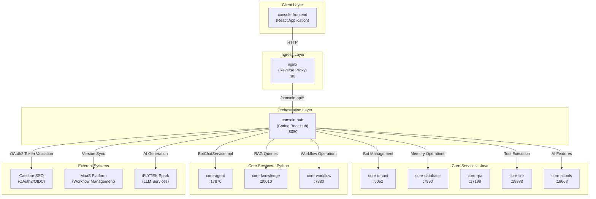
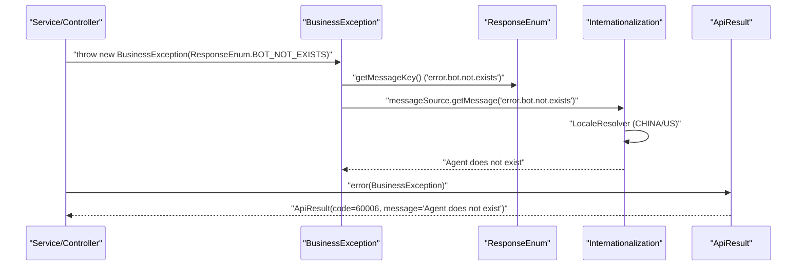

<!-- source: DeepWiki mcp.deepwiki.com · repo iflytek/astron-agent · page 10 Console Backend Services · fetched 2026-10-27 -->

# Console Backend Services

Relevant source files

The following files were used as context for generating this wiki page:

- [console/backend/commons/src/main/java/com/iflytek/astron/console/commons/constant/ResponseEnum.java](console/backend/commons/src/main/java/com/iflytek/astron/console/commons/constant/ResponseEnum.java)
- [console/backend/commons/src/main/java/com/iflytek/astron/console/commons/enums/bot/ReleaseTypeEnum.java](console/backend/commons/src/main/java/com/iflytek/astron/console/commons/enums/bot/ReleaseTypeEnum.java)
- [console/backend/commons/src/main/java/com/iflytek/astron/console/commons/util/BotFileParamUtil.java](console/backend/commons/src/main/java/com/iflytek/astron/console/commons/util/BotFileParamUtil.java)
- [console/backend/commons/src/main/resources/messages_en.properties](console/backend/commons/src/main/resources/messages_en.properties)
- [console/backend/commons/src/main/resources/messages_zh.properties](console/backend/commons/src/main/resources/messages_zh.properties)
- [console/backend/config/pmd-ruleset.xml](console/backend/config/pmd-ruleset.xml)
- [console/backend/config/spotbugs-exclude.xml](console/backend/config/spotbugs-exclude.xml)
- [console/backend/hub/src/main/java/com/iflytek/astron/console/hub/aspect/DistributedLockAspect.java](console/backend/hub/src/main/java/com/iflytek/astron/console/hub/aspect/DistributedLockAspect.java)
- [console/backend/hub/src/main/java/com/iflytek/astron/console/hub/config/InternationalConfig.java](console/backend/hub/src/main/java/com/iflytek/astron/console/hub/config/InternationalConfig.java)
- [console/backend/hub/src/main/java/com/iflytek/astron/console/hub/config/WebMvcConfig.java](console/backend/hub/src/main/java/com/iflytek/astron/console/hub/config/WebMvcConfig.java)
- [console/backend/hub/src/main/java/com/iflytek/astron/console/hub/dto/publish/prepare/WechatPrepareDto.java](console/backend/hub/src/main/java/com/iflytek/astron/console/hub/dto/publish/prepare/WechatPrepareDto.java)
- [console/backend/hub/src/main/java/com/iflytek/astron/console/hub/dto/user/UserInfoResultExcelDTO.java](console/backend/hub/src/main/java/com/iflytek/astron/console/hub/dto/user/UserInfoResultExcelDTO.java)
- [console/backend/hub/src/main/java/com/iflytek/astron/console/hub/properties/InviteMessageTempProperties.java](console/backend/hub/src/main/java/com/iflytek/astron/console/hub/properties/InviteMessageTempProperties.java)
- [console/backend/hub/src/main/java/com/iflytek/astron/console/hub/service/space/impl/InviteRecordBizServiceImpl.java](console/backend/hub/src/main/java/com/iflytek/astron/console/hub/service/space/impl/InviteRecordBizServiceImpl.java)
- [console/backend/hub/src/main/java/com/iflytek/astron/console/hub/util/Md5Util.java](console/backend/hub/src/main/java/com/iflytek/astron/console/hub/util/Md5Util.java)

## Purpose and Scope

The Console Backend Services comprise a Spring Boot application (`console-hub`) that serves as the **API gateway and orchestration layer** for the Astron Agent platform's administrative and management functions. This service layer handles bot lifecycle management, multi-channel publishing, AI-assisted bot generation, workflow version control, and integration with external MaaS (Model-as-a-Service) platforms.

This document covers the backend API services, controllers, business logic, data access patterns, and error handling.

---

## Console Hub Architecture

The `console-hub` application operates as a **centralized API gateway** that authenticates requests, enforces authorization, and delegates operations to specialized core services.

### System Position in Architecture

The following diagram illustrates how the `console-hub` interacts with other system components, bridging the frontend requests to the specialized microservices.

**Sources:** [console/backend/hub/src/main/java/com/iflytek/astron/console/hub/config/WebMvcConfig.java:12-23](), [console/backend/commons/src/main/java/com/iflytek/astron/console/commons/constant/ResponseEnum.java:99-131]()

### Service Orchestration Patterns

The backend uses a standard Spring Boot layered architecture:
- **Controllers**: Handle HTTP requests and input validation.
- **Services**: Orchestrate business logic. For example, `InviteRecordBizServiceImpl` manages complex space invitation logic and capacity checks [console/backend/hub/src/main/java/com/iflytek/astron/console/hub/service/space/impl/InviteRecordBizServiceImpl.java:102-127]().
- **Mappers**: Interface with persistence layers via MyBatis or JPA.
- **Aspects**: Handle cross-cutting concerns. The `DistributedLockAspect` uses Redisson to manage concurrency across the cluster, preventing race conditions during critical operations [console/backend/hub/src/main/java/com/iflytek/astron/console/hub/aspect/DistributedLockAspect.java:41-98]().

For details, see [Console Hub Architecture](#10.1).

---

## Bot Management Services

The bot management layer handles the complete bot lifecycle, from AI-assisted creation to dataset association.

### Bot Creation and Configuration
Bots are defined by entities and managed through services that validate multi-tenant permissions. The system handles specific file parameters and input configurations using utilities like `BotFileParamUtil` to determine if a bot supports multi-file parameters [console/backend/commons/src/main/java/com/iflytek/astron/console/commons/util/BotFileParamUtil.java:25-40]().

### AI-Assisted Generation
The AI generation services leverage iFLYTEK Spark APIs to provide:
- **One-sentence bot creation**: Parsing natural language into structured configurations.
- **AI Avatar Generation**: Creating bot icons and managing storage via S3 [console/backend/commons/src/main/java/com/iflytek/astron/console/commons/constant/ResponseEnum.java:30-31]().
- **Prologue and Input Example Generation**: Enhancing user experience with AI-generated content [console/backend/commons/src/main/java/com/iflytek/astron/console/commons/constant/ResponseEnum.java:89-90]().

For details, see [Bot Management Services](#10.2).

---

## Publishing and Marketplace Services

The publishing system handles deployment to diverse channels including the internal Marketplace, API, WeChat, and MCP [console/backend/commons/src/main/java/com/iflytek/astron/console/commons/enums/bot/ReleaseTypeEnum.java:3-14]().

### Multi-Channel Strategy
The system manages different preparation data for various channels. For example, `WechatPrepareDto` holds specific credentials like `appId`, `appSecret`, and `encodingAESKey` required for WeChat Official Account integration [console/backend/hub/src/main/java/com/iflytek/astron/console/hub/dto/publish/prepare/WechatPrepareDto.java:13-44]().

- **Marketplace Sync**: Synchronizes bot metadata and marketplace entries.
- **Status Management**: Enforces strict state transitions, ensuring bots are in a valid state before publishing [console/backend/commons/src/main/java/com/iflytek/astron/console/commons/constant/ResponseEnum.java:42-44]().

For details, see [Publishing and Marketplace Services](#10.3).

---

## Error Handling and Internationalization

The platform implements a robust error handling and i18n system to support global deployments.

### Standardized Responses and Localization Flow

The following diagram shows how the system transforms internal error states into localized API responses using the `ResponseEnum` catalog and `messages_*.properties` files.

### Error Catalog
The `ResponseEnum` provides a comprehensive catalog of error codes:
- **System Errors (5xxxx)**: S3 upload failures, internal server errors [console/backend/commons/src/main/java/com/iflytek/astron/console/commons/constant/ResponseEnum.java:26-31]().
- **Business Errors (6xxxx)**: Bot not found, duplicate names, insufficient permissions [console/backend/commons/src/main/java/com/iflytek/astron/console/commons/constant/ResponseEnum.java:33-45]().
- **Spark API Errors**: Mapping specific engine and WebSocket errors (e.g., `60040-60080`) from iFLYTEK Spark to localized messages [console/backend/commons/src/main/java/com/iflytek/astron/console/commons/constant/ResponseEnum.java:99-131]().

### Message Resolution
The `InternationalConfig` sets up an `AcceptHeaderLocaleResolver` to determine the user's language from HTTP headers, defaulting to `Locale.CHINA` [console/backend/hub/src/main/java/com/iflytek/astron/console/hub/config/InternationalConfig.java:19-24](). Resource bundles like `messages_en.properties` provide the localized strings for all business and system codes [console/backend/commons/src/main/resources/messages_en.properties:1-113]().

For details, see [Error Handling and Internationalization](#10.4).

---

## Data Access Patterns

The backend relies on relational databases for persistence and Redis for distributed locking and caching.

### Key Data Utilities and Configs

| Component | Purpose | Source |
|--------------|---------|--------|
| `ResponseEnum` | Centralized definition of all platform error codes and message keys | [console/backend/commons/src/main/java/com/iflytek/astron/console/commons/constant/ResponseEnum.java:8-131]() |
| `BotFileParamUtil` | Logic for merging and validating bot file upload configurations | [console/backend/commons/src/main/java/com/iflytek/astron/console/commons/util/BotFileParamUtil.java:84-107]() |
| `WebMvcConfig` | Configuration for API interceptors and public endpoint whitelisting | [console/backend/hub/src/main/java/com/iflytek/astron/console/hub/config/WebMvcConfig.java:12-30]() |

### Distributed Locking
To prevent race conditions during bot updates, invitations, or publishing, the system uses the `@DistributedLock` annotation. The `DistributedLockAspect` handles the acquisition of reentrant, fair, or read-write locks using Redisson, supporting SpEL expressions for dynamic keys [console/backend/hub/src/main/java/com/iflytek/astron/console/hub/aspect/DistributedLockAspect.java:61-98]().

**Sources:**
- [console/backend/commons/src/main/java/com/iflytek/astron/console/commons/constant/ResponseEnum.java]()
- [console/backend/commons/src/main/resources/messages_en.properties]()
- [console/backend/commons/src/main/java/com/iflytek/astron/console/commons/util/BotFileParamUtil.java]()
- [console/backend/hub/src/main/java/com/iflytek/astron/console/hub/aspect/DistributedLockAspect.java]()
- [console/backend/hub/src/main/java/com/iflytek/astron/console/hub/config/InternationalConfig.java]()
- [console/backend/hub/src/main/java/com/iflytek/astron/console/hub/service/space/impl/InviteRecordBizServiceImpl.java]()
- [console/backend/hub/src/main/java/com/iflytek/astron/console/hub/dto/publish/prepare/WechatPrepareDto.java]()

---

