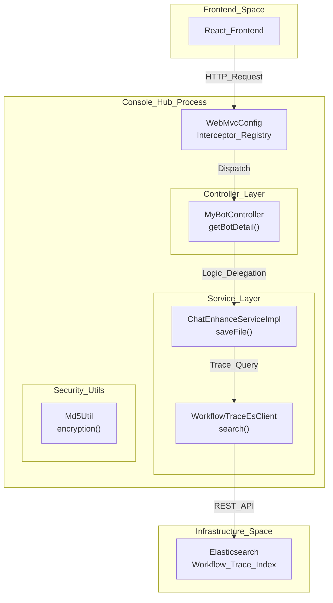
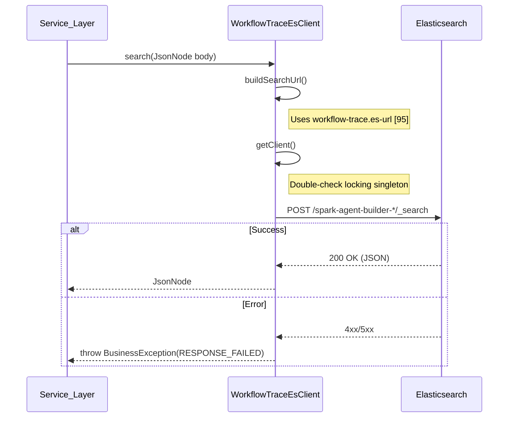

<!-- source: DeepWiki mcp.deepwiki.com · repo iflytek/astron-agent · page 10.1 Console Hub Architecture · fetched 2026-10-27 -->

# Console Hub Architecture

Relevant source files

The following files were used as context for generating this wiki page:

- [console/backend/config/pmd-ruleset.xml](console/backend/config/pmd-ruleset.xml)
- [console/backend/config/spotbugs-exclude.xml](console/backend/config/spotbugs-exclude.xml)
- [console/backend/hub/Dockerfile](console/backend/hub/Dockerfile)
- [console/backend/hub/src/main/java/com/iflytek/astron/console/hub/config/WebMvcConfig.java](console/backend/hub/src/main/java/com/iflytek/astron/console/hub/config/WebMvcConfig.java)
- [console/backend/hub/src/main/java/com/iflytek/astron/console/hub/util/Md5Util.java](console/backend/hub/src/main/java/com/iflytek/astron/console/hub/util/Md5Util.java)
- [console/backend/toolkit/src/main/java/com/iflytek/astron/console/toolkit/config/properties/WorkflowTraceProperties.java](console/backend/toolkit/src/main/java/com/iflytek/astron/console/toolkit/config/properties/WorkflowTraceProperties.java)
- [console/backend/toolkit/src/main/java/com/iflytek/astron/console/toolkit/service/workflowtrace/WorkflowTraceEsClient.java](console/backend/toolkit/src/main/java/com/iflytek/astron/console/toolkit/service/workflowtrace/WorkflowTraceEsClient.java)
- [console/backend/toolkit/src/main/resources/application-toolkit.yml](console/backend/toolkit/src/main/resources/application-toolkit.yml)

## Purpose and Scope

Console Hub (`console-hub`) is the central Spring Boot API Gateway and orchestration service in the Astron Agent platform, running on port 8080 [console/backend/hub/Dockerfile:31-31](). It serves as the primary backend entry point for the Console Frontend, bridging the gap between the React-based UI and the specialized Python, Go, and Java-based core microservices.

**Key responsibilities:**
- **API Gateway**: Routes requests from Nginx to appropriate internal handlers and downstream services.
- **Service Orchestration**: Coordinates complex operations across multiple services, such as bot publishing, knowledge base management, and RPA integration [console/backend/toolkit/src/main/resources/application-toolkit.yml:9-40]().
- **Infrastructure Abstraction**: Provides unified access to object storage (MinIO/S3), databases, and search engines (Elasticsearch) [console/backend/toolkit/src/main/java/com/iflytek/astron/console/toolkit/service/workflowtrace/WorkflowTraceEsClient.java:24-26]().
- **Security and Context**: Manages space-based isolation and user context through interceptors and utility classes.

**Sources:** [console/backend/hub/Dockerfile:31-31](), [console/backend/toolkit/src/main/resources/application-toolkit.yml:9-40](), [console/backend/toolkit/src/main/java/com/iflytek/astron/console/toolkit/service/workflowtrace/WorkflowTraceEsClient.java:24-26]()

## Technology Stack

Console Hub is built on a modern Java stack optimized for containerized environments:

| Component | Technology | Details |
|-----------|-----------|-----------------|
| **Framework** | Spring Boot | Core application framework |
| **Language** | Java | JDK 21 (Eclipse Temurin) [console/backend/hub/Dockerfile:1-1]() |
| **ORM** | MyBatis | Integrated with PageHelper for pagination [console/backend/toolkit/src/main/resources/application-toolkit.yml:2-3]() |
| **Build Tool** | Maven | Multi-module build (hub, toolkit, commons) [console/backend/hub/Dockerfile:4-7]() |
| **External APIs** | OkHttp3 | Used for Elasticsearch and inter-service calls [console/backend/toolkit/src/main/java/com/iflytek/astron/console/toolkit/service/workflowtrace/WorkflowTraceEsClient.java:13-13]() |
| **JSON Library** | Jackson | For data serialization and tree parsing [console/backend/toolkit/src/main/java/com/iflytek/astron/console/toolkit/service/workflowtrace/WorkflowTraceEsClient.java:5-5]() |

**Sources:** [console/backend/hub/Dockerfile:1-1](), [console/backend/toolkit/src/main/resources/application-toolkit.yml:2-6](), [console/backend/toolkit/src/main/java/com/iflytek/astron/console/toolkit/service/workflowtrace/WorkflowTraceEsClient.java:5-13]()

## Request Flow and Component Architecture

Console Hub acts as the orchestrator, receiving requests from the frontend and delegating to specialized services. It utilizes a standard layered architecture: `Controller` (Entry) -> `Service` (Logic) -> `Mapper/Client` (Data/Integration).

**Diagram: Console Hub Internal Service Flow**

**Sources:** [console/backend/hub/src/main/java/com/iflytek/astron/console/hub/config/WebMvcConfig.java:10-30](), [console/backend/toolkit/src/main/java/com/iflytek/astron/console/toolkit/service/workflowtrace/WorkflowTraceEsClient.java:36-47](), [console/backend/hub/src/main/java/com/iflytek/astron/console/hub/util/Md5Util.java:13-13](), [console/backend/config/spotbugs-exclude.xml:104-112]()

## Infrastructure Orchestration Patterns

### External Service Integration
The Hub centralizes the configuration for various internal and external services. These are managed via the `api.url` configuration prefix [console/backend/toolkit/src/main/resources/application-toolkit.yml:9-10]().

- **Knowledge & Dataset**: Integrates with `knowledgeUrl` and specialized dataset endpoints like `xinghuoDatasetFileUrl` [console/backend/toolkit/src/main/resources/application-toolkit.yml:18-37]().
- **RPA & Tools**: Orchestrates calls to `toolRpaUrl` and the main `toolUrl` [console/backend/toolkit/src/main/resources/application-toolkit.yml:25-26]().
- **MaaS/Workflow**: Communicates with the `workflow` service for agent execution logic [console/backend/toolkit/src/main/resources/application-toolkit.yml:27-27]().

### Workflow Trace Integration
The `WorkflowTraceEsClient` handles communication with Elasticsearch to retrieve execution logs. It utilizes `WorkflowTraceProperties` for configuration [console/backend/toolkit/src/main/java/com/iflytek/astron/console/toolkit/service/workflowtrace/WorkflowTraceEsClient.java:27-31]().

**Diagram: Elasticsearch Client Search Flow**

**Sources:** [console/backend/toolkit/src/main/java/com/iflytek/astron/console/toolkit/service/workflowtrace/WorkflowTraceEsClient.java:36-90](), [console/backend/toolkit/src/main/resources/application-toolkit.yml:94-99]()

## Deployment and Runtime Configuration

The Hub is containerized using a multi-stage Docker build to optimize for size and security.

### Docker Multi-Stage Build
1.  **Build Stage**: Uses `maven:3.9.9-eclipse-temurin-21` to compile the `hub` module along with its internal dependencies (`commons`, `toolkit`) [console/backend/hub/Dockerfile:1-12]().
2.  **Runtime Stage**: Uses `eclipse-temurin:21-jre` and configures the environment for `Asia/Shanghai` timezone and `zh_CN.UTF-8` locale [console/backend/hub/Dockerfile:14-28]().

### JVM Performance Tuning
The Hub's `ENTRYPOINT` includes optimized parameters for container environments:
- `-XX:+UseContainerSupport`: Ensures the JVM respects Docker resource limits [console/backend/hub/Dockerfile:35-35]().
- `-XX:MaxRAMPercentage=75.0`: Allocates 75% of container memory to the heap [console/backend/hub/Dockerfile:36-36]().
- `-XX:+UseG1GC`: Utilizes the G1 Garbage Collector for predictable pause times [console/backend/hub/Dockerfile:37-37]().
- `-XX:+UseStringDeduplication`: Reduces memory footprint by deduplicating common strings [console/backend/hub/Dockerfile:38-38]().

**Sources:** [console/backend/hub/Dockerfile:1-40]()

## Code Quality and Standards

The backend adheres to strict quality checks defined in the `console/backend/config` directory:
- **PMD**: Enforces complexity limits (Cyclomatic Complexity < 23) and method length (NCSS < 80) [console/backend/config/pmd-ruleset.xml:12-25]().
- **SpotBugs**: Filters out known false positives, such as internal representation exposure in DTOs or MapStruct generated classes [console/backend/config/spotbugs-exclude.xml:43-45](), [console/backend/config/spotbugs-exclude.xml:149-152]().
- **Async Execution**: Configured with a dedicated thread pool for background tasks, using a `CallerRuns` rejection policy to ensure system stability under high load [console/backend/toolkit/src/main/resources/application-toolkit.yml:75-85]().

**Sources:** [console/backend/config/pmd-ruleset.xml:11-33](), [console/backend/config/spotbugs-exclude.xml:1-154](), [console/backend/toolkit/src/main/resources/application-toolkit.yml:75-85]()

---

