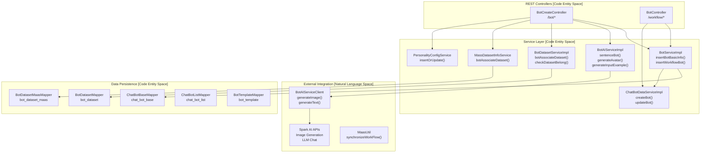
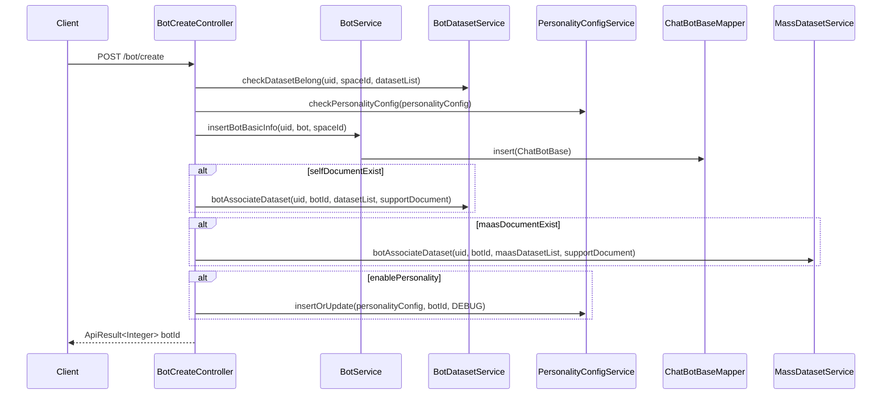
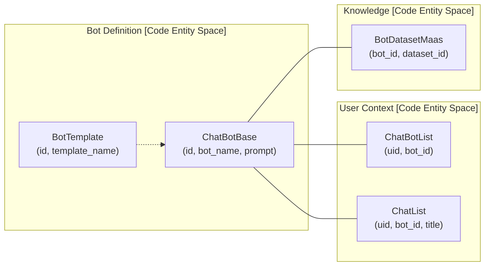

<!-- source: DeepWiki mcp.deepwiki.com · repo iflytek/astron-agent · page 10.2 Bot Management Services · fetched 2026-10-27 -->

# Bot Management Services

Relevant source files

The following files were used as context for generating this wiki page:

- [console/backend/commons/src/main/java/com/iflytek/astron/console/commons/constant/RedisKeyConstant.java](console/backend/commons/src/main/java/com/iflytek/astron/console/commons/constant/RedisKeyConstant.java)
- [console/backend/commons/src/main/java/com/iflytek/astron/console/commons/dto/bot/BotCreateForm.java](console/backend/commons/src/main/java/com/iflytek/astron/console/commons/dto/bot/BotCreateForm.java)
- [console/backend/commons/src/main/java/com/iflytek/astron/console/commons/entity/bot/BotTemplate.java](console/backend/commons/src/main/java/com/iflytek/astron/console/commons/entity/bot/BotTemplate.java)
- [console/backend/commons/src/main/java/com/iflytek/astron/console/commons/entity/bot/ChatBotBase.java](console/backend/commons/src/main/java/com/iflytek/astron/console/commons/entity/bot/ChatBotBase.java)
- [console/backend/commons/src/main/java/com/iflytek/astron/console/commons/enums/bot/DefaultBotModelEnum.java](console/backend/commons/src/main/java/com/iflytek/astron/console/commons/enums/bot/DefaultBotModelEnum.java)
- [console/backend/commons/src/main/java/com/iflytek/astron/console/commons/mapper/bot/BotTemplateMapper.java](console/backend/commons/src/main/java/com/iflytek/astron/console/commons/mapper/bot/BotTemplateMapper.java)
- [console/backend/commons/src/main/java/com/iflytek/astron/console/commons/service/bot/BotDatasetService.java](console/backend/commons/src/main/java/com/iflytek/astron/console/commons/service/bot/BotDatasetService.java)
- [console/backend/commons/src/main/java/com/iflytek/astron/console/commons/service/bot/BotService.java](console/backend/commons/src/main/java/com/iflytek/astron/console/commons/service/bot/BotService.java)
- [console/backend/commons/src/main/java/com/iflytek/astron/console/commons/service/bot/ChatBotDataService.java](console/backend/commons/src/main/java/com/iflytek/astron/console/commons/service/bot/ChatBotDataService.java)
- [console/backend/commons/src/main/java/com/iflytek/astron/console/commons/service/bot/impl/BotServiceImpl.java](console/backend/commons/src/main/java/com/iflytek/astron/console/commons/service/bot/impl/BotServiceImpl.java)
- [console/backend/commons/src/main/java/com/iflytek/astron/console/commons/service/bot/impl/ChatBotDataServiceImpl.java](console/backend/commons/src/main/java/com/iflytek/astron/console/commons/service/bot/impl/ChatBotDataServiceImpl.java)
- [console/backend/commons/src/main/java/com/iflytek/astron/console/commons/service/data/impl/ChatListDataServiceImpl.java](console/backend/commons/src/main/java/com/iflytek/astron/console/commons/service/data/impl/ChatListDataServiceImpl.java)
- [console/backend/commons/src/main/java/com/iflytek/astron/console/commons/service/workflow/WorkflowBotService.java](console/backend/commons/src/main/java/com/iflytek/astron/console/commons/service/workflow/WorkflowBotService.java)
- [console/backend/commons/src/main/java/com/iflytek/astron/console/commons/util/BotUtil.java](console/backend/commons/src/main/java/com/iflytek/astron/console/commons/util/BotUtil.java)
- [console/backend/commons/src/test/java/com/iflytek/astron/console/commons/service/bot/impl/ChatBotDataServiceImplTest.java](console/backend/commons/src/test/java/com/iflytek/astron/console/commons/service/bot/impl/ChatBotDataServiceImplTest.java)
- [console/backend/hub/src/main/java/com/iflytek/astron/console/hub/controller/bot/BotController.java](console/backend/hub/src/main/java/com/iflytek/astron/console/hub/controller/bot/BotController.java)
- [console/backend/hub/src/main/java/com/iflytek/astron/console/hub/controller/bot/BotCreateController.java](console/backend/hub/src/main/java/com/iflytek/astron/console/hub/controller/bot/BotCreateController.java)
- [console/backend/hub/src/main/java/com/iflytek/astron/console/hub/controller/user/MyBotController.java](console/backend/hub/src/main/java/com/iflytek/astron/console/hub/controller/user/MyBotController.java)
- [console/backend/hub/src/main/java/com/iflytek/astron/console/hub/dto/publish/CreateBotApiVo.java](console/backend/hub/src/main/java/com/iflytek/astron/console/hub/dto/publish/CreateBotApiVo.java)
- [console/backend/hub/src/main/java/com/iflytek/astron/console/hub/service/bot/BotAIService.java](console/backend/hub/src/main/java/com/iflytek/astron/console/hub/service/bot/BotAIService.java)
- [console/backend/hub/src/main/java/com/iflytek/astron/console/hub/service/bot/BotTransactionalService.java](console/backend/hub/src/main/java/com/iflytek/astron/console/hub/service/bot/BotTransactionalService.java)
- [console/backend/hub/src/main/java/com/iflytek/astron/console/hub/service/bot/impl/BotAIServiceImpl.java](console/backend/hub/src/main/java/com/iflytek/astron/console/hub/service/bot/impl/BotAIServiceImpl.java)
- [console/backend/hub/src/main/java/com/iflytek/astron/console/hub/service/workflow/BotChainService.java](console/backend/hub/src/main/java/com/iflytek/astron/console/hub/service/workflow/BotChainService.java)
- [console/backend/hub/src/main/java/com/iflytek/astron/console/hub/util/BotAIServiceClient.java](console/backend/hub/src/main/java/com/iflytek/astron/console/hub/util/BotAIServiceClient.java)
- [console/backend/hub/src/test/java/com/iflytek/astron/console/hub/data/impl/ChatDataServiceImplTest.java](console/backend/hub/src/test/java/com/iflytek/astron/console/hub/data/impl/ChatDataServiceImplTest.java)
- [console/backend/hub/src/test/java/com/iflytek/astron/console/hub/data/impl/ReqKnowledgeRecordsDataServiceImplTest.java](console/backend/hub/src/test/java/com/iflytek/astron/console/hub/data/impl/ReqKnowledgeRecordsDataServiceImplTest.java)
- [console/backend/hub/src/test/java/com/iflytek/astron/console/hub/data/impl/ShareDataServiceImplTest.java](console/backend/hub/src/test/java/com/iflytek/astron/console/hub/data/impl/ShareDataServiceImplTest.java)
- [console/backend/toolkit/src/main/java/com/iflytek/astron/console/toolkit/service/repo/MassDatasetInfoService.java](console/backend/toolkit/src/main/java/com/iflytek/astron/console/toolkit/service/repo/MassDatasetInfoService.java)

Bot Management Services comprise the backend service layer responsible for bot lifecycle operations including creation, AI-assisted generation, configuration management, dataset associations, and chat processing. These services are implemented in the `console-hub` Spring Boot application and provide REST APIs for bot CRUD operations, AI-powered bot generation features, and runtime chat execution with knowledge enhancement.

---

## Service Architecture Overview

The bot management layer follows a controller-service-mapper pattern with specialized services for different aspects of bot lifecycle management.

### Core Service Components

**Sources:** [console/backend/commons/src/main/java/com/iflytek/astron/console/commons/service/bot/impl/BotServiceImpl.java:61-106](), [console/backend/commons/src/main/java/com/iflytek/astron/console/commons/service/bot/impl/ChatBotDataServiceImpl.java:45-85](), [console/backend/toolkit/src/main/java/com/iflytek/astron/console/toolkit/service/repo/MassDatasetInfoService.java:26-36](), [console/backend/hub/src/main/java/com/iflytek/astron/console/hub/controller/bot/BotCreateController.java:45-73]()

---

## Bot Creation and Update Services

### Bot Lifecycle Management

The `BotServiceImpl` and `ChatBotDataServiceImpl` handle the core logic for bot persistence and metadata management.

| Function | Service | Description |
|----------|---------|-------------|
| `insertBotBasicInfo` | `BotServiceImpl` | Creates a basic bot entry with name, description, and avatar [console/backend/commons/src/main/java/com/iflytek/astron/console/commons/service/bot/impl/BotServiceImpl.java:189-205](). |
| `insertWorkflowBot` | `BotServiceImpl` | Creates a bot specifically linked to a workflow version with a distributed lock [console/backend/commons/src/main/java/com/iflytek/astron/console/commons/service/bot/impl/BotServiceImpl.java:179-186](). |
| `updateBot` | `ChatBotDataServiceImpl` | Updates bot configuration, including explicit null handling for `modelId` [console/backend/commons/src/main/java/com/iflytek/astron/console/commons/service/bot/impl/ChatBotDataServiceImpl.java:171-180](). |
| `copyBot` | `ChatBotDataServiceImpl` | Clones an existing bot configuration into a new space or for a new user [console/backend/commons/src/main/java/com/iflytek/astron/console/commons/service/bot/ChatBotDataService.java:167](). |
| `updateBotBasicInfo`| `ChatBotDataServiceImpl`| Updates specific metadata: description, prologue, and input examples [console/backend/commons/src/main/java/com/iflytek/astron/console/commons/service/bot/ChatBotDataService.java:172-174](). |

### Bot Creation Flow

The creation process involves validating ownership of resources (datasets), configuring personality settings, and persisting metadata.

**Sources:** [console/backend/hub/src/main/java/com/iflytek/astron/console/hub/controller/bot/BotCreateController.java:85-122](), [console/backend/commons/src/main/java/com/iflytek/astron/console/commons/service/bot/impl/BotServiceImpl.java:189-210](), [console/backend/toolkit/src/main/java/com/iflytek/astron/console/toolkit/service/repo/MassDatasetInfoService.java:62-81]()

---

## AI-Assisted Bot Generation

AI-powered generation features use iFLYTEK Spark APIs to streamline bot creation. The `BotAIServiceImpl` uses localized and cached prompt templates to interact with the LLM.

### AI Generation Capabilities

| Feature | Service Method | Output |
|---------|----------------|--------|
| One-Sentence Bot | `sentenceBot()` | Uses `sentence_bot` prompt to generate a JSON structure containing name, desc, and prompt [console/backend/hub/src/main/java/com/iflytek/astron/console/hub/service/bot/impl/BotAIServiceImpl.java:286-300](). |
| Avatar Generation | `generateAvatar()` | Calls Spark TTI (Text-to-Image) via `BotAIServiceClient`, compresses the image, and uploads to MinIO/S3 [console/backend/hub/src/main/java/com/iflytek/astron/console/hub/service/bot/impl/BotAIServiceImpl.java:328-360](). |
| Input Examples | `generateInputExample()` | Uses `input_example_generation` prompt to create suggested user inputs for the bot [console/backend/hub/src/main/java/com/iflytek/astron/console/hub/service/bot/impl/BotAIServiceImpl.java:375-390](). |
| Prologue Generation | `generatePrologue()` | Generates an opening greeting based on the bot's persona [console/backend/hub/src/main/java/com/iflytek/astron/console/hub/service/bot/impl/BotAIServiceImpl.java:400-410](). |

### Prompt Template Management
The system caches prompt templates in Redis with a key structure `prompt_template:{promptKey}:{languageCode}` [console/backend/hub/src/main/java/com/iflytek/astron/console/hub/service/bot/impl/BotAIServiceImpl.java:64-69](). If a localized template is missing, it falls back to English [console/backend/hub/src/main/java/com/iflytek/astron/console/hub/service/bot/impl/BotAIServiceImpl.java:83-92]().

**Sources:** [console/backend/hub/src/main/java/com/iflytek/astron/console/hub/service/bot/impl/BotAIServiceImpl.java:62-102](), [console/backend/hub/src/main/java/com/iflytek/astron/console/hub/service/bot/impl/BotAIServiceImpl.java:286-410](), [console/backend/hub/src/main/java/com/iflytek/astron/console/hub/util/BotAIServiceClient.java:127-146]()

---

## Dataset Association and Knowledge Services

Bots integrate with knowledge bases through association services that manage the mapping between bots and datasets.

### Dataset Association Implementation

1. **Standard Association**: `BotDatasetServiceImpl` links a bot to standard datasets in the `bot_dataset` table, generating a unique `datasetIndex` (uid + datasetId) [console/backend/commons/src/main/java/com/iflytek/astron/console/commons/service/bot/impl/BotDatasetServiceImpl.java:83-100]().
2. **MaaS Association**: `MassDatasetInfoService` handles associations for MaaS-based datasets, storing them in the `bot_dataset_maas` table [console/backend/toolkit/src/main/java/com/iflytek/astron/console/toolkit/service/repo/MassDatasetInfoService.java:62-81]().
3. **Synchronization**: Both services update the `support_document` flag in `chat_bot_base` to notify the runtime that the bot has knowledge base capabilities [console/backend/toolkit/src/main/java/com/iflytek/astron/console/toolkit/service/repo/MassDatasetInfoService.java:84-87]().
4. **Update Strategy**: When updating associations, `MassDatasetInfoService.updateDatasetByBot` first invalidates old associations by setting `is_act = 0` before inserting new ones [console/backend/toolkit/src/main/java/com/iflytek/astron/console/toolkit/service/repo/MassDatasetInfoService.java:94-103]().

**Sources:** [console/backend/toolkit/src/main/java/com/iflytek/astron/console/toolkit/service/repo/MassDatasetInfoService.java:37-105](), [console/backend/commons/src/main/java/com/iflytek/astron/console/commons/service/bot/impl/BotDatasetServiceImpl.java:83-111]()

---

## Data Models and Persistence

### Core Entities and Mappers

| Entity | Mapper | Purpose |
|--------|--------|---------|
| `ChatBotBase` | `ChatBotBaseMapper` | Primary configuration including `botName`, `prompt`, `modelId`, and `version` [console/backend/commons/src/main/java/com/iflytek/astron/console/commons/entity/bot/ChatBotBase.java](). |
| `ChatBotList` | `ChatBotListMapper` | Mapping of bots to a user's personal "My Bots" list [console/backend/commons/src/main/java/com/iflytek/astron/console/commons/service/bot/impl/ChatBotDataServiceImpl.java:51](). |
| `BotDatasetMaas`| `BotDatasetMaasMapper`| Join table for bots and MaaS datasets [console/backend/toolkit/src/main/java/com/iflytek/astron/console/toolkit/service/repo/MassDatasetInfoService.java:29](). |
| `BotTemplate` | `BotTemplateMapper` | Templates used as blueprints for creating new bots [console/backend/hub/src/main/java/com/iflytek/astron/console/hub/controller/bot/BotCreateController.java:66](). |
| `ChatBotMarket` | `ChatBotMarketMapper` | Bots published to the marketplace [console/backend/commons/src/main/java/com/iflytek/astron/console/commons/service/bot/impl/ChatBotDataServiceImpl.java:54](). |

### Data Relationship Diagram

**Sources:** [console/backend/commons/src/main/java/com/iflytek/astron/console/commons/service/bot/impl/ChatBotDataServiceImpl.java:89-102](), [console/backend/toolkit/src/main/java/com/iflytek/astron/console/toolkit/service/repo/MassDatasetInfoService.java:62-81](), [console/backend/commons/src/main/java/com/iflytek/astron/console/commons/util/BotUtil.java:49-77]()

---

