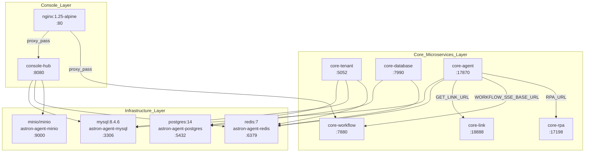
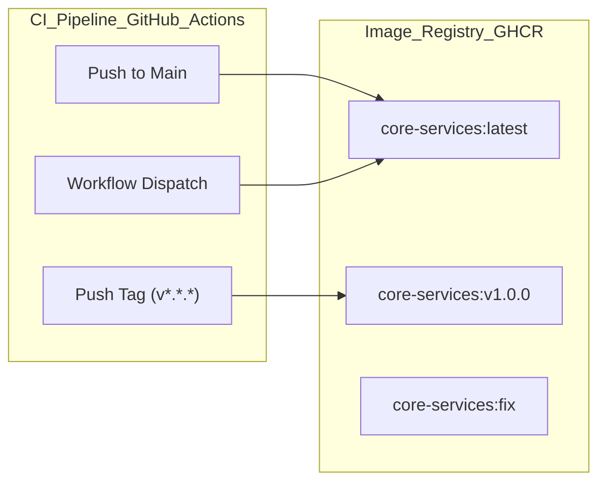

<!-- source: DeepWiki mcp.deepwiki.com · repo iflytek/astron-agent · page 11.1 Docker Compose Orchestration · fetched 2026-10-27 -->

# Docker Compose Orchestration

Relevant source files

The following files were used as context for generating this wiki page:

- [README.md](README.md)
- [console/backend/hub/src/main/resources/application.yml](console/backend/hub/src/main/resources/application.yml)
- [console/frontend/index.html](console/frontend/index.html)
- [console/frontend/public/runtime-config.js](console/frontend/public/runtime-config.js)
- [docker/astronAgent/.env.example](docker/astronAgent/.env.example)
- [docker/astronAgent/.env.with-rpa](docker/astronAgent/.env.with-rpa)
- [docker/astronAgent/astronRPA/.env](docker/astronAgent/astronRPA/.env)
- [docker/astronAgent/astronRPA/docker-compose.yml](docker/astronAgent/astronRPA/docker-compose.yml)
- [docker/astronAgent/astronRPA/volumes/atlas/atlas.hcl](docker/astronAgent/astronRPA/volumes/atlas/atlas.hcl)
- [docker/astronAgent/astronRPA/volumes/atlas/schema.hcl](docker/astronAgent/astronRPA/volumes/atlas/schema.hcl)
- [docker/astronAgent/astronRPA/volumes/mysql/init_app_market_dict_data.sql](docker/astronAgent/astronRPA/volumes/mysql/init_app_market_dict_data.sql)
- [docker/astronAgent/astronRPA/volumes/mysql/init_c_atom_meta_data.sql](docker/astronAgent/astronRPA/volumes/mysql/init_c_atom_meta_data.sql)
- [docker/astronAgent/astronRPA/volumes/mysql/init_c_atom_meta_new_data.sql](docker/astronAgent/astronRPA/volumes/mysql/init_c_atom_meta_new_data.sql)
- [docker/astronAgent/astronRPA/volumes/mysql/init_his_data_enum_data.sql](docker/astronAgent/astronRPA/volumes/mysql/init_his_data_enum_data.sql)
- [docker/astronAgent/astronRPA/volumes/mysql/init_sample_template_data.sql](docker/astronAgent/astronRPA/volumes/mysql/init_sample_template_data.sql)
- [docker/astronAgent/astronRPA/volumes/mysql/schema.sql](docker/astronAgent/astronRPA/volumes/mysql/schema.sql)
- [docker/astronAgent/astronRPA/volumes/nginx/default.conf](docker/astronAgent/astronRPA/volumes/nginx/default.conf)
- [docker/astronAgent/astronRPA/volumes/nginx/lua/auth_handler.lua](docker/astronAgent/astronRPA/volumes/nginx/lua/auth_handler.lua)
- [docker/astronAgent/docker-compose-with-auth-rpa.yaml](docker/astronAgent/docker-compose-with-auth-rpa.yaml)
- [docker/astronAgent/docker-compose.yaml](docker/astronAgent/docker-compose.yaml)
- [docker/astronAgent/nginx/nginx.conf](docker/astronAgent/nginx/nginx.conf)
- [docker/ragflow/docker-compose-macos.yml](docker/ragflow/docker-compose-macos.yml)
- [docs/CONFIGURATION.md](docs/CONFIGURATION.md)
- [docs/CONFIGURATION_zh.md](docs/CONFIGURATION_zh.md)
- [docs/CONTRIBUTING_CN.md](docs/CONTRIBUTING_CN.md)
- [docs/DEPLOYMENT_GUIDE.md](docs/DEPLOYMENT_GUIDE.md)
- [docs/DEPLOYMENT_GUIDE_zh.md](docs/DEPLOYMENT_GUIDE_zh.md)
- [docs/README-zh.md](docs/README-zh.md)

## Purpose and Scope

This document describes the Docker Compose orchestration strategy for the Astron Agent platform, detailing service definitions, health check mechanisms, dependency management, and configuration injection. The orchestration is primarily defined in [docker/astronAgent/docker-compose.yaml:1-658](), coordinated with the environment variables in [docker/astronAgent/.env.example:1-317]().

The platform supports modular deployment, including core infrastructure, mandatory authentication via Casdoor [docs/DEPLOYMENT_GUIDE_zh.md:27-39](), and optional knowledge base services via RagFlow [docs/DEPLOYMENT_GUIDE_zh.md:46-61](). It also supports integrated RPA automation through the `astronRPA` service cluster [docker/astronAgent/docker-compose-with-auth-rpa.yaml:1-27]().

---

## Service Stack Architecture

The Docker Compose configuration orchestrates a multi-tier microservices architecture consisting of infrastructure, core business logic, and frontend console layers.

### Natural Language to Code Entity Mapping (Core Services)

| System Name | Code Image / Entity | Port (Internal) | Configuration File |
| :--- | :--- | :--- | :--- |
| **Tenant Service** | `core-tenant` | `5052` | `config/tenant/config.toml` |
| **Memory DB** | `core-database` | `7990` | `config/database/config.env` |
| **Agent Runtime** | `core-agent` | `17870` | `config/agent/config.env` |
| **Link Service** | `core-link` | `18888` | `config/link/config.env` |
| **Knowledge** | `core-knowledge` | `20010` | `config/knowledge/config.env` |
| **Workflow** | `core-workflow` | `7880` | `config/workflow/config.env` |
| **Console Hub** | `console-hub` | `8080` | `application.yml` |
| **RPA Service** | `ai-service` | `8000` | `astronRPA/.env` |

**Sources:** [docker/astronAgent/docker-compose.yaml:165-481](), [docker/astronAgent/.env.example:91-102](), [console/backend/hub/src/main/resources/application.yml:1-12](), [docker/astronAgent/astronRPA/docker-compose.yml:204-213]()

### Service Dependency and Data Flow

The following diagram illustrates the boot sequence and communication paths between the orchestrated containers, including the optional RPA integration.

Title: Astron Agent Container Communication Graph

**Sources:** [docker/astronAgent/docker-compose.yaml:1-632](), [docker/astronAgent/nginx/nginx.conf:81-164](), [docker/astronAgent/.env.example:138-142](), [docker/astronAgent/.env.example:161-166]()

---

## Infrastructure Services Configuration

### Database Orchestration (PostgreSQL & MySQL)

The platform utilizes both PostgreSQL for the `MemoryDB` service and MySQL for general application state.

*   **PostgreSQL**: Initialized with scripts from `./pgsql/` into the `sparkdb_manager` database [docker/astronAgent/docker-compose.yaml:7-26](). Health is verified via `pg_isready` [docker/astronAgent/docker-compose.yaml:22]().
*   **MySQL**: Acts as the primary store for `astron_console`, `tenant`, `agent`, and `workflow` schemas. It uses a health check based on `mysqladmin ping` [docker/astronAgent/docker-compose.yaml:28-44](). The `console-hub` uses Flyway for automated schema migrations on this instance [console/backend/hub/src/main/resources/application.yml:67-82]().
*   **RPA MySQL**: A dedicated MySQL instance `rpa-opensource-mysql` is used for RPA services, initialized with specific schema and data scripts [docker/astronAgent/astronRPA/docker-compose.yml:4-25]().

### Object Storage (MinIO)

MinIO provides S3-compatible storage. The orchestration configures it with API (`9000`) and Console (`9001`) ports [docker/astronAgent/docker-compose.yaml:133-135](). The `MINIO_SERVER_URL` is critical for pre-signed URL generation used by the `console-hub` [docker/astronAgent/docker-compose.yaml:132](). The RPA cluster also includes a dedicated MinIO instance `rpa-opensource-minio` with an automated bucket creation entrypoint [docker/astronAgent/astronRPA/docker-compose.yml:127-165]().

**Sources:** [docker/astronAgent/docker-compose.yaml:7-147](), [docker/astronAgent/.env.example:15-67](), [console/backend/hub/src/main/resources/application.yml:117-124](), [docker/astronAgent/astronRPA/docker-compose.yml:127-165]()

---

## Core Service Orchestration Details

### Memory Database Service (`core-database`)

This service manages dynamic SQL execution and tenant isolation. Its orchestration involves mounting a specific `config.env` for fine-grained OTLP and PGSQL tuning [docker/astronAgent/docker-compose.yaml:221-224]().

| Variable | Source | Purpose |
| :--- | :--- | :--- |
| `PGSQL_DATABASE` | `${DATABASE_POSTGRES_DATABASE}` | Manager DB name [docker/astronAgent/docker-compose.yaml:208]() |
| `OTLP_ENABLE` | `${OTLP_ENABLE}` | Toggle OpenTelemetry [docker/astronAgent/config/database/config.env:74]() |

**Sources:** [docker/astronAgent/docker-compose.yaml:197-227](), [docker/astronAgent/config/database/config.env:1-95]()

### Workflow Service (`core-workflow`)

The workflow service requires `mysql`, `redis`, and `minio` to be healthy before starting [docker/astronAgent/docker-compose.yaml:466-475](). It exposes SSE-capable endpoints proxied by Nginx for real-time chat completions [docker/astronAgent/nginx/nginx.conf:81-106]().

**Sources:** [docker/astronAgent/docker-compose.yaml:421-481](), [docker/astronAgent/nginx/nginx.conf:81-106]()

---

## Build and Release Orchestration

The platform's lifecycle is managed via GitHub Actions, which build and push multi-architecture images (`linux/amd64`, `linux/arm64`) to GHCR.

### Image Tagging Strategy

Title: CI/CD Image Lifecycle Flow

**Sources:** [docker/astronAgent/docker-compose.yaml:166, 198, 230]()

---

## Health Checks and Dependency Chains

The platform uses `depends_on` with `condition: service_healthy` to ensure strict startup ordering.

| Service | Health Check Command | Dependency |
| :--- | :--- | :--- |
| `postgres` | `pg_isready -U ${POSTGRES_USER}` | None |
| `mysql` | `mysqladmin ping` | None |
| `redis` | `redis-cli ping` | None |
| `core-tenant` | Internal | `postgres`, `mysql`, `redis`, `minio` |
| `console-hub` | Internal | `mysql`, `redis`, `minio`, `core-tenant` |
| `rpa-atlas` | Schema Apply | `rpa-mysql` |

**Sources:** [docker/astronAgent/docker-compose.yaml:21-25, 39-43, 55-59, 178-187, 620-629](), [docker/astronAgent/astronRPA/docker-compose.yml:85-88]()

---

## Network and Volume Management

### Networks

A single bridge network, `astron-agent-network`, is defined to allow cross-service communication via container names [docker/astronAgent/docker-compose.yaml:636-639](). When integrating RPA, the unified network is explicitly defined to avoid conflicts [docker/astronAgent/docker-compose-with-auth-rpa.yaml:31-35]().

### Volumes

The orchestration uses named volumes for persistence:
*   `postgres_data`: Persistent storage for PGSQL [docker/astronAgent/docker-compose.yaml:16]().
*   `mysql_data`: Persistent storage for MySQL [docker/astronAgent/docker-compose.yaml:35]().
*   `minio_data`: Persistent storage for S3 objects [docker/astronAgent/docker-compose.yaml:137]().
*   `rpa_mysql_data`: Persistent storage for RPA MySQL [docker/astronAgent/astronRPA/docker-compose.yml:19]().

**Sources:** [docker/astronAgent/docker-compose.yaml:643-658](), [docker/astronAgent/astronRPA/docker-compose.yml:19]()

---

## Configuration Management

### Environment Variable Hierarchy

1.  **`.env` file**: Primary source for local overrides [docker/astronAgent/.env.example:1-2]().
2.  **`docker-compose.yaml` defaults**: Hardcoded fallbacks using `${VAR:-default}` syntax [docker/astronAgent/docker-compose.yaml:12]().
3.  **Service Config Files**: Mounted files like `config.env` or `config.toml` for internal service logic [docker/astronAgent/docker-compose.yaml:189, 222]().
4.  **Included Compose Files**: `docker-compose-with-auth-rpa.yaml` uses `include` to load authentication and RPA definitions, allowing parent `.env` to be overridden by child `.env` files [docker/astronAgent/docker-compose-with-auth-rpa.yaml:7-27]().

### Frontend Runtime Configuration

The `console-frontend` uses a unique pattern where environment variables are injected into a `/runtime-config.js` file at container startup [docker/astronAgent/nginx/nginx.conf:55-66](). This allows the same Docker image to be used across different environments by simply changing the Compose environment variables [docker/astronAgent/docker-compose.yaml:516-521](). Nginx is configured to serve this file with `Cache-Control: no-cache` to ensure updates are immediate [docker/astronAgent/nginx/nginx.conf:63-65]().

**Sources:** [docker/astronAgent/nginx/nginx.conf:55-66](), [docker/astronAgent/docker-compose.yaml:511-527](), [console/frontend/index.html:17]()

---

