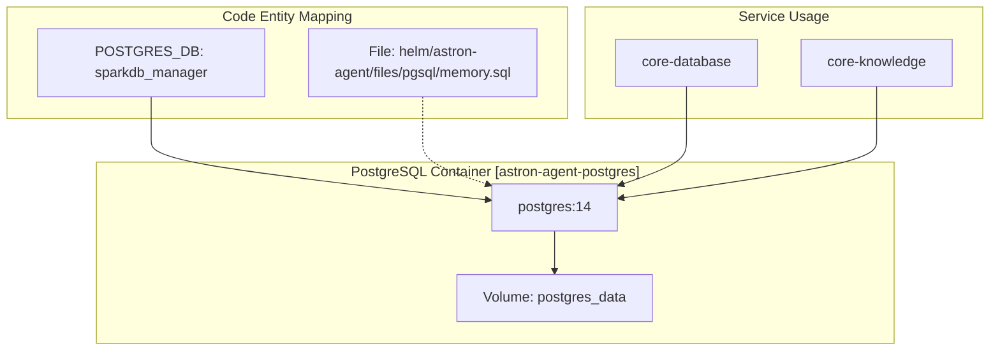
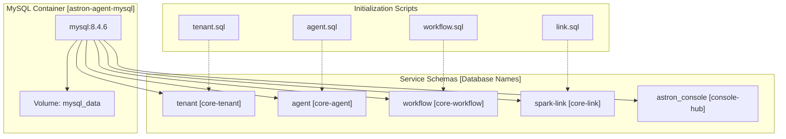
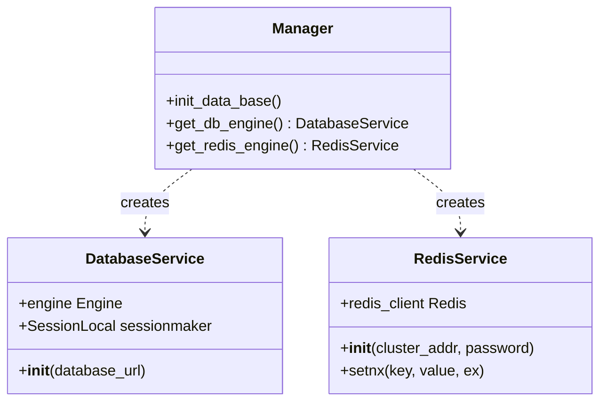

<!-- source: DeepWiki mcp.deepwiki.com · repo iflytek/astron-agent · page 11.2 Database Architecture and Configuration · fetched 2026-10-27 -->

# Database Architecture and Configuration

Relevant source files

The following files were used as context for generating this wiki page:

- [console/backend/hub/src/main/resources/db/migration/README.md](console/backend/hub/src/main/resources/db/migration/README.md)
- [console/backend/hub/src/main/resources/db/migration/V1.10__insert_permission_data.sql](console/backend/hub/src/main/resources/db/migration/V1.10__insert_permission_data.sql)
- [console/backend/hub/src/main/resources/db/migration/V1.11__insert_template_data.sql](console/backend/hub/src/main/resources/db/migration/V1.11__insert_template_data.sql)
- [console/backend/hub/src/main/resources/db/migration/V1.12__insert_other_data.sql](console/backend/hub/src/main/resources/db/migration/V1.12__insert_other_data.sql)
- [console/backend/hub/src/main/resources/db/migration/V1.13__insert_config_data.sql](console/backend/hub/src/main/resources/db/migration/V1.13__insert_config_data.sql)
- [console/backend/hub/src/main/resources/db/migration/V1.14__insert_config_data2.sql](console/backend/hub/src/main/resources/db/migration/V1.14__insert_config_data2.sql)
- [console/backend/hub/src/main/resources/db/migration/V1.16__insert_workflow_data.sql](console/backend/hub/src/main/resources/db/migration/V1.16__insert_workflow_data.sql)
- [console/backend/hub/src/main/resources/db/migration/V1.1__init_core.sql](console/backend/hub/src/main/resources/db/migration/V1.1__init_core.sql)
- [console/backend/hub/src/main/resources/db/migration/V1.2__init_enterprise.sql](console/backend/hub/src/main/resources/db/migration/V1.2__init_enterprise.sql)
- [console/backend/hub/src/main/resources/db/migration/V1.3__init_space.sql](console/backend/hub/src/main/resources/db/migration/V1.3__init_space.sql)
- [core/plugin/link/alembic/default_tools.py](core/plugin/link/alembic/default_tools.py)
- [core/plugin/link/alembic/versions/2026_03_06_0257-5c4f1b5ab83d_init.py](core/plugin/link/alembic/versions/2026_03_06_0257-5c4f1b5ab83d_init.py)
- [core/plugin/link/domain/models/manager.py](core/plugin/link/domain/models/manager.py)
- [core/plugin/link/extensions/database_migration.py](core/plugin/link/extensions/database_migration.py)
- [core/plugin/link/tests/unit/test_alembic_migration.py](core/plugin/link/tests/unit/test_alembic_migration.py)
- [core/tenant/tools/database/database.go](core/tenant/tools/database/database.go)
- [core/tenant/tools/database/migrations.go](core/tenant/tools/database/migrations.go)
- [core/tenant/tools/database/tenant_schema.go](core/tenant/tools/database/tenant_schema.go)
- [helm/astron-agent/files/casdoor/conf/init_data.json.template](helm/astron-agent/files/casdoor/conf/init_data.json.template)
- [helm/astron-agent/files/config/workflow/config.env](helm/astron-agent/files/config/workflow/config.env)
- [helm/astron-agent/files/mysql/agent.sql](helm/astron-agent/files/mysql/agent.sql)
- [helm/astron-agent/files/mysql/link.sql](helm/astron-agent/files/mysql/link.sql)
- [helm/astron-agent/files/mysql/tenant.sql](helm/astron-agent/files/mysql/tenant.sql)
- [helm/astron-agent/files/mysql/workflow.sql](helm/astron-agent/files/mysql/workflow.sql)
- [helm/astron-agent/files/pgsql/memory.sql](helm/astron-agent/files/pgsql/memory.sql)
- [helm/astron-agent/templates/ingress.yaml](helm/astron-agent/templates/ingress.yaml)

This document describes the database infrastructure and configuration patterns used across the Astron Agent platform. It covers the two primary relational database systems (PostgreSQL and MySQL), their service-specific usage, connection pooling strategies, schema migration approaches, and multi-tenancy isolation patterns.

---

## Database Systems Overview

The Astron Agent platform employs a **polyglot persistence** strategy using two relational databases:

| Database | Version | Primary Use Cases | Services |
|----------|---------|-------------------|----------|
| **PostgreSQL** | 14 | Structured metadata, memory database manager schemas | `core-database`, `core-tenant`, `core-knowledge` |
| **MySQL** | 8.4.6 | Application data, bot configurations, workflows, chat history, tool schemas | `console-hub`, `core-agent`, `core-workflow`, `core-link`, `core-rpa` |

Both databases are deployed as containerized services with persistent volumes and health checks to ensure proper startup sequencing. The `docker-compose.yaml` defines these as `astron-agent-postgres` and `astron-agent-mysql`.

**Sources:** [docker/astronAgent/docker-compose.yaml:7-43](), [docker/astronAgent/.env.example:15-30]()

---

## Database Service Definitions

### PostgreSQL Service Configuration

The PostgreSQL service is configured as the primary store for metadata and multi-tenant schema management. It specifically supports the memory database functionality where isolated schemas are created per environment and tenant.

PostgreSQL is initialized with the `sparkdb_manager` database [docker/astronAgent/docker-compose.yaml:11](). The `core-database` service identifies it via the `DB_TYPE=postgresql` environment variable.

**Sources:** [docker/astronAgent/docker-compose.yaml:7-25](), [docker/astronAgent/.env.example:134]()

---

### MySQL Service Configuration

The MySQL service hosts multiple application-specific databases. Each core service typically has its own dedicated schema initialized via SQL scripts during deployment.

MySQL is configured with the `astron_console` database by default [docker/astronAgent/docker-compose.yaml:33](). Other databases like `spark-link`, `agent`, and `workflow` are created during initialization [helm/astron-agent/files/mysql/link.sql:2](), [helm/astron-agent/files/mysql/workflow.sql:1]().

**Sources:** [docker/astronAgent/docker-compose.yaml:28-43](), [docker/astronAgent/.env.example:29-30](), [helm/astron-agent/files/mysql/workflow.sql:1-3](), [helm/astron-agent/files/mysql/link.sql:1-4]()

---

## Database Migration and Initialization

The platform utilizes different migration strategies depending on the service technology stack.

### Python-based Migrations (Alembic)
The `core-link` service uses **Alembic** for automated schema migrations [core/plugin/link/extensions/database_migration.py:18-19]().
- **Migration Execution:** The `run_database_migration` function executes migrations using a Redis distributed lock (`link_database_migration_lock`) to prevent race conditions during scaling [core/plugin/link/extensions/database_migration.py:23, 171-188]().
- **Handling Legacy DBs:** If a table already exists (MySQL error 1050), the system stamps the database to the initial version `5c4f1b5ab83d` and continues upgrading [core/plugin/link/extensions/database_migration.py:22, 110-116]().
- **Default Data Seeding:** After migration, `seed_default_tools` inserts official tools into `tools_schema` using `INSERT IGNORE` statements [core/plugin/link/extensions/database_migration.py:132-169, 187]().

### Java-based Migrations (Flyway)
The `console-hub` uses **Flyway** for automated schema migrations.
- **Baseline:** The system uses `baseline-on-migrate` for existing databases with a baseline version of 1.0.
- **Template Seeding:** Complex JSON structures for workflow templates (e.g., "【模板勿动】大模型资讯小助手") are seeded via SQL scripts [console/backend/hub/src/main/resources/db/migration/V1.16__insert_workflow_data.sql:1-3]().

### SQL Initialization
Infrastructure deployment (Docker/Helm) uses raw SQL scripts to set up the environment:
- **System Apps:** A default application with `app_id` `680ab54f` is created in the `workflow` database to support internal operations [helm/astron-agent/files/mysql/workflow.sql:110-111]().
- **Official Tools:** Built-in AI tools like "超拟人合成" and "文生图" are pre-inserted into the `tools_schema` table [helm/astron-agent/files/mysql/link.sql:35-55]().

**Sources:** [core/plugin/link/extensions/database_migration.py:22-188](), [console/backend/hub/src/main/resources/db/migration/V1.16__insert_workflow_data.sql:1-3](), [helm/astron-agent/files/mysql/workflow.sql:110-114](), [helm/astron-agent/files/mysql/link.sql:35-74]()

---

## Schema Architecture per Service

### Workflow Service (`workflow` DB)
Managed by `core-workflow`, this database stores orchestration protocols and execution history.
- **`app`**: Stores application credentials (`api_key`, `api_secret`) and source tracking [helm/astron-agent/files/mysql/workflow.sql:12-32]().
- **`flow`**: Contains the standard orchestration protocol (`data`) and published versions (`release_data`) [helm/astron-agent/files/mysql/workflow.sql:52-71]().
- **`workflow_node_history`**: Audit trail for node execution results, indexed by `chat_id` and `uid` [helm/astron-agent/files/mysql/workflow.sql:93-106]().

### Link Service (`spark-link` DB)
Stores tool definitions and OpenAPI schemas for external service integration.
- **`tools_schema`**: Stores the `open_api_schema` and `mcp_server_url`. It uses a unique constraint on `tool_id`, `version`, and `is_deleted` to manage tool lifecycles [helm/astron-agent/files/mysql/link.sql:14-28](). Defined in code via SQLAlchemy [core/plugin/link/alembic/versions/2026_03_06_0257-5c4f1b5ab83d_init.py:24-81]().

### Console Hub Service (`astron_console` DB)
Stores high-level bot configurations and platform settings.
- **`bot_type_list`**: Defines categories for the bot marketplace such as "Workplace", "Learning", and "Programming" [console/backend/hub/src/main/resources/db/migration/V1.12__insert_other_data.sql:1-21]().
- **`rpa_info`**: Stores integration details for RPA platforms like "晓悟RPA" [console/backend/hub/src/main/resources/db/migration/V1.12__insert_other_data.sql:24-32]().
- **`tool_box`**: Stores the metadata for user-created and official tools, including `web_schema` for UI rendering and `auth_info` for API keys [console/backend/hub/src/main/resources/db/migration/V1.12__insert_other_data.sql:36-38]().

**Sources:** [helm/astron-agent/files/mysql/workflow.sql:12-106](), [helm/astron-agent/files/mysql/link.sql:14-28](), [console/backend/hub/src/main/resources/db/migration/V1.12__insert_other_data.sql:1-38](), [core/plugin/link/alembic/versions/2026_03_06_0257-5c4f1b5ab83d_init.py:24-81]()

---

## Connection Pooling and Data Access

### Python Service Implementation (`core-link`)
The Link service uses a singleton pattern for database and Redis management.

- **Database Initialization:** `init_data_base` creates the target database if it doesn't exist before initializing the `DatabaseService` [core/plugin/link/domain/models/manager.py:13-35]().
- **Engine Creation:** Uses `mysql+pymysql` with `utf8mb4` charset [core/plugin/link/domain/models/manager.py:24-27]().

### Connection Pooling Parameters

| Service | Technology | Max Pool Size | Idle Connections |
|-----------|-------|-------------|----------|
| `console-hub` | HikariCP | 10 | 2 |
| `core-tenant` | Go (sql) | Configurable | Configurable |
| `core-link` | SQLAlchemy | Default | Default |

**Sources:** [core/plugin/link/domain/models/manager.py:9-67](), [docker/astronAgent/docker-compose.yaml:175-176]()

---

## Multi-Tenancy and Data Isolation

The platform implements multi-tenancy through a combination of schema isolation and logical filtering.

1.  **Logical Filtering:** Application data in MySQL (like `workflow` and `astron_console`) uses `uid` and `space_id` columns to partition data [console/backend/hub/src/main/resources/db/migration/V1.16__insert_workflow_data.sql:2]().
2.  **Schema-Level Isolation:** The `core-database` service manages dynamic schema creation in PostgreSQL. It creates isolated schemas for tenants to run SQL queries against their own datasets.
3.  **Redis Partitioning:** Different services or environments use distinct Redis database indices. For example, the Link service uses a distributed lock `link_database_migration_lock` in Redis to ensure only one instance performs migrations [core/plugin/link/extensions/database_migration.py:23, 178]().

**Sources:** [console/backend/hub/src/main/resources/db/migration/V1.16__insert_workflow_data.sql:1-3](), [core/plugin/link/extensions/database_migration.py:23, 171-188](), [docker/astronAgent/.env.example:31-41]()

---

