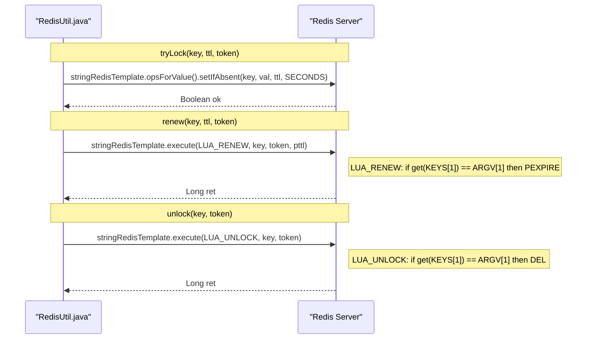

<!-- source: DeepWiki mcp.deepwiki.com · repo iflytek/astron-agent · page 11.3 Storage and Caching Services · fetched 2026-10-27 -->

# Storage and Caching Services

<details>
<summary>Relevant source files</summary>

The following files were used as context for generating this wiki page:

- [console/backend/toolkit/pom.xml](console/backend/toolkit/pom.xml)
- [console/backend/toolkit/src/main/java/com/iflytek/astron/console/toolkit/entity/mongo/Knowledge.java](console/backend/toolkit/src/main/java/com/iflytek/astron/console/toolkit/entity/mongo/Knowledge.java)
- [console/backend/toolkit/src/main/java/com/iflytek/astron/console/toolkit/entity/mongo/PreviewKnowledge.java](console/backend/toolkit/src/main/java/com/iflytek/astron/console/toolkit/entity/mongo/PreviewKnowledge.java)
- [console/backend/toolkit/src/main/java/com/iflytek/astron/console/toolkit/entity/table/knowledge/MysqlKnowledge.java](console/backend/toolkit/src/main/java/com/iflytek/astron/console/toolkit/entity/table/knowledge/MysqlKnowledge.java)
- [console/backend/toolkit/src/main/java/com/iflytek/astron/console/toolkit/entity/table/knowledge/MysqlPreviewKnowledge.java](console/backend/toolkit/src/main/java/com/iflytek/astron/console/toolkit/entity/table/knowledge/MysqlPreviewKnowledge.java)
- [console/backend/toolkit/src/main/java/com/iflytek/astron/console/toolkit/mapper/knowledge/KnowledgeMapper.java](console/backend/toolkit/src/main/java/com/iflytek/astron/console/toolkit/mapper/knowledge/KnowledgeMapper.java)
- [console/backend/toolkit/src/main/java/com/iflytek/astron/console/toolkit/service/database/DatabaseService.java](console/backend/toolkit/src/main/java/com/iflytek/astron/console/toolkit/service/database/DatabaseService.java)
- [console/backend/toolkit/src/main/java/com/iflytek/astron/console/toolkit/util/RedisUtil.java](console/backend/toolkit/src/main/java/com/iflytek/astron/console/toolkit/util/RedisUtil.java)
- [console/backend/toolkit/src/main/java/com/iflytek/astron/console/toolkit/util/S3Util.java](console/backend/toolkit/src/main/java/com/iflytek/astron/console/toolkit/util/S3Util.java)
- [console/backend/toolkit/src/main/java/com/iflytek/astron/console/toolkit/util/database/SqlRenderer.java](console/backend/toolkit/src/main/java/com/iflytek/astron/console/toolkit/util/database/SqlRenderer.java)
- [console/backend/toolkit/src/main/java/com/iflytek/astron/console/toolkit/util/database/dialect/DbDialect.java](console/backend/toolkit/src/main/java/com/iflytek/astron/console/toolkit/util/database/dialect/DbDialect.java)
- [console/backend/toolkit/src/main/java/com/iflytek/astron/console/toolkit/util/database/dialect/MysqlDialect.java](console/backend/toolkit/src/main/java/com/iflytek/astron/console/toolkit/util/database/dialect/MysqlDialect.java)
- [console/backend/toolkit/src/main/java/com/iflytek/astron/console/toolkit/util/database/dialect/PostgresDialect.java](console/backend/toolkit/src/main/java/com/iflytek/astron/console/toolkit/util/database/dialect/PostgresDialect.java)
- [console/backend/toolkit/src/main/resources/mybatis/mapper/mysql/KnowledgeMapper.xml](console/backend/toolkit/src/main/resources/mybatis/mapper/mysql/KnowledgeMapper.xml)
- [console/backend/toolkit/src/main/resources/mybatis/mapper/mysql/PreviewKnowledgeMapper.xml](console/backend/toolkit/src/main/resources/mybatis/mapper/mysql/PreviewKnowledgeMapper.xml)
- [console/backend/toolkit/src/test/java/com/iflytek/astron/console/toolkit/service/model/ModelServiceTest.java](console/backend/toolkit/src/test/java/com/iflytek/astron/console/toolkit/service/model/ModelServiceTest.java)
- [core/memory/database/tests/test_exec_dml.py](core/memory/database/tests/test_exec_dml.py)

</details>


This page provides a technical deep dive into the storage and caching infrastructure of the Astron Agent platform. It covers the implementation of S3-compatible object storage (MinIO), distributed caching and locking via Redis, and the management of persistent data across different storage tiers, including multi-dialect SQL support.

## 1. Object Storage Service (OSS)

The platform utilizes S3-compatible services (primarily MinIO) for storing bot avatars, knowledge base documents, and tool-related artifacts. The Java-based `S3Util` component serves as the unified client for these operations.

### 1.1 MinIO S3 Client Implementation
The `S3Util` class in the console toolkit provides a thread-safe wrapper around the `MinioClient` [console/backend/toolkit/src/main/java/com/iflytek/astron/console/toolkit/util/S3Util.java:46-51](). It is initialized using Spring `@Value` properties for endpoint, access keys, and bucket names [console/backend/toolkit/src/main/java/com/iflytek/astron/console/toolkit/util/S3Util.java:52-63]().

**Storage Service Architecture and Entity Mapping**

```mermaid
classDiagram
    class "S3Util" as S3Util {
        -MinioClient minioClient
        -String bucketName
        +init() void
        +putObject(String key, InputStream input, long size, String type) void
        +getPresignedUrl(String key, Method method) String
        +removeObject(String key) void
    }
    class "MinioClient" as MinioClient {
        <<Library>>
        +putObject(PutObjectArgs args)
        +getPresignedObjectUrl(GetPresignedObjectUrlArgs args)
    }
    class "DatabaseService" as DatabaseService {
        -S3Util s3Util
        +create(DatabaseDto dto)
        +delete(Long id)
    }

    S3Util ..> MinioClient : "wraps"
    DatabaseService --> S3Util : "uses for file exports"
```

**Key Implementation Details:**
*   **Multipart Uploads**: The utility supports both explicit content length uploads and multipart uploads for unknown stream sizes (using a recommended part size ≥ 5MB) [console/backend/toolkit/src/main/java/com/iflytek/astron/console/toolkit/util/S3Util.java:111-150]().
*   **Presigned URLs**: To facilitate secure browser-side downloads or uploads without exposing credentials, `S3Util` generates presigned URLs with a configurable expiry (default 600s) [console/backend/toolkit/src/main/java/com/iflytek/astron/console/toolkit/util/S3Util.java:66-67, 219-236]().
*   **Public vs. Internal Endpoints**: The service distinguishes between an internal `endpoint` (for service-to-service traffic) and a `remoteEndpoint` (used for generating URLs returned to external clients/browsers) [console/backend/toolkit/src/main/java/com/iflytek/astron/console/toolkit/util/S3Util.java:70-75]().

**Sources:** [console/backend/toolkit/src/main/java/com/iflytek/astron/console/toolkit/util/S3Util.java:51-236](), [console/backend/toolkit/src/main/java/com/iflytek/astron/console/toolkit/service/database/DatabaseService.java:78-80]()

## 2. Distributed Caching and Locking (Redis)

Redis serves as the primary distributed caching layer and coordination mechanism for distributed locking across microservice instances.

### 2.1 Distributed Lock Implementation
The `RedisUtil` class provides a robust distributed lock implementation using Lua scripts to ensure atomicity and "owner-only" release semantics [console/backend/toolkit/src/main/java/com/iflytek/astron/console/toolkit/util/RedisUtil.java:40-45]().

**Distributed Lock Flow with Code Entities**



**Key Implementation Details:**
*   **Safety via Tokens**: The `tryLock` method uses a `token` (typically a UUID) to identify the lock owner [console/backend/toolkit/src/main/java/com/iflytek/astron/console/toolkit/util/RedisUtil.java:83-91]().
*   **Atomic Renewal**: `LUA_RENEW` ensures that a service only extends a lock it actually owns, preventing a service from accidentally extending a lock that has timed out and been re-acquired [console/backend/toolkit/src/main/java/com/iflytek/astron/console/toolkit/util/RedisUtil.java:54-59]().
*   **Atomic Release**: `LUA_UNLOCK` prevents the "late release" problem where a service finishes a task after its lock expired and accidentally deletes a new lock held by a different instance [console/backend/toolkit/src/main/java/com/iflytek/astron/console/toolkit/util/RedisUtil.java:62-67]().

**Sources:** [console/backend/toolkit/src/main/java/com/iflytek/astron/console/toolkit/util/RedisUtil.java:40-165]()

## 3. Persistent Data and SQL Dialect Management

The platform handles structured data across multiple SQL dialects (PostgreSQL and MySQL) and manages specialized knowledge entities.

### 3.1 Multi-Dialect SQL Generation
The system uses a strategy pattern (`DbDialect` interface) to handle syntactic differences between PostgreSQL and MySQL, particularly for DDL operations like creating tables and modifying columns [console/backend/toolkit/src/main/java/com/iflytek/astron/console/toolkit/util/database/dialect/DbDialect.java:11-15]().

| Feature | PostgreSQL (`PostgresDialect`) | MySQL (`MysqlDialect`) |
| :--- | :--- | :--- |
| **Quoting** | Double quotes (`"ident"`) [console/backend/toolkit/src/main/java/com/iflytek/astron/console/toolkit/util/database/dialect/PostgresDialect.java:17-20]() | Backticks (`` `ident` ``) [console/backend/toolkit/src/main/java/com/iflytek/astron/console/toolkit/util/database/dialect/MysqlDialect.java:16-19]() |
| **Primary Key** | `BIGSERIAL PRIMARY KEY` [console/backend/toolkit/src/main/java/com/iflytek/astron/console/toolkit/util/database/dialect/PostgresDialect.java:32]() | `BIGINT AUTO_INCREMENT PRIMARY KEY` [console/backend/toolkit/src/main/java/com/iflytek/astron/console/toolkit/util/database/dialect/MysqlDialect.java:31]() |
| **Comments** | `COMMENT ON TABLE/COLUMN` (Separate) [console/backend/toolkit/src/main/java/com/iflytek/astron/console/toolkit/util/database/dialect/PostgresDialect.java:53-64]() | `COMMENT 'text'` (Inline) [console/backend/toolkit/src/main/java/com/iflytek/astron/console/toolkit/util/database/dialect/MysqlDialect.java:47-55]() |

**SQL Security and Rendering:**
The `SqlRenderer` utility provides strict validation for identifiers and literals to prevent SQL injection [console/backend/toolkit/src/main/java/com/iflytek/astron/console/toolkit/util/database/SqlRenderer.java:9-12](). It enforces length limits (63 for identifiers) and blocks reserved keywords [console/backend/toolkit/src/main/java/com/iflytek/astron/console/toolkit/util/database/SqlRenderer.java:22-28, 51-53]().

### 3.2 Knowledge Persistence Models
Knowledge entries are stored with sequence IDs to preserve document order during RAG operations.

| Entity | Description | Key Fields |
| :--- | :--- | :--- |
| `Knowledge` | Formal knowledge point used in production chat [console/backend/toolkit/src/main/java/com/iflytek/astron/console/toolkit/entity/mongo/Knowledge.java:17](). | `content`, `seqId`, `coreRepoName`, `enabled` [console/backend/toolkit/src/main/java/com/iflytek/astron/console/toolkit/entity/mongo/Knowledge.java:27-41](). |
| `PreviewKnowledge` | Staging area for knowledge points during parsing or audit [console/backend/toolkit/src/main/java/com/iflytek/astron/console/toolkit/entity/mongo/PreviewKnowledge.java:18](). | `fileId`, `seqId`, `content`, `charCount` [console/backend/toolkit/src/main/java/com/iflytek/astron/console/toolkit/entity/mongo/PreviewKnowledge.java:22-32](). |

**Data Integrity Features:**
*   **Sequence Management**: The `seqId` is critical for preserving insertion order, ensuring context remains coherent during retrieval [console/backend/toolkit/src/main/java/com/iflytek/astron/console/toolkit/entity/mongo/Knowledge.java:27]().
*   **MySQL Mapping**: For MySQL environments, `KnowledgeMapper.xml` provides specialized queries like `findByFileId` and `findByFileIdInAndContentLike`, which uses `JSON_EXTRACT` for fuzzy matching within JSON content fields [console/backend/toolkit/src/main/resources/mybatis/mapper/mysql/KnowledgeMapper.xml:15-19, 138-146]().

**Sources:** [console/backend/toolkit/src/main/java/com/iflytek/astron/console/toolkit/util/database/dialect/DbDialect.java:11-73](), [console/backend/toolkit/src/main/java/com/iflytek/astron/console/toolkit/util/database/SqlRenderer.java:12-187](), [console/backend/toolkit/src/main/java/com/iflytek/astron/console/toolkit/entity/mongo/Knowledge.java:1-50](), [console/backend/toolkit/src/main/resources/mybatis/mapper/mysql/KnowledgeMapper.xml:1-182]()

---

