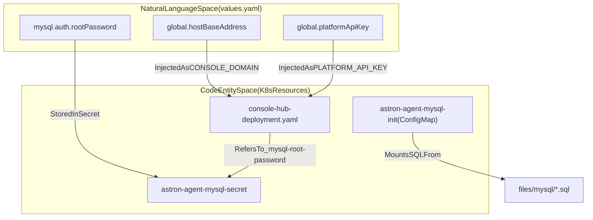
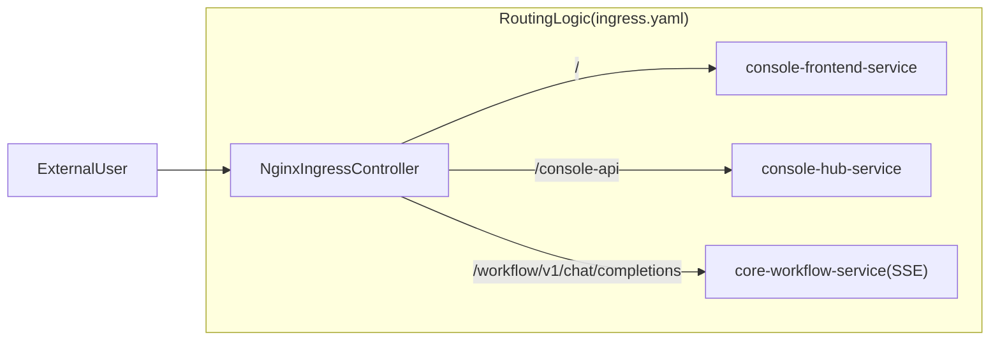
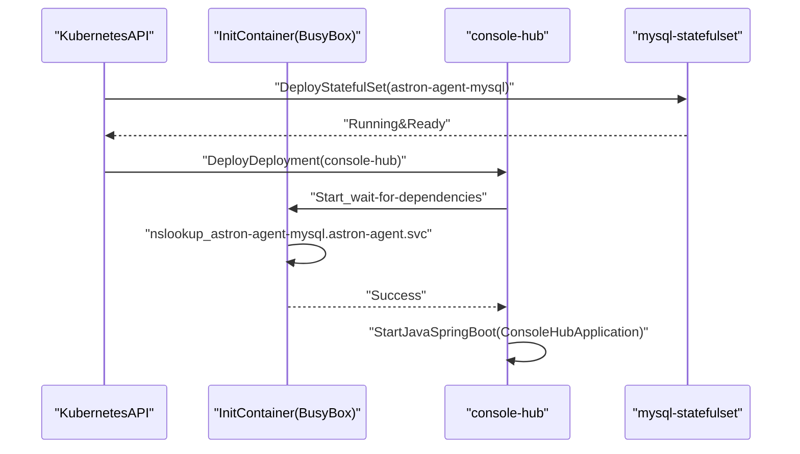

<!-- source: DeepWiki mcp.deepwiki.com · repo iflytek/astron-agent · page 11.5 Kubernetes Helm Deployment · fetched 2026-10-27 -->

# Kubernetes Helm Deployment

Relevant source files

The following files were used as context for generating this wiki page:

- [helm/README.md](helm/README.md)
- [helm/astron-agent/.helmignore](helm/astron-agent/.helmignore)
- [helm/astron-agent/Chart.yaml](helm/astron-agent/Chart.yaml)
- [helm/astron-agent/files/casdoor/conf/app.conf](helm/astron-agent/files/casdoor/conf/app.conf)
- [helm/astron-agent/files/casdoor/conf/init_data.json](helm/astron-agent/files/casdoor/conf/init_data.json)
- [helm/astron-agent/files/casdoor/conf/init_data.json.template](helm/astron-agent/files/casdoor/conf/init_data.json.template)
- [helm/astron-agent/files/casdoor/entrypoint.sh](helm/astron-agent/files/casdoor/entrypoint.sh)
- [helm/astron-agent/files/config/agent/config.env](helm/astron-agent/files/config/agent/config.env)
- [helm/astron-agent/files/config/workflow/config.env](helm/astron-agent/files/config/workflow/config.env)
- [helm/astron-agent/files/mysql/agent.sql](helm/astron-agent/files/mysql/agent.sql)
- [helm/astron-agent/files/mysql/link.sql](helm/astron-agent/files/mysql/link.sql)
- [helm/astron-agent/files/mysql/tenant.sql](helm/astron-agent/files/mysql/tenant.sql)
- [helm/astron-agent/files/mysql/workflow.sql](helm/astron-agent/files/mysql/workflow.sql)
- [helm/astron-agent/files/pgsql/memory.sql](helm/astron-agent/files/pgsql/memory.sql)
- [helm/astron-agent/templates/auth/casdoor-deployment.yaml](helm/astron-agent/templates/auth/casdoor-deployment.yaml)
- [helm/astron-agent/templates/configmaps.yaml](helm/astron-agent/templates/configmaps.yaml)
- [helm/astron-agent/templates/console/console-hub-deployment.yaml](helm/astron-agent/templates/console/console-hub-deployment.yaml)
- [helm/astron-agent/templates/core/core-services.yaml](helm/astron-agent/templates/core/core-services.yaml)
- [helm/astron-agent/templates/infrastructure/mysql-statefulset.yaml](helm/astron-agent/templates/infrastructure/mysql-statefulset.yaml)
- [helm/astron-agent/templates/ingress.yaml](helm/astron-agent/templates/ingress.yaml)
- [helm/astron-agent/values.yaml](helm/astron-agent/values.yaml)

This page details the Kubernetes deployment strategy for the Astron Agent platform using Helm. The deployment architecture transitions the microservices from a container-orchestrated environment (Docker Compose) to a production-grade, scalable Kubernetes cluster, utilizing `StatefulSets` for persistent data layers and `Ingress` for complex routing.

## Helm Chart Structure

The Astron Agent Helm chart is organized into logical components to manage the lifecycle of 8+ microservices and their associated infrastructure.

| Component | Directory / Template | Description |
| :--- | :--- | :--- |
| **Global Config** | `values.yaml` | Centralized configuration for image registries, API keys, and host addresses. |
| **Core Services** | `templates/core/` | Deployments for `core-tenant`, `core-agent`, `core-workflow`, etc. |
| **Infrastructure** | `templates/infrastructure/` | `StatefulSets` for MySQL, PostgreSQL, Redis, and MinIO. |
| **Console** | `templates/console/` | Deployments for `console-hub` and `console-frontend`. |
| **Init Scripts** | `templates/configmaps.yaml` | SQL initialization scripts and service-specific `.env` files. |

### Configuration Flow Diagram
The following diagram illustrates how the `values.yaml` configuration is injected into the Kubernetes `Deployment` and `ConfigMap` entities, mapping natural language configuration to code entities.

**Configuration Injection Map**

**Sources:** [helm/astron-agent/values.yaml:2-26](), [helm/astron-agent/templates/console/console-hub-deployment.yaml:44-110](), [helm/astron-agent/templates/configmaps.yaml:28-40]()

---

## values.yaml Configuration

The `values.yaml` file acts as the single source of truth for the deployment. It defines resource limits, image versions, and platform-specific credentials.

### Key Global Settings
- **`global.hostBaseAddress`**: The external URL (e.g., `http://astron-agent.example.com`) used by services like MinIO and Casdoor for redirecting traffic and generating public links [helm/astron-agent/values.yaml:7-9]().
- **iFLYTEK Platform Keys**: Centralized keys for Spark LLM (`platformApiKey`), Image Generation, and RTASR (`sparkRtasrApiKey`) are defined once and propagated to all relevant microservices [helm/astron-agent/values.yaml:10-26]().

### Service-Specific Overrides
Each core service (e.g., `coreTenant`, `coreDatabase`) has its own section to define:
- `replicaCount`: For horizontal scaling [helm/astron-agent/values.yaml:164-164]().
- `resources`: CPU/Memory requests and limits [helm/astron-agent/values.yaml:165-171]().
- `env`: Service-specific logic variables, such as `databaseType` or `databaseUrl` [helm/astron-agent/values.yaml:175-184]().

**Sources:** [helm/astron-agent/values.yaml:1-306]()

---

## Ingress and Network Routing

The platform uses an Ingress setup to handle standard HTTP traffic, Server-Sent Events (SSE) for streaming AI responses, and path-based routing.

### Ingress Rules and Annotations
The Ingress controller is configured via the `ingress` block in `values.yaml` to handle domain routing [helm/README.md:44-51](). To support SSE, specific annotations like `nginx.ingress.kubernetes.io/proxy-buffering: "off"` and increased timeouts (`1800` seconds) are used to prevent connection drops during long LLM generations [helm/astron-agent/templates/ingress.yaml:10-12]().

### Path Routing Architecture
The following diagram shows how the Ingress rules map external URL paths to specific backend services.

**Ingress Routing Map**

**Sources:** [helm/astron-agent/templates/ingress.yaml:45-60](), [helm/astron-agent/templates/ingress.yaml:94-101](), [helm/astron-agent/templates/ingress.yaml:135-142]()

---

## StatefulSets for Databases

To ensure data persistence and consistent identity, infrastructure components like MySQL, PostgreSQL, and Redis are deployed as `StatefulSets`.

### Database Initialization
Databases are initialized using `ConfigMaps` that wrap SQL scripts located in the `files/` directory. For MySQL, scripts from `files/mysql/*.sql` are mounted to `/docker-entrypoint-initdb.d` to set up schemas for `workflow`, `tenant`, and `spark-link` [helm/astron-agent/templates/infrastructure/mysql-statefulset.yaml:67-72](), [helm/astron-agent/files/mysql/workflow.sql:1-4](), [helm/astron-agent/files/mysql/link.sql:1-4]().

| Database | Role | Init Script Source |
| :--- | :--- | :--- |
| **MySQL** | Metadata storage for `core-tenant`, `core-workflow`, `core-link` | `files/mysql/*.sql` [helm/astron-agent/templates/configmaps.yaml:36-38]() |
| **PostgreSQL** | Memory Database Service (`core-database`) | `files/pgsql/*.sql` [helm/astron-agent/templates/configmaps.yaml:23-25]() |
| **Redis** | Caching and session management | N/A (Configured via `REDIS_PASSWORD`) [helm/astron-agent/values.yaml:83-98]() |

### Persistence Logic
If `persistence.enabled` is true, the chart generates a `volumeClaimTemplate`. This requests a `PersistentVolume` from the cluster's `storageClass` [helm/astron-agent/templates/infrastructure/mysql-statefulset.yaml:73-84](). 

**Sources:** [helm/astron-agent/templates/infrastructure/mysql-statefulset.yaml:1-88](), [helm/astron-agent/templates/configmaps.yaml:15-40](), [helm/astron-agent/files/mysql/workflow.sql:1-71]()

---

## Kubernetes Deployment Patterns

### Dependency Management (InitContainers)
Core services require infrastructure to be ready before starting. The chart uses `initContainers` with `nslookup` loops to wait for `mysql`, `redis`, and `minio` services within the cluster [helm/astron-agent/templates/console/console-hub-deployment.yaml:25-39](). Similarly, `casdoor` waits for its specific MySQL instance [helm/astron-agent/templates/auth/casdoor-deployment.yaml:27-39]().

### Probes and Health Checks
- **Liveness Probes**: Use `tcpSocket` or `httpGet` to ensure the process is running. For `console-hub`, it checks the HTTP port after a 60-second delay [helm/astron-agent/templates/console/console-hub-deployment.yaml:115-121]().
- **Readiness Probes**: Ensure the service is ready to accept traffic before adding it to the Service endpoint pool [helm/astron-agent/templates/console/console-hub-deployment.yaml:122-128]().
- **MySQL Health**: Uses `mysqladmin ping` inside the container for a reliable health check [helm/astron-agent/templates/infrastructure/mysql-statefulset.yaml:40-50]().

### Deployment Sequence Diagram

**Sources:** [helm/astron-agent/templates/console/console-hub-deployment.yaml:25-39](), [helm/astron-agent/templates/infrastructure/mysql-statefulset.yaml:40-61](), [helm/README.md:53-58]()

---

