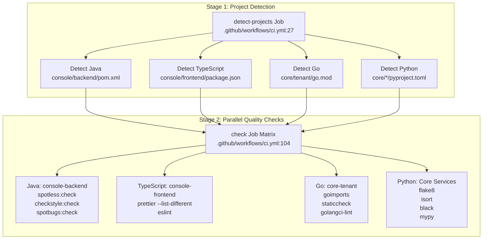
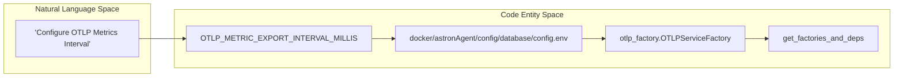

<!-- source: DeepWiki mcp.deepwiki.com · repo iflytek/astron-agent · page 12 Development and Operations · fetched 2026-10-27 -->

# Development and Operations

Relevant source files

The following files were used as context for generating this wiki page:

- [.github/ISSUE_TEMPLATE/bug_report.yml](.github/ISSUE_TEMPLATE/bug_report.yml)
- [.github/ISSUE_TEMPLATE/config.yml](.github/ISSUE_TEMPLATE/config.yml)
- [.github/ISSUE_TEMPLATE/feature_request.yml](.github/ISSUE_TEMPLATE/feature_request.yml)
- [.github/ISSUE_TEMPLATE/general_issue.yml](.github/ISSUE_TEMPLATE/general_issue.yml)
- [.github/workflows/build-push.yml](.github/workflows/build-push.yml)
- [.github/workflows/ci.yml](.github/workflows/ci.yml)
- [.github/workflows/release.yml](.github/workflows/release.yml)
- [.gitignore](.gitignore)
- [.pre-commit-config.yaml](.pre-commit-config.yaml)
- [Makefile](Makefile)
- [core/memory/database/Dockerfile](core/memory/database/Dockerfile)
- [core/workflow/extensions/middleware/utils.py](core/workflow/extensions/middleware/utils.py)
- [docker/astronAgent/config/database/config.env](docker/astronAgent/config/database/config.env)
- [docs/DEPLOYMENT_FAQ_zh.md](docs/DEPLOYMENT_FAQ_zh.md)
- [docs/imgs/WeCom_Group.png](docs/imgs/WeCom_Group.png)
- [makefiles/check-comments.sh](makefiles/check-comments.sh)
- [makefiles/comment-check.mk](makefiles/comment-check.mk)
- [makefiles/common.mk](makefiles/common.mk)
- [makefiles/core/workflows.mk](makefiles/core/workflows.mk)
- [makefiles/git.mk](makefiles/git.mk)
- [makefiles/go.mk](makefiles/go.mk)
- [makefiles/java.mk](makefiles/java.mk)
- [makefiles/python.mk](makefiles/python.mk)
- [makefiles/typescript.mk](makefiles/typescript.mk)

## Purpose and Scope

This document provides comprehensive guidance for developers contributing to the Astron Agent platform and operators managing deployment environments. It covers local development environment setup, continuous integration and deployment workflows, code quality standards, multi-language build systems, service lifecycle management, and observability configuration.

For details on CI/CD infrastructure, see [CI/CD Pipeline Architecture](#12.1). For build system specifics, see [Multi-Language Build System](#12.2). For quality gates, see [Code Quality and Testing](#12.3). For monitoring, see [Observability and Telemetry](#12.4).

---

## Development Environment Setup

### Local Development Prerequisites

The Astron Agent platform is a polyglot codebase requiring multiple language runtimes and development tools. The following runtimes are required for full platform development:

| Language | Version | Purpose | Projects |
|----------|---------|---------|----------|
| **Python** | 3.11 | Core microservices | `core/agent`, `core/workflow`, `core/knowledge`, `core/memory/database`, `core/plugin/*` [.github/workflows/ci.yml:144]() |
| **Java** | 21 | Console backend | `console/backend` [.github/workflows/ci.yml:122]() |
| **Node.js** | 20 | Frontend application | `console/frontend` [.github/workflows/ci.yml:129]() |
| **Go** | 1.23 | Tenant service | `core/tenant` [.github/workflows/ci.yml:137]() |

### Python Service Development

Each Python service uses `uv` for dependency management with lock files. The build system detects these projects by scanning for `pyproject.toml` or `requirements.txt` [.github/workflows/ci.yml:71-73]().

**Setup workflow:**
1. **Install uv**: The CI uses the Astral `uv` installer [.github/workflows/ci.yml:149]().
2. **Sync dependencies**: Use `uv sync` to prepare the environment [makefiles/python.mk:115]().
3. **Run tests**: Execute `uv run python -m pytest tests/ -v` for project-specific testing [makefiles/python.mk:116]().

### Java Backend Development

The Console Hub uses Spring Boot with Maven. The CI pipeline detects the project at `console/backend/pom.xml` [.github/workflows/ci.yml:48]().

**Setup workflow:**
1. **Build project**: Run `mvn clean compile` to ensure the project compiles [.github/workflows/ci.yml:159]().
2. **Quality Checks**: Run `mvn spotless:check` and `mvn checkstyle:check` to verify code style [.github/workflows/ci.yml:161-163]().

Sources: [.github/workflows/ci.yml:47-150](), [makefiles/python.mk:104-127]()

---

## CI/CD Pipeline Architecture

### Pipeline Overview

The GitHub Actions CI pipeline implements a matrix-based multi-stage workflow with language-specific parallelization. The pipeline automatically detects active projects and runs checks in parallel across all modified language ecosystems [.github/workflows/ci.yml:27-100]().

**Project Detection Logic**
The detection job dynamically builds a matrix by scanning the repository for language-specific marker files at [.github/workflows/ci.yml:38-99](). It maps directories like `core/memory/database` to logical names like `core-database` for the CI matrix [.github/workflows/ci.yml:77-78]().

### Container Image Publishing
The platform uses a dedicated `build-push.yml` workflow to generate multi-arch Docker images (`linux/amd64,linux/arm64`) for all core services [.github/workflows/build-push.yml:74](). Images are tagged as `latest` for main branches or specific tags for bugfixes and features [.github/workflows/build-push.yml:51-58]().

For details on the pipeline stages, see [CI/CD Pipeline Architecture](#12.1).

Sources: [.github/workflows/ci.yml:1-112](), [.github/workflows/build-push.yml:1-132]()

---

## Multi-Language Build System

### Makefile Architecture

The build system uses modular makefiles with language-specific modules included in the root `Makefile`. 

**Python Build Targets [makefiles/python.mk:34-160]():**
- `install-tools-python`: Installs `black`, `isort`, `flake8`, `mypy`, `pylint`, `pytest` [makefiles/python.mk:34-44]().
- `check-python`: Runs style, import order, format, type, and code analysis checks [makefiles/python.mk:65-102]().
- `test-python`: Executes `pytest` with `uv` synchronization support [makefiles/python.mk:104-130]().

**Release Management**
Official releases are triggered by tags matching `v*.*.*` [.github/workflows/release.yml:5-7](). The `prepare-release` job performs "Smart project detection" to determine which components (Core, Hub, Frontend) require building based on Dockerfile presence [.github/workflows/release.yml:83-122]().

For details, see [Multi-Language Build System](#12.2).

Sources: [makefiles/python.mk:1-160](), [.github/workflows/release.yml:1-122]()

---

## Code Quality and Testing Standards

### Pre-commit Hooks

The repository uses `pre-commit` to enforce quality checks before commits. The configuration at [.pre-commit-config.yaml]() runs checks only on staged files to maintain fast feedback loops.

**Key Hooks:**
- **Python Formatting**: Enforces `black` formatting with the `--check` flag [.pre-commit-config.yaml:45-49]().
- **Python Typing**: Runs `mypy` with strict flags like `--disallow-untyped-defs` for every core service [.pre-commit-config.yaml:113-161]().
- **Import Ordering**: Uses `isort` with the `black` profile to maintain consistent import blocks [.pre-commit-config.yaml:53-80]().

For details, see [Code Quality and Testing](#12.3).

Sources: [.pre-commit-config.yaml:1-166]()

---

## Observability and Telemetry

### OpenTelemetry (OTLP) Integration

All Python services support OpenTelemetry Protocol (OTLP) for distributed tracing and metrics. Configuration is driven by environment variables like `OTLP_ENABLE` and `OTLP_ENDPOINT` [docker/astronAgent/config/database/config.env:68-74]().

**Service Lifecycle Management:**
Service factories are aggregated in `get_factories_and_deps` [core/workflow/extensions/middleware/utils.py:13-49](). This utility dynamically imports factories to avoid circular dependencies [core/workflow/extensions/middleware/utils.py:21-31](), including:
- `DatabaseServiceFactory` [core/workflow/extensions/middleware/utils.py:34]()
- `CacheServiceFactory` [core/workflow/extensions/middleware/utils.py:35]()
- `OTLPServiceFactory` [core/workflow/extensions/middleware/utils.py:38]()
- `LogServiceFactory` [core/workflow/extensions/middleware/utils.py:39]()

For details, see [Observability and Telemetry](#12.4).

Sources: [core/workflow/extensions/middleware/utils.py:1-50](), [docker/astronAgent/config/database/config.env:62-95]()

---

