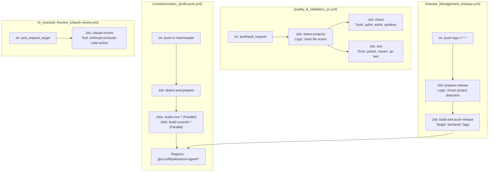
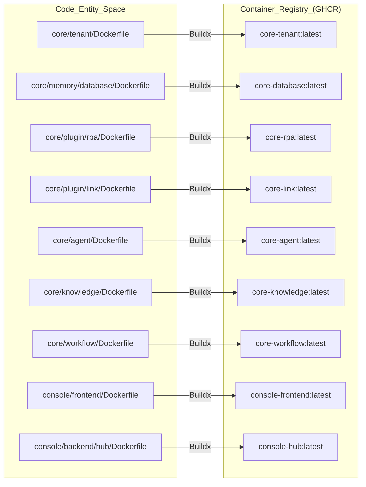

<!-- source: DeepWiki mcp.deepwiki.com · repo iflytek/astron-agent · page 12.1 CI/CD Pipeline Architecture · fetched 2026-10-27 -->

# CI/CD Pipeline Architecture

Relevant source files

The following files were used as context for generating this wiki page:

- [.github/ISSUE_TEMPLATE/bug_report.yml](.github/ISSUE_TEMPLATE/bug_report.yml)
- [.github/ISSUE_TEMPLATE/config.yml](.github/ISSUE_TEMPLATE/config.yml)
- [.github/ISSUE_TEMPLATE/feature_request.yml](.github/ISSUE_TEMPLATE/feature_request.yml)
- [.github/ISSUE_TEMPLATE/general_issue.yml](.github/ISSUE_TEMPLATE/general_issue.yml)
- [.github/workflows/build-push.yml](.github/workflows/build-push.yml)
- [.github/workflows/ci.yml](.github/workflows/ci.yml)
- [.github/workflows/claude-review.yml](.github/workflows/claude-review.yml)
- [.github/workflows/claude.yml](.github/workflows/claude.yml)
- [.github/workflows/release.yml](.github/workflows/release.yml)
- [.pre-commit-config.yaml](.pre-commit-config.yaml)
- [core/memory/database/Dockerfile](core/memory/database/Dockerfile)
- [core/workflow/extensions/middleware/utils.py](core/workflow/extensions/middleware/utils.py)
- [docker/astronAgent/config/database/config.env](docker/astronAgent/config/database/config.env)
- [docs/imgs/WeCom_Group.png](docs/imgs/WeCom_Group.png)
- [makefiles/python.mk](makefiles/python.mk)

## Purpose and Scope

This document describes the automated CI/CD pipeline architecture for the Astron Agent platform. The pipeline consists of multiple GitHub Actions workflows that handle continuous integration, multi-platform Docker image building, code quality enforcement, and automated release management across the microservices ecosystem.

The system automates the lifecycle of the core service components: 8 core backend services (`tenant`, `database`, `rpa`, `link`, `aitools`, `agent`, `knowledge`, and `workflow`) and 2 console components (`frontend` and `backend`).

Sources: [.github/workflows/ci.yml:24-88](), [.github/workflows/build-push.yml:1-15](), [.github/workflows/release.yml:92-118]()

---

## Pipeline Overview

The CI/CD system implements a multi-stage automation workflow using GitHub Actions. The architecture is divided into quality validation (CI), multi-platform image building, and semantic versioned releases.

### GitHub Actions Workflow Architecture

The following diagram illustrates the flow from code push to container registry:

**Workflow Data Flow**

Sources: [.github/workflows/ci.yml:1-12](), [.github/workflows/build-push.yml:1-15](), [.github/workflows/release.yml:3-8](), [.github/workflows/claude-review.yml:1-5]()

---

## Continuous Integration Pipeline

### Project Detection Strategy

The `detect-projects` job dynamically generates a build matrix by scanning the repository structure. This allows the pipeline to scale as new services are added without manual workflow updates. It outputs a JSON matrix containing the project name, path, and language type.

| Language | Detection File | Target Service Example | Matrix Type |
| :--- | :--- | :--- | :--- |
| **Java** | `console/backend/pom.xml` | `console-backend` | `java` |
| **Python** | `pyproject.toml` or `requirements.txt` | `core-agent`, `core-workflow` | `python` |
| **Go** | `core/tenant/go.mod` | `core-tenant` | `go` |
| **TypeScript** | `console/frontend/package.json` | `console-frontend` | `typescript` |

Sources: [.github/workflows/ci.yml:27-100]()

### Multi-Language Quality Gates

The pipeline enforces strict code quality standards using language-specific tools defined in the workflow and corresponding Makefiles.

#### Python Quality Suite
For services like `core-agent` and `core-knowledge`, the pipeline executes:
1. **flake8**: Style and complexity checks (max-complexity: 10) [[makefiles/python.mk:9-9]]().
2. **isort**: Import ordering validation using the `black` profile [[makefiles/python.mk:8-8]]().
3. **black**: Deterministic code formatting [[makefiles/python.mk:7-7]]().
4. **mypy**: Static type checking with `--disallow-untyped-defs` [[makefiles/python.mk:10-10]]().
5. **pylint**: Deep static analysis with a failure threshold of `8.0` [[makefiles/python.mk:11-11]]().

#### Java, Go, and Frontend Checks
- **Java**: Uses `mvn spotless:check` for formatting and `mvn checkstyle:check` for standards [[.github/workflows/ci.yml:159-163]]().
- **Go**: Runs `gofmt`, `gocyclo` (complexity > 10), and `staticcheck` [[.github/workflows/ci.yml:186-210]]().
- **Frontend**: Uses `eslint` and `prettier` to validate the React application in `console/frontend` [[.github/workflows/ci.yml:172-183]]().

Sources: [.github/workflows/ci.yml:140-229](), [makefiles/python.mk:7-11](), [.pre-commit-config.yaml:42-166]()

---

## Build and Push Pipeline

The `build-push.yml` workflow manages the creation of production-ready container images for the GitHub Container Registry (GHCR).

### Multi-Platform Strategy
The pipeline utilizes `docker/setup-buildx-action` to build multi-arch images supporting `linux/amd64` and `linux/arm64` [[.github/workflows/build-push.yml:74-74]]().

**Build Entity Mapping**

Sources: [.github/workflows/build-push.yml:118-131](), [.github/workflows/build-push.yml:164-177](), [.github/workflows/release.yml:92-118](), [core/memory/database/Dockerfile:1-10]()

---

## Release Management

The `release.yml` workflow handles formal versioning of the platform.

- **Trigger**: Activated by semantic tags (e.g., `v1.0.0`) [[.github/workflows/release.yml:5-7]]().
- **Smart Detection**: The `prepare-release` job identifies which components exist in the repository (Core, Console Hub, Console Frontend) before initiating builds [[.github/workflows/release.yml:83-122]]().
- **Changelog Generation**: Automatically generates a release summary by categorizing merged Pull Requests into "Features", "Fixes", and "Improvements" based on PR titles using the `actions/github-script` [[.github/workflows/release.yml:148-181]]().

Sources: [.github/workflows/release.yml:1-181]()

---

## Infrastructure and Observability

### OpenTelemetry Integration
The CI/CD pipeline ensures services are configured for observability. Configuration files like `config.env` define OTLP endpoints and service names for distributed tracing [[docker/astronAgent/config/database/config.env:62-74]]().

### Middleware Orchestration
Backend services utilize a factory pattern for managing infrastructure dependencies such as `DATABASE_SERVICE`, `KAFKA_PRODUCER_SERVICE`, and `OTLP_SERVICE` [[core/workflow/extensions/middleware/utils.py:33-41]]().

### Development Tools
Local development quality is maintained via `pre-commit` hooks that replicate CI quality gates (Black, Isort, Flake8, Mypy) before code is pushed [[.pre-commit-config.yaml:1-18]]().

Sources: [docker/astronAgent/config/database/config.env:62-95](), [core/workflow/extensions/middleware/utils.py:13-49](), [.pre-commit-config.yaml:1-166]()

---

