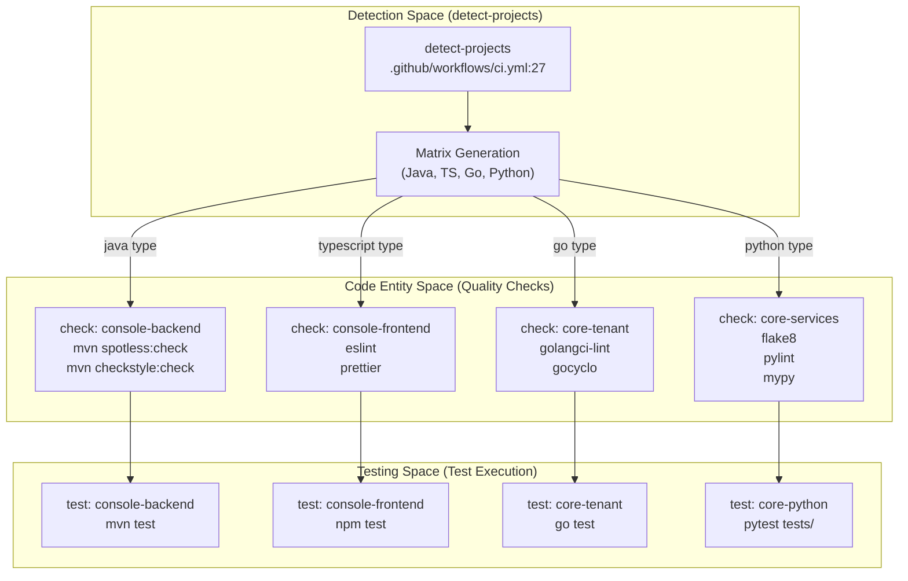
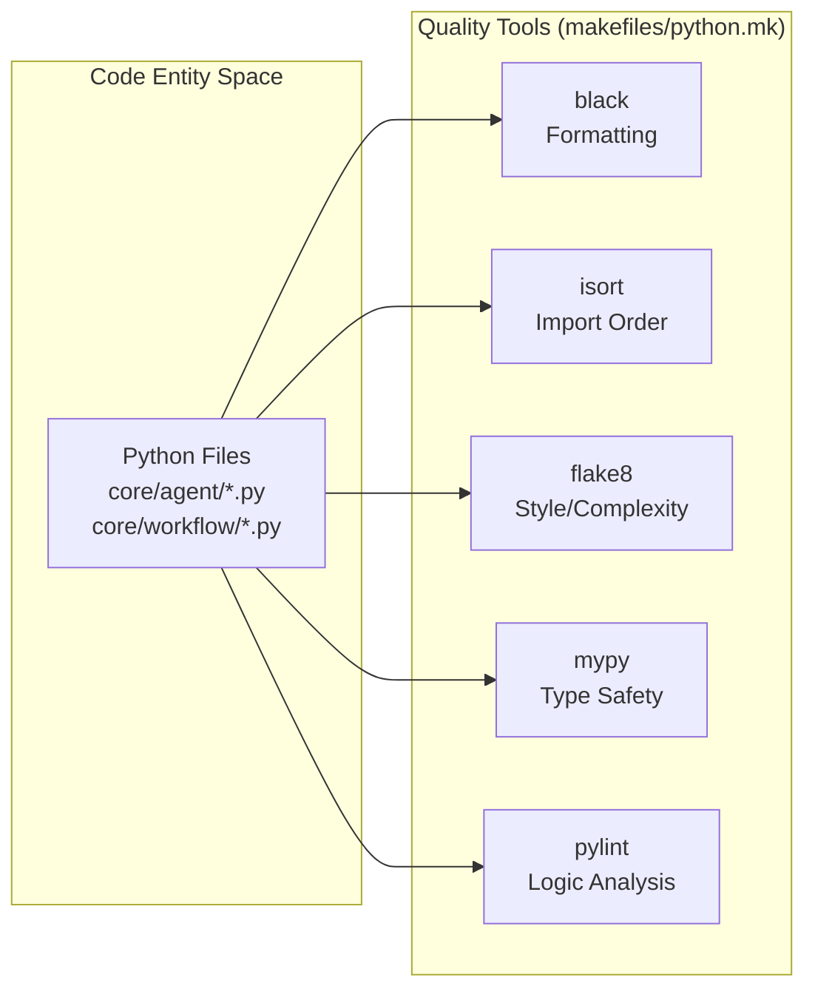
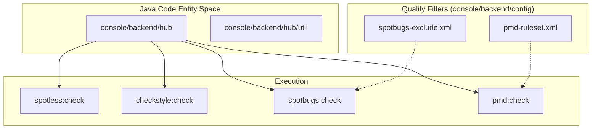

<!-- source: DeepWiki mcp.deepwiki.com · repo iflytek/astron-agent · page 12.3 Code Quality and Testing · fetched 2026-10-27 -->

# Code Quality and Testing

Relevant source files

The following files were used as context for generating this wiki page:

- [.github/ISSUE_TEMPLATE/bug_report.yml](.github/ISSUE_TEMPLATE/bug_report.yml)
- [.github/ISSUE_TEMPLATE/config.yml](.github/ISSUE_TEMPLATE/config.yml)
- [.github/ISSUE_TEMPLATE/feature_request.yml](.github/ISSUE_TEMPLATE/feature_request.yml)
- [.github/ISSUE_TEMPLATE/general_issue.yml](.github/ISSUE_TEMPLATE/general_issue.yml)
- [.github/workflows/build-push.yml](.github/workflows/build-push.yml)
- [.github/workflows/ci.yml](.github/workflows/ci.yml)
- [.github/workflows/release.yml](.github/workflows/release.yml)
- [.pre-commit-config.yaml](.pre-commit-config.yaml)
- [console/backend/config/pmd-ruleset.xml](console/backend/config/pmd-ruleset.xml)
- [console/backend/config/spotbugs-exclude.xml](console/backend/config/spotbugs-exclude.xml)
- [console/backend/hub/src/main/java/com/iflytek/astron/console/hub/config/WebMvcConfig.java](console/backend/hub/src/main/java/com/iflytek/astron/console/hub/config/WebMvcConfig.java)
- [console/backend/hub/src/main/java/com/iflytek/astron/console/hub/util/Md5Util.java](console/backend/hub/src/main/java/com/iflytek/astron/console/hub/util/Md5Util.java)
- [core/memory/database/Dockerfile](core/memory/database/Dockerfile)
- [core/workflow/extensions/middleware/utils.py](core/workflow/extensions/middleware/utils.py)
- [docker/astronAgent/config/database/config.env](docker/astronAgent/config/database/config.env)
- [docs/imgs/WeCom_Group.png](docs/imgs/WeCom_Group.png)
- [makefiles/python.mk](makefiles/python.mk)

This document describes the code quality standards, testing infrastructure, and continuous integration pipeline for the Astron Agent platform. It covers the quality tools, configuration parameters, test execution strategies, and automated checks that ensure code reliability across all services.

For information about CI/CD build and deployment workflows, see [CI/CD Pipeline Architecture](). For observability and monitoring, see [Observability and Telemetry]().

## Overview

The Astron Agent platform enforces code quality through a multi-layered approach:

- **Pre-commit hooks** for local validation before commits [[.pre-commit-config.yaml:1-18]]().
- **CI pipeline** for automated quality checks on push/pull requests [[.github/workflows/ci.yml:1-12]]().
- **Language-specific tools** tailored to Python, TypeScript, Go, and Java codebases [[.github/workflows/ci.yml:156-211]]().
- **Test automation** with coverage reporting across all services [[makefiles/python.mk:104-130]]().

The system uses a project detection matrix to identify active projects and execute appropriate quality checks in parallel, ensuring fast feedback cycles [[.github/workflows/ci.yml:27-100]]().

**Sources:** [[.github/workflows/ci.yml:1-100]](), [[.pre-commit-config.yaml:1-18]](), [[makefiles/python.mk:104-130]]()

## CI Pipeline Architecture

The CI pipeline implements a multi-stage architecture with dynamic project detection and parallel execution.

### Pipeline Stages

The following diagram illustrates the transition from the "Detection Space" (shell scripts identifying files) to the "Execution Space" (GitHub Action jobs running specific tools).

**Sources:** [[.github/workflows/ci.yml:23-100]](), [[makefiles/python.mk:65-130]]()

### Project Detection Matrix

The pipeline uses dynamic project detection to build an execution matrix based on the presence of project indicators (e.g., `pom.xml`, `package.json`, `go.mod`, `pyproject.toml`) [[.github/workflows/ci.yml:43-86]]().

| Project Type | Detection File | Matrix Name | Path | Cache Type |
|--------------|----------------|-------------|------|------------|
| Java | `console/backend/pom.xml` | `console-backend` | `console/backend` | `maven` [[.github/workflows/ci.yml:48-53]]() |
| TypeScript | `console/frontend/package.json` | `console-frontend` | `console/frontend` | `node` [[.github/workflows/ci.yml:56-61]]() |
| Go | `core/tenant/go.mod` | `core-tenant` | `core/tenant` | `go` [[.github/workflows/ci.yml:64-69]]() |
| Python | `*/pyproject.toml` | `core-*` | Multiple paths | `pip` [[.github/workflows/ci.yml:72-86]]() |

**Sources:** [[.github/workflows/ci.yml:38-100]]()

## Python Quality Standards

### Quality Tool Chain

Python services (Agent, Workflow, Knowledge, etc.) utilize a rigorous toolchain defined in the centralized Makefile module.

**Sources:** [[makefiles/python.mk:6-11]](), [[makefiles/python.mk:65-102]](), [[.pre-commit-config.yaml:42-166]]()

### Configuration Parameters

#### Black and Isort
- **Black Version:** `24.4.2` [[makefiles/python.mk:38]]()
- **Line length:** 88 characters [[makefiles/python.mk:9]]()
- **Isort Profile:** `black` to ensure compatibility [[makefiles/python.mk:8]]()

#### Flake8 and Complexity
- **Line length:** 88 characters [[makefiles/python.mk:9]]()
- **Complexity Threshold:** 10 (Cyclomatic complexity) [[makefiles/python.mk:9]]()
- **Ignored Rules:** `E203,W503,E501` to prevent conflicts with Black [[makefiles/python.mk:9]]()

#### Mypy and Pylint
- **Mypy Strictness:** `--disallow-untyped-defs --disallow-incomplete-defs` [[makefiles/python.mk:10]]()
- **Pylint Threshold:** Must score above 8.0 [[makefiles/python.mk:11]]()
- **Pylint Constraints:** Max args 7, max locals 15, max returns 6 [[makefiles/python.mk:11]]()

**Sources:** [[makefiles/python.mk:6-11]](), [[.pre-commit-config.yaml:42-166]]()

## TypeScript Quality Standards

### Quality Tool Chain

The frontend quality checks ensure UI stability and code consistency.

- **Prettier:** Checks format compliance for `ts`, `tsx`, `js`, `jsx`, `json`, and `md` files [[.github/workflows/ci.yml:173]]().
- **TypeScript (TSC):** Runs `tsc --noEmit` to perform full type checking without generating output [[.github/workflows/ci.yml:181]]().
- **ESLint:** Targets `**/*.{ts,tsx}` with the `--quiet` flag to fail the build only on errors [[.github/workflows/ci.yml:183]]().

**Sources:** [[.github/workflows/ci.yml:169-183]]()

## Go Quality Standards

### Tool Specifications

| Tool | Flag/Threshold | Purpose |
|------|--------------|---------|
| `goimports` | N/A | Import organization [[makefiles/go.mk:39]]() |
| `gocyclo` | `-over 10` | Cyclomatic complexity threshold [[makefiles/go.mk:87]]() |
| `staticcheck` | `2025.1.1` | Advanced static analysis [[makefiles/go.mk:43]]() |
| `golangci-lint` | `v2.5.0` | Comprehensive meta-linting [[makefiles/go.mk:44]]() |

**Target Service:** Multi-tenancy service at `core/tenant` [[.github/workflows/ci.yml:64-69]]().

**Sources:** [[makefiles/go.mk:36-108]](), [[.github/workflows/ci.yml:185-211]]()

## Java Quality Standards

### Maven Quality Pipeline

The Java quality checks execute sequentially within the `console/backend` project using Maven plugins. The configuration includes specific rulesets and filters for deep analysis.

1. **Spotless:** `mvn spotless:check` enforces Google Java Format [[makefiles/java.mk:71]]().
2. **Checkstyle:** `mvn checkstyle:check` verifies style compliance [[makefiles/java.mk:73]]().
3. **SpotBugs:** `mvn spotbugs:check` detects potential software bugs [[makefiles/java.mk:75]](). It uses `spotbugs-exclude.xml` to filter low-value alarms like `NM_CONFUSING` or `EI_EXPOSE_REP` [[console/backend/config/spotbugs-exclude.xml:19-45]]().
4. **PMD:** `mvn pmd:check` analyzes code for flaws [[makefiles/java.mk:77]](). It uses a custom ruleset defining a cyclomatic complexity threshold of 23 for methods [[console/backend/config/pmd-ruleset.xml:11-17]]() and a parameter list limit of 10 [[console/backend/config/pmd-ruleset.xml:28-32]]().

**Sources:** [[makefiles/java.mk:61-86]](), [[.github/workflows/ci.yml:157-168]](), [[console/backend/config/spotbugs-exclude.xml:1-154]](), [[console/backend/config/pmd-ruleset.xml:1-33]]()

## Test Execution and Coverage

### Test Infrastructure

The platform uses language-native testing frameworks integrated into the build system.

- **Python Testing:** Uses `pytest` for execution and `pytest-cov` for coverage reporting [[makefiles/python.mk:43-44]](). Tests are expected in the `tests/` directory of each service [[makefiles/python.mk:111]](). For projects with `uv.lock`, it uses `uv run python -m pytest` [[makefiles/python.mk:116]]().
- **Java Testing:** Uses standard Maven test lifecycle (`mvn test`) [[makefiles/java.mk:94]]().
- **Go Testing:** Executes `go test ./...` with the `-v` flag for verbose output [[makefiles/go.mk:117]]().
- **Coverage Artifacts:** The system is configured to ignore coverage files in version control, including `*.cover`, `coverage.html`, `coverage.xml`, and `.coverage` [[.gitignore:193-240]]().

**Sources:** [[makefiles/python.mk:104-130]](), [[makefiles/java.mk:88-103]](), [[makefiles/go.mk:110-125]](), [[.gitignore:193-240]]()

## Pre-commit Hook System

Local quality checks are managed via `.pre-commit-config.yaml` to ensure code meets standards before reaching the repository. This system is designed for "Check Only" mode, reporting issues without auto-fixing to prevent unexpected changes during commit [[.pre-commit-config.yaml:12]]().

- **Global Checks:** YAML/JSON validation and large file detection [[.pre-commit-config.yaml:28-38]]().
- **Python Hooks:** Module-specific `isort`, `flake8`, `mypy`, and `pylint` hooks for `core/agent`, `core/workflow`, `core/knowledge`, `core/plugin`, and `core/memory/database` [[.pre-commit-config.yaml:42-166]]().
- **Frontend Hooks:** Prettier and ESLint checks for the `console/frontend` [[.pre-commit-config.yaml:216-230]]().
- **Go Hooks:** `golangci-lint`, `gofmt`, and `go-vet` for the `core/tenant` service [[.pre-commit-config.yaml:240-276]]().
- **Java Hooks:** `spotless-check` and `checkstyle` for the `console/backend` [[.pre-commit-config.yaml:281-291]]().

**Sources:** [[.pre-commit-config.yaml:1-313]]()

---

